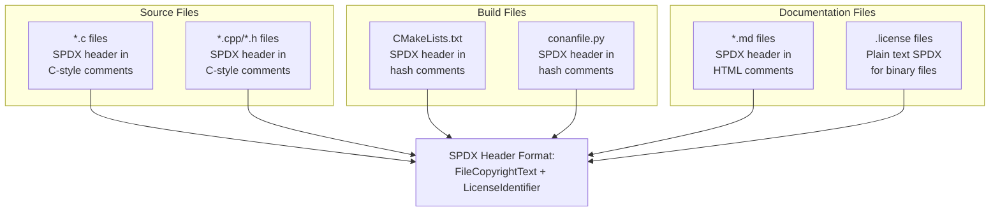
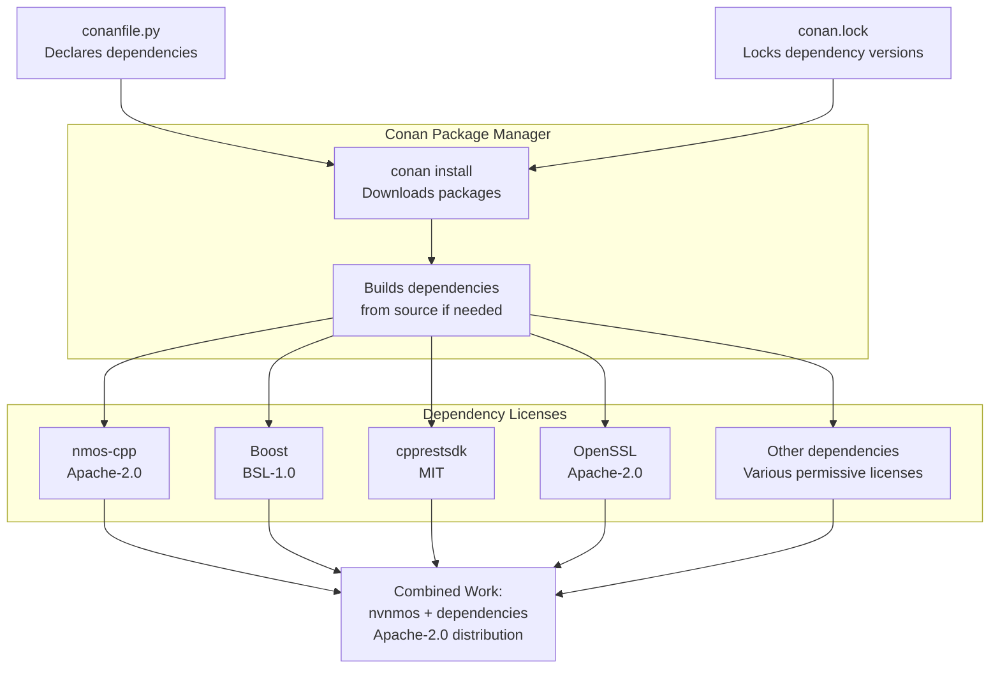
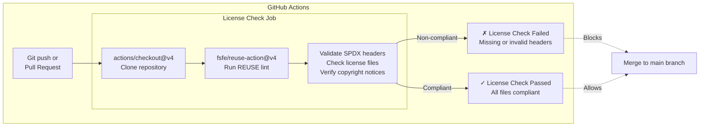

<!-- source: DeepWiki mcp.deepwiki.com · repo NVIDIA/nvnmos · page 8.3 License and Copyright · fetched 2026-10-26 -->

# License and Copyright

<details>
<summary>Relevant source files</summary>

The following files were used as context for generating this wiki page:

- [LICENSE](LICENSE)
- [src/conan.lock.license](src/conan.lock.license)

</details>


This page documents the licensing terms, copyright information, and license compliance practices for the nvnmos project. It covers the main project license, copyright ownership, SPDX compliance headers, third-party dependency licenses, and the automated license checking process.

For information about contributing code to the project, see [Development](#8). For details about the CI/CD pipeline that enforces license compliance, see [CI/CD Pipeline](#8.1).

## License Overview

The nvnmos library is licensed under the **Apache License, Version 2.0**. This is a permissive open-source license that allows users to:

- Use the software for any purpose (commercial or non-commercial)
- Modify and create derivative works
- Distribute original or modified versions
- Sublicense to third parties
- Grant patent rights for contributions

The full license text is located at [LICENSE:1-203]() in the repository root.

**Key License Requirements:**

| Requirement | Description |
|-------------|-------------|
| **License Notice** | Redistributions must include a copy of the Apache 2.0 license |
| **Copyright Notice** | Copyright notices must be retained in source distributions |
| **State Changes** | Modified files must carry notices stating the changes |
| **Attribution** | Attribution notices from the original work must be preserved |
| **No Trademark Rights** | License does not grant rights to use NVIDIA trademarks |

**Warranty Disclaimer:**

The software is provided "AS IS" without warranties of any kind, as stated in [LICENSE:144-152](). Users assume all risks associated with using the software.

**Sources:** [LICENSE:1-203]()

---

## Copyright Notice

All original source code in the nvnmos repository is copyrighted by:

```
Copyright (C) 2024 NVIDIA CORPORATION & AFFILIATES. All rights reserved.
```

This copyright applies to all files authored by NVIDIA as part of the nvnmos project, including:

- Source code files (`.c`, `.cpp`, `.h`)
- Build configuration files (`CMakeLists.txt`, `conanfile.py`)
- Documentation files
- Configuration files

**Sources:** [src/conan.lock.license:1](), [LICENSE:190]()

---

## SPDX Compliance

The nvnmos project uses **SPDX** (Software Package Data Exchange) headers to clearly identify the license and copyright for each file. SPDX is an industry-standard format for communicating license information.

### SPDX Header Format

Every source file in the project contains a standardized SPDX header at the beginning:

```
SPDX-FileCopyrightText: Copyright (C) 2024 NVIDIA CORPORATION & AFFILIATES. All rights reserved.
SPDX-License-Identifier: Apache-2.0
```

This two-line format provides:
- **SPDX-FileCopyrightText:** Copyright ownership and year
- **SPDX-License-Identifier:** License identifier from the SPDX License List

### License Identifier

The SPDX identifier `Apache-2.0` is the standardized short identifier for the Apache License, Version 2.0. This identifier is recognized by automated license scanning tools and package managers.

**SPDX Header Locations:**



**Diagram:** SPDX header locations across different file types in the nvnmos repository

**Sources:** [src/conan.lock.license:1-3](), [LICENSE:179-189]()

---

## Third-Party Dependencies

The nvnmos library depends on several third-party open-source libraries, each with its own license. These dependencies are managed through Conan (see [Dependency Management with Conan](#6.3)).

### Primary Dependencies

| Dependency | License | Purpose |
|------------|---------|---------|
| **nmos-cpp** | Apache-2.0 | NMOS protocol implementation (IS-04, IS-05, IS-09) |
| **Boost** | BSL-1.0 | C++ utility libraries |
| **cpprestsdk** | MIT | HTTP/REST client and server |
| **WebSocket++** | BSD-3-Clause | WebSocket protocol implementation |
| **OpenSSL** | Apache-2.0 | TLS/SSL cryptography |
| **nlohmann_json** | MIT | JSON parsing and serialization |
| **jwt-cpp** | MIT | JSON Web Token implementation |

### License Compatibility

All third-party dependencies use permissive open-source licenses (Apache-2.0, MIT, BSD, BSL-1.0) that are compatible with nvnmos's Apache-2.0 license. This allows:

- Distribution of nvnmos with all its dependencies
- Creation of derivative works combining nvnmos with dependencies
- Commercial use without additional license obligations

### Dependency License Management



**Diagram:** Dependency license management through Conan package manager

**Sources:** [src/conan.lock.license:1-3]()

---

## License Compliance Checking

The nvnmos project uses automated tools to ensure license compliance throughout the development lifecycle.

### REUSE Compliance

The project follows the **REUSE** specification (https://reuse.software), which defines best practices for declaring copyright and licensing information in software projects. REUSE compliance ensures:

- Every file has clear copyright and license information
- License texts are available in the repository
- Licensing information is machine-readable

### CI/CD License Validation

The GitHub Actions CI/CD pipeline includes a dedicated license compliance check job that runs on every commit and pull request.

**License Check Workflow:**



**Diagram:** Automated license compliance checking workflow in CI/CD pipeline

The license check job validates:
- All source files have proper SPDX headers
- Binary files have corresponding `.license` sidecar files
- License texts are present in the `LICENSES/` directory
- Copyright statements are properly formatted
- No files are missing license information

**Sources:** [src/conan.lock.license:1-3](), [LICENSE:1-203]()

---

## Adding License Headers to New Files

When contributing new files to the nvnmos project, you must include the appropriate SPDX header.

### Source Code Files (C/C++)

Add the following header at the top of `.c`, `.cpp`, and `.h` files:

```c
/*
 * SPDX-FileCopyrightText: Copyright (C) 2024 NVIDIA CORPORATION & AFFILIATES. All rights reserved.
 * SPDX-License-Identifier: Apache-2.0
 */
```

### CMake and Python Files

Add the following header at the top of `CMakeLists.txt` and `.py` files:

```cmake
# SPDX-FileCopyrightText: Copyright (C) 2024 NVIDIA CORPORATION & AFFILIATES. All rights reserved.
# SPDX-License-Identifier: Apache-2.0
```

### Binary or Non-Text Files

For files that cannot contain text headers (images, lock files, etc.), create a corresponding `.license` file:

**Example:** For `conan.lock`, create `conan.lock.license`:

```
SPDX-FileCopyrightText: Copyright (C) 2024 NVIDIA CORPORATION & AFFILIATES. All rights reserved.
SPDX-License-Identifier: Apache-2.0
```

**Sources:** [src/conan.lock.license:1-3]()

---

## Redistribution and Derivative Works

When redistributing the nvnmos library or creating derivative works, you must comply with the Apache 2.0 license requirements.

### Requirements for Redistribution

| Requirement | Binary Distribution | Source Distribution |
|-------------|---------------------|---------------------|
| **Include License** | ✓ Include copy of [LICENSE]() | ✓ Include copy of [LICENSE]() |
| **Preserve Copyright** | ✓ Include copyright notices | ✓ Preserve copyright in source files |
| **State Changes** | N/A | ✓ Mark modified files with change notices |
| **Include NOTICE** | ✓ If NOTICE file exists | ✓ If NOTICE file exists |

### Derivative Works

If you modify nvnmos source code:

1. **Retain Original Headers:** Keep the NVIDIA copyright and Apache-2.0 license identifier
2. **Add Change Notice:** Document your modifications in the file
3. **Optional: Add Your Copyright:** You may add your own copyright for your modifications
4. **Maintain License:** Your derivative work must also be Apache-2.0 or compatible

**Example of Modified File Header:**

```c
/*
 * SPDX-FileCopyrightText: Copyright (C) 2024 NVIDIA CORPORATION & AFFILIATES. All rights reserved.
 * SPDX-FileCopyrightText: Copyright (C) 2024 Your Company Name
 * SPDX-License-Identifier: Apache-2.0
 * 
 * Modified by Your Company Name on 2024-XX-XX:
 * - Description of changes made
 */
```

### Patent Grant

The Apache 2.0 license includes an express grant of patent rights from contributors to users, as specified in [LICENSE:74-88](). This grant:

- Applies to patent claims necessarily infringed by the contribution
- Is perpetual, worldwide, non-exclusive, and royalty-free
- Terminates if you initiate patent litigation against the Work

**Sources:** [LICENSE:90-129](), [LICENSE:74-88]()

---

## License Summary

| Aspect | Details |
|--------|---------|
| **Project License** | Apache License, Version 2.0 |
| **Copyright Holder** | NVIDIA CORPORATION & AFFILIATES |
| **Copyright Year** | 2024 |
| **License File** | [LICENSE]() in repository root |
| **SPDX Identifier** | `Apache-2.0` |
| **Compliance Standard** | REUSE 3.0 specification |
| **Dependency Licenses** | Apache-2.0, MIT, BSD-3-Clause, BSL-1.0 (all permissive) |
| **Commercial Use** | ✓ Allowed |
| **Modification** | ✓ Allowed (with proper notices) |
| **Distribution** | ✓ Allowed (with license copy) |
| **Patent Grant** | ✓ Included |
| **Warranty** | ✗ None (AS IS) |
| **Trademark Rights** | ✗ Not granted |

**Sources:** [LICENSE:1-203](), [src/conan.lock.license:1-3]()

---

