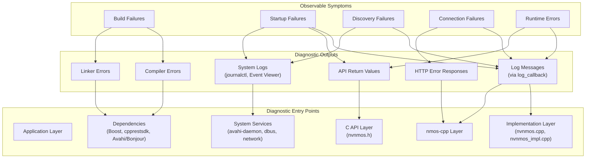
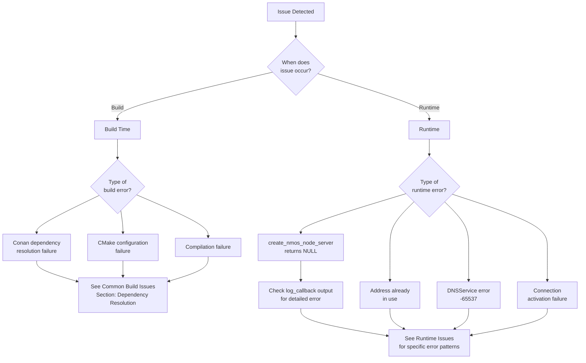
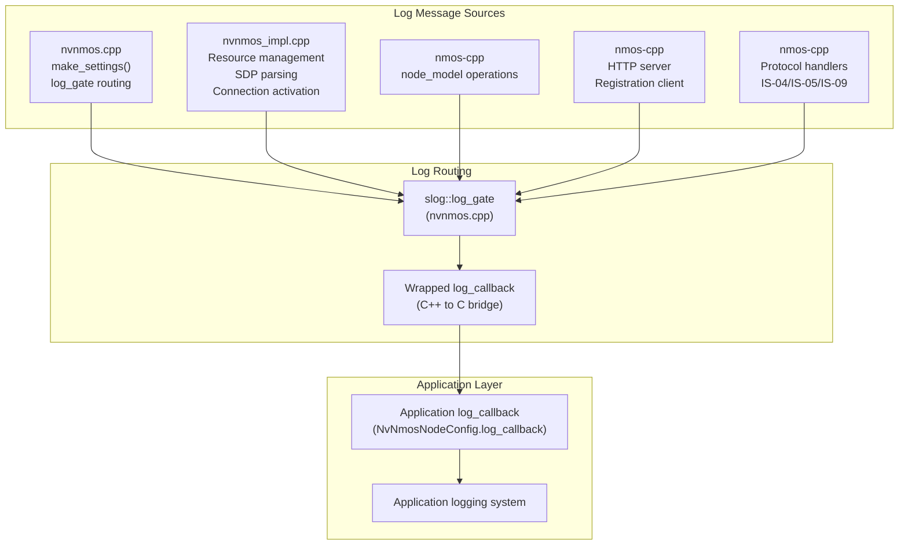
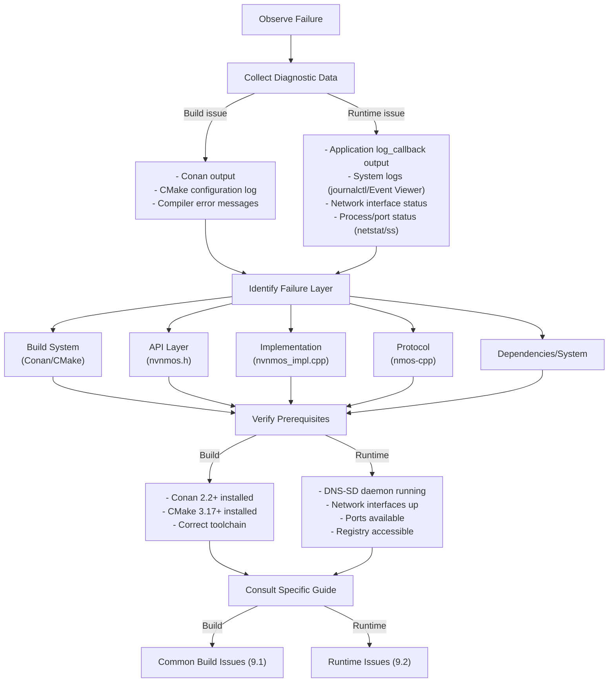
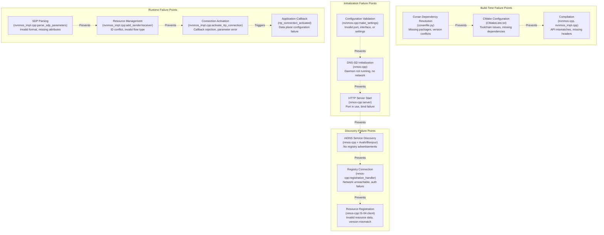

<!-- source: DeepWiki mcp.deepwiki.com · repo NVIDIA/nvnmos · page 9 Troubleshooting · fetched 2026-10-26 -->

# Troubleshooting

<details>
<summary>Relevant source files</summary>

The following files were used as context for generating this wiki page:

- [README.md](README.md)
- [entrypoint.sh](entrypoint.sh)

</details>


This document provides a systematic approach to diagnosing and resolving issues with the NvNmos library. It covers general troubleshooting methodology, diagnostic tools, log interpretation, and common failure modes across the system's architecture.

For detailed guidance on specific categories of issues, see:
- [Common Build Issues](#9.1) - Dependency resolution, CMake configuration, and Conan-related problems
- [Runtime Issues](#9.2) - DNS-SD failures, port conflicts, connection activation errors, and registry communication problems

## Diagnostic Framework

NvNmos operates as a multi-layered system with several potential failure points. Systematic diagnosis requires understanding where in the stack the failure occurs and what diagnostic information is available at that layer.

### System Layer Diagnostic Map



**Sources:** [README.md:340-382]()

### Troubleshooting Decision Tree



**Sources:** [README.md:340-382]()

## Log Message Interpretation

The NvNmos library routes all internal log messages through the application-provided `log_callback` function. Understanding the structure and sources of these messages is essential for effective troubleshooting.

### Log Callback Architecture



**Sources:** [README.md:310-311](), Architecture diagrams

### Log Level Semantics

| Log Level Range | Severity | Typical Sources | When to Investigate |
|-----------------|----------|-----------------|---------------------|
| > 0 | Warnings and Errors | API validation failures, network errors, resource conflicts | Always - indicates a problem |
| 0 | Informational | Node lifecycle events, registration success | When diagnosing flow |
| -10 to -1 | Debug | Resource creation, connection state changes | When tracing operations |
| < -10 | Trace | HTTP requests/responses, protocol details | When deep debugging |

**Sources:** [README.md:310-312]()

### Common Log Message Patterns

| Log Pattern | Source | Meaning | Resolution |
|-------------|--------|---------|------------|
| `asio listen error: system:98` | nmos-cpp HTTP server | Port already in use | Use different port in `NvNmosNodeConfig.port` |
| `DNSServiceRegister reported error: -65537` | nmos-cpp DNS-SD integration | DNS-SD daemon not running | Start `avahi-daemon` (Linux) or Bonjour Service (Windows) |
| `DNSServiceBrowse reported error: -65537` | nmos-cpp DNS-SD integration | Cannot discover registries | Check DNS-SD daemon status |
| `*** WARNING *** uses the Apple Bonjour compatibility layer` | Avahi compatibility layer | Informational only | Safe to ignore |
| `Failed to parse SDP` | nvnmos_impl.cpp SDP processing | Invalid SDP format | Validate SDP against SMPTE ST 2110 specifications |
| `Connection activation callback returned false` | nvnmos_impl.cpp activation handler | Application rejected activation | Check application's `rtp_connection_activated` implementation |

**Sources:** [README.md:342-382]()

## Diagnostic Methodology

### Step-by-Step Diagnostic Process



**Sources:** [README.md:93-382]()

### Enabling Verbose Logging

To obtain detailed diagnostic information, configure the log level when creating the node server:

**Via NvNmosNodeConfig:**
```c
NvNmosNodeConfig config;
// ... other configuration
config.log_level = -40;  // Maximum verbosity
```

**In nvnmos-example:**
```sh
# Fourth argument sets log level
nvnmos-example nmos-api.local 8080 192.0.2.0 -40
```

Verbose logging (`log_level < 0`) produces output including:
- HTTP request/response details
- DNS-SD service discovery events
- Resource creation and modification
- Connection state transitions
- SDP parsing details
- Protocol-level interactions

**Sources:** [README.md:310-312]()

## System Health Verification

### Quick Health Check Commands

**Linux:**
```sh
# Check if Avahi daemon is running
systemctl status avahi-daemon

# Check if D-Bus is running
systemctl status dbus

# Verify network interfaces
ip addr show

# Check for port conflicts
ss -tulpn | grep <port>

# View system logs
journalctl -u avahi-daemon -f
```

**Windows:**
```powershell
# Check if Bonjour Service is running
Get-Service | Where-Object {$_.Name -like "*Bonjour*"}

# Check for port conflicts
netstat -ano | findstr <port>

# View event logs
Get-EventLog -LogName Application -Source Bonjour -Newest 50
```

**Sources:** [README.md:269-290](), [entrypoint.sh:20-24]()

### API Return Value Analysis

All NvNmos C API functions that can fail return indicators of success or failure:

| Function | Success Return | Failure Return | Common Failure Causes |
|----------|----------------|----------------|----------------------|
| `create_nmos_node_server` | Non-NULL pointer | NULL | Invalid config, port conflict, DNS-SD unavailable |
| `add_nmos_sender_to_node_server` | true | false | Invalid SDP, resource ID conflict |
| `add_nmos_receiver_to_node_server` | true | false | Invalid SDP, resource ID conflict |
| `nmos_connection_rtp_activate` | true | false | Invalid connection ID, malformed parameters |
| `remove_nmos_*_from_node_server` | true | false | Resource ID not found |

When an API function fails, detailed error information is available through the `log_callback` mechanism. Always check both the return value and log output when diagnosing failures.

**Sources:** Architecture diagrams, API design patterns

## Common Failure Point Architecture



**Sources:** [README.md:340-382](), Architecture diagrams

## Environment-Specific Considerations

### Docker Environments

When running NvNmos in containers, additional failure modes exist:

- **D-Bus socket access**: Container must have access to D-Bus system socket
- **Network mode**: Host networking may be required for mDNS functionality
- **Service startup**: DNS-SD daemon must start before application

Reference: [entrypoint.sh:20-30]()

### Multi-Interface Systems

Systems with multiple network interfaces require careful configuration:

- Specify the correct interface IP address in `NvNmosNodeConfig`
- Ensure the interface has connectivity to the NMOS Registry
- Verify that mDNS advertisements use the correct interface

## Gathering Support Information

When requesting assistance, include:

1. **Version Information**
   - NvNmos build version and commit hash
   - Operating system and version
   - Compiler version (GCC/MSVC)

2. **Configuration**
   - Relevant fields from `NvNmosNodeConfig`
   - Network topology and interface configuration
   - DNS-SD daemon version

3. **Diagnostic Output**
   - Complete log output with `log_level = -40`
   - Return values from failed API calls
   - System service status

4. **Minimal Reproduction**
   - Simplified configuration that reproduces the issue
   - Steps to trigger the failure
   - Expected vs. actual behavior

## Related Documentation

- [Common Build Issues](#9.1) - Detailed troubleshooting for dependency, CMake, and compilation problems
- [Runtime Issues](#9.2) - Specific solutions for DNS-SD, networking, and connection activation failures
- [API Reference](#4) - Complete API documentation for understanding function contracts
- [Integration Guide](#7) - Guidance on proper integration patterns to avoid common pitfalls

---

