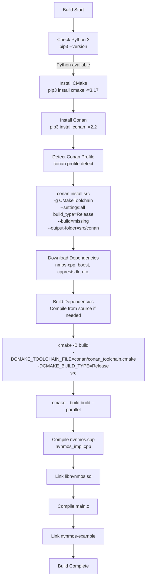
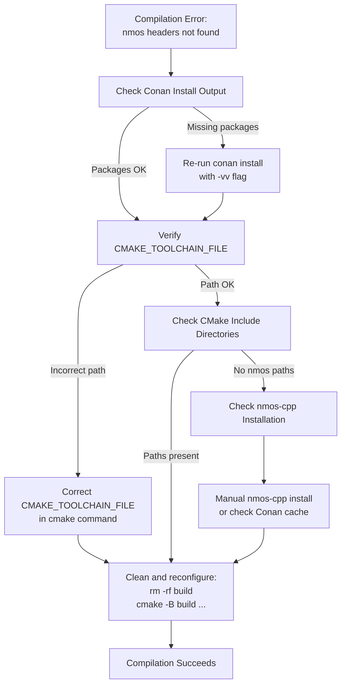
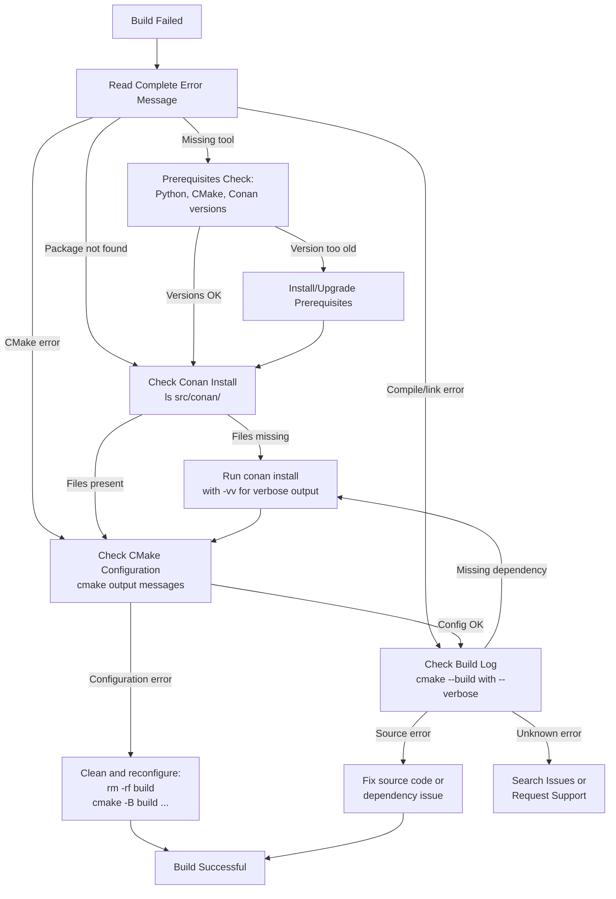

<!-- source: DeepWiki mcp.deepwiki.com · repo NVIDIA/nvnmos · page 9.1 Common Build Issues · fetched 2026-10-26 -->

# Common Build Issues

<details>
<summary>Relevant source files</summary>

The following files were used as context for generating this wiki page:

- [README.md](README.md)
- [src/CMakeLists.txt](src/CMakeLists.txt)
- [src/conanfile.py](src/conanfile.py)

</details>


This page provides troubleshooting guidance for build errors encountered when compiling the nvnmos library and its dependencies. It focuses on issues related to CMake configuration, Conan package management, and platform-specific build problems.

For runtime issues such as DNS-SD failures, port conflicts, or connection errors, see [Runtime Issues](#9.2). For general build instructions, see [Building from Source](#2.1).

---

## Build Process Overview

Understanding the build pipeline helps diagnose where errors occur. The following diagram shows the complete build dependency chain with the actual commands and files involved:

**Build Process Flow**



**Sources:** [README.md:93-268](), [src/CMakeLists.txt:1-145](), [src/conanfile.py:1-25]()

---

## Prerequisites Issues

### CMake Version Mismatch

**Problem:** The build fails with an error indicating CMake version is too old.

**Error Message:**
```
CMake Error at CMakeLists.txt:23 (cmake_minimum_required):
  CMake 3.17 or higher is required.  You are running version 3.10.2
```

**Solution:**

The nvnmos library requires CMake 3.17 or higher as specified in [src/CMakeLists.txt:23](). System-provided CMake on some platforms (e.g., Jetson with Ubuntu 18.04) is version 3.10, which is insufficient.

Install CMake via pip3:
```sh
pip3 install cmake~=3.17
```

Verify the installation:
```sh
cmake --version
```

On Linux, if the newly installed CMake is not in your `PATH`, add the user binary directory:
```sh
export PATH=/home/<userid>/.local/bin:${PATH}
```

**Sources:** [README.md:129-156](), [src/CMakeLists.txt:17-24]()

---

### Conan Version or Profile Issues

**Problem:** Conan installation fails or reports version incompatibility.

**Error Messages:**
```
ERROR: Conan version 2.2 or higher required
ERROR: Conan profile not detected
```

**Solution:**

Install Conan 2.2 or higher (version 2.5.0 has been tested):
```sh
pip3 install conan~=2.2 --upgrade
```

After installation, detect the default profile:
```sh
conan profile detect
```

This creates a profile at `~/.conan2/profiles/default` (Linux) or `%USERPROFILE%\.conan2\profiles\default` (Windows) with auto-detected compiler settings.

If you have both Python 2 and Python 3 installed, ensure you're using `pip3`:
```sh
pip3 install conan~=2.2 --upgrade
```

**Verification:**

Check the Conan version:
```sh
conan --version
```

List available profiles:
```sh
conan profile list
```

**Sources:** [README.md:158-183](), [src/conanfile.py:20-21]()

---

## Dependency Resolution Issues

### Missing System Dependencies for Building

**Problem:** Conan fails to build dependencies from source with compiler or library errors.

**Error Messages:**
```
ERROR: openssl/3.x.x: Error in build() method
fatal error: zlib.h: No such file or directory
```

**Cause:** Some Conan packages build from source and require system development libraries.

**Solution for Linux:**

Install essential build tools and libraries:
```sh
sudo apt update
sudo apt install -y build-essential pkg-config libssl-dev zlib1g-dev
```

For multimedia dependencies required by nmos-cpp:
```sh
sudo apt install -y libavahi-client-dev
```

**Solution for Windows:**

Ensure Visual Studio 2022 is installed with the C++ development workload. The Windows SDK should be included.

**Sources:** [README.md:48-50](), [README.md:270-281]()

---

### Conan Lock File Conflicts

**Problem:** Build uses different dependency versions than expected, or `conan install` fails with version conflicts.

**Error Messages:**
```
ERROR: Version conflict: nmos-cpp/cci.20240223 conflicts with locked nmos-cpp/cci.20230101
```

**Cause:** The repository includes a `conan.lock` file to ensure reproducible builds. If you've modified dependencies or are using a different Conan configuration, conflicts may occur.

**Solutions:**

**Option 1: Use the lock file (recommended for reproducibility)**

Ensure you're using the lock file during install:
```sh
conan install src \
  --lockfile=src/conan.lock \
  -g CMakeToolchain \
  --settings:all build_type=Release \
  --build=missing \
  --output-folder=src/conan
```

**Option 2: Ignore the lock file (for development)**

Remove or ignore the lock file:
```sh
conan install src \
  -g CMakeToolchain \
  --settings:all build_type=Release \
  --build=missing \
  --output-folder=src/conan
```

**Option 3: Update the lock file**

Generate a new lock file with current versions:
```sh
conan lock create src/conanfile.py \
  --settings:all build_type=Release \
  --lockfile-out=src/conan.lock
```

**Sources:** [README.md:89]()

---

### nmos-cpp Dependency Not Found

**Problem:** CMake cannot find the nmos-cpp package.

**Error Message:**
```
CMake Error at CMakeLists.txt:46 (find_package):
  Could not find a package configuration file provided by "nmos-cpp"
```

**Cause:** The `conan install` step did not complete successfully, or the toolchain file is not specified correctly.

**Diagnosis:**

Check if Conan created the necessary files:
```sh
ls src/conan/
```

You should see files like:
- `conan_toolchain.cmake`
- `nmos-cppConfig.cmake`
- Various `.cmake` files for dependencies

**Solution:**

1. Re-run the `conan install` command with verbose output:
```sh
conan install src \
  -g CMakeToolchain \
  --settings:all build_type=Release \
  --build=missing \
  --output-folder=src/conan \
  -vv
```

2. Verify the toolchain file is specified in the CMake configure step:
```sh
cmake -B build \
  -DCMAKE_TOOLCHAIN_FILE=conan/conan_toolchain.cmake \
  -DCMAKE_BUILD_TYPE=Release \
  src
```

3. If using Visual Studio generator on Windows, ensure you're not specifying conflicting generators:
```sh
cmake -B build \
  -G "Visual Studio 17 2022" \
  -DCMAKE_TOOLCHAIN_FILE=conan/conan_toolchain.cmake \
  src
```

**Sources:** [README.md:195-206](), [README.md:240-258](), [src/CMakeLists.txt:36-52]()

---

## CMake Configuration Issues

### Build Type Mismatch

**Problem:** Linker errors occur when building or linking fails with undefined symbols.

**Error Messages:**
```
undefined reference to `nmos::make_node_api(...)`
```

**Cause:** Debug and Release builds of dependencies are not compatible. If you ran `conan install` with `build_type=Release` but configure CMake with `CMAKE_BUILD_TYPE=Debug`, the linker will fail.

**Solution:**

Ensure consistency between Conan and CMake build types:

**For Release builds:**
```sh
conan install src \
  --settings:all build_type=Release \
  --build=missing \
  --output-folder=src/conan

cmake -B build \
  -DCMAKE_TOOLCHAIN_FILE=conan/conan_toolchain.cmake \
  -DCMAKE_BUILD_TYPE=Release \
  src
```

**For Debug builds:**
```sh
conan install src \
  --settings:all build_type=Debug \
  --build=missing \
  --output-folder=src/conan

cmake -B build \
  -DCMAKE_TOOLCHAIN_FILE=conan/conan_toolchain.cmake \
  -DCMAKE_BUILD_TYPE=Debug \
  src
```

**On Windows (Multi-Config):**

You can install both Debug and Release dependencies:
```sh
conan install src --settings:all build_type=Release --output-folder=src/conan
conan install src --settings:all build_type=Debug --output-folder=src/conan
```

Then configure with:
```sh
cmake -B build \
  -G "Visual Studio 17 2022" \
  -DCMAKE_TOOLCHAIN_FILE=conan/conan_toolchain.cmake \
  -DCMAKE_CONFIGURATION_TYPES="Debug;Release" \
  src
```

**Sources:** [README.md:195-267](), [src/CMakeLists.txt:80-100]()

---

### Toolchain File Not Found

**Problem:** CMake reports it cannot find the toolchain file.

**Error Message:**
```
CMake Error: Error processing file: conan/conan_toolchain.cmake
```

**Cause:** The path to `conan_toolchain.cmake` is relative to the source directory, not the build directory.

**Solution:**

The correct path depends on your current working directory. If you're in the repository root:

```sh
cmake -B build \
  -DCMAKE_TOOLCHAIN_FILE=src/conan/conan_toolchain.cmake \
  -DCMAKE_BUILD_TYPE=Release \
  src
```

However, the recommended approach in the README assumes the working directory is the repository root and uses a relative path from inside the `src` directory:

```sh
cmake -B build \
  -DCMAKE_TOOLCHAIN_FILE=conan/conan_toolchain.cmake \
  -DCMAKE_BUILD_TYPE=Release \
  src
```

The path `conan/conan_toolchain.cmake` is relative to `src`, which is the last argument.

**Alternative:** Use an absolute path to avoid confusion:
```sh
cmake -B build \
  -DCMAKE_TOOLCHAIN_FILE=$(pwd)/src/conan/conan_toolchain.cmake \
  -DCMAKE_BUILD_TYPE=Release \
  src
```

**Sources:** [README.md:208-218](), [README.md:250-258]()

---

## Platform-Specific Issues

### Windows: Visual Studio Not Found

**Problem:** CMake cannot generate Visual Studio project files.

**Error Message:**
```
CMake Error: CMAKE_C_COMPILER not set, after EnableLanguage
```

**Cause:** Visual Studio 2022 is not installed, or the C++ workload is not selected.

**Solution:**

1. Install Visual Studio 2022 from https://visualstudio.microsoft.com/downloads/
2. During installation, select the "Desktop development with C++" workload
3. Ensure the Windows SDK is included (usually selected by default)

After installation, verify CMake can detect the compiler:
```sh
cmake -B build -G "Visual Studio 17 2022" src
```

**Sources:** [README.md:48-50](), [README.md:252-258]()

---

### Windows: PowerShell Line Continuation

**Problem:** Commands fail when copied from documentation.

**Cause:** The backtick (`` ` ``) is PowerShell's line continuation character. In Command Prompt, use `^` instead.

**Solution:**

**PowerShell:**
```powershell
conan install src `
  -g CMakeToolchain `
  --settings:all build_type=Release `
  --build=missing `
  --output-folder=src/conan
```

**Command Prompt (cmd.exe):**
```cmd
conan install src ^
  -g CMakeToolchain ^
  --settings:all build_type=Release ^
  --build=missing ^
  --output-folder=src/conan
```

**Sources:** [README.md:237-246]()

---

### Linux: Permission Denied for CMake/Conan Binaries

**Problem:** Commands report "permission denied" or "command not found" after installing CMake or Conan via pip3.

**Cause:** User-installed binaries are placed in `~/.local/bin` which may not be in the `PATH`.

**Solution:**

Add the user binary directory to your `PATH`:
```sh
export PATH=/home/<userid>/.local/bin:${PATH}
```

To make this permanent, add the line to your `~/.bashrc` or `~/.profile`:
```sh
echo 'export PATH=/home/$USER/.local/bin:${PATH}' >> ~/.bashrc
source ~/.bashrc
```

**Verification:**
```sh
which cmake
which conan
```

Both should show paths in `/home/<userid>/.local/bin/`.

**Sources:** [README.md:138-150](), [README.md:171-172]()

---

## Compilation Errors

### Missing Header Files

**Problem:** Compilation fails with "file not found" errors for nmos-cpp headers.

**Error Messages:**
```
fatal error: nmos/node_api.h: No such file or directory
fatal error: nmos/model.h: No such file or directory
```

**Cause:** The nmos-cpp package was not properly installed or found by CMake.

**Diagnosis and Solution Flow:**



**Steps:**

1. Verify Conan installed nmos-cpp:
```sh
conan list nmos-cpp
```

2. Check the CMake cache for nmos-cpp:
```sh
grep -i nmos-cpp build/CMakeCache.txt
```

3. Inspect the generated `nmos-cppConfig.cmake`:
```sh
cat src/conan/nmos-cppConfig.cmake
```

4. Clean and rebuild:
```sh
rm -rf build
conan install src --settings:all build_type=Release --build=missing --output-folder=src/conan
cmake -B build -DCMAKE_TOOLCHAIN_FILE=conan/conan_toolchain.cmake -DCMAKE_BUILD_TYPE=Release src
cmake --build build --parallel
```

**Sources:** [src/CMakeLists.txt:36-52](), [src/conanfile.py:23-24]()

---

### Linker Errors with Boost or cpprestsdk

**Problem:** Linking fails with undefined references to Boost or cpprestsdk symbols.

**Error Messages:**
```
undefined reference to `boost::system::system_category()'
undefined reference to `web::json::value::as_object()'
```

**Cause:** These are transitive dependencies of nmos-cpp. The issue typically occurs when:
1. Build type mismatch (Debug vs Release)
2. Incomplete Conan installation
3. Static/shared library mismatch

**Solution:**

1. Ensure consistent build types (see [Build Type Mismatch](#build-type-mismatch) above)

2. Rebuild all dependencies from scratch:
```sh
# Remove Conan cache for this project
conan remove '*' -c

# Reinstall with forced rebuild
conan install src \
  --settings:all build_type=Release \
  --build=missing \
  --output-folder=src/conan
```

3. For static library builds, define `NVNMOS_STATIC`:

The CMakeLists.txt handles this automatically based on `BUILD_SHARED_LIBS` [src/CMakeLists.txt:91-99](), but if you're manually integrating, ensure:
```cmake
target_compile_definitions(nvnmos PUBLIC NVNMOS_STATIC)
```

**Sources:** [src/CMakeLists.txt:80-100](), [src/conanfile.py:23-24]()

---

## Diagnostic Commands

The following table provides quick diagnostic commands to identify build issues:

| Issue Category | Command | Expected Output |
|----------------|---------|-----------------|
| Python version | `python3 --version` | Python 3.x.x |
| pip installation | `pip3 --version` | pip x.x.x |
| CMake version | `cmake --version` | cmake version 3.17 or higher |
| Conan version | `conan --version` | Conan version 2.2 or higher |
| Conan profile | `conan profile show default` | Profile settings (compiler, arch, etc.) |
| Conan cache | `conan list nmos-cpp` | Lists nmos-cpp package versions |
| CMake generator | `cmake -B build src` (without build) | Shows detected generator |
| CMake variables | `grep CMAKE_CXX_COMPILER build/CMakeCache.txt` | Path to C++ compiler |
| Toolchain file | `ls src/conan/conan_toolchain.cmake` | File exists |
| Build output | `cmake --build build --verbose` | Full compile/link commands |

**Sources:** [README.md:93-268]()

---

## Common Diagnostic Workflow

When encountering build issues, follow this systematic approach:



**Sources:** [README.md:340-382]()

---

## Getting Additional Help

If you encounter build issues not covered in this guide:

1. **Check the Build Logs:** Run CMake with verbose output:
   ```sh
   cmake --build build --verbose
   ```

2. **Check Conan Logs:** Run Conan commands with `-vv` for verbose output:
   ```sh
   conan install src -vv --settings:all build_type=Release --build=missing --output-folder=src/conan
   ```

3. **Review nmos-cpp Documentation:** Many issues originate from the underlying nmos-cpp library. See https://github.com/sony/nmos-cpp

4. **Search Existing Issues:** Check the GitHub issues at https://github.com/NVIDIA/nvnmos/issues

5. **Report New Issues:** If you've found a new bug, file an issue with:
   - Operating system and version
   - CMake version (`cmake --version`)
   - Conan version (`conan --version`)
   - Complete error messages
   - Build commands used

**Sources:** [README.md:1-382]()

---

