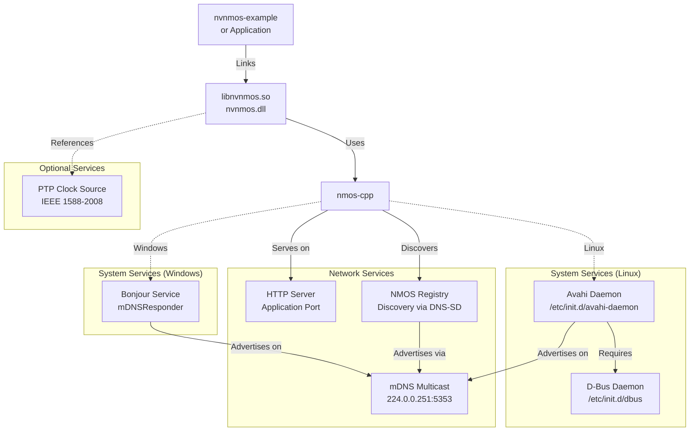
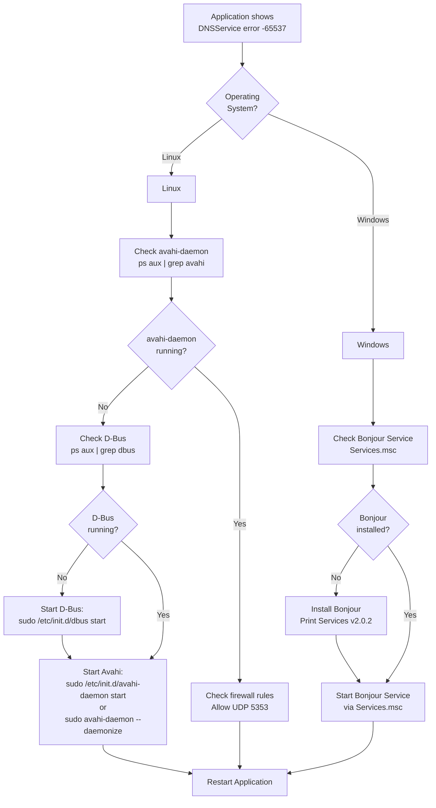
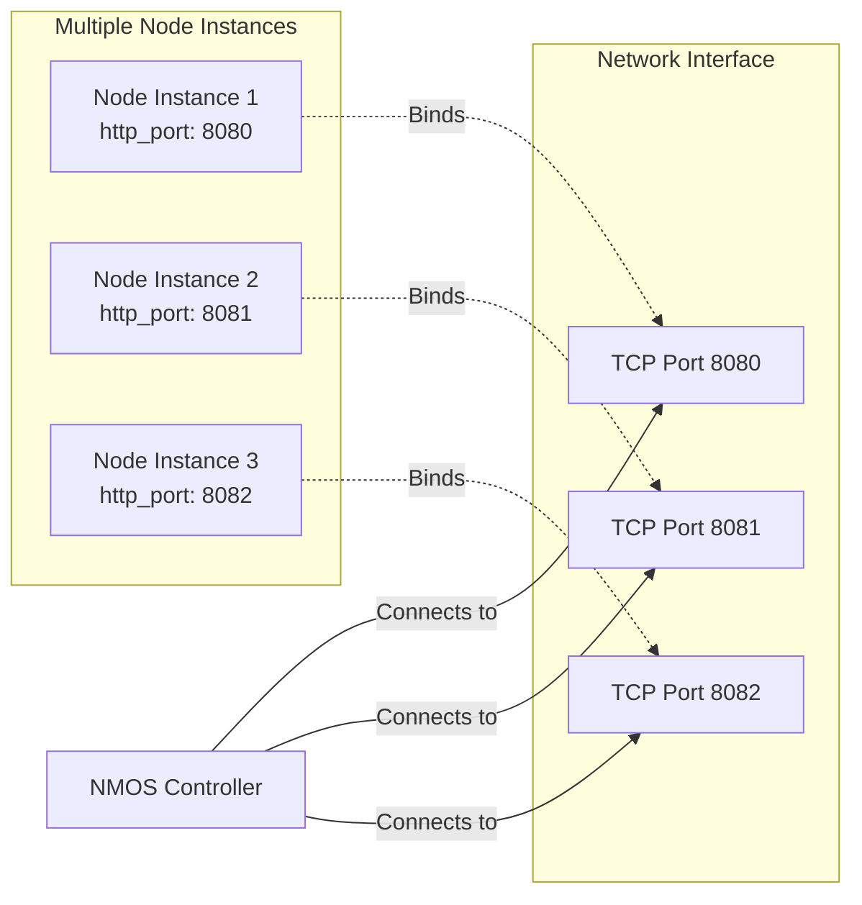
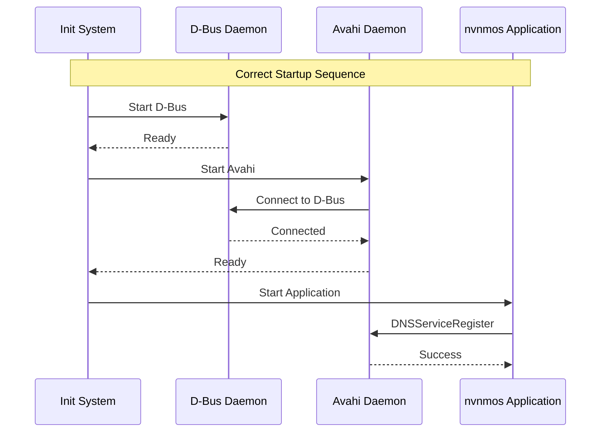
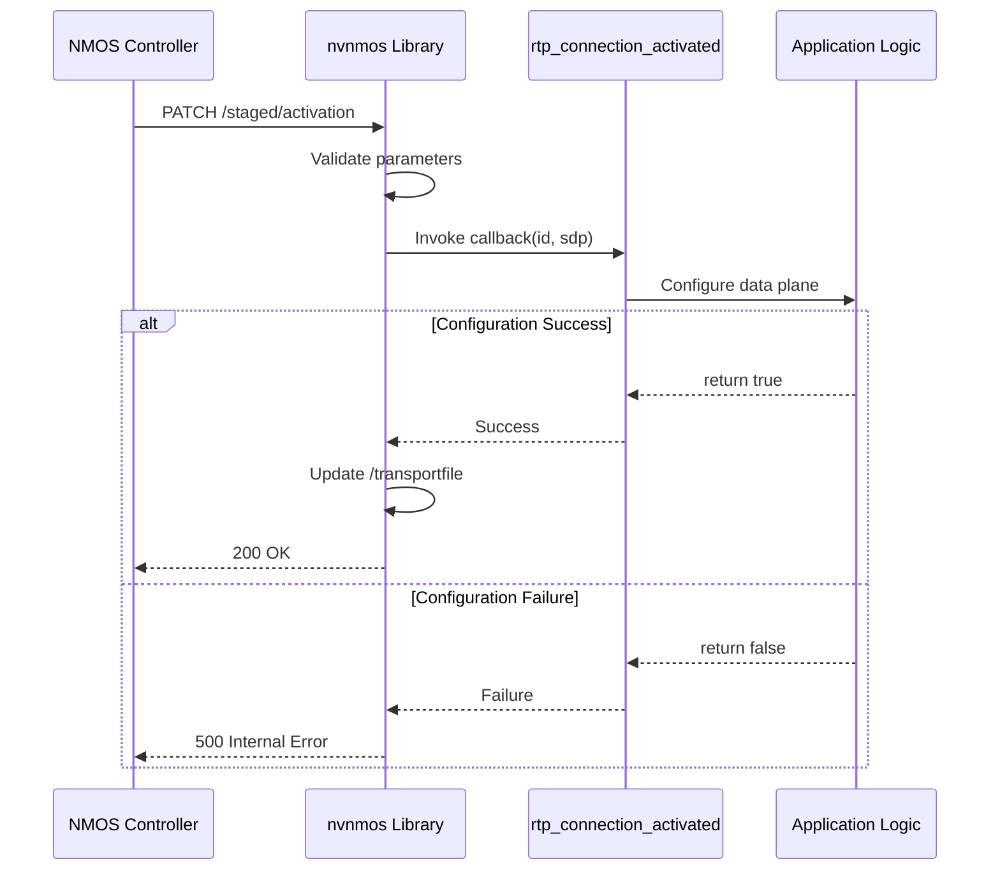
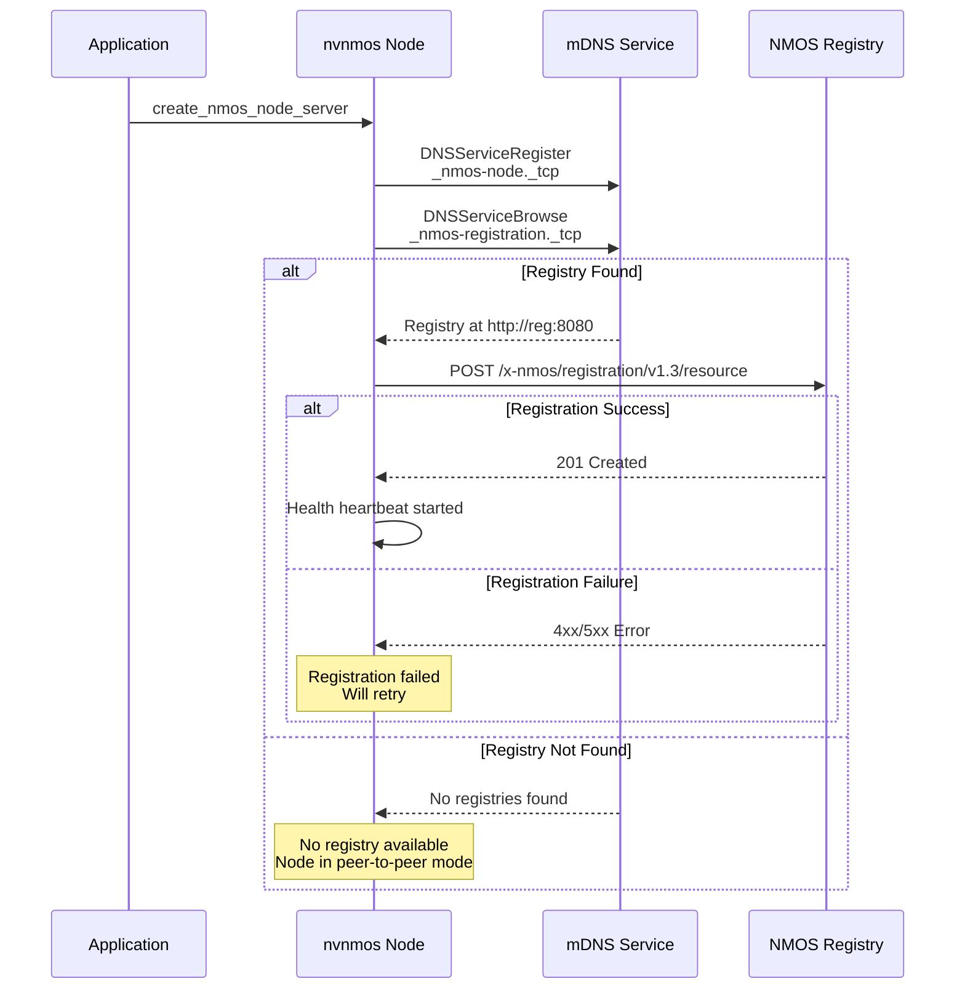
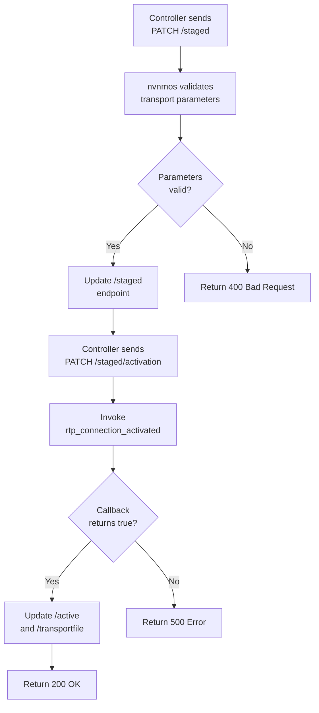
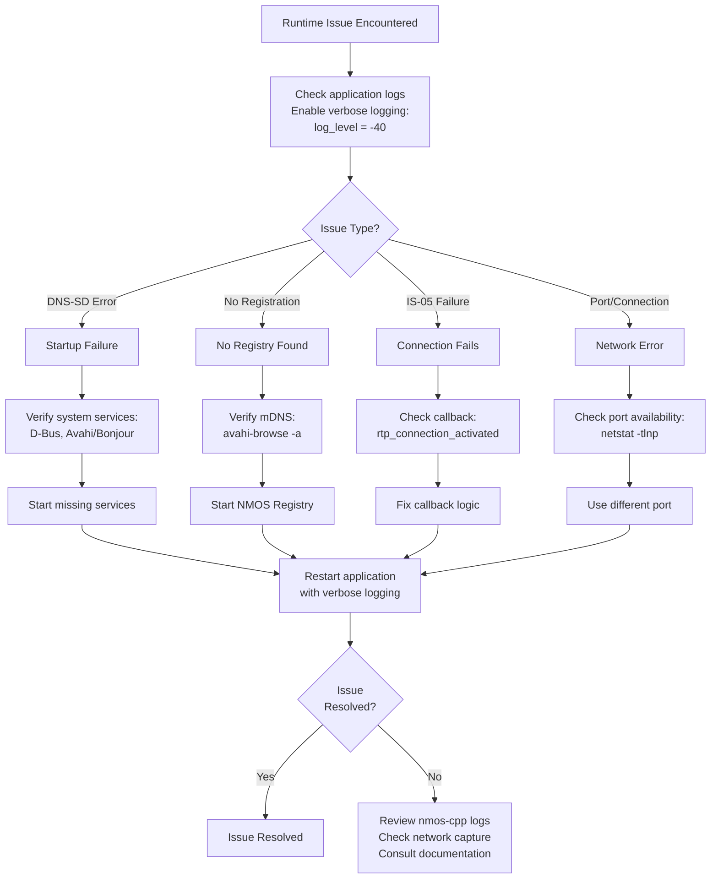

<!-- source: DeepWiki mcp.deepwiki.com · repo NVIDIA/nvnmos · page 9.2 Runtime Issues · fetched 2026-10-26 -->

# Runtime Issues

<details>
<summary>Relevant source files</summary>

The following files were used as context for generating this wiki page:

- [README.md](README.md)
- [entrypoint.sh](entrypoint.sh)
- [src/main.c](src/main.c)

</details>


## Purpose and Scope

This page documents common runtime problems encountered when running nvnmos applications, their root causes, and resolution strategies. It focuses on issues that occur after successful compilation and during application execution, including service discovery failures, network conflicts, system dependency problems, and connection errors.

For build-time issues, see [Common Build Issues](#9.1). For understanding the normal connection activation flow, see [Connection Activation](#3.3). For details on DNS-SD and registry registration, see [Discovery and Registration](#3.4).

---

## Runtime Dependency Chain

The following diagram illustrates the dependencies required at runtime and common failure points:

**Runtime Dependency Architecture**



**Sources:** [README.md:269-291](), [entrypoint.sh:20-24](), [Diagram 5]()

---

## DNS-SD Service Discovery Issues

### DNSServiceRegister and DNSServiceBrowse Errors

The most common runtime issue involves DNS-SD service failures, indicated by error messages similar to:

```
DNSServiceRegister reported error: -65537 while registering advertisement for: nmos-cpp_node_192-168-1-194:12345._nmos-node._tcp
DNSServiceBrowse reported error: -65537
```

**Error Code -65537**: This indicates `kDNSServiceErr_Unknown`, typically caused by the DNS-SD daemon not running or being inaccessible.

**Impact:** The NMOS Node cannot advertise itself or discover the NMOS Registry, preventing all IS-04 functionality.

**Resolution by Platform:**

| Platform | Service Check | Start Command |
|----------|--------------|---------------|
| **Linux (Ubuntu 22.04)** | `systemctl status avahi-daemon` | `sudo /etc/init.d/avahi-daemon start` |
| **Linux (Ubuntu 24.04+)** | `systemctl status avahi-daemon` | `sudo avahi-daemon --daemonize` |
| **Windows** | Check Services for "Bonjour Service" | Install from [Apple DL999](https://support.apple.com/kb/DL999) |
| **Docker** | Container must have D-Bus and Avahi | See [entrypoint.sh:20-24]() |

**Diagnostic Flow:**



**Sources:** [README.md:362-382]()

### Apple Bonjour Compatibility Layer Warnings

When using Avahi on Linux, warnings like the following are displayed but can be safely ignored:

```
*** WARNING *** The program 'nvnmos-example' uses the Apple Bonjour compatibility layer of Avahi.
*** WARNING *** Please fix your application to use the native API of Avahi!
*** WARNING *** For more information see <http://0pointer.de/blog/projects/avahi-compat.html>
```

**Explanation:** The nmos-cpp library uses the DNS-SD API (`dns_sd.h`), which Avahi implements through a compatibility layer. This is expected behavior and does not affect functionality.

**Action:** None required. These warnings do not indicate a problem.

**Sources:** [README.md:351-360]()

### Registry Discovery Failures

**Symptom:** Application starts but no Registry is discovered, preventing resource registration.

**Diagnostic Steps:**

1. **Verify mDNS traffic:**
   ```bash
   # Linux
   avahi-browse -a
   
   # Should show _nmos-registration._tcp services
   ```

2. **Check hostname resolution:**
   - For `.local` hostnames: Ensure mDNS resolution works
   - For FQDN: Ensure DNS server provides SRV records for DNS-SD

3. **Verify network connectivity:**
   - Multicast must be enabled on network interfaces
   - Firewall must allow UDP port 5353

**Resolution Table:**

| Issue | Check | Resolution |
|-------|-------|------------|
| No Registry visible | `avahi-browse -rt _nmos-registration._tcp` | Start Registry, verify network |
| Wrong domain | Check `host_name` in [NvNmosNodeConfig](#4.3) | Use `.local` for mDNS or proper FQDN |
| Multicast blocked | `tcpdump -i any port 5353` | Enable multicast on switches/routers |

**Sources:** [README.md:303-304](), [src/main.c:250]()

---

## Network and Port Conflicts

### Address Already in Use

**Error Message:**
```
asio listen error: system:98 (Address already in use)
```

**Cause:** The HTTP port specified in `NvNmosNodeConfig.http_port` is already bound by another process.

**Resolution:**

1. **Identify the conflicting process:**
   ```bash
   # Linux
   sudo netstat -tlnp | grep <port>
   # or
   sudo lsof -i :<port>
   
   # Windows
   netstat -ano | findstr <port>
   ```

2. **Choose different port:**
   - Each NMOS Node instance requires a unique port
   - Default convention uses 8080, 8081, 8082, etc.
   - Update `node_config.http_port` in application code

**Example from nvnmos-example:**

The port is set from command-line arguments in [src/main.c:251]():
```c
node_config.http_port = atoi(argv[2]);
```

When running multiple instances, use different ports:
```bash
# Instance 1
./nvnmos-example nmos-api.local 8080 192.0.2.1

# Instance 2
./nvnmos-example nmos-api.local 8081 192.0.2.2
```

**Port Allocation Strategy:**



**Sources:** [README.md:342-349](), [src/main.c:251]()

### Network Interface Configuration Issues

**Symptom:** Node starts but Senders/Receivers cannot activate or Controllers cannot reach APIs.

**Common Causes:**

1. **Wrong IP address in configuration:**
   - `interface_ip` used in SDP must match actual network interface
   - Host IP used in examples may not match container/VM networking

2. **Docker networking:**
   - Container IP differs from host IP
   - Port forwarding required for external access
   - mDNS may not cross network boundaries

**Docker-Specific Resolution:**

The [entrypoint.sh:28]() script determines the container IP:
```bash
export HOSTIP=`awk 'END{print $1}' /etc/hosts`
```

For host network access, run Docker with `--network host`:
```bash
docker run --network host nvnmos /bin/bash
```

**Sources:** [entrypoint.sh:28-30](), [src/main.c:262-263]()

---

## System Service Dependencies

### D-Bus Service Issues (Linux)

**Symptom:** avahi-daemon fails to start or immediately exits.

**Cause:** D-Bus daemon is not running, which Avahi requires for inter-process communication.

**Resolution:**

1. **Check D-Bus status:**
   ```bash
   ps aux | grep dbus
   ```

2. **Start D-Bus:**
   ```bash
   # Ubuntu 22.04 and earlier
   sudo /etc/init.d/dbus start
   
   # Alternative
   sudo dbus-daemon --system --fork
   ```

3. **Verify Avahi starts after D-Bus:**
   ```bash
   sudo /etc/init.d/avahi-daemon start
   # or
   sudo avahi-daemon --daemonize
   ```

**Startup Order:**



**Sources:** [entrypoint.sh:23](), [README.md:276-280]()

### PTP Clock Reference Issues

**Symptom:** Senders reference PTP in SDP but no PTP clock is available, causing connection failures with strict controllers.

**Background:** The example SDP includes PTP clock references when `CLK_PTP` is true (see [src/main.c:67-69]()):
```c
const char* ts_refclk = CLK_PTP
    ? "a=ts-refclk:ptp=IEEE1588-2008:AC-DE-48-23-45-67-01-9F:42\r\n"
```

**Resolution Options:**

1. **Install PTP daemon:**
   ```bash
   sudo apt install linuxptp
   sudo ptp4l -i eth0 -m
   ```

2. **Modify application to use local clock:**
   - Rebuild with `-DCLK_PTP=false`
   - Update SDP generation to use `localmac` reference

3. **Configure NMOS Controller:**
   - Some Controllers ignore clock references
   - Others may require matching clock domains

**Sources:** [src/main.c:67-69](), [src/main.c:103-106]()

---

## Connection and Activation Errors

### RTP Connection Activation Callback Failures

**Symptom:** Controller sends connection activation request, but activation fails or times out.

**Callback Mechanism:**

When a Controller activates a connection via IS-05, the library invokes `rtp_connection_activated` callback:



**Common Callback Failure Reasons:**

| Failure Type | Symptom | Resolution |
|--------------|---------|------------|
| **Callback returns false** | Activation fails with 500 error | Check application's data plane configuration logic |
| **Callback blocks** | Activation times out | Ensure callback returns quickly; defer blocking operations |
| **Callback crashes** | Application terminates | Add error handling in callback; validate SDP before use |
| **Null callback** | Segmentation fault | Ensure `node_config.rtp_connection_activated` is set |

**Example Implementation from nvnmos-example:**

[src/main.c:80-88]() shows a minimal callback:
```c
static bool handle_rtp_connection_activated(
    NvNmosNodeServer *server,
    const char *id,
    const char *sdp)
{
    printf("%s %s\n", id, sdp ? "activated via NMOS" : "deactivated via NMOS");
    if (server->user_data && sdp) printf("%s\n", sdp);
    return true;  // Always succeeds in example
}
```

**Production Callback Pattern:**
```c
bool handle_rtp_connection_activated(
    NvNmosNodeServer *server,
    const char *id,
    const char *sdp)
{
    // Validate inputs
    if (!id) return false;
    
    if (sdp) {
        // Activation: Parse SDP and configure transport
        // Return false if configuration fails
    } else {
        // Deactivation: Stop transport
    }
    
    return true;
}
```

**Sources:** [src/main.c:80-88](), [src/main.c:288](), [Diagram 4]()

### Application-Initiated Activation Failures

**API Function:** `nmos_connection_rtp_activate`

**Symptom:** Function returns false or subsequent Controller queries show incorrect state.

**Common Causes:**

1. **Invalid sender/receiver ID:**
   - ID must match one added via `add_nmos_sender_to_node_server` or `add_nmos_receiver_to_node_server`
   - Check for typos in ID strings

2. **Malformed SDP:**
   - SDP must include required attributes
   - Must match format expected for Sender or Receiver

3. **Node server destroyed:**
   - Cannot activate on destroyed server
   - Ensure `destroy_nmos_node_server` not already called

**Diagnostic Example from nvnmos-example:**

[src/main.c:308-318]() demonstrates proper activation sequence:
```c
printf("Activating senders and receivers...\n");
if (!nmos_connection_rtp_activate(&node_server, "source-0", source_config[0].sdp)) goto cleanup;
if (!nmos_connection_rtp_activate(&node_server, "source-1", source_config[1].sdp)) goto cleanup;
if (!nmos_connection_rtp_activate(&node_server, "sink-0", sink_config[0].sdp)) goto cleanup;
if (!nmos_connection_rtp_activate(&node_server, "sink-1", sink_config[1].sdp)) goto cleanup;
```

**Sources:** [src/main.c:308-318](), [API Reference](#4.1)

---

## Logging and Diagnostics

### Log Callback Configuration

**Purpose:** The log callback provides visibility into library internal operations for troubleshooting.

**Configuration:**

```c
node_config.log_callback = &handle_log;
node_config.log_level = NVNMOS_LOG_ERROR;  // Or desired level
```

**Log Levels:**

| Level Value | Constant | Description | Use Case |
|-------------|----------|-------------|----------|
| > 0 | `NVNMOS_LOG_ERROR` | Warnings and errors only | Production |
| 0 | Default | Normal operation messages | Development |
| < 0 | Debug/Trace | Detailed internal operations | Troubleshooting |
| -40 | Maximum verbosity | All library operations | Deep debugging |

**Example Log Handler:**

[src/main.c:71-78]() provides a simple log handler:
```c
static void handle_log(
    NvNmosNodeServer *server,
    const char *categories,
    int level,
    const char *message)
{
    printf("%s [%d:%s]\n", message, level, categories);
}
```

**Enhanced Production Pattern:**
```c
void handle_log(
    NvNmosNodeServer *server,
    const char *categories,
    int level,
    const char *message)
{
    // Filter by level
    if (level > NVNMOS_LOG_ERROR) return;
    
    // Route to application logging system
    if (level > 0) {
        app_logger_error(categories, message);
    } else {
        app_logger_debug(categories, message);
    }
}
```

**Sources:** [src/main.c:71-78](), [src/main.c:290-291]()

### Enabling Verbose Logging

**Command-Line (nvnmos-example):**

```bash
# Error-level logging (default)
./nvnmos-example nmos-api.local 8080 192.0.2.1

# Info-level logging
./nvnmos-example nmos-api.local 8080 192.0.2.1 0

# Debug logging
./nvnmos-example nmos-api.local 8080 192.0.2.1 -10

# Maximum verbosity
./nvnmos-example nmos-api.local 8080 192.0.2.1 -40
```

**Programmatic:**

```c
node_config.log_level = -40;  // Maximum verbosity
```

**Key Log Categories to Monitor:**

- `node_implementation`: Resource lifecycle operations
- `connection_api`: IS-05 connection requests
- `registration_api`: IS-04 registry communication
- `dns_sd`: Service discovery operations

**Sources:** [src/main.c:291](), [README.md:310-311]()

### Common Error Messages

**Error Message Reference:**

| Message Pattern | Cause | Resolution |
|----------------|-------|------------|
| `asio listen error: system:98` | Port conflict | Use different `http_port` |
| `DNSServiceRegister reported error: -65537` | DNS-SD daemon not running | Start avahi-daemon or Bonjour |
| `DNSServiceBrowse reported error: -65537` | Cannot discover Registry | Start avahi-daemon or Bonjour |
| `Could not resolve host` | Invalid hostname | Check `host_name` configuration |
| `Connection refused` | Registry not available | Verify Registry is running and reachable |
| `SDP parse error` | Malformed SDP string | Validate SDP format |

---

## Configuration Problems

### Invalid SDP Strings

**Symptom:** `add_nmos_sender_to_node_server` or `add_nmos_receiver_to_node_server` returns false.

**Common SDP Errors:**

1. **Missing required attributes:**
   - `a=x-nvnmos-id:` (required for nvnmos)
   - `a=rtpmap:` (required for RTP payload format)

2. **Invalid format:**
   - Incorrect line endings (must be `\r\n`)
   - Malformed IP addresses
   - Invalid media type

3. **Inconsistent parameters:**
   - Payload type mismatch in `m=` and `a=rtpmap:`
   - Missing connection line `c=IN IP4`

**SDP Construction Example:**

[src/main.c:110-149]() shows proper SDP construction with all required fields:
```c
snprintf(sdp, sdp_size,
    "v=0\r\n"
    "o=- %d %d IN IP4 %s\r\n"
    "s=%s\r\n"
    // ... other fields
    "a=x-nvnmos-id:%s\r\n"         // Required
    "a=x-nvnmos-group-hint:%s\r\n" // Optional
    // ... media lines
    "a=rtpmap:%d %s\r\n"            // Required
    // ...
);
```

**Validation Checklist:**

- [ ] Version line: `v=0\r\n`
- [ ] Origin line with NTP timestamp
- [ ] Session name
- [ ] Media line with port and payload type
- [ ] Connection line with IP address
- [ ] `a=x-nvnmos-id:` attribute
- [ ] `a=rtpmap:` attribute matching payload type
- [ ] All lines end with `\r\n`

**Sources:** [src/main.c:90-216]()

### Hostname Resolution Issues

**Symptom:** Node cannot discover Registry even when DNS-SD is working.

**hostname Types:**

| Type | Example | DNS-SD Method | Notes |
|------|---------|---------------|-------|
| `.local` | `nmos-api.local` | Multicast DNS | Requires mDNS support |
| FQDN | `api.example.com` | Unicast DNS-SD | Requires SRV records in DNS |
| IP address | Not supported | N/A | Use hostname instead |

**Resolution:**

1. **For `.local` hostnames:**
   - Ensure mDNS is enabled on network
   - Verify avahi/Bonjour is running
   - Test: `ping nmos-api.local`

2. **For FQDN:**
   - Verify DNS server has SRV records for `_nmos-registration._tcp.example.com`
   - Test: `dig SRV _nmos-registration._tcp.example.com`

**Sources:** [README.md:303-304](), [src/main.c:250]()

---

## Registry and Controller Communication Issues

### Registration Failures

**Symptom:** Node starts but resources don't appear in Registry.

**Communication Flow:**



**Diagnostic Steps:**

1. **Verify Registry is advertising:**
   ```bash
   avahi-browse -rt _nmos-registration._tcp
   ```

2. **Check network connectivity:**
   ```bash
   curl http://<registry-host>:<registry-port>/x-nmos/registration/v1.3/health/nodes
   ```

3. **Enable verbose logging** to see registration attempts:
   ```bash
   ./nvnmos-example nmos-api.local 8080 192.0.2.1 -40
   ```

4. **Check Registry logs** for rejection reasons

**Common Registration Failures:**

| Error | Cause | Resolution |
|-------|-------|------------|
| 400 Bad Request | Malformed resource data | Check SDP parsing; enable debug logs |
| 409 Conflict | Resource ID collision | Use unique seed in `NvNmosNodeConfig` |
| 500 Internal Error | Registry database issue | Check Registry health |
| Connection timeout | Network/firewall issue | Verify connectivity, check firewall rules |

**Sources:** [Diagram 4](), [src/main.c:254-256]()

### Connection API (IS-05) Request Failures

**Symptom:** Controller can see resources but cannot activate connections.

**Request Validation Flow:**



**Troubleshooting Steps:**

1. **Verify endpoint accessibility:**
   ```bash
   curl http://<node-ip>:<port>/x-nmos/connection/v1.1/single/receivers/<id>/staged
   ```

2. **Test parameter validation:**
   - Send minimal PATCH request
   - Check for specific validation errors

3. **Monitor callback execution:**
   - Add logging to `rtp_connection_activated` callback
   - Verify callback is invoked
   - Check return value

4. **Review transport parameters:**
   - Verify SDP compatibility
   - Check multicast addresses and ports

**Sources:** [Diagram 2](), [Connection Activation](#3.3)

---

## Troubleshooting Workflow

**General Troubleshooting Process:**



**Sources:** All sections above

---

## Summary of Resolution Patterns

| Issue Category | Primary Diagnostic | Primary Resolution |
|----------------|-------------------|-------------------|
| **DNS-SD Errors** | `ps aux \| grep avahi` | Start avahi-daemon or Bonjour Service |
| **Port Conflicts** | `netstat -tlnp \| grep <port>` | Use unique `http_port` per instance |
| **Registry Discovery** | `avahi-browse -rt _nmos-registration._tcp` | Verify Registry running and advertising |
| **Connection Failures** | Check `rtp_connection_activated` callback | Fix callback implementation |
| **Network Issues** | `tcpdump port 5353` | Check firewall, multicast settings |
| **Configuration Errors** | Enable verbose logging (`-40`) | Validate SDP, check hostname format |

**Sources:** All sections above