# Page: Overview

# Overview

<details>
<summary>Relevant source files</summary>

The following files were used as context for generating this wiki page:

- [LICENSE](LICENSE)
- [README.md](README.md)
- [src/nvnmos.h](src/nvnmos.h)

</details>


This document introduces the NvNmos library, its purpose as an NMOS control plane for NVIDIA media applications, and provides a high-level architectural overview. For detailed information about building and running the library, see [Getting Started](#2). For in-depth coverage of the internal architecture and implementation, see [Architecture and Design](#5).

## Purpose and Scope

The NVIDIA Networked Media Open Specifications (NvNmos) library provides a C API for creating and managing NMOS Nodes in media applications. The library implements the NMOS control plane (registration, discovery, and connection management) while delegating the ST 2110 data plane (actual media transport) to external libraries such as NVIDIA Rivermax or NVIDIA DeepStream.

NvNmos is **not** a complete media transport solution. It handles only the NMOS protocol layer, enabling applications to:

- Register with NMOS registries and advertise their capabilities
- Respond to connection requests from NMOS controllers
- Dynamically add and remove senders and receivers
- Receive callbacks when connection parameters change

Applications remain responsible for configuring the actual media streams using the transport parameters provided through NvNmos callbacks.

**Sources:** [src/nvnmos.h:18-56](), [README.md:20-43]()

## What is NvNmos?

NvNmos is a shared library (`libnvnmos.so` on Linux, `nvnmos.dll` on Windows) that wraps the Sony nmos-cpp implementation with a simplified C API designed for integration with NVIDIA media processing workflows. The library automatically handles:

- DNS-SD service discovery to locate NMOS registries
- IS-04 registration of Node, Device, Sender, and Receiver resources
- IS-05 connection management endpoints
- Session Description Protocol (SDP) parsing and validation
- Resource lifecycle management

The primary interface is defined in [src/nvnmos.h](), which exports a C API consisting of:

- `NvNmosNodeServer` - Opaque server handle
- `create_nmos_node_server()` - Initialize and start a node
- `add_nmos_sender_to_node_server()` / `add_nmos_receiver_to_node_server()` - Register resources
- `remove_nmos_sender_from_node_server()` / `remove_nmos_receiver_from_node_server()` - Unregister resources
- `nmos_connection_rtp_activate()` - Apply connection parameters
- `destroy_nmos_node_server()` - Shutdown and cleanup

**Sources:** [src/nvnmos.h:59-478](), [README.md:52-58]()

## Supported Specifications

NvNmos supports the following AMWA NMOS specifications and related standards:

| Specification | Version | Description |
|---------------|---------|-------------|
| [AMWA IS-04](https://specs.amwa.tv/is-04/) | v1.3 | Discovery and Registration |
| [AMWA IS-05](https://specs.amwa.tv/is-05/) | v1.1 | Device Connection Management |
| [AMWA IS-09](https://specs.amwa.tv/is-09/) | v1.0 | System Parameters |
| [AMWA BCP-002-01](https://specs.amwa.tv/bcp-002-01/) | v1.0 | Natural Grouping of NMOS Resources |
| [AMWA BCP-002-02](https://specs.amwa.tv/bcp-002-02/) | v1.0 | NMOS Asset Distinguishing Information |
| [AMWA BCP-004-01](https://specs.amwa.tv/bcp-004-01/) | v1.0 | NMOS Receiver Capabilities |
| [AMWA BCP-006-01](https://specs.amwa.tv/bcp-006-01/) | v1.0 | NMOS With JPEG XS |
| SMPTE ST 2110 | - | Session Description Protocol for ST 2110-20, -22, -30, -40 |
| SMPTE ST 2022-7 | - | Seamless Protection Switching |

The library currently supports uncompressed video (SMPTE ST 2110-20) and audio (SMPTE ST 2110-30) streams.

**Sources:** [src/nvnmos.h:45-53](), [README.md:34-42]()

## Architecture Overview

### System Layering

The following diagram shows the layered architecture and how code files map to architectural layers:

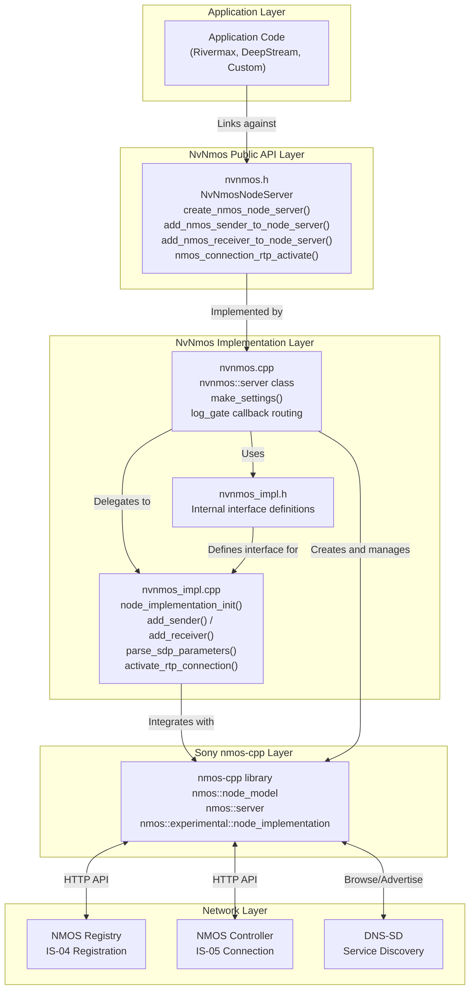

**Sources:** [src/nvnmos.h:1-478](), [src/nvnmos.cpp]() (file structure), [src/nvnmos_impl.h]() (file structure), [src/nvnmos_impl.cpp]() (file structure)

### Resource Management Flow

This diagram shows how API calls flow through the implementation and which code entities handle each step:

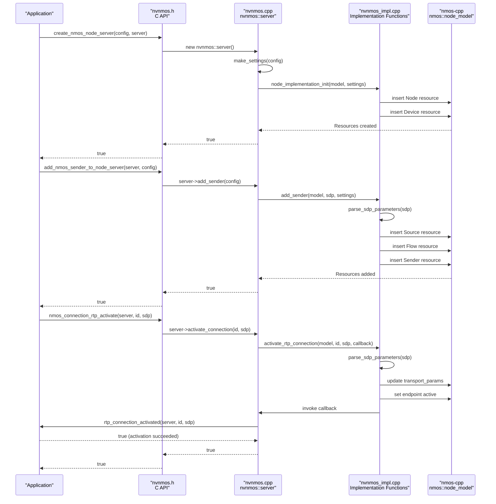

**Sources:** [src/nvnmos.h:352-469](), [src/nvnmos.cpp]() (implementation of create/add/activate functions), [src/nvnmos_impl.cpp]() (node_implementation_init, add_sender, add_receiver, activate_rtp_connection functions)

## Key Concepts

### Configuration via SDP

NvNmos uses Session Description Protocol (SDP) as the primary mechanism for configuring senders and receivers. The SDP string contains:

- Media format parameters (video/audio codec, resolution, sample rate)
- Transport parameters (RTP ports, multicast groups)
- Custom `x-nvnmos-*` attributes for additional configuration

The `NvNmosSenderConfig` and `NvNmosReceiverConfig` structures each contain a single `sdp` field that must be populated with valid SDP data conforming to SMPTE ST 2110 standards. For details, see [Session Description Protocol (SDP)](#3.2).

**Sources:** [src/nvnmos.h:260-293]()

### Callback-Based Activation

When an NMOS Controller requests a connection change via IS-05, the library invokes the application-provided `nmos_connection_rtp_activation_callback`. This callback receives:

- The sender or receiver ID
- The updated SDP with new transport parameters
- The server handle for context

The application must configure its media transport layer and return `true` if successful, or `false` to reject the activation. For details, see [Connection Activation](#3.3) and [Callbacks and Event Handling](#4.4).

**Sources:** [src/nvnmos.h:98-125](), [src/nvnmos.h:218]()

### Resource Lifecycle

NMOS resources follow this lifecycle:

1. **Creation** - `create_nmos_node_server()` creates Node and Device resources
2. **Registration** - Resources are automatically registered with the NMOS Registry via IS-04
3. **Runtime Updates** - `add_nmos_sender_to_node_server()` and `add_nmos_receiver_to_node_server()` add resources dynamically
4. **Connection Management** - Controllers can activate/deactivate connections via IS-05
5. **Removal** - `remove_nmos_sender_from_node_server()` and `remove_nmos_receiver_from_node_server()` unregister resources
6. **Shutdown** - `destroy_nmos_node_server()` cleans up all resources

For implementation details, see [Resource Lifecycle Management](#5.2).

**Sources:** [src/nvnmos.h:352-437]()

### Separation of Control and Data Planes

NvNmos handles the **NMOS control plane**:
- Registration and discovery (IS-04)
- Connection management (IS-05)
- System parameters (IS-09)

The application handles the **ST 2110 data plane**:
- RTP stream transmission/reception
- Media processing
- PTP clock synchronization

This separation allows NvNmos to be integrated with any ST 2110 transport library. For integration patterns, see [Integration Guide](#7).

**Sources:** [README.md:20-31](), [src/nvnmos.h:18-56]()

## Platform Support

The library supports the following platforms:

| Operating System | Compiler | Status |
|-----------------|----------|--------|
| Ubuntu 22.04 | GCC 11 | Tested |
| Windows 10 | Visual Studio 2022 | Tested |

The library is designed to be portable and may work on other platforms with compatible C++11 compilers.

**Sources:** [README.md:44-50]()

## Dependencies

NvNmos depends on the following key libraries, managed via Conan:

- **Sony nmos-cpp** - Core NMOS protocol implementation
- **Boost** - C++ utilities and ASIO for networking
- **cpprestsdk** - HTTP client/server
- **WebSocket++** - WebSocket protocol support
- **OpenSSL** - TLS/SSL security
- **nlohmann_json** - JSON parsing

Runtime dependencies:
- **Avahi daemon** (Linux) or **Bonjour Service** (Windows) for DNS-SD

For build instructions, see [Building from Source](#2.1). For dependency management details, see [Dependency Management with Conan](#6.3).

**Sources:** [README.md:93-127](), [README.md:269-291]()

## Example Application

The `nvnmos-example` application ([src/nvnmos-example/main.c]()) demonstrates:

- Creating an NMOS Node with multiple senders and receivers
- Dynamically adding and removing resources
- Handling connection activation callbacks
- Logging configuration

The example uses mock senders and receivers that do not actually transport media, making it suitable for testing NMOS control plane functionality without requiring ST 2110 hardware or software.

For a walkthrough of the example, see [Running the Example Application](#2.3).

**Sources:** [README.md:57-58](), [README.md:292-331]()

## Next Steps

- **[Getting Started](#2)** - Build and run your first NMOS Node
- **[Core Concepts](#3)** - Understand NMOS resource model and SDP configuration
- **[API Reference](#4)** - Complete API documentation
- **[Architecture and Design](#5)** - Internal implementation details
- **[Integration Guide](#7)** - Integrate with ST 2110 transport libraries

**Sources:** Documentation table of contents structure

---

# Page: Getting Started

# Getting Started

<details>
<summary>Relevant source files</summary>

The following files were used as context for generating this wiki page:

- [README.md](README.md)
- [src/main.c](src/main.c)

</details>


This page provides an overview of the initial setup process for the nvnmos library, from installation through running your first NMOS Node. It covers prerequisites, build options, and basic verification steps. For detailed build instructions, see [Building from Source](#2.1) or [Using Docker](#2.2). For understanding the example application workflow, see [Running the Example Application](#2.3).

## Purpose and Scope

This guide walks you through:
- Installing required dependencies (Python, CMake, Conan)
- Choosing between Docker-based and native builds
- Building the `libnvnmos.so` / `nvnmos.dll` shared library
- Running the `nvnmos-example` application to verify your setup
- Understanding the basic NMOS Node lifecycle

For architectural details about how nvnmos integrates with your application, see [Core Concepts](#3). For API reference documentation, see [API Reference](#4).

## Prerequisites Overview

The nvnmos library requires several tools and runtime services to build and operate:

### Build-Time Dependencies

| Component | Minimum Version | Purpose |
|-----------|----------------|---------|
| Python 3 | Any recent version | Package management (pip, Conan) |
| CMake | 3.17 | Build system configuration |
| Conan | 2.2 | C++ dependency management |
| C++ Compiler | GCC 11 / MSVC 2022 | Building native code |

### Runtime Dependencies

| Platform | Service | Purpose |
|----------|---------|---------|
| Linux | `avahi-daemon` | DNS-SD service discovery |
| Linux | `dbus` | IPC for avahi-daemon |
| Windows | Bonjour Service | DNS-SD service discovery |
| Both | PTP daemon (optional) | Precision time synchronization |

### C++ Libraries (Managed by Conan)

The nvnmos library depends on the Sony `nmos-cpp` library, which in turn requires:
- Boost - C++ utilities
- cpprestsdk - HTTP/REST server
- WebSocket++ - WebSocket protocol
- OpenSSL - TLS/SSL security
- nlohmann_json - JSON parsing
- jwt-cpp - Authentication tokens

These are automatically downloaded and built by Conan during the build process.

**Sources:** [README.md:93-183](), [README.md:269-290]()

## Build Workflow Overview

The nvnmos build process follows a standard Conan + CMake workflow:

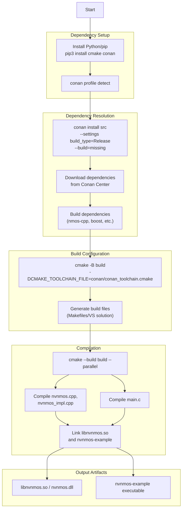

**Sources:** [README.md:185-267]()

## Quick Start Paths

### Option 1: Docker Build (Recommended for First-Time Users)

The Docker-based build is the fastest way to get started. It handles all dependencies automatically and produces a portable package:

```bash
# Build the container image
docker build -t nvnmos .

# Extract the built package
docker create --name nvnmos-test nvnmos
docker cp nvnmos-test:/nvnmos-ubuntu-22.04.tar.gz .
docker rm nvnmos-test

# Run the example in container
docker run -it nvnmos /bin/bash
```

The Dockerfile implements a multi-stage build that installs dependencies, compiles the library, and packages everything into a tarball. See [Using Docker](#2.2) for details.

**Sources:** [README.md:59-91]()

### Option 2: Native Build from Source

For development work or integration into existing build systems, build natively:

**Linux:**
```bash
# Install prerequisites
pip3 install cmake~=3.17 conan~=2.2
conan profile detect

# Install dependencies
conan install src \
  -g CMakeToolchain \
  --settings:all build_type=Release \
  --build=missing \
  --output-folder=src/conan

# Configure and build
cmake -B build \
  -DCMAKE_TOOLCHAIN_FILE=conan/conan_toolchain.cmake \
  -DCMAKE_BUILD_TYPE=Release \
  src
cmake --build build --parallel
```

**Windows:**
```powershell
# Install prerequisites
pip3 install cmake~=3.17 conan~=2.2
conan profile detect

# Install dependencies
conan install src `
  -g CMakeToolchain `
  --settings:all build_type=Release `
  --build=missing `
  --output-folder=src/conan

# Configure and build
cmake -B build `
  -G "Visual Studio 17 2022" `
  -DCMAKE_TOOLCHAIN_FILE=conan/conan_toolchain.cmake `
  src
cmake --build build --config Release --parallel
```

See [Building from Source](#2.1) for complete instructions including troubleshooting.

**Sources:** [README.md:185-267]()

## Runtime Environment Setup

Before running nvnmos applications, ensure DNS-SD services are running:

**Linux:**
```bash
# Install and start services
sudo apt update
sudo apt install -y dbus avahi-daemon
sudo /etc/init.d/dbus start
sudo /etc/init.d/avahi-daemon start
```

**Windows:**
Download and install [Bonjour Print Services v2.0.2](https://support.apple.com/kb/DL999), which includes the mDNSResponder service.

**Sources:** [README.md:269-290]()

## Basic Application Structure

The nvnmos API follows a simple lifecycle pattern:

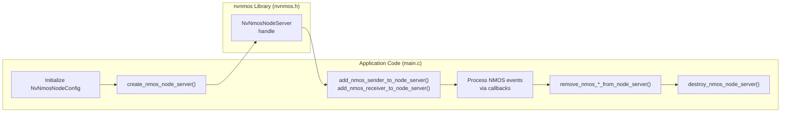

**Minimal Example Flow:**

1. **Configure Node** - Populate `NvNmosNodeConfig` with host name, port, asset tags
2. **Create Server** - Call `create_nmos_node_server()` to initialize the NMOS Node
3. **Add Resources** - Add senders/receivers using SDP strings
4. **Handle Callbacks** - Implement `rtp_connection_activated` to respond to connection requests
5. **Cleanup** - Call `destroy_nmos_node_server()` on shutdown

**Sources:** [src/main.c:228-328](), [README.md:52-58]()

## Code Entity Map: API Entry Points

This diagram maps high-level concepts to the concrete C API functions you'll use:

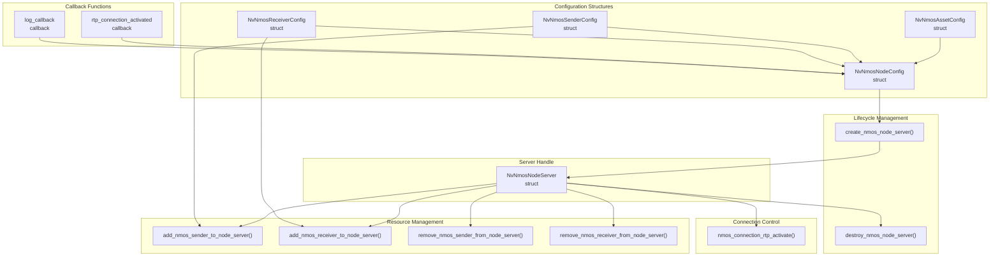

All these types and functions are declared in the `nvnmos.h` public API header.

**Sources:** [README.md:52-58]()

## Verification Steps

After building, verify your setup:

### 1. Check Build Artifacts

**Linux:**
```bash
ls -lh build/libnvnmos.so
ls -lh build/nvnmos-example
```

**Windows:**
```powershell
dir build\Release\nvnmos.dll
dir build\Release\nvnmos-example.exe
```

### 2. Run the Example Application

The `nvnmos-example` application requires three arguments:

```bash
./nvnmos-example <host-name> <port> <interface-ip> [log-level]
```

Example:
```bash
./nvnmos-example nmos-api.local 8080 192.0.2.0
```

The application will:
- Create an NMOS Node with 2 video+audio sender/receiver pairs
- Demonstrate adding and removing resources
- Show connection activation/deactivation
- Prompt for continuation at each step

See [Running the Example Application](#2.3) for detailed walkthrough.

**Sources:** [README.md:292-330](), [src/main.c:228-328]()

### 3. Verify NMOS APIs

While the example is running, the NMOS HTTP APIs are accessible at:

```
http://<host-address>:<port>/
```

Example endpoints:
- `http://192.0.2.0:8080/x-nmos/node/v1.3/` - IS-04 Node API
- `http://192.0.2.0:8080/x-nmos/connection/v1.1/` - IS-05 Connection API

You can browse these in a web browser or use curl:

```bash
curl http://192.0.2.0:8080/x-nmos/node/v1.3/self
curl http://192.0.2.0:8080/x-nmos/node/v1.3/senders
curl http://192.0.2.0:8080/x-nmos/node/v1.3/receivers
```

**Sources:** [README.md:332-338]()

## Common Setup Issues

| Issue | Symptom | Solution |
|-------|---------|----------|
| Port conflict | `asio listen error: Address already in use` | Change the `port` parameter to an unused port |
| DNS-SD not running | `DNSServiceRegister error: -65537` | Start avahi-daemon (Linux) or Bonjour Service (Windows) |
| Dependency build failure | Conan reports build errors | Run `conan install` with `--build=missing` flag |
| CMake version too old | CMake configuration fails | Install CMake 3.17+ via pip: `pip3 install cmake~=3.17` |

For comprehensive troubleshooting, see [Troubleshooting](#9).

**Sources:** [README.md:340-382]()

## Next Steps

Once you have successfully built and run the example application:

1. **Understand the concepts** - Read [Core Concepts](#3) to learn about the NMOS resource model and SDP configuration
2. **Explore the API** - Review [API Reference](#4) for complete function documentation
3. **Integrate with your application** - See [Integration Guide](#7) for patterns to integrate nvnmos with ST 2110 data plane libraries
4. **Study the architecture** - Read [Architecture and Design](#5) to understand internal implementation

The example application in [src/main.c]() provides a complete reference implementation demonstrating all major API features.

**Sources:** [README.md:1-382](), [src/main.c:1-328]()

---

# Page: Building from Source

# Building from Source

<details>
<summary>Relevant source files</summary>

The following files were used as context for generating this wiki page:

- [README.md](README.md)
- [src/CMakeLists.txt](src/CMakeLists.txt)
- [src/conan.lock](src/conan.lock)
- [src/conanfile.py](src/conanfile.py)

</details>


## Purpose and Scope

This document provides detailed instructions for building the nvnmos library and example application from source code on Linux and Windows platforms. It covers prerequisite software installation, dependency management with Conan, and the CMake build process.

For containerized builds using Docker, see [Using Docker](#2.2). For information on running the compiled example application, see [Running the Example Application](#2.3).

---

## Build Process Overview

The nvnmos library follows a standard C++ build workflow using modern tools. The following diagram illustrates the complete build pipeline from prerequisites to final artifacts:

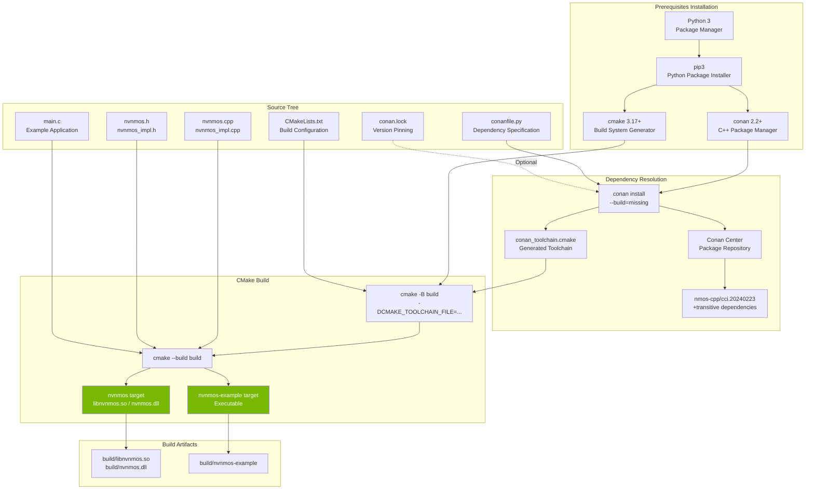

**Sources:** [README.md:93-268](), [src/CMakeLists.txt:1-145](), [src/conanfile.py:1-25]()

---

## Prerequisites

The build system requires three foundational tools that must be installed before building nvnmos:

| Tool | Minimum Version | Purpose |
|------|----------------|---------|
| **Python 3** | 3.x | Runtime for CMake and Conan installers |
| **pip** | Latest | Python package installer for CMake and Conan |
| **CMake** | 3.17 | Build system generator |
| **Conan** | 2.2 | C++ dependency manager |

### Platform-Specific Installation

#### Python and pip Installation

**Linux:**

```sh
sudo apt install -y python3-pip
pip3 install --upgrade pip
```

The `-y` flag allows `apt install` to run non-interactively.

**Windows:**

Download and install Python 3 using PowerShell:

```PowerShell
Invoke-WebRequest `
  https://www.python.org/ftp/python/3.10.9/python-3.10.9-amd64.exe `
  -OutFile python-3.10.9-amd64.exe

./python-3.10.9-amd64.exe /quiet PrependPath=1 Include_tcltk=0 Include_test=0

pip3 install --upgrade pip
```

**Sources:** [README.md:93-127]()

#### CMake Installation

The build requires CMake 3.17 or higher. The project rejects CMake 3.24+ when using `CMAKE_PROJECT_TOP_LEVEL_INCLUDES` unless explicitly supported.

**Linux:**

```sh
pip3 install cmake~=3.17
```

On platforms like Jetson where the system CMake (3.10) is insufficient, the pip-installed CMake binary is placed in `/home/<userid>/.local/bin`. Add this directory to your `PATH`:

```sh
export PATH=/home/<userid>/.local/bin:${PATH}
```

**Windows:**

```sh
pip3 install cmake~=3.17
```

**Sources:** [README.md:129-156](), [src/CMakeLists.txt:16-24]()

#### Conan Installation

Conan 2.2 or higher is required for dependency management. Version 2.5.0 has been tested.

**Linux:**

```sh
pip3 install conan~=2.2 --upgrade
conan profile detect
```

On Jetson platforms, ensure `/home/<userid>/.local/bin` is in your `PATH`.

**Windows:**

```sh
pip3 install conan~=2.2 --upgrade
conan profile detect
```

The `conan profile detect` command automatically creates a default Conan profile based on the system's compiler and build environment.

**Sources:** [README.md:158-183]()

---

## Dependency Management with Conan

The nvnmos library depends on Sony's nmos-cpp library and its transitive dependencies. Conan automates fetching, building, and configuring these dependencies.

### Dependency Tree

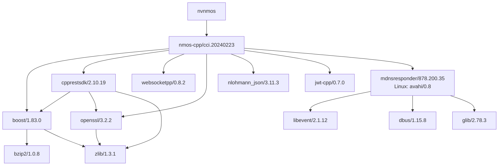

**Sources:** [src/conanfile.py:23-24](), [src/conan.lock:1-56]()

### Conan Install Command

Prepare a `build` directory adjacent to the `src` directory:

```sh
mkdir build
```

**Linux:**

Install dependencies and generate the CMake toolchain file:

```sh
conan install src \
  -g CMakeToolchain \
  --settings:all build_type=<Release-or-Debug> \
  --build=missing \
  --output-folder=src/conan
```

**Windows:**

```PowerShell
conan install src `
  -g CMakeToolchain `
  --settings:all build_type=<Release-or-Debug> `
  --build=missing `
  --output-folder=src/conan
```

For Visual Studio multi-config builds, repeat the command for both `Debug` and `Release` configurations.

The `--build=missing` flag instructs Conan to build any dependencies that don't have precompiled binaries available for your platform.

**Sources:** [README.md:189-246]()

### Conan Lock File

The [conan.lock]() file pins exact versions of all dependencies to ensure reproducible builds across different environments and times. This file locks:

- Direct dependency: `nmos-cpp/cci.20240223`
- 26 transitive runtime dependencies (e.g., `boost/1.83.0`, `openssl/3.2.2`)
- 22 build-time dependencies (e.g., `cmake/3.30.0`, `ninja/1.11.1`)

To use the lock file, include `--lockfile=conan.lock` in the `conan install` command. The Dockerfile uses this by default via the `USE_CONAN_LOCK` build argument.

**Sources:** [src/conan.lock:1-56](), [README.md:89]()

### Generated Artifacts

The `conan install` command generates several files in the `src/conan` directory:

| File | Purpose |
|------|---------|
| `conan_toolchain.cmake` | CMake toolchain file with compiler flags and dependency paths |
| `CMakeDeps` files | CMake find-module files for each dependency |
| `conanbuild.*` | Platform-specific build environment scripts |
| `conaninfo.txt` | Metadata about installed dependencies |

**Sources:** [README.md:195-246](), [src/conanfile.py:21]()

---

## CMake Configuration and Build

### CMake Project Structure

The CMake build is configured through several files:

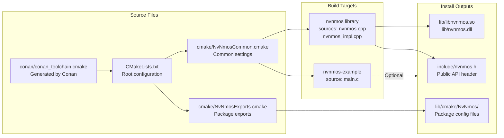

**Sources:** [src/CMakeLists.txt:1-145]()

### CMake Configuration

**Linux:**

Configure the build system with the Conan-generated toolchain:

```sh
cmake -B build \
  -DCMAKE_TOOLCHAIN_FILE=conan/conan_toolchain.cmake \
  -DCMAKE_BUILD_TYPE=<Release-or-Debug> \
  src
```

**Windows:**

For Visual Studio 2022:

```PowerShell
cmake -B build `
  -G "Visual Studio 17 2022" `
  -DCMAKE_TOOLCHAIN_FILE=conan/conan_toolchain.cmake `
  -DCMAKE_CONFIGURATION_TYPES="Debug;Release" `
  src
```

The `-G` flag specifies the generator. Windows uses multi-config generators that support both Debug and Release in a single build tree.

**Sources:** [README.md:208-258]()

### CMake Build Options

The following CMake options control the build:

| Option | Default | Description |
|--------|---------|-------------|
| `BUILD_SHARED_LIBS` | `ON` | Build nvnmos as a shared library (.so/.dll) |
| `NVNMOS_BUILD_EXAMPLES` | `ON` | Build the nvnmos-example application |
| `USE_ADD_SUBDIRECTORY` | `OFF` | Use nmos-cpp as a subdirectory instead of find_package |

Example of customizing build options:

```sh
cmake -B build \
  -DCMAKE_TOOLCHAIN_FILE=conan/conan_toolchain.cmake \
  -DCMAKE_BUILD_TYPE=Release \
  -DBUILD_SHARED_LIBS=OFF \
  -DNVNMOS_BUILD_EXAMPLES=OFF \
  src
```

**Sources:** [src/CMakeLists.txt:28-52]()

### Building the Library

**Linux:**

Build all targets using parallel compilation:

```sh
cmake --build build --parallel
```

**Windows:**

Build with a specific configuration:

```sh
cmake --build build --config <Release-or-Debug> --parallel
```

Alternatively, open the generated Visual Studio solution (`build/NvNmos.sln`) and build through the IDE.

**Sources:** [README.md:220-267]()

### Build Target Details

The CMake configuration defines two primary targets:

#### nvnmos Library Target

The `nvnmos` target is defined at [src/CMakeLists.txt:71-110]():

- **Sources:** `nvnmos.cpp`, `nvnmos_impl.cpp`
- **Public headers:** `nvnmos.h`
- **Private headers:** `nvnmos_impl.h`
- **Dependencies:** `nmos-cpp::nmos-cpp`, `nmos-cpp::compile-settings`
- **Output:** `libnvnmos.so` (Linux) or `nvnmos.dll` (Windows)

When `BUILD_SHARED_LIBS=ON`, the library is compiled with `NVNMOS_EXPORTS` defined. When `BUILD_SHARED_LIBS=OFF`, it's a static library with `NVNMOS_STATIC` defined.

An alias target `nvnmos::nvnmos` is also created for consistent naming when consumed as a CMake package.

#### nvnmos-example Executable Target

The `nvnmos-example` target is defined at [src/CMakeLists.txt:112-140]():

- **Sources:** `main.c`
- **Dependencies:** `nvnmos` library
- **Output:** `nvnmos-example` executable
- **Conditional:** Only built when `NVNMOS_BUILD_EXAMPLES=ON`

**Sources:** [src/CMakeLists.txt:56-140]()

---

## Build Outputs

After a successful build, the following artifacts are created in the `build` directory:

### Linux Build Outputs

```
build/
├── libnvnmos.so              # Shared library
├── nvnmos-example            # Example executable
└── lib/
    └── cmake/
        └── NvNmos/           # CMake package config files
```

### Windows Build Outputs

```
build/
├── Debug/
│   ├── nvnmos.dll            # Debug shared library
│   ├── nvnmos.lib            # Import library
│   └── nvnmos-example.exe    # Debug executable
├── Release/
│   ├── nvnmos.dll            # Release shared library
│   ├── nvnmos.lib            # Import library
│   └── nvnmos-example.exe    # Release executable
└── lib/
    └── cmake/
        └── NvNmos/           # CMake package config files
```

### Installed Outputs

The CMake install target places files in the configured install prefix (default: `/usr/local` on Linux, `C:\Program Files\NvNmos` on Windows):

```
<install-prefix>/
├── include/
│   └── nvnmos.h              # Public API header
├── lib/
│   ├── libnvnmos.so          # Shared library (Linux)
│   ├── nvnmos.dll            # Shared library (Windows)
│   └── cmake/
│       └── NvNmos/
│           ├── NvNmosConfig.cmake
│           ├── NvNmosTargets.cmake
│           └── NvNmosTargets-<config>.cmake
└── bin/
    └── nvnmos-example        # Example executable (optional)
```

**Sources:** [src/CMakeLists.txt:102-145]()

---

## Verifying the Build

After building, verify that the library and example were compiled successfully:

**Linux:**

```sh
# Check library
file build/libnvnmos.so
ldd build/libnvnmos.so

# Check example
file build/nvnmos-example
./build/nvnmos-example --help
```

**Windows:**

```PowerShell
# Check library
dir build\Release\nvnmos.dll

# Check example
.\build\Release\nvnmos-example.exe --help
```

The example application requires runtime dependencies (DNS-SD daemon) to function properly. For complete runtime setup and execution instructions, see [Running the Example Application](#2.3).

**Sources:** [README.md:292-331]()

---

## Alternative: Using add_subdirectory

Instead of using Conan to find the nmos-cpp package, you can build it as a CMake subdirectory. This approach is useful for development but requires manually managing all dependencies:

```sh
cmake -B build \
  -DUSE_ADD_SUBDIRECTORY=ON \
  -DNMOS_CPP_DIRECTORY=/path/to/nmos-cpp/Development \
  -DCMAKE_BUILD_TYPE=Release \
  src
```

This option is controlled at [src/CMakeLists.txt:38-52]().

**Note:** This method requires that nmos-cpp's dependencies (Boost, cpprestsdk, etc.) are already available on the system or configured through other means.

**Sources:** [src/CMakeLists.txt:38-52]()

---

## Troubleshooting Build Issues

Common build problems and solutions:

| Issue | Symptom | Solution |
|-------|---------|----------|
| **CMake version too old** | `CMake 3.17 or higher is required` | Install CMake 3.17+ via pip: `pip3 install cmake~=3.17` |
| **Conan profile not found** | `ERROR: Conan config file not found` | Run `conan profile detect` to create default profile |
| **Missing dependencies** | `Package 'nmos-cpp' not found` | Run `conan install` command before CMake configuration |
| **Toolchain file not found** | `CMake Error: Could not find toolchain file` | Ensure `conan install` completed and `--output-folder=src/conan` was used |
| **Compiler not supported** | Conan errors about compiler version | Check that your compiler is compatible: GCC 11+ or Visual Studio 2022 |

For additional troubleshooting information, see [Common Build Issues](#9.1).

**Sources:** [README.md:93-268](), [src/CMakeLists.txt:16-24]()

---

# Page: Using Docker

# Using Docker

<details>
<summary>Relevant source files</summary>

The following files were used as context for generating this wiki page:

- [Dockerfile](Dockerfile)
- [README.md](README.md)
- [entrypoint.sh](entrypoint.sh)

</details>


## Purpose and Scope

This page describes how to build and run the nvnmos library using Docker containers. Docker provides a self-contained environment that handles all dependencies and build requirements, producing distributable packages that can be deployed to compatible host systems.

For manual builds without Docker, see [Building from Source](#2.1). For information about running the built artifacts, see [Running the Example Application](#2.3).

---

## Docker Build Overview

The nvnmos repository provides a Dockerfile that implements a multi-stage build process. This approach separates build-time dependencies from runtime requirements, producing a minimal final container and a portable tarball package.

**Multi-Stage Build Architecture**

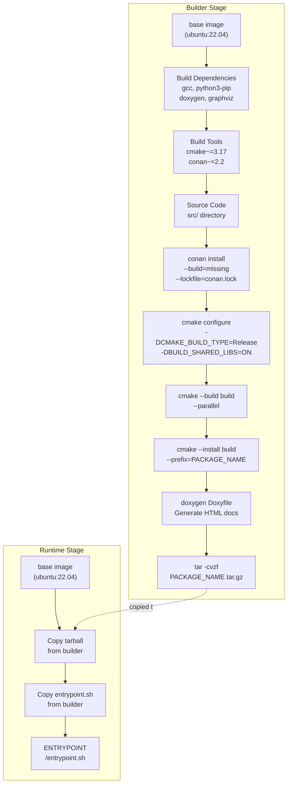

**Sources:** [Dockerfile:1-88](), [README.md:59-91]()

---

## Building the Container Image

### Basic Build Command

Build the container image with the default configuration:

```sh
docker build -t nvnmos .
```

This command executes the multi-stage build defined in [Dockerfile:1-88](), producing a container tagged as `nvnmos`.

**Sources:** [README.md:63-65]()

### Build Process Stages

#### Stage 1: Builder (lines 22-72)

The builder stage performs the complete build process:

| Step | Command Location | Purpose |
|------|-----------------|---------|
| Install system packages | [Dockerfile:34]() | gcc, python3-pip, doxygen, graphviz |
| Install Python tools | [Dockerfile:35-36]() | CMake 3.17+, Conan 2.2+ |
| Copy source code | [Dockerfile:40]() | src/ directory contents |
| Install dependencies | [Dockerfile:46-53]() | Conan dependency resolution |
| Configure build | [Dockerfile:55-59]() | CMake configuration with toolchain |
| Compile | [Dockerfile:61]() | Parallel build execution |
| Install to prefix | [Dockerfile:63]() | Stage files into PACKAGE_NAME directory |
| Copy metadata | [Dockerfile:65-67]() | conan.lock, LICENSE, README.md |
| Generate docs | [Dockerfile:69]() | Doxygen HTML documentation |
| Create package | [Dockerfile:71]() | Tarball for distribution |

**Conan Dependency Installation Details**

The [Dockerfile:46-53]() command installs dependencies using the following configuration:

```sh
conan install . \
    -g CMakeToolchain \
    --settings:all build_type=Release \
    --build=missing \
    --output-folder=conan \
    --lockfile=${USE_CONAN_LOCK:+conan.lock} \
    --lockfile-partial \
    --lockfile-out=conan.lock
```

This command uses the `conan.lock` file (when `USE_CONAN_LOCK=1`) to ensure reproducible builds with locked dependency versions. The `--build=missing` flag allows Conan to build dependencies from source if prebuilt binaries are unavailable.

**CMake Configuration**

The [Dockerfile:55-59]() command configures the build:

```sh
cmake -B build \
    -DCMAKE_TOOLCHAIN_FILE=conan/conan_toolchain.cmake \
    -DCMAKE_BUILD_TYPE=Release \
    -DBUILD_SHARED_LIBS=ON \
    .
```

The `conan_toolchain.cmake` file provides compiler flags, library paths, and dependency information from the Conan installation.

**Sources:** [Dockerfile:22-72]()

#### Stage 2: Runtime (lines 73-88)

The runtime stage creates a minimal container containing only the packaged artifacts:

```dockerfile
FROM ${BASE_IMAGE}

COPY --from=builder \
    /src/${PACKAGE_NAME}.tar.gz \
    /entrypoint.sh \
    .

ENTRYPOINT ["/entrypoint.sh"]
```

This stage copies the tarball from the builder stage and sets up the entrypoint script, resulting in a much smaller final image.

**Sources:** [Dockerfile:73-88]()

---

## Build Arguments

The Dockerfile accepts several build arguments for customization:

| Argument | Default | Purpose | Example Usage |
|----------|---------|---------|---------------|
| `BASE_IMAGE` | `ubuntu:22.04` | Base container image | `--build-arg BASE_IMAGE=ubuntu:24.04` |
| `PACKAGE_SUFFIX` | Based on `BASE_IMAGE` | Package filename suffix | `--build-arg PACKAGE_SUFFIX=-custom` |
| `USE_CONAN_LOCK` | `1` | Enable reproducible builds via conan.lock | `--build-arg USE_CONAN_LOCK=0` |

### Package Naming

The package name is constructed from the base image [Dockerfile:31-32]():

```sh
ENV _BASE_IMAGE=${BASE_IMAGE//\//-}
ENV PACKAGE_NAME=nvnmos${PACKAGE_SUFFIX:--${_BASE_IMAGE//:/-}}
```

For example, with `BASE_IMAGE=ubuntu:22.04`, the package becomes `nvnmos-ubuntu-22.04.tar.gz`.

### Example: Custom Build

Build with Ubuntu 24.04 and a custom suffix:

```sh
docker build \
  --build-arg BASE_IMAGE=ubuntu:24.04 \
  --build-arg PACKAGE_SUFFIX=-custom \
  -t nvnmos:custom .
```

**Sources:** [README.md:81-90](), [Dockerfile:16-32]()

---

## Extracting the Package

After building, extract the package tarball from the container to the host system:

```sh
docker create --name nvnmos-test nvnmos
docker cp nvnmos-test:/nvnmos-ubuntu-22.04.tar.gz .
docker rm nvnmos-test
```

This sequence creates a temporary container, copies the package, and removes the container. The tarball contains:

- `lib/` - Shared libraries (libnvnmos.so or nvnmos.dll)
- `bin/` - Example application (nvnmos-example)
- `include/` - Public headers (nvnmos.h)
- `html/` - API documentation
- `conan.lock` - Dependency lock file
- `LICENSE`, `README.md` - Metadata files

**Sources:** [README.md:69-73](), [Dockerfile:63-69]()

---

## Running the Container

### Interactive Container Usage

Launch an interactive shell in the container:

```sh
docker run -it nvnmos /bin/bash
```

This executes the entrypoint script [entrypoint.sh:1-33]() which:

1. Installs runtime dependencies (dbus, avahi-daemon)
2. Starts system services
3. Extracts the package tarball
4. Runs the example application with auto-detected hostname and IP

**Sources:** [README.md:77-79]()

### Entrypoint Script Workflow

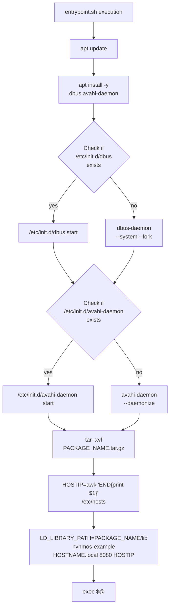

**Sources:** [entrypoint.sh:1-33]()

### Runtime Dependencies

The entrypoint installs and starts required services [entrypoint.sh:20-24]():

| Service | Package | Startup Method | Purpose |
|---------|---------|----------------|---------|
| D-Bus | `dbus` | `/etc/init.d/dbus start` or `dbus-daemon --system --fork` | Inter-process communication |
| Avahi | `avahi-daemon` | `/etc/init.d/avahi-daemon start` or `avahi-daemon --daemonize` | mDNS service discovery |

The script handles both traditional init systems and newer systemd-based containers by checking for init scripts before attempting direct daemon invocation.

**Sources:** [entrypoint.sh:20-24]()

### Application Execution

The example application is launched with environment-derived parameters [entrypoint.sh:28-30]():

```sh
export HOSTIP=`awk 'END{print $1}' /etc/hosts`
yes | LD_LIBRARY_PATH=${PACKAGE_NAME}/lib ${PACKAGE_NAME}/bin/nvnmos-example ${HOSTNAME}.local 8080 ${HOSTIP}
```

| Parameter | Value | Source | Purpose |
|-----------|-------|--------|---------|
| Hostname | `${HOSTNAME}.local` | Container hostname | mDNS service name |
| Port | `8080` | Hardcoded | HTTP API port |
| IP Address | `${HOSTIP}` | `/etc/hosts` | Network interface for mock senders/receivers |

The `yes` command automatically responds to application prompts, allowing unattended execution.

**Sources:** [entrypoint.sh:28-30]()

---

## Docker Build Flow

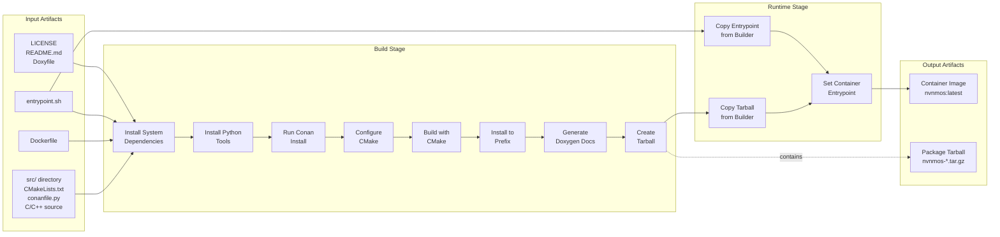

**Sources:** [Dockerfile:1-88](), [entrypoint.sh:1-33]()

---

## Package Contents and Structure

The tarball extracted from the container contains the complete build artifacts organized by directory:

| Directory/File | Contents | Description |
|---------------|----------|-------------|
| `bin/` | `nvnmos-example` | Example application executable |
| `lib/` | `libnvnmos.so` (Linux) | Shared library for nvnmos |
| `include/` | `nvnmos.h` | Public C API header |
| `html/` | Documentation files | Doxygen-generated API documentation |
| `conan.lock` | Lock file | Locked dependency versions |
| `LICENSE` | Apache 2.0 license | License text |
| `README.md` | Project readme | Getting started guide |

The package can be extracted on any compatible system (matching OS/architecture) and used independently of Docker. The `LD_LIBRARY_PATH` environment variable must be set to include the `lib/` directory when running the example application.

**Sources:** [Dockerfile:63-69](), [entrypoint.sh:26-30]()

---

## Advanced: Customizing the Build

### Using a Different Base Image

To build for a different Ubuntu version:

```sh
docker build \
  --build-arg BASE_IMAGE=ubuntu:24.04 \
  --build-arg PACKAGE_SUFFIX=-ubuntu-24.04 \
  -t nvnmos:ubuntu24 .
```

### Disabling Locked Dependencies

To allow Conan to use the latest available dependency versions:

```sh
docker build \
  --build-arg USE_CONAN_LOCK=0 \
  -t nvnmos:latest-deps .
```

This is useful for testing compatibility with newer dependency versions but may produce non-reproducible builds.

**Warning:** Disabling the lock file may result in build failures if newer dependency versions introduce breaking changes.

**Sources:** [Dockerfile:46-53](), [README.md:89]()

---

## Summary

The Docker build process provides a complete, self-contained build environment that:

1. Installs all build dependencies via system packages and Python tools
2. Uses Conan to manage C++ library dependencies with optional version locking
3. Builds the nvnmos library and example application using CMake
4. Generates API documentation with Doxygen
5. Packages everything into a portable tarball
6. Creates a minimal runtime container with only the necessary artifacts

The multi-stage design separates build complexity from runtime requirements, producing both a deployable container image and an extractable package suitable for host installation.

**Sources:** [Dockerfile:1-88](), [entrypoint.sh:1-33](), [README.md:59-91]()

---

# Page: Running the Example Application

# Running the Example Application

<details>
<summary>Relevant source files</summary>

The following files were used as context for generating this wiki page:

- [README.md](README.md)
- [src/main.c](src/main.c)

</details>


This document provides a walkthrough of the `nvnmos-example` application included with the NvNmos library. The example demonstrates the complete lifecycle of an NMOS Node, including resource creation, dynamic management, connection activation, and cleanup. This is a mock application that does not perform actual media transport; it focuses on demonstrating the NMOS control plane API.

For instructions on building the example application, see [Building from Source](#2.1). For containerized execution, see [Using Docker](#2.2). For details on the NMOS resource model and connection activation concepts demonstrated by this example, see [Core Concepts](#3).

## Prerequisites

Before running the example application, ensure runtime dependencies are installed and running.

### Linux Requirements

The Avahi daemon must be running to provide DNS-SD (mDNS) service discovery:

```bash
apt update
apt install -y dbus avahi-daemon

/etc/init.d/dbus start
/etc/init.d/avahi-daemon start
```

**Note:** On Ubuntu 24.04 and later, use `avahi-daemon --daemonize` instead of the init script.

### Windows Requirements

The Bonjour Service must be installed and running. Download from Apple's [Bonjour Print Services v2.0.2](https://support.apple.com/kb/DL999).

Sources: [README.md:271-290]()

## Command Line Interface

### Basic Syntax

```bash
nvnmos-example <host-name> <port> <iface-ip> [log-level]
```

### Parameters

| Parameter | Required | Description |
|-----------|----------|-------------|
| `host-name` | Yes | Registry hostname for discovery. Use `.local` suffix for mDNS or FQDN for unicast DNS-SD |
| `port` | Yes | HTTP port for serving NMOS APIs (IS-04, IS-05, IS-09) |
| `iface-ip` | Yes | IP address of network interface for mock senders/receivers |
| `log-level` | No | Logging verbosity: -40 (most verbose) to 40 (least verbose). Values > 0 are warnings/errors, < 0 are debug/trace |

### Example Invocations

**Multicast DNS-SD discovery:**
```bash
nvnmos-example nmos-api.local 8080 192.0.2.0
```

**Unicast DNS-SD discovery:**
```bash
nvnmos-example api.example.com 8080 192.168.1.100
```

**With verbose logging:**
```bash
nvnmos-example nmos-api.local 8080 192.0.2.0 -20
```

Sources: [README.md:295-312](), [src/main.c:228-234]()

## Application Workflow

The example application executes a predefined sequence of operations that demonstrate the NvNmos API's capabilities. Each step pauses for user confirmation before proceeding.

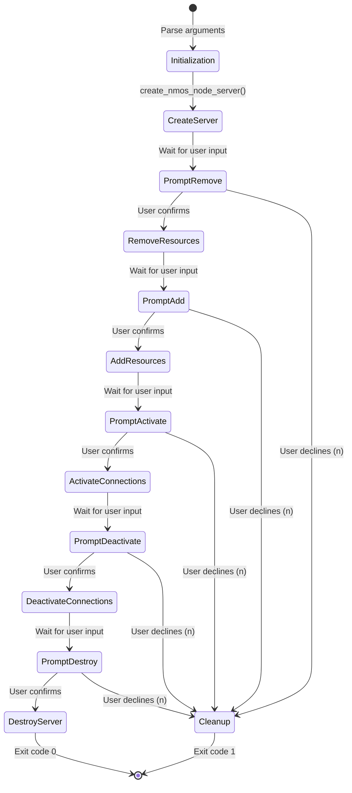

**Application Workflow State Machine**

Sources: [src/main.c:297-322](), [README.md:313-330]()

### Workflow Phases

The application outputs the following status messages as it progresses:

```
Creating NvNmos server...
Removing some senders and receivers...
Adding back some senders and receivers...
Activating senders and receivers...
Deactivating senders and receivers...
Destroying NvNmos server...
Finished
```

After each phase (except initialization), the application prompts:
```
Continue ([y]/n)?
```

- Pressing Enter or `y` continues to the next phase
- Pressing `n` triggers cleanup and exits with code 1
- Successful completion (all phases) exits with code 0

Sources: [README.md:313-330](), [src/main.c:218-226]()

## Initialization and Configuration

### Node Configuration Structure

The application constructs an `NvNmosNodeConfig` structure containing asset information, network settings, and initial resources.

```mermaid
graph TB
    subgraph "Node Configuration (main.c:248-296)"
        NodeConfig["NvNmosNodeConfig<br/>node_config"]
        AssetConfig["NvNmosAssetConfig<br/>asset_config"]
        ReceiverConfigs["NvNmosReceiverConfig[2]<br/>source_config"]
        SenderConfigs["NvNmosSenderConfig[2]<br/>sink_config"]
        
        NodeConfig --> AssetConfig
        NodeConfig --> ReceiverConfigs
        NodeConfig --> SenderConfigs
    end
    
    subgraph "Asset Tags"
        Manufacturer["manufacturer: 'Acme'"]
        Product["product: 'Widget Pro'"]
        InstanceID["instance_id: 'XYZ123-456789'"]
        Functions["functions: ['Example']"]
        
        AssetConfig --> Manufacturer
        AssetConfig --> Product
        AssetConfig --> InstanceID
        AssetConfig --> Functions
    end
    
    subgraph "Network Settings"
        HostName["host_name: argv[1]"]
        Port["http_port: argv[2]"]
        Seed["seed: 'hostname:port'"]
        
        NodeConfig --> HostName
        NodeConfig --> Port
        NodeConfig --> Seed
    end
    
    subgraph "Callbacks"
        LogCallback["log_callback:<br/>handle_log()"]
        RTPCallback["rtp_connection_activated:<br/>handle_rtp_connection_activated()"]
        LogLevel["log_level: NVNMOS_LOG_ERROR"]
        
        NodeConfig --> LogCallback
        NodeConfig --> RTPCallback
        NodeConfig --> LogLevel
    end
    
    subgraph "Initial Resources"
        Receiver0["source-0<br/>Video Receiver<br/>1920x1080p50"]
        Receiver1["source-1<br/>Audio Receiver<br/>2ch 48kHz 24bit"]
        Sender0["sink-0<br/>Video Sender<br/>1920x1080p50"]
        Sender1["sink-1<br/>Audio Sender<br/>2ch 48kHz 24bit"]
        
        ReceiverConfigs --> Receiver0
        ReceiverConfigs --> Receiver1
        SenderConfigs --> Sender0
        SenderConfigs --> Sender1
    end
```

**Node Configuration Object Structure**

Sources: [src/main.c:240-296]()

### Mock Resources

The application creates four initial resources using generated SDP configurations:

| Resource ID | Type | Media Type | Format | Description |
|-------------|------|------------|--------|-------------|
| `source-0` | Receiver | Video | ST 2110-20 | YCbCr-4:2:2, 10-bit, 1920x1080p50 |
| `source-1` | Receiver | Audio | ST 2110-30 | 2 channels, 48 kHz, 24-bit |
| `sink-0` | Sender | Video | ST 2110-20 | YCbCr-4:2:2, 10-bit, 1920x1080p50 |
| `sink-1` | Sender | Audio | ST 2110-30 | 2 channels, 48 kHz, 24-bit |

Each resource is configured with:
- **Group hint**: Logical grouping (e.g., `rx-0:video`, `tx-0:audio`)
- **Interface IP**: Network interface from `iface-ip` argument
- **Multicast addresses**: From MCAST-TEST-NET range (233.252.0.0/24)
- **RTP ports**: Conventional assignments (video: 5020, audio: 5030)
- **Clock reference**: PTP (IEEE1588-2008) or local MAC depending on `CLK_PTP` define

Sources: [src/main.c:91-216](), [src/main.c:263-286]()

### SDP Generation Functions

The application uses two helper functions to construct SDP strings:

- **`init_video_sdp()`** [src/main.c:91-152](): Generates SDP for video senders/receivers
- **`init_audio_sdp()`** [src/main.c:155-216](): Generates SDP for audio senders/receivers

Both functions support compile-time configuration via preprocessor macros for different video codecs (ST 2110-20 raw video or ST 2110-22 JPEG XS).

Sources: [src/main.c:24-65](), [src/main.c:91-216]()

## Dynamic Resource Management

The application demonstrates adding and removing resources at runtime.

### Phase 1: Resource Removal

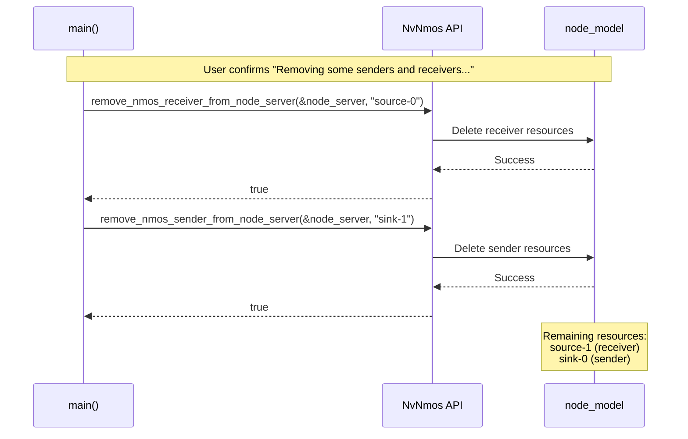

**Resource Removal Sequence**

The application removes:
- **`source-0`**: Video receiver
- **`sink-1`**: Audio sender

Sources: [src/main.c:300-302]()

### Phase 2: Resource Addition

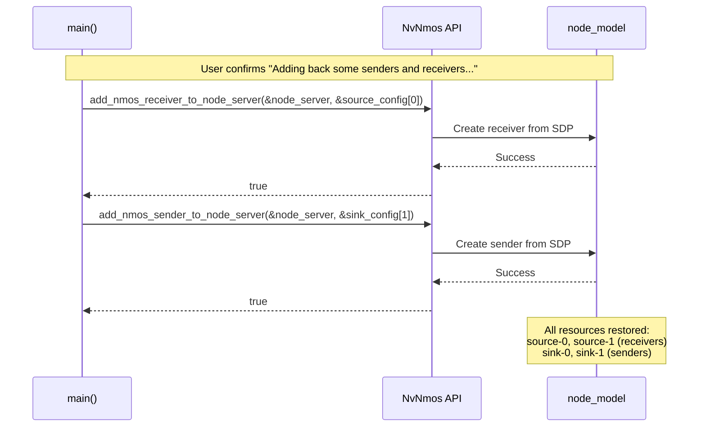

**Resource Addition Sequence**

The application re-adds the previously removed resources using the same configurations.

Sources: [src/main.c:304-306]()

## Connection Activation

The application demonstrates programmatic connection activation using `nmos_connection_rtp_activate()`. This simulates what would normally be triggered by an NMOS Controller via IS-05 Connection API.

### Activation Phase

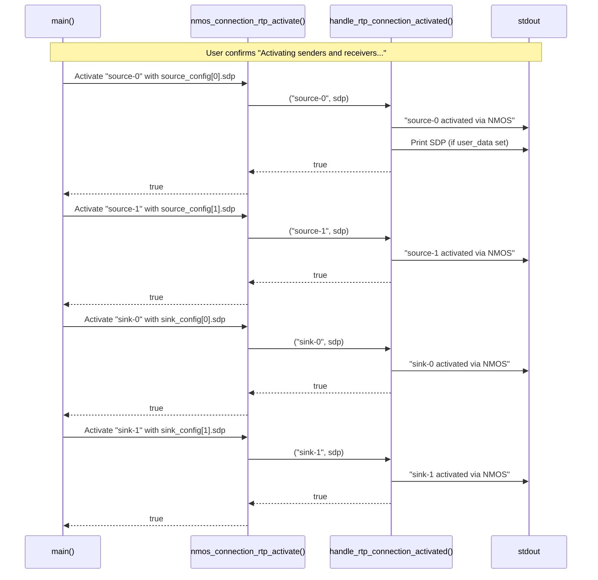

**Connection Activation Sequence**

Sources: [src/main.c:308-312](), [src/main.c:80-88]()

### Deactivation Phase

Deactivation follows the same pattern but passes `NULL` instead of an SDP string:

```c
nmos_connection_rtp_activate(&node_server, "source-0", NULL);
```

The callback receives `NULL` for the `sdp` parameter and prints:
```
source-0 deactivated via NMOS
```

Sources: [src/main.c:314-318](), [src/main.c:80-88]()

### Callback Implementation

The `handle_rtp_connection_activated()` callback demonstrates proper response handling:

```c
static bool handle_rtp_connection_activated(
    NvNmosNodeServer *server,
    const char *id,
    const char *sdp)
{
    printf("%s %s\n", id, sdp ? "activated via NMOS" : "deactivated via NMOS");
    if (server->user_data && sdp) printf("%s\n", sdp);
    return true;
}
```

**Key behaviors:**
- Returns `true` to indicate successful handling
- Distinguishes activation (sdp != NULL) from deactivation (sdp == NULL)
- Optionally prints SDP content based on `user_data` flag
- In a real application, this would configure actual media transport

Sources: [src/main.c:80-88](), [src/main.c:294-295]()

## Accessing NMOS APIs

While the application is running, the NMOS Node exposes standard IS-04, IS-05, and IS-09 HTTP APIs.

### API Endpoints

The base URL for all APIs is:
```
http://<host-address>:<port>/
```

Where:
- `<host-address>` is the local IP address or hostname
- `<port>` is the value provided as the second command-line argument

### Available APIs

| API | Specification | Typical Path | Description |
|-----|---------------|--------------|-------------|
| Node API | IS-04 | `/x-nmos/node/v1.3/` | Node, device, sender, receiver resources |
| Connection API | IS-05 | `/x-nmos/connection/v1.1/` | Connection management, staged parameters |
| System API | IS-09 | `/x-nmos/system/v1.0/` | Global system parameters |

### Example Queries

**List all receivers:**
```bash
curl http://192.168.1.100:8080/x-nmos/node/v1.3/receivers/
```

**Get specific sender details:**
```bash
curl http://192.168.1.100:8080/x-nmos/node/v1.3/senders/sink-0/
```

**View receiver connection status:**
```bash
curl http://192.168.1.100:8080/x-nmos/connection/v1.1/single/receivers/source-0/active/
```

Sources: [README.md:332-338]()

## Callback Mechanisms

The example demonstrates two callback types that enable bidirectional communication between the application and the NvNmos library.

### Logging Callback

The `handle_log()` function receives all internal log messages:

```c
static void handle_log(
    NvNmosNodeServer *server,
    const char *categories,
    int level,
    const char *message)
{
    printf("%s [%d:%s]\n", message, level, categories);
}
```

**Parameters:**
- `categories`: Comma-separated log categories (e.g., "nmos,node")
- `level`: Numeric severity (-40 to 40)
- `message`: Log message text

The callback filters messages based on `node_config.log_level` before invocation.

Sources: [src/main.c:71-78](), [src/main.c:290-291]()

### RTP Connection Activated Callback

The `handle_rtp_connection_activated()` callback is invoked when:
- Application calls `nmos_connection_rtp_activate()` (as shown in this example)
- NMOS Controller sends IS-05 Connection API activation request

This callback is where a real application would:
- Parse the SDP to extract transport parameters
- Configure ST 2110 data plane (Rivermax, DeepStream, etc.)
- Start or stop media streams
- Validate that resources are available

The example simply logs the activation and returns `true` to indicate success.

Sources: [src/main.c:80-88](), [src/main.c:288]()

## Troubleshooting

### Port Already in Use

**Symptom:**
```
asio listen error: system:98 (Address already in use)
```

**Cause:** Another process is using the specified HTTP port.

**Solution:** 
- Use a different port number in the command-line arguments
- Stop the conflicting process
- On Linux, find the process with: `sudo lsof -i :<port>`

Sources: [README.md:342-349]()

### DNS-SD Service Errors

**Symptom:**
```
DNSServiceRegister reported error: -65537 while registering advertisement for: ...
DNSServiceBrowse reported error: -65537
```

**Cause:** DNS-SD daemon/service is not running.

**Solution:**

**Linux:**
```bash
sudo systemctl status avahi-daemon
sudo systemctl start avahi-daemon
```

**Windows:**
- Verify Bonjour Service is running in Services panel
- Restart the service if necessary

When DNS-SD fails, the Node cannot discover or register with NMOS Registries.

Sources: [README.md:363-382]()

### Avahi Compatibility Warnings

**Symptom:**
```
*** WARNING *** The program 'nvnmos-example' uses the Apple Bonjour compatibility layer of Avahi.
*** WARNING *** Please fix your application to use the native API of Avahi!
```

**Cause:** The nmos-cpp library uses DNS-SD APIs compatible with both Avahi and Bonjour.

**Impact:** These warnings are informational and can be safely ignored. They do not indicate a problem.

Sources: [README.md:351-360]()

### Application Exits Immediately

**Symptom:** The application exits with code 1 before completing workflow.

**Possible causes:**
- Invalid command-line arguments (insufficient parameters)
- Port conflict during initialization
- DNS-SD service unavailable
- User declined to continue at a prompt
- SDP generation buffer overflow (rare)

**Debugging:**
- Run with verbose logging: `nvnmos-example <args> -40`
- Check system logs for DNS-SD errors
- Verify all prerequisites are met
- Check return values and error messages in console output

Sources: [src/main.c:230-234](), [src/main.c:325-327]()

---

# Page: Core Concepts

# Core Concepts

<details>
<summary>Relevant source files</summary>

The following files were used as context for generating this wiki page:

- [README.md](README.md)
- [src/nvnmos.h](src/nvnmos.h)
- [src/nvnmos_impl.cpp](src/nvnmos_impl.cpp)

</details>


This page introduces the fundamental concepts of NMOS (Networked Media Open Specifications) and how the nvnmos library implements them. It covers the separation of control plane and data plane, the NMOS resource model, and the role of Session Description Protocol (SDP) in configuring media streams.

For detailed API documentation, see [API Reference](#4). For integration patterns with ST 2110 data plane libraries, see [Integration Guide](#7).

## NMOS Overview

NMOS provides industry-standard APIs for discovering, registering, and managing professional media devices on IP networks. The nvnmos library implements the **control plane** for NMOS, handling registration, discovery, and connection management, while delegating the **data plane** (actual media transport) to external libraries like NVIDIA Rivermax or DeepStream.

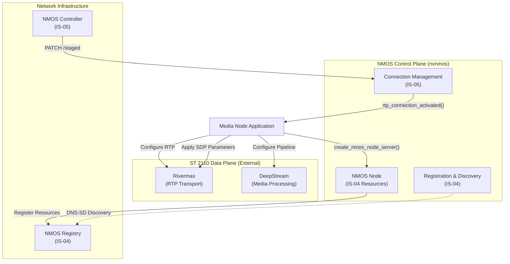

**Sources:** [src/nvnmos.h:18-56](), [README.md:20-43]()

## NMOS Resource Model

NMOS defines a hierarchical resource model that describes the capabilities and configuration of media devices. The nvnmos library manages these resources internally and exposes them via HTTP APIs.

### Resource Hierarchy

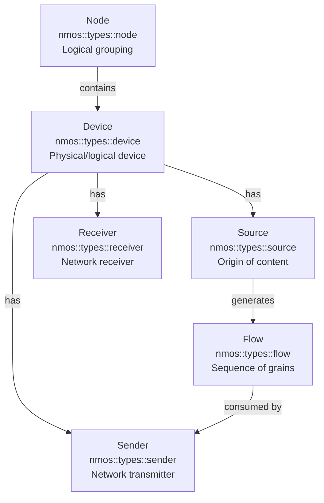

**Resource Creation Flow:**

| Application Action | Internal Resources Created | ID Generation |
|-------------------|---------------------------|---------------|
| `add_nmos_sender_to_node_server(sdp)` | Source, Flow, Sender | `impl::make_id(seed_id, type, internal_id)` |
| `add_nmos_receiver_to_node_server(sdp)` | Receiver | `impl::make_id(seed_id, type, internal_id)` |

**Sources:** [src/nvnmos_impl.cpp:190-387](), [src/nvnmos_impl.cpp:389-564](), [src/nvnmos_impl.cpp:1365-1368]()

### Resource Identification

Each sender and receiver is identified by:

1. **Internal ID**: Application-provided identifier specified in SDP via `x-nvnmos-id` attribute
2. **Resource ID**: UUID generated deterministically from seed and internal ID using `impl::make_id()`
3. **Group Hint**: Optional grouping tag specified via `x-nvnmos-group-hint` attribute

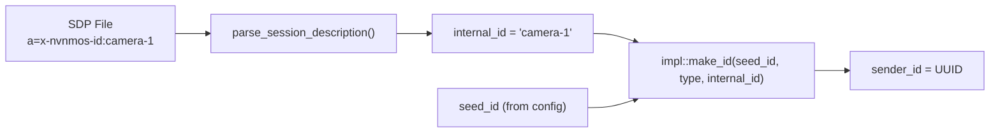

**Sources:** [src/nvnmos_impl.cpp:1237-1252](), [src/nvnmos_impl.cpp:1365-1368](), [src/nvnmos_impl.cpp:1384-1400]()

## Session Description Protocol (SDP)

SDP is the primary configuration mechanism in nvnmos. Applications provide SDP strings that describe media streams, and nvnmos parses them to create and configure NMOS resources.

### SDP Configuration Flow

```mermaid
sequenceDiagram
    participant App as "Application"
    participant API as "add_nmos_sender_to_node_server()"
    participant Parse as "sdp::parse_session_description()"
    participant Extract as "get_session_description_*"
    participant Create as "node_implementation_add_sender_()"
    participant Model as "nmos::node_model"
    
    App->>API: SDP string
    API->>Parse: Parse SDP
    Parse-->>API: session_description (JSON)
    API->>Extract: Extract sdp_params
    API->>Extract: Extract transport_params
    API->>Extract: Extract internal_id
    API->>Extract: Extract group_hint
    Extract-->>API: Parsed parameters
    API->>Create: Create resources
    Create->>Model: Insert Source
    Create->>Model: Insert Flow
    Create->>Model: Insert Sender
    Model-->>App: Success
```

**Sources:** [src/nvnmos_impl.cpp:190-204](), [src/nvnmos_impl.cpp:1076-1125]()

### Standard and Custom SDP Attributes

nvnmos uses both standard SDP attributes (defined by IETF RFCs and SMPTE standards) and custom `x-nvnmos-*` attributes:

| Attribute | Level | Purpose | Spec |
|-----------|-------|---------|------|
| `ts-refclk` | Session/Media | PTP clock reference | RFC 7273 |
| `x-nvnmos-id` | Session | Unique sender/receiver identifier | nvnmos |
| `x-nvnmos-iface-ip` | Media | Interface IP for RX or source IP for TX | nvnmos |
| `x-nvnmos-src-port` | Media | Source port for TX | nvnmos |
| `x-nvnmos-group-hint` | Session | BCP-002-01 grouping tag | nvnmos |
| `inactive` | Media | Indicates disabled leg (ST 2022-7) | RFC 4566 |

**Example SDP with Custom Attributes:**

```sdp
v=0
o=- 0 0 IN IP4 192.0.2.1
s=Video Sender 1
t=0 0
a=x-nvnmos-id:camera-1
a=x-nvnmos-group-hint:studio-a
m=video 5004 RTP/AVP 96
c=IN IP4 239.1.1.1/32
a=x-nvnmos-iface-ip:192.0.2.1
a=x-nvnmos-src-port:5004
a=ts-refclk:ptp=IEEE1588-2008:traceable
```

**Sources:** [src/nvnmos.h:98-125](), [src/nvnmos.h:260-293](), [src/nvnmos_impl.cpp:1076-1125]()

## Supported Media Formats

nvnmos supports the following media formats through SDP parsing and NMOS resource creation:

```mermaid
graph TB
    subgraph "Video Formats"
        RAW["video/raw<br/>SMPTE ST 2110-20<br/>Uncompressed"]
        JXSV["video/jxsv<br/>SMPTE ST 2110-22<br/>JPEG XS"]
    end
    
    subgraph "Audio Formats"
        L24["audio/L24<br/>SMPTE ST 2110-30<br/>24-bit Linear PCM"]
        L16["audio/L16<br/>SMPTE ST 2110-30<br/>16-bit Linear PCM"]
    end
    
    subgraph "Data Formats"
        ANC["video/smpte291<br/>SMPTE ST 2110-40<br/>Ancillary Data"]
    end
    
    subgraph "Mux Formats"
        SMPTE2022["video/SMPTE2022-6<br/>SMPTE ST 2022-6<br/>SDI over IP"]
    end
    
    FORMAT_CHECK["impl::get_format(media_type)"]
    
    RAW --> FORMAT_CHECK
    JXSV --> FORMAT_CHECK
    L24 --> FORMAT_CHECK
    L16 --> FORMAT_CHECK
    ANC --> FORMAT_CHECK
    SMPTE2022 --> FORMAT_CHECK
```

**Format Detection and Resource Creation:**

The `impl::get_format()` function maps media types to internal format enums, which determine which NMOS resource creation functions are called:

- **Video (raw)**: `nmos::make_video_source()`, `nmos::make_raw_video_flow()`
- **Video (JPEG XS)**: `nmos::make_video_source()`, `nmos::make_video_jxsv_flow()`
- **Audio**: `nmos::make_audio_source()`, `nmos::make_raw_audio_flow()`
- **Data**: `nmos::make_data_source()`, `nmos::make_sdianc_data_flow()`
- **Mux**: `nmos::make_mux_source()`, `nmos::make_mux_flow()`

**Sources:** [src/nvnmos_impl.cpp:73-84](), [src/nvnmos_impl.cpp:1330-1340](), [src/nvnmos_impl.cpp:234-306]()

## Connection Activation

Connection activation is the process of applying transport parameters to establish or modify media connections. This can be initiated by an NMOS Controller (via IS-05) or by the application directly.

### Activation Flow

```mermaid
sequenceDiagram
    participant Controller as "NMOS Controller<br/>(IS-05 Client)"
    participant ConnAPI as "IS-05 Connection API<br/>nmos::connection_resources"
    participant Callback as "make_node_implementation_connection_activation_handler()"
    participant AppCB as "rtp_connection_activated()<br/>(Application Callback)"
    participant App as "Application<br/>(Data Plane)"
    
    Controller->>ConnAPI: PATCH /staged<br/>{transport_params}
    ConnAPI->>ConnAPI: Validate parameters
    Controller->>ConnAPI: PATCH /staged/activation<br/>{mode: activate_immediate}
    ConnAPI->>Callback: on_connection_activated()
    Callback->>Callback: Generate merged SDP
    Callback->>AppCB: (internal_id, sdp)
    AppCB->>App: Configure RTP stream
    App-->>AppCB: true (success)
    AppCB-->>Callback: Success
    Callback->>ConnAPI: Update /active endpoint
    ConnAPI-->>Controller: 200 OK
```

**Alternative: Application-Initiated Activation:**

```mermaid
sequenceDiagram
    participant App as "Application"
    participant API as "nmos_connection_rtp_activate()"
    participant Impl as "node_implementation_activate_rtp_connection_()"
    participant Model as "nmos::connection_resources"
    participant AppCB as "rtp_connection_activated()<br/>(via make_node_implementation_connection_activation_handler)"
    
    App->>API: (id, sdp)
    API->>Impl: (internal_id, sdp)
    Impl->>Model: Update endpoint_active
    Impl->>Model: Update endpoint_transportfile
    Note over Impl: Bypasses /staged,<br/>directly updates /active
```

**Sources:** [src/nvnmos_impl.cpp:874-965](), [src/nvnmos_impl.cpp:967-1072](), [src/nvnmos.h:439-469]()

### Transport Parameters

During activation, the following transport parameters are resolved and applied:

| Parameter | Type | Source | Auto Resolution |
|-----------|------|--------|-----------------|
| `source_ip` | Sender | Constraint | First constrained value |
| `destination_ip` | Sender | Auto | `impl::make_source_specific_multicast_address_v4()` |
| `source_port` | Sender | Auto | Spec default |
| `interface_ip` | Receiver | Constraint | First constrained value |
| `multicast_ip` | Receiver | Transport File | From SDP |
| `rtp_enabled` | Both | Transport File | From SDP `a=inactive` |

**Auto-resolution logic** is implemented in `make_node_implementation_auto_resolver()`:

**Sources:** [src/nvnmos_impl.cpp:778-812](), [src/nvnmos_impl.cpp:1370-1382]()

## Discovery and Registration

The nvnmos library automatically discovers NMOS Registries on the network and registers its resources using IS-04 APIs.

### Discovery Methods

```mermaid
graph TB
    NODE["NMOS Node<br/>(nvnmos)"]
    CONFIG["NvNmosNodeConfig"]
    
    subgraph "DNS-SD Discovery (Default)"
        MDNS["Multicast DNS-SD<br/>domain: .local"]
        UDNS["Unicast DNS-SD<br/>domain: example.com"]
        BROWSE["Browse for<br/>_nmos-registration._tcp"]
        ADVERTISE["Advertise<br/>_nmos-node._tcp"]
    end
    
    subgraph "Fixed Registry (Optional)"
        FIXED["registration_address<br/>registration_port"]
    end
    
    CONFIG -->|"host_name ends with .local"| MDNS
    CONFIG -->|"host_name is FQDN"| UDNS
    CONFIG -->|"registration_address set"| FIXED
    
    MDNS --> BROWSE
    UDNS --> BROWSE
    
    NODE --> ADVERTISE
    BROWSE -->|"Discover Registry"| REG["NMOS Registry<br/>(IS-04)"]
    NODE -->|"POST /x-nmos/registration/v1.3/*"| REG
```

**Configuration Options:**

The `NvNmosNetworkServicesConfig` structure controls discovery behavior:

```c
typedef struct _NvNmosNetworkServicesConfig
{
    const char* domain;                    // "local" forces mDNS, FQDN uses uDNS
    const char* registration_address;      // Fixed registry (disables DNS-SD)
    unsigned int registration_port;        // Port for fixed registry
    const char* registration_version;      // API version (default: "v1.3")
    const char* system_address;            // IS-09 System API address
    unsigned int system_port;
    const char* system_version;
} NvNmosNetworkServicesConfig;
```

**Sources:** [src/nvnmos.h:295-330](), [README.md:303-304]()

### Registration Lifecycle

```mermaid
stateDiagram-v2
    [*] --> Initializing: create_nmos_node_server()
    Initializing --> Advertising: Start HTTP server
    Advertising --> Discovering: Advertise _nmos-node._tcp
    Discovering --> Registering: Find _nmos-registration._tcp
    Registering --> Registered: POST /nodes, /devices, /senders, /receivers
    
    Registered --> Heartbeating: Begin periodic health updates
    Heartbeating --> Heartbeating: POST /health/nodes/{id}
    
    Registered --> Updating: add_nmos_sender_to_node_server()
    Updating --> Registered: POST /senders
    
    Registered --> Removing: remove_nmos_sender_from_node_server()
    Removing --> Registered: DELETE /senders/{id}
    
    Registered --> Deregistering: destroy_nmos_node_server()
    Deregistering --> [*]: DELETE /nodes/{id}
```

**Registration Operations:**

| Operation | Method | Endpoint | Trigger |
|-----------|--------|----------|---------|
| Register Node | POST | `/nodes` | `node_implementation_init()` |
| Register Device | POST | `/devices` | `node_implementation_init()` |
| Register Sender | POST | `/senders` | `node_implementation_add_sender()` |
| Register Receiver | POST | `/receivers` | `node_implementation_add_receiver()` |
| Update Health | POST | `/health/nodes/{id}` | Periodic (5s default) |
| Unregister | DELETE | `/nodes/{id}` | `destroy_nmos_node_server()` |

**Sources:** [src/nvnmos_impl.cpp:153-188](), [src/nvnmos_impl.cpp:644-654]()

## Clock Management

nvnmos manages PTP clock references for senders, extracting them from SDP `ts-refclk` attributes and updating the Node's clock configuration.

### Clock Reference Types

```mermaid
graph TB
    SDP["SDP ts-refclk Attributes"]
    
    PTP_GMID["a=ts-refclk:ptp=IEEE1588-2008:<gmid>:<domain>"]
    PTP_TRACE["a=ts-refclk:ptp=IEEE1588-2008:traceable"]
    LOCALMAC["a=ts-refclk:localmac=<mac-address>"]
    
    SDP --> PTP_GMID
    SDP --> PTP_TRACE
    SDP --> LOCALMAC
    
    PTP_GMID --> MAKE_PTP["nmos::make_ptp_clock()<br/>traceable=false/true<br/>gmid from SDP<br/>domain from SDP"]
    PTP_TRACE --> MAKE_PTP_T["nmos::make_ptp_clock()<br/>traceable=true<br/>gmid=ff-ff-ff-ff-ff-ff-ff-ff"]
    LOCALMAC --> MAKE_INT["nmos::make_internal_clock()"]
    
    MAKE_PTP --> UPDATE["impl::update_node_clock()"]
    MAKE_PTP_T --> UPDATE
    MAKE_INT --> UPDATE
```

**Clock Extraction Flow:**

1. Parse `ts-refclk` attributes from SDP: `impl::get_session_description_ts_refclks()`
2. Create clock object: `impl::make_node_clock(clock_name, ts_refclks, ptp_domain)`
3. Update Node resource: `impl::update_node_clock(node_resources, node_id, clock)`
4. Store PTP domain in settings: `nvnmos::fields::clocks(settings)[clock.name]`

**Sources:** [src/nvnmos_impl.cpp:1127-1178](), [src/nvnmos_impl.cpp:1432-1484](), [src/nvnmos_impl.cpp:374-381]()

## Interface Management

The nvnmos library automatically manages network interface bindings based on the IP addresses specified in sender and receiver configurations.

### Interface Binding Process

```mermaid
sequenceDiagram
    participant SDP as "SDP Configuration"
    participant Parse as "get_session_description_transport_params()"
    participant Find as "impl::find_interface()"
    participant Host as "web::hosts::experimental::host_interfaces()"
    participant Update as "impl::update_node_interfaces()"
    participant Node as "Node Resource"
    
    SDP->>Parse: Extract interface_ip / source_ip
    Parse->>Find: Look up interface by IP
    Find->>Host: Get system interfaces
    Host-->>Find: Interface list
    Find-->>Parse: interface.name
    Parse-->>SDP: interface_names[]
    
    Note over Update: After resource creation
    Update->>Node: Scan all sender/receiver bindings
    Update->>Node: Update Node.interfaces array
```

**Interface Resolution:**

For each leg of a sender or receiver:
1. Extract IP address from `transport_params` (source_ip for sender, interface_ip for receiver)
2. Find matching system interface: `impl::find_interface(host_interfaces, address)`
3. Store interface name in sender/receiver `interface_bindings`
4. Update Node's `interfaces` array: `impl::update_node_interfaces()`

**Sources:** [src/nvnmos_impl.cpp:1355-1362](), [src/nvnmos_impl.cpp:217-229](), [src/nvnmos_impl.cpp:1517-1562]()

---

# Page: NMOS Node Architecture

# NMOS Node Architecture

<details>
<summary>Relevant source files</summary>

The following files were used as context for generating this wiki page:

- [src/nvnmos.h](src/nvnmos.h)
- [src/nvnmos_impl.cpp](src/nvnmos_impl.cpp)
- [src/nvnmos_impl.h](src/nvnmos_impl.h)

</details>


## Purpose and Scope

This document describes the NMOS resource model implemented by nvnmos and how the library manages the lifecycle of Node, Device, Source, Flow, Sender, and Receiver resources. It explains the hierarchical relationships between these resources, how they are identified, and how they are created from Session Description Protocol (SDP) data.

For information about the SDP format and custom attributes used to configure resources, see [Session Description Protocol (SDP)](#3.2). For details on the connection activation workflow, see [Connection Activation](#3.3). For the overall layered architecture of the nvnmos library, see [Layered Architecture](#5.1).

## NMOS Resource Model Overview

The NMOS specifications define a hierarchical resource model where a **Node** represents a logical host, containing one or more **Devices**, which in turn contain **Sources**, **Flows**, **Senders**, and **Receivers**. The nvnmos library creates and manages these resources based on the IS-04 specification.

### Resource Hierarchy

```mermaid
graph TD
    Node["Node<br/>(nmos::types::node)"]
    Device["Device<br/>(nmos::types::device)"]
    Source1["Source<br/>(nmos::types::source)"]
    Source2["Source"]
    Flow1["Flow<br/>(nmos::types::flow)"]
    Flow2["Flow"]
    Sender1["Sender<br/>(nmos::types::sender)"]
    Sender2["Sender"]
    Receiver1["Receiver<br/>(nmos::types::receiver)"]
    Receiver2["Receiver"]
    
    Node -->|"contains"| Device
    Device -->|"contains"| Source1
    Device -->|"contains"| Source2
    Device -->|"contains"| Flow1
    Device -->|"contains"| Flow2
    Device -->|"contains"| Sender1
    Device -->|"contains"| Sender2
    Device -->|"contains"| Receiver1
    Device -->|"contains"| Receiver2
    
    Source1 -.->|"referenced by"| Flow1
    Source2 -.->|"referenced by"| Flow2
    Flow1 -.->|"referenced by"| Sender1
    Flow2 -.->|"referenced by"| Sender2
```

**Sources:** [src/nvnmos_impl.cpp:153-188](), [src/nvnmos_impl.cpp:190-387](), [src/nvnmos_impl.cpp:389-564]()

## Resource Types and Relationships

### Node

A **Node** represents the NMOS API endpoint exposed by the nvnmos library. Each Node contains exactly one Device in the current implementation. The Node resource includes:

- **Clocks**: References to timing sources (e.g., PTP, internal clock)
- **Interfaces**: Network interfaces available for media transport
- **Label/Description**: Human-readable identification
- **Tags**: Asset distinguishing information per BCP-002-02

The Node is created during initialization by `node_implementation_init_()` at [src/nvnmos_impl.cpp:166-173]().

| Field | Type | Description |
|-------|------|-------------|
| `id` | UUID | Repeatable identifier generated from seed |
| `label` | String | From `nvnmos::fields::node_label` in settings |
| `description` | String | From `nvnmos::fields::node_description` in settings |
| `tags` | Object | BCP-002-02 asset tags from `nvnmos::fields::node_tags` |
| `clocks` | Array | Initially contains one internal clock (`clk0`) |
| `interfaces` | Array | Updated dynamically based on sender/receiver bindings |

### Device

A **Device** represents a logical grouping of media processing capabilities. The nvnmos library creates a single Device per Node. The Device maintains deprecated arrays of sender and receiver IDs for backwards compatibility.

The Device is created during initialization by `node_implementation_init_()` at [src/nvnmos_impl.cpp:176-182]().

| Field | Type | Description |
|-------|------|-------------|
| `id` | UUID | Repeatable identifier generated from seed |
| `node_id` | UUID | Reference to parent Node |
| `label` | String | From `nvnmos::fields::device_label` in settings |
| `description` | String | From `nvnmos::fields::device_description` in settings |
| `tags` | Object | BCP-002-02 asset tags from `nvnmos::fields::device_tags` |
| `senders` | Array | List of sender IDs (deprecated, updated dynamically) |
| `receivers` | Array | List of receiver IDs (deprecated, updated dynamically) |

### Source

A **Source** represents the origin of media content. For senders, nvnmos creates a Source for each added sender based on the media type parsed from SDP:

- **Video Source** (`nmos::make_video_source`): For `video/raw` and `video/jxsv` media types
- **Audio Source** (`nmos::make_audio_source`): For `audio/L16` and `audio/L24` media types
- **Data Source** (`nmos::make_data_source`): For `video/smpte291` ancillary data
- **Mux Source** (`nmos::make_mux_source`): For `video/SMPTE2022-6` multiplexed streams

Sources are created at [src/nvnmos_impl.cpp:231-306]() depending on the detected format.

| Field | Type | Description |
|-------|------|-------------|
| `id` | UUID | Generated from seed and internal ID |
| `device_id` | UUID | Reference to parent Device |
| `clock_name` | String | Reference to Node clock (typically `"clk0"`) |
| `grain_rate` | Rational | Frame/packet rate (for video/audio/data) |
| `channels` | Array | Audio channel configuration (audio only) |

### Flow

A **Flow** represents a sequence of grains (media units) derived from a Source. The Flow describes the media format in detail:

- **Raw Video Flow** (`nmos::make_raw_video_flow`): Uncompressed video with colorspace, sampling, bit depth
- **Video JXSV Flow** (`nmos::make_video_jxsv_flow`): JPEG XS compressed video with profile, level, sublevel
- **Raw Audio Flow** (`nmos::make_raw_audio_flow`): PCM audio with sample rate and bit depth
- **SDIANC Data Flow** (`nmos::make_sdianc_data_flow`): Ancillary data with DID/SDID filtering
- **Mux Flow** (`nmos::make_mux_flow`): Multiplexed streams

Flows are created at [src/nvnmos_impl.cpp:231-306]() in conjunction with Sources.

| Field | Type | Description |
|-------|------|-------------|
| `id` | UUID | Generated from seed and internal ID |
| `source_id` | UUID | Reference to parent Source |
| `device_id` | UUID | Reference to parent Device |
| `format` | String | NMOS format (`video`, `audio`, `data`, `mux`) |
| `media_type` | String | IANA media type (e.g., `video/raw`, `audio/L24`) |
| Format-specific | Various | Width, height, colorspace (video); sample_rate, bit_depth (audio); etc. |

### Sender

A **Sender** transmits media flows over the network. Each Sender references a Flow and specifies transport parameters. Senders support:

- **RTP transport** (`nmos::transports::rtp`)
- **Multiple legs** for redundant streams (ST 2022-7)
- **Interface bindings** specifying which network interfaces are used
- **Manifest API** providing SDP transport files

Senders are created at [src/nvnmos_impl.cpp:308-360]() and include a corresponding Connection API sender resource created at [src/nvnmos_impl.cpp:336-347]().

| Field | Type | Description |
|-------|------|-------------|
| `id` | UUID | Generated from seed and internal ID |
| `flow_id` | UUID | Reference to Flow being transmitted |
| `device_id` | UUID | Reference to parent Device |
| `transport` | String | Transport protocol (`urn:x-nmos:transport:rtp`) |
| `interface_bindings` | Array | Network interface names |
| `manifest_href` | String | URL to SDP manifest |
| `tags` | Object | Contains internal ID and optional group hint |

### Receiver

A **Receiver** accepts media streams from the network. Receivers specify:

- **Capabilities** (`caps`) describing acceptable stream formats per BCP-004-01
- **Constraint sets** limiting compatible sender configurations
- **RTP transport** with interface bindings
- **Format** and **media_type** filters

Receivers are created at [src/nvnmos_impl.cpp:425-544]() with capabilities generated at [src/nvnmos_impl.cpp:431-492]() if not explicitly disabled.

| Field | Type | Description |
|-------|------|-------------|
| `id` | UUID | Generated from seed and internal ID |
| `device_id` | UUID | Reference to parent Device |
| `transport` | String | Transport protocol (`urn:x-nmos:transport:rtp`) |
| `interface_bindings` | Array | Network interface names |
| `format` | String | NMOS format filter |
| `caps` | Object | BCP-004-01 capability constraints |
| `tags` | Object | Contains internal ID and optional group hint |

**Sources:** [src/nvnmos_impl.cpp:425-544](), [src/nvnmos.h:260-273](), [src/nvnmos.h:279-293]()

## Resource Identification

### Repeatable ID Generation

The nvnmos library generates **repeatable UUIDs** for all resources based on a seed ID provided in the Node configuration. This ensures that resources have consistent identifiers across restarts, which is important for clients that cache resource information.

```mermaid
graph LR
    SeedID["seed_id<br/>(from NvNmosNodeConfig)"]
    InternalID["internal_id<br/>(from x-nvnmos-id SDP attribute)"]
    ResourceType["type<br/>(node, device, sender, etc.)"]
    
    SeedID --> MakeID["impl::make_id()"]
    ResourceType --> MakeID
    InternalID --> MakeID
    MakeID --> FinalID["Repeatable UUID<br/>(nmos::id)"]
    
    MakeID -.->|"implementation"| HashFunc["nmos::make_repeatable_id()<br/>seed + '/x-nmos/node/' + type + '/' + internal_id"]
```

The ID generation is implemented at [src/nvnmos_impl.cpp:1365-1368]():

```
nmos::id make_id(const nmos::id& seed_id, const nmos::type& type, const utility::string_t& internal_id)
{
    return nmos::make_repeatable_id(seed_id, U("/x-nmos/node/") + type.name + U('/') + internal_id);
}
```

### Internal IDs vs NMOS IDs

The library maintains two levels of identification:

| ID Type | Purpose | Storage | Example |
|---------|---------|---------|---------|
| **Internal ID** | Application-facing identifier specified in SDP via `x-nvnmos-id` | Stored in resource tags at [src/nvnmos_impl.cpp:1385-1390]() | `"camera-1"`, `"monitor-2"` |
| **NMOS ID** | UUID used in NMOS APIs | Primary resource identifier | `"a1b2c3d4-..."` |

The internal ID is extracted from SDP at [src/nvnmos_impl.cpp:1238-1252]() and used to generate the NMOS ID. Applications use internal IDs in API calls like `remove_nmos_sender_from_node_server()` and `nmos_connection_rtp_activate()`.

**Sources:** [src/nvnmos_impl.cpp:1365-1368](), [src/nvnmos_impl.cpp:1385-1400](), [src/nvnmos_impl.cpp:1238-1252]()

## Resource Creation Workflow

### Initialization Phase

When `create_nmos_node_server()` is called, the following resources are created:

```mermaid
sequenceDiagram
    participant App as Application
    participant API as nvnmos.cpp
    participant Impl as nvnmos_impl.cpp
    participant Model as nmos::node_model
    
    App->>API: create_nmos_node_server(config)
    API->>Impl: node_implementation_init(model)
    
    Impl->>Impl: Generate seed_id from config
    Impl->>Impl: node_id = make_id(seed_id, types::node)
    Impl->>Impl: device_id = make_id(seed_id, types::device)
    
    Impl->>Model: Insert Node resource
    Note over Model: Node contains clk0 (internal clock)
    
    Impl->>Model: Insert Device resource
    Note over Model: Device initially has empty senders/receivers arrays
    
    Impl->>API: Return success
    API->>App: Return NvNmosNodeServer*
```

The initialization creates the minimal resource structure at [src/nvnmos_impl.cpp:153-188]().

### Adding a Sender

When `add_nmos_sender_to_node_server()` is called with an SDP configuration:

```mermaid
flowchart TD
    Start["add_nmos_sender_to_node_server(sdp)"]
    ParseSDP["Parse SDP<br/>(sdp::parse_session_description)"]
    ExtractParams["Extract SDP parameters<br/>(get_session_description_sdp_parameters)"]
    GetInternalID["Extract internal_id<br/>(x-nvnmos-id attribute)"]
    DetectFormat["Detect media format<br/>(get_format from media_type)"]
    
    Start --> ParseSDP
    ParseSDP --> ExtractParams
    ExtractParams --> GetInternalID
    ExtractParams --> DetectFormat
    
    DetectFormat --> VideoCheck{Format?}
    VideoCheck -->|video/raw| CreateVideoSource["Create Video Source"]
    VideoCheck -->|video/jxsv| CreateJXSVSource["Create JXSV Source"]
    VideoCheck -->|audio/L24| CreateAudioSource["Create Audio Source"]
    VideoCheck -->|video/smpte291| CreateDataSource["Create Data Source"]
    VideoCheck -->|video/SMPTE2022-6| CreateMuxSource["Create Mux Source"]
    
    CreateVideoSource --> CreateVideoFlow["Create Raw Video Flow"]
    CreateJXSVSource --> CreateJXSVFlow["Create JXSV Flow"]
    CreateAudioSource --> CreateAudioFlow["Create Raw Audio Flow"]
    CreateDataSource --> CreateDataFlow["Create Data Flow"]
    CreateMuxSource --> CreateMuxFlow["Create Mux Flow"]
    
    CreateVideoFlow --> CreateSender["Create Sender<br/>(nmos::make_sender)"]
    CreateJXSVFlow --> CreateSender
    CreateAudioFlow --> CreateSender
    CreateDataFlow --> CreateSender
    CreateMuxFlow --> CreateSender
    
    CreateSender --> CreateConnection["Create Connection Sender<br/>(nmos::make_connection_rtp_sender)"]
    CreateConnection --> InsertResources["Insert into model.node_resources<br/>and model.connection_resources"]
    InsertResources --> UpdateDevice["Update Device.senders array"]
    UpdateDevice --> UpdateInterfaces["Update Node.interfaces"]
    UpdateInterfaces --> UpdateClock["Update Node.clocks from ts-refclk"]
    UpdateClock --> End["Return success"]
```

This workflow is implemented in `node_implementation_add_sender_()` at [src/nvnmos_impl.cpp:190-387]().

### Adding a Receiver

When `add_nmos_receiver_to_node_server()` is called with an SDP configuration:

```mermaid
flowchart TD
    Start["add_nmos_receiver_to_node_server(sdp)"]
    ParseSDP["Parse SDP"]
    ExtractParams["Extract parameters"]
    GetInternalID["Extract internal_id"]
    DetectFormat["Detect media format"]
    CheckCaps{Want capabilities?}
    
    Start --> ParseSDP
    ParseSDP --> ExtractParams
    ExtractParams --> GetInternalID
    ExtractParams --> DetectFormat
    DetectFormat --> CheckCaps
    
    CheckCaps -->|No x-nvnmos-caps| CreateReceiver["Create Receiver<br/>(nmos::make_receiver or variants)"]
    CheckCaps -->|Has x-nvnmos-caps| CreateReceiverNoCaps["Create Receiver without caps"]
    
    CreateReceiver --> GenerateCaps["Generate BCP-004-01 capabilities<br/>based on SDP parameters"]
    GenerateCaps --> CreateConnection
    CreateReceiverNoCaps --> CreateConnection["Create Connection Receiver<br/>(nmos::make_connection_rtp_receiver)"]
    
    CreateConnection --> InsertResources["Insert into model.node_resources<br/>and model.connection_resources"]
    InsertResources --> UpdateDevice["Update Device.receivers array"]
    UpdateDevice --> UpdateInterfaces["Update Node.interfaces"]
    UpdateInterfaces --> End["Return success"]
```

This workflow is implemented in `node_implementation_add_receiver_()` at [src/nvnmos_impl.cpp:389-564]().

**Sources:** [src/nvnmos_impl.cpp:190-387](), [src/nvnmos_impl.cpp:389-564](), [src/nvnmos_impl.cpp:657-678]()

## Resource Metadata

### Labels and Descriptions

Each resource has a `label` (short name) and `description` (longer explanation) field:

| Resource | Label Source | Description Source |
|----------|--------------|-------------------|
| Node | `nvnmos::fields::node_label` in settings, or generated from asset tags | `nvnmos::fields::node_description` in settings, or generated from asset tags |
| Device | `nvnmos::fields::device_label` in settings, or generated from asset tags | `nvnmos::fields::device_description` in settings, or generated from asset tags |
| Sender | `sdp_params.session_name` from SDP `s=` line | `session_info` from SDP `i=` line, extracted at [src/nvnmos_impl.cpp:1272-1275]() |
| Receiver | `sdp_params.session_name` from SDP `s=` line | `session_info` from SDP `i=` line |

Labels are set at [src/nvnmos_impl.cpp:169-170]() for Node, [src/nvnmos_impl.cpp:178-179]() for Device, [src/nvnmos_impl.cpp:350-351]() for Sender, and [src/nvnmos_impl.cpp:537-538]() for Receiver.

### Tags

Resources use the `tags` field for:

1. **Asset Distinguishing Information (BCP-002-02)**: Node and Device include manufacturer, product, instance ID, and function tags
2. **Internal ID**: Senders and Receivers store their internal ID in `tags["urn:x-nvnmos:id"]` array
3. **Group Hint (BCP-002-01)**: Optional grouping information stored in `tags["urn:x-nmos:tag:grouphint/v1.0"]`

Internal ID tagging is implemented at [src/nvnmos_impl.cpp:1385-1390]():

```
void set_internal_id(nmos::resource& resource, const utility::string_t& internal_id)
{
    using web::json::value_of;
    resource.data[nmos::fields::tags][nvnmos::fields::internal_id_tag] = value_of({ internal_id });
}
```

Group hints are set at [src/nvnmos_impl.cpp:1403-1408]() and extracted from the `x-nvnmos-group-hint` SDP attribute.

### Versions

All NMOS resources include a `version` field (TAI timestamp) that increments whenever the resource is modified. The nvnmos library updates versions when:

- Resources are created: `version` is set to current TAI time
- Device arrays are updated: When senders/receivers are added/removed at [src/nvnmos_impl.cpp:366]() and [src/nvnmos_impl.cpp:551]()
- Node interfaces/clocks change: At [src/nvnmos_impl.cpp:1505]() and [src/nvnmos_impl.cpp:1557]()
- Connection activation occurs: At [src/nvnmos_impl.cpp:1021]()

**Sources:** [src/nvnmos_impl.cpp:169-170](), [src/nvnmos_impl.cpp:350-351](), [src/nvnmos_impl.cpp:1385-1408](), [src/nvnmos_impl.cpp:1272-1275]()

## Supporting Resources

### Clocks

The Node maintains an array of clock references that Sources use for timing. The nvnmos library currently manages a single clock named `clk0`.

#### Clock Types

| Clock Type | Created By | Description |
|------------|-----------|-------------|
| **Internal Clock** | `nmos::make_internal_clock()` | Default, no external synchronization |
| **PTP Clock** | `nmos::make_ptp_clock()` | IEEE 1588 Precision Time Protocol |

Clocks are parsed from the SDP `ts-refclk` attribute at [src/nvnmos_impl.cpp:1432-1484]():

```
a=ts-refclk:ptp=IEEE1588-2008:<gmid>[:<domain>]
a=ts-refclk:ptp=IEEE1588-2008:traceable
```

The clock is created/updated when senders are added at [src/nvnmos_impl.cpp:376-380]() and when connections are activated at [src/nvnmos_impl.cpp:996-1012]().

#### Clock Metadata

| Field | Type | Description |
|-------|------|-------------|
| `name` | String | Clock identifier (e.g., `"clk0"`) |
| `ref_type` | String | `"internal"` or `"ptp"` |
| `traceable` | Boolean | For PTP: clock is traceable to international standard |
| `gmid` | String | For PTP: Grand Master ID in format `"xx-xx-xx-xx-xx-xx-xx-xx"` |
| `version` | String | TAI timestamp of last change |

### Interfaces

The Node's `interfaces` array lists network interfaces that have active bindings to senders or receivers. This array is dynamically updated whenever senders/receivers are added or removed.

The interface update logic at [src/nvnmos_impl.cpp:1518-1562]():

1. Collects all `interface_bindings` from senders at [src/nvnmos_impl.cpp:1529-1536]()
2. Collects all `interface_bindings` from receivers at [src/nvnmos_impl.cpp:1538-1545]()
3. Filters system host interfaces to include only those with active bindings at [src/nvnmos_impl.cpp:1547-1551]()
4. Updates the Node resource if the interface list changed at [src/nvnmos_impl.cpp:1553-1561]()

#### Interface Metadata

Each interface in the Node includes:

| Field | Type | Description |
|-------|------|-------------|
| `name` | String | System interface name (e.g., `"eth0"`, `"Ethernet"`) |
| `chassis_id` | String | MAC address or similar identifier |
| `port_id` | String | Interface port identifier |

Interface bindings for senders are determined from the `source_ip` or `interface_ip` transport parameter, mapped to system interfaces at [src/nvnmos_impl.cpp:217-229]() for senders and [src/nvnmos_impl.cpp:411-423]() for receivers.

**Sources:** [src/nvnmos_impl.cpp:1432-1484](), [src/nvnmos_impl.cpp:376-380](), [src/nvnmos_impl.cpp:1518-1562](), [src/nvnmos_impl.cpp:217-229]()

## Resource Lifecycle Summary

```mermaid
stateDiagram-v2
    [*] --> NodeCreated: create_nmos_node_server()
    
    NodeCreated: Node + Device Created
    NodeCreated: Clocks: [clk0 (internal)]
    NodeCreated: Interfaces: []
    NodeCreated: Senders: []
    NodeCreated: Receivers: []
    
    NodeCreated --> SenderAdded: add_nmos_sender_to_node_server(sdp)
    NodeCreated --> ReceiverAdded: add_nmos_receiver_to_node_server(sdp)
    
    SenderAdded: Source + Flow + Sender Created
    SenderAdded: Device.senders updated
    SenderAdded: Node.interfaces updated
    SenderAdded: Node.clocks updated from ts-refclk
    
    ReceiverAdded: Receiver Created (with caps)
    ReceiverAdded: Device.receivers updated
    ReceiverAdded: Node.interfaces updated
    
    SenderAdded --> Active: Connection activation
    ReceiverAdded --> Active: Connection activation
    
    Active: Resource.version updated
    Active: Connection transport_params set
    Active: Sender transportfile updated
    
    Active --> SenderAdded: add more senders
    Active --> ReceiverAdded: add more receivers
    Active --> Removed: remove_nmos_sender/receiver_from_node_server()
    
    Removed: Source + Flow + Sender/Receiver deleted
    Removed: Device arrays updated
    Removed: Node.interfaces recalculated
    
    Removed --> SenderAdded: add new sender
    Removed --> ReceiverAdded: add new receiver
    Removed --> [*]: destroy_nmos_node_server()
    
    SenderAdded --> Removed
    ReceiverAdded --> Removed
```

**Sources:** [src/nvnmos_impl.cpp:153-188](), [src/nvnmos_impl.cpp:190-387](), [src/nvnmos_impl.cpp:389-564](), [src/nvnmos_impl.cpp:566-642]()

---

# Page: Session Description Protocol (SDP)

# Session Description Protocol (SDP)

<details>
<summary>Relevant source files</summary>

The following files were used as context for generating this wiki page:

- [src/main.c](src/main.c)
- [src/nvnmos.h](src/nvnmos.h)
- [src/nvnmos_impl.cpp](src/nvnmos_impl.cpp)

</details>


## Purpose and Scope

This page describes how Session Description Protocol (SDP) is used in the nvnmos library to configure and manage NMOS senders and receivers. SDP serves as the primary configuration format for specifying media transport parameters, format details, and connection information for ST 2110 streams.

For information about the NMOS resource model (Node, Device, Sender, Receiver), see [NMOS Node Architecture](#3.1). For details about how SDP is used during connection activation workflows, see [Connection Activation](#3.3). For architectural details about the SDP processing implementation, see [SDP Processing Pipeline](#5.3).

---

## SDP in NMOS Context

In nvnmos, SDP serves two primary purposes:

1. **Initial Configuration**: SDP strings define the capabilities and default transport parameters when creating senders and receivers
2. **Runtime Activation**: SDP strings communicate updated transport parameters during IS-05 connection activation

The library uses standard IETF RFC 4566 SDP syntax, extended with SMPTE ST 2110 attributes and custom nvnmos-specific attributes.

| SDP Usage Context | Direction | Primary Functions |
|------------------|-----------|-------------------|
| Sender Configuration | Application → Library | `add_nmos_sender_to_node_server` |
| Receiver Configuration | Application → Library | `add_nmos_receiver_to_node_server` |
| Controller-Initiated Activation | Library → Application | `nmos_connection_rtp_activation_callback` |
| Application-Initiated Activation | Application → Library | `nmos_connection_rtp_activate` |

**Sources:** [src/nvnmos.h:260-293](), [src/nvnmos.h:439-469](), [src/nvnmos_impl.cpp:190-387]()

---

## SDP Structure and Standard Elements

### Required SDP Components

A valid SDP file for nvnmos must include standard SDP session-level and media-level components conforming to RFC 4566 and SMPTE ST 2110 specifications.

```mermaid
graph TB
    subgraph "Session Level"
        V["v= (Protocol Version)"]
        O["o= (Origin)"]
        S["s= (Session Name)"]
        I["i= (Session Information)"]
        T["t= (Timing)"]
        A_SESSION["a= (Session Attributes)"]
    end
    
    subgraph "Media Level"
        M["m= (Media Description)"]
        C["c= (Connection Data)"]
        B["b= (Bandwidth)"]
        A_MEDIA["a= (Media Attributes)"]
    end
    
    V --> O
    O --> S
    S --> I
    I --> T
    T --> A_SESSION
    A_SESSION --> M
    M --> C
    C --> B
    B --> A_MEDIA
    
    subgraph "Standard Media Attributes"
        RTPMAP["a=rtpmap (Payload Type Mapping)"]
        FMTP["a=fmtp (Format Parameters)"]
        SOURCEFILTER["a=source-filter (Multicast Source)"]
        TSREFCLK["a=ts-refclk (Timestamp Clock)"]
        MEDIACLK["a=mediaclk (Media Clock)"]
    end
    
    A_MEDIA --> RTPMAP
    A_MEDIA --> FMTP
    A_MEDIA --> SOURCEFILTER
    A_MEDIA --> TSREFCLK
    A_MEDIA --> MEDIACLK
```

**Sources:** [src/nvnmos_impl.cpp:195-202](), [src/main.c:110-149]()

### Media Types and Formats

nvnmos supports the following SMPTE ST 2110 media types:

| Media Type | Format | Description | Example Encoding |
|------------|--------|-------------|------------------|
| `video/raw` | Uncompressed Video | ST 2110-20 | `raw/90000` |
| `video/jxsv` | JPEG XS Video | ST 2110-22 | `jxsv/90000` |
| `audio/L24` | 24-bit Linear Audio | ST 2110-30 | `L24/48000/2` |
| `audio/L16` | 16-bit Linear Audio | ST 2110-30 | `L16/48000/2` |
| `video/smpte291` | Ancillary Data | ST 2110-40 | `smpte291/90000` |
| `video/SMPTE2022-6` | SDI Multiplex | ST 2022-6 | `SMPTE2022-6/27000000` |

**Sources:** [src/nvnmos_impl.cpp:73-84](), [src/nvnmos_impl.cpp:1331-1340]()

---

## Custom nvnmos SDP Attributes

nvnmos extends standard SDP with custom attributes prefixed with `x-nvnmos-` to carry additional metadata required for NMOS resource management.

### Session-Level Custom Attributes

#### `a=x-nvnmos-id:<id>`

**Purpose:** Specifies the unique identifier for the sender or receiver being configured.

**Required:** Yes

**Example:** `a=x-nvnmos-id:source-0`

This ID is used to:
- Generate deterministic UUIDs for NMOS resources
- Associate the SDP with specific sender/receiver instances
- Reference the sender/receiver in API calls like `remove_nmos_sender_from_node_server`

**Sources:** [src/nvnmos.h:111-113](), [src/nvnmos.h:266-267](), [src/nvnmos_impl.cpp:199](), [src/nvnmos_impl.cpp:1237-1252]()

#### `a=x-nvnmos-group-hint:<tag>`

**Purpose:** Specifies an optional group hint tag for BCP-002-01 Natural Grouping.

**Required:** No

**Example:** `a=x-nvnmos-group-hint:rx-0:video`

Group hints enable logical grouping of related senders and receivers in NMOS controllers.

**Sources:** [src/nvnmos.h:268-269](), [src/nvnmos_impl.cpp:201](), [src/nvnmos_impl.cpp:1254-1269]()

### Media-Level Custom Attributes

#### `a=x-nvnmos-iface-ip:<address>`

**Purpose:** Specifies the interface IP address for receiving or transmitting the stream.

**Required:** Yes

**For Receivers:** The network interface IP address on which to receive the stream.

**For Senders:** The source IP address from which to transmit the stream.

**Example:** `a=x-nvnmos-iface-ip:192.0.2.0`

**Sources:** [src/nvnmos.h:114-116](), [src/nvnmos.h:270-271](), [src/nvnmos_impl.cpp:1113-1115](), [src/nvnmos_impl.cpp:1209-1213]()

#### `a=x-nvnmos-src-port:<port>`

**Purpose:** Specifies the source UDP port for senders.

**Required:** For senders only

**Example:** `a=x-nvnmos-src-port:5004`

This attribute is not applicable to receivers, as they bind to the destination port specified in the `m=` line.

**Sources:** [src/nvnmos.h:117-119](), [src/nvnmos_impl.cpp:1106-1110](), [src/nvnmos_impl.cpp:1215-1223]()

#### `a=inactive`

**Purpose:** Standard SDP attribute used to indicate disabled legs in redundant transport.

When present in a media description, it signals that `rtp_enabled` should be set to `false` for that leg in the IS-05 transport parameters.

**Example:** Used in ST 2022-7 seamless protection configurations to disable one leg.

**Sources:** [src/nvnmos.h:109-110](), [src/nvnmos_impl.cpp:1117-1121](), [src/nvnmos_impl.cpp:1225-1230]()

---

## SDP Data Flow Through nvnmos

### Configuration Flow

```mermaid
flowchart TD
    APP["Application"]
    
    subgraph "Public API - nvnmos.h"
        SENDER_CONFIG["NvNmosSenderConfig<br/>{ const char *sdp; }"]
        RECEIVER_CONFIG["NvNmosReceiverConfig<br/>{ const char *sdp; }"]
        ADD_SENDER["add_nmos_sender_to_node_server()"]
        ADD_RECEIVER["add_nmos_receiver_to_node_server()"]
    end
    
    subgraph "Implementation - nvnmos_impl.cpp"
        PARSE["sdp::parse_session_description()"]
        GET_PARAMS["nmos::get_session_description_sdp_parameters()"]
        GET_TRANSPORT["impl::get_session_description_transport_params()"]
        GET_ID["impl::get_session_description_internal_id()"]
        GET_HINT["impl::get_session_description_group_hint()"]
    end
    
    subgraph "Resource Creation - nvnmos_impl.cpp"
        CREATE_SOURCE["nmos::make_*_source()"]
        CREATE_FLOW["nmos::make_*_flow()"]
        CREATE_SENDER["nmos::make_sender()"]
        CREATE_RECEIVER["nmos::make_receiver()"]
        CREATE_CONNECTION["nmos::make_connection_rtp_*()"]
    end
    
    subgraph "NMOS Resources"
        NODE_RESOURCES["node_resources<br/>(Source, Flow, Sender)"]
        CONN_RESOURCES["connection_resources<br/>(Connection API endpoints)"]
    end
    
    APP -->|"Sender SDP"| SENDER_CONFIG
    APP -->|"Receiver SDP"| RECEIVER_CONFIG
    SENDER_CONFIG --> ADD_SENDER
    RECEIVER_CONFIG --> ADD_RECEIVER
    
    ADD_SENDER --> PARSE
    ADD_RECEIVER --> PARSE
    
    PARSE --> GET_PARAMS
    PARSE --> GET_TRANSPORT
    PARSE --> GET_ID
    PARSE --> GET_HINT
    
    GET_PARAMS --> CREATE_SOURCE
    GET_PARAMS --> CREATE_FLOW
    GET_PARAMS --> CREATE_SENDER
    GET_PARAMS --> CREATE_RECEIVER
    GET_TRANSPORT --> CREATE_CONNECTION
    
    CREATE_SOURCE --> NODE_RESOURCES
    CREATE_FLOW --> NODE_RESOURCES
    CREATE_SENDER --> NODE_RESOURCES
    CREATE_RECEIVER --> NODE_RESOURCES
    CREATE_CONNECTION --> CONN_RESOURCES
```

**Sources:** [src/nvnmos_impl.cpp:190-387](), [src/nvnmos_impl.cpp:389-564](), [src/nvnmos_impl.cpp:656-678]()

### Activation Flow

```mermaid
sequenceDiagram
    participant Controller as NMOS Controller
    participant Library as nvnmos Library
    participant Callback as nmos_connection_rtp_activation_callback
    participant App as Application
    
    Note over Controller,App: Controller-Initiated Activation
    
    Controller->>Library: PATCH /staged (transport_file)
    Library->>Library: parse_rtp_transport_file()<br/>[nvnmos_impl.cpp:746-767]
    Library->>Library: validate_sdp_parameters()<br/>[nvnmos_impl.cpp:753-764]
    
    Controller->>Library: PATCH /staged/activation
    Library->>Library: make_session_description()<br/>[nvnmos_impl.cpp:1078-1125]
    Library->>Library: merge SDP params + transport_params
    Library->>Library: sdp::make_session_description()
    Library->>Callback: callback(id, merged_sdp)
    Callback->>App: Configure ST 2110 transport
    App-->>Callback: return success
    Callback-->>Library: activation complete
    Library-->>Controller: 200 OK
    
    Note over Controller,App: Application-Initiated Activation
    
    App->>Library: nmos_connection_rtp_activate(id, sdp)
    Library->>Library: node_implementation_activate_rtp_connection_()<br/>[nvnmos_impl.cpp:967-1061]
    Library->>Library: Update /active endpoint
    Library->>Library: Update /transportfile (senders)
    Library->>Library: set_transportfile()<br/>[nvnmos_impl.cpp:815-872]
```

**Sources:** [src/nvnmos_impl.cpp:745-767](), [src/nvnmos_impl.cpp:875-965](), [src/nvnmos_impl.cpp:967-1061]()

---

## SDP Parsing and Processing Functions

### Core Parsing Functions

The library provides several layers of SDP parsing to extract different types of information:

| Function | Purpose | Returns | Location |
|----------|---------|---------|----------|
| `sdp::parse_session_description()` | Parse SDP string into JSON structure | `web::json::value` | nmos-cpp library |
| `nmos::get_session_description_sdp_parameters()` | Extract media format parameters | `nmos::sdp_parameters` | nmos-cpp library |
| `impl::get_session_description_transport_params()` | Extract transport parameters including custom attributes | `web::json::value` | [nvnmos_impl.cpp:1182-1235]() |
| `impl::get_session_description_internal_id()` | Extract `x-nvnmos-id` attribute | `utility::string_t` | [nvnmos_impl.cpp:1238-1252]() |
| `impl::get_session_description_group_hint()` | Extract `x-nvnmos-group-hint` attribute | `utility::string_t` | [nvnmos_impl.cpp:1255-1269]() |
| `impl::get_session_description_ts_refclks()` | Extract all `ts-refclk` attributes (multi-leg) | `vector<vector<ts_refclk_t>>` | [nvnmos_impl.cpp:1160-1178]() |

**Sources:** [src/nvnmos_impl.cpp:89-117](), [src/nvnmos_impl.cpp:1160-1235]()

### SDP Generation Functions

When activating connections, the library generates SDP by merging configuration with active transport parameters:

| Function | Purpose | Location |
|----------|---------|----------|
| `impl::make_session_description()` | Create SDP with custom nvnmos attributes | [nvnmos_impl.cpp:1078-1125]() |
| `nmos::make_session_description()` | Create standard NMOS SDP (no custom attributes) | nmos-cpp library |
| `sdp::make_session_description()` | Convert JSON SDP structure to string | nmos-cpp library |

**Sources:** [src/nvnmos_impl.cpp:1076-1125](), [src/nvnmos_impl.cpp:815-872]()

---

## SDP Examples

### Video Sender (ST 2110-20 Uncompressed)

```sdp
v=0
o=- 1234567890 1234567890 IN IP4 192.0.2.0
s=NvNmos Video Sender
i=YCbCr-4:2:2, 10 bit, 1920 x 1080, progressive, 50 Hz
t=0 0
a=x-nvnmos-id:sink-0
a=x-nvnmos-group-hint:tx-0:video
m=video 5020 RTP/AVP 96
c=IN IP4 233.252.0.0/64
a=source-filter: incl IN IP4 233.252.0.0 192.0.2.0
a=x-nvnmos-iface-ip:192.0.2.0
a=x-nvnmos-src-port:5004
a=rtpmap:96 raw/90000
a=fmtp:96 sampling=YCbCr-4:2:2; width=1920; height=1080; exactframerate=50; depth=10; TCS=SDR; colorimetry=BT709; PM=2110GPM; SSN=ST2110-20:2017; TP=2110TPN; 
a=ts-refclk:ptp=IEEE1588-2008:AC-DE-48-23-45-67-01-9F:42
a=ts-refclk:ptp=IEEE1588-2008:traceable
a=mediaclk:direct=0
```

**Key Elements:**
- Session name (`s=`) becomes the sender label in NMOS
- Session info (`i=`) becomes the sender description
- Custom `x-nvnmos-id` maps to sender identifier
- Custom `x-nvnmos-group-hint` enables BCP-002-01 grouping
- Custom `x-nvnmos-iface-ip` specifies source interface
- Custom `x-nvnmos-src-port` specifies source port
- Dual `ts-refclk` attributes specify both GMID and traceability

**Sources:** [src/main.c:90-152]()

### Audio Receiver (ST 2110-30)

```sdp
v=0
o=- 1234567890 1234567890 IN IP4 192.0.2.1
s=NvNmos Audio Receiver
i=2 ch, 48 kHz, 24 bit
t=0 0
a=x-nvnmos-id:source-1
a=x-nvnmos-group-hint:rx-0:audio
m=audio 5030 RTP/AVP 97
c=IN IP4 233.252.0.1/64
a=source-filter: incl IN IP4 233.252.0.1 192.0.2.1
a=x-nvnmos-iface-ip:192.0.2.1
a=rtpmap:97 L24/48000/2
a=fmtp:97 channel-order=SMPTE2110.(ST); 
a=mediaclk:direct=0
```

**Key Elements:**
- No `ts-refclk` attributes (not required for receivers)
- No `x-nvnmos-src-port` (not applicable to receivers)
- Custom `x-nvnmos-iface-ip` specifies receive interface
- Source filter uses any-source format (could be omitted for any-source multicast)

**Sources:** [src/main.c:154-216]()

### JPEG XS Sender (ST 2110-22)

```sdp
v=0
o=- 1234567890 1234567890 IN IP4 192.0.2.0
s=NvNmos JPEG XS Sender
i=JPEG XS, YCbCr-4:2:2, 10 bit, 1280 x 720, progressive, 59.94 Hz
t=0 0
a=x-nvnmos-id:jxs-sender-0
m=video 5020 RTP/AVP 96
c=IN IP4 233.252.0.0/64
b=AS:116000
a=source-filter: incl IN IP4 233.252.0.0 192.0.2.0
a=x-nvnmos-iface-ip:192.0.2.0
a=x-nvnmos-src-port:5004
a=rtpmap:96 jxsv/90000
a=fmtp:96 packetmode=0; profile=High444.12; level=1k-1; sublevel=Sublev3bpp; sampling=YCbCr-4:2:2; width=1280; height=720; exactframerate=60000/1001; depth=10; colorimetry=BT709; TCS=SDR; RANGE=FULL; SSN=ST2110-22:2019; TP=2110TPN
a=ts-refclk:ptp=IEEE1588-2008:AC-DE-48-23-45-67-01-9F:42
a=ts-refclk:ptp=IEEE1588-2008:traceable
a=mediaclk:direct=0
```

**Key Elements:**
- Bandwidth (`b=AS:`) specifies transport bit rate in kb/s
- `fmtp` parameters include JPEG XS specific attributes (profile, level, sublevel)
- BCP-006-01 compliance requires additional sender metadata extracted from SDP

**Sources:** [src/main.c:25-38](), [src/nvnmos_impl.cpp:249-264](), [src/nvnmos_impl.cpp:314-333]()

---

## SDP Processing Pipeline Details

### Sender Creation Pipeline

```mermaid
flowchart TD
    SDP_INPUT["SDP String Input"]
    
    subgraph "Parse Phase"
        PARSE_SDP["sdp::parse_session_description()<br/>[nvnmos_impl.cpp:195]"]
        GET_SDP_PARAMS["nmos::get_session_description_sdp_parameters()<br/>[nvnmos_impl.cpp:196]"]
        GET_TS_REFCLKS["impl::get_session_description_ts_refclks()<br/>[nvnmos_impl.cpp:197]"]
        GET_TRANSPORT["impl::get_session_description_transport_params()<br/>[nvnmos_impl.cpp:198]"]
        GET_INTERNAL_ID["impl::get_session_description_internal_id()<br/>[nvnmos_impl.cpp:199]"]
        GET_GROUP_HINT["impl::get_session_description_group_hint()<br/>[nvnmos_impl.cpp:201]"]
    end
    
    subgraph "Validate Phase"
        GET_MEDIA_TYPE["nmos::get_media_type()<br/>[nvnmos_impl.cpp:214]"]
        GET_FORMAT["impl::get_format()<br/>[nvnmos_impl.cpp:215]"]
        FIND_INTERFACES["impl::find_interface()<br/>[nvnmos_impl.cpp:217-229]"]
    end
    
    subgraph "Extract Format-Specific Parameters"
        VIDEO_RAW["nmos::get_video_raw_parameters()<br/>[nvnmos_impl.cpp:238]"]
        VIDEO_JXSV["nmos::get_video_jxsv_parameters()<br/>[nvnmos_impl.cpp:251]"]
        AUDIO_L["nmos::get_audio_L_parameters()<br/>[nvnmos_impl.cpp:269]"]
        DATA_291["nmos::get_video_smpte291_parameters()<br/>[nvnmos_impl.cpp:288]"]
        MUX_2022["nmos::get_video_SMPTE2022_6_parameters()<br/>[nvnmos_impl.cpp:298]"]
    end
    
    subgraph "Resource Creation"
        MAKE_SOURCE["nmos::make_*_source()<br/>[nvnmos_impl.cpp:240,254,282,292,303]"]
        MAKE_FLOW["nmos::make_*_flow()<br/>[nvnmos_impl.cpp:241-247,256-263,283-284,293-294,304-305]"]
        MAKE_SENDER["nmos::make_sender()<br/>[nvnmos_impl.cpp:309]"]
        MAKE_CONN_SENDER["nmos::make_connection_rtp_sender()<br/>[nvnmos_impl.cpp:336]"]
    end
    
    subgraph "Post-Processing"
        SET_INTERNAL_ID["impl::set_internal_id()<br/>[nvnmos_impl.cpp:353]"]
        SET_GROUP_HINT["impl::set_group_hint()<br/>[nvnmos_impl.cpp:355]"]
        UPDATE_CLOCKS["impl::update_node_clock()<br/>[nvnmos_impl.cpp:378]"]
        UPDATE_INTERFACES["impl::update_node_interfaces()<br/>[nvnmos_impl.cpp:372]"]
    end
    
    INSERT_RESOURCES["Insert into node_resources<br/>and connection_resources<br/>[nvnmos_impl.cpp:357-360]"]
    
    SDP_INPUT --> PARSE_SDP
    PARSE_SDP --> GET_SDP_PARAMS
    PARSE_SDP --> GET_TS_REFCLKS
    PARSE_SDP --> GET_TRANSPORT
    PARSE_SDP --> GET_INTERNAL_ID
    PARSE_SDP --> GET_GROUP_HINT
    
    GET_SDP_PARAMS --> GET_MEDIA_TYPE
    GET_MEDIA_TYPE --> GET_FORMAT
    GET_TRANSPORT --> FIND_INTERFACES
    
    GET_FORMAT --> VIDEO_RAW
    GET_FORMAT --> VIDEO_JXSV
    GET_FORMAT --> AUDIO_L
    GET_FORMAT --> DATA_291
    GET_FORMAT --> MUX_2022
    
    VIDEO_RAW --> MAKE_SOURCE
    VIDEO_JXSV --> MAKE_SOURCE
    AUDIO_L --> MAKE_SOURCE
    DATA_291 --> MAKE_SOURCE
    MUX_2022 --> MAKE_SOURCE
    
    MAKE_SOURCE --> MAKE_FLOW
    MAKE_FLOW --> MAKE_SENDER
    GET_TRANSPORT --> MAKE_CONN_SENDER
    FIND_INTERFACES --> MAKE_SENDER
    
    MAKE_SENDER --> SET_INTERNAL_ID
    SET_INTERNAL_ID --> SET_GROUP_HINT
    SET_GROUP_HINT --> INSERT_RESOURCES
    
    GET_TS_REFCLKS --> UPDATE_CLOCKS
    FIND_INTERFACES --> UPDATE_INTERFACES
    
    INSERT_RESOURCES --> UPDATE_INTERFACES
    INSERT_RESOURCES --> UPDATE_CLOCKS
```

**Sources:** [src/nvnmos_impl.cpp:190-387]()

### Activation SDP Merging

During connection activation, the library merges stored SDP configuration with active transport parameters:

1. **Retrieve Stored SDP**: Get original SDP from settings [nvnmos_impl.cpp:822-830]()
2. **Parse Stored SDP**: Extract `sdp_parameters` [nvnmos_impl.cpp:831-833]()
3. **Remove Custom Attributes**: Strip `x-nvnmos-*` attributes from format parameters [nvnmos_impl.cpp:836-839]()
4. **Update Clock References**: For senders, update `ts-refclk` based on current node clock [nvnmos_impl.cpp:842-858]()
5. **Update Session Version**: Set new version timestamp [nvnmos_impl.cpp:861]()
6. **Get Active Transport Params**: From IS-05 `/active` endpoint [nvnmos_impl.cpp:863]()
7. **Merge into SDP**: Combine format and transport parameters [nvnmos_impl.cpp:867]()
8. **Generate String**: Convert to SDP text format [nvnmos_impl.cpp:868]()

For activation callbacks, additional merging occurs to handle multi-leg configurations:

1. **Check Transport File**: Use staged transport file if present, otherwise use original SDP [nvnmos_impl.cpp:902-911]()
2. **Handle Multi-Leg**: Duplicate single-leg SDP to multi-leg if needed [nvnmos_impl.cpp:920-944]()
3. **Update Session Version**: Timestamp the merged SDP [nvnmos_impl.cpp:947-948]()
4. **Add Custom Attributes**: Re-add `x-nvnmos-*` attributes [nvnmos_impl.cpp:952]()
5. **Invoke Callback**: Pass merged SDP to application [nvnmos_impl.cpp:955]()

**Sources:** [src/nvnmos_impl.cpp:815-872](), [src/nvnmos_impl.cpp:875-965]()

---

## Custom Bit Rate Attributes

For JPEG XS (BCP-006-01), nvnmos supports custom format parameters to specify bit rates:

### `x-nvnmos-format-bit-rate`

Format bit rate in bits per second (before transport overhead).

**Example:** `a=fmtp:96 x-nvnmos-format-bit-rate=110000000; ...`

### `x-nvnmos-transport-bit-rate`

Transport bit rate in bits per second (including IP/UDP/RTP overhead).

**Example:** `a=fmtp:96 x-nvnmos-transport-bit-rate=116000000; ...`

These attributes are extracted during parsing and removed before generating `/transportfile` endpoints:

| Function | Purpose | Location |
|----------|---------|----------|
| `impl::get_format_bit_rate()` | Extract or calculate format bit rate | [nvnmos_impl.cpp:1303-1313]() |
| `impl::get_transport_bit_rate()` | Extract or calculate transport bit rate | [nvnmos_impl.cpp:1316-1328]() |

The library uses an approximate 5% overhead factor (`transport_bit_rate_factor = 1.05`) to estimate transport bit rate from format bit rate when custom attributes are not present.

**Sources:** [src/nvnmos_impl.cpp:1299-1328](), [src/nvnmos_impl.cpp:252](), [src/nvnmos_impl.cpp:318-323](), [src/nvnmos_impl.cpp:836-839]()

---

## Multi-Leg SDP Handling

For ST 2022-7 redundant transport, SDP can describe multiple media descriptions (legs):

### Redundant Transport Structure

```sdp
v=0
o=- 1234567890 1234567890 IN IP4 192.0.2.0
s=Redundant Video Sender
t=0 0
a=group:DUP 0 1
a=x-nvnmos-id:redundant-sender
m=video 5020 RTP/AVP 96
c=IN IP4 233.252.0.0/64
a=mid:0
a=source-filter: incl IN IP4 233.252.0.0 192.0.2.0
a=x-nvnmos-iface-ip:192.0.2.0
a=rtpmap:96 raw/90000
a=fmtp:96 sampling=YCbCr-4:2:2; width=1920; height=1080; ...
a=ts-refclk:ptp=IEEE1588-2008:traceable
a=mediaclk:direct=0
m=video 5020 RTP/AVP 96
c=IN IP4 233.252.1.0/64
a=mid:1
a=source-filter: incl IN IP4 233.252.1.0 192.0.2.1
a=x-nvnmos-iface-ip:192.0.2.1
a=rtpmap:96 raw/90000
a=fmtp:96 sampling=YCbCr-4:2:2; width=1920; height=1080; ...
a=ts-refclk:ptp=IEEE1588-2008:traceable
a=mediaclk:direct=0
```

### Leg-Specific Processing

Each media description is processed independently for:
- Interface bindings (`a=x-nvnmos-iface-ip`)
- Source ports (`a=x-nvnmos-src-port`)
- RTP enable/disable (`a=inactive`)
- Clock references (`a=ts-refclk`)

The library handles single-to-multi-leg expansion when a Controller applies a single-leg SDP to a redundant receiver by duplicating parameters appropriately.

**Sources:** [src/nvnmos_impl.cpp:920-944](), [src/nvnmos_impl.cpp:1097-1122]()

---

## SDP Validation

The library validates SDP during transport file parsing for receivers:

### Validation Process

1. **Parse Transport File**: Extract SDP from IS-05 PATCH request [nvnmos_impl.cpp:751-752]()
2. **Get Media Type**: Determine format from RTP payload [nvnmos_impl.cpp:756]()
3. **Format-Specific Validation**: Call appropriate validator:
   - `nmos::validate_video_jxsv_sdp_parameters()` for JPEG XS
   - `nmos::validate_sdp_parameters()` for core media types
4. **Check Constraints**: Verify against receiver capabilities and constraints
5. **Return Parsed Parameters**: Or throw exception if invalid

**Sources:** [src/nvnmos_impl.cpp:746-767]()

---

## Relationship Between SDP and NMOS Resources

```mermaid
graph TB
    SDP["SDP File"]
    
    subgraph "Session-Level SDP Elements"
        S_NAME["s= (Session Name)"]
        S_INFO["i= (Session Info)"]
        X_ID["a=x-nvnmos-id"]
        X_GROUP["a=x-nvnmos-group-hint"]
        TS_REFCLK_S["a=ts-refclk (session-level)"]
    end
    
    subgraph "Media-Level SDP Elements"
        RTPMAP["a=rtpmap (media type)"]
        FMTP["a=fmtp (format params)"]
        TS_REFCLK_M["a=ts-refclk (media-level)"]
        X_IFACE["a=x-nvnmos-iface-ip"]
        X_PORT["a=x-nvnmos-src-port"]
        INACTIVE["a=inactive"]
    end
    
    subgraph "NMOS Node Resources"
        SOURCE["Source<br/>nmos::make_*_source()"]
        FLOW["Flow<br/>nmos::make_*_flow()"]
        SENDER["Sender/Receiver<br/>nmos::make_sender/receiver()"]
    end
    
    subgraph "NMOS Connection Resources"
        CONN["Connection API Resource<br/>nmos::make_connection_rtp_*()"]
        TRANSPORT_PARAMS["transport_params[]"]
        CONSTRAINTS["endpoint_constraints"]
    end
    
    subgraph "Resource Metadata"
        LABEL["label"]
        DESC["description"]
        ID["id (UUID)"]
        TAGS["tags"]
        IFACE_BINDINGS["interface_bindings[]"]
    end
    
    subgraph "Node Metadata"
        NODE_CLOCK["Node Clock<br/>impl::make_node_clock()"]
        NODE_IFACES["Node Interfaces<br/>impl::update_node_interfaces()"]
    end
    
    SDP --> S_NAME
    SDP --> S_INFO
    SDP --> X_ID
    SDP --> X_GROUP
    SDP --> RTPMAP
    SDP --> FMTP
    SDP --> TS_REFCLK_S
    SDP --> TS_REFCLK_M
    SDP --> X_IFACE
    SDP --> X_PORT
    SDP --> INACTIVE
    
    S_NAME --> LABEL
    S_INFO --> DESC
    X_ID --> ID
    X_GROUP --> TAGS
    
    LABEL --> SENDER
    DESC --> SENDER
    ID --> SOURCE
    ID --> FLOW
    ID --> SENDER
    TAGS --> SENDER
    
    RTPMAP --> SOURCE
    RTPMAP --> FLOW
    FMTP --> SOURCE
    FMTP --> FLOW
    
    TS_REFCLK_S --> NODE_CLOCK
    TS_REFCLK_M --> NODE_CLOCK
    
    X_IFACE --> IFACE_BINDINGS
    X_IFACE --> TRANSPORT_PARAMS
    X_IFACE --> CONSTRAINTS
    X_IFACE --> NODE_IFACES
    
    X_PORT --> TRANSPORT_PARAMS
    X_PORT --> CONSTRAINTS
    
    INACTIVE --> TRANSPORT_PARAMS
    
    IFACE_BINDINGS --> SENDER
    TRANSPORT_PARAMS --> CONN
    CONSTRAINTS --> CONN
```

**Sources:** [src/nvnmos_impl.cpp:190-387](), [src/nvnmos_impl.cpp:1384-1418](), [src/nvnmos_impl.cpp:1432-1484]()

---

## Common SDP Patterns

### Pattern: PTP Clock Reference

Senders must specify both GMID and traceability using dual `ts-refclk` attributes:

```sdp
a=ts-refclk:ptp=IEEE1588-2008:AC-DE-48-23-45-67-01-9F:42
a=ts-refclk:ptp=IEEE1588-2008:traceable
```

The library parses both to extract complete PTP information and updates the node clock accordingly.

**Sources:** [src/nvnmos_impl.cpp:1432-1484](), [src/main.c:103-106](), [src/main.c:167-170]()

### Pattern: Local MAC Clock Reference

For non-PTP synchronized systems:

```sdp
a=ts-refclk:localmac=CA-FE-01-CA-FE-02
```

The library creates an internal clock reference in the NMOS node.

**Sources:** [src/nvnmos_impl.cpp:1463-1468]()

### Pattern: Interface Specification

Both senders and receivers must specify the network interface:

```sdp
a=x-nvnmos-iface-ip:192.0.2.0
```

This is mapped to:
- `source_ip` for senders in transport parameters
- `interface_ip` for receivers in transport parameters
- `interface_bindings` array in sender/receiver resources

**Sources:** [src/nvnmos_impl.cpp:1113-1115](), [src/nvnmos_impl.cpp:1209-1213](), [src/nvnmos_impl.cpp:217-229]()

---

## Summary

SDP in nvnmos serves as the bridge between ST 2110 media transport configuration and NMOS resource representation. The library:

1. **Accepts** SDP strings with standard and custom attributes for sender/receiver configuration
2. **Parses** SDP to extract media format, transport parameters, and metadata
3. **Generates** NMOS resources (Source, Flow, Sender/Receiver, Connection API endpoints)
4. **Merges** SDP with runtime transport parameters during activation
5. **Validates** SDP against receiver capabilities and constraints
6. **Returns** merged SDP to applications for actual media transport configuration

The custom `x-nvnmos-*` attributes extend standard SDP to carry NMOS-specific metadata like resource identifiers, group hints, interface bindings, and source ports that are not part of standard SMPTE ST 2110 SDP specifications.

**Sources:** [src/nvnmos.h:53](), [src/nvnmos_impl.cpp:26-62](), [src/main.c:1-328]()

---

# Page: Connection Activation

# Connection Activation

<details>
<summary>Relevant source files</summary>

The following files were used as context for generating this wiki page:

- [src/nvnmos.cpp](src/nvnmos.cpp)
- [src/nvnmos.h](src/nvnmos.h)
- [src/nvnmos_impl.cpp](src/nvnmos_impl.cpp)

</details>


## Purpose and Scope

This document describes the IS-05 Connection API activation flow in nvnmos and how applications respond to and initiate connection activation requests. Connection activation is the process by which transport parameters are applied to senders and receivers, either in response to requests from an NMOS Controller or initiated directly by the application.

For information about the NMOS resource model and how senders/receivers are structured, see [NMOS Node Architecture](#3.1). For details about SDP format and custom attributes used in activation, see [Session Description Protocol (SDP)](#3.2). For API reference on callback functions, see [Callbacks and Event Handling](#4.4).

## Overview

Connection activation in nvnmos supports bidirectional control:

| Direction | Initiator | Flow |
|-----------|-----------|------|
| **Controller-initiated** | NMOS Controller | Controller → IS-05 API → nmos-cpp → nvnmos → Application Callback |
| **Application-initiated** | Media Application | Application → `nmos_connection_rtp_activate()` → nvnmos → Application Callback |

Both flows result in the application's `nmos_connection_rtp_activation_callback` being invoked with the effective transport parameters encoded as SDP, allowing the application to configure its ST 2110 data plane (e.g., Rivermax, DeepStream).

**Sources:** [src/nvnmos.h:98-125](), [src/nvnmos_impl.cpp:875-965]()

## IS-05 Connection API Endpoints

The IS-05 Connection Management API exposes three key endpoints per sender or receiver:

```mermaid
graph LR
    subgraph "IS-05 Connection Resource"
        CONSTRAINTS["/constraints<br/>Read-only capabilities"]
        STAGED["/staged<br/>Pending parameters"]
        ACTIVE["/active<br/>Current parameters"]
        TRANSPORTFILE["/transportfile<br/>Effective SDP<br/>(senders only)"]
    end
    
    CONSTRAINTS -->|"Defines valid values for"| STAGED
    STAGED -->|"Activated to become"| ACTIVE
    ACTIVE -->|"Generates"| TRANSPORTFILE
```

**Endpoint Structure:**

| Endpoint | Purpose | Modifiable |
|----------|---------|------------|
| `/constraints` | Defines valid transport parameter ranges and enum values | No |
| `/staged` | Holds pending transport parameters before activation | Yes (PATCH) |
| `/active` | Holds currently active transport parameters | No (set by activation) |
| `/transportfile` | Effective SDP after auto-resolution (senders only) | No (generated) |

**Sources:** [src/nvnmos_impl.cpp:336-347](), [src/nvnmos_impl.cpp:523-531]()

## Controller-Initiated Activation Flow

```mermaid
sequenceDiagram
    participant Controller as "NMOS Controller"
    participant IS05 as "nmos-cpp<br/>IS-05 Server"
    participant Impl as "nvnmos_impl.cpp<br/>Activation Handler"
    participant App as "Application<br/>Callback"
    participant DataPlane as "ST 2110<br/>Data Plane"
    
    Note over Controller,DataPlane: Stage Transport Parameters
    Controller->>IS05: "PATCH /single/receivers/{id}/staged"
    IS05->>IS05: "Validate against /constraints"
    IS05->>Impl: "on_parse_transport_file()"
    Note over Impl: "Parse and validate SDP<br/>if transport_file provided"
    Impl-->>IS05: "Validated parameters"
    IS05-->>Controller: "200 OK"
    
    Note over Controller,DataPlane: Activate
    Controller->>IS05: "PATCH /staged/activation<br/>{mode: 'activate_immediate'}"
    IS05->>Impl: "on_resolve_auto()"
    Note over Impl: "Replace 'auto' with<br/>actual values"
    IS05->>Impl: "on_set_transportfile()"
    Note over Impl: "Generate /transportfile<br/>(senders only)"
    IS05->>Impl: "on_connection_activated()"
    Impl->>Impl: "make_session_description()<br/>Merge SDP + transport_params"
    Impl->>App: "rtp_connection_activated(id, sdp)"
    App->>DataPlane: "Configure RTP stream"
    DataPlane-->>App: "Success/Failure"
    App-->>Impl: "return true/false"
    Note over Impl: "If false, log warning<br/>but continue"
    Impl-->>IS05: "Activation complete"
    IS05->>IS05: "/staged → /active"
    IS05-->>Controller: "200 OK"
```

**Key Functions:**

1. **Transport File Parsing** - [src/nvnmos_impl.cpp:746-767]()
   - `make_node_implementation_transport_file_parser()` creates parser
   - Validates SDP against receiver capabilities
   - Supports both core media types and `video/jxsv` (JPEG XS)

2. **Auto-Resolution** - [src/nvnmos_impl.cpp:778-812]()
   - `make_node_implementation_auto_resolver()` resolves "auto" values
   - For senders: `source_ip` from constraints, `destination_ip` generated from sender ID
   - For receivers: `interface_ip` from constraints

3. **Activation Handler** - [src/nvnmos_impl.cpp:875-965]()
   - `make_node_implementation_connection_activation_handler()` is the main callback
   - Merges transport file + transport params into effective SDP
   - Invokes application callback with merged SDP

**Sources:** [src/nvnmos_impl.cpp:746-965]()

## Application-Initiated Activation Flow

Applications can directly activate or deactivate connections using `nmos_connection_rtp_activate()`:

```mermaid
sequenceDiagram
    participant App as "Application Code"
    participant API as "nvnmos.cpp<br/>server::activate_rtp_connection()"
    participant ImplAPI as "nvnmos_impl.cpp<br/>node_implementation_activate_rtp_connection()"
    participant Resources as "nmos::node_model"
    participant Callback as "Application Callback"
    
    App->>API: "nmos_connection_rtp_activate(server, id, sdp)"
    API->>ImplAPI: "node_implementation_activate_rtp_connection(model, id, sdp)"
    
    Note over ImplAPI: Find sender/receiver by internal_id
    ImplAPI->>Resources: "find_resource(sender_id/receiver_id)"
    
    alt Sender Activation
        Note over ImplAPI: Update node clock from SDP ts-refclk
        ImplAPI->>ImplAPI: "get_session_description_ts_refclks()"
        ImplAPI->>ImplAPI: "update_node_clock()"
    end
    
    Note over ImplAPI: Parse SDP to extract transport_params
    ImplAPI->>ImplAPI: "get_session_description_transport_params()"
    
    Note over ImplAPI: Update connection resource
    ImplAPI->>Resources: "modify_resource(connection_resource)"
    Note over Resources: "Set /active/master_enable<br/>Set /active/transport_params<br/>Set /active/transport_file (receivers)"
    
    alt Sender Activation
        Note over ImplAPI: Generate /transportfile
        ImplAPI->>ImplAPI: "set_transportfile()"
    end
    
    Note over ImplAPI: Update subscription state
    ImplAPI->>Resources: "modify_resource(resource)<br/>set_resource_subscription()"
    
    Note over ImplAPI: Application callback NOT invoked<br/>in application-initiated flow
    
    ImplAPI-->>API: "Complete"
    API-->>App: "return true"
```

**Function Hierarchy:**

- [src/nvnmos.h:466-469]() - Public API `nmos_connection_rtp_activate()`
- [src/nvnmos.cpp:590-611]() - C API wrapper
- [src/nvnmos.cpp:461-472]() - `nvnmos::server::activate_rtp_connection()`
- [src/nvnmos_impl.cpp:1065-1072]() - `node_implementation_activate_rtp_connection()` (model lock)
- [src/nvnmos_impl.cpp:967-1061]() - `node_implementation_activate_rtp_connection_()` (implementation)

**Important Note:** When using application-initiated activation, the `rtp_connection_activated` callback is **not** invoked. The application already has the SDP it's activating, so the callback would be redundant. The callback is only invoked for controller-initiated activations.

**Sources:** [src/nvnmos.h:466-469](), [src/nvnmos.cpp:590-611](), [src/nvnmos_impl.cpp:967-1072]()

## Auto-Resolution Mechanism

The IS-05 specification allows transport parameters to use the special value `"auto"` to defer parameter selection to the node. nvnmos implements auto-resolution with the following rules:

**Auto-Resolution Logic:**

```mermaid
graph TD
    START["Auto-Resolution<br/>make_node_implementation_auto_resolver()"]
    
    START --> CHECK_TYPE{"Resource Type"}
    
    CHECK_TYPE -->|Sender| SENDER_AUTO["Sender Auto-Resolution"]
    CHECK_TYPE -->|Receiver| RECEIVER_AUTO["Receiver Auto-Resolution"]
    
    SENDER_AUTO --> SENDER_SOURCE_IP["source_ip:<br/>First value from<br/>/constraints/source_ip/enum"]
    SENDER_SOURCE_IP --> SENDER_DEST_IP["destination_ip:<br/>Generated SSM address<br/>make_source_specific_multicast_address_v4()"]
    SENDER_DEST_IP --> SENDER_SPEC_AUTO["Apply spec defaults:<br/>nmos::resolve_rtp_auto()"]
    
    RECEIVER_AUTO --> RECEIVER_IFACE_IP["interface_ip:<br/>First value from<br/>/constraints/interface_ip/enum"]
    RECEIVER_IFACE_IP --> RECEIVER_SPEC_AUTO["Apply spec defaults:<br/>nmos::resolve_rtp_auto()"]
    
    SENDER_SPEC_AUTO --> END["Resolved Parameters"]
    RECEIVER_SPEC_AUTO --> END
```

**Source-Specific Multicast Address Generation:**

For senders, the `destination_ip` is generated deterministically from the sender ID:

| Step | Implementation | Location |
|------|----------------|----------|
| Hash sender ID + leg number | `std::hash<utility::string_t>{}(id + '/' + leg)` | [src/nvnmos_impl.cpp:1371-1381]() |
| Convert to IPv4 address | `boost::asio::ip::address_v4(hash_value)` | [src/nvnmos_impl.cpp:1376]() |
| Force into SSM range | `a[0] = 232; a[2] |= 1;` | [src/nvnmos_impl.cpp:1379-1380]() |
| Result | Address in 232.0.1.0 - 232.255.255.255 | RFC 4607 |

**Constraints Setup:**

Constraints are populated during sender/receiver creation:

- **Senders:** [src/nvnmos_impl.cpp:336-344]() - `source_ip` constrained to interface address from SDP
- **Receivers:** [src/nvnmos_impl.cpp:523-531]() - `interface_ip` constrained to interface address from SDP

**Sources:** [src/nvnmos_impl.cpp:778-812](), [src/nvnmos_impl.cpp:1371-1382]()

## Transport File Handling

### For Receivers

When a Controller sends a transport file (SDP) to a receiver's `/staged` endpoint:

1. **Validation** - [src/nvnmos_impl.cpp:752-766]()
   - Parse SDP using `sdp::parse_session_description()`
   - Extract `nmos::sdp_parameters`
   - Validate against receiver capabilities using `nmos::validate_sdp_parameters()` or `nmos::validate_video_jxsv_sdp_parameters()`

2. **Storage** - Stored in `/staged/transport_file`

3. **Activation** - [src/nvnmos_impl.cpp:902-944]()
   - If transport file is present, use it as base SDP
   - If no transport file, use original SDP from receiver configuration
   - Merge with `/active/transport_params` to create effective SDP

### For Senders

Senders generate their `/transportfile` endpoint dynamically during activation:

```mermaid
graph TD
    START["Activation Triggered"] --> GET_ORIGINAL["Get Original SDP<br/>from nvnmos::fields::senders(settings)"]
    
    GET_ORIGINAL --> PARSE["Parse SDP<br/>sdp::parse_session_description()"]
    
    PARSE --> REMOVE_CUSTOM["Remove Custom Attributes<br/>x-nvnmos-* parameters"]
    
    REMOVE_CUSTOM --> UPDATE_CLOCK["Update ts-refclk<br/>from current node clock"]
    
    UPDATE_CLOCK --> UPDATE_VERSION["Update session version<br/>sdp::ntp_now() >> 32"]
    
    UPDATE_VERSION --> GET_TRANSPORT["Get /active/transport_params"]
    
    GET_TRANSPORT --> MAKE_SDP["nmos::make_session_description()<br/>Merge sdp_params + transport_params"]
    
    MAKE_SDP --> GENERATE["Generate final SDP<br/>sdp::make_session_description()"]
    
    GENERATE --> STORE["/transportfile updated"]
```

**Implementation:** [src/nvnmos_impl.cpp:815-872]() - `make_node_implementation_transportfile_setter()`

**Key Points:**
- Custom `x-nvnmos-*` attributes removed before generating `/transportfile` [src/nvnmos_impl.cpp:836-839]()
- `ts-refclk` updated from current node clock state [src/nvnmos_impl.cpp:842-858]()
- Session version updated to avoid SDP collisions [src/nvnmos_impl.cpp:861]()

**Sources:** [src/nvnmos_impl.cpp:746-767](), [src/nvnmos_impl.cpp:815-872](), [src/nvnmos_impl.cpp:902-944]()

## Activation Callback Mechanism

The application callback is invoked with merged SDP that contains all necessary information for configuring the data plane:

### Callback Signature

```c
typedef bool (* nmos_connection_rtp_activation_callback)(
    NvNmosNodeServer *server,
    const char *id,           // Internal ID from x-nvnmos-id
    const char *sdp);         // Merged SDP or NULL for deactivation
```

**Parameters:**

| Parameter | Description | NULL Meaning |
|-----------|-------------|--------------|
| `server` | Pointer to the server instance | - |
| `id` | Internal ID (from `x-nvnmos-id` SDP attribute) | - |
| `sdp` | Complete SDP with transport parameters | Deactivation request |

**Sources:** [src/nvnmos.h:98-125]()

### Callback Invocation

The callback is wrapped and invoked from the connection activation handler:

```mermaid
graph TD
    START["make_node_implementation_connection_activation_handler()"] --> CHECK_ACTIVE{"master_enable<br/>== true?"}
    
    CHECK_ACTIVE -->|Yes - Activate| GET_TRANSPORTFILE["Get transport file:<br/>Sender: /transportfile<br/>Receiver: /staged/transport_file"]
    
    GET_TRANSPORTFILE --> FALLBACK{"Transport file<br/>present?"}
    
    FALLBACK -->|No| USE_ORIGINAL["Use original SDP from<br/>nvnmos::fields::senders/receivers(settings)"]
    FALLBACK -->|Yes| USE_TRANSPORTFILE["Use transport file"]
    
    USE_ORIGINAL --> GET_PARAMS["Get /active/transport_params"]
    USE_TRANSPORTFILE --> GET_PARAMS
    
    GET_PARAMS --> HANDLE_MULTILEG{"Multiple legs?"}
    
    HANDLE_MULTILEG -->|Yes| DUPLICATE_SDP["Create duplicated SDP:<br/>group.semantics = duplication<br/>Duplicate ts-refclk for each leg"]
    HANDLE_MULTILEG -->|No| MERGE["Merge SDP + transport_params"]
    
    DUPLICATE_SDP --> MERGE
    
    MERGE --> UPDATE_VERSION["Update session version:<br/>sdp::ntp_now() >> 32"]
    
    UPDATE_VERSION --> MAKE_INTERNAL_SDP["impl::make_session_description()<br/>Add x-nvnmos-id<br/>Add x-nvnmos-group-hint<br/>Add x-nvnmos-iface-ip<br/>Add x-nvnmos-src-port<br/>Add a=inactive for disabled legs"]
    
    MAKE_INTERNAL_SDP --> INVOKE["rtp_connection_activated(id, sdp)"]
    
    CHECK_ACTIVE -->|No - Deactivate| INVOKE_NULL["rtp_connection_activated(id, NULL)"]
    
    INVOKE --> END["Complete"]
    INVOKE_NULL --> END
```

**Callback Wrapper:** [src/nvnmos.cpp:131-142]()

```cpp
auto rtp_connection_activated = [activated, server, &gate_](
    const std::string& id, const std::string& sdp)
{
    if (!activated) return;
    const bool success = activated(server, id.c_str(), 
                                   !sdp.empty() ? sdp.c_str() : 0);
    if (!success)
    {
        slog::log<slog::severities::warning>(gate_, SLOG_FLF) 
            << "Activation failed for internal id: " << id;
    }
};
```

**Sources:** [src/nvnmos_impl.cpp:875-965](), [src/nvnmos.cpp:131-142]()

### SDP Content for Application

The SDP passed to the callback contains:

**Standard SDP Elements:**
- Media format parameters (video/audio/data characteristics)
- Transport parameters (IP addresses, ports, multicast settings)
- Timing information (`ts-refclk` attributes)

**Custom nvnmos Attributes:**
- `a=x-nvnmos-id:<internal_id>` - Session-level, identifies the sender/receiver
- `a=x-nvnmos-group-hint:<tag>` - Session-level (optional), grouping hint
- `a=x-nvnmos-iface-ip:<address>` - Media-level, interface IP for data plane binding
- `a=x-nvnmos-src-port:<port>` - Media-level (senders only), source port
- `a=inactive` - Media-level, indicates disabled leg (when `rtp_enabled=false`)

**SDP Generation:** [src/nvnmos_impl.cpp:1076-1125]() - `impl::make_session_description()`

**Sources:** [src/nvnmos_impl.cpp:1076-1125](), [src/nvnmos.h:111-119]()

## Multi-Leg Handling

For redundant streams (ST 2022-7), senders and receivers may have multiple legs:

### Leg Detection

Transport parameters are arrays, one element per leg:

```json
{
  "transport_params": [
    { "interface_ip": "192.0.2.1", "rtp_enabled": true },    // Leg 0
    { "interface_ip": "192.0.2.2", "rtp_enabled": true }     // Leg 1
  ]
}
```

### Single-Leg SDP on Multi-Leg Receiver

A common scenario: Controller applies single-leg SDP to a two-leg receiver:

**Handling Logic:** [src/nvnmos_impl.cpp:920-944]()

1. If `transport_params.size() > 1` but SDP has single media description
2. Duplicate SDP parameters for each leg:
   - Set `group.semantics = "DUP"` (duplication)
   - Create media stream IDs: "0", "1", etc.
   - Duplicate `ts-refclk` if present
3. Allow per-leg `rtp_enabled` control via transport params

**Example:**
- Controller sends single-leg SDP to 2-leg receiver
- Sets leg 0 `rtp_enabled=false`, leg 1 `rtp_enabled=true`
- Result: Receiver uses secondary interface

**Sources:** [src/nvnmos_impl.cpp:920-944]()

## Activation State Transitions

```mermaid
stateDiagram-v2
    [*] --> Unconnected: "Initial state<br/>master_enable=false"
    
    Unconnected --> Staged: "PATCH /staged<br/>(transport_params)"
    
    Staged --> Activating: "PATCH /staged/activation<br/>{mode: 'activate_immediate'}"
    
    Activating --> Active: "Callback returns true<br/>/staged → /active<br/>master_enable=true"
    
    Activating --> Error: "Callback returns false<br/>(warning logged)"
    
    Error --> Staged: "PATCH /staged<br/>(retry)"
    
    Active --> Staged: "PATCH /staged<br/>(modify params)"
    
    Active --> Deactivating: "PATCH /staged/activation<br/>{master_enable: false}"
    
    Deactivating --> Unconnected: "Callback returns true<br/>master_enable=false"
    
    Unconnected --> AppActivating: "nmos_connection_rtp_activate(id, sdp)"
    AppActivating --> Active: "Direct to /active<br/>(no callback)"
    
    Active --> AppDeactivating: "nmos_connection_rtp_activate(id, NULL)"
    AppDeactivating --> Unconnected: "Direct to /active<br/>(no callback)"
```

**State Storage:**
- `/staged` - Pending parameters, modified by PATCH requests
- `/active` - Current active parameters
- `master_enable` - Boolean indicating connected state
- `activation` - Activation timing/mode information

**Sources:** [src/nvnmos_impl.cpp:1015-1055]()

## Deactivation

Deactivation clears the connection:

**Controller-Initiated:** PATCH `/staged/activation` with `master_enable=false`
- Callback invoked with `sdp=NULL`
- Application should tear down data plane stream

**Application-Initiated:** `nmos_connection_rtp_activate(server, id, "")`
- Empty string or NULL for `sdp` parameter
- Updates `/active/master_enable=false`
- No callback invoked

**Implementation:** [src/nvnmos_impl.cpp:957-962]() - Deactivation branch

**Sources:** [src/nvnmos_impl.cpp:957-962](), [src/nvnmos.cpp:590-611]()

## Error Handling

### Callback Return Value

The application callback returns `bool` to indicate success:

- **`true`**: Activation applied successfully to data plane
- **`false`**: Activation failed (warning logged, but IS-05 activation still completes)

**Important:** Even if the callback returns `false`, the IS-05 activation proceeds. This is because:
1. The NMOS Controller expects a response
2. The application might recover later
3. The parameters are still valid from NMOS perspective

**Callback Return Handling:** [src/nvnmos.cpp:133-140]()

```cpp
const bool success = activated(server, id.c_str(), 
                               !sdp.empty() ? sdp.c_str() : 0);
if (!success)
{
    slog::log<slog::severities::warning>(gate_, SLOG_FLF) 
        << "Activation failed for internal id: " << id;
}
// Note: Activation still completes
```

### Exception Handling

The public API functions catch all exceptions and return `false`:

```cpp
NVNMOS_API bool nmos_connection_rtp_activate(
    NvNmosNodeServer *server, const char *id, const char *sdp)
{
    try {
        impl->activate_rtp_connection(id, sdp);
        return true;
    } catch (...) {
        return false;
    }
}
```

**Sources:** [src/nvnmos.cpp:133-140](), [src/nvnmos.cpp:590-611]()

## Thread Safety

Connection activation is thread-safe through model locking:

**Write Lock Acquisition:** [src/nvnmos_impl.cpp:1067]()

```cpp
void node_implementation_activate_rtp_connection(
    nmos::node_model& model, 
    const utility::string_t& internal_id, 
    const std::string& sdp, 
    slog::base_gate& gate)
{
    auto lock = model.write_lock(); // Acquire write lock
    
    node_implementation_activate_rtp_connection_(
        model.node_resources, model.connection_resources, 
        internal_id, sdp, model.settings, gate);
    
    model.notify(); // Notify observers
}
```

**Lock Types:**
- **Write Lock:** Required for modifying resources
- **Read Lock:** Used for reading resource state (not shown in activation flow)
- **Model Notification:** Triggers observers after changes

**Sources:** [src/nvnmos_impl.cpp:1065-1072]()

## Code Entity Reference

### Key Functions

| Function | File | Purpose |
|----------|------|---------|
| `nmos_connection_rtp_activate()` | [src/nvnmos.h:466-469]() | Public API for application-initiated activation |
| `make_node_implementation_connection_activation_handler()` | [src/nvnmos_impl.cpp:875-965]() | Creates callback for controller-initiated activation |
| `make_node_implementation_auto_resolver()` | [src/nvnmos_impl.cpp:778-812]() | Creates auto-resolution callback |
| `make_node_implementation_transportfile_setter()` | [src/nvnmos_impl.cpp:815-872]() | Creates sender transportfile generator |
| `make_node_implementation_transport_file_parser()` | [src/nvnmos_impl.cpp:746-767]() | Creates SDP validator for receivers |
| `node_implementation_activate_rtp_connection()` | [src/nvnmos_impl.cpp:1065-1072]() | Application activation with locking |
| `node_implementation_activate_rtp_connection_()` | [src/nvnmos_impl.cpp:967-1061]() | Application activation implementation |
| `impl::make_session_description()` | [src/nvnmos_impl.cpp:1076-1125]() | Generates merged SDP with custom attributes |
| `impl::get_session_description_transport_params()` | [src/nvnmos_impl.cpp:1182-1235]() | Parses transport params from SDP |

### Key Data Structures

| Structure | File | Purpose |
|-----------|------|---------|
| `nmos_connection_rtp_activation_callback` | [src/nvnmos.h:122-125]() | Callback type for activation events |
| `nmos::resource` | nmos-cpp | Node resource (sender/receiver) |
| `nmos::sdp_parameters` | nmos-cpp | Parsed SDP media parameters |
| `transport_params` | IS-05 spec | Array of per-leg transport parameters |
| `endpoint_active` | IS-05 spec | Active connection state |
| `endpoint_staged` | IS-05 spec | Staged connection state |

**Sources:** [src/nvnmos.h](), [src/nvnmos_impl.cpp]()

---

# Page: Discovery and Registration

# Discovery and Registration

<details>
<summary>Relevant source files</summary>

The following files were used as context for generating this wiki page:

- [README.md](README.md)
- [entrypoint.sh](entrypoint.sh)
- [src/nvnmos.cpp](src/nvnmos.cpp)

</details>


This page explains how nvnmos Nodes discover NMOS Registries on the network using DNS-SD (DNS Service Discovery) and register their resources using the IS-04 Registration API. The discovery and registration mechanisms enable automatic configuration and zero-touch deployment of NMOS infrastructure.

For information about the NMOS resource model (Node, Device, Sender, Receiver), see [NMOS Node Architecture](#3.1). For details about connection activation after registration, see [Connection Activation](#3.3). For implementation details of how nvnmos integrates with nmos-cpp to provide these capabilities, see [Integration with nmos-cpp](#5.4).

## Discovery Mechanisms

The nvnmos library supports two modes of registry discovery:

| Mode | Trigger | Discovery Protocol | Use Case |
|------|---------|-------------------|----------|
| **Automatic DNS-SD** | No `registration_address` configured | mDNS (multicast) or unicast DNS-SD | Dynamic network environments, zero-configuration setups |
| **Static Registry** | Explicit `registration_address` in `NvNmosNetworkServices` | None (DNS-SD disabled) | Fixed infrastructure, environments without DNS-SD support |

### Multicast DNS-SD (mDNS)

When the node's host name is specified as a `.local` name (e.g., `nmos-api.local`), the library uses multicast DNS-SD to discover registries on the local network segment. This leverages the Avahi daemon (Linux) or Bonjour service (Windows) to broadcast and receive service advertisements.

**Service Types:**
- The node advertises itself as: `_nmos-node._tcp`
- The node browses for: `_nmos-registration._tcp`

### Unicast DNS-SD

When the node's host name is a fully-qualified domain name (e.g., `api.example.com`), the library uses unicast DNS-SD to query DNS servers in the specified domain (e.g., `example.com`) for NMOS services. This enables discovery across routed networks and larger-scale deployments.

### Service Advertisement Flow

```mermaid
sequenceDiagram
    participant App as "Application"
    participant nvnmos as "nvnmos::server"
    participant nmos_cpp as "nmos-cpp Server"
    participant dns_sd as "DNS-SD Daemon<br/>(avahi-daemon/Bonjour)"
    participant network as "Network"
    
    App->>nvnmos: "create_nmos_node_server(config)"
    nvnmos->>nvnmos: "make_settings(config)"
    Note over nvnmos: "Parse host_name, domain<br/>Configure registry discovery"
    nvnmos->>nmos_cpp: "nmos::server(node_model, implementation)"
    nvnmos->>nmos_cpp: "node_server->open()"
    
    nmos_cpp->>dns_sd: "DNSServiceRegister(_nmos-node._tcp)"
    dns_sd->>network: "Advertise service"
    
    nmos_cpp->>dns_sd: "DNSServiceBrowse(_nmos-registration._tcp)"
    dns_sd->>network: "Query for registry services"
    network-->>dns_sd: "Registry service records"
    dns_sd-->>nmos_cpp: "Registry address and port"
    
    Note over nmos_cpp: "Registry discovered"
```

**Sources:**
- [src/nvnmos.cpp:171-177]()
- [src/nvnmos.cpp:223-225]()
- [src/nvnmos.cpp:329-336]()
- [README.md:303-304]()

## IS-04 Registration Process

Once a registry is discovered (or statically configured), the node registers its resources using the IS-04 Registration API. The nmos-cpp library handles the HTTP POST requests and maintains the registration heartbeat.

### Registration Sequence

```mermaid
sequenceDiagram
    participant nvnmos as "nvnmos::server"
    participant node_model as "nmos::node_model"
    participant node_server as "nmos::server<br/>(nmos-cpp)"
    participant registry as "NMOS Registry"
    
    Note over nvnmos: "Startup: node_server->open()"
    
    nvnmos->>node_model: "node_implementation_init()"
    Note over node_model: "Create Node and Device resources"
    
    nvnmos->>node_model: "node_implementation_add_receiver()<br/>node_implementation_add_sender()"
    Note over node_model: "Create Source, Flow, Sender,<br/>Receiver resources"
    
    node_server->>registry: "POST /nodes/{nodeId}"
    Note over registry: "Register Node resource"
    registry-->>node_server: "201 Created"
    
    node_server->>registry: "POST /devices/{deviceId}"
    Note over registry: "Register Device resource"
    registry-->>node_server: "201 Created"
    
    node_server->>registry: "POST /sources/{sourceId}<br/>POST /flows/{flowId}<br/>POST /senders/{senderId}<br/>POST /receivers/{receiverId}"
    Note over registry: "Register media resources"
    registry-->>node_server: "201 Created (each)"
    
    loop Heartbeat (every 5 seconds)
        node_server->>registry: "POST /health/nodes/{nodeId}"
        registry-->>node_server: "200 OK"
    end
    
    Note over nvnmos: "Runtime: add/remove resources"
    nvnmos->>node_model: "node_implementation_add_sender()"
    node_server->>registry: "POST /sources/{sourceId}<br/>POST /flows/{flowId}<br/>POST /senders/{senderId}"
    
    Note over nvnmos: "Shutdown: node_server->close()"
    node_server->>registry: "DELETE /nodes/{nodeId}"
    Note over registry: "Cascading delete of all resources"
```

**Sources:**
- [src/nvnmos.cpp:155-177]()
- [src/nvnmos.cpp:186-201]()

### Resource Registration Lifecycle

The library manages the following registration lifecycle:

1. **Startup Registration**: When `node_server->open()` is called at [src/nvnmos.cpp:175](), the nmos-cpp library immediately begins registration
2. **Initial Resources**: Resources configured in `NvNmosNodeConfig` (senders/receivers) are registered during startup at [src/nvnmos.cpp:159-169]()
3. **Dynamic Updates**: Resources added via `add_nmos_sender_to_node_server()` or `add_nmos_receiver_to_node_server()` trigger POST requests to the registry
4. **Heartbeat Maintenance**: The nmos-cpp library automatically sends periodic heartbeat requests to maintain registration
5. **Graceful Shutdown**: When `destroy_nmos_node_server()` is called, the node sends DELETE requests to deregister

**Sources:**
- [src/nvnmos.cpp:155-177]()
- [src/nvnmos.cpp:186-201]()
- [src/nvnmos.cpp:403-416]()
- [src/nvnmos.cpp:432-445]()
- [src/nvnmos.cpp:495-503]()

## Configuration

Discovery and registration behavior is controlled through the `NvNmosNodeConfig` structure passed to `create_nmos_node_server()`.

### Network Services Configuration

```mermaid
graph TB
    subgraph "NvNmosNodeConfig Structure"
        node_config["NvNmosNodeConfig"]
        host_name["host_name"]
        http_port["http_port"]
        network_services["network_services<br/>(NvNmosNetworkServices*)"]
    end
    
    subgraph "NvNmosNetworkServices Structure"
        domain["domain"]
        reg_addr["registration_address"]
        reg_port["registration_port"]
        reg_ver["registration_version"]
        sys_addr["system_address"]
        sys_port["system_port"]
        sys_ver["system_version"]
    end
    
    subgraph "nmos::settings (JSON)"
        nmos_host_name["nmos::fields::host_name"]
        nmos_domain["nmos::fields::domain"]
        nmos_http_port["nmos::fields::http_port"]
        registry_address["nmos::fields::registry_address"]
        registry_port["nmos::fields::registration_port"]
        registry_version["nmos::fields::registry_version"]
        highest_pri["nmos::fields::highest_pri"]
        pri["nmos::fields::pri"]
    end
    
    subgraph "Implementation Functions"
        make_settings["nvnmos::server::make_settings()"]
        make_host_name_domain["make_host_name_domain()"]
    end
    
    node_config --> host_name
    node_config --> http_port
    node_config --> network_services
    network_services --> domain
    network_services --> reg_addr
    network_services --> reg_port
    network_services --> reg_ver
    
    host_name --> make_host_name_domain
    domain --> make_host_name_domain
    make_host_name_domain --> nmos_host_name
    make_host_name_domain --> nmos_domain
    
    host_name --> make_settings
    http_port --> make_settings
    reg_addr --> make_settings
    reg_port --> make_settings
    reg_ver --> make_settings
    
    make_settings --> nmos_host_name
    make_settings --> nmos_domain
    make_settings --> nmos_http_port
    make_settings --> registry_address
    make_settings --> registry_port
    make_settings --> registry_version
    make_settings --> highest_pri
    make_settings --> pri
```

**Sources:**
- [src/nvnmos.cpp:216-357]()
- [src/nvnmos.cpp:205-214]()

### Configuration Fields

| Config Field | nmos::settings Key | Purpose |
|--------------|-------------------|---------|
| `host_name` | `nmos::fields::host_name` | Node's hostname; `.local` enables mDNS, FQDN enables unicast DNS-SD |
| `network_services->domain` | `nmos::fields::domain` | DNS domain for unicast DNS-SD; extracted from FQDN if not specified |
| `http_port` | `nmos::fields::http_port` | Port for IS-04/IS-05 HTTP APIs |
| `network_services->registration_address` | `nmos::fields::registry_address` | Static registry IP/hostname; disables DNS-SD when set |
| `network_services->registration_port` | `nmos::fields::registration_port` | Registry HTTP port (default: 80) |
| `network_services->registration_version` | `nmos::fields::registry_version` | IS-04 API version (e.g., "v1.3") |

### DNS-SD Priority Control

When `registration_address` is explicitly configured at [src/nvnmos.cpp:329-336]():
```cpp
// disable DNS-SD discovery
web::json::insert(settings, std::make_pair(nmos::fields::highest_pri, 
    nmos::service_priorities::no_priority));
// disable DNS-SD advertisement
web::json::insert(settings, std::make_pair(nmos::fields::pri, 
    nmos::service_priorities::no_priority));
```

This disables both:
- **Discovery**: The node will not browse for `_nmos-registration._tcp` services
- **Advertisement**: The node will not advertise its own `_nmos-node._tcp` service

**Sources:**
- [src/nvnmos.cpp:329-336]()

## Runtime Dependencies

### Linux: Avahi Daemon

The Avahi daemon provides DNS-SD services on Linux systems. The daemon must be running before starting the nvnmos application.

**Installation and startup:**
```sh
apt install -y dbus avahi-daemon
/etc/init.d/dbus start
/etc/init.d/avahi-daemon start
```

On Ubuntu 24.04 and newer:
```sh
dbus-daemon --system --fork
avahi-daemon --daemonize
```

**Sources:**
- [entrypoint.sh:20-24]()
- [README.md:272-284]()

### Windows: Bonjour Service

The Bonjour Service (Apple's mDNSResponder) provides DNS-SD services on Windows systems.

**Installation:** Download from [Apple Support](https://support.apple.com/kb/DL999) and install the Bonjour Print Services package.

**Sources:**
- [README.md:286-290]()

### Troubleshooting DNS-SD Issues

Common error messages and their solutions:

| Error Message | Cause | Solution |
|--------------|-------|----------|
| `DNSServiceRegister reported error: -65537` | DNS-SD daemon not running | Start `avahi-daemon` (Linux) or Bonjour Service (Windows) |
| `DNSServiceBrowse reported error: -65537` | DNS-SD daemon not running | Start `avahi-daemon` (Linux) or Bonjour Service (Windows) |
| `asio listen error: system:98 (Address already in use)` | HTTP port already bound | Configure unique `http_port` value or stop conflicting process |

**Compatibility warnings** (can be ignored):
```
*** WARNING *** The program 'nvnmos-example' uses the Apple Bonjour compatibility layer of Avahi.
*** WARNING *** Please fix your application to use the native API of Avahi!
```

These warnings appear because nmos-cpp uses the Bonjour-compatible DNS-SD API provided by Avahi, rather than Avahi's native API. They do not indicate a problem with functionality.

**Sources:**
- [README.md:351-381]()
- [README.md:342-349]()

## Implementation Architecture

### Startup Sequence

The discovery and registration process begins when the application calls `create_nmos_node_server()`:

```mermaid
flowchart TD
    create["create_nmos_node_server()"] --> new_server["new nvnmos::server(config)"]
    new_server --> make_settings["make_settings(config)"]
    make_settings --> parse_hostname["make_host_name_domain()<br/>Parse hostname and domain"]
    make_settings --> config_registry["Configure registry_address,<br/>registration_port, etc."]
    make_settings --> insert_defaults["nmos::insert_node_default_settings()"]
    
    new_server --> create_impl["make_node_implementation()"]
    new_server --> create_nmos_server["new nmos::server(<br/>make_node_server(model, impl))"]
    
    new_server --> init_node["node_implementation_init()"]
    init_node --> create_resources["Create Node, Device resources"]
    
    new_server --> add_initial["Loop: add_receiver/add_sender<br/>for initial config"]
    add_initial --> update_model["Update node_model"]
    
    new_server --> open["node_server->open()"]
    open --> start_http["Start HTTP listeners"]
    open --> start_mdns["Start DNS-SD advertisement<br/>(if enabled)"]
    open --> browse_registry["Browse for _nmos-registration._tcp<br/>(if no static address)"]
    open --> register["POST to registry<br/>(IS-04 Registration API)"]
    
    style create fill:#e1f5e1
    style open fill:#e1f5e1
    style register fill:#ffe1e1
```

**Sources:**
- [src/nvnmos.cpp:476-492]()
- [src/nvnmos.cpp:107-183]()
- [src/nvnmos.cpp:216-357]()

### Integration with nmos-cpp

The nvnmos library delegates DNS-SD and IS-04 protocol handling to the nmos-cpp library:

| nvnmos Component | nmos-cpp Component | Responsibility |
|------------------|-------------------|----------------|
| `nvnmos::server` | `nmos::server` | HTTP server lifecycle, DNS-SD coordination |
| `nvnmos::server::make_settings()` | `nmos::settings` (JSON) | Configuration translation |
| N/A (transparent) | `nmos::node_server` | IS-04 Node API implementation |
| N/A (transparent) | `nmos::registration_handler` | Registry communication, heartbeat |
| N/A (transparent) | DNS-SD library (Avahi/Bonjour) | Service advertisement and browsing |

The nmos-cpp library automatically handles:
- DNS-SD service advertisement and browsing
- HTTP request/response for IS-04 Registration API
- Periodic heartbeat maintenance
- Connection with multiple registries (failover)
- Graceful re-registration on network changes

**Sources:**
- [src/nvnmos.cpp:99-105]()
- [src/nvnmos.cpp:142-146]()

---

# Page: API Reference

# API Reference

<details>
<summary>Relevant source files</summary>

The following files were used as context for generating this wiki page:

- [src/nvnmos.h](src/nvnmos.h)

</details>


This section provides comprehensive reference documentation for the nvnmos public C API defined in [src/nvnmos.h](). The API enables applications to create and manage NMOS Nodes, dynamically add/remove senders and receivers, and respond to connection activation requests from NMOS Controllers.

For conceptual information about NMOS resources and how they work, see [Core Concepts](#3). For detailed architectural information about the implementation, see [Architecture and Design](#5). For integration examples with ST 2110 data planes, see [Integration Guide](#7).

**Sources:** [src/nvnmos.h:1-478]()

---

## API Organization

The nvnmos API is organized into the following categories:

| Category | Description | Key Types/Functions |
|----------|-------------|---------------------|
| **Node Server Management** | Create, destroy, and manage the NMOS Node Server lifecycle | `create_nmos_node_server`, `destroy_nmos_node_server`, `NvNmosNodeServer` |
| **Sender/Receiver Management** | Dynamically add and remove senders and receivers | `add_nmos_sender_to_node_server`, `add_nmos_receiver_to_node_server`, `remove_nmos_sender_from_node_server`, `remove_nmos_receiver_from_node_server` |
| **Connection Activation** | Programmatically activate or deactivate connections | `nmos_connection_rtp_activate` |
| **Configuration Structures** | Define node, sender, receiver, and network settings | `NvNmosNodeConfig`, `NvNmosSenderConfig`, `NvNmosReceiverConfig`, `NvNmosAssetConfig`, `NvNmosNetworkServicesConfig` |
| **Callbacks** | Handle events from NMOS Controllers and log messages | `nmos_connection_rtp_activation_callback`, `nmos_logging_callback` |

**Sources:** [src/nvnmos.h:95-470]()

---

## API Structure Overview

The following diagram illustrates the complete organization of the nvnmos API, showing the relationships between types, structures, callbacks, and functions:

```mermaid
graph TB
    subgraph "Core Types"
        SERVER["NvNmosNodeServer<br/>(Opaque Handle)"]
    end
    
    subgraph "Configuration Structures"
        NODE_CONFIG["NvNmosNodeConfig<br/>Main configuration"]
        ASSET_CONFIG["NvNmosAssetConfig<br/>BCP-002-02 tags"]
        SENDER_CONFIG["NvNmosSenderConfig<br/>SDP for sender"]
        RECEIVER_CONFIG["NvNmosReceiverConfig<br/>SDP for receiver"]
        NETWORK_CONFIG["NvNmosNetworkServicesConfig<br/>Registry/DNS settings"]
    end
    
    subgraph "Callback Types"
        RTP_CB["nmos_connection_rtp_activation_callback<br/>Connection events"]
        LOG_CB["nmos_logging_callback<br/>Log messages"]
    end
    
    subgraph "Server Lifecycle Functions"
        CREATE["create_nmos_node_server()"]
        DESTROY["destroy_nmos_node_server()"]
    end
    
    subgraph "Runtime Functions"
        ADD_RX["add_nmos_receiver_to_node_server()"]
        ADD_TX["add_nmos_sender_to_node_server()"]
        REMOVE_RX["remove_nmos_receiver_from_node_server()"]
        REMOVE_TX["remove_nmos_sender_from_node_server()"]
        ACTIVATE["nmos_connection_rtp_activate()"]
    end
    
    NODE_CONFIG -->|"references"| ASSET_CONFIG
    NODE_CONFIG -->|"array of"| SENDER_CONFIG
    NODE_CONFIG -->|"array of"| RECEIVER_CONFIG
    NODE_CONFIG -->|"references"| NETWORK_CONFIG
    NODE_CONFIG -->|"callbacks"| RTP_CB
    NODE_CONFIG -->|"callbacks"| LOG_CB
    
    CREATE -->|"input"| NODE_CONFIG
    CREATE -->|"output"| SERVER
    DESTROY -->|"input"| SERVER
    
    ADD_RX -->|"input"| SERVER
    ADD_RX -->|"input"| RECEIVER_CONFIG
    ADD_TX -->|"input"| SERVER
    ADD_TX -->|"input"| SENDER_CONFIG
    REMOVE_RX -->|"input"| SERVER
    REMOVE_TX -->|"input"| SERVER
    ACTIVATE -->|"input"| SERVER
    
    RTP_CB -.->|"receives"| SERVER
    LOG_CB -.->|"receives"| SERVER
```

**Sources:** [src/nvnmos.h:95-470]()

---

## Typical API Usage Pattern

The following diagram shows the typical sequence of API calls during the lifecycle of an NMOS Node application:

```mermaid
sequenceDiagram
    participant App as Application
    participant API as nvnmos API
    participant Internal as Internal Implementation
    
    Note over App,Internal: Initialization Phase
    
    App->>App: Prepare NvNmosNodeConfig
    App->>App: Set callbacks, asset tags, network config
    App->>App: Optionally add initial senders/receivers
    App->>API: create_nmos_node_server(&config, &server)
    API->>Internal: Parse config, create node_model
    API->>Internal: Start HTTP server, register with registry
    Internal-->>API: Server running
    API-->>App: return true
    
    Note over App,Internal: Runtime Phase - Add Resources
    
    App->>App: Prepare NvNmosSenderConfig with SDP
    App->>API: add_nmos_sender_to_node_server(&server, &config)
    API->>Internal: Parse SDP, create source/flow/sender
    API->>Internal: Register resources with registry
    Internal-->>API: Sender added
    API-->>App: return true
    
    App->>App: Prepare NvNmosReceiverConfig with SDP
    App->>API: add_nmos_receiver_to_node_server(&server, &config)
    API->>Internal: Parse SDP, create receiver
    API->>Internal: Register resources with registry
    Internal-->>API: Receiver added
    API-->>App: return true
    
    Note over App,Internal: Runtime Phase - Connection Activation
    
    Internal->>Internal: Controller sends IS-05 activation
    Internal->>API: Invoke rtp_connection_activated callback
    API->>App: rtp_connection_activated(&server, id, sdp)
    App->>App: Configure data plane with SDP parameters
    App-->>API: return true
    API-->>Internal: Activation confirmed
    
    Note over App,Internal: Alternative - App-Initiated Activation
    
    App->>API: nmos_connection_rtp_activate(&server, id, sdp)
    API->>Internal: Update connection state
    API->>App: rtp_connection_activated(&server, id, sdp)
    App->>App: Configure data plane
    App-->>API: return true
    API-->>Internal: Update transportfile
    Internal-->>API: Activation complete
    API-->>App: return true
    
    Note over App,Internal: Runtime Phase - Remove Resources
    
    App->>API: remove_nmos_sender_from_node_server(&server, id)
    API->>Internal: Delete sender resources
    API->>Internal: Unregister from registry
    Internal-->>API: Sender removed
    API-->>App: return true
    
    Note over App,Internal: Shutdown Phase
    
    App->>API: destroy_nmos_node_server(&server)
    API->>Internal: Unregister all resources
    API->>Internal: Stop HTTP server
    Internal-->>API: Server stopped
    API-->>App: return true
```

**Sources:** [src/nvnmos.h:352-470]()

---

## Configuration Structure Relationships

The following diagram illustrates how the various configuration structures relate to each other and to the NMOS resource model:

```mermaid
graph LR
    subgraph "Application Configuration"
        NC["NvNmosNodeConfig"]
        AC["NvNmosAssetConfig"]
        NSC["NvNmosNetworkServicesConfig"]
        SC["NvNmosSenderConfig[]"]
        RC["NvNmosReceiverConfig[]"]
    end
    
    subgraph "NMOS Resources Created"
        NODE["Node Resource<br/>IS-04"]
        DEVICE["Device Resource<br/>IS-04"]
        SOURCES["Source Resources<br/>IS-04"]
        FLOWS["Flow Resources<br/>IS-04"]
        SENDERS["Sender Resources<br/>IS-04/IS-05"]
        RECEIVERS["Receiver Resources<br/>IS-04/IS-05"]
    end
    
    NC -->|"asset_tags"| AC
    NC -->|"network_services"| NSC
    NC -->|"senders[]"| SC
    NC -->|"receivers[]"| RC
    
    NC -->|"label, description"| NODE
    NC -->|"host_name, http_port"| NODE
    AC -->|"tags"| DEVICE
    NSC -->|"registration settings"| NODE
    
    SC -->|"SDP parsing"| SOURCES
    SC -->|"SDP parsing"| FLOWS
    SC -->|"SDP parsing"| SENDERS
    
    RC -->|"SDP parsing"| RECEIVERS
    
    NODE -->|"contains"| DEVICE
    DEVICE -->|"contains"| SENDERS
    DEVICE -->|"contains"| RECEIVERS
    SOURCES -->|"generates"| FLOWS
    FLOWS -->|"input to"| SENDERS
```

**Sources:** [src/nvnmos.h:174-330]()

---

## Function Categories

### Server Lifecycle

| Function | Purpose | Details |
|----------|---------|---------|
| `create_nmos_node_server` | Initialize and start an NMOS Node server | See [Node Server Management](#4.1) |
| `destroy_nmos_node_server` | Stop and deinitialize the server | See [Node Server Management](#4.1) |

**Sources:** [src/nvnmos.h:352-377]()

### Resource Management

| Function | Purpose | Details |
|----------|---------|---------|
| `add_nmos_sender_to_node_server` | Add a sender at runtime | See [Sender and Receiver Management](#4.2) |
| `add_nmos_receiver_to_node_server` | Add a receiver at runtime | See [Sender and Receiver Management](#4.2) |
| `remove_nmos_sender_from_node_server` | Remove a sender at runtime | See [Sender and Receiver Management](#4.2) |
| `remove_nmos_receiver_from_node_server` | Remove a receiver at runtime | See [Sender and Receiver Management](#4.2) |

**Sources:** [src/nvnmos.h:379-437]()

### Connection Control

| Function | Purpose | Details |
|----------|---------|---------|
| `nmos_connection_rtp_activate` | Update sender/receiver transport parameters | See [Node Server Management](#4.1) |

**Sources:** [src/nvnmos.h:439-469]()

---

## Data Types Reference

### Opaque Handle

| Type | Description | File Location |
|------|-------------|---------------|
| `NvNmosNodeServer` | Opaque handle representing a running NMOS Node server. Contains `user_data` pointer for application use and `impl` pointer for internal implementation. | [src/nvnmos.h:337-349]() |

### Callback Function Types

| Type | Description | File Location |
|------|-------------|---------------|
| `nmos_connection_rtp_activation_callback` | Invoked when an IS-05 connection activation occurs. Application must return `true` if activation was successfully applied. | [src/nvnmos.h:122-125]() |
| `nmos_logging_callback` | Invoked for log messages from the library. Receives severity level, categories, and message text. | [src/nvnmos.h:159-163]() |

**Sources:** [src/nvnmos.h:95-163]()

---

## Logging Levels

The library defines the following severity levels for log messages, matching standard logging practices:

| Constant | Value | Meaning |
|----------|-------|---------|
| `NVNMOS_LOG_DEVEL` | -40 | Low-level debugging information |
| `NVNMOS_LOG_VERBOSE` | -10 | Detailed API request/response tracking |
| `NVNMOS_LOG_INFO` | 0 | Normal operational information |
| `NVNMOS_LOG_WARNING` | 10 | Minor recoverable problems |
| `NVNMOS_LOG_ERROR` | 20 | Serious recoverable errors |
| `NVNMOS_LOG_SEVERE` | 30 | Errors unlikely to be recoverable without restart |
| `NVNMOS_LOG_FATAL` | 40 | Errors likely to cause immediate termination |

**Note:** Values greater than zero indicate warnings and errors. Values less than zero indicate debugging/trace messages.

**Sources:** [src/nvnmos.h:131-146]()

---

## Error Handling

All API functions return `bool` to indicate success (`true`) or failure (`false`). The library uses the logging callback to report detailed error information. Applications should:

1. Check return values from all API calls
2. Register a `nmos_logging_callback` to receive error details
3. Filter log messages by level using `log_level` in `NvNmosNodeConfig`

For comprehensive error handling guidance, see [Error Handling and Logging](#7.3).

**Sources:** [src/nvnmos.h:220-224]()

---

## SDP Integration

The nvnmos API uses Session Description Protocol (SDP) strings to configure senders and receivers. SDP data:

- Must conform to IETF RFCs and SMPTE ST 2110 standards
- Includes custom `x-nvnmos-*` attributes for nvnmos-specific settings
- Is provided during initialization (`NvNmosSenderConfig`, `NvNmosReceiverConfig`)
- Is updated during connection activation via callbacks or `nmos_connection_rtp_activate`

For detailed information about SDP structure and custom attributes, see [Session Description Protocol (SDP)](#3.2).

**Sources:** [src/nvnmos.h:262-293]()

---

## Thread Safety

The `NvNmosNodeServer` handle is **not thread-safe**. Applications must serialize all API calls that operate on the same server instance. Callbacks are invoked from internal library threads, so applications must ensure thread-safe access to shared data when implementing callbacks.

**Sources:** [src/nvnmos.h:337-349]()

---

## Platform Compatibility

The API is available on both Linux and Windows platforms. Symbol visibility is controlled via:

- `NVNMOS_EXPORTS` - Define when building the shared library
- `NVNMOS_STATIC` - Define when using the static library
- `NVNMOS_API` macro - Automatically expands to appropriate `__declspec` or `__attribute__` directives

**Sources:** [src/nvnmos.h:62-86]()

---

## Detailed Documentation

For detailed documentation on each category:

- [Node Server Management](#4.1) - `create_nmos_node_server`, `destroy_nmos_node_server`, `nmos_connection_rtp_activate`
- [Sender and Receiver Management](#4.2) - Adding and removing senders/receivers at runtime
- [Configuration Structures](#4.3) - Complete reference for all configuration types
- [Callbacks and Event Handling](#4.4) - Implementing callbacks for connection activation and logging

---

# Page: Node Server Management

# Node Server Management

<details>
<summary>Relevant source files</summary>

The following files were used as context for generating this wiki page:

- [src/nvnmos.cpp](src/nvnmos.cpp)
- [src/nvnmos.h](src/nvnmos.h)

</details>


This page documents the API functions for creating, destroying, and managing the lifecycle of an NMOS Node Server. These are the fundamental operations required to initialize and terminate the nvnmos library's core functionality.

For information about managing individual senders and receivers after the node server is created, see [Sender and Receiver Management](#4.2). For details about the configuration structures used during creation, see [Configuration Structures](#4.3).

## Overview

The Node Server Management API consists of two primary functions that control the server's lifecycle:

| Function | Purpose | Required |
|----------|---------|----------|
| `create_nmos_node_server` | Initializes and starts the NMOS Node Server | Yes (first call) |
| `destroy_nmos_node_server` | Stops and deallocates the NMOS Node Server | Yes (final call) |

All operations on senders, receivers, and connections must occur between these two calls.

**Sources:** [src/nvnmos.h:352-377]()

## Server Lifecycle

The NMOS Node Server follows a simple two-state lifecycle model:

```mermaid
stateDiagram-v2
    [*] --> Uninitialized: Application starts
    Uninitialized --> Running: create_nmos_node_server()
    Running --> Running: add_nmos_sender_to_node_server()<br/>add_nmos_receiver_to_node_server()<br/>remove_nmos_sender_from_node_server()<br/>remove_nmos_receiver_from_node_server()<br/>nmos_connection_rtp_activate()
    Running --> Shutdown: destroy_nmos_node_server()
    Shutdown --> [*]: Server deallocated
    
    note right of Running
        HTTP APIs active
        DNS-SD advertising
        Registry registration
        Connection management
    end note
    
    note right of Shutdown
        HTTP listeners closed
        Registry deregistration
        DNS-SD stopped
    end note
```

**Sources:** [src/nvnmos.cpp:107-184](), [src/nvnmos.cpp:186-201]()

## NvNmosNodeServer Structure

The `NvNmosNodeServer` structure is an opaque handle that represents a running NMOS Node Server instance. Applications interact with the server through this handle.

### Structure Definition

```c
typedef struct _NvNmosNodeServer
{
    void *user_data;  // Application-specific data
    void *impl;       // Internal implementation pointer (opaque)
} NvNmosNodeServer;
```

**Sources:** [src/nvnmos.h:337-349]()

### Member Variables

| Member | Type | Purpose | Usage |
|--------|------|---------|-------|
| `user_data` | `void*` | Application-defined pointer not used by nvnmos | Can be used to access application context in callbacks |
| `impl` | `void*` | Internal pointer to `nvnmos::server` instance | **Do not modify** - managed by the library |

### Initialization

The structure must be zero-initialized before passing to `create_nmos_node_server`. The `user_data` member may optionally be set before initialization:

```c
NvNmosNodeServer server = {0};
// Optionally set user_data for use in callbacks
server.user_data = my_application_context;
```

**Sources:** [src/nvnmos.h:334-349]()

## create_nmos_node_server

Initializes and starts an NMOS Node Server according to the specified configuration settings.

### Function Signature

```c
NVNMOS_API
bool create_nmos_node_server(
    const NvNmosNodeConfig *config,
    NvNmosNodeServer *server);
```

**Sources:** [src/nvnmos.h:352-364]()

### Parameters

| Parameter | Type | Direction | Description |
|-----------|------|-----------|-------------|
| `config` | `const NvNmosNodeConfig*` | Input | Pointer to configuration settings. Must not be `NULL`. |
| `server` | `NvNmosNodeServer*` | In/Out | Pointer to server structure to initialize. Must not be `NULL`. Should be zero-initialized before call. |

### Return Value

Returns `true` if the server was successfully created and started, `false` otherwise. On failure, the `server` structure remains unmodified.

### Behavior

The function performs the following operations in sequence:

```mermaid
flowchart TD
    Start["create_nmos_node_server()"] --> ValidateParams["Validate parameters<br/>(config != NULL, server != NULL)"]
    ValidateParams -->|Invalid| ReturnFalse["return false"]
    ValidateParams -->|Valid| CreateImpl["Create nvnmos::server instance<br/>new nvnmos::server(*config, server)"]
    
    CreateImpl --> MakeSettings["nvnmos::server::make_settings()<br/>Parse config into nmos::settings"]
    MakeSettings --> InitLogModel["Initialize log_model<br/>Create log_gate for callbacks"]
    InitLogModel --> LogStartup["Log startup messages<br/>Process ID, build settings, initial settings"]
    
    LogStartup --> CreateNodeImpl["Create node_implementation<br/>make_node_implementation()"]
    CreateNodeImpl --> CreateNodeServer["Create nmos::server<br/>make_node_server()"]
    CreateNodeServer --> DisableTrace["Disable HTTP TRACE method"]
    
    DisableTrace --> NodeInit["node_implementation_init()<br/>Create Node and Device resources"]
    NodeInit --> AddReceivers["Add initial receivers<br/>config.receivers[0..num_receivers]"]
    AddReceivers --> AddSenders["Add initial senders<br/>config.senders[0..num_senders]"]
    
    AddSenders --> OpenServer["node_server->open().wait()<br/>Start HTTP listeners<br/>Begin DNS-SD advertisement"]
    OpenServer --> StoreImpl["server->impl = impl.release()"]
    StoreImpl --> ReturnTrue["return true"]
    
    CreateImpl -.Exception.-> CatchException["Catch exception"]
    MakeSettings -.Exception.-> CatchException
    InitLogModel -.Exception.-> CatchException
    CreateNodeImpl -.Exception.-> CatchException
    CreateNodeServer -.Exception.-> CatchException
    NodeInit -.Exception.-> CatchException
    AddReceivers -.Exception.-> CatchException
    AddSenders -.Exception.-> CatchException
    OpenServer -.Exception.-> CatchException
    CatchException --> ReturnFalse
```

**Sources:** [src/nvnmos.cpp:475-492](), [src/nvnmos.cpp:107-184]()

### Internal Implementation Mapping

The function creates an instance of the internal `nvnmos::server` class and stores it in the opaque `impl` pointer:

```mermaid
graph LR
    subgraph "C API Layer"
        CreateFunc["create_nmos_node_server()"]
        ServerStruct["NvNmosNodeServer<br/>struct { user_data, impl }"]
    end
    
    subgraph "C++ Implementation Layer"
        ServerClass["nvnmos::server class"]
        NodeModel["nmos::node_model<br/>Resource storage"]
        LogModel["nmos::experimental::log_model<br/>Logging configuration"]
        LogGate["nvnmos::log_gate<br/>Routes logs to callback"]
        NodeImpl["nmos::experimental::node_implementation<br/>Callback handlers"]
        NmosServer["nmos::server<br/>HTTP listeners and APIs"]
    end
    
    CreateFunc -->|"new nvnmos::server()"| ServerClass
    ServerClass -->|"impl.release()"| ServerStruct
    ServerClass -->|"contains"| NodeModel
    ServerClass -->|"contains"| LogModel
    ServerClass -->|"contains"| LogGate
    ServerClass -->|"contains"| NodeImpl
    ServerClass -->|"contains"| NmosServer
```

**Sources:** [src/nvnmos.cpp:82-105](), [src/nvnmos.cpp:475-492]()

### Configuration Processing

The `make_settings` function converts the `NvNmosNodeConfig` structure into an `nmos::settings` object:

| Config Field | Settings Field | Default Behavior |
|--------------|----------------|------------------|
| `host_name` | `nmos::fields::host_name` | Auto-detected system hostname |
| `host_addresses` | `nmos::fields::host_addresses` | Auto-detected system addresses |
| `http_port` | `nmos::fields::http_port` | Default ports per API |
| `label` | `nvnmos::fields::node_label`<br/>`nvnmos::fields::device_label` | Generated from `asset_tags` |
| `description` | `nvnmos::fields::node_description`<br/>`nvnmos::fields::device_description` | Generated from `asset_tags` |
| `asset_tags` | `nvnmos::fields::node_tags`<br/>`nvnmos::fields::device_tags` | None |
| `seed` | `nmos::experimental::fields::seed_id` | Random UUID generation |
| `network_services` | Registry/System API settings | DNS-SD discovery |
| `log_level` | `nmos::fields::logging_level` | As specified |
| `log_categories` | `nmos::fields::logging_categories` | All categories if not specified |

**Sources:** [src/nvnmos.cpp:216-357]()

### Error Handling

The function returns `false` in the following cases:

1. **Null parameter:** Either `config` or `server` is `NULL`
2. **Invalid configuration:** Required fields are missing or invalid (e.g., `receivers[i].sdp == NULL`)
3. **Exception during initialization:** Any exception thrown during server creation

Detailed error information is logged through the `log_callback` if configured. The function catches all exceptions and converts them to a boolean return value.

**Sources:** [src/nvnmos.cpp:475-492](), [src/nvnmos.cpp:179-183]()

### Thread Safety

This function is **not thread-safe**. Do not call `create_nmos_node_server` concurrently on the same `NvNmosNodeServer` structure. The function may be called on different `NvNmosNodeServer` structures from different threads.

### Example Usage

```c
NvNmosNodeServer server = {0};
NvNmosNodeConfig config = {0};

// Configure basic settings
config.host_name = "media-node.local";
config.http_port = 8080;

// Set up asset tags
NvNmosAssetConfig asset_tags = {
    .manufacturer = "Acme Corp",
    .product = "Media Processor",
    .instance_id = "device-001",
    .functions = (const char*[]){"Encoder"},
    .num_functions = 1
};
config.asset_tags = &asset_tags;

// Set callbacks
config.rtp_connection_activated = my_activation_callback;
config.log_callback = my_log_callback;
config.log_level = NVNMOS_LOG_INFO;

// Create server
if (!create_nmos_node_server(&config, &server)) {
    fprintf(stderr, "Failed to create NMOS Node Server\n");
    return -1;
}

// Server is now running...
```

**Sources:** [src/nvnmos.h:352-364]()

## destroy_nmos_node_server

Stops and deallocates an NMOS Node Server that was previously initialized with `create_nmos_node_server`.

### Function Signature

```c
NVNMOS_API
bool destroy_nmos_node_server(
    NvNmosNodeServer *server);
```

**Sources:** [src/nvnmos.h:366-377]()

### Parameters

| Parameter | Type | Direction | Description |
|-----------|------|-----------|-------------|
| `server` | `NvNmosNodeServer*` | In/Out | Pointer to the server to deallocate. Must not be `NULL`. Must have been successfully initialized by `create_nmos_node_server`. |

### Return Value

Returns `true` if the server was successfully stopped and deallocated, `false` if the `server` parameter is `NULL`.

### Behavior

The function performs cleanup in the following order:

```mermaid
flowchart TD
    Start["destroy_nmos_node_server()"] --> ValidateParam["Validate server != NULL"]
    ValidateParam -->|NULL| ReturnFalse["return false"]
    ValidateParam -->|Valid| GetImpl["Get impl pointer<br/>(nvnmos::server*)server->impl"]
    
    GetImpl --> LogClosing["Log 'Closing connections'"]
    LogClosing --> CloseServer["node_server->close().wait()<br/>Close HTTP listeners<br/>Deregister from Registry<br/>Stop DNS-SD advertisement"]
    
    CloseServer --> LogStopping["Log 'Stopping NvNmos node'"]
    LogStopping --> DeleteImpl["delete impl<br/>Destroy nvnmos::server instance"]
    DeleteImpl --> ClearImpl["server->impl = 0"]
    ClearImpl --> ReturnTrue["return true"]
    
    CloseServer -.Exception.-> CatchException["Catch and log exception<br/>Continue with cleanup"]
    CatchException --> LogStopping
```

**Sources:** [src/nvnmos.cpp:494-504](), [src/nvnmos.cpp:186-201]()

### Cleanup Operations

The destructor of `nvnmos::server` performs the following cleanup:

1. **Close HTTP listeners:** Stops accepting new connections
2. **Deregister from Registry:** Sends DELETE requests to the IS-04 Registry
3. **Stop DNS-SD advertisement:** Stops advertising `_nmos-node._tcp` service
4. **Wait for completion:** Blocks until all network operations complete
5. **Deallocate resources:** Destroys internal data structures

**Sources:** [src/nvnmos.cpp:186-201]()

### Error Handling

The function only returns `false` if the `server` parameter is `NULL`. Even if exceptions occur during shutdown (e.g., network errors during deregistration), the function catches them, logs them, and continues with cleanup, ultimately returning `true`.

This ensures that resources are always released even in error conditions.

**Sources:** [src/nvnmos.cpp:494-504](), [src/nvnmos.cpp:186-201](), [src/nvnmos.cpp:359-401]()

### Thread Safety

This function is **not thread-safe** with respect to the same `NvNmosNodeServer` instance. Do not call `destroy_nmos_node_server` while other threads are calling functions on the same server instance.

The function blocks until all internal operations complete, ensuring safe cleanup.

### Post-Destruction State

After calling `destroy_nmos_node_server`:

- The `server->impl` pointer is set to `NULL`
- The `server->user_data` pointer is **not modified** by the library
- All NMOS resources (Node, Device, Senders, Receivers) are deregistered from the Registry
- HTTP API endpoints are no longer accessible
- DNS-SD advertisements are stopped

The `NvNmosNodeServer` structure can be reused by calling `create_nmos_node_server` again.

**Sources:** [src/nvnmos.cpp:494-504]()

### Example Usage

```c
NvNmosNodeServer server = {0};
NvNmosNodeConfig config = {0};
// ... configure and create server ...

if (!create_nmos_node_server(&config, &server)) {
    return -1;
}

// Run server...
// Handle connections, etc.

// Clean shutdown
if (!destroy_nmos_node_server(&server)) {
    fprintf(stderr, "Failed to destroy server\n");
}
```

**Sources:** [src/nvnmos.h:366-377]()

## Implementation Details

### Class Hierarchy

The C API functions delegate to the internal `nvnmos::server` C++ class:

```mermaid
classDiagram
    class NvNmosNodeServer {
        +void* user_data
        +void* impl
    }
    
    class nvnmos_server["nvnmos::server"] {
        -nmos::node_model node_model
        -nmos::experimental::log_model log_model
        -nvnmos::log_gate gate
        -nmos::experimental::node_implementation node_implementation
        -std::unique_ptr~nmos::server~ node_server
        +server(config, server_ptr)
        +~server()
        +add_receiver(config)
        +remove_receiver(id)
        +add_sender(config)
        +remove_sender(id)
        +activate_rtp_connection(id, sdp)
        -make_settings(config) nmos::settings
        -log_current_exception()
    }
    
    class nvnmos_log_gate["nvnmos::log_gate"] {
        -NvNmosNodeServer* server
        -nmos_logging_callback callback
        -nmos::experimental::log_model& model
        +pertinent(level) bool
        +log(message)
    }
    
    class nmos_node_model["nmos::node_model"] {
        +nmos::settings settings
        +nmos::resources resources
        +std::mutex mutex
    }
    
    class nmos_server["nmos::server"] {
        +vector~http_listener~ http_listeners
        +open() pplx::task
        +close() pplx::task
    }
    
    NvNmosNodeServer --> nvnmos_server : impl points to
    nvnmos_server *-- nmos_node_model : contains
    nvnmos_server *-- nvnmos_log_gate : contains
    nvnmos_server *-- nmos_server : contains
    nvnmos_log_gate --> NvNmosNodeServer : callback target
```

**Sources:** [src/nvnmos.cpp:82-105](), [src/nvnmos.cpp:52-80](), [src/nvnmos.cpp:475-492](), [src/nvnmos.cpp:494-504]()

### Memory Management

| Object | Allocation | Deallocation | Ownership |
|--------|------------|--------------|-----------|
| `NvNmosNodeServer` | Application (stack or heap) | Application | Application |
| `nvnmos::server` | `create_nmos_node_server` (heap) | `destroy_nmos_node_server` | Library |
| `nmos::server` | `nvnmos::server` constructor | `nvnmos::server` destructor | Library |
| `node_model.resources` | `node_implementation_init` | `nmos::server` destructor | Library |

The application is responsible for the lifetime of the `NvNmosNodeServer` structure, while the library manages all internal allocations.

**Sources:** [src/nvnmos.cpp:107-184](), [src/nvnmos.cpp:186-201](), [src/nvnmos.cpp:475-492](), [src/nvnmos.cpp:494-504]()

---

# Page: Sender and Receiver Management

# Sender and Receiver Management

<details>
<summary>Relevant source files</summary>

The following files were used as context for generating this wiki page:

- [src/nvnmos.cpp](src/nvnmos.cpp)
- [src/nvnmos.h](src/nvnmos.h)

</details>


## Purpose and Scope

This page documents the API functions for dynamically adding and removing NMOS Senders and Receivers from a running Node Server. These functions enable applications to modify the available media inputs and outputs during runtime without restarting the server.

For creating the initial Node Server instance, see [Node Server Management](#4.1). For detailed configuration structure reference, see [Configuration Structures](#4.3). For understanding how SDP is used to configure senders and receivers, see [Session Description Protocol (SDP)](#3.2).

## Overview

The nvnmos library provides four primary functions for managing senders and receivers after the Node Server has been created:

- **Receiver Management**: `add_nmos_receiver_to_node_server()` and `remove_nmos_receiver_from_node_server()`
- **Sender Management**: `add_nmos_sender_to_node_server()` and `remove_nmos_sender_from_node_server()`

All senders and receivers are configured using Session Description Protocol (SDP) data that defines the media format, transport parameters, and custom nvnmos attributes. Each sender/receiver is identified by a unique ID specified in the SDP via the `x-nvnmos-id` session-level attribute.

Sources: [src/nvnmos.h:379-437]()

## Receiver Management

### Adding Receivers

```c
bool add_nmos_receiver_to_node_server(
    NvNmosNodeServer *server,
    const NvNmosReceiverConfig* config);
```

Adds a new NMOS Receiver to the running Node Server. The receiver is created based on the configuration provided in `NvNmosReceiverConfig`, which contains an SDP description of the receiver's capabilities.

**Parameters:**
- `server` - Pointer to the Node Server to update (must not be NULL)
- `config` - Pointer to receiver configuration settings (must not be NULL)

**Returns:** `true` if the receiver was successfully added, `false` otherwise

**SDP Requirements:**
The SDP string in the configuration must include:
- Valid SMPTE ST 2110 format specification
- `x-nvnmos-id` session-level attribute specifying the unique receiver ID
- `x-nvnmos-iface-ip` media-level attribute specifying the interface IP address
- Optional `x-nvnmos-group-hint` session-level attribute for grouping

Sources: [src/nvnmos.h:379-392](), [src/nvnmos.cpp:506-525]()

### Removing Receivers

```c
bool remove_nmos_receiver_from_node_server(
    NvNmosNodeServer *server,
    const char* id);
```

Removes an existing NMOS Receiver from the Node Server. The receiver is identified by its unique ID, which was specified during creation.

**Parameters:**
- `server` - Pointer to the Node Server to update (must not be NULL)
- `id` - The unique identifier for the receiver to remove (must not be NULL)

**Returns:** `true` if the receiver was successfully removed, `false` otherwise

**Notes:**
- The receiver may have been added via `create_nmos_node_server()` (as an initial receiver) or `add_nmos_receiver_to_node_server()`
- All associated NMOS resources (sources, flows) are also removed from the node model

Sources: [src/nvnmos.h:394-407](), [src/nvnmos.cpp:527-546]()

## Sender Management

### Adding Senders

```c
bool add_nmos_sender_to_node_server(
    NvNmosNodeServer *server,
    const NvNmosSenderConfig* config);
```

Adds a new NMOS Sender to the running Node Server. The sender is created based on the configuration provided in `NvNmosSenderConfig`, which contains an SDP description of the sender's output stream.

**Parameters:**
- `server` - Pointer to the Node Server to update (must not be NULL)
- `config` - Pointer to sender configuration settings (must not be NULL)

**Returns:** `true` if the sender was successfully added, `false` otherwise

**SDP Requirements:**
The SDP string in the configuration must include:
- Valid SMPTE ST 2110 format specification
- `ts-refclk` attributes specifying the node clock reference
- `x-nvnmos-id` session-level attribute specifying the unique sender ID
- `x-nvnmos-src-port` media-level attribute specifying the source port
- Optional `x-nvnmos-group-hint` session-level attribute for grouping

Sources: [src/nvnmos.h:409-422](), [src/nvnmos.cpp:548-567]()

### Removing Senders

```c
bool remove_nmos_sender_from_node_server(
    NvNmosNodeServer *server,
    const char* id);
```

Removes an existing NMOS Sender from the Node Server. The sender is identified by its unique ID, which was specified during creation.

**Parameters:**
- `server` - Pointer to the Node Server to update (must not be NULL)
- `id` - The unique identifier for the sender to remove (must not be NULL)

**Returns:** `true` if the sender was successfully removed, `false` otherwise

**Notes:**
- The sender may have been added via `create_nmos_node_server()` (as an initial sender) or `add_nmos_sender_to_node_server()`
- All associated NMOS resources (sources, flows) are also removed from the node model

Sources: [src/nvnmos.h:424-437](), [src/nvnmos.cpp:569-588]()

## Configuration Structures

### NvNmosReceiverConfig

```c
typedef struct _NvNmosReceiverConfig
{
    const char *sdp;
} NvNmosReceiverConfig;
```

Minimal configuration structure containing only the SDP description. The SDP must conform to SMPTE ST 2110 standards and include the required custom attributes.

Sources: [src/nvnmos.h:260-273]()

### NvNmosSenderConfig

```c
typedef struct _NvNmosSenderConfig
{
    const char *sdp;
} NvNmosSenderConfig;
```

Minimal configuration structure containing only the SDP description. The SDP must conform to SMPTE ST 2110 standards and include the required custom attributes.

For detailed information about these structures and their SDP requirements, see [Configuration Structures](#4.3).

Sources: [src/nvnmos.h:279-293]()

## Implementation Architecture

The following diagram shows how the API functions are implemented through the layered architecture:

**Diagram: Sender/Receiver Management Call Flow**

```mermaid
flowchart TD
    App["Application Code"]
    
    subgraph "C API Layer (nvnmos.h)"
        AddRx["add_nmos_receiver_to_node_server()"]
        RemoveRx["remove_nmos_receiver_from_node_server()"]
        AddTx["add_nmos_sender_to_node_server()"]
        RemoveTx["remove_nmos_sender_from_node_server()"]
    end
    
    subgraph "Implementation Layer (nvnmos.cpp)"
        ServerClass["nvnmos::server class"]
        AddRxImpl["server::add_receiver()"]
        RemoveRxImpl["server::remove_receiver()"]
        AddTxImpl["server::add_sender()"]
        RemoveTxImpl["server::remove_sender()"]
    end
    
    subgraph "Node Implementation (nvnmos_impl.cpp)"
        AddRxNode["node_implementation_add_receiver()"]
        RemoveRxNode["node_implementation_remove_receiver()"]
        AddTxNode["node_implementation_add_sender()"]
        RemoveTxNode["node_implementation_remove_sender()"]
    end
    
    subgraph "nmos-cpp Layer"
        NodeModel["nmos::node_model"]
        Resources["NMOS Resources:<br/>sources, flows,<br/>senders, receivers"]
    end
    
    App -->|"Calls"| AddRx
    App -->|"Calls"| RemoveRx
    App -->|"Calls"| AddTx
    App -->|"Calls"| RemoveTx
    
    AddRx -->|"Validates & Forwards"| AddRxImpl
    RemoveRx -->|"Validates & Forwards"| RemoveRxImpl
    AddTx -->|"Validates & Forwards"| AddTxImpl
    RemoveTx -->|"Validates & Forwards"| RemoveTxImpl
    
    AddRxImpl -->|"Parses SDP & Creates"| AddRxNode
    RemoveRxImpl -->|"Deletes Resources"| RemoveRxNode
    AddTxImpl -->|"Parses SDP & Creates"| AddTxNode
    RemoveTxImpl -->|"Deletes Resources"| RemoveTxNode
    
    AddRxNode -->|"Updates"| NodeModel
    RemoveRxNode -->|"Updates"| NodeModel
    AddTxNode -->|"Updates"| NodeModel
    RemoveTxNode -->|"Updates"| NodeModel
    
    NodeModel -->|"Contains"| Resources
```

Sources: [src/nvnmos.h:379-437](), [src/nvnmos.cpp:403-459](), [src/nvnmos.cpp:506-588]()

## Function Implementation Details

### C API to C++ Translation

The C API functions follow a consistent pattern for translating from C to C++:

**Diagram: C API Function Structure**

```mermaid
flowchart LR
    Entry["Function Entry"]
    ValidateServer["Validate server != NULL"]
    GetImpl["Get nvnmos::server* from server->impl"]
    ValidateImpl["Validate impl != NULL"]
    ValidateConfig["Validate config/id != NULL"]
    TryBlock["try { impl->method() }"]
    CatchBlock["catch { return false }"]
    ReturnTrue["return true"]
    ReturnFalse["return false"]
    
    Entry --> ValidateServer
    ValidateServer -->|"Failed"| ReturnFalse
    ValidateServer -->|"Success"| GetImpl
    GetImpl --> ValidateImpl
    ValidateImpl -->|"Failed"| ReturnFalse
    ValidateImpl -->|"Success"| ValidateConfig
    ValidateConfig -->|"Failed"| ReturnFalse
    ValidateConfig -->|"Success"| TryBlock
    TryBlock -->|"Success"| ReturnTrue
    TryBlock -->|"Exception"| CatchBlock
    CatchBlock --> ReturnFalse
```

Each C API function performs these validation steps:
1. Check that `server` pointer is not NULL
2. Extract the `impl` pointer cast to `nvnmos::server*`
3. Verify the `impl` pointer is valid
4. Validate the configuration or ID parameter
5. Call the corresponding C++ method within a try-catch block
6. Return `true` on success, `false` on any failure

Sources: [src/nvnmos.cpp:506-588]()

### nvnmos::server Class Methods

The `nvnmos::server` class provides the C++ implementation that bridges to the node implementation layer:

| Method | Responsibility | Exception Handling |
|--------|---------------|-------------------|
| `add_receiver()` | Validates SDP, calls `node_implementation_add_receiver()` | Logs exception via `log_current_exception()`, rethrows |
| `remove_receiver()` | Converts ID to wide string, calls `node_implementation_remove_receiver()` | Logs exception via `log_current_exception()`, rethrows |
| `add_sender()` | Validates SDP, calls `node_implementation_add_sender()` | Logs exception via `log_current_exception()`, rethrows |
| `remove_sender()` | Converts ID to wide string, calls `node_implementation_remove_sender()` | Logs exception via `log_current_exception()`, rethrows |

All methods verify that the SDP pointer is not NULL for add operations, throwing `std::logic_error` if the configuration is invalid.

Sources: [src/nvnmos.cpp:403-459]()

## Resource Creation Pipeline

When adding a sender or receiver, the library performs the following operations:

**Diagram: Add Sender/Receiver Pipeline**

```mermaid
sequenceDiagram
    participant App as "Application"
    participant API as "add_nmos_*_to_node_server()"
    participant Server as "nvnmos::server"
    participant NodeImpl as "node_implementation_add_*()"
    participant SDPParser as "SDP Parser"
    participant NodeModel as "nmos::node_model"
    participant Registry as "NMOS Registry"
    
    App->>API: "Call with NvNmos*Config"
    API->>API: "Validate parameters"
    API->>Server: "add_sender() or add_receiver()"
    Server->>Server: "Validate SDP not NULL"
    Server->>NodeImpl: "Call implementation function"
    NodeImpl->>SDPParser: "Parse SDP string"
    SDPParser-->>NodeImpl: "Media format, transport params,<br/>custom attributes"
    NodeImpl->>NodeModel: "Create source resource"
    NodeImpl->>NodeModel: "Create flow resource"
    NodeImpl->>NodeModel: "Create sender/receiver resource"
    NodeImpl->>NodeModel: "Update connection resources"
    NodeModel->>Registry: "POST new resources (IS-04)"
    Registry-->>NodeModel: "Acknowledgment"
    NodeImpl-->>Server: "Return success"
    Server-->>API: "Return (or throw exception)"
    API-->>App: "return true"
```

Sources: [src/nvnmos.cpp:403-459]()

## Usage Patterns

### Adding a Receiver at Runtime

```c
NvNmosNodeServer server = {0};
// ... create and start server ...

// Define receiver configuration with SDP
const char* receiver_sdp = 
    "v=0\r\n"
    "o=- 0 0 IN IP4 192.168.1.10\r\n"
    "s=Example Receiver\r\n"
    "a=x-nvnmos-id:receiver-001\r\n"
    "t=0 0\r\n"
    "m=video 5004 RTP/AVP 96\r\n"
    "c=IN IP4 239.1.1.1/32\r\n"
    "a=x-nvnmos-iface-ip:192.168.1.10\r\n"
    // ... additional SDP attributes ...
    ;

NvNmosReceiverConfig config = {0};
config.sdp = receiver_sdp;

if (add_nmos_receiver_to_node_server(&server, &config)) {
    // Receiver successfully added and registered
} else {
    // Failed to add receiver
}
```

### Adding a Sender at Runtime

```c
// Define sender configuration with SDP
const char* sender_sdp = 
    "v=0\r\n"
    "o=- 0 0 IN IP4 192.168.1.10\r\n"
    "s=Example Sender\r\n"
    "a=x-nvnmos-id:sender-001\r\n"
    "a=ts-refclk:ptp=IEEE1588-2008:00-11-22-FF-FE-33-44-55\r\n"
    "t=0 0\r\n"
    "m=video 5004 RTP/AVP 96\r\n"
    "c=IN IP4 239.1.1.1/32\r\n"
    "a=x-nvnmos-src-port:5004\r\n"
    // ... additional SDP attributes ...
    ;

NvNmosSenderConfig config = {0};
config.sdp = sender_sdp;

if (add_nmos_sender_to_node_server(&server, &config)) {
    // Sender successfully added and registered
} else {
    // Failed to add sender
}
```

### Removing Resources

```c
// Remove a receiver by ID
if (remove_nmos_receiver_from_node_server(&server, "receiver-001")) {
    // Receiver successfully removed
}

// Remove a sender by ID
if (remove_nmos_sender_from_node_server(&server, "sender-001")) {
    // Sender successfully removed
}
```

## Error Handling

All sender and receiver management functions return `bool` to indicate success or failure:
- `true` - The operation completed successfully
- `false` - The operation failed due to validation error, invalid SDP, or internal exception

**Common Failure Scenarios:**

| Scenario | Detected At | Returned Value |
|----------|------------|----------------|
| NULL `server` pointer | C API layer | `false` |
| Invalid `server->impl` | C API layer | `false` |
| NULL configuration pointer | C API layer | `false` |
| NULL or empty SDP string | `nvnmos::server` layer | `false` (after logging) |
| Invalid SDP format | Node implementation layer | `false` (after logging) |
| Duplicate ID conflict | Node implementation layer | `false` (after logging) |
| Internal exception | Any layer | `false` (after logging) |

The library logs detailed error information via the `log_callback` configured in `NvNmosNodeConfig`. Applications should monitor these logs for diagnostic information when operations fail.

For detailed exception logging implementation, see the `log_current_exception()` method in [src/nvnmos.cpp:359-401]().

Sources: [src/nvnmos.h:379-437](), [src/nvnmos.cpp:359-401](), [src/nvnmos.cpp:403-459](), [src/nvnmos.cpp:506-588]()

## Thread Safety Considerations

The sender and receiver management functions modify the shared `nmos::node_model` state. The nmos-cpp library uses mutex protection for the node model, ensuring thread-safe access. However, applications should be aware that:

1. Multiple concurrent modifications to the node model are serialized
2. Add/remove operations may block briefly while updating the model
3. NMOS Registry updates occur asynchronously after the function returns

Applications using multiple threads should coordinate sender/receiver management operations to avoid race conditions at the application level.

Sources: [src/nvnmos.cpp:403-459]()

---

# Page: Configuration Structures

# Configuration Structures

<details>
<summary>Relevant source files</summary>

The following files were used as context for generating this wiki page:

- [src/main.c](src/main.c)
- [src/nvnmos.h](src/nvnmos.h)

</details>


This page provides comprehensive reference documentation for all configuration structures in the nvnmos API. These structures are used to configure the NMOS Node Server and its resources (senders, receivers, and network services).

For information about how to use these structures to create and manage nodes, see [Node Server Management](#4.1). For details on the callback functions referenced in these structures, see [Callbacks and Event Handling](#4.4). For the underlying NMOS resource model concepts, see [NMOS Node Architecture](#3.1).

**Sources:** [src/nvnmos.h:1-478]()

## Overview

The nvnmos library uses a hierarchical configuration model where the main `NvNmosNodeConfig` structure aggregates several specialized configuration structures. All structures follow a zero-initialization pattern and use explicit field counts for array members.

**Configuration Structure Hierarchy**

```mermaid
graph TD
    NvNmosNodeConfig["NvNmosNodeConfig<br/>Main node configuration"]
    NvNmosAssetConfig["NvNmosAssetConfig<br/>BCP-002-02 asset tags"]
    NvNmosReceiverConfig["NvNmosReceiverConfig<br/>Receiver configuration"]
    NvNmosSenderConfig["NvNmosSenderConfig<br/>Sender configuration"]
    NvNmosNetworkServicesConfig["NvNmosNetworkServicesConfig<br/>Network services config"]
    NvNmosNodeServer["NvNmosNodeServer<br/>Runtime server instance"]
    
    NvNmosNodeConfig -->|"asset_tags"| NvNmosAssetConfig
    NvNmosNodeConfig -->|"receivers[]"| NvNmosReceiverConfig
    NvNmosNodeConfig -->|"senders[]"| NvNmosSenderConfig
    NvNmosNodeConfig -->|"network_services"| NvNmosNetworkServicesConfig
    NvNmosNodeConfig -->|"passed to"| create_nmos_node_server
    create_nmos_node_server -->|"initializes"| NvNmosNodeServer
```

**Sources:** [src/nvnmos.h:165-349]()

## NvNmosNodeConfig

The primary configuration structure for creating an NMOS Node Server via `create_nmos_node_server()`. This structure aggregates all configuration settings required to initialize a complete NMOS Node with its senders, receivers, and network services.

**Definition:** [src/nvnmos.h:174-234]()

### Field Reference

| Field | Type | Description | Constraints |
|-------|------|-------------|-------------|
| `host_name` | `const char*` | Fully-qualified host name (e.g., "nmos-node.local") | May be `NULL` for automatic detection |
| `host_addresses` | `const char**` | Array of host IP addresses | May be `NULL` for automatic detection; size must equal `num_host_addresses` |
| `num_host_addresses` | `unsigned int` | Number of entries in `host_addresses` | May be zero |
| `http_port` | `unsigned int` | Port number for HTTP APIs | May be zero for default ports (80/443) |
| `label` | `const char*` | Label for node and device | May be `NULL` to generate from `asset_tags` |
| `description` | `const char*` | Description of node and device | May be `NULL` to generate from `asset_tags` |
| `asset_tags` | `NvNmosAssetConfig*` | BCP-002-02 asset distinguishing information | May be `NULL` |
| `seed` | `const char*` | String for repeatable UUID generation | May be `NULL` (random seed); **not recommended** |
| `receivers` | `NvNmosReceiverConfig*` | Array of receiver configurations | May be `NULL`; size must equal `num_receivers` |
| `num_receivers` | `unsigned int` | Number of entries in `receivers` | May be zero |
| `senders` | `NvNmosSenderConfig*` | Array of sender configurations | May be `NULL`; size must equal `num_senders` |
| `num_senders` | `unsigned int` | Number of entries in `senders` | May be zero |
| `rtp_connection_activated` | `nmos_connection_rtp_activation_callback` | Callback for IS-05 connection activation | May be `NULL` |
| `log_callback` | `nmos_logging_callback` | Callback for log messages | May be `NULL` |
| `log_level` | `int` | Minimum severity level for log callbacks | See `NVNMOS_LOG_*` constants |
| `log_categories` | `const char**` | Array of topic strings for filtering logs | May be `NULL`; size must equal `num_log_categories` |
| `num_log_categories` | `unsigned int` | Number of entries in `log_categories` | May be zero |
| `network_services` | `NvNmosNetworkServicesConfig*` | Network services configuration | May be `NULL` for DNS-SD based discovery |

### Usage Pattern

```mermaid
graph LR
    App["Application Code"]
    ZeroInit["Zero-initialize<br/>NvNmosNodeConfig"]
    SetFields["Populate required<br/>and optional fields"]
    CreateServer["create_nmos_node_server()"]
    Server["NvNmosNodeServer<br/>instance"]
    
    App --> ZeroInit
    ZeroInit --> SetFields
    SetFields --> CreateServer
    CreateServer --> Server
```

**Sources:** [src/nvnmos.h:174-234](), [src/main.c:228-298]()

### Example from nvnmos-example

The example application demonstrates typical initialization:

[src/main.c:240-296]()

Key patterns:
- Structure is zero-initialized
- Asset tags are configured to populate node metadata
- A deterministic `seed` is generated from host name and port for repeatable UUIDs
- Initial receivers and senders are configured via arrays
- Callbacks are registered for connection activation and logging

**Sources:** [src/main.c:240-296]()

## NvNmosAssetConfig

Configuration structure for BCP-002-02 Asset Distinguishing Information. These tags provide standardized metadata about the manufacturer, product, and function of the NMOS Node.

**Definition:** [src/nvnmos.h:240-254]()

### Field Reference

| Field | Type | Description | Constraints |
|-------|------|-------------|-------------|
| `manufacturer` | `const char*` | Manufacturer name (e.g., "Acme") | **Must not be `NULL`** |
| `product` | `const char*` | Product name (e.g., "Widget Pro") | **Must not be `NULL`** |
| `instance_id` | `const char*` | Instance identifier (e.g., "XYZ123-456789") | **Must not be `NULL`** |
| `functions` | `const char**` | Array of function strings | **Must not be `NULL`**; size must equal `num_functions` |
| `num_functions` | `unsigned int` | Number of entries in `functions` | **Must not be zero** |

### Function Values

Common function values include:
- `"Encoder"` - Video/audio encoding
- `"Decoder"` - Video/audio decoding
- `"Converter"` - Format conversion
- `"Analyzer"` - Stream analysis
- `"Example"` - Demonstration/testing (as used in nvnmos-example)

### Example Configuration

[src/main.c:236-246]()

**Sources:** [src/nvnmos.h:240-254](), [src/main.c:236-246]()

## NvNmosReceiverConfig

Configuration structure for creating NMOS Receivers. Receivers represent ingress points for media streams in the NMOS Node.

**Definition:** [src/nvnmos.h:260-273]()

### Field Reference

| Field | Type | Description | Constraints |
|-------|------|-------------|-------------|
| `sdp` | `const char*` | Session Description Protocol data | **Must not be `NULL`**; must be valid SDP per IETF RFC and SMPTE standards |

### Required SDP Attributes

The SDP string must include standard attributes and custom nvnmos extensions:

**Standard SDP Attributes:**
- Protocol version (`v=`)
- Origin (`o=`)
- Session name (`s=`)
- Timing (`t=`)
- Media description (`m=`)
- Connection information (`c=`)

**Custom nvnmos Attributes:**

| Attribute | Scope | Description | Required |
|-----------|-------|-------------|----------|
| `a=x-nvnmos-id` | Session | Unique identifier for the receiver | **Yes** |
| `a=x-nvnmos-iface-ip` | Media | Interface IP address for receiving stream | **Yes** |
| `a=x-nvnmos-group-hint` | Session | Group hint tag for resource grouping | No |

For detailed SDP semantics, see [Session Description Protocol (SDP)](#3.2).

### Example Configuration

[src/main.c:264-278]()

The receiver SDP construction demonstrates:
- `x-nvnmos-id` specifies unique receiver ID
- `x-nvnmos-iface-ip` specifies the network interface
- `x-nvnmos-group-hint` enables logical grouping (e.g., "rx-0:video")
- Source IP in `source-filter` is for documentation; actual source is determined at connection time

**Sources:** [src/nvnmos.h:260-273](), [src/main.c:155-216](), [src/main.c:264-278]()

## NvNmosSenderConfig

Configuration structure for creating NMOS Senders. Senders represent egress points for media streams in the NMOS Node.

**Definition:** [src/nvnmos.h:279-293]()

### Field Reference

| Field | Type | Description | Constraints |
|-------|------|-------------|-------------|
| `sdp` | `const char*` | Session Description Protocol data | **Must not be `NULL`**; must be valid SDP per IETF RFC and SMPTE standards |

### Required SDP Attributes

Similar to receivers, with sender-specific requirements:

**Standard SDP Attributes:**
- All standard SDP fields (v=, o=, s=, t=, m=, c=)
- Timing and synchronization attributes (`a=ts-refclk`, `a=mediaclk`)

**Custom nvnmos Attributes:**

| Attribute | Scope | Description | Required |
|-----------|-------|-------------|----------|
| `a=x-nvnmos-id` | Session | Unique identifier for the sender | **Yes** |
| `a=x-nvnmos-src-port` | Media | Source port for transmitted stream | **Yes** |
| `a=x-nvnmos-group-hint` | Session | Group hint tag for resource grouping | No |

**Timing Reference Attributes:**
- `a=ts-refclk:ptp=IEEE1588-2008:...` - PTP reference clock
- `a=ts-refclk:localmac=...` - Local MAC reference clock

### Example Configuration

[src/main.c:268-286]()

The sender SDP construction demonstrates:
- `ts-refclk` attributes specify the timing reference (PTP or local MAC)
- `x-nvnmos-src-port` specifies the source port for RTP transmission
- Multiple `ts-refclk` attributes may be used to include all required NMOS parameters

**Sources:** [src/nvnmos.h:279-293](), [src/main.c:90-152](), [src/main.c:268-286]()

## NvNmosNetworkServicesConfig

Configuration structure for specifying fixed network service locations. This allows bypassing DNS-SD discovery for Registry and System API services.

**Definition:** [src/nvnmos.h:299-330]()

### Field Reference

| Field | Type | Description | Constraints |
|-------|------|-------------|-------------|
| `domain` | `const char*` | DNS domain for service discovery | May be `NULL` for automatic; use `"local"` to force mDNS |
| `registration_address` | `const char*` | Fixed IS-04 Registry IP/hostname | May be `NULL` for DNS-SD discovery; disables DNS-SD if set |
| `registration_port` | `unsigned int` | Port for fixed Registry | May be zero (defaults to 80); only used if `registration_address` is set |
| `registration_version` | `const char*` | IS-04 API version | May be `NULL` (defaults to "v1.3"); only used if `registration_address` is set |
| `system_address` | `const char*` | Fixed IS-09 System API IP/hostname | May be `NULL`; only used if `registration_address` is set |
| `system_port` | `unsigned int` | Port for fixed System API | May be zero (defaults to 80); only used if `system_address` is set |
| `system_version` | `const char*` | IS-09 API version | May be `NULL` (defaults to "v1.0"); only used if `system_address` is set |

### DNS-SD vs Fixed Configuration

```mermaid
graph TB
    Config["NvNmosNetworkServicesConfig"]
    DNSMode["DNS-SD Mode"]
    FixedMode["Fixed Registry Mode"]
    
    Config -->|"registration_address == NULL"| DNSMode
    Config -->|"registration_address != NULL"| FixedMode
    
    DNSMode --> mDNS["Browse for<br/>_nmos-registration._tcp"]
    DNSMode --> Domain["Use domain field<br/>or auto-detect"]
    
    FixedMode --> RegAddr["Connect to<br/>registration_address:registration_port"]
    FixedMode --> SysAddr["Optionally connect to<br/>system_address:system_port"]
    FixedMode --> NoDNS["DNS-SD disabled"]
```

**Sources:** [src/nvnmos.h:299-330]()

### Configuration Modes

**Mode 1: DNS-SD Discovery (Default)**
- Set `network_services` to `NULL` or leave `registration_address` as `NULL`
- Node discovers Registry via mDNS browsing for `_nmos-registration._tcp`
- Follows AMWA IS-04 specification for dynamic discovery

**Mode 2: Fixed Registry with DNS-SD Domain**
- Set `domain` to customize DNS-SD domain (e.g., `"local"` for mDNS)
- Leave `registration_address` as `NULL`
- Useful for controlling multicast DNS vs unicast DNS-SD

**Mode 3: Fixed Registry without DNS-SD**
- Set `registration_address` to Registry IP/hostname
- Optionally set `system_address` for IS-09 System API
- DNS-SD is completely disabled
- Useful for controlled environments or testing

For information on discovery mechanisms, see [Discovery and Registration](#3.4).

**Sources:** [src/nvnmos.h:299-330]()

## NvNmosNodeServer

Runtime structure representing a running NMOS Node Server instance. This structure is initialized by `create_nmos_node_server()` and should be zero-initialized by the application before creation.

**Definition:** [src/nvnmos.h:337-349]()

### Field Reference

| Field | Type | Description | Usage |
|-------|------|-------------|-------|
| `user_data` | `void*` | Application-specific data pointer | **Not used by nvnmos**; available for application use in callbacks |
| `impl` | `void*` | Opaque library implementation pointer | **Used internally by nvnmos**; must not be modified by application |

### Lifecycle

```mermaid
stateDiagram-v2
    [*] --> Uninitialized: Application zero-initializes
    Uninitialized --> Running: create_nmos_node_server()
    Running --> Running: add/remove senders/receivers<br/>nmos_connection_rtp_activate()
    Running --> Destroyed: destroy_nmos_node_server()
    Destroyed --> [*]
    
    note right of Uninitialized
        user_data may be set
        impl is NULL
    end note
    
    note right of Running
        impl points to nvnmos::server
        user_data unchanged
    end note
    
    note right of Destroyed
        impl is NULL
        user_data unchanged
    end note
```

**Sources:** [src/nvnmos.h:337-349]()

### user_data Usage Pattern

The `user_data` field enables applications to access context-specific data within callbacks:

[src/main.c:293-295]()

In the callback:

[src/main.c:80-88]()

The callback checks `server->user_data` to conditionally print SDP data. This pattern allows the same callback to be reused with different behavior based on application state.

**Sources:** [src/nvnmos.h:337-349](), [src/main.c:80-88](), [src/main.c:293-295]()

## Structure Initialization Patterns

All nvnmos configuration structures follow consistent initialization patterns to ensure safe defaults and clear intent.

### Zero-Initialization Requirement

All structures **must** be zero-initialized before use:

```c
// Correct: Zero-initialize
NvNmosNodeConfig config = { 0 };

// Correct: Alternative syntax
NvNmosNodeConfig config;
memset(&config, 0, sizeof(config));

// Incorrect: Uninitialized
NvNmosNodeConfig config;  // Contains garbage values
```

Zero-initialization ensures:
- Optional pointer fields default to `NULL`
- Optional count fields default to zero
- Future structure extensions maintain backward compatibility

### Array Field Pattern

Array fields use a consistent pattern with separate pointer and count fields:

```c
// Pattern: array + num_array
const char* addresses[2] = { "192.0.2.1", "192.0.2.2" };
config.host_addresses = addresses;
config.num_host_addresses = 2;

// NULL array requires zero count
config.host_addresses = NULL;
config.num_host_addresses = 0;  // Must be zero when array is NULL
```

This pattern is used for:
- `host_addresses` / `num_host_addresses`
- `receivers` / `num_receivers`
- `senders` / `num_senders`
- `log_categories` / `num_log_categories`
- `functions` / `num_functions` (in `NvNmosAssetConfig`)

### Optional vs Required Fields

**Field Validation Summary:**

```mermaid
graph TD
    subgraph "NvNmosNodeConfig"
        HostName["host_name<br/>(optional)"]
        Seed["seed<br/>(optional but recommended)"]
        AssetTags["asset_tags<br/>(optional)"]
        Receivers["receivers<br/>(optional)"]
        Senders["senders<br/>(optional)"]
    end
    
    subgraph "NvNmosAssetConfig"
        Manufacturer["manufacturer<br/>(REQUIRED)"]
        Product["product<br/>(REQUIRED)"]
        InstanceID["instance_id<br/>(REQUIRED)"]
        Functions["functions<br/>(REQUIRED)"]
    end
    
    subgraph "NvNmosReceiverConfig / NvNmosSenderConfig"
        SDP["sdp<br/>(REQUIRED)"]
    end
    
    AssetTags -.-> Manufacturer
    AssetTags -.-> Product
    AssetTags -.-> InstanceID
    AssetTags -.-> Functions
```

**Sources:** [src/nvnmos.h:174-330]()

### Complete Initialization Example

The nvnmos-example demonstrates a complete initialization workflow:

**Step 1: Asset Configuration**
[src/main.c:236-246]()

**Step 2: Main Node Configuration**
[src/main.c:248-296]()

**Step 3: Create Server**
[src/main.c:297-298]()

**Sources:** [src/main.c:236-298]()

## Field Constraints and Validation

Understanding field constraints prevents runtime errors and ensures proper NMOS Node operation.

### String Field Constraints

| Field | NULL Allowed | Empty String Allowed | Format Requirements |
|-------|--------------|---------------------|---------------------|
| `host_name` | Yes (auto-detect) | No | FQDN format (e.g., "host.domain") |
| `label` | Yes (generated) | No | UTF-8 string |
| `description` | Yes (generated) | No | UTF-8 string |
| `seed` | Yes (not recommended) | No | Any string (determines UUID) |
| `manufacturer` | **No** | No | UTF-8 string |
| `product` | **No** | No | UTF-8 string |
| `instance_id` | **No** | No | UTF-8 string |
| `sdp` (receiver/sender) | **No** | No | Valid SDP per RFC 4566 + SMPTE |

### Numeric Field Constraints

| Field | Zero Allowed | Special Zero Meaning |
|-------|--------------|---------------------|
| `http_port` | Yes | Use default ports (80 for HTTP) |
| `num_receivers` | Yes | No receivers configured |
| `num_senders` | Yes | No senders configured |
| `num_host_addresses` | Yes | Auto-detect addresses |
| `num_functions` | **No** | Must have at least one function |
| `log_level` | Yes | No filtering by level |
| `registration_port` | Yes | Default to port 80 |
| `system_port` | Yes | Default to port 80 |

### SDP Field Validation

The `sdp` field in `NvNmosReceiverConfig` and `NvNmosSenderConfig` must contain valid SDP data:

**Validation performed by nvnmos:**
1. SDP syntax must conform to RFC 4566
2. Required custom attributes must be present (`x-nvnmos-id`, etc.)
3. Media format must match supported SMPTE standards (ST 2110-20, -22, -30, -40)
4. Transport parameters must be valid for the media type

**Common validation failures:**
- Missing `x-nvnmos-id` attribute
- Malformed IP addresses in connection data
- Invalid RTP payload types
- Missing timing reference for senders

For SDP construction details, see [Session Description Protocol (SDP)](#3.2).

**Sources:** [src/nvnmos.h:174-330]()

## Configuration Cross-References

Understanding how configuration structures interact with other parts of the API:

```mermaid
graph LR
    NodeConfig["NvNmosNodeConfig"]
    ReceiverConfig["NvNmosReceiverConfig"]
    SenderConfig["NvNmosSenderConfig"]
    
    CreateAPI["create_nmos_node_server()"]
    AddRxAPI["add_nmos_receiver_to_node_server()"]
    AddTxAPI["add_nmos_sender_to_node_server()"]
    ActivateAPI["nmos_connection_rtp_activate()"]
    
    RTPCallback["nmos_connection_rtp_activation_callback"]
    LogCallback["nmos_logging_callback"]
    
    NodeConfig --> CreateAPI
    ReceiverConfig --> AddRxAPI
    SenderConfig --> AddTxAPI
    
    NodeConfig -.registers.-> RTPCallback
    NodeConfig -.registers.-> LogCallback
    
    ActivateAPI -.triggers.-> RTPCallback
```

**API Cross-Reference:**
- Configuration structures are passed to creation/addition functions: [Node Server Management](#4.1), [Sender and Receiver Management](#4.2)
- Callbacks registered in config are invoked during operation: [Callbacks and Event Handling](#4.4)
- SDP data in sender/receiver configs is parsed according to: [Session Description Protocol (SDP)](#3.2)
- Configuration affects resource lifecycle: [Resource Lifecycle Management](#5.2)

**Sources:** [src/nvnmos.h:1-478]()

---

# Page: Callbacks and Event Handling

# Callbacks and Event Handling

<details>
<summary>Relevant source files</summary>

The following files were used as context for generating this wiki page:

- [src/main.c](src/main.c)
- [src/nvnmos.cpp](src/nvnmos.cpp)
- [src/nvnmos.h](src/nvnmos.h)

</details>


This page documents the callback functions used by the NvNmos library to communicate events back to the application. The library provides two callback types: connection activation callbacks for handling IS-05 connection API requests, and logging callbacks for receiving diagnostic messages.

For architectural details on how callbacks are implemented internally, see [Callback Mechanism](#5.5). For information on configuring callbacks during node creation, see [Configuration Structures](#4.3).

---

## Callback Types Overview

The NvNmos library defines two callback function types that applications must implement:

| Callback Type | Purpose | Required |
|---------------|---------|----------|
| `nmos_connection_rtp_activation_callback` | Handle connection activation/deactivation requests | Optional |
| `nmos_logging_callback` | Receive log messages from the library | Optional |

Both callbacks are registered during node server creation through the `NvNmosNodeConfig` structure and can be `NULL` if not needed.

**Sources:** [src/nvnmos.h:122-163]()

---

## Connection Activation Callback

### Type Definition

```c
typedef bool (* nmos_connection_rtp_activation_callback)(
    NvNmosNodeServer *server,
    const char *id,
    const char *sdp);
```

This callback is invoked when a sender or receiver needs to be activated or deactivated, either through an IS-05 Connection API request from an NMOS Controller or through an application-initiated call to `nmos_connection_rtp_activate`.

**Sources:** [src/nvnmos.h:122-125]()

### Parameters

| Parameter | Type | Description |
|-----------|------|-------------|
| `server` | `NvNmosNodeServer *` | Pointer to the server issuing the callback. Provides access to `user_data`. |
| `id` | `const char *` | Unique identifier of the sender or receiver to activate/deactivate. |
| `sdp` | `const char *` | Session Description Protocol data for activation, or `NULL` for deactivation. |

### SDP Content

When `sdp` is non-NULL (activation), it contains updated transport parameters with the following characteristics:

- **Transport parameters only**: The SDP updates transport settings (IP addresses, ports) but not media format
- **Custom attributes**: Contains `x-nvnmos-*` attributes for NVIDIA-specific parameters:
  - `x-nvnmos-id`: Session-level attribute specifying the sender/receiver ID (matches `id` parameter)
  - `x-nvnmos-iface-ip`: Media-level attribute for receiver interface IP address
  - `x-nvnmos-src-port`: Media-level attribute for sender source port
- **Inactive legs**: The `inactive` media-level attribute indicates disabled legs in multi-leg configurations

When `sdp` is `NULL`, the sender or receiver is being deactivated.

**Sources:** [src/nvnmos.h:104-119]()

### Return Value

The callback must return `true` if the activation could be successfully applied to the media transport, or `false` if the activation failed. A `false` return value indicates to the NMOS Controller that the connection request was rejected.

### Invocation Pattern

The following diagram shows when this callback is invoked:

```mermaid
sequenceDiagram
    participant Controller as "NMOS Controller"
    participant NvNmos as "NvNmos Library"
    participant App as "Application"
    participant DataPlane as "ST 2110 Data Plane"
    
    Note over Controller,DataPlane: Controller-Initiated Activation
    
    Controller->>NvNmos: "PATCH /staged (IS-05)"
    NvNmos->>NvNmos: "Validate parameters"
    Controller->>NvNmos: "PATCH /staged/activation"
    NvNmos->>App: "rtp_connection_activated(id, sdp)"
    App->>DataPlane: "Configure transport"
    DataPlane-->>App: "Success/Failure"
    App-->>NvNmos: "return true/false"
    NvNmos-->>Controller: "200 OK / 500 Error"
    
    Note over Controller,DataPlane: Application-Initiated Activation
    
    App->>NvNmos: "nmos_connection_rtp_activate(id, sdp)"
    NvNmos->>NvNmos: "Update connection state"
    NvNmos->>App: "rtp_connection_activated(id, sdp)"
    App->>DataPlane: "Configure transport"
    App-->>NvNmos: "return true/false"
```

**Sources:** [src/nvnmos.cpp:131-141](), [src/nvnmos_impl.cpp]()

### Usage Example

```c
static bool handle_rtp_connection_activated(
    NvNmosNodeServer *server,
    const char *id,
    const char *sdp)
{
    printf("%s %s\n", id, sdp ? "activated via NMOS" : "deactivated via NMOS");
    
    if (sdp) {
        // Parse SDP and configure data plane
        // For example, extract multicast IP, port, etc.
        // Configure Rivermax or similar transport library
        printf("SDP: %s\n", sdp);
    } else {
        // Deactivate the connection
        // Stop the data plane transport for this sender/receiver
    }
    
    return true;  // Return false if configuration failed
}
```

**Sources:** [src/main.c:80-88]()

---

## Logging Callback

### Type Definition

```c
typedef void (* nmos_logging_callback)(
    NvNmosNodeServer *server,
    const char *categories,
    int level,
    const char *message);
```

This callback is invoked for log messages from the NvNmos library and the underlying nmos-cpp implementation, providing visibility into library operations and errors.

**Sources:** [src/nvnmos.h:159-163]()

### Parameters

| Parameter | Type | Description |
|-----------|------|-------------|
| `server` | `NvNmosNodeServer *` | Pointer to the server issuing the callback |
| `categories` | `const char *` | Comma-separated list of topics (e.g., submodules) |
| `level` | `int` | Severity/verbosity level of the message |
| `message` | `const char *` | The log message text |

### Logging Levels

The library defines standard logging levels as enumeration values:

| Level | Value | Description |
|-------|-------|-------------|
| `NVNMOS_LOG_DEVEL` | -40 | Low-level debugging information |
| `NVNMOS_LOG_VERBOSE` | -10 | Chatty messages, detailed API tracking |
| `NVNMOS_LOG_INFO` | 0 | Higher-level information about expected events |
| `NVNMOS_LOG_WARNING` | 10 | Minor recoverable problems |
| `NVNMOS_LOG_ERROR` | 20 | More serious recoverable errors |
| `NVNMOS_LOG_SEVERE` | 30 | Errors unlikely to be recoverable without restart |
| `NVNMOS_LOG_FATAL` | 40 | Errors likely to cause immediate termination |

Values greater than zero indicate warnings and errors. Values less than zero are debugging or trace messages.

**Sources:** [src/nvnmos.h:131-146]()

### Log Filtering

Log messages can be filtered by level and categories:

- **Level filtering**: Set `NvNmosNodeConfig.log_level` to the minimum severity to receive
- **Category filtering**: Set `NvNmosNodeConfig.log_categories` to an array of topic strings to filter by module

The `log_gate` class performs the filtering before invoking the callback:

```mermaid
flowchart LR
    LogMsg["Log Message"] --> CheckCallback{"Callback<br/>set?"}
    CheckCallback -->|No| Drop["Drop Message"]
    CheckCallback -->|Yes| CheckLevel{"Level >=<br/>log_level?"}
    CheckLevel -->|No| Drop
    CheckLevel -->|Yes| CheckCat{"Category<br/>match?"}
    CheckCat -->|No| Drop
    CheckCat -->|Yes| Invoke["Invoke Callback"]
```

**Sources:** [src/nvnmos.cpp:52-80](), [src/nvnmos.h:222-229]()

### Usage Example

```c
static void handle_log(
    NvNmosNodeServer *server,
    const char *categories,
    int level,
    const char *message)
{
    const char *level_str;
    if (level >= NVNMOS_LOG_FATAL) level_str = "FATAL";
    else if (level >= NVNMOS_LOG_SEVERE) level_str = "SEVERE";
    else if (level >= NVNMOS_LOG_ERROR) level_str = "ERROR";
    else if (level >= NVNMOS_LOG_WARNING) level_str = "WARNING";
    else if (level >= NVNMOS_LOG_INFO) level_str = "INFO";
    else level_str = "DEBUG";
    
    printf("[%s] %s [%s]\n", level_str, message, categories);
}
```

**Sources:** [src/main.c:71-78]()

---

## Configuring Callbacks

Callbacks are configured through the `NvNmosNodeConfig` structure before creating the node server:

```c
NvNmosNodeConfig config = { 0 };

// Set connection activation callback
config.rtp_connection_activated = &handle_rtp_connection_activated;

// Set logging callback and filtering
config.log_callback = &handle_log;
config.log_level = NVNMOS_LOG_WARNING;  // Only warnings and above

// Optionally filter by categories
const char *categories[] = { "nmos", "connection" };
config.log_categories = categories;
config.num_log_categories = 2;

// Create server with callbacks
NvNmosNodeServer server = { 0 };
create_nmos_node_server(&config, &server);
```

**Sources:** [src/nvnmos.h:216-229](), [src/main.c:288-291]()

---

## Using user_data for Context

The `NvNmosNodeServer` structure includes a `user_data` field that applications can use to pass context to callbacks:

```c
typedef struct _NvNmosNodeServer
{
    void *user_data;  // Application-specific context
    void *impl;       // Library internal data
} NvNmosNodeServer;
```

This allows callbacks to access application state without using global variables:

```c
typedef struct {
    void *rivermax_context;
    void *pipeline_state;
} AppContext;

// Set before creating node server
AppContext app_ctx;
node_server.user_data = &app_ctx;

// Access in callback
static bool handle_activation(NvNmosNodeServer *server, const char *id, const char *sdp)
{
    AppContext *ctx = (AppContext *)server->user_data;
    // Use ctx->rivermax_context, etc.
}
```

**Sources:** [src/nvnmos.h:337-349](), [src/main.c:294-295]()

---

## Callback Implementation Internals

The following diagram shows how callbacks flow from configuration to invocation:

```mermaid
flowchart TB
    Config["NvNmosNodeConfig<br/>rtp_connection_activated<br/>log_callback"] --> CreateServer["create_nmos_node_server()"]
    
    CreateServer --> ServerCtor["nvnmos::server constructor"]
    
    ServerCtor --> WrapRTP["Wrap RTP callback<br/>with lambda"]
    ServerCtor --> CreateGate["Create log_gate<br/>with log callback"]
    
    WrapRTP --> MakeImpl["make_node_implementation()"]
    CreateGate --> MakeImpl
    
    MakeImpl --> NodeImpl["node_implementation<br/>(nmos-cpp)"]
    
    subgraph "Runtime Invocation"
        IS05["IS-05 Connection Request"] --> NmosCpp["nmos-cpp<br/>connection handler"]
        NmosCpp --> ImplCallback["node_implementation<br/>on_connection_activated"]
        ImplCallback --> LambdaWrap["Lambda wrapper<br/>(checks success)"]
        LambdaWrap --> AppCallback["Application callback<br/>rtp_connection_activated"]
        
        LogSource["Library code<br/>slog::log()"] --> GateCheck["log_gate::pertinent()"]
        GateCheck --> GateLog["log_gate::log()"]
        GateLog --> AppLog["Application callback<br/>log_callback"]
    end
    
    NodeImpl -.provides.-> ImplCallback
    WrapRTP -.creates.-> LambdaWrap
    CreateGate -.creates.-> GateLog
```

**Sources:** [src/nvnmos.cpp:107-146](), [src/nvnmos.cpp:52-80]()

---

## Thread Safety Considerations

### Callback Invocation Context

- **Connection activation callbacks** are invoked from the nmos-cpp HTTP server thread handling IS-05 requests
- **Logging callbacks** may be invoked from multiple threads within the nmos-cpp library

### Best Practices

1. **Keep callbacks short**: Callbacks should complete quickly to avoid blocking NMOS protocol operations
2. **Thread-safe access**: If accessing shared application state, use proper synchronization
3. **Avoid blocking operations**: Do not perform long-running I/O or network operations in callbacks
4. **Queue work if needed**: For complex operations, enqueue work to a separate thread and return quickly
5. **Error handling**: Connection activation callbacks should catch and handle all exceptions, returning `false` on failure

### Example Pattern for Asynchronous Handling

```c
// In callback: queue work and return quickly
static bool handle_activation(NvNmosNodeServer *server, const char *id, const char *sdp)
{
    WorkItem *work = create_work_item(id, sdp);
    enqueue_to_worker_thread(work);
    return true;  // Return success, actual work happens asynchronously
}
```

**Sources:** [src/nvnmos.cpp:131-141]()

---

## Summary Table

| Aspect | Connection Activation Callback | Logging Callback |
|--------|-------------------------------|------------------|
| **Type** | `nmos_connection_rtp_activation_callback` | `nmos_logging_callback` |
| **Return** | `bool` (success/failure) | `void` |
| **Thread** | nmos-cpp HTTP server thread | Multiple threads |
| **Frequency** | On each connection change | Continuous during operation |
| **Filtering** | N/A | By level and categories |
| **Required** | Optional | Optional |

**Sources:** [src/nvnmos.h:122-163](), [src/nvnmos.cpp:52-141]()

---

# Page: Architecture and Design

# Architecture and Design

<details>
<summary>Relevant source files</summary>

The following files were used as context for generating this wiki page:

- [src/nvnmos.cpp](src/nvnmos.cpp)
- [src/nvnmos_impl.cpp](src/nvnmos_impl.cpp)
- [src/nvnmos_impl.h](src/nvnmos_impl.h)

</details>


This page provides a deep dive into the internal architecture of nvnmos, covering the implementation patterns, design decisions, and structural organization of the codebase. It explains how the library is organized into layers, how components interact, and the rationale behind key architectural choices.

For detailed information about specific subsystems, see:
- Layered architecture details: [#5.1](#5.1)
- Resource lifecycle management: [#5.2](#5.2)  
- SDP processing pipeline: [#5.3](#5.3)
- Integration with nmos-cpp: [#5.4](#5.4)
- Callback mechanism details: [#5.5](#5.5)

For build system architecture, see [#6](#6). For API usage patterns, see [#4](#4).

## Overview

The nvnmos library implements a **three-layer architecture** that separates concerns between the public API surface, internal resource management logic, and integration with the underlying nmos-cpp protocol implementation. This design enables a simplified C API for applications while leveraging the comprehensive NMOS protocol support provided by Sony's nmos-cpp library.

### Core Design Principles

| Principle | Implementation |
|-----------|----------------|
| **Separation of Concerns** | C API layer, implementation layer, and nmos-cpp integration are clearly delineated |
| **SDP-Driven Configuration** | All sender and receiver configuration is expressed through SDP files with custom attributes |
| **Callback-Based Integration** | Bidirectional communication between application and library through function pointers |
| **Resource Consistency** | NMOS resource model maintained through transactional updates with write locks |
| **Repeatable IDs** | Deterministic resource ID generation using seed-based hashing |

Sources: [src/nvnmos.cpp:1-612](), [src/nvnmos_impl.cpp:1-1500](), [src/nvnmos_impl.h:1-116]()

## Architectural Layers

The library is organized into three distinct layers, each with specific responsibilities:

```mermaid
graph TB
    subgraph "Application Layer"
        APP["Application Code<br/>(Customer Integration)"]
    end
    
    subgraph "Layer 1: Public C API"
        API_H["nvnmos.h<br/>C API Declarations"]
        API_TYPES["NvNmosNodeConfig<br/>NvNmosSenderConfig<br/>NvNmosReceiverConfig<br/>NvNmosNodeServer"]
        API_FUNCS["create_nmos_node_server()<br/>add_nmos_sender_to_node_server()<br/>add_nmos_receiver_to_node_server()<br/>remove_nmos_*_from_node_server()<br/>nmos_connection_rtp_activate()<br/>destroy_nmos_node_server()"]
    end
    
    subgraph "Layer 2: C++ Implementation"
        SERVER["nvnmos::server<br/>(nvnmos.cpp)"]
        LOG_GATE["nvnmos::log_gate<br/>slog::base_gate"]
        SETTINGS["make_settings()<br/>Configuration Parser"]
        IMPL_H["nvnmos_impl.h<br/>Internal API"]
        IMPL_FUNCS["node_implementation_init()<br/>node_implementation_add_sender()<br/>node_implementation_add_receiver()<br/>node_implementation_remove_*()<br/>node_implementation_activate_rtp_connection()"]
    end
    
    subgraph "Layer 3: NMOS Resource Management"
        IMPL_CPP["nvnmos_impl.cpp<br/>Resource Management"]
        NODE_IMPL["make_node_implementation()<br/>Callback Factories"]
        SDP_PROC["SDP Processing:<br/>parse_session_description()<br/>get_session_description_sdp_parameters()<br/>make_session_description()"]
        RESOURCE_OPS["Resource Operations:<br/>nmos::make_sender()<br/>nmos::make_receiver()<br/>nmos::make_flow()<br/>nmos::make_source()"]
    end
    
    subgraph "Layer 4: nmos-cpp Integration"
        NODE_MODEL["nmos::node_model<br/>Resource State"]
        NODE_SERVER["nmos::server<br/>HTTP APIs"]
        CALLBACKS["Connection Callbacks:<br/>auto_resolver<br/>transportfile_setter<br/>activation_handler"]
    end
    
    APP --> API_H
    API_H --> API_TYPES
    API_H --> API_FUNCS
    API_FUNCS --> SERVER
    SERVER --> LOG_GATE
    SERVER --> SETTINGS
    SERVER --> IMPL_H
    IMPL_H --> IMPL_FUNCS
    IMPL_FUNCS --> IMPL_CPP
    IMPL_CPP --> NODE_IMPL
    IMPL_CPP --> SDP_PROC
    IMPL_CPP --> RESOURCE_OPS
    RESOURCE_OPS --> NODE_MODEL
    NODE_IMPL --> CALLBACKS
    CALLBACKS --> NODE_SERVER
    NODE_MODEL --> NODE_SERVER
```

**Figure 1: Layer Architecture with Code Entities**

Sources: [src/nvnmos.cpp:82-105](), [src/nvnmos_impl.h:26-115](), [src/nvnmos_impl.cpp:63-149]()

### Layer 1: Public C API

The outermost layer provides a C-compatible API surface defined in `nvnmos.h`. This layer consists of:

- **Configuration Structures**: `NvNmosNodeConfig`, `NvNmosSenderConfig`, `NvNmosReceiverConfig`
- **Server Handle**: `NvNmosNodeServer` (opaque pointer to internal implementation)
- **Lifecycle Functions**: `create_nmos_node_server()`, `destroy_nmos_node_server()`
- **Resource Management**: `add_nmos_sender_to_node_server()`, `remove_nmos_sender_from_node_server()`, etc.
- **Connection Control**: `nmos_connection_rtp_activate()`
- **Callback Types**: `nmos_rtp_connection_activation_callback`, `nmos_logging_callback`

The C API functions are thin wrappers that validate parameters, cast the opaque handle to the internal `nvnmos::server` instance, and forward calls to C++ methods.

Sources: [src/nvnmos.cpp:475-611]()

### Layer 2: C++ Implementation

The `nvnmos::server` class (in `nvnmos.cpp`) implements the core coordination logic:

- **Configuration Processing**: `make_settings()` transforms `NvNmosNodeConfig` into `nmos::settings`
- **Logging Integration**: `nvnmos::log_gate` bridges internal logging to application callbacks
- **Resource Management**: Methods like `add_sender()`, `remove_receiver()` that call implementation functions
- **Node Server Lifecycle**: Manages `nmos::server` instance and HTTP listeners

The implementation layer delegates NMOS-specific operations to functions in `nvnmos_impl.cpp`.

Sources: [src/nvnmos.cpp:82-473](), [src/nvnmos.cpp:216-357]()

### Layer 3: NMOS Resource Management

The `nvnmos_impl.cpp` file contains the core NMOS resource management logic:

- **Resource Creation**: Functions like `node_implementation_add_sender_()` that parse SDP and create NMOS resources
- **SDP Processing**: Custom SDP parsing with support for nvnmos-specific attributes
- **ID Generation**: Deterministic ID generation using `impl::make_id()` with seed-based hashing
- **Resource Lifecycle**: Transactional updates to `nmos::node_model` with write locks
- **Callback Factories**: `make_node_implementation_*()` functions that create callback handlers

This layer implements the `nvnmos::node_implementation` interface expected by nmos-cpp.

Sources: [src/nvnmos_impl.cpp:153-1072](), [src/nvnmos_impl.h:88-112]()

### Layer 4: nmos-cpp Integration

The library integrates with Sony's nmos-cpp through:

- **Node Model**: `nmos::node_model` stores all NMOS resources (node, device, sources, flows, senders, receivers)
- **Node Server**: `nmos::server` provides HTTP APIs for IS-04 (Discovery/Registration), IS-05 (Connection), IS-09 (System)
- **Callback Interface**: `nmos::experimental::node_implementation` with callbacks for system events, registration, connection activation, etc.

Sources: [src/nvnmos.cpp:99-104](), [src/nvnmos_impl.cpp:705-965]()

## Component Class Diagram

```mermaid
classDiagram
    class NvNmosNodeServer {
        +void* impl
    }
    
    class nvnmos_server {
        -nmos::node_model node_model
        -nmos::experimental::log_model log_model
        -nvnmos::log_gate gate
        -nmos::experimental::node_implementation node_implementation
        -std::unique_ptr~nmos::server~ node_server
        +server(NvNmosNodeConfig, NvNmosNodeServer*)
        +~server()
        +add_receiver(NvNmosReceiverConfig)
        +remove_receiver(string)
        +add_sender(NvNmosSenderConfig)
        +remove_sender(string)
        +activate_rtp_connection(string, string)
        -make_settings(NvNmosNodeConfig) nmos::settings
    }
    
    class nvnmos_log_gate {
        -NvNmosNodeServer* server
        -nmos_logging_callback callback
        -nmos::experimental::log_model& model
        +pertinent(severity) bool
        +log(log_message)
    }
    
    class nmos_node_model {
        +nmos::resources node_resources
        +nmos::resources connection_resources
        +nmos::settings settings
        +write_lock()
        +notify()
    }
    
    class nmos_server {
        +vector~http_listener~ http_listeners
        +open() pplx::task
        +close() pplx::task
    }
    
    class node_implementation {
        +system_global_handler
        +registration_handler
        +transport_file_parser
        +patch_validator
        +auto_resolver
        +transportfile_setter
        +connection_activation_handler
    }
    
    NvNmosNodeServer --> nvnmos_server : impl points to
    nvnmos_server --> nvnmos_log_gate : owns
    nvnmos_server --> nmos_node_model : owns
    nvnmos_server --> nmos_server : owns
    nvnmos_server --> node_implementation : owns
    nvnmos_log_gate --> nmos_node_model : references
    nmos_server --> nmos_node_model : references
    node_implementation --> nmos_node_model : modifies
```

**Figure 2: Core Component Class Structure**

Sources: [src/nvnmos.cpp:52-105](), [src/nvnmos_impl.h:38-44]()

## Data Flow Architecture

The following diagram illustrates how data flows through the system during key operations:

```mermaid
sequenceDiagram
    participant App as "Application"
    participant API as "C API Functions<br/>(nvnmos.cpp)"
    participant Server as "nvnmos::server"
    participant Impl as "node_implementation_*<br/>(nvnmos_impl.cpp)"
    participant Model as "nmos::node_model"
    participant NmosCpp as "nmos::server"
    
    Note over App,NmosCpp: Node Initialization
    App->>API: create_nmos_node_server(config)
    API->>Server: new nvnmos::server(config)
    Server->>Server: make_settings(config)
    Server->>Impl: node_implementation_init(model)
    Impl->>Model: insert_resource(node)
    Impl->>Model: insert_resource(device)
    Server->>NmosCpp: nmos::server::open()
    NmosCpp-->>App: Server running
    
    Note over App,NmosCpp: Add Sender
    App->>API: add_nmos_sender_to_node_server(config)
    API->>Server: add_sender(config)
    Server->>Impl: node_implementation_add_sender(sdp)
    Impl->>Impl: sdp::parse_session_description(sdp)
    Impl->>Impl: get_session_description_sdp_parameters()
    Impl->>Impl: impl::make_id(seed, type, internal_id)
    Impl->>Model: insert_resource(source)
    Impl->>Model: insert_resource(flow)
    Impl->>Model: insert_resource(sender)
    Impl->>Model: insert_resource(connection_sender)
    Model->>NmosCpp: Resource registered in HTTP APIs
    
    Note over App,NmosCpp: Connection Activation (Controller-Initiated)
    NmosCpp->>Impl: connection_activation_handler(resource, connection_resource)
    Impl->>Impl: make_session_description(type, id, sdp_params, transport_params)
    Impl->>Impl: sdp::make_session_description()
    Impl->>App: rtp_connection_activated(id, sdp)
    App-->>Impl: return success
    Impl->>Model: Update connection state
    
    Note over App,NmosCpp: Connection Activation (Application-Initiated)
    App->>API: nmos_connection_rtp_activate(id, sdp)
    API->>Server: activate_rtp_connection(id, sdp)
    Server->>Impl: node_implementation_activate_rtp_connection(id, sdp)
    Impl->>Model: modify_resource(connection_resource)
    Impl->>Impl: get_session_description_transport_params()
    Impl->>Model: set_resource_subscription(active)
```

**Figure 3: Data Flow for Key Operations**

Sources: [src/nvnmos.cpp:107-184](), [src/nvnmos_impl.cpp:153-188](), [src/nvnmos_impl.cpp:190-387](), [src/nvnmos_impl.cpp:875-965]()

## Key Design Patterns

### 1. Repeatable ID Generation

All NMOS resources require unique UUIDs. The library generates **deterministic, repeatable IDs** based on a seed and internal identifier:

```mermaid
graph LR
    SEED["Seed ID<br/>(from config or hostname)"]
    INTERNAL["Internal ID<br/>(from SDP x-nvnmos-id)"]
    TYPE["Resource Type<br/>(node, device, sender, etc.)"]
    HASH["Hashing Function<br/>impl::make_id()"]
    UUID["Repeatable UUID"]
    
    SEED --> HASH
    INTERNAL --> HASH
    TYPE --> HASH
    HASH --> UUID
```

**Figure 4: Deterministic ID Generation Pattern**

Implementation details:
- **Seed ID**: Derived from `config.seed` or hostname if not specified ([src/nvnmos.cpp:306-310]())
- **Internal ID**: Application-provided identifier in SDP `a=x-nvnmos-id` attribute ([src/nvnmos_impl.cpp:199-200]())
- **ID Function**: `impl::make_id(seed_id, type, internal_id)` ([src/nvnmos_impl.cpp:1497-1509]())

This pattern enables:
- Consistent resource IDs across restarts
- Predictable ID allocation for testing
- Correlation between application concepts and NMOS resources

Sources: [src/nvnmos_impl.cpp:1497-1509](), [src/nvnmos.cpp:203-214](), [src/nvnmos.cpp:306-310]()

### 2. Write Lock Transactionality

All modifications to the NMOS resource model are protected by write locks to ensure consistency:

```cpp
// Pattern used throughout nvnmos_impl.cpp
void node_implementation_add_sender(nmos::node_model& model, const std::string& sdp, slog::base_gate& gate)
{
    auto lock = model.write_lock(); // Acquire write lock
    
    // ... perform multiple resource insertions ...
    insert_resource(model.node_resources, source);
    insert_resource(model.node_resources, flow);
    insert_resource(model.node_resources, sender);
    
    model.notify(); // Notify observers after all changes complete
}
// Lock automatically released when scope exits
```

This ensures atomic updates even when creating complex resource hierarchies (source → flow → sender).

Sources: [src/nvnmos_impl.cpp:645-677]()

### 3. SDP as Configuration Language

Instead of requiring applications to understand NMOS resource structures, the library uses **SDP files as the primary configuration interface**:

| SDP Element | NMOS Mapping |
|-------------|--------------|
| Session name (`s=`) | `label` field of sender/receiver |
| Session information (`i=`) | `description` field |
| Media type (`m=video`, `m=audio`) | Determines source/flow type |
| Format parameters (`a=fmtp`) | Flow parameters (resolution, frame rate, bit depth, etc.) |
| Custom `a=x-nvnmos-id` | Internal identifier for resource correlation |
| Custom `a=x-nvnmos-group-hint` | Group hint for resource organization |
| Transport parameters (`c=`, port) | Connection transport_params |

This design:
- Leverages existing SDP knowledge in media applications
- Provides natural expression of ST 2110 stream parameters
- Allows incremental addition of custom attributes
- Simplifies integration with SDP-generating tools

Sources: [src/nvnmos_impl.cpp:190-387](), [src/nvnmos_impl.cpp:1076-1229]()

### 4. Callback Inversion for Integration

The library inverts control for media plane operations through callbacks:

```mermaid
sequenceDiagram
    participant Controller as "NMOS Controller"
    participant NmosCpp as "nmos-cpp<br/>Connection API"
    participant Handler as "connection_activation_handler<br/>(nvnmos_impl.cpp)"
    participant Wrapper as "Callback Wrapper<br/>(nvnmos.cpp)"
    participant App as "Application Callback"
    participant DataPlane as "Media Plane<br/>(Rivermax, etc.)"
    
    Controller->>NmosCpp: PATCH /staged + /activate
    NmosCpp->>Handler: on_connection_activated(resource)
    Handler->>Handler: Generate merged SDP
    Handler->>Wrapper: rtp_connection_activated(id, sdp)
    Wrapper->>App: activated(server, id, sdp)
    App->>DataPlane: Configure stream with SDP
    DataPlane-->>App: Success
    App-->>Wrapper: return true
    Wrapper-->>Handler: Success
    Handler->>NmosCpp: Update active state
    NmosCpp-->>Controller: 200 OK
```

**Figure 5: Callback Inversion Pattern**

The callback wrapper ([src/nvnmos.cpp:131-142]()) translates between C++ and C calling conventions:
- Converts `std::string` to `const char*`
- Passes opaque `NvNmosNodeServer*` handle to application
- Converts `bool` return value to indicate success/failure
- Logs warnings on activation failure

Sources: [src/nvnmos.cpp:131-142](), [src/nvnmos_impl.cpp:875-965]()

### 5. Settings-Based Resource State

The library maintains a parallel representation of resource state in `nmos::settings`:

```cpp
// Settings structure (simplified)
{
    "clocks": {
        "clk0": { "ptp_domain_number": 0 }
    },
    "senders": {
        "<sender-uuid>": { "sdp": "<original-sdp-data>" }
    },
    "receivers": {
        "<receiver-uuid>": { "sdp": "<original-sdp-data>" }
    }
}
```

This parallel state enables:
- **Transportfile Generation**: Recreate sender SDP with current transport parameters ([src/nvnmos_impl.cpp:814-872]())
- **Activation Defaults**: Fall back to original SDP when no transport file staged ([src/nvnmos_impl.cpp:907-911]())
- **Clock Tracking**: Maintain PTP domain mapping per clock ([src/nvnmos_impl.cpp:376-381]())

Sources: [src/nvnmos_impl.cpp:184-188](), [src/nvnmos_impl.cpp:383-386](), [src/nvnmos_impl.cpp:561-563](), [src/nvnmos_impl.cpp:814-872]()

## Custom SDP Attributes

The library defines custom SDP attributes in the `nvnmos::attributes` namespace to extend standard SDP:

| Attribute | Scope | Purpose |
|-----------|-------|---------|
| `x-nvnmos-id` | Session | Internal identifier for application correlation |
| `x-nvnmos-group-hint` | Session | Optional grouping hint (e.g., for BCP-002-01) |
| `x-nvnmos-caps` | Session | Disables automatic capability generation |
| `x-nvnmos-iface-ip` | Media | Interface IP address for receivers |
| `x-nvnmos-src-port` | Media | Source port for senders |
| `x-nvnmos-transport-bit-rate` | Format param | Total bit rate including overhead |
| `x-nvnmos-format-bit-rate` | Format param | Payload bit rate excluding overhead |

These attributes are processed during SDP parsing ([src/nvnmos_impl.cpp:1180-1229]()) and serialization ([src/nvnmos_impl.cpp:1076-1125]()).

Sources: [src/nvnmos_impl.h:66-84](), [src/nvnmos_impl.cpp:1076-1229]()

## Resource Model Mapping

The library maps SDP media descriptions to NMOS resource hierarchies:

```mermaid
graph TB
    SDP["SDP Media Description"]
    
    subgraph "For Senders"
        SDP_S[SDP] --> SOURCE_S["Source<br/>(video/audio/data/mux)"]
        SOURCE_S --> FLOW_S["Flow<br/>(raw-video/raw-audio/sdianc-data/mux)"]
        FLOW_S --> SENDER["Sender<br/>(transport=rtp)"]
        SENDER --> CONN_SENDER["Connection Sender<br/>(IS-05 /staged, /active)"]
    end
    
    subgraph "For Receivers"
        SDP_R[SDP] --> RECEIVER["Receiver<br/>(transport=rtp, caps)"]
        RECEIVER --> CONN_RECEIVER["Connection Receiver<br/>(IS-05 /staged, /active)"]
    end
    
    style SOURCE_S fill:#f9f9f9
    style FLOW_S fill:#f9f9f9
    style SENDER fill:#f9f9f9
    style CONN_SENDER fill:#f9f9f9
    style RECEIVER fill:#f9f9f9
    style CONN_RECEIVER fill:#f9f9f9
```

**Figure 6: SDP to NMOS Resource Mapping**

### Sender Resource Creation

When `node_implementation_add_sender_()` is called:

1. **Parse SDP**: Extract `sdp_parameters`, `transport_params`, metadata ([src/nvnmos_impl.cpp:195-202]())
2. **Determine Format**: Identify video/audio/data/mux from media type ([src/nvnmos_impl.cpp:214-215]())
3. **Create Source**: Media-type-specific source (e.g., `nmos::make_video_source()`) ([src/nvnmos_impl.cpp:236-305]())
4. **Create Flow**: Media-type-specific flow (e.g., `nmos::make_raw_video_flow()`) ([src/nvnmos_impl.cpp:241-265]())
5. **Create Sender**: `nmos::make_sender()` with interface bindings ([src/nvnmos_impl.cpp:308-334]())
6. **Create Connection Sender**: `nmos::make_connection_rtp_sender()` with constraints ([src/nvnmos_impl.cpp:336-347]())
7. **Update Device**: Add sender ID to device's senders array ([src/nvnmos_impl.cpp:364-368]())

Sources: [src/nvnmos_impl.cpp:190-387]()

### Receiver Resource Creation

When `node_implementation_add_receiver_()` is called:

1. **Parse SDP**: Extract `sdp_parameters`, `transport_params`, metadata ([src/nvnmos_impl.cpp:394-400]())
2. **Create Receiver**: Media-type-specific receiver with interface bindings ([src/nvnmos_impl.cpp:425-521]())
3. **Generate Capabilities**: If `x-nvnmos-caps` not present, auto-generate constraint sets ([src/nvnmos_impl.cpp:409](), [src/nvnmos_impl.cpp:431-473]())
4. **Create Connection Receiver**: `nmos::make_connection_rtp_receiver()` with constraints ([src/nvnmos_impl.cpp:523-534]())
5. **Update Device**: Add receiver ID to device's receivers array ([src/nvnmos_impl.cpp:549-553]())

Sources: [src/nvnmos_impl.cpp:389-564]()

## Error Handling Strategy

The library uses a multi-level error handling approach:

| Level | Mechanism | Example |
|-------|-----------|---------|
| **C API** | Return `bool`, log exception | [src/nvnmos.cpp:475-491]() |
| **C++ Server** | Catch and log, rethrow | [src/nvnmos.cpp:359-401]() |
| **Implementation** | Throw `node_implementation_exception` | [src/nvnmos_impl.cpp:172]() |
| **Callbacks** | Return false from application callback | [src/nvnmos.cpp:136-140]() |

Error propagation:
1. Internal operations throw exceptions with detailed logging
2. `nvnmos::server` catches, logs via `log_current_exception()`, and rethrows
3. C API wrappers catch all exceptions and return `false`
4. Application callback failures are logged as warnings but don't fail the operation

Sources: [src/nvnmos.cpp:359-401](), [src/nvnmos.cpp:475-491](), [src/nvnmos_impl.h:86]()

## Thread Safety Model

The library provides thread safety through:

- **Write Locks**: All model modifications acquire `model.write_lock()` ([src/nvnmos_impl.cpp:647]())
- **Notification**: `model.notify()` called after all changes in a transaction ([src/nvnmos_impl.cpp:653]())
- **Callback Serialization**: Connection activation callbacks run on nmos-cpp's callback thread
- **No Shared Mutable State**: `nvnmos::server` owns all state, no global variables

Applications must ensure:
- Callbacks can be invoked from any thread
- Callbacks should not block for extended periods
- Multiple concurrent calls to C API functions on the same server are not thread-safe

Sources: [src/nvnmos_impl.cpp:645-702]()

---

This architecture enables nvnmos to provide a simple, SDP-based interface for NMOS integration while maintaining full protocol compliance through the underlying nmos-cpp implementation. The layered design allows each component to focus on its specific responsibilities, from API translation to resource management to protocol implementation.

---

# Page: Layered Architecture

# Layered Architecture

<details>
<summary>Relevant source files</summary>

The following files were used as context for generating this wiki page:

- [src/nvnmos.cpp](src/nvnmos.cpp)
- [src/nvnmos_impl.cpp](src/nvnmos_impl.cpp)
- [src/nvnmos_impl.h](src/nvnmos_impl.h)

</details>


This page describes the three-layer software architecture of the nvnmos library, explaining how responsibilities are separated between the public C API, the internal implementation, and the nmos-cpp integration layer. This architecture enables a clean separation of concerns while providing a simple C interface for external applications.

For details on specific implementation aspects covered by this architecture, see:
- Resource lifecycle operations: [Resource Lifecycle Management](#5.2)
- SDP processing details: [SDP Processing Pipeline](#5.3)
- Integration patterns with nmos-cpp: [Integration with nmos-cpp](#5.4)
- Callback mechanisms: [Callback Mechanism](#5.5)

## Architecture Overview

The nvnmos library implements a three-layer architecture that separates interface concerns from implementation concerns and isolates the dependency on the nmos-cpp library. Each layer has distinct responsibilities and communicates through well-defined interfaces.

### Layer Structure

```mermaid
graph TB
    subgraph "Layer 1: Public C API"
        API_H["nvnmos.h<br/>Public C API Header<br/>Structures & Function Declarations"]
        API_FUNCS["C API Functions:<br/>create_nmos_node_server()<br/>add_nmos_sender_to_node_server()<br/>add_nmos_receiver_to_node_server()<br/>remove_nmos_sender_from_node_server()<br/>remove_nmos_receiver_from_node_server()<br/>nmos_connection_rtp_activate()<br/>destroy_nmos_node_server()"]
        API_STRUCTS["Configuration Structures:<br/>NvNmosNodeConfig<br/>NvNmosSenderConfig<br/>NvNmosReceiverConfig<br/>NvNmosNodeServer"]
        API_CALLBACKS["Callback Types:<br/>nmos_logging_callback<br/>nmos_rtp_connection_activation_callback"]
    end
    
    subgraph "Layer 2: C++ Implementation Wrapper"
        SERVER_CLASS["nvnmos::server<br/>Main Implementation Class"]
        SETTINGS["server::make_settings()<br/>Configuration Translation"]
        LOG_GATE["nvnmos::log_gate<br/>Logging Bridge"]
        WRAPPER_METHODS["server::add_sender()<br/>server::add_receiver()<br/>server::remove_sender()<br/>server::remove_receiver()<br/>server::activate_rtp_connection()"]
    end
    
    subgraph "Layer 3: NMOS Implementation"
        IMPL_H["nvnmos_impl.h<br/>Internal API Interface"]
        IMPL_FUNCS["node_implementation_init()<br/>node_implementation_add_sender()<br/>node_implementation_add_receiver()<br/>node_implementation_remove_sender()<br/>node_implementation_remove_receiver()<br/>node_implementation_activate_rtp_connection()"]
        IMPL_CPP["nvnmos_impl.cpp<br/>Core Logic Implementation"]
        RESOURCE_OPS["Resource Management:<br/>SDP Parsing<br/>Resource Creation<br/>Connection Activation<br/>Clock & Interface Updates"]
    end
    
    subgraph "Layer 4: nmos-cpp Integration"
        NODE_MODEL["nmos::node_model<br/>Resource State Container"]
        NODE_IMPL["nmos::experimental::node_implementation<br/>Callback Collection"]
        NODE_SERVER["nmos::server<br/>HTTP/WebSocket Servers<br/>IS-04/IS-05/IS-09 Endpoints"]
        NMOS_RESOURCES["nmos::resources<br/>node_resources<br/>connection_resources"]
    end
    
    API_H --> API_FUNCS
    API_H --> API_STRUCTS
    API_H --> API_CALLBACKS
    
    API_FUNCS --> SERVER_CLASS
    API_STRUCTS --> SETTINGS
    API_CALLBACKS --> LOG_GATE
    
    SERVER_CLASS --> WRAPPER_METHODS
    SERVER_CLASS --> NODE_MODEL
    SERVER_CLASS --> NODE_IMPL
    SERVER_CLASS --> NODE_SERVER
    
    WRAPPER_METHODS --> IMPL_FUNCS
    SETTINGS --> NODE_MODEL
    LOG_GATE --> NODE_MODEL
    
    IMPL_FUNCS --> IMPL_CPP
    IMPL_CPP --> RESOURCE_OPS
    
    RESOURCE_OPS --> NODE_MODEL
    RESOURCE_OPS --> NMOS_RESOURCES
    IMPL_FUNCS --> NODE_IMPL
    
    NODE_MODEL --> NMOS_RESOURCES
    NODE_IMPL --> NODE_SERVER
```

**Sources:** [src/nvnmos.h](), [src/nvnmos.cpp:82-105](), [src/nvnmos_impl.h:26-115](), [src/nvnmos_impl.cpp:63-148]()

## Layer 1: Public C API

The top layer provides a pure C interface that external applications use to manage NMOS Nodes. This layer is defined entirely in `nvnmos.h` and has no C++ dependencies visible to the caller.

### API Surface

| Component | File | Purpose |
|-----------|------|---------|
| Function declarations | `nvnmos.h` | C API entry points for node lifecycle and resource management |
| Configuration structures | `nvnmos.h` | POD types for passing configuration data |
| Callback type definitions | `nvnmos.h` | Function pointer types for application callbacks |
| Opaque handle | `NvNmosNodeServer` | Encapsulates internal server state |

### Key API Functions

The C API exposes the following primary functions:

- **`create_nmos_node_server()`** - Initializes the NMOS node server with configuration
- **`add_nmos_sender_to_node_server()`** - Dynamically adds a sender resource
- **`add_nmos_receiver_to_node_server()`** - Dynamically adds a receiver resource
- **`remove_nmos_sender_from_node_server()`** - Removes a sender by internal ID
- **`remove_nmos_receiver_from_node_server()`** - Removes a receiver by internal ID
- **`nmos_connection_rtp_activate()`** - Application-initiated connection activation
- **`destroy_nmos_node_server()`** - Shuts down and cleans up the server

**Sources:** [src/nvnmos.cpp:475-611]()

### Configuration Data Flow

```mermaid
graph LR
    APP["Application Code"]
    CONFIG["NvNmosNodeConfig<br/>NvNmosSenderConfig<br/>NvNmosReceiverConfig"]
    CREATE["create_nmos_node_server()"]
    ADD["add_nmos_sender_to_node_server()<br/>add_nmos_receiver_to_node_server()"]
    SERVER_IMPL["nvnmos::server constructor"]
    MAKE_SET["server::make_settings()"]
    NMOS_SET["nmos::settings"]
    
    APP --> CONFIG
    CONFIG --> CREATE
    CONFIG --> ADD
    CREATE --> SERVER_IMPL
    SERVER_IMPL --> MAKE_SET
    MAKE_SET --> NMOS_SET
    
    NMOS_SET --> NODE_MODEL["nmos::node_model"]
```

**Sources:** [src/nvnmos.cpp:107-183](), [src/nvnmos.cpp:216-357]()

## Layer 2: C++ Implementation Wrapper

The second layer implements the C API using C++ and bridges between the C interface and the internal implementation. This layer is responsible for:

- **Type conversion** - Translating C types to C++ types
- **Settings management** - Creating `nmos::settings` from configuration structures
- **Logging integration** - Routing internal logs to application callbacks
- **Exception handling** - Converting C++ exceptions to C return codes
- **Lifecycle management** - Managing the lifetime of C++ objects

### The `nvnmos::server` Class

The core of this layer is the `nvnmos::server` class, which owns all the C++ implementation objects:

```mermaid
classDiagram
    class server {
        -nmos::node_model node_model
        -nmos::experimental::log_model log_model
        -log_gate gate
        -nmos::experimental::node_implementation node_implementation
        -std::unique_ptr~nmos::server~ node_server
        +server(NvNmosNodeConfig, NvNmosNodeServer*)
        +~server()
        +add_sender(NvNmosSenderConfig)
        +add_receiver(NvNmosReceiverConfig)
        +remove_sender(string)
        +remove_receiver(string)
        +activate_rtp_connection(string, string)
        -make_settings(NvNmosNodeConfig) nmos::settings
        -log_current_exception()
    }
    
    class log_gate {
        -NvNmosNodeServer* server
        -nmos_logging_callback callback
        -nmos::experimental::log_model& model
        +pertinent(slog::severity) bool
        +log(slog::log_message)
    }
    
    server *-- log_gate
    server --> "1" node_model
    server --> "1" node_server
```

**Sources:** [src/nvnmos.cpp:82-105](), [src/nvnmos.cpp:52-80]()

### Settings Translation

The `server::make_settings()` function translates C configuration structures into the `nmos::settings` format required by nmos-cpp. This function handles:

| Configuration Field | Settings Key | Processing |
|---------------------|-------------|------------|
| `host_name` | `nmos::fields::host_name` | Combined with domain to create FQDN |
| `label` | `nvnmos::fields::node_label`, `nvnmos::fields::device_label` | Direct mapping or derived from asset tags |
| `description` | `nvnmos::fields::node_description`, `nvnmos::fields::device_description` | Direct mapping or joined from functions |
| `asset_tags` | `nvnmos::fields::node_tags`, `nvnmos::fields::device_tags` | Converted to JSON objects with manufacturer, product, instance_id |
| `host_addresses` | `nmos::fields::host_addresses` | Converted to JSON array |
| `http_port` | `nmos::fields::http_port` | Direct integer mapping |
| `seed` | `nmos::experimental::fields::seed_id` | Converted to repeatable UUID |
| `network_services` | `nmos::fields::registry_address`, `nmos::fields::system_address` | DNS-SD configuration or static addresses |

**Sources:** [src/nvnmos.cpp:216-357]()

### Callback Wrapping

The layer wraps application-provided C callbacks to work with C++ internal implementations:

```mermaid
sequenceDiagram
    participant App as "Application"
    participant CApi as "C API"
    participant Wrapper as "nvnmos::server"
    participant Lambda as "Callback Lambda"
    participant Impl as "node_implementation"
    
    App->>CApi: create_nmos_node_server(config)
    CApi->>Wrapper: new server(config)
    Wrapper->>Lambda: Capture config.rtp_connection_activated
    Wrapper->>Impl: make_node_implementation(lambda)
    
    Note over Impl: Connection activation event
    Impl->>Lambda: rtp_connection_activated(id, sdp)
    Lambda->>App: config.rtp_connection_activated(server, id, sdp)
    App-->>Lambda: return success
    Lambda-->>Impl: (logs if failed)
```

**Sources:** [src/nvnmos.cpp:131-142]()

### Exception Translation

All public methods catch C++ exceptions and translate them to boolean return codes:

```mermaid
graph TD
    CFUNC["C API Function"]
    TRY["try block"]
    IMPL["nvnmos::server method"]
    CATCH["catch block"]
    LOG["log_current_exception()"]
    SUCCESS["return true"]
    FAILURE["return false"]
    
    CFUNC --> TRY
    TRY --> IMPL
    IMPL --> SUCCESS
    TRY --> CATCH
    CATCH --> LOG
    LOG --> FAILURE
```

**Sources:** [src/nvnmos.cpp:359-401](), [src/nvnmos.cpp:475-611]()

## Layer 3: NMOS Implementation

The third layer implements the core NMOS resource management logic. This layer is split between interface definitions in `nvnmos_impl.h` and implementations in `nvnmos_impl.cpp`.

### Internal API Interface

The `nvnmos_impl.h` header defines the internal API that bridges the wrapper layer to the implementation:

| Function | Purpose | Parameters |
|----------|---------|------------|
| `node_implementation_init()` | Creates initial node and device resources | `nmos::node_model&`, `slog::base_gate&` |
| `node_implementation_add_sender()` | Parses SDP and creates sender/flow/source | `nmos::node_model&`, `string sdp`, `slog::base_gate&` |
| `node_implementation_add_receiver()` | Parses SDP and creates receiver | `nmos::node_model&`, `string sdp`, `slog::base_gate&` |
| `node_implementation_remove_sender()` | Removes sender and associated resources | `nmos::node_model&`, `string id`, `slog::base_gate&` |
| `node_implementation_remove_receiver()` | Removes receiver resource | `nmos::node_model&`, `string id`, `slog::base_gate&` |
| `node_implementation_activate_rtp_connection()` | Updates connection state and transport file | `nmos::node_model&`, `string id`, `string sdp`, `slog::base_gate&` |
| `make_node_implementation()` | Creates callback collection for nmos-cpp | `nmos::node_model&`, `rtp_connection_activation_handler`, `slog::base_gate&` |

**Sources:** [src/nvnmos_impl.h:88-112]()

### Implementation Layer Responsibilities

The `nvnmos_impl.cpp` file implements complex NMOS-specific logic:

```mermaid
graph TB
    subgraph "Resource Creation"
        PARSE_SDP["sdp::parse_session_description()"]
        GET_PARAMS["nmos::get_session_description_sdp_parameters()"]
        GET_TRANSPORT["impl::get_session_description_transport_params()"]
        GET_ID["impl::get_session_description_internal_id()"]
        
        MAKE_SOURCE["nmos::make_video_source()<br/>nmos::make_audio_source()<br/>nmos::make_data_source()<br/>nmos::make_mux_source()"]
        MAKE_FLOW["nmos::make_raw_video_flow()<br/>nmos::make_video_jxsv_flow()<br/>nmos::make_raw_audio_flow()<br/>nmos::make_sdianc_data_flow()<br/>nmos::make_mux_flow()"]
        MAKE_SENDER["nmos::make_sender()"]
        MAKE_RECEIVER["nmos::make_receiver()"]
        
        INSERT["nmos::insert_resource()"]
    end
    
    subgraph "Connection Management"
        RESOLVE_AUTO["make_node_implementation_auto_resolver()"]
        SET_TRANSPORTFILE["make_node_implementation_transportfile_setter()"]
        ACTIVATE["make_node_implementation_connection_activation_handler()"]
    end
    
    subgraph "Clock & Interface Updates"
        UPDATE_CLOCK["impl::update_node_clock()"]
        UPDATE_IFACES["impl::update_node_interfaces()"]
        MAKE_CLOCK["impl::make_node_clock()"]
    end
    
    PARSE_SDP --> GET_PARAMS
    PARSE_SDP --> GET_TRANSPORT
    PARSE_SDP --> GET_ID
    
    GET_PARAMS --> MAKE_SOURCE
    GET_PARAMS --> MAKE_FLOW
    GET_PARAMS --> MAKE_SENDER
    GET_PARAMS --> MAKE_RECEIVER
    
    MAKE_SOURCE --> INSERT
    MAKE_FLOW --> INSERT
    MAKE_SENDER --> INSERT
    MAKE_RECEIVER --> INSERT
    
    INSERT --> UPDATE_CLOCK
    INSERT --> UPDATE_IFACES
```

**Sources:** [src/nvnmos_impl.cpp:190-387](), [src/nvnmos_impl.cpp:389-564](), [src/nvnmos_impl.cpp:566-642]()

### Custom SDP Attributes

This layer defines and processes custom SDP attributes in the `nvnmos::attributes` namespace:

| Attribute | Usage | Purpose |
|-----------|-------|---------|
| `x-nvnmos-id` | Senders & Receivers | Internal identifier for application reference |
| `x-nvnmos-group-hint` | Senders & Receivers | Optional grouping hint for resource organization |
| `x-nvnmos-caps` | Receivers | Flag to suppress automatic capability generation |
| `x-nvnmos-iface-ip` | Senders & Receivers | Network interface IP address binding |
| `x-nvnmos-src-port` | Senders | Source port for RTP transmission |

These attributes are parsed from SDP during resource creation and used to configure NMOS resources appropriately.

**Sources:** [src/nvnmos_impl.h:66-77](), [src/nvnmos_impl.cpp:1180-1298]()

## Layer 4: nmos-cpp Integration

The bottom layer integrates with Sony's nmos-cpp library, which handles the actual NMOS protocol implementation. The nvnmos library interacts with nmos-cpp through several key interfaces:

### Data Model Integration

```mermaid
graph TB
    subgraph "nvnmos Interaction"
        ADD_SENDER["node_implementation_add_sender()"]
        ADD_RECEIVER["node_implementation_add_receiver()"]
        ACTIVATE["node_implementation_activate_rtp_connection()"]
    end
    
    subgraph "nmos::node_model"
        WRITE_LOCK["write_lock()"]
        NODE_RES["node_resources"]
        CONN_RES["connection_resources"]
        SETTINGS["settings"]
        NOTIFY["notify()"]
    end
    
    subgraph "nmos::resources Operations"
        INSERT["nmos::insert_resource()"]
        MODIFY["nmos::modify_resource()"]
        ERASE["nmos::erase_resource()"]
        FIND["nmos::find_resource()"]
    end
    
    subgraph "nmos::resource Types"
        NODE["node"]
        DEVICE["device"]
        SOURCE["source"]
        FLOW["flow"]
        SENDER["sender"]
        RECEIVER["receiver"]
        CONN_SENDER["connection_sender"]
        CONN_RECEIVER["connection_receiver"]
    end
    
    ADD_SENDER --> WRITE_LOCK
    ADD_RECEIVER --> WRITE_LOCK
    ACTIVATE --> WRITE_LOCK
    
    WRITE_LOCK --> NODE_RES
    WRITE_LOCK --> CONN_RES
    
    NODE_RES --> INSERT
    NODE_RES --> MODIFY
    NODE_RES --> ERASE
    NODE_RES --> FIND
    
    CONN_RES --> INSERT
    CONN_RES --> MODIFY
    CONN_RES --> ERASE
    
    INSERT --> SOURCE
    INSERT --> FLOW
    INSERT --> SENDER
    INSERT --> RECEIVER
    INSERT --> CONN_SENDER
    INSERT --> CONN_RECEIVER
    
    MODIFY --> NODE
    MODIFY --> DEVICE
    
    INSERT --> NOTIFY
    MODIFY --> NOTIFY
    ERASE --> NOTIFY
```

**Sources:** [src/nvnmos_impl.cpp:645-702]()

### Callback Integration

The library creates an `nmos::experimental::node_implementation` structure containing all callbacks needed by nmos-cpp:

```mermaid
graph LR
    subgraph "nvnmos Callbacks"
        MAKE_IMPL["make_node_implementation()"]
        SYS_GLOBAL["make_node_implementation_system_global_handler()"]
        REGISTRATION["make_node_implementation_registration_handler()"]
        TRANSPORT_PARSE["make_node_implementation_transport_file_parser()"]
        PATCH_VALID["make_node_implementation_patch_validator()"]
        AUTO_RESOLVE["make_node_implementation_auto_resolver()"]
        TRANSPORTFILE["make_node_implementation_transportfile_setter()"]
        CONN_ACTIVATE["make_node_implementation_connection_activation_handler()"]
    end
    
    subgraph "nmos::experimental::node_implementation"
        ON_SYS_GLOBAL["on_system_changed"]
        ON_REG["on_registration_changed"]
        PARSE_TRANSPORT["parse_transport_file"]
        VALIDATE_MERGED["validate_merged"]
        RESOLVE_AUTO["resolve_auto"]
        SET_TRANSPORTFILE["set_transportfile"]
        CONN_ACTIVATED["connection_activated"]
    end
    
    MAKE_IMPL --> SYS_GLOBAL
    MAKE_IMPL --> REGISTRATION
    MAKE_IMPL --> TRANSPORT_PARSE
    MAKE_IMPL --> PATCH_VALID
    MAKE_IMPL --> AUTO_RESOLVE
    MAKE_IMPL --> TRANSPORTFILE
    MAKE_IMPL --> CONN_ACTIVATE
    
    SYS_GLOBAL --> ON_SYS_GLOBAL
    REGISTRATION --> ON_REG
    TRANSPORT_PARSE --> PARSE_TRANSPORT
    PATCH_VALID --> VALIDATE_MERGED
    AUTO_RESOLVE --> RESOLVE_AUTO
    TRANSPORTFILE --> SET_TRANSPORTFILE
    CONN_ACTIVATE --> CONN_ACTIVATED
```

**Sources:** [src/nvnmos_impl.cpp:704-965]()

### Server Integration

The `nmos::server` object created by `nmos::experimental::make_node_server()` manages:

| Component | Responsibility |
|-----------|---------------|
| HTTP listeners | Serve IS-04 Node API, IS-05 Connection API, IS-09 System API |
| Registration client | Register resources with NMOS Registry using IS-04 |
| System client | Discover system-wide configuration using IS-09 |
| Connection handler | Process IS-05 connection activation requests |
| mDNS advertisement | Advertise node services via DNS-SD |

**Sources:** [src/nvnmos.cpp:146-177]()

## Data Flow Through Layers

### Sender Addition Flow

```mermaid
sequenceDiagram
    participant App as "Application"
    participant C_API as "C API"
    participant Server as "nvnmos::server"
    participant Impl as "node_implementation_add_sender_()"
    participant Model as "nmos::node_model"
    participant Resources as "nmos::resources"
    
    App->>C_API: add_nmos_sender_to_node_server(config)
    C_API->>Server: add_sender(config)
    Server->>Impl: node_implementation_add_sender(model, sdp)
    
    Impl->>Impl: sdp::parse_session_description(sdp)
    Impl->>Impl: nmos::get_session_description_sdp_parameters()
    Impl->>Impl: impl::get_session_description_transport_params()
    Impl->>Impl: impl::get_session_description_internal_id()
    
    Impl->>Impl: nmos::make_video_source() / make_audio_source()
    Impl->>Impl: nmos::make_raw_video_flow() / make_raw_audio_flow()
    Impl->>Impl: nmos::make_sender()
    Impl->>Impl: nmos::make_connection_rtp_sender()
    
    Impl->>Model: write_lock()
    Impl->>Resources: insert_resource(source)
    Impl->>Resources: insert_resource(flow)
    Impl->>Resources: insert_resource(sender)
    Impl->>Resources: insert_resource(connection_sender)
    
    Impl->>Resources: modify_resource(device)
    Impl->>Impl: impl::update_node_interfaces()
    Impl->>Impl: impl::update_node_clock()
    
    Impl->>Model: notify()
    Model-->>Server: 
    Server-->>C_API: 
    C_API-->>App: return true
```

**Sources:** [src/nvnmos.cpp:432-445](), [src/nvnmos.cpp:549-567](), [src/nvnmos_impl.cpp:190-387]()

### Connection Activation Flow

```mermaid
sequenceDiagram
    participant Controller as "NMOS Controller"
    participant nmos_cpp as "nmos-cpp Server"
    participant Handler as "connection_activation_handler"
    participant Lambda as "Callback Lambda"
    participant App as "Application"
    
    Controller->>nmos_cpp: PATCH /staged (IS-05)
    Controller->>nmos_cpp: PATCH /staged/activation
    
    nmos_cpp->>nmos_cpp: resolve_auto(transport_params)
    nmos_cpp->>Handler: connection_activated(resource, connection_resource)
    
    Handler->>Handler: Get internal_id from resource tags
    Handler->>Handler: Get endpoint_active transport_params
    Handler->>Handler: Get or generate transportfile_data
    Handler->>Handler: impl::make_session_description()
    Handler->>Handler: sdp::make_session_description()
    
    Handler->>Lambda: rtp_connection_activated(id, sdp)
    Lambda->>App: rtp_connection_activated(server, id, sdp)
    App->>App: Configure ST 2110 data plane
    App-->>Lambda: return success
    Lambda-->>Handler: (log if failed)
    
    Handler->>nmos_cpp: Update /transportfile endpoint
    nmos_cpp-->>Controller: 200 OK
```

**Sources:** [src/nvnmos_impl.cpp:874-965](), [src/nvnmos.cpp:131-142]()

## Responsibility Separation

The layered architecture achieves clean separation of concerns:

| Layer | Primary Responsibilities | Not Responsible For |
|-------|-------------------------|---------------------|
| **Public C API** | ABI stability, C compatibility, opaque handles | Type conversion, settings management, exception handling |
| **C++ Wrapper** | Settings translation, callback wrapping, exception conversion, lifecycle management | NMOS protocol logic, SDP parsing, resource state |
| **NMOS Implementation** | SDP processing, resource creation, connection activation, custom attributes | HTTP servers, protocol APIs, network communication |
| **nmos-cpp Integration** | IS-04/IS-05/IS-09 protocol implementation, HTTP/WebSocket servers, Registry communication | Application-specific configuration, SDP extensions |

This separation allows each layer to evolve independently while maintaining stable interfaces. The C API can remain constant while internal implementations improve, and the nmos-cpp library can be upgraded without affecting the public API.

**Sources:** [src/nvnmos.h](), [src/nvnmos.cpp:1-612](), [src/nvnmos_impl.h:1-115](), [src/nvnmos_impl.cpp:1-3330]()

---

# Page: Resource Lifecycle Management

# Resource Lifecycle Management

<details>
<summary>Relevant source files</summary>

The following files were used as context for generating this wiki page:

- [src/nvnmos_impl.cpp](src/nvnmos_impl.cpp)
- [src/nvnmos_impl.h](src/nvnmos_impl.h)

</details>


## Purpose and Scope

This page describes how NMOS resources are created, modified, and destroyed throughout the lifecycle of an nvnmos Node. It covers the internal implementation of resource management, including the creation of Node, Device, Source, Flow, Sender, and Receiver resources, their relationships, and how they transition through different states.

For information about the NMOS resource model itself, see [NMOS Node Architecture](#3.1). For details about the SDP processing that drives resource creation, see [SDP Processing Pipeline](#5.3). For the public API used to manage these resources, see [Node Server Management](#4.1) and [Sender and Receiver Management](#4.2).

## NMOS Resource Model

nvnmos manages a hierarchy of NMOS resources that conform to the IS-04 specification. The following diagram shows the relationships between resource types:

```mermaid
graph TB
    Node["Node<br/>(nmos::types::node)"]
    Device["Device<br/>(nmos::types::device)"]
    Source["Source<br/>(nmos::types::source)"]
    Flow["Flow<br/>(nmos::types::flow)"]
    Sender["Sender<br/>(nmos::types::sender)"]
    Receiver["Receiver<br/>(nmos::types::receiver)"]
    
    Node -->|"contains"| Device
    Device -->|"has"| Sender
    Device -->|"has"| Receiver
    Sender -->|"references"| Flow
    Flow -->|"references"| Source
    Source -->|"uses"| Clock["Clock<br/>(node clock reference)"]
    Node -->|"provides"| Clock
    
    ConnectionSender["Connection Sender<br/>(IS-05 resource)"]
    ConnectionReceiver["Connection Receiver<br/>(IS-05 resource)"]
    
    Sender -.->|"paired with"| ConnectionSender
    Receiver -.->|"paired with"| ConnectionReceiver
```

**Resource Cardinality:**
- One Node contains exactly one Device (in current implementation)
- One Device contains multiple Senders and Receivers
- Each Sender references one Flow
- Each Flow references one Source
- Each Receiver operates independently
- IS-05 Connection resources mirror each Sender/Receiver

Sources: [src/nvnmos_impl.cpp:153-188](), [src/nvnmos_impl.cpp:190-387](), [src/nvnmos_impl.cpp:389-564]()

## Lifecycle Phases

Resources in nvnmos progress through distinct lifecycle phases. The following state diagram illustrates the transitions:

```mermaid
stateDiagram-v2
    [*] --> Uninitialized
    Uninitialized --> NodeDeviceCreated: node_implementation_init()
    
    NodeDeviceCreated --> WithSender: node_implementation_add_sender()
    NodeDeviceCreated --> WithReceiver: node_implementation_add_receiver()
    
    WithSender --> SenderActive: Connection API activation
    WithSender --> SenderActive: node_implementation_activate_rtp_connection()
    SenderActive --> WithSender: Deactivation
    WithSender --> NodeDeviceCreated: node_implementation_remove_sender()
    
    WithReceiver --> ReceiverActive: Connection API activation
    WithReceiver --> ReceiverActive: node_implementation_activate_rtp_connection()
    ReceiverActive --> WithReceiver: Deactivation
    WithReceiver --> NodeDeviceCreated: node_implementation_remove_receiver()
    
    NodeDeviceCreated --> [*]: destroy_nmos_node_server()
    WithSender --> [*]: destroy_nmos_node_server()
    WithReceiver --> [*]: destroy_nmos_node_server()
    SenderActive --> [*]: destroy_nmos_node_server()
    ReceiverActive --> [*]: destroy_nmos_node_server()
```

Sources: [src/nvnmos_impl.h:88-112](), [src/nvnmos_impl.cpp:645-702]()

## Initialization Phase

### Node and Device Creation

The initialization phase creates the foundational Node and Device resources. This occurs during `create_nmos_node_server()` via the `node_implementation_init()` function.

| Step | Action | Resource Created | Key Fields Set |
|------|--------|------------------|----------------|
| 1 | Generate IDs | Node ID, Device ID | Based on seed_id |
| 2 | Create default clock | Clock configuration | `clk0` (internal) |
| 3 | Create Node resource | Node | label, description, tags, clocks |
| 4 | Create Device resource | Device | label, description, tags, node_id |
| 5 | Initialize config storage | Settings entries | clocks, senders, receivers |

**ID Generation:**

Resource IDs are deterministically generated using `impl::make_id()`, which creates repeatable IDs based on a seed and resource type:

```
ID = make_repeatable_id(seed_id, "/x-nmos/node/" + type.name + "/" + internal_id)
```

This ensures that the same configuration always produces the same resource IDs, which is important for consistency across restarts.

Sources: [src/nvnmos_impl.cpp:153-188](), [src/nvnmos_impl.cpp:1365-1368]()

### Resource Storage

Resources are stored in two collections within `nmos::node_model`:

```mermaid
graph LR
    subgraph "nmos::node_model"
        NR["node_resources<br/>(nmos::resources)"]
        CR["connection_resources<br/>(nmos::resources)"]
        Settings["settings<br/>(nmos::settings)"]
    end
    
    NR -->|"stores"| NodeRes["Node, Device,<br/>Source, Flow,<br/>Sender, Receiver"]
    CR -->|"stores"| ConnRes["Connection Sender,<br/>Connection Receiver"]
    Settings -->|"stores"| Config["SDP files,<br/>clock configs"]
    
    NodeRes -->|"IS-04 API"| Registry["Registry"]
    ConnRes -->|"IS-05 API"| Controller["Controller"]
```

Sources: [src/nvnmos_impl.cpp:645-654]()

## Adding Resources

### Sender Resource Creation

When `node_implementation_add_sender()` is called with an SDP file, the following resources are created:

```mermaid
flowchart TD
    Start["SDP String Input"] --> Parse["Parse SDP<br/>sdp::parse_session_description()"]
    Parse --> Extract["Extract Parameters<br/>sdp_params, ts_refclks,<br/>transport_params, internal_id"]
    
    Extract --> GenIDs["Generate IDs<br/>source_id = make_id(seed_id, source, internal_id)<br/>flow_id = make_id(seed_id, flow, internal_id)<br/>sender_id = make_id(seed_id, sender, internal_id)"]
    
    GenIDs --> DetectFormat["Detect Format<br/>get_format(media_type)"]
    
    DetectFormat --> Video{Format?}
    Video -->|video| CreateVideoSource["Create Video Source<br/>make_video_source()"]
    Video -->|audio| CreateAudioSource["Create Audio Source<br/>make_audio_source()"]
    Video -->|data| CreateDataSource["Create Data Source<br/>make_data_source()"]
    Video -->|mux| CreateMuxSource["Create Mux Source<br/>make_mux_source()"]
    
    CreateVideoSource --> CreateVideoFlow["Create Video Flow<br/>make_raw_video_flow() or<br/>make_video_jxsv_flow()"]
    CreateAudioSource --> CreateAudioFlow["Create Audio Flow<br/>make_raw_audio_flow()"]
    CreateDataSource --> CreateDataFlow["Create Data Flow<br/>make_sdianc_data_flow()"]
    CreateMuxSource --> CreateMuxFlow["Create Mux Flow<br/>make_mux_flow()"]
    
    CreateVideoFlow --> CreateSender["Create Sender<br/>make_sender()"]
    CreateAudioFlow --> CreateSender
    CreateDataFlow --> CreateSender
    CreateMuxFlow --> CreateSender
    
    CreateSender --> CreateConn["Create Connection Sender<br/>make_connection_rtp_sender()"]
    
    CreateConn --> Insert["Insert Resources<br/>insert_resource(node_resources)<br/>insert_resource(connection_resources)"]
    
    Insert --> Update["Update Device<br/>Add sender_id to device.senders[]"]
    
    Update --> UpdateNode["Update Node<br/>update_node_interfaces()<br/>update_node_clock()"]
    
    UpdateNode --> StoreConfig["Store Config<br/>settings[senders][sender_id] = sdp"]
    
    StoreConfig --> Notify["Notify<br/>model.notify()"]
```

**Format-Specific Processing:**

Different media types create different Source and Flow types:

| Media Type | Source Type | Flow Type | Additional Processing |
|------------|-------------|-----------|----------------------|
| video/raw | Video Source | Raw Video Flow | Parse colorimetry, sampling, depth |
| video/jxsv | Video Source | JXSV Video Flow | Parse profile, level, bit_rate |
| audio/L24, audio/L16 | Audio Source | Raw Audio Flow | Parse channels, sample_rate, bit_depth |
| video/smpte291 | Data Source | SDIANC Data Flow | Parse DID/SDID pairs |
| video/SMPTE2022-6 | Mux Source | Mux Flow | Parse TS parameters |

Sources: [src/nvnmos_impl.cpp:190-387](), [src/nvnmos_impl.cpp:234-306]()

### Receiver Resource Creation

Receiver creation is simpler since receivers don't require Source and Flow resources:

```mermaid
flowchart TD
    Start["SDP String Input"] --> Parse["Parse SDP<br/>sdp::parse_session_description()"]
    Parse --> Extract["Extract Parameters<br/>sdp_params, transport_params,<br/>internal_id"]
    
    Extract --> GenID["Generate ID<br/>receiver_id = make_id(seed_id, receiver, internal_id)"]
    
    GenID --> DetectFormat["Detect Format<br/>get_format(media_type)"]
    
    DetectFormat --> CreateReceiver["Create Receiver<br/>make_receiver() or<br/>make_audio_receiver() or<br/>make_sdianc_data_receiver() or<br/>make_mux_receiver()"]
    
    CreateReceiver --> CheckCaps{Want Caps?}
    CheckCaps -->|Yes| AddCaps["Add Capability Constraints<br/>constraint_sets"]
    CheckCaps -->|No| CreateConn["Create Connection Receiver<br/>make_connection_rtp_receiver()"]
    AddCaps --> CreateConn
    
    CreateConn --> Insert["Insert Resources<br/>insert_resource(node_resources)<br/>insert_resource(connection_resources)"]
    
    Insert --> Update["Update Device<br/>Add receiver_id to device.receivers[]"]
    
    Update --> UpdateNode["Update Node<br/>update_node_interfaces()"]
    
    UpdateNode --> StoreConfig["Store Config<br/>settings[receivers][receiver_id] = sdp"]
    
    StoreConfig --> Notify["Notify<br/>model.notify()"]
```

**Capability Constraints:**

If the SDP doesn't contain the custom `x-nvnmos-caps` attribute, nvnmos automatically generates capability constraints based on the SDP parameters. This allows Controllers to discover what the Receiver can accept.

Sources: [src/nvnmos_impl.cpp:389-564](), [src/nvnmos_impl.cpp:428-521]()

## Activation and Deactivation

### Connection Activation Flow

Resource activation occurs when a connection is established via the IS-05 Connection API or through the direct `node_implementation_activate_rtp_connection()` function:

```mermaid
sequenceDiagram
    participant App as Application
    participant Impl as nvnmos_impl
    participant Model as node_model
    participant Callback as rtp_connection_activation_handler
    
    Note over App,Callback: External Activation Path
    App->>Impl: node_implementation_activate_rtp_connection(internal_id, sdp)
    Impl->>Model: write_lock()
    Impl->>Impl: Find sender/receiver by internal_id
    Impl->>Impl: Parse SDP, extract ts_refclks
    Impl->>Impl: update_node_clock() if sender
    Impl->>Model: modify_resource(connection_resource)
    Note over Impl: Update endpoint_active with<br/>master_enable=true<br/>transport_params from SDP<br/>transport_file (receiver only)
    Impl->>Model: modify_resource(sender/receiver)
    Note over Impl: set_resource_subscription(active=true)
    Impl->>Model: notify()
    
    Note over App,Callback: IS-05 Activation Path
    Callback->>Impl: on_connection_activated(resource, connection_resource)
    Impl->>Impl: Get internal_id from resource tags
    Impl->>Impl: Get endpoint_active state
    alt master_enable = true
        Impl->>Impl: Get transportfile_data or use original SDP
        Impl->>Impl: Parse SDP, merge with transport_params
        Impl->>Impl: make_session_description() with merged params
        Impl->>Callback: rtp_connection_activated(internal_id, merged_sdp)
    else master_enable = false
        Impl->>Callback: rtp_connection_activated(internal_id, "")
    end
```

**Activation State Storage:**

The activation state is stored in multiple locations:

| Location | Purpose | Key Fields |
|----------|---------|------------|
| `connection_resource.endpoint_active` | IS-05 active endpoint | `master_enable`, `transport_params`, `transport_file` (receiver), `activation` |
| `connection_resource.endpoint_transportfile` | Sender transport file | `data` (SDP string), `type` |
| `resource.subscription` | IS-04 subscription state | `active`, `resource_id`, `updated` |
| `settings[senders/receivers][id]` | Original configuration | `sdp` (original SDP string) |

Sources: [src/nvnmos_impl.cpp:967-1072](), [src/nvnmos_impl.cpp:875-965]()

### Transport File Management

For senders, the `/transportfile` endpoint must be updated during activation to reflect the current transport parameters:

```mermaid
flowchart TD
    Start["Activation Triggered"] --> GetOriginal["Get Original SDP<br/>settings[senders][sender_id].sdp"]
    GetOriginal --> Parse["Parse SDP<br/>sdp::parse_session_description()"]
    Parse --> GetParams["Get sdp_params"]
    
    GetParams --> RemoveCustom["Remove Custom Attributes<br/>Remove x-nvnmos-* fmtp params"]
    
    RemoveCustom --> UpdateClock["Update ts-refclk<br/>Based on current node clock<br/>and PTP domain"]
    
    UpdateClock --> UpdateVersion["Update Session Version<br/>session_version = ntp_now() >> 32"]
    
    UpdateVersion --> GetTransport["Get Active Transport Params<br/>endpoint_active.transport_params"]
    
    GetTransport --> Generate["Generate Session Description<br/>make_session_description(sdp_params, transport_params)"]
    
    Generate --> MakeSDP["Make SDP String<br/>sdp::make_session_description()"]
    
    MakeSDP --> Store["Store in transportfile<br/>endpoint_transportfile.data = sdp"]
```

Note that custom nvnmos attributes are removed from the `/transportfile` because they are only for internal use.

Sources: [src/nvnmos_impl.cpp:814-872]()

## Removing Resources

### Resource Deletion

When `node_implementation_remove_sender()` or `node_implementation_remove_receiver()` is called, resources are removed in the correct dependency order:

```mermaid
flowchart TD
    Start["Remove Request<br/>internal_id"] --> FindID["Generate Resource ID<br/>id = make_id(seed_id, type, internal_id)"]
    
    FindID --> Find["Find Resource<br/>find_resource(node_resources, {id, type})"]
    
    Find --> Found{Found?}
    Found -->|No| Error["Log Error<br/>throw node_implementation_exception"]
    
    Found -->|Yes| EraseConn["Erase Connection Resource<br/>erase_resource(connection_resources, id)"]
    
    EraseConn --> CheckType{Type?}
    
    CheckType -->|Sender| FindFlow["Find Flow<br/>flow_id from sender.flow_id"]
    FindFlow --> FindSource["Find Source<br/>source_id from flow.source_id"]
    FindSource --> EraseSender["Erase Resources<br/>1. erase_resource(sender)<br/>2. erase_resource(flow)<br/>3. erase_resource(source)"]
    
    CheckType -->|Receiver| EraseReceiver["Erase Resource<br/>erase_resource(receiver)"]
    
    EraseSender --> UpdateDevice["Update Device<br/>Remove id from device.senders[]<br/>or device.receivers[]"]
    EraseReceiver --> UpdateDevice
    
    UpdateDevice --> UpdateNode["Update Node<br/>update_node_interfaces()"]
    
    UpdateNode --> EraseConfig["Erase Config<br/>settings[senders/receivers].erase(id)"]
    
    EraseConfig --> Notify["Notify<br/>model.notify()"]
```

**Deletion Order:**

The deletion order is critical to maintain referential integrity:

1. Connection resource (no dependencies)
2. Sender (depends on Flow)
3. Flow (depends on Source)
4. Source (no IS-04 dependencies)

Receivers have no dependent resources, so they can be deleted directly.

Sources: [src/nvnmos_impl.cpp:566-642](), [src/nvnmos_impl.cpp:680-702]()

## Resource Identification and Tagging

### Internal ID System

nvnmos uses a dual-ID system for tracking resources:

| ID Type | Purpose | Scope | Generation |
|---------|---------|-------|------------|
| NMOS ID | IS-04 resource identifier | Global, UUIDs | `make_id(seed_id, type, internal_id)` |
| Internal ID | Application-level identifier | Application-specific | Specified in SDP `x-nvnmos-id` attribute |

**Internal ID Storage:**

The internal ID is stored as a resource tag, not in the core NMOS resource fields:

```
resource.data[nmos::fields::tags]["urn:x-nvnmos:id"] = [internal_id]
```

This allows applications to use their own naming scheme while maintaining NMOS compliance.

Sources: [src/nvnmos_impl.cpp:1384-1418](), [src/nvnmos_impl.h:67]()

### Group Hints

Resources can also carry a group hint, which is used for organizing related senders/receivers:

```
resource.data[nmos::fields::tags][nmos::fields::group_hint] = [group_hint]
```

The group hint is extracted from the SDP `x-nvnmos-group-hint` attribute and can be used by Controllers to display related resources together.

Sources: [src/nvnmos_impl.cpp:1402-1418](), [src/nvnmos_impl.h:71]()

## Node-Level Resource Management

### Interface Updates

The Node resource maintains a list of active network interfaces. This list is automatically updated whenever senders or receivers are added or removed:

```mermaid
flowchart TD
    Start["Trigger: Add/Remove<br/>Sender or Receiver"] --> Collect["Collect Interface Names<br/>Iterate all senders:<br/>  Extract interface_bindings<br/>Iterate all receivers:<br/>  Extract interface_bindings"]
    
    Collect --> Filter["Filter host_interfaces<br/>Keep only interfaces<br/>in collected names"]
    
    Filter --> Make["Make Node Interfaces<br/>make_node_interfaces()"]
    
    Make --> Compare["Compare with Current<br/>node.interfaces"]
    
    Compare --> Changed{Changed?}
    Changed -->|No| Done["Done"]
    Changed -->|Yes| Modify["Modify Node Resource<br/>Update version<br/>Update interfaces array"]
    
    Modify --> Done
```

This ensures the Node advertises only the interfaces that are actually in use.

Sources: [src/nvnmos_impl.cpp:1517-1562]()

### Clock Management

The Node resource also tracks clock references. When a sender with PTP clock references is added or activated, the Node's clock configuration is updated:

```mermaid
flowchart TD
    Start["SDP with ts-refclk"] --> Parse["Parse ts-refclk Attributes<br/>get_session_description_ts_refclks()"]
    
    Parse --> Extract["Extract PTP Parameters<br/>For each ts-refclk:<br/>  clock_source<br/>  ptp_version<br/>  ptp_server (GMID:domain)"]
    
    Extract --> Make["Make Node Clock<br/>make_node_clock(clock_name, ts_refclks, ptp_domain)"]
    
    Make --> CheckType{Clock Type?}
    
    CheckType -->|PTP with GMID| CreatePTP["Create PTP Clock<br/>make_ptp_clock(name, traceable, gmid, locked)"]
    CheckType -->|PTP traceable| CreateTraceable["Create PTP Clock<br/>gmid = ff-ff-ff-ff-ff-ff-ff-ff"]
    CheckType -->|Other/None| CreateInternal["Create Internal Clock<br/>make_internal_clock(name)"]
    
    CreatePTP --> Update["Update Node Resource<br/>update_node_clock()"]
    CreateTraceable --> Update
    CreateInternal --> Update
    
    Update --> StoreDomain["Store PTP Domain<br/>settings[clocks][name].ptp_domain_number"]
```

The PTP domain number is extracted from the `ts-refclk` attribute and stored in settings for use when generating the sender's `/transportfile`.

Sources: [src/nvnmos_impl.cpp:1432-1515](), [src/nvnmos_impl.cpp:375-380]()

## Version Management and Notifications

### Resource Versioning

Every NMOS resource has a version field that is updated whenever the resource is modified:

```
resource.data[nmos::fields::version] = nmos::make_version()
```

The version is a timestamp-based string that increases monotonically, allowing clients to detect changes.

**Automatic Version Updates:**

Versions are automatically updated when:
- Resource fields are modified via `nmos::modify_resource()`
- Capability constraint sets are added to receivers
- Device's sender/receiver arrays are updated
- Node's interfaces or clocks are updated
- Connection state transitions (staged → active)

Sources: [src/nvnmos_impl.cpp:366-368](), [src/nvnmos_impl.cpp:550-552](), [src/nvnmos_impl.cpp:1019-1021]()

### Model Notifications

After any resource modification, `model.notify()` must be called to wake up the nmos-cpp server threads:

```mermaid
flowchart LR
    ModifyOp["Resource Modification<br/>Operation"] --> Lock["Acquire write_lock()"]
    Lock --> Modify["Modify node_resources<br/>and/or connection_resources"]
    Modify --> Notify["Call model.notify()"]
    Notify --> Wake["Wake Server Threads"]
    Wake --> Update["Update IS-04/IS-05<br/>API responses"]
    Update --> Broadcast["Broadcast to<br/>WebSocket subscribers"]
```

This notification mechanism ensures that:
- The Registration API sends updates to the Registry
- WebSocket clients receive resource change notifications
- Query API responses reflect the latest state

Sources: [src/nvnmos_impl.cpp:653](), [src/nvnmos_impl.cpp:665](), [src/nvnmos_impl.cpp:677](), [src/nvnmos_impl.cpp:689](), [src/nvnmos_impl.cpp:701](), [src/nvnmos_impl.cpp:1071]()

## Implementation Functions Reference

The following table summarizes the key functions involved in resource lifecycle management:

| Function | Purpose | Resources Modified | Notification |
|----------|---------|-------------------|--------------|
| `node_implementation_init()` | Initialize Node and Device | node_resources: Node, Device<br/>settings: clocks, senders, receivers | Yes |
| `node_implementation_add_sender()` | Add sender with Source and Flow | node_resources: Source, Flow, Sender<br/>connection_resources: Connection Sender<br/>settings: senders[id] | Yes |
| `node_implementation_add_receiver()` | Add receiver | node_resources: Receiver<br/>connection_resources: Connection Receiver<br/>settings: receivers[id] | Yes |
| `node_implementation_remove_sender()` | Remove sender and dependencies | node_resources: erase Sender, Flow, Source<br/>connection_resources: erase Connection Sender<br/>settings: erase senders[id] | Yes |
| `node_implementation_remove_receiver()` | Remove receiver | node_resources: erase Receiver<br/>connection_resources: erase Connection Receiver<br/>settings: erase receivers[id] | Yes |
| `node_implementation_activate_rtp_connection()` | Activate/deactivate connection | connection_resources: endpoint_active<br/>node_resources: subscription state | Yes |
| `impl::update_node_interfaces()` | Update Node interfaces | node_resources: Node.interfaces | Only if changed |
| `impl::update_node_clock()` | Update Node clock | node_resources: Node.clocks | Only if changed |
| `impl::make_id()` | Generate repeatable resource ID | N/A (utility) | No |
| `impl::set_internal_id()` | Tag resource with internal ID | resource.tags | No |
| `impl::get_internal_id()` | Retrieve internal ID from tags | N/A (query) | No |

Sources: [src/nvnmos_impl.h:88-112](), [src/nvnmos_impl.cpp:645-702](), [src/nvnmos_impl.cpp:1365-1418]()

---

# Page: SDP Processing Pipeline

# SDP Processing Pipeline

<details>
<summary>Relevant source files</summary>

The following files were used as context for generating this wiki page:

- [src/main.c](src/main.c)
- [src/nvnmos_impl.cpp](src/nvnmos_impl.cpp)

</details>


## Purpose and Scope

This document describes how nvnmos processes Session Description Protocol (SDP) data to configure NMOS senders and receivers. The SDP Processing Pipeline is responsible for parsing SDP strings, extracting both standard and custom parameters, validating media formats, and creating or updating NMOS resources based on the extracted information. This processing occurs during sender/receiver registration and connection activation.

For information about the overall resource lifecycle, see [Resource Lifecycle Management](#5.2). For details on connection activation workflows, see [Connection Activation](#3.3).

## Overview

The SDP Processing Pipeline transforms SDP strings into NMOS resources and vice versa. Applications provide SDP data to describe their media capabilities, and nvnmos parses this data to create appropriate IS-04 resources (sources, flows, senders, receivers) and IS-05 connection endpoints. The pipeline also generates SDP transport files during connection activation.

**Key Characteristics:**
- Supports ST 2110-20 (raw video), ST 2110-22 (JPEG XS), ST 2110-30 (audio), ST 2110-40 (ancillary data), and ST 2022-6 (mux)
- Extends standard SDP with custom `x-nvnmos-*` attributes for internal configuration
- Bidirectional: parses input SDP and generates output SDP for transport files
- Validates media parameters against supported formats
- Extracts timing reference clock information for PTP synchronization

Sources: [src/nvnmos_impl.cpp:1-1581]()

## SDP Processing Architecture

```mermaid
flowchart TB
    subgraph "Input Sources"
        API_ADD["add_nmos_sender/receiver_to_node_server<br/>Application API Call"]
        API_ACT["nmos_connection_rtp_activate<br/>Application Activation"]
        CONTROLLER["IS-05 Controller<br/>PATCH /staged"]
    end
    
    subgraph "SDP Parsing Stage"
        PARSE["sdp::parse_session_description<br/>Parse SDP String to JSON"]
        EXTRACT_STD["nmos::get_session_description_sdp_parameters<br/>Extract Standard Parameters"]
        EXTRACT_CUSTOM["Custom Extractors:<br/>get_session_description_internal_id<br/>get_session_description_group_hint<br/>get_session_description_ts_refclks<br/>get_session_description_transport_params"]
    end
    
    subgraph "Validation Stage"
        GET_MEDIA["nmos::get_media_type<br/>Determine Media Type"]
        GET_FORMAT["impl::get_format<br/>Map to Internal Format"]
        GET_PARAMS["Format-Specific Extractors:<br/>get_video_raw_parameters<br/>get_video_jxsv_parameters<br/>get_audio_L_parameters<br/>get_video_smpte291_parameters<br/>get_video_SMPTE2022_6_parameters"]
    end
    
    subgraph "Resource Creation Stage"
        CREATE_SOURCE["Create Source Resource<br/>make_video_source<br/>make_audio_source<br/>make_data_source<br/>make_mux_source"]
        CREATE_FLOW["Create Flow Resource<br/>make_raw_video_flow<br/>make_video_jxsv_flow<br/>make_raw_audio_flow<br/>make_sdianc_data_flow<br/>make_mux_flow"]
        CREATE_CONN["Create Sender/Receiver<br/>make_sender<br/>make_receiver<br/>make_connection_rtp_sender<br/>make_connection_rtp_receiver"]
        UPDATE_NODE["Update Node Resources:<br/>update_node_interfaces<br/>update_node_clock"]
    end
    
    subgraph "Output Generation Stage"
        GEN_SESSION["impl::make_session_description<br/>Create JSON with Custom Attributes"]
        GEN_SDP["sdp::make_session_description<br/>Serialize to SDP String"]
        UPDATE_TRANSPORT["Update /transportfile<br/>or /active/transport_file"]
    end
    
    API_ADD --> PARSE
    API_ACT --> PARSE
    CONTROLLER --> PARSE
    
    PARSE --> EXTRACT_STD
    PARSE --> EXTRACT_CUSTOM
    
    EXTRACT_STD --> GET_MEDIA
    GET_MEDIA --> GET_FORMAT
    GET_FORMAT --> GET_PARAMS
    
    EXTRACT_STD --> CREATE_SOURCE
    EXTRACT_CUSTOM --> CREATE_SOURCE
    GET_PARAMS --> CREATE_SOURCE
    
    CREATE_SOURCE --> CREATE_FLOW
    CREATE_FLOW --> CREATE_CONN
    CREATE_CONN --> UPDATE_NODE
    
    EXTRACT_STD --> GEN_SESSION
    EXTRACT_CUSTOM --> GEN_SESSION
    
    GEN_SESSION --> GEN_SDP
    GEN_SDP --> UPDATE_TRANSPORT
```

**SDP Processing Pipeline Overview**

The pipeline consists of five main stages: parsing, validation, resource creation, and output generation. Input SDP flows through parsing and extraction, validation of media parameters, creation of NMOS resources, and optionally generation of output SDP for transport files.

Sources: [src/nvnmos_impl.cpp:190-565](), [src/nvnmos_impl.cpp:967-1072]()

## SDP Parsing and Extraction

### Standard SDP Parsing

The pipeline uses the `sdp` library to parse SDP strings into structured JSON representations. Standard NMOS utilities then extract parameters defined by ST 2110 specifications.

| Function | Purpose | Returns |
|----------|---------|---------|
| `sdp::parse_session_description()` | Parse SDP string to JSON | `web::json::value` |
| `nmos::get_session_description_sdp_parameters()` | Extract standard parameters | `nmos::sdp_parameters` |
| `nmos::get_session_description_transport_params()` | Extract transport parameters | `web::json::value` |

The `nmos::sdp_parameters` structure contains:
- **Session information**: `session_name`, `origin`, timing
- **Media description**: `media_type`, `connection`, `port`
- **Format parameters**: `fmtp` attributes (width, height, sampling, etc.)
- **Timing**: `ts_refclk` for clock references
- **Grouping**: `group` semantics for redundant legs
- **Bandwidth**: `bandwidth` constraints

Sources: [src/nvnmos_impl.cpp:195-196](), [src/nvnmos_impl.cpp:394-395]()

### Custom Attribute Extraction

nvnmos extends standard SDP with custom attributes prefixed with `x-nvnmos-`. These attributes carry internal configuration not expressible in standard SDP.

```mermaid
flowchart LR
    subgraph "Session-Level Attributes"
        INTERNAL_ID["a=x-nvnmos-id:<internal_id>"]
        GROUP_HINT["a=x-nvnmos-group-hint:<group_hint>"]
    end
    
    subgraph "Media-Level Attributes"
        IFACE_IP["a=x-nvnmos-iface-ip:<address>"]
        SRC_PORT["a=x-nvnmos-src-port:<port>"]
        CAPS["a=x-nvnmos-caps:<constraints>"]
    end
    
    subgraph "Extraction Functions"
        GET_ID["get_session_description_internal_id<br/>line 1238-1252"]
        GET_HINT["get_session_description_group_hint<br/>line 1255-1269"]
        GET_TRANSPORT["get_session_description_transport_params<br/>line 1182-1235"]
        GET_CAPS["has_session_description_caps<br/>line 1282-1297"]
    end
    
    INTERNAL_ID --> GET_ID
    GROUP_HINT --> GET_HINT
    IFACE_IP --> GET_TRANSPORT
    SRC_PORT --> GET_TRANSPORT
    CAPS --> GET_CAPS
```

**Custom SDP Attribute Extraction**

Custom attributes are extracted from the parsed SDP session description to provide nvnmos-specific configuration that standard NMOS does not define.

| Attribute | Level | Purpose | Extractor Function |
|-----------|-------|---------|-------------------|
| `x-nvnmos-id` | Session | Internal identifier for sender/receiver | `impl::get_session_description_internal_id()` |
| `x-nvnmos-group-hint` | Session | Grouping hint for UI organization | `impl::get_session_description_group_hint()` |
| `x-nvnmos-iface-ip` | Media | Network interface IP address | `impl::get_session_description_transport_params()` |
| `x-nvnmos-src-port` | Media | Source port (senders only) | `impl::get_session_description_transport_params()` |
| `x-nvnmos-caps` | Media | Capability constraints override | `impl::has_session_description_caps()` |

Sources: [src/nvnmos_impl.cpp:1237-1297](), [src/nvnmos_impl.cpp:1182-1235]()

### Timing Reference Clock Extraction

The pipeline extracts PTP and other timing references from `a=ts-refclk` attributes to configure node clocks. Unlike standard NMOS processing that expects a single clock reference, nvnmos supports multiple `ts-refclk` attributes per media description.

**Function**: `impl::get_session_description_ts_refclks()`  
**Location**: [src/nvnmos_impl.cpp:1160-1178]()

**Supported Clock Sources:**
- **PTP IEEE 1588-2008**: `a=ts-refclk:ptp=IEEE1588-2008:<gmid>[:<domain>]`
- **PTP Traceable**: `a=ts-refclk:ptp=IEEE1588-2008:traceable`
- **Local MAC**: `a=ts-refclk:localmac=<mac-address>`

The function returns a vector of vectors: one vector of clock references per media description (leg), allowing different clocks for redundant streams.

Sources: [src/nvnmos_impl.cpp:1127-1178](), [src/nvnmos_impl.cpp:1432-1484]()

## Media Format Processing

### Format Detection and Validation

```mermaid
flowchart TB
    SDP_PARAMS["nmos::sdp_parameters<br/>Parsed SDP Parameters"]
    
    GET_MEDIA["nmos::get_media_type<br/>Extract RTP Media Type"]
    
    FORMAT_ENUM["impl::get_format<br/>Map to Internal Format Enum"]
    
    subgraph "Format-Specific Extraction"
        VIDEO_RAW["nmos::get_video_raw_parameters<br/>video/raw → video_raw_parameters"]
        VIDEO_JXSV["nmos::get_video_jxsv_parameters<br/>video/jxsv → video_jxsv_parameters"]
        AUDIO_L["nmos::get_audio_L_parameters<br/>audio/L24 or L16 → audio_L_parameters"]
        DATA_291["nmos::get_video_smpte291_parameters<br/>video/smpte291 → smpte291_parameters"]
        MUX_2022["nmos::get_video_SMPTE2022_6_parameters<br/>video/SMPTE2022-6 → mux_parameters"]
    end
    
    SDP_PARAMS --> GET_MEDIA
    GET_MEDIA --> FORMAT_ENUM
    
    FORMAT_ENUM -->|format::video| VIDEO_RAW
    FORMAT_ENUM -->|format::video| VIDEO_JXSV
    FORMAT_ENUM -->|format::audio| AUDIO_L
    FORMAT_ENUM -->|format::data| DATA_291
    FORMAT_ENUM -->|format::mux| MUX_2022
```

**Media Format Detection and Parameter Extraction**

The `impl::get_format()` function maps NMOS media types to an internal format enumeration, then format-specific extractors parse the detailed parameters.

**Format Enumeration** ([src/nvnmos_impl.cpp:74-84]()):
```cpp
enum class format {
    video,  // video/raw or video/jxsv
    audio,  // audio/L24 or audio/L16
    data,   // video/smpte291
    mux     // video/SMPTE2022-6
}
```

Sources: [src/nvnmos_impl.cpp:74-84](), [src/nvnmos_impl.cpp:1330-1340](), [src/nvnmos_impl.cpp:214-215]()

### Video Format Processing

For video formats, the pipeline extracts resolution, frame rate, color space, and encoding parameters. JPEG XS requires additional bit rate information.

**Video Raw (ST 2110-20)** - [src/nvnmos_impl.cpp:236-247]():
- Width, height from `fmtp` parameters
- Exact frame rate (rational number)
- Interlace mode (progressive/interlaced)
- Color sampling (e.g., YCbCr-4:2:2)
- Bit depth
- Colorimetry and transfer characteristic

**Video JXSV (ST 2110-22)** - [src/nvnmos_impl.cpp:249-265]():
- All video/raw parameters plus:
- JPEG XS profile, level, sublevel
- Format bit rate (extracted via `impl::get_format_bit_rate()`)
- Transport bit rate (extracted via `impl::get_transport_bit_rate()`)
- Packet transmission mode

Sources: [src/nvnmos_impl.cpp:236-265](), [src/nvnmos_impl.cpp:1303-1328]()

### Audio Format Processing

Audio processing extracts channel count, sample rate, bit depth, and optional packet timing.

**Audio Parameters** - [src/nvnmos_impl.cpp:268-285]():
- Sample rate (e.g., 48000 Hz)
- Bit depth (16 or 24 bits)
- Channel count
- Channel order (from `fmtp` if present)
- Packet time (`ptime` attribute)

The pipeline creates a channel vector with placeholder symbols if the channel order is not specified in the SDP.

Sources: [src/nvnmos_impl.cpp:268-285]()

### Ancillary Data and Mux Processing

**Ancillary Data (ST 2110-40)** - [src/nvnmos_impl.cpp:286-295]():
- Frame rate for grain rate
- DID/SDID list for packet identification

**Mux (ST 2022-6)** - [src/nvnmos_impl.cpp:296-306]():
- Grain rate (currently hardcoded to 50 fps)
- MPEG-TS parameters

Sources: [src/nvnmos_impl.cpp:286-306]()

## Resource Creation from SDP

### Sender Resource Creation

The `node_implementation_add_sender_()` function orchestrates creation of source, flow, and sender resources from parsed SDP.

```mermaid
flowchart TB
    SDP_INPUT["SDP String Input"]
    
    PARSE["Parse SDP<br/>Extract Parameters"]
    
    DERIVE_IDS["Generate Resource IDs:<br/>impl::make_id(seed_id, type, internal_id)"]
    
    subgraph "Resource Creation by Format"
        VIDEO_SRC["Video Source<br/>nmos::make_video_source"]
        AUDIO_SRC["Audio Source<br/>nmos::make_audio_source"]
        DATA_SRC["Data Source<br/>nmos::make_data_source"]
        MUX_SRC["Mux Source<br/>nmos::make_mux_source"]
        
        VIDEO_FLOW["Video Flow<br/>make_raw_video_flow<br/>make_video_jxsv_flow"]
        AUDIO_FLOW["Audio Flow<br/>make_raw_audio_flow"]
        DATA_FLOW["Data Flow<br/>make_sdianc_data_flow"]
        MUX_FLOW["Mux Flow<br/>make_mux_flow"]
    end
    
    CREATE_SENDER["Create Sender<br/>nmos::make_sender<br/>Set manifest_href<br/>Set interface_bindings"]
    
    CREATE_CONN["Create Connection Resource<br/>nmos::make_connection_rtp_sender<br/>Set endpoint_constraints"]
    
    RESOLVE_AUTO["Resolve Auto Parameters<br/>make_node_implementation_auto_resolver"]
    
    SET_METADATA["Set Metadata:<br/>label = session_name<br/>description = session_info<br/>tags: internal_id, group_hint"]
    
    INSERT["Insert Resources:<br/>insert_resource(source)<br/>insert_resource(flow)<br/>insert_resource(sender)<br/>insert_resource(connection_sender)"]
    
    UPDATE["Update Node:<br/>update_node_interfaces<br/>update_node_clock<br/>update device.senders array"]
    
    SDP_INPUT --> PARSE
    PARSE --> DERIVE_IDS
    DERIVE_IDS --> VIDEO_SRC
    DERIVE_IDS --> AUDIO_SRC
    DERIVE_IDS --> DATA_SRC
    DERIVE_IDS --> MUX_SRC
    
    VIDEO_SRC --> VIDEO_FLOW
    AUDIO_SRC --> AUDIO_FLOW
    DATA_SRC --> DATA_FLOW
    MUX_SRC --> MUX_FLOW
    
    VIDEO_FLOW --> CREATE_SENDER
    AUDIO_FLOW --> CREATE_SENDER
    DATA_FLOW --> CREATE_SENDER
    MUX_FLOW --> CREATE_SENDER
    
    CREATE_SENDER --> CREATE_CONN
    CREATE_CONN --> RESOLVE_AUTO
    RESOLVE_AUTO --> SET_METADATA
    SET_METADATA --> INSERT
    INSERT --> UPDATE
```

**Sender Resource Creation Pipeline**

Starting from parsed SDP, the pipeline generates deterministic resource IDs, creates format-specific source and flow resources, creates the sender and connection resources, resolves auto parameters, and updates the node model.

Sources: [src/nvnmos_impl.cpp:190-387]()

### Resource ID Generation

Resource IDs are deterministically generated using a seed ID and the internal ID from the SDP:

**Function**: `impl::make_id(seed_id, type, internal_id)`  
**Location**: [src/nvnmos_impl.cpp:1365-1368]()

```
resource_id = nmos::make_repeatable_id(seed_id, "/x-nmos/node/" + type.name + "/" + internal_id)
```

This ensures that resources can be consistently identified across application restarts and matched with their configuration data stored in settings.

| Resource Type | ID Pattern | Example |
|---------------|------------|---------|
| Source | `/x-nmos/node/source/<internal_id>` | `source-0` → deterministic UUID |
| Flow | `/x-nmos/node/flow/<internal_id>` | `source-0` → deterministic UUID |
| Sender | `/x-nmos/node/sender/<internal_id>` | `sink-0` → deterministic UUID |
| Receiver | `/x-nmos/node/receiver/<internal_id>` | `source-1` → deterministic UUID |

Sources: [src/nvnmos_impl.cpp:1365-1368](), [src/nvnmos_impl.cpp:207-209]()

### Interface Binding

The pipeline validates that the network interfaces specified in the SDP exist on the host system:

**Process**:
1. Extract `source_ip` (senders) or `interface_ip` (receivers) from transport parameters
2. Find matching interface: `impl::find_interface(host_interfaces, address)`
3. Set `interface_bindings` array on sender/receiver resource
4. Update node's `interfaces` array to include all bound interfaces

If an interface address is not found, the function logs an error and throws `node_implementation_exception`.

Sources: [src/nvnmos_impl.cpp:217-229](), [src/nvnmos_impl.cpp:1355-1362](), [src/nvnmos_impl.cpp:1517-1562]()

### Receiver Resource Creation

The `node_implementation_add_receiver_()` function creates receiver resources with capability constraints.

**Key Differences from Senders**:
- Creates only receiver resource (no source/flow)
- Generates capability constraint sets from SDP parameters
- Supports `x-nvnmos-caps` attribute to suppress auto-generated constraints

**Capability Generation** - [src/nvnmos_impl.cpp:409-473]():

For video/raw receivers:
- `grain_rate`: exact frame rate constraint
- `frame_width`, `frame_height`: resolution constraints
- `interlace_mode`: list of compatible modes
- `color_sampling`: sampling constraint

For video/jxsv receivers (BCP-006-01):
- `profile`, `level`, `sublevel`: JPEG XS constraints
- `bit_rate`: format and transport bit rate limits
- `packet_transmission_mode`: transmission mode constraint

For audio receivers:
- `channel_count`, `sample_rate`, `sample_depth`
- `packet_time`, `max_packet_time` (if specified)

Sources: [src/nvnmos_impl.cpp:389-564]()

## Transport Parameter Processing

### Transport Parameter Extraction

The `impl::get_session_description_transport_params()` function extends standard NMOS extraction with custom attributes.

**Standard Extraction** ([src/nvnmos_impl.cpp:1186]()):
- Calls `nmos::get_session_description_transport_params()` for base parameters
- Extracts `multicast_ip`, `interface_ip`, `destination_port`, `rtp_enabled`

**Custom Enhancements** ([src/nvnmos_impl.cpp:1189-1232]()):

For **senders**:
- Rename `multicast_ip`/`interface_ip` to `destination_ip`
- Extract `source_ip` from `a=x-nvnmos-iface-ip`
- Extract `source_port` from `a=x-nvnmos-src-port` (defaults to "auto")

For **receivers**:
- Extract `interface_ip` from `a=x-nvnmos-iface-ip`
- Keep `multicast_ip` and `destination_port` from standard extraction

For **both**:
- Detect `a=inactive` attribute to set `rtp_enabled: false`

Sources: [src/nvnmos_impl.cpp:1182-1235]()

### Connection Constraints

When creating connection resources, the pipeline adds endpoint constraints that limit the allowed transport parameters during IS-05 connections.

**Sender Constraints** - [src/nvnmos_impl.cpp:338-344]():
```json
{
  "endpoint_constraints": [
    {
      "source_ip": {
        "constraint_enum": ["<source_ip from SDP>"]
      }
    }
  ]
}
```

**Receiver Constraints** - [src/nvnmos_impl.cpp:525-531]():
```json
{
  "endpoint_constraints": [
    {
      "interface_ip": {
        "constraint_enum": ["<interface_ip from SDP>"]
      }
    }
  ]
}
```

These constraints prevent controllers from activating connections with incompatible network configurations.

Sources: [src/nvnmos_impl.cpp:336-344](), [src/nvnmos_impl.cpp:523-531]()

## SDP Generation Pipeline

### Session Description Generation

When activating connections or updating transport files, the pipeline generates SDP from NMOS resources and transport parameters.

```mermaid
flowchart TB
    subgraph "Input Data"
        RESOURCE["NMOS Resource<br/>sender or receiver"]
        CONN_RESOURCE["Connection Resource<br/>transport_params"]
        SDP_PARAMS["Original sdp_parameters<br/>from settings"]
        INTERNAL["Internal Metadata:<br/>internal_id<br/>group_hint<br/>session_info"]
    end
    
    subgraph "SDP Generation Functions"
        STD_SESSION["nmos::make_session_description<br/>Create Standard NMOS SDP JSON"]
        CUSTOM_SESSION["impl::make_session_description<br/>Add Custom nvnmos Attributes"]
        SERIALIZE["sdp::make_session_description<br/>Serialize JSON to SDP String"]
    end
    
    subgraph "Custom Attribute Injection"
        ADD_ID["Add a=x-nvnmos-id:<internal_id>"]
        ADD_HINT["Add a=x-nvnmos-group-hint:<group_hint>"]
        ADD_INFO["Add i=<session_info>"]
        ADD_IFACE["Add a=x-nvnmos-iface-ip:<address>"]
        ADD_PORT["Add a=x-nvnmos-src-port:<port>"]
        ADD_INACTIVE["Add a=inactive if rtp_enabled=false"]
    end
    
    subgraph "Output Destinations"
        TRANSPORTFILE["Sender /transportfile<br/>Connection Endpoint"]
        TRANSPORT_FILE["Receiver /active/transport_file<br/>Activation Data"]
        APP_CALLBACK["Application Callback<br/>rtp_connection_activated"]
    end
    
    RESOURCE --> STD_SESSION
    CONN_RESOURCE --> STD_SESSION
    SDP_PARAMS --> STD_SESSION
    
    STD_SESSION --> CUSTOM_SESSION
    INTERNAL --> CUSTOM_SESSION
    
    CUSTOM_SESSION --> ADD_ID
    CUSTOM_SESSION --> ADD_HINT
    CUSTOM_SESSION --> ADD_INFO
    CUSTOM_SESSION --> ADD_IFACE
    CUSTOM_SESSION --> ADD_PORT
    CUSTOM_SESSION --> ADD_INACTIVE
    
    ADD_ID --> SERIALIZE
    ADD_HINT --> SERIALIZE
    ADD_INFO --> SERIALIZE
    ADD_IFACE --> SERIALIZE
    ADD_PORT --> SERIALIZE
    ADD_INACTIVE --> SERIALIZE
    
    SERIALIZE --> TRANSPORTFILE
    SERIALIZE --> TRANSPORT_FILE
    SERIALIZE --> APP_CALLBACK
```

**SDP Generation and Custom Attribute Injection**

The generation pipeline creates standard NMOS SDP, injects custom nvnmos attributes, serializes to SDP string, and delivers to appropriate destinations.

Sources: [src/nvnmos_impl.cpp:1076-1125]()

### Custom Attribute Injection

The `impl::make_session_description()` function adds nvnmos-specific attributes to the SDP:

**Session-Level Attributes** ([src/nvnmos_impl.cpp:1086-1093]()):
```
a=x-nvnmos-id:<internal_id>
a=x-nvnmos-group-hint:<group_hint>  // if not empty
i=<session_info>                     // if not empty
```

**Media-Level Attributes** ([src/nvnmos_impl.cpp:1096-1122]()):
```
a=x-nvnmos-src-port:<source_port>   // senders only, if not auto
a=x-nvnmos-iface-ip:<interface_ip>  // source_ip for senders, interface_ip for receivers
a=inactive                           // if rtp_enabled is false
```

Sources: [src/nvnmos_impl.cpp:1078-1125]()

### Transport File Updates

**Sender Transportfile** - [src/nvnmos_impl.cpp:815-872]():

The `make_node_implementation_transportfile_setter()` callback updates the sender's `/transportfile` endpoint during activation:

1. Retrieve original SDP from settings
2. Parse to extract `sdp_parameters`
3. Remove custom `x-nvnmos-*` fmtp parameters
4. Update `ts-refclk` based on current node clock
5. Update session version to NTP timestamp
6. Merge with active `transport_params`
7. Generate standard NMOS SDP (without custom attributes)
8. Set on `endpoint_transportfile`

**Receiver Transport File** - [src/nvnmos_impl.cpp:1032-1039]():

For receivers, the transport file is set on `/active/transport_file` with the SDP data and type:
```json
{
  "data": "<sdp_string>",
  "type": "application/sdp"
}
```

Sources: [src/nvnmos_impl.cpp:815-872](), [src/nvnmos_impl.cpp:1032-1039]()

### Activation SDP Merging

During connection activation, the pipeline merges the original SDP with active transport parameters to create the effective SDP for the application.

**Process** - [src/nvnmos_impl.cpp:899-963]():

1. Determine if activating or deactivating (`master_enable` flag)
2. Get transport file: sender's `/transportfile` or receiver's `/active/transport_file`
3. If no transport file staged, use original SDP from settings
4. Parse transport file to extract `sdp_parameters`
5. Handle multi-leg receivers with single-leg SDP:
   - Set `group.semantics` to duplication
   - Generate media stream IDs for each leg
   - Replicate `ts_refclk` across legs
6. Update session version to NTP timestamp
7. Call `impl::make_session_description()` to merge with transport params
8. Serialize to SDP string
9. Invoke `rtp_connection_activated()` callback with merged SDP

Sources: [src/nvnmos_impl.cpp:875-965]()

## Clock and Interface Updates

### Node Clock Updates

When processing sender SDP, the pipeline extracts timing references and updates the node's clock resources.

**Function**: `impl::update_node_clock()`  
**Location**: [src/nvnmos_impl.cpp:1486-1515]()

**Process**:
1. Parse `ts-refclk` attributes from SDP using `impl::get_session_description_ts_refclks()`
2. Create node clock using `impl::make_node_clock()` which:
   - Returns internal clock if no timing references
   - Returns PTP clock with GMID and domain if specified
   - Returns PTP traceable clock if only traceable reference
   - Returns local MAC clock if specified
3. Compare with existing clock in node resource
4. Update clock and increment version if changed

The PTP domain is extracted from the `ts-refclk` attribute and stored in settings for use when generating sender transport files.

Sources: [src/nvnmos_impl.cpp:1432-1515](), [src/nvnmos_impl.cpp:376-380]()

### Interface Updates

The pipeline updates the node's interfaces array to reflect all interfaces currently bound to senders or receivers.

**Function**: `impl::update_node_interfaces()`  
**Location**: [src/nvnmos_impl.cpp:1517-1562]()

**Process**:
1. Collect all `interface_bindings` from all senders
2. Collect all `interface_bindings` from all receivers
3. Filter host interfaces to those in the collected set
4. Generate NMOS interface resources using `nmos::make_node_interfaces()`
5. Compare with existing interfaces in node resource
6. Update interfaces and increment version if changed

This ensures the node advertises only the interfaces it actually uses, improving discovery efficiency.

Sources: [src/nvnmos_impl.cpp:1517-1562](), [src/nvnmos_impl.cpp:372](), [src/nvnmos_impl.cpp:557]()

## Error Handling and Validation

### Validation Points

The SDP Processing Pipeline includes multiple validation points where errors can be detected:

| Stage | Validation | Exception Type |
|-------|------------|----------------|
| Parse | SDP syntax validity | `sdp::parse_exception` |
| Format Detection | Supported media type | `node_implementation_exception` |
| Interface Lookup | Interface exists on host | `node_implementation_exception` |
| Resource Creation | Valid parameters for format | Various NMOS exceptions |
| ID Uniqueness | Internal ID not duplicate | Currently not validated |

When validation fails, the functions throw `node_implementation_exception` which propagates to the C API layer where it's caught and returns false to the application.

Sources: [src/nvnmos_impl.cpp:226](), [src/nvnmos_impl.cpp:420](), [src/nvnmos_impl.cpp:1339]()

### Logging

The pipeline logs errors and informational messages through the `slog::base_gate` interface:

**Error Logging** - [src/nvnmos_impl.cpp:224-226]():
```cpp
slog::log<slog::severities::severe>(gate, SLOG_FLF)
    << "No network interface corresponding to the connection address: " 
    << address << " for: " << internal_id;
```

**Info Logging** - [src/nvnmos_impl.cpp:883](), [src/nvnmos_impl.cpp:994]():
```cpp
slog::log<slog::severities::info>(gate, SLOG_FLF) 
    << "Activating " << id_type;
```

These logs are routed through the `log_gate` to the application's log callback for debugging and monitoring.

Sources: [src/nvnmos_impl.cpp:224-226](), [src/nvnmos_impl.cpp:883](), [src/nvnmos_impl.cpp:994]()

## Example SDP Processing

### Example Input SDP

The example application demonstrates SDP construction for various media types. Here's a video sender example:

[src/main.c:91-152]()

**Key Elements**:
- `a=x-nvnmos-id:sink-0` - Internal identifier
- `a=x-nvnmos-group-hint:tx-0:video` - Grouping hint
- `a=x-nvnmos-iface-ip:192.0.2.0` - Interface IP
- `a=x-nvnmos-src-port:5004` - Source port
- `a=ts-refclk:ptp=...` - Timing reference
- Standard ST 2110-20 or ST 2110-22 format parameters in `a=fmtp`

### Resource Creation Example

Given the SDP above, the pipeline creates:

**Source**: Video source with frame rate, linked to clock `clk0`  
**Flow**: Raw video flow or JXSV flow with resolution, color space, bit depth  
**Sender**: RTP sender with manifest URL, interface bindings  
**Connection**: Connection sender with constraints and active endpoint

The internal ID `sink-0` generates deterministic UUIDs:
- Source ID: `make_id(seed_id, "source", "sink-0")`
- Flow ID: `make_id(seed_id, "flow", "sink-0")`
- Sender ID: `make_id(seed_id, "sender", "sink-0")`

Sources: [src/main.c:91-152](), [src/nvnmos_impl.cpp:207-209]()

## Integration Points

The SDP Processing Pipeline integrates with other nvnmos subsystems:

| Subsystem | Integration Point | Description |
|-----------|------------------|-------------|
| C API Layer | `add_nmos_sender/receiver_to_node_server()` | Entry point for SDP input |
| Resource Lifecycle | `node_implementation_add_sender/receiver()` | Creates resources from SDP |
| Connection Activation | `make_node_implementation_connection_activation_handler()` | Generates activation SDP |
| Auto Resolver | `make_node_implementation_auto_resolver()` | Resolves "auto" values in transport params |
| Transportfile Setter | `make_node_implementation_transportfile_setter()` | Updates sender transport files |
| Settings Storage | `nvnmos::fields::senders/receivers` | Stores original SDP for later use |

For details on how these subsystems interact, see [Layered Architecture](#5.1) and [Integration with nmos-cpp](#5.4).

Sources: [src/nvnmos_impl.cpp:657-702](), [src/nvnmos_impl.cpp:1565-1579]()

---

# Page: Integration with nmos-cpp

# Integration with nmos-cpp

<details>
<summary>Relevant source files</summary>

The following files were used as context for generating this wiki page:

- [src/nvnmos.cpp](src/nvnmos.cpp)
- [src/nvnmos_impl.cpp](src/nvnmos_impl.cpp)
- [src/nvnmos_impl.h](src/nvnmos_impl.h)

</details>


This document explains how nvnmos extends and integrates with Sony's nmos-cpp library to provide NMOS functionality. The integration architecture wraps nmos-cpp's protocol implementation with a simplified C API while extending its capabilities with custom SDP attributes and resource management patterns.

For information about the overall layered architecture, see [Layered Architecture](#5.1). For details on the C API itself, see [API Reference](#4).

## Integration Architecture

nvnmos acts as a thin wrapper around nmos-cpp, leveraging its comprehensive NMOS protocol implementation (IS-04, IS-05, IS-09) while adding NVIDIA-specific functionality and a C API surface. The integration is primarily implemented in three layers:

| Layer | Files | Purpose |
|-------|-------|---------|
| **C API Wrapper** | [src/nvnmos.cpp]() | Translates C API calls to C++ operations, manages server lifecycle |
| **Implementation Layer** | [src/nvnmos_impl.cpp](), [src/nvnmos_impl.h]() | Implements NMOS resource management using nmos-cpp primitives |
| **Protocol Layer** | nmos-cpp library | Provides HTTP servers, DNS-SD, Registry/Controller communication |

```mermaid
graph TB
    subgraph "Application"
        APP["C Application"]
    end
    
    subgraph "nvnmos C API Layer"
        API_CREATE["create_nmos_node_server()"]
        API_ADD["add_nmos_sender/receiver()"]
        API_ACTIVATE["nmos_connection_rtp_activate()"]
    end
    
    subgraph "nvnmos::server Class"
        SERVER["nvnmos::server"]
        SETTINGS["make_settings()"]
        LOG["log_gate"]
    end
    
    subgraph "nvnmos Implementation"
        IMPL_INIT["node_implementation_init()"]
        IMPL_ADD_TX["node_implementation_add_sender()"]
        IMPL_ADD_RX["node_implementation_add_receiver()"]
        IMPL_ACTIVATE["node_implementation_activate_rtp_connection()"]
        IMPL_CALLBACKS["make_node_implementation()"]
    end
    
    subgraph "nmos-cpp Core Types"
        NODE_MODEL["nmos::node_model"]
        NODE_RESOURCES["node_resources"]
        CONN_RESOURCES["connection_resources"]
        SETTINGS_OBJ["nmos::settings"]
    end
    
    subgraph "nmos-cpp Server"
        NMOS_SERVER["nmos::server"]
        NODE_SERVER["nmos::experimental::make_node_server()"]
        HTTP["HTTP Listeners"]
    end
    
    subgraph "nmos-cpp Callback Interfaces"
        CB_ACTIVATION["connection_activation_handler"]
        CB_AUTO["connection_resource_auto_resolver"]
        CB_TRANSPORT["transport_file_parser"]
        CB_SYSTEM["system_global_handler"]
    end
    
    APP --> API_CREATE
    APP --> API_ADD
    APP --> API_ACTIVATE
    
    API_CREATE --> SERVER
    API_ADD --> SERVER
    API_ACTIVATE --> SERVER
    
    SERVER --> SETTINGS
    SERVER --> IMPL_INIT
    SERVER --> IMPL_CALLBACKS
    SERVER --> NODE_SERVER
    
    IMPL_INIT --> NODE_MODEL
    IMPL_ADD_TX --> NODE_RESOURCES
    IMPL_ADD_RX --> NODE_RESOURCES
    IMPL_ACTIVATE --> CONN_RESOURCES
    
    IMPL_CALLBACKS --> CB_ACTIVATION
    IMPL_CALLBACKS --> CB_AUTO
    IMPL_CALLBACKS --> CB_TRANSPORT
    IMPL_CALLBACKS --> CB_SYSTEM
    
    SERVER --> NMOS_SERVER
    NODE_SERVER --> NMOS_SERVER
    NODE_MODEL --> NODE_SERVER
    CB_ACTIVATION --> NODE_SERVER
    
    NMOS_SERVER --> HTTP
    
    SETTINGS --> SETTINGS_OBJ
    NODE_MODEL --> NODE_RESOURCES
    NODE_MODEL --> CONN_RESOURCES
    NODE_MODEL --> SETTINGS_OBJ
```

**Diagram: Integration Architecture Overview**

Sources: [src/nvnmos.cpp:82-105](), [src/nvnmos.cpp:107-184](), [src/nvnmos_impl.h:37-44]()

## Core nmos-cpp Types

nvnmos directly uses several core nmos-cpp types to manage NMOS resources and state:

### nmos::node_model

The `nmos::node_model` is the central data structure that holds all NMOS resources and configuration:

```mermaid
graph LR
    subgraph "nmos::node_model"
        NODE_MODEL["nmos::node_model"]
        NR["node_resources"]
        CR["connection_resources"]
        S["settings"]
        MUTEX["write_lock()"]
    end
    
    NODE_MODEL --> NR
    NODE_MODEL --> CR
    NODE_MODEL --> S
    NODE_MODEL --> MUTEX
    
    subgraph "nvnmos::server"
        NVNMOS_SERVER["node_model member"]
    end
    
    subgraph "Resource Types in node_resources"
        NODE["nmos::resource (node)"]
        DEVICE["nmos::resource (device)"]
        SOURCE["nmos::resource (source)"]
        FLOW["nmos::resource (flow)"]
        SENDER["nmos::resource (sender)"]
        RECEIVER["nmos::resource (receiver)"]
    end
    
    subgraph "Connection Types in connection_resources"
        CONN_SENDER["nmos::resource (connection_sender)"]
        CONN_RECEIVER["nmos::resource (connection_receiver)"]
    end
    
    NVNMOS_SERVER --> NODE_MODEL
    NR --> NODE
    NR --> DEVICE
    NR --> SOURCE
    NR --> FLOW
    NR --> SENDER
    NR --> RECEIVER
    CR --> CONN_SENDER
    CR --> CONN_RECEIVER
```

**Diagram: nmos::node_model Structure**

The `nmos::node_model` object is owned by `nvnmos::server` and accessed through write locks for thread-safe modifications:

| Operation | Lock Usage | Example |
|-----------|------------|---------|
| Resource creation/modification | `model.write_lock()` | [src/nvnmos_impl.cpp:647-654]() |
| Resource query | Read access via nmos-cpp | [src/nvnmos_impl.cpp:846-850]() |
| Notification | `model.notify()` | [src/nvnmos_impl.cpp:653]() |

Sources: [src/nvnmos.cpp:99](), [src/nvnmos_impl.cpp:645-654]()

### nmos::settings

nvnmos extends `nmos::settings` with custom configuration fields while preserving all nmos-cpp settings:

```cpp
// Custom nvnmos settings fields
nvnmos::fields::node_label
nvnmos::fields::node_description
nvnmos::fields::node_tags
nvnmos::fields::device_label
nvnmos::fields::device_description
nvnmos::fields::device_tags
nvnmos::fields::senders      // object mapping sender IDs to configs
nvnmos::fields::receivers    // object mapping receiver IDs to configs
nvnmos::fields::clocks       // object mapping clock names to configs
```

These are defined in [src/nvnmos_impl.h:49-64]() and populated in [src/nvnmos.cpp:216-357]().

The settings object flows through the following path:

1. Application provides `NvNmosNodeConfig` to C API
2. `nvnmos::server::make_settings()` converts to `nmos::settings`
3. Custom fields added alongside standard nmos-cpp fields
4. Settings stored in `node_model.settings`
5. nmos-cpp uses settings for resource creation and server configuration

Sources: [src/nvnmos_impl.h:49-64](), [src/nvnmos.cpp:216-357]()

## Server Lifecycle Integration

The integration with nmos-cpp's server components follows this initialization sequence:

```mermaid
sequenceDiagram
    participant App as "Application"
    participant API as "create_nmos_node_server()"
    participant Server as "nvnmos::server"
    participant Settings as "make_settings()"
    participant Impl as "make_node_implementation()"
    participant NmosServer as "nmos::server"
    participant Init as "node_implementation_init()"
    
    App->>API: NvNmosNodeConfig
    API->>Server: new nvnmos::server()
    
    Server->>Settings: Convert config to nmos::settings
    Settings-->>Server: nmos::settings
    
    Server->>Impl: Create nmos-cpp callbacks
    Impl-->>Server: node_implementation
    
    Server->>NmosServer: nmos::experimental::make_node_server()
    Note over NmosServer: Creates HTTP listeners<br/>Starts DNS-SD<br/>Initializes IS-04/IS-05 APIs
    
    Server->>Init: Initialize node & device resources
    Note over Init: Uses nmos::make_node()<br/>Uses nmos::make_device()
    
    Server->>NmosServer: open().wait()
    Note over NmosServer: Opens HTTP ports<br/>Advertises via mDNS<br/>Registers with Registry
    
    NmosServer-->>Server: Server running
    Server-->>API: Success
    API-->>App: NvNmosNodeServer*
```

**Diagram: Server Initialization Sequence**

Sources: [src/nvnmos.cpp:107-184](), [src/nvnmos_impl.cpp:153-188]()

### Creating the nmos::server

The core nmos-cpp server is instantiated in the `nvnmos::server` constructor:

```cpp
// From nvnmos.cpp:146
node_server.reset(new nmos::server(
    nmos::experimental::make_node_server(
        node_model, 
        node_implementation, 
        log_model, 
        gate
    )
));
```

The `nmos::experimental::make_node_server()` function returns a configured `nmos::server` object that includes:
- HTTP listeners for Node API, Connection API, and other NMOS APIs
- Registration client for IS-04 Registry communication  
- Connection activation handlers for IS-05
- DNS-SD service advertisement and discovery
- WebSocket support for events (if enabled)

Sources: [src/nvnmos.cpp:146]()

### Server Opening and Closing

The nmos-cpp server lifecycle is managed through asynchronous operations:

| Operation | nvnmos Call | nmos-cpp Method | Purpose |
|-----------|-------------|-----------------|---------|
| **Start** | Constructor completion | `node_server->open().wait()` | Opens HTTP ports, starts mDNS |
| **Shutdown** | Destructor | `node_server->close().wait()` | Closes ports, deregisters resources |

Sources: [src/nvnmos.cpp:175](), [src/nvnmos.cpp:193]()

## Callback Integration

nvnmos implements several nmos-cpp callback interfaces to bridge protocol events with application logic. These callbacks are created by `make_node_implementation()` in [src/nvnmos_impl.cpp]().

```mermaid
graph TB
    subgraph "nvnmos Callback Creation"
        MAKE_IMPL["make_node_implementation()"]
        
        MAKE_ACTIVATION["make_node_implementation_connection_activation_handler()"]
        MAKE_AUTO["make_node_implementation_auto_resolver()"]
        MAKE_TRANSPORT["make_node_implementation_transportfile_setter()"]
        MAKE_PARSER["make_node_implementation_transport_file_parser()"]
        MAKE_VALIDATOR["make_node_implementation_patch_validator()"]
        MAKE_SYSTEM["make_node_implementation_system_global_handler()"]
        MAKE_REG["make_node_implementation_registration_handler()"]
    end
    
    subgraph "nmos-cpp Callback Interfaces"
        CB_ACTIVATION["connection_activation_handler"]
        CB_AUTO["connection_resource_auto_resolver"]
        CB_TRANSPORT["connection_sender_transportfile_setter"]
        CB_PARSER["transport_file_parser"]
        CB_VALIDATOR["connection_resource_patch_validator"]
        CB_SYSTEM["system_global_handler"]
        CB_REG["registration_handler"]
    end
    
    subgraph "Application"
        APP_CALLBACK["rtp_connection_activated()"]
    end
    
    MAKE_IMPL --> MAKE_ACTIVATION
    MAKE_IMPL --> MAKE_AUTO
    MAKE_IMPL --> MAKE_TRANSPORT
    MAKE_IMPL --> MAKE_PARSER
    MAKE_IMPL --> MAKE_VALIDATOR
    MAKE_IMPL --> MAKE_SYSTEM
    MAKE_IMPL --> MAKE_REG
    
    MAKE_ACTIVATION --> CB_ACTIVATION
    MAKE_AUTO --> CB_AUTO
    MAKE_TRANSPORT --> CB_TRANSPORT
    MAKE_PARSER --> CB_PARSER
    MAKE_VALIDATOR --> CB_VALIDATOR
    MAKE_SYSTEM --> CB_SYSTEM
    MAKE_REG --> CB_REG
    
    CB_ACTIVATION -.Invokes.-> APP_CALLBACK
```

**Diagram: Callback Implementation Architecture**

Sources: [src/nvnmos_impl.cpp:705-966]()

### Connection Activation Handler

The `connection_activation_handler` is the primary callback that bridges IS-05 activation events to application code:

**Function**: `make_node_implementation_connection_activation_handler()` [src/nvnmos_impl.cpp:875-965]()

**Purpose**: Invoked when an NMOS Controller activates or deactivates a connection

**Flow**:
1. nmos-cpp receives IS-05 PATCH request on `/staged` with activation
2. nmos-cpp validates request and resolves auto values
3. nmos-cpp invokes `connection_activation_handler`
4. Handler retrieves SDP from settings or transport file
5. Handler merges transport parameters into SDP
6. Handler calls application's `rtp_connection_activated` callback
7. Application configures media transport based on SDP

**Key Code**:
```cpp
// From nvnmos_impl.cpp:880
return [&settings, rtp_connection_activated, &gate]
       (const nmos::resource& resource, 
        const nmos::resource& connection_resource)
{
    // Get internal ID and active endpoint
    const auto internal_id = impl::get_internal_id(resource);
    const auto& endpoint_active = 
        nmos::fields::endpoint_active(connection_resource.data);
    
    // Determine if activating or deactivating
    const bool active = nmos::fields::master_enable(endpoint_active);
    
    if (active) {
        // Merge SDP with transport_params and invoke application
        rtp_connection_activated(utility::us2s(internal_id), sdp_data);
    } else {
        // Deactivate
        rtp_connection_activated(utility::us2s(internal_id), {});
    }
};
```

Sources: [src/nvnmos_impl.cpp:875-965]()

### Auto Resolver

The `connection_resource_auto_resolver` resolves "auto" values in transport parameters during activation:

**Function**: `make_node_implementation_auto_resolver()` [src/nvnmos_impl.cpp:778-812]()

**Purpose**: Replace "auto" values with concrete values when staging connection parameters

**Implementation Details**:
- For senders: Resolves `source_ip` from constraints, generates SSM `destination_ip`
- For receivers: Resolves `interface_ip` from constraints
- Delegates to nmos-cpp's `nmos::resolve_rtp_auto()` for remaining parameters

Example resolution logic:
```cpp
// From nvnmos_impl.cpp:796-798
nmos::details::resolve_auto(transport_params[leg], 
    nmos::fields::source_ip, 
    [&] { 
        return web::json::front(
            nmos::fields::constraint_enum(
                constraints.at(leg).at(nmos::fields::source_ip)
            )
        ); 
    }
);
```

Sources: [src/nvnmos_impl.cpp:778-812]()

### Transport File Parser

The `transport_file_parser` extends nmos-cpp's SDP parsing to support JPEG XS:

**Function**: `make_node_implementation_transport_file_parser()` [src/nvnmos_impl.cpp:746-767]()

**Extension**: Validates `video/jxsv` media type in addition to core media types

**Integration with nmos-cpp**:
```cpp
// From nvnmos_impl.cpp:753-763
const auto validate_sdp_parameters = 
    [](const web::json::value& receiver, 
       const nmos::sdp_parameters& sdp_params)
{
    if (nmos::media_types::video_jxsv == 
        nmos::get_media_type(sdp_params))
    {
        nmos::validate_video_jxsv_sdp_parameters(receiver, sdp_params);
    }
    else
    {
        nmos::validate_sdp_parameters(receiver, sdp_params);
    }
};
```

Sources: [src/nvnmos_impl.cpp:746-767]()

### Transportfile Setter

The `connection_sender_transportfile_setter` updates a sender's `/transportfile` endpoint during activation:

**Function**: `make_node_implementation_transportfile_setter()` [src/nvnmos_impl.cpp:815-872]()

**Purpose**: Generate SDP for sender's `/transportfile` based on active connection parameters

**Process**:
1. Retrieve original SDP from settings
2. Parse and extract SDP parameters
3. Remove custom nvnmos attributes (x-nvnmos-*)
4. Update ts-refclk based on current clock configuration
5. Update session version
6. Merge with active transport parameters
7. Generate final SDP using `nmos::make_session_description()`

Sources: [src/nvnmos_impl.cpp:815-872]()

## Resource Management Integration

nvnmos uses nmos-cpp's resource management functions to create and manipulate NMOS resources:

### Resource Creation Functions

| nmos-cpp Function | nvnmos Usage | Purpose |
|-------------------|--------------|---------|
| `nmos::make_node()` | [src/nvnmos_impl.cpp:168]() | Create node resource with clocks and interfaces |
| `nmos::make_device()` | [src/nvnmos_impl.cpp:177]() | Create device resource linked to node |
| `nmos::make_video_source()` | [src/nvnmos_impl.cpp:240](), [src/nvnmos_impl.cpp:254]() | Create video source with clock reference |
| `nmos::make_audio_source()` | [src/nvnmos_impl.cpp:282]() | Create audio source with channels |
| `nmos::make_data_source()` | [src/nvnmos_impl.cpp:292]() | Create ancillary data source |
| `nmos::make_mux_source()` | [src/nvnmos_impl.cpp:303]() | Create SMPTE 2022-6 mux source |
| `nmos::make_raw_video_flow()` | [src/nvnmos_impl.cpp:241-247]() | Create uncompressed video flow |
| `nmos::make_video_jxsv_flow()` | [src/nvnmos_impl.cpp:256-263]() | Create JPEG XS video flow |
| `nmos::make_raw_audio_flow()` | [src/nvnmos_impl.cpp:283]() | Create audio flow |
| `nmos::make_sender()` | [src/nvnmos_impl.cpp:309]() | Create sender with transport and interfaces |
| `nmos::make_receiver()` | [src/nvnmos_impl.cpp:429]() | Create receiver with capabilities |
| `nmos::make_connection_rtp_sender()` | [src/nvnmos_impl.cpp:336]() | Create IS-05 sender connection resource |
| `nmos::make_connection_rtp_receiver()` | [src/nvnmos_impl.cpp:523]() | Create IS-05 receiver connection resource |

### Resource Insertion and Modification

Resources are managed through nmos-cpp's resource collection APIs:

```cpp
// Insert new resource
nmos::insert_resource(node_resources, std::move(resource))

// Modify existing resource
nmos::modify_resource(node_resources, resource_id, 
    [&](nmos::resource& resource) {
        // Mutation logic
        resource.data[nmos::fields::version] = 
            value::string(nmos::make_version());
    }
)

// Find resource
auto resource = nmos::find_resource(node_resources, 
    {resource_id, resource_type})

// Erase resource
nmos::erase_resource(node_resources, resource_id)
```

Sources: [src/nvnmos_impl.cpp:357-360](), [src/nvnmos_impl.cpp:364-368](), [src/nvnmos_impl.cpp:576-641]()

### Resource Lifecycle Example: Adding a Sender

```mermaid
sequenceDiagram
    participant App as "Application"
    participant API as "add_nmos_sender_to_node_server()"
    participant Impl as "node_implementation_add_sender_()"
    participant Parse as "SDP Parsing"
    participant Create as "Resource Creation"
    participant Insert as "nmos::insert_resource()"
    participant Update as "Update Node/Device"
    
    App->>API: NvNmosSenderConfig with SDP
    API->>Impl: Call implementation
    
    Impl->>Parse: sdp::parse_session_description()
    Parse->>Impl: session_description
    
    Impl->>Parse: nmos::get_session_description_sdp_parameters()
    Parse->>Impl: sdp_parameters
    
    Impl->>Create: nmos::make_video_source()
    Create->>Impl: source resource
    
    Impl->>Create: nmos::make_raw_video_flow()
    Create->>Impl: flow resource
    
    Impl->>Create: nmos::make_sender()
    Create->>Impl: sender resource
    
    Impl->>Create: nmos::make_connection_rtp_sender()
    Create->>Impl: connection_sender resource
    
    Impl->>Insert: insert source into node_resources
    Impl->>Insert: insert flow into node_resources
    Impl->>Insert: insert sender into node_resources
    Impl->>Insert: insert connection_sender into connection_resources
    
    Impl->>Update: Update device.senders array
    Impl->>Update: Update node.interfaces
    Impl->>Update: Update node.clocks
    
    Impl->>Impl: Store SDP in settings
    
    Impl-->>API: Success
    API-->>App: true
```

**Diagram: Sender Creation Flow Using nmos-cpp APIs**

Sources: [src/nvnmos_impl.cpp:190-387]()

## Extended SDP Functionality

nvnmos extends nmos-cpp's SDP processing with custom attributes and enhanced handling:

### Custom SDP Attributes

nvnmos defines several custom SDP attributes for internal resource tracking:

```cpp
// Session-level attributes
nvnmos::attributes::internal_id       // "x-nvnmos-id"
nvnmos::attributes::group_hint        // "x-nvnmos-group-hint"
nvnmos::attributes::caps              // "x-nvnmos-caps"

// Media-level attributes (receivers)
nvnmos::attributes::interface_ip      // "x-nvnmos-iface-ip"

// Media-level attributes (senders)
nvnmos::attributes::source_port       // "x-nvnmos-src-port"

// Format-specific parameters (fmtp)
nvnmos::fields::transport_bit_rate    // "x-nvnmos-transport-bit-rate"
nvnmos::fields::format_bit_rate       // "x-nvnmos-format-bit-rate"
```

Defined in [src/nvnmos_impl.h:66-84]()

### Extended Session Description Generation

nvnmos provides `impl::make_session_description()` which wraps nmos-cpp's version with additional attributes:

**Function**: [src/nvnmos_impl.cpp:1078-1125]()

**Extensions over nmos-cpp**:
1. Adds `x-nvnmos-id` session attribute for internal ID tracking
2. Adds `x-nvnmos-group-hint` for resource grouping
3. Adds `x-nvnmos-src-port` for sender source port
4. Adds `x-nvnmos-iface-ip` for interface binding
5. Adds `a=inactive` for disabled legs (rtp_enabled=false)

**Implementation**:
```cpp
auto session_description = 
    nmos::make_session_description(sdp_params, transport_params);

// Add custom session attributes
auto& session_attributes = session_description[sdp::fields::attributes];
web::json::push_back(session_attributes, 
    sdp::named_value(nvnmos::attributes::internal_id, internal_id));

// Add custom media attributes per leg
auto& media_descriptions = 
    session_description[sdp::fields::media_descriptions];
for (int leg = 0; leg < transport_params.size(); ++leg) {
    auto& media_attributes = 
        media_descriptions.at(leg).at(sdp::fields::attributes);
    web::json::push_back(media_attributes, 
        sdp::named_value(nvnmos::attributes::interface_ip, address));
}
```

Sources: [src/nvnmos_impl.cpp:1078-1125]()

### Multi-Clock Support via ts-refclk

nvnmos extends nmos-cpp's single ts-refclk handling to support multiple PTP clocks:

**Function**: `impl::get_session_description_ts_refclks()` [src/nvnmos_impl.cpp:1160-1178]()

**Extension**: Returns a vector of vectors (one per media description) of ts-refclk attributes, whereas nmos-cpp assumes a single clock per session

**Usage**: Allows different legs to reference different PTP domains or clock sources

```cpp
// Parse multiple ts-refclk per media description
std::vector<std::vector<nmos::sdp_parameters::ts_refclk_t>> 
    ts_refclks = impl::get_session_description_ts_refclks(sdp);

// Create node clock from first leg's clocks
auto ptp_domain = nmos::fields::ptp_domain_number(clock_settings);
impl::update_node_clock(node_resources, node_id, 
    impl::make_node_clock(clock, ts_refclks, ptp_domain));
```

Sources: [src/nvnmos_impl.cpp:1127-1156](), [src/nvnmos_impl.cpp:1160-1178]()

### Transport Parameters with Custom Attributes

nvnmos's `impl::get_session_description_transport_params()` extracts both standard IS-05 parameters and custom nvnmos attributes:

**Function**: [src/nvnmos_impl.cpp:1180-1328]()

**Extracted Parameters**:

| Parameter | Source | Notes |
|-----------|--------|-------|
| `source_ip` / `interface_ip` | Standard SDP c= line | Standard nmos-cpp |
| `destination_ip` | Standard SDP c= line | Standard nmos-cpp |
| `source_port` | `x-nvnmos-src-port` attribute | Custom nvnmos extension |
| `destination_port` | Standard SDP m= line | Standard nmos-cpp |
| `rtp_enabled` | Presence of `a=inactive` | Custom nvnmos extension |

**Integration**: Results are used to populate IS-05 `/staged` and `/active` endpoints

Sources: [src/nvnmos_impl.cpp:1180-1328]()

## Thread Safety and Locking

All resource modifications through nmos-cpp use proper locking:

```mermaid
graph TB
    subgraph "Thread-Safe Operations"
        LOCK["model.write_lock()"]
        MODIFY["Modify node_resources/connection_resources"]
        NOTIFY["model.notify()"]
    end
    
    subgraph "Public API Functions"
        ADD_SENDER["node_implementation_add_sender()"]
        ADD_RECEIVER["node_implementation_add_receiver()"]
        REMOVE["node_implementation_remove_*()"]
        ACTIVATE["node_implementation_activate_rtp_connection()"]
    end
    
    ADD_SENDER --> LOCK
    ADD_RECEIVER --> LOCK
    REMOVE --> LOCK
    ACTIVATE --> LOCK
    
    LOCK --> MODIFY
    MODIFY --> NOTIFY
    
    NOTIFY -.Wakes.-> NMOS_THREADS["nmos-cpp background threads"]
```

**Diagram: Thread-Safe Resource Access Pattern**

All public functions in [src/nvnmos_impl.cpp]() follow this pattern:
1. Acquire write lock via `model.write_lock()`
2. Perform modifications to `node_resources` or `connection_resources`
3. Call `model.notify()` to wake nmos-cpp background threads
4. Lock released automatically at scope exit

Sources: [src/nvnmos_impl.cpp:647-653](), [src/nvnmos_impl.cpp:659-665](), [src/nvnmos_impl.cpp:695-701]()

## Logging Integration

nvnmos integrates with nmos-cpp's `slog` logging system through a custom gate:

```cpp
class log_gate : public slog::base_gate
{
public:
    virtual bool pertinent(slog::severity level) const {
        return callback && model.level <= level;
    }
    
    virtual void log(const slog::log_message& message) const {
        if (callback) {
            auto categories = nmos::get_categories_stash(message.stream());
            auto csv = boost::join(categories, ",");
            callback(server, csv.c_str(), message.level(), 
                    message.str().c_str());
        }
    }
};
```

**Flow**:
1. nmos-cpp internal code calls `slog::log<severity>(gate, ...)`
2. `log_gate::pertinent()` checks if message should be logged
3. `log_gate::log()` invokes application's `log_callback`
4. Application receives structured log with category and severity

Sources: [src/nvnmos.cpp:52-80]()

## Summary of Integration Points

| Component | nvnmos Extension | nmos-cpp Base |
|-----------|------------------|---------------|
| **Data Model** | Custom settings fields, internal ID tracking | `nmos::node_model`, `nmos::resources` |
| **Resource Creation** | SDP-driven creation, custom attributes | `nmos::make_*()` factory functions |
| **SDP Processing** | Multi-clock support, custom attributes, JPEG XS | `nmos::get_session_description_sdp_parameters()` |
| **Callbacks** | Application activation callback bridge | `connection_activation_handler`, etc. |
| **Server** | C API wrapper, lifecycle management | `nmos::server`, `nmos::experimental::make_node_server()` |
| **Logging** | Application callback routing | `slog::base_gate` |
| **Settings** | Asset tags, network configuration | `nmos::settings` |

This integration approach allows nvnmos to provide a simplified, application-friendly API while leveraging nmos-cpp's robust implementation of NMOS protocols and best practices.

---

# Page: Callback Mechanism

# Callback Mechanism

<details>
<summary>Relevant source files</summary>

The following files were used as context for generating this wiki page:

- [src/nvnmos.cpp](src/nvnmos.cpp)
- [src/nvnmos_impl.cpp](src/nvnmos_impl.cpp)

</details>


## Purpose and Scope

This page describes the callback architecture that enables bidirectional communication between the application and the nvnmos library. The callback mechanism allows the application to respond to NMOS connection activation requests and receive logging events from the library. For information about the overall system architecture and how callbacks fit into the layered design, see [Layered Architecture](#5.1). For details about connection activation workflows, see [Connection Activation](#3.3).

---

## Overview

The nvnmos library implements two primary callback types that allow external applications to integrate with NMOS control plane operations:

| Callback Type | Purpose | Direction | Configuration Field |
|--------------|---------|-----------|-------------------|
| `rtp_connection_activation_handler` | Notify application of connection activation/deactivation | Library → Application | `NvNmosNodeConfig::rtp_connection_activated` |
| `nmos_logging_callback` | Route internal log messages to application | Library → Application | `NvNmosNodeConfig::log_callback` |

Both callbacks are provided during node server creation via the `NvNmosNodeConfig` structure and remain active for the lifetime of the node server.

**Sources:** [include/nvnmos.h:80-95](), [src/nvnmos.cpp:107-142]()

---

## Callback Types and Signatures

### RTP Connection Activation Handler

```c
typedef bool (*rtp_connection_activation_handler)(
    NvNmosNodeServer* server,
    const char* id,
    const char* sdp);
```

This callback is invoked whenever a sender or receiver needs to be activated or deactivated:
- **Parameters:**
  - `server`: Pointer to the node server instance
  - `id`: Internal identifier for the sender/receiver being activated
  - `sdp`: SDP file describing the active connection parameters, or `NULL` for deactivation
- **Return Value:** `true` if the application successfully configured the data plane, `false` otherwise

### Logging Callback

```c
typedef void (*nmos_logging_callback)(
    NvNmosNodeServer* server,
    const char* categories,
    int level,
    const char* message);
```

This callback is invoked for all log messages generated by the library:
- **Parameters:**
  - `server`: Pointer to the node server instance
  - `categories`: Comma-separated list of log categories (e.g., "node_implementation,sdp")
  - `level`: Severity level (40=error, 30=warning, 20=info, 10=more_info, 0=all)
  - `message`: The log message text

**Sources:** [include/nvnmos.h:80-95]()

---

## Logging Callback Flow

The logging callback mechanism routes all internal log messages from nmos-cpp and nvnmos to the application through a custom gate implementation.

```mermaid
sequenceDiagram
    participant nmos_cpp as "nmos-cpp Library"
    participant nvnmos_impl as "nvnmos_impl.cpp"
    participant log_gate as "nvnmos::log_gate"
    participant app_cb as "Application Callback"
    participant app as "Application"

    Note over nmos_cpp,app: Logging Flow During Operation
    
    nmos_cpp->>log_gate: slog::log() with message
    activate log_gate
    log_gate->>log_gate: pertinent(level)?
    alt Level is pertinent and callback exists
        log_gate->>log_gate: Extract categories from stream
        log_gate->>app_cb: nmos_logging_callback(server, categories, level, message)
        activate app_cb
        app_cb->>app: Forward to application logger
        app_cb-->>log_gate: return
        deactivate app_cb
    end
    deactivate log_gate
    
    nvnmos_impl->>log_gate: slog::log() with message
    activate log_gate
    log_gate->>app_cb: nmos_logging_callback(...)
    activate app_cb
    app_cb->>app: Forward to application logger
    app_cb-->>log_gate: return
    deactivate app_cb
    deactivate log_gate
```

### Log Gate Implementation

The `nvnmos::log_gate` class implements the `slog::base_gate` interface to intercept all log messages:

- **Filtering:** The `pertinent()` method checks if the callback exists and if the message severity meets the configured threshold [src/nvnmos.cpp:61-64]()
- **Category Extraction:** Categories are extracted from the log stream's stash and formatted as a comma-separated string [src/nvnmos.cpp:70-71]()
- **Callback Invocation:** If the message is pertinent, the application callback is invoked with the formatted information [src/nvnmos.cpp:72]()

**Sources:** [src/nvnmos.cpp:52-80](), [src/nvnmos.cpp:108](), [src/nvnmos.cpp:146]()

---

## Connection Activation Callback Flow

The connection activation callback notifies the application when an NMOS Controller requests a connection to be activated or when the application itself initiates activation.

```mermaid
graph TB
    Controller["NMOS Controller<br/>(IS-05 PATCH)"]
    App_API["Application API Call<br/>nmos_connection_rtp_activate()"]
    
    nmos_cpp["nmos-cpp<br/>Connection Handler"]
    
    activation_handler["make_node_implementation_connection_activation_handler<br/>[nvnmos_impl.cpp:875-965]"]
    
    wrapper["Lambda Wrapper<br/>[nvnmos.cpp:133-141]"]
    
    app_callback["rtp_connection_activation_handler<br/>(Application Callback)"]
    
    data_plane["Application Data Plane<br/>(Rivermax/DeepStream)"]
    
    Controller -->|"1. PATCH /staged"| nmos_cpp
    App_API -->|"1. Direct activation"| activation_handler
    
    nmos_cpp -->|"2. on_connection_activated"| activation_handler
    
    activation_handler -->|"3. Extract internal_id,<br/>merge SDP params"| activation_handler
    activation_handler -->|"4. Call wrapped callback"| wrapper
    
    wrapper -->|"5. Convert types,<br/>invoke application"| app_callback
    
    app_callback -->|"6. Configure with SDP"| data_plane
    data_plane -->|"7. Success/failure"| app_callback
    app_callback -->|"8. Return bool"| wrapper
    
    wrapper -->|"9. Log warning if failed"| wrapper
    
    style activation_handler fill:#f9f9f9
    style wrapper fill:#f9f9f9
```

### Activation Handler Creation

The connection activation callback is wrapped in multiple layers to adapt between different interfaces:

1. **Application Provides Callback:** The application provides `rtp_connection_activation_handler` in `NvNmosNodeConfig` [include/nvnmos.h:118]()

2. **Type Conversion Wrapper:** `nvnmos::server` constructor creates a lambda that converts between C++ and C types [src/nvnmos.cpp:131-141]():
   - Converts `std::string` to `const char*`
   - Converts empty SDP to `NULL` pointer for deactivation
   - Logs warnings if activation fails

3. **NMOS Integration Handler:** The wrapper is passed to `make_node_implementation_connection_activation_handler()` which creates the handler that nmos-cpp will invoke [src/nvnmos_impl.cpp:875-965]()

**Sources:** [src/nvnmos.cpp:131-142](), [src/nvnmos_impl.cpp:875-965](), [src/nvnmos_impl.cpp:1566-1579]()

---

## Connection Activation Handler Implementation

### Handler Responsibilities

The `make_node_implementation_connection_activation_handler()` function [src/nvnmos_impl.cpp:875-965]() creates a handler with the following responsibilities:

| Step | Operation | Code Reference |
|------|-----------|----------------|
| 1 | Determine activation state | [src/nvnmos_impl.cpp:897]() |
| 2 | Retrieve transport file or use defaults | [src/nvnmos_impl.cpp:901-911]() |
| 3 | Parse and merge SDP parameters | [src/nvnmos_impl.cpp:917-948]() |
| 4 | Handle dual-leg receivers | [src/nvnmos_impl.cpp:920-944]() |
| 5 | Create final session description | [src/nvnmos_impl.cpp:952-953]() |
| 6 | Invoke application callback | [src/nvnmos_impl.cpp:955]() |

### SDP Parameter Merging

When a connection is activated, the handler merges multiple sources of information:

```mermaid
flowchart TB
    subgraph Input["Input Sources"]
        original_sdp["Original SDP<br/>(from add_sender/receiver)"]
        transport_file["Transport File<br/>(from PATCH /staged or /transportfile)"]
        transport_params["Active Transport Params<br/>(from /active endpoint)"]
    end
    
    subgraph Processing["Processing Steps"]
        parse_sdp["Parse SDP to sdp_parameters<br/>[nvnmos_impl.cpp:917-918]"]
        check_legs["Check leg count<br/>(single vs dual)"]
        adjust_legs["Adjust for dual-leg<br/>[nvnmos_impl.cpp:920-944]"]
        update_version["Update session version<br/>[nvnmos_impl.cpp:948]"]
        merge["make_session_description<br/>[nvnmos_impl.cpp:952]"]
    end
    
    subgraph Output["Output"]
        final_sdp["Final SDP String"]
        callback["Application Callback<br/>with merged SDP"]
    end
    
    original_sdp -.->|"Default if no transport_file"| transport_file
    transport_file --> parse_sdp
    transport_params --> check_legs
    
    parse_sdp --> check_legs
    check_legs -->|"Dual-leg receiver"| adjust_legs
    check_legs -->|"Single-leg"| update_version
    adjust_legs --> update_version
    
    update_version --> merge
    transport_params --> merge
    
    merge --> final_sdp
    final_sdp --> callback
```

The merging process ensures that:
- Custom nvnmos attributes (`x-nvnmos-*`) are preserved [src/nvnmos_impl.cpp:1078-1125]()
- Dual-leg receivers handle single-leg SDP files correctly [src/nvnmos_impl.cpp:920-944]()
- The `rtp_enabled` flag from transport parameters is reflected in the SDP [src/nvnmos_impl.cpp:1118-1122]()
- Session version is updated to indicate modifications [src/nvnmos_impl.cpp:948]()

**Sources:** [src/nvnmos_impl.cpp:875-965](), [src/nvnmos_impl.cpp:1078-1125]()

---

## Callback Context and Threading

### Execution Context

Both callbacks are invoked from within the nmos-cpp server's internal threads:

- **Logging Callback:** Invoked synchronously from any thread that generates log messages (HTTP handlers, registration threads, etc.)
- **Connection Activation Callback:** Invoked from the nmos-cpp connection activation thread when processing IS-05 requests or from the calling thread when using `nmos_connection_rtp_activate()`

### Thread Safety Requirements

Applications must ensure their callback implementations are thread-safe:

| Requirement | Rationale |
|-------------|-----------|
| Non-blocking | Callbacks are invoked from nmos-cpp threads; blocking will stall NMOS operations |
| Reentrant | Multiple threads may invoke callbacks concurrently |
| Exception-safe | Exceptions must not propagate to the library (C ABI boundary) |

The library protects against callback exceptions by wrapping invocations in try-catch blocks [src/nvnmos.cpp:179-183](), [src/nvnmos.cpp:407-416]().

**Sources:** [src/nvnmos.cpp:52-80](), [src/nvnmos.cpp:131-141]()

---

## Application-Initiated Activation

In addition to responding to Controller-initiated activations, applications can directly activate connections using `nmos_connection_rtp_activate()` [include/nvnmos.h:191-202]().

```mermaid
sequenceDiagram
    participant App as "Application"
    participant API as "nvnmos.cpp<br/>nmos_connection_rtp_activate"
    participant Server as "nvnmos::server"
    participant Impl as "nvnmos_impl.cpp<br/>node_implementation_activate_rtp_connection_"
    participant Resources as "NMOS Resources"
    participant Callback as "Application Callback"

    App->>API: nmos_connection_rtp_activate(id, sdp)
    API->>Server: activate_rtp_connection(id, sdp)
    Server->>Impl: node_implementation_activate_rtp_connection_(...)
    
    Impl->>Resources: Find sender/receiver by internal_id
    
    alt SDP provided (activation)
        Impl->>Impl: Parse SDP, extract transport_params
        Impl->>Resources: Update /active endpoint
        Impl->>Resources: Update /transportfile (senders)
        Impl->>Resources: Set subscription active
    else Empty SDP (deactivation)
        Impl->>Resources: Clear /active endpoint
        Impl->>Resources: Set subscription inactive
    end
    
    Note over Impl,Callback: Connection activation handler is NOT invoked<br/>for application-initiated activations via this path
    
    Impl-->>Server: return
    Server-->>API: return
    API-->>App: return success/failure
```

**Important:** When using `nmos_connection_rtp_activate()`, the connection activation callback is **not** invoked. This function directly updates the NMOS resource state and assumes the application is configuring the data plane separately. The callback is only invoked for Controller-initiated activations through the IS-05 Connection API.

**Sources:** [src/nvnmos.cpp:590-611](), [src/nvnmos.cpp:461-472](), [src/nvnmos_impl.cpp:967-1072]()

---

## Callback Error Handling

### Return Values and Error Reporting

The connection activation callback's return value indicates whether the application successfully configured the data plane:

- **`true`:** Data plane configured successfully; NMOS reports activation success
- **`false`:** Data plane configuration failed; library logs a warning but still reports activation success to NMOS Controller

**Note:** The current implementation does not propagate activation failures back to the Controller [src/nvnmos.cpp:136-140](). This design assumes the application will handle retries or error recovery internally.

### Exception Handling

All callback invocations are protected by exception handlers:

```c++
try
{
    impl->add_receiver(*config);
    return true;
}
catch (...)
{
    return false;
}
```

Exceptions thrown by application callbacks or library code are caught and converted to boolean return values, preventing crashes but potentially losing error context [src/nvnmos.cpp:407-416](), [src/nvnmos.cpp:516-524]().

**Sources:** [src/nvnmos.cpp:131-141](), [src/nvnmos.cpp:359-401](), [src/nvnmos.cpp:407-416]()

---

## Integration with nmos-cpp Callback System

The nvnmos library integrates with the nmos-cpp callback system by implementing handlers for various lifecycle events:

```mermaid
graph LR
    subgraph "Application Callbacks"
        log_cb["nmos_logging_callback"]
        activation_cb["rtp_connection_activation_handler"]
    end
    
    subgraph "nvnmos Wrappers"
        log_gate["nvnmos::log_gate"]
        activation_wrapper["Lambda Wrapper<br/>[nvnmos.cpp:133-141]"]
    end
    
    subgraph "nvnmos Handlers"
        connection_handler["make_node_implementation_connection_activation_handler"]
        system_handler["make_node_implementation_system_global_handler"]
        registration_handler["make_node_implementation_registration_handler"]
        transport_parser["make_node_implementation_transport_file_parser"]
        auto_resolver["make_node_implementation_auto_resolver"]
        transportfile_setter["make_node_implementation_transportfile_setter"]
    end
    
    subgraph "nmos-cpp Hooks"
        node_impl["nmos::experimental::node_implementation"]
    end
    
    log_cb --> log_gate
    activation_cb --> activation_wrapper
    
    activation_wrapper --> connection_handler
    
    connection_handler --> node_impl
    system_handler --> node_impl
    registration_handler --> node_impl
    transport_parser --> node_impl
    auto_resolver --> node_impl
    transportfile_setter --> node_impl
    
    log_gate -.->|"Used throughout"| connection_handler
    log_gate -.->|"Used throughout"| system_handler
    log_gate -.->|"Used throughout"| registration_handler
```

The `make_node_implementation()` function [src/nvnmos_impl.cpp:1566-1579]() constructs a `nmos::experimental::node_implementation` object with all required handlers:

- `on_connection_activated`: Wraps the application's connection activation callback
- `on_system_changed`: Logs system configuration changes (optional)
- `on_registration_changed`: Logs registration state changes (optional)
- `on_parse_transport_file`: Validates transport files including JPEG XS
- `on_validate_connection_resource_patch`: Currently empty (validation done by schemas)
- `on_resolve_auto`: Resolves "auto" values in transport parameters
- `on_set_transportfile`: Updates sender transportfile endpoints

Only the connection activation handler directly invokes application code; the others are internal to the library.

**Sources:** [src/nvnmos_impl.cpp:1566-1579](), [src/nvnmos_impl.cpp:705-727](), [src/nvnmos_impl.cpp:730-743](), [src/nvnmos_impl.cpp:746-767]()

---

# Page: Build System

# Build System

<details>
<summary>Relevant source files</summary>

The following files were used as context for generating this wiki page:

- [src/CMakeLists.txt](src/CMakeLists.txt)
- [src/cmake/NvNmosCommon.cmake](src/cmake/NvNmosCommon.cmake)
- [src/cmake/NvNmosExports.cmake](src/cmake/NvNmosExports.cmake)

</details>


## Purpose and Scope

This document provides a comprehensive overview of the nvnmos build system, covering the CMake-based build configuration, dependency management, build targets, and integration with continuous integration pipelines. It explains how the library and example application are compiled, linked, and packaged for distribution.

For detailed information about specific build system components, see:
- CMake configuration details: [CMake Configuration](#6.1)
- Package export mechanisms: [Package Configuration and Exports](#6.2)
- Conan dependency management: [Dependency Management with Conan](#6.3)
- Docker containerization: [Docker Build Process](#6.4)

---

## Build System Overview

The nvnmos build system uses CMake as the primary build orchestrator, Conan for C++ dependency management, and supports both native and containerized builds. The system is designed to produce shared or static libraries, example applications, and distribution packages.

**Build Technology Stack**

```mermaid
flowchart TB
    subgraph "Build Tools"
        CMAKE["CMake 3.17+<br/>(3.24+ for conan integration)"]
        CONAN["Conan Package Manager<br/>C++ Dependencies"]
        NINJA["Ninja / Make<br/>Build Backend"]
    end
    
    subgraph "Build Configuration Files"
        CMAKELISTS["src/CMakeLists.txt<br/>Main build configuration"]
        COMMON["src/cmake/NvNmosCommon.cmake<br/>Common settings"]
        EXPORTS["src/cmake/NvNmosExports.cmake<br/>Package exports"]
        CONANFILE["conanfile.py<br/>Dependency specification"]
        CONANLOCK["conan.lock<br/>Version lockfile"]
    end
    
    subgraph "Build Targets"
        NVNMOS_LIB["nvnmos library<br/>Shared or Static"]
        EXAMPLE["nvnmos-example<br/>Executable"]
    end
    
    subgraph "Dependencies"
        NMOS_CPP["nmos-cpp::nmos-cpp<br/>Core NMOS implementation"]
        COMPILE_SETTINGS["nmos-cpp::compile-settings<br/>Compiler flags"]
        TRANSITIVE["Transitive Dependencies<br/>Boost, cpprestsdk, etc."]
    end
    
    subgraph "Build Artifacts"
        SO["libnvnmos.so / nvnmos.dll"]
        EXE["nvnmos-example binary"]
        HEADERS["nvnmos.h header"]
        CMAKE_PKG["nvnmos-config.cmake<br/>nvnmos-targets.cmake"]
    end
    
    CMAKE --> CMAKELISTS
    CONAN --> CONANFILE
    CONANFILE --> CONANLOCK
    
    CMAKELISTS --> COMMON
    CMAKELISTS --> EXPORTS
    CMAKELISTS --> NVNMOS_LIB
    CMAKELISTS --> EXAMPLE
    
    NVNMOS_LIB --> NMOS_CPP
    NVNMOS_LIB --> COMPILE_SETTINGS
    NMOS_CPP --> TRANSITIVE
    
    NVNMOS_LIB --> SO
    NVNMOS_LIB --> HEADERS
    EXAMPLE --> EXE
    EXPORTS --> CMAKE_PKG
    
    NINJA --> SO
    NINJA --> EXE
```

**Sources:** [src/CMakeLists.txt:1-145](), [src/cmake/NvNmosCommon.cmake:1-65](), [src/cmake/NvNmosExports.cmake:1-39]()

---

## Build Targets

The build system defines two primary targets:

| Target | Type | Description | Build Option |
|--------|------|-------------|--------------|
| `nvnmos` | Library | Core NMOS control plane library (shared or static) | `BUILD_SHARED_LIBS` |
| `nvnmos-example` | Executable | Example application demonstrating library usage | `NVNMOS_BUILD_EXAMPLES` |

**nvnmos Library Target**

The `nvnmos` library target is created at [src/CMakeLists.txt:71-110]() and includes:

- **Source Files**: `nvnmos.cpp`, `nvnmos_impl.cpp` [src/CMakeLists.txt:56-59]()
- **Public Headers**: `nvnmos.h` [src/CMakeLists.txt:60-62]()
- **Private Headers**: `nvnmos_impl.h` [src/CMakeLists.txt:63-65]()
- **Link Dependencies**: `nmos-cpp::nmos-cpp`, `nmos-cpp::compile-settings` [src/CMakeLists.txt:85-99]()
- **Compile Definitions**: `NVNMOS_EXPORTS` (shared), `NVNMOS_STATIC` (static) [src/CMakeLists.txt:80-100]()
- **Installed Headers**: Only public interface headers are installed [src/CMakeLists.txt:107]()

The library can be referenced by consumers as `nvnmos::nvnmos` via the namespace alias [src/CMakeLists.txt:110]().

**nvnmos-example Target**

The example executable is created at [src/CMakeLists.txt:121-133]() when `NVNMOS_BUILD_EXAMPLES` is enabled:

- **Source Files**: `main.c` [src/CMakeLists.txt:115-117]()
- **Link Dependencies**: `nvnmos` library [src/CMakeLists.txt:130-133]()
- **Language**: Pure C application demonstrating C API usage

**Sources:** [src/CMakeLists.txt:56-140]()

---

## Build Options and Configuration

**CMake Options**

| Option | Default | Description |
|--------|---------|-------------|
| `BUILD_SHARED_LIBS` | `ON` | Build nvnmos as shared library (`.so`/`.dll`) instead of static (`.a`/`.lib`) |
| `NVNMOS_BUILD_EXAMPLES` | `ON` | Build the nvnmos-example application |
| `USE_ADD_SUBDIRECTORY` | `OFF` | Use nmos-cpp as subdirectory instead of via `find_package()` |
| `NMOS_CPP_DIRECTORY` | `../../nmos-cpp/Development` | Path to nmos-cpp when using subdirectory mode |

**CMake Version Requirements**

The build system supports two CMake usage patterns [src/CMakeLists.txt:16-24]():

- **Standard Mode**: CMake 3.17+ required, must run `conan install` separately
- **Injection Point Mode**: CMake 3.24+ required, can use `CMAKE_PROJECT_TOP_LEVEL_INCLUDES` for automatic Conan integration

**C++ Standard Requirements**

The build enforces C++11 or higher [src/cmake/NvNmosCommon.cmake:28-39]():
- Rejects C++98 with fatal error
- Sets `CMAKE_CXX_STANDARD_REQUIRED` to `ON`
- Sets `CMAKE_CXX_EXTENSIONS` to `OFF` (disable compiler-specific extensions)

**Sources:** [src/CMakeLists.txt:20-52](), [src/cmake/NvNmosCommon.cmake:28-39]()

---

## File Organization

**CMake Module Structure**

```mermaid
graph TB
    subgraph "Source Root: src/"
        MAIN["CMakeLists.txt<br/>Main build configuration"]
        
        subgraph "cmake/ Module Directory"
            COMMON_FILE["NvNmosCommon.cmake<br/>Build settings"]
            EXPORTS_FILE["NvNmosExports.cmake<br/>Package exports"]
            CONFIG_IN["nvnmos-config.cmake.in<br/>Package template"]
        end
        
        subgraph "Source Files"
            NVNMOS_CPP["nvnmos.cpp<br/>C API implementation"]
            IMPL_CPP["nvnmos_impl.cpp<br/>NMOS logic"]
            MAIN_C["main.c<br/>Example application"]
        end
        
        subgraph "Header Files"
            NVNMOS_H["nvnmos.h<br/>Public C API"]
            IMPL_H["nvnmos_impl.h<br/>Private interface"]
        end
    end
    
    subgraph "Build Directory: build/"
        CMAKE_CACHE["CMakeCache.txt"]
        NVNMOS_BIN["libnvnmos.so"]
        EXAMPLE_BIN["nvnmos-example"]
        
        subgraph "cmake/ Generated"
            CONFIG_GEN["nvnmos-config.cmake<br/>Generated package config"]
        end
    end
    
    subgraph "Install Directory"
        INSTALL_INCLUDE["include/<br/>nvnmos.h"]
        INSTALL_LIB["lib/<br/>libnvnmos.so"]
        INSTALL_BIN["bin/<br/>nvnmos-example"]
        
        subgraph "lib/cmake/nvnmos/"
            INSTALL_CONFIG["nvnmos-config.cmake"]
            INSTALL_TARGETS["nvnmos-targets.cmake"]
        end
    end
    
    MAIN --> COMMON_FILE
    MAIN --> EXPORTS_FILE
    EXPORTS_FILE --> CONFIG_IN
    
    MAIN --> NVNMOS_CPP
    MAIN --> IMPL_CPP
    MAIN --> MAIN_C
    
    MAIN --> NVNMOS_H
    MAIN --> IMPL_H
    
    CONFIG_IN --> CONFIG_GEN
    
    NVNMOS_BIN --> INSTALL_LIB
    EXAMPLE_BIN --> INSTALL_BIN
    NVNMOS_H --> INSTALL_INCLUDE
    
    CONFIG_GEN --> INSTALL_CONFIG
    EXPORTS_FILE --> INSTALL_TARGETS
```

**Install Directory Layout**

The build uses platform-specific install paths via `GNUInstallDirs` [src/cmake/NvNmosCommon.cmake:16]():

- **Headers**: `${CMAKE_INSTALL_INCLUDEDIR}/${NVNMOS_INCLUDE_PREFIX}` [src/cmake/NvNmosCommon.cmake:19]()
- **Libraries**: `${CMAKE_INSTALL_LIBDIR}` with Debug/Release subdirs on Windows [src/cmake/NvNmosCommon.cmake:21-26]()
- **Binaries**: `${CMAKE_INSTALL_BINDIR}` with Debug/Release subdirs on Windows [src/cmake/NvNmosCommon.cmake:22-26]()
- **CMake Package**: `${CMAKE_INSTALL_LIBDIR}/cmake/nvnmos` [src/cmake/NvNmosExports.cmake:28]()

**Sources:** [src/CMakeLists.txt:1-145](), [src/cmake/NvNmosCommon.cmake:16-26]()

---

## Dependency Resolution

**nmos-cpp Dependency**

The build supports two methods for resolving the nmos-cpp dependency:

**Method 1: find_package() (Default)**

```mermaid
flowchart LR
    CMAKELISTS["CMakeLists.txt<br/>find_package(nmos-cpp REQUIRED)"]
    
    subgraph "Package Discovery"
        CONAN_PKG["Conan-installed package<br/>nmos-cppConfig.cmake"]
        SYSTEM_PKG["System-installed package<br/>/usr/lib/cmake/nmos-cpp"]
    end
    
    TARGET["nmos-cpp::nmos-cpp target<br/>+ transitive dependencies"]
    
    CMAKELISTS --> CONAN_PKG
    CMAKELISTS --> SYSTEM_PKG
    CONAN_PKG --> TARGET
    SYSTEM_PKG --> TARGET
```

This method requires nmos-cpp and all its dependencies (Boost, cpprestsdk, WebSocket++, OpenSSL, etc.) to be pre-installed and discoverable via CMake's package mechanism. Conan handles this automatically when `conan install` is run [src/CMakeLists.txt:40-46]().

**Method 2: add_subdirectory() (Optional)**

When `USE_ADD_SUBDIRECTORY` is enabled, nmos-cpp is built as part of the nvnmos build [src/CMakeLists.txt:47-52](). The path is specified via `NMOS_CPP_DIRECTORY`, defaulting to `../../nmos-cpp/Development`. The subdirectory is excluded from installation via `EXCLUDE_FROM_ALL`.

**Sources:** [src/CMakeLists.txt:36-52]()

---

## Build Process Flow

**Complete Build Workflow**

```mermaid
flowchart TB
    START[["Developer invokes build"]]
    
    subgraph "Phase 1: Dependency Resolution"
        CONAN_INSTALL["conan install . --build=missing<br/>Install nmos-cpp + dependencies"]
        CONAN_GENERATE["Generate CMake toolchain<br/>conan_toolchain.cmake"]
    end
    
    subgraph "Phase 2: CMake Configuration"
        CMAKE_CONFIG["cmake -B build -S src<br/>Configure build system"]
        LOAD_COMMON["Load NvNmosCommon.cmake<br/>Set compiler flags<br/>Configure install paths"]
        FIND_NMOS["find_package(nmos-cpp)<br/>or add_subdirectory()"]
        DEFINE_TARGETS["Define nvnmos library<br/>Define nvnmos-example"]
        LOAD_EXPORTS["Load NvNmosExports.cmake<br/>Configure package exports"]
    end
    
    subgraph "Phase 3: Build Execution"
        CMAKE_BUILD["cmake --build build<br/>Compile source files"]
        COMPILE_LIB["Compile nvnmos.cpp<br/>Compile nvnmos_impl.cpp"]
        LINK_LIB["Link libnvnmos.so<br/>with nmos-cpp::nmos-cpp"]
        COMPILE_EXAMPLE["Compile main.c"]
        LINK_EXAMPLE["Link nvnmos-example<br/>with nvnmos"]
    end
    
    subgraph "Phase 4: Installation"
        CMAKE_INSTALL["cmake --install build<br/>Install artifacts"]
        INSTALL_HEADERS["Install nvnmos.h<br/>to include/"]
        INSTALL_LIB_BIN["Install library/binary<br/>to lib/ and bin/"]
        INSTALL_CMAKE["Install nvnmos-config.cmake<br/>and nvnmos-targets.cmake"]
    end
    
    subgraph "Phase 5: Package Generation"
        CPACK["cpack -G TGZ<br/>Create distribution package"]
        TARBALL["nvnmos-*.tar.gz"]
    end
    
    START --> CONAN_INSTALL
    CONAN_INSTALL --> CONAN_GENERATE
    CONAN_GENERATE --> CMAKE_CONFIG
    
    CMAKE_CONFIG --> LOAD_COMMON
    LOAD_COMMON --> FIND_NMOS
    FIND_NMOS --> DEFINE_TARGETS
    DEFINE_TARGETS --> LOAD_EXPORTS
    
    LOAD_EXPORTS --> CMAKE_BUILD
    CMAKE_BUILD --> COMPILE_LIB
    COMPILE_LIB --> LINK_LIB
    CMAKE_BUILD --> COMPILE_EXAMPLE
    LINK_LIB --> LINK_EXAMPLE
    COMPILE_EXAMPLE --> LINK_EXAMPLE
    
    LINK_LIB --> CMAKE_INSTALL
    LINK_EXAMPLE --> CMAKE_INSTALL
    CMAKE_INSTALL --> INSTALL_HEADERS
    CMAKE_INSTALL --> INSTALL_LIB_BIN
    CMAKE_INSTALL --> INSTALL_CMAKE
    
    CMAKE_INSTALL --> CPACK
    CPACK --> TARBALL
```

**Sources:** [src/CMakeLists.txt:1-145](), [src/cmake/NvNmosCommon.cmake:1-65](), [src/cmake/NvNmosExports.cmake:1-39]()

---

## Build Configuration Details

**Shared vs Static Library Configuration**

The `BUILD_SHARED_LIBS` option controls library type and affects linking behavior:

**Shared Library Mode** (`BUILD_SHARED_LIBS=ON`, default) [src/CMakeLists.txt:80-89]():
- Defines `NVNMOS_EXPORTS` as private compile definition
- Links nmos-cpp dependencies as `PRIVATE` (not exposed to consumers)
- Produces platform-specific shared library (`.so`, `.dll`, `.dylib`)

**Static Library Mode** (`BUILD_SHARED_LIBS=OFF`) [src/CMakeLists.txt:90-100]():
- Defines `NVNMOS_STATIC` as public compile definition
- Links nmos-cpp dependencies as `PUBLIC` (exposed to consumers)
- Produces static library (`.a`, `.lib`)
- Consumers must link against nmos-cpp transitively

**Build Type Validation**

The build system validates `CMAKE_BUILD_TYPE` and provides a default [src/cmake/NvNmosCommon.cmake:46-64]():

- **Default**: `Debug` if not specified
- **Allowed Values**: `Debug`, `Release`, `RelWithDebInfo`, `MinSizeRel` (case-insensitive)
- **Fatal Error**: Triggered for any other value

**Build Safeguards**

Additional build safety checks [src/cmake/NvNmosCommon.cmake:52-54]():
- **Warning**: In-source builds are discouraged but not fatal
- Build directory should be separate from source directory

**Sources:** [src/CMakeLists.txt:80-100](), [src/cmake/NvNmosCommon.cmake:46-64]()

---

## Target Export Configuration

The build system exports CMake targets for consumption by downstream projects via the modern config-file package mechanism.

**Export Workflow**

```mermaid
flowchart TB
    subgraph "Build-Time Configuration"
        TARGETS["NVNMOS_TARGETS list<br/>nvnmos, nvnmos-example"]
        EXPORT_CMD["install(TARGETS ... EXPORT nvnmos-targets)"]
    end
    
    subgraph "Installation"
        INSTALL_TARGETS["install(EXPORT nvnmos-targets)"]
        TARGETS_FILE["lib/cmake/nvnmos/<br/>nvnmos-targets.cmake"]
        
        CONFIG_TEMPLATE["cmake/nvnmos-config.cmake.in"]
        CONFIGURE_PKG["configure_package_config_file()"]
        CONFIG_FILE["lib/cmake/nvnmos/<br/>nvnmos-config.cmake"]
    end
    
    subgraph "Consumer Project"
        FIND["find_package(nvnmos REQUIRED)"]
        USE_TARGET["target_link_libraries(app<br/>PRIVATE nvnmos::nvnmos)"]
    end
    
    TARGETS --> EXPORT_CMD
    EXPORT_CMD --> INSTALL_TARGETS
    INSTALL_TARGETS --> TARGETS_FILE
    
    CONFIG_TEMPLATE --> CONFIGURE_PKG
    CONFIGURE_PKG --> CONFIG_FILE
    
    TARGETS_FILE --> FIND
    CONFIG_FILE --> FIND
    FIND --> USE_TARGET
```

**Installation Specification** [src/cmake/NvNmosExports.cmake:18-29]():

- Targets are installed to platform-specific directories (`NVNMOS_INSTALL_LIBDIR`, `NVNMOS_INSTALL_BINDIR`)
- Export name: `nvnmos-targets`
- Target namespace: `nvnmos::`
- CMake package location: `${CMAKE_INSTALL_LIBDIR}/cmake/nvnmos`

**Generated Files**:

- `nvnmos-targets.cmake`: Contains imported target definitions with full paths
- `nvnmos-config.cmake`: Package configuration file for `find_package()` [src/cmake/NvNmosExports.cmake:31-38]()

**Sources:** [src/cmake/NvNmosExports.cmake:16-39]()

---

## Integration with CI/CD

The build system integrates with GitHub Actions for continuous integration. The CI pipeline executes the build on multiple platforms (Ubuntu, Windows) and configurations (Release). Build artifacts are validated, and the system ensures reproducible builds via locked Conan dependencies.

For detailed CI/CD workflow information, see [CI/CD Pipeline](#8.1).

**Sources:** [src/CMakeLists.txt:1-145]()

---

# Page: CMake Configuration

# CMake Configuration

<details>
<summary>Relevant source files</summary>

The following files were used as context for generating this wiki page:

- [src/CMakeLists.txt](src/CMakeLists.txt)
- [src/cmake/NvNmosCommon.cmake](src/cmake/NvNmosCommon.cmake)

</details>


## Purpose and Scope

This document describes the CMake build configuration for the nvnmos library, including build options, target definitions, compiler settings, and installation rules. It covers the structure and content of the main `CMakeLists.txt` file and the common configuration module `NvNmosCommon.cmake`.

For information about how nvnmos is packaged and exported for consumption by other CMake projects, see [Package Configuration and Exports](#6.2). For details on dependency management, see [Dependency Management with Conan](#6.3). For practical build instructions, see [Building from Source](#2.1).

---

## CMake File Structure

The build system is organized into modular CMake files that separate concerns and enable reuse:

**CMake File Organization**
```mermaid
graph TB
    Root["src/CMakeLists.txt<br/>Main build configuration"]
    Common["src/cmake/NvNmosCommon.cmake<br/>Common build settings"]
    Exports["src/cmake/NvNmosExports.cmake<br/>Package exports"]
    
    Root -->|"include()"| Common
    Root -->|"include()"| Exports
    
    Common -->|"Sets"| InstallDirs["Install directories<br/>NVNMOS_INSTALL_INCLUDEDIR<br/>NVNMOS_INSTALL_LIBDIR<br/>NVNMOS_INSTALL_BINDIR"]
    Common -->|"Configures"| CppSettings["C++ standard settings<br/>CMAKE_CXX_STANDARD<br/>CMAKE_CXX_EXTENSIONS"]
    Common -->|"Validates"| BuildType["CMAKE_BUILD_TYPE<br/>Debug/Release/RelWithDebInfo/MinSizeRel"]
    
    Root -->|"Defines"| NvnmosLib["nvnmos library target"]
    Root -->|"Defines"| ExampleApp["nvnmos-example executable"]
    Root -->|"Finds/Adds"| NmosCpp["nmos-cpp dependency"]
```

Sources: [src/CMakeLists.txt:1-145](), [src/cmake/NvNmosCommon.cmake:1-65]()

---

## CMake Version Requirements

The project supports two CMake usage patterns with different version requirements:

| Usage Pattern | Minimum Version | Conditional Check |
|---------------|----------------|-------------------|
| Standard invocation | 3.17 | Default |
| With `CMAKE_PROJECT_TOP_LEVEL_INCLUDES` | 3.24 | For Conan injection point |

The version requirement is conditionally enforced at [src/CMakeLists.txt:20-24]():

```cmake
if(CMAKE_PROJECT_TOP_LEVEL_INCLUDES)
    cmake_minimum_required(VERSION 3.24 FATAL_ERROR)
else()
    cmake_minimum_required(VERSION 3.17 FATAL_ERROR)
endif()
```

The higher version requirement (3.24) is needed when using the dependency provider injection point to configure Conan automatically. For earlier CMake versions, run `conan install` separately before invoking CMake.

Sources: [src/CMakeLists.txt:16-24]()

---

## Build Options

The build system exposes several cache variables that control what gets built and how:

**Build Options and Their Effects**
```mermaid
graph LR
    subgraph "CMake Cache Variables"
        SharedLibs["BUILD_SHARED_LIBS<br/>Default: ON"]
        Examples["NVNMOS_BUILD_EXAMPLES<br/>Default: ON"]
        UseSubdir["USE_ADD_SUBDIRECTORY<br/>Default: OFF"]
    end
    
    subgraph "Build Outputs"
        SharedLib["libnvnmos.so / nvnmos.dll<br/>(shared library)"]
        StaticLib["libnvnmos.a / nvnmos.lib<br/>(static library)"]
        ExampleExe["nvnmos-example executable"]
    end
    
    subgraph "Dependency Resolution"
        FindPkg["find_package(nmos-cpp)<br/>Use installed nmos-cpp"]
        AddSubdir["add_subdirectory()<br/>Build nmos-cpp from source"]
    end
    
    SharedLibs -->|"ON"| SharedLib
    SharedLibs -->|"OFF"| StaticLib
    Examples -->|"ON"| ExampleExe
    Examples -->|"OFF"| NoExample["Example not built"]
    UseSubdir -->|"OFF"| FindPkg
    UseSubdir -->|"ON"| AddSubdir
```

### BUILD_SHARED_LIBS

Controls whether the nvnmos library is built as a shared or static library. Defined at [src/CMakeLists.txt:28]():

- **ON (default)**: Builds `libnvnmos.so` (Linux) or `nvnmos.dll` (Windows)
- **OFF**: Builds `libnvnmos.a` (Linux) or `nvnmos.lib` (Windows)

This option affects compile definitions and link visibility:
- Shared builds define `NVNMOS_EXPORTS` privately and link nmos-cpp privately [src/CMakeLists.txt:80-89]()
- Static builds define `NVNMOS_STATIC` publicly and link nmos-cpp publicly [src/CMakeLists.txt:91-99]()

### NVNMOS_BUILD_EXAMPLES

Controls whether the example application is built. Defined at [src/CMakeLists.txt:29]():

- **ON (default)**: Builds the `nvnmos-example` executable from `main.c`
- **OFF**: Skips example application build

The example build is conditional on this option at [src/CMakeLists.txt:112-140]().

### USE_ADD_SUBDIRECTORY

Controls how the nmos-cpp dependency is resolved. Defined at [src/CMakeLists.txt:38]():

- **OFF (default)**: Uses `find_package(nmos-cpp)` to locate an installed nmos-cpp [src/CMakeLists.txt:40-46]()
- **ON**: Uses `add_subdirectory()` to build nmos-cpp from source [src/CMakeLists.txt:47-52]()

When enabled, the `NMOS_CPP_DIRECTORY` cache variable specifies the path to the nmos-cpp source directory (default: `../../nmos-cpp/Development`).

Sources: [src/CMakeLists.txt:28-52]()

---

## nvnmos Library Target

The core library target is defined with the following source structure:

**Library Source Organization**
```mermaid
graph TB
    LibTarget["add_library(nvnmos)"]
    
    subgraph "Source Files"
        NvnmosCpp["nvnmos.cpp<br/>C API implementation"]
        NvnmosImplCpp["nvnmos_impl.cpp<br/>NMOS resource management"]
    end
    
    subgraph "Public Headers"
        NvnmosH["nvnmos.h<br/>Public C API"]
    end
    
    subgraph "Private Headers"
        NvnmosImplH["nvnmos_impl.h<br/>Internal interface"]
    end
    
    LibTarget -->|"Compiles"| NvnmosCpp
    LibTarget -->|"Compiles"| NvnmosImplCpp
    LibTarget -->|"Includes"| NvnmosH
    LibTarget -->|"Includes"| NvnmosImplH
    
    NvnmosH -->|"Installed to"| IncludeDir["${NVNMOS_INSTALL_INCLUDEDIR}"]
```

The library target is created at [src/CMakeLists.txt:71-75]() with source files defined at [src/CMakeLists.txt:56-69](). Source groups are configured for IDE organization at [src/CMakeLists.txt:77-78]().

### Compile Definitions

Build-type-specific compile definitions are set conditionally:

| Build Type | Scope | Definition | Purpose |
|------------|-------|------------|---------|
| Shared | PRIVATE | `NVNMOS_EXPORTS` | Export symbols from DLL |
| Static | PUBLIC | `NVNMOS_STATIC` | Disable DLL import/export |

These are configured at [src/CMakeLists.txt:80-99]().

### Link Dependencies

The library links against nmos-cpp and its compile settings:

```cmake
target_link_libraries(
    nvnmos [PRIVATE|PUBLIC]
    nmos-cpp::compile-settings
    nmos-cpp::nmos-cpp
)
```

Link visibility is PRIVATE for shared builds and PUBLIC for static builds, matching the compile definition visibility [src/CMakeLists.txt:85-99]().

### Include Directories

Include directories are configured with generator expressions to support both build-tree and install-tree usage:

- **Build interface**: `${CMAKE_CURRENT_SOURCE_DIR}` - the src directory
- **Install interface**: `${NVNMOS_INSTALL_INCLUDEDIR}` - the installation include directory

Configured at [src/CMakeLists.txt:102-105]().

### Installation

Public headers (only `nvnmos.h`) are installed to the include directory at [src/CMakeLists.txt:107]().

An alias target `nvnmos::nvnmos` is created at [src/CMakeLists.txt:110]() to provide a namespaced target for use in parent projects.

Sources: [src/CMakeLists.txt:56-110]()

---

## nvnmos-example Target

The example application demonstrates library usage and is conditionally built based on `NVNMOS_BUILD_EXAMPLES`:

**Example Application Configuration**
```mermaid
graph TB
    Condition["if(NVNMOS_BUILD_EXAMPLES)"]
    
    ExeSources["main.c<br/>Example application source"]
    
    ExeTarget["add_executable(nvnmos-example)"]
    
    LinkLib["target_link_libraries<br/>nvnmos"]
    
    IncludeDir["target_include_directories<br/>${CMAKE_CURRENT_SOURCE_DIR}"]
    
    Condition -->|"ON"| ExeTarget
    ExeSources --> ExeTarget
    ExeTarget --> LinkLib
    ExeTarget --> IncludeDir
```

The executable is defined at [src/CMakeLists.txt:121-125]() with source files specified at [src/CMakeLists.txt:115-119]().

It links against the nvnmos library at [src/CMakeLists.txt:130-133]() and includes the source directory at [src/CMakeLists.txt:135-137]().

Both the library and example are added to the `NVNMOS_TARGETS` list for export configuration at [src/CMakeLists.txt:109]() and [src/CMakeLists.txt:139]().

Sources: [src/CMakeLists.txt:112-140]()

---

## Common Build Settings

The `NvNmosCommon.cmake` module provides shared configuration used across the build system:

**Common Settings Configuration Flow**
```mermaid
graph TB
    Include["include(NvNmosCommon.cmake)"]
    
    subgraph "Standard Modules"
        GNUInstall["include(GNUInstallDirs)<br/>Standard directory variables"]
    end
    
    subgraph "Install Directory Configuration"
        IncludeVar["NVNMOS_INSTALL_INCLUDEDIR<br/>= CMAKE_INSTALL_INCLUDEDIR/NVNMOS_INCLUDE_PREFIX"]
        LibVar["NVNMOS_INSTALL_LIBDIR<br/>= CMAKE_INSTALL_LIBDIR"]
        BinVar["NVNMOS_INSTALL_BINDIR<br/>= CMAKE_INSTALL_BINDIR"]
        WinConfig["Windows: Append /Debug or /Release"]
    end
    
    subgraph "C++ Configuration"
        EnableCXX["enable_language(CXX)"]
        StandardCheck["Require C++11 or higher<br/>CMAKE_CXX_STANDARD >= 11"]
        Extensions["CMAKE_CXX_EXTENSIONS = OFF"]
    end
    
    subgraph "Build Safeguards"
        BuildTypeCheck["Validate CMAKE_BUILD_TYPE<br/>Debug/Release/RelWithDebInfo/MinSizeRel"]
        InSourceCheck["Warn on in-source builds"]
    end
    
    Include --> GNUInstall
    GNUInstall --> IncludeVar
    GNUInstall --> LibVar
    GNUInstall --> BinVar
    LibVar --> WinConfig
    BinVar --> WinConfig
    
    Include --> EnableCXX
    EnableCXX --> StandardCheck
    EnableCXX --> Extensions
    
    Include --> BuildTypeCheck
    Include --> InSourceCheck
```

### Install Directories

The module configures platform-specific installation paths using GNUInstallDirs at [src/cmake/NvNmosCommon.cmake:16-26]():

**Include Directory** (`NVNMOS_INSTALL_INCLUDEDIR`):
- Joins `CMAKE_INSTALL_INCLUDEDIR` with `NVNMOS_INCLUDE_PREFIX` if both are non-empty
- Allows optional subdirectory within the include tree

**Library and Binary Directories** (Windows-specific):
- Base paths: `CMAKE_INSTALL_LIBDIR` and `CMAKE_INSTALL_BINDIR`
- Windows appends configuration-specific subdirectory: `/Debug` or `/Release`
- Linux uses the base paths directly

### C++ Standard Configuration

C++ language settings are enforced at [src/cmake/NvNmosCommon.cmake:28-39]():

| Setting | Value | Purpose |
|---------|-------|---------|
| Language enabled | CXX | Enable C++ compiler |
| Minimum standard | C++11 | Reject C++98 (not supported) |
| `CMAKE_CXX_STANDARD_REQUIRED` | ON | Enforce minimum standard |
| `CMAKE_CXX_EXTENSIONS` | OFF | Disable compiler-specific extensions |

The C++98 check is performed at [src/cmake/NvNmosCommon.cmake:31-33]() with a fatal error if detected.

### Module Path Configuration

Additional CMake module directories are added at [src/cmake/NvNmosCommon.cmake:41-44]():

```cmake
list(APPEND CMAKE_MODULE_PATH
    ${CMAKE_CURRENT_SOURCE_DIR}/cmake
)
```

This allows the main CMakeLists.txt to include other modules like `NvNmosExports.cmake`.

### Build Type Validation

The module validates the build type configuration at [src/cmake/NvNmosCommon.cmake:46-64]():

1. **Default Build Type**: Set to "Debug" if not specified [src/cmake/NvNmosCommon.cmake:48-50]()
2. **In-Source Build Warning**: Warns if building in the source directory [src/cmake/NvNmosCommon.cmake:52-54]()
3. **Valid Build Type Check**: Ensures the build type is one of:
   - Debug
   - Release
   - RelWithDebInfo
   - MinSizeRel
   
   Case-insensitive validation occurs at [src/cmake/NvNmosCommon.cmake:56-64]().

Sources: [src/cmake/NvNmosCommon.cmake:1-65]()

---

## Target Export Configuration

The build concludes by including the exports module at [src/CMakeLists.txt:144]():

```cmake
include(cmake/NvNmosExports.cmake)
```

This module handles the generation of CMake package configuration files, enabling other projects to consume nvnmos using `find_package(NvNmos)`. Details are covered in [Package Configuration and Exports](#6.2).

Sources: [src/CMakeLists.txt:142-145]()

---

## Build Configuration Summary

The complete build configuration can be visualized as a dependency graph of targets, options, and outputs:

**Complete Build Configuration Graph**
```mermaid
graph TB
    subgraph "Configuration Input"
        Options["Build Options<br/>BUILD_SHARED_LIBS<br/>NVNMOS_BUILD_EXAMPLES<br/>USE_ADD_SUBDIRECTORY"]
        Settings["Common Settings<br/>C++ standard<br/>Install directories<br/>Build type validation"]
    end
    
    subgraph "Dependencies"
        NmosCppPkg["find_package(nmos-cpp)"]
        NmosCppSrc["add_subdirectory(nmos-cpp)"]
        DepChoice{"USE_ADD_SUBDIRECTORY?"}
    end
    
    subgraph "Primary Targets"
        NvnmosLib["nvnmos library<br/>(shared or static)"]
        NvnmosAlias["nvnmos::nvnmos alias"]
    end
    
    subgraph "Optional Targets"
        Example["nvnmos-example executable"]
        ExampleCond{"NVNMOS_BUILD_EXAMPLES?"}
    end
    
    subgraph "Output"
        InstallHeaders["Install nvnmos.h"]
        ExportConfig["Package configuration<br/>NvNmosExports.cmake"]
        Targets["NVNMOS_TARGETS list"]
    end
    
    Options --> DepChoice
    Settings --> NvnmosLib
    
    DepChoice -->|"OFF"| NmosCppPkg
    DepChoice -->|"ON"| NmosCppSrc
    
    NmosCppPkg --> NvnmosLib
    NmosCppSrc --> NvnmosLib
    
    NvnmosLib --> NvnmosAlias
    NvnmosLib --> Targets
    
    Options --> ExampleCond
    ExampleCond -->|"ON"| Example
    Example --> Targets
    
    NvnmosLib --> InstallHeaders
    Targets --> ExportConfig
```

Sources: [src/CMakeLists.txt:1-145](), [src/cmake/NvNmosCommon.cmake:1-65]()

---

# Page: Package Configuration and Exports

# Package Configuration and Exports

<details>
<summary>Relevant source files</summary>

The following files were used as context for generating this wiki page:

- [src/cmake/NvNmosExports.cmake](src/cmake/NvNmosExports.cmake)
- [src/cmake/nvnmos-config.cmake.in](src/cmake/nvnmos-config.cmake.in)

</details>


## Purpose and Scope

This document describes how nvnmos is packaged and exported for consumption by downstream CMake projects. It covers the CMake export mechanism, the generated package configuration files, target namespacing, and installation layout. This enables external applications to integrate nvnmos using the standard `find_package(nvnmos)` command.

For information about building nvnmos itself, see [CMake Configuration](#6.1). For guidance on integrating nvnmos into media applications, see [Integration Patterns](#7.1).

---

## CMake Export System Overview

nvnmos uses CMake's standard export and package configuration mechanism to enable downstream projects to import the library. This system consists of three key components:

1. **Target Export**: The `install(EXPORT)` command generates a `nvnmos-targets.cmake` file containing imported target definitions
2. **Package Configuration**: A `nvnmos-config.cmake` file that downstream projects load via `find_package()`
3. **Namespace Isolation**: All exported targets use the `nvnmos::` namespace to avoid naming conflicts

**Diagram: CMake Export and Import Flow**

```mermaid
flowchart TB
    subgraph "nvnmos Build Process"
        BUILD["CMake Build<br/>(nvnmos project)"]
        INSTALL["cmake --install"]
        TARGETS["NVNMOS_TARGETS<br/>variable"]
    end
    
    subgraph "Export Generation (NvNmosExports.cmake)"
        INSTALL_TARGETS["install(TARGETS)<br/>EXPORT nvnmos-targets"]
        INSTALL_EXPORT["install(EXPORT nvnmos-targets)<br/>FILE nvnmos-targets.cmake<br/>NAMESPACE nvnmos::"]
        CONFIG_TEMPLATE["nvnmos-config.cmake.in"]
        CONFIGURE["configure_package_config_file()"]
        INSTALL_CONFIG["install(FILES nvnmos-config.cmake)"]
    end
    
    subgraph "Installation Directory"
        LIB_DIR["${CMAKE_INSTALL_LIBDIR}/"]
        CMAKE_DIR["${CMAKE_INSTALL_LIBDIR}/cmake/nvnmos/"]
        TARGET_FILE["nvnmos-targets.cmake"]
        CONFIG_FILE["nvnmos-config.cmake"]
    end
    
    subgraph "Downstream Project"
        DOWNSTREAM["CMakeLists.txt"]
        FIND_PKG["find_package(nvnmos REQUIRED)"]
        USE_TARGET["target_link_libraries(app nvnmos::nvnmos)"]
    end
    
    BUILD --> TARGETS
    TARGETS --> INSTALL_TARGETS
    INSTALL_TARGETS --> INSTALL
    INSTALL_EXPORT --> INSTALL
    CONFIG_TEMPLATE --> CONFIGURE
    CONFIGURE --> INSTALL_CONFIG
    INSTALL_CONFIG --> INSTALL
    
    INSTALL --> LIB_DIR
    INSTALL --> CMAKE_DIR
    INSTALL_EXPORT -.generates.-> TARGET_FILE
    CONFIGURE -.generates.-> CONFIG_FILE
    TARGET_FILE --> CMAKE_DIR
    CONFIG_FILE --> CMAKE_DIR
    
    DOWNSTREAM --> FIND_PKG
    FIND_PKG -.loads.-> CONFIG_FILE
    CONFIG_FILE -.includes.-> TARGET_FILE
    TARGET_FILE -.defines.-> USE_TARGET
```

**Sources:** [src/cmake/NvNmosExports.cmake:18-38](), [src/cmake/nvnmos-config.cmake.in:16-34]()

---

## Target Export Configuration

The target export is configured in `NvNmosExports.cmake` and specifies which targets are exported and where they are installed.

### Exported Targets

The `install(TARGETS)` command at [src/cmake/NvNmosExports.cmake:18-23]() exports all targets listed in the `${NVNMOS_TARGETS}` variable. This variable is populated by the main `CMakeLists.txt` and typically includes:

- `nvnmos` - The shared library target
- `nvnmos-example` - The example application (when built)

### Installation Destinations

Each component type is installed to a specific directory:

| Component Type | CMake Property | Installation Variable | Typical Path |
|---------------|----------------|----------------------|--------------|
| Shared libraries | `LIBRARY` | `${NVNMOS_INSTALL_LIBDIR}` | `lib/` |
| Static libraries | `ARCHIVE` | `${NVNMOS_INSTALL_LIBDIR}` | `lib/` |
| Executables | `RUNTIME` | `${NVNMOS_INSTALL_BINDIR}` | `bin/` |

### Export File Generation

The `install(EXPORT)` command at [src/cmake/NvNmosExports.cmake:25-29]() generates the target export file:

```cmake
install(EXPORT nvnmos-targets
    FILE nvnmos-targets.cmake
    NAMESPACE nvnmos::
    DESTINATION ${CMAKE_INSTALL_LIBDIR}/cmake/nvnmos
    )
```

Key properties:
- **Export name**: `nvnmos-targets` (referenced by `install(TARGETS ... EXPORT nvnmos-targets)`)
- **File name**: `nvnmos-targets.cmake`
- **Namespace**: `nvnmos::` (all imported targets will be prefixed with this)
- **Installation location**: `${CMAKE_INSTALL_LIBDIR}/cmake/nvnmos/`

**Sources:** [src/cmake/NvNmosExports.cmake:18-29]()

---

## Package Configuration File

The package configuration file (`nvnmos-config.cmake`) is generated from a template at [src/cmake/nvnmos-config.cmake.in]() using CMake's `configure_package_config_file()` function.

**Diagram: Package Configuration File Structure**

```mermaid
flowchart TB
    TEMPLATE["nvnmos-config.cmake.in<br/>(template)"]
    
    subgraph "Configuration Steps"
        INIT["@PACKAGE_INIT@<br/>(macro expansion)"]
        MODULE_PATH["Temporarily modify<br/>CMAKE_MODULE_PATH"]
        FIND_DEPS["find_dependency()<br/>(currently none)"]
        RESTORE_PATH["Restore CMAKE_MODULE_PATH"]
        INCLUDE_TARGETS["include(nvnmos-targets.cmake)"]
        CHECK["check_required_components(nvnmos)"]
    end
    
    CONFIG["nvnmos-config.cmake<br/>(generated)"]
    
    TEMPLATE --> INIT
    INIT --> MODULE_PATH
    MODULE_PATH --> FIND_DEPS
    FIND_DEPS --> RESTORE_PATH
    RESTORE_PATH --> INCLUDE_TARGETS
    INCLUDE_TARGETS --> CHECK
    CHECK --> CONFIG
```

### Template Processing

At [src/cmake/NvNmosExports.cmake:33-36](), the template is processed:

```cmake
configure_package_config_file(cmake/nvnmos-config.cmake.in
    "${CMAKE_CURRENT_BINARY_DIR}/cmake/nvnmos-config.cmake"
    INSTALL_DESTINATION ${CMAKE_INSTALL_LIBDIR}/cmake/nvnmos
    )
```

The `@PACKAGE_INIT@` placeholder at [src/cmake/nvnmos-config.cmake.in:16]() is replaced with initialization code that handles relocatable package installations.

### Dependency Management

The configuration file uses `CMakeFindDependencyMacro` to locate dependencies. However, as noted in the comment at [src/cmake/nvnmos-config.cmake.in:24-25](), `nmos-cpp` is explicitly **not** listed as a public dependency:

```cmake
# nmos-cpp is not a public dependency (no headers or linking) so is not required
#find_dependency(nmos-cpp)
```

This design decision means:
- Downstream projects do not need to explicitly find `nmos-cpp`
- `nmos-cpp` symbols are not exposed in the public API
- The nvnmos library encapsulates all `nmos-cpp` usage

### Target Import

The generated `nvnmos-targets.cmake` file is included at [src/cmake/nvnmos-config.cmake.in:32]():

```cmake
include("${CMAKE_CURRENT_LIST_DIR}/nvnmos-targets.cmake")
```

This makes the imported targets available to the downstream project.

**Sources:** [src/cmake/nvnmos-config.cmake.in:16-34](), [src/cmake/NvNmosExports.cmake:33-38]()

---

## Target Namespacing

All exported targets are placed in the `nvnmos::` namespace to prevent naming conflicts with other libraries. This is configured via the `NAMESPACE` argument at [src/cmake/NvNmosExports.cmake:27]().

**Namespace Resolution Table**

| Build Target Name | Exported Target Name | Usage in Downstream Project |
|------------------|---------------------|----------------------------|
| `nvnmos` | `nvnmos::nvnmos` | `target_link_libraries(app nvnmos::nvnmos)` |
| `nvnmos-example` | `nvnmos::nvnmos-example` | `target_link_libraries(test nvnmos::nvnmos-example)` |

The namespace serves several purposes:
- **Clarity**: Makes it obvious which targets come from nvnmos
- **Conflict prevention**: Avoids collisions if another library also has a target named `nvnmos`
- **CMake best practice**: Follows modern CMake conventions for exported packages

**Sources:** [src/cmake/NvNmosExports.cmake:27]()

---

## Installation Directory Layout

When `cmake --install` is executed, files are installed into a structured directory hierarchy:

**Diagram: Installed Directory Structure**

```mermaid
graph TB
    ROOT["Installation Prefix<br/>(e.g., /usr/local)"]
    
    BIN["bin/"]
    LIB["lib/"]
    CMAKE_PKG["lib/cmake/nvnmos/"]
    INCLUDE["include/"]
    
    EXAMPLE_BIN["nvnmos-example"]
    LIBNVNMOS["libnvnmos.so<br/>(or nvnmos.dll on Windows)"]
    TARGETS_FILE["nvnmos-targets.cmake"]
    CONFIG_FILE["nvnmos-config.cmake"]
    HEADER["nvnmos.h"]
    
    ROOT --> BIN
    ROOT --> LIB
    ROOT --> INCLUDE
    LIB --> CMAKE_PKG
    
    BIN --> EXAMPLE_BIN
    LIB --> LIBNVNMOS
    CMAKE_PKG --> TARGETS_FILE
    CMAKE_PKG --> CONFIG_FILE
    INCLUDE --> HEADER
```

The installation paths are controlled by CMake standard variables:

| Variable | Typical Value | Description |
|----------|--------------|-------------|
| `CMAKE_INSTALL_PREFIX` | `/usr/local` | Root installation directory |
| `CMAKE_INSTALL_BINDIR` | `bin` | Executable installation directory |
| `CMAKE_INSTALL_LIBDIR` | `lib` or `lib64` | Library installation directory |
| `CMAKE_INSTALL_INCLUDEDIR` | `include` | Header installation directory |

CMake package configuration files are always installed to `${CMAKE_INSTALL_LIBDIR}/cmake/nvnmos/` as per CMake conventions.

**Sources:** [src/cmake/NvNmosExports.cmake:18-38]()

---

## Consuming the Package

Downstream CMake projects can import nvnmos using standard CMake commands. Here's the typical workflow:

**Diagram: Downstream Project Integration Sequence**

```mermaid
sequenceDiagram
    participant Dev as Developer
    participant CMake as CMake Configure
    participant FindPkg as find_package()
    participant ConfigFile as nvnmos-config.cmake
    participant TargetsFile as nvnmos-targets.cmake
    participant Build as Build System
    
    Dev->>CMake: cmake ..
    CMake->>FindPkg: find_package(nvnmos REQUIRED)
    FindPkg->>FindPkg: Search CMAKE_PREFIX_PATH
    FindPkg->>ConfigFile: Load nvnmos-config.cmake
    ConfigFile->>ConfigFile: Execute @PACKAGE_INIT@
    ConfigFile->>ConfigFile: Set CMAKE_MODULE_PATH
    ConfigFile->>TargetsFile: include(nvnmos-targets.cmake)
    TargetsFile->>TargetsFile: Define nvnmos::nvnmos target
    TargetsFile-->>ConfigFile: Targets available
    ConfigFile->>ConfigFile: check_required_components()
    ConfigFile-->>FindPkg: Package found
    FindPkg-->>CMake: nvnmos::nvnmos available
    Dev->>CMake: target_link_libraries(app nvnmos::nvnmos)
    CMake->>Build: Configure with nvnmos linkage
```

### Example Downstream CMakeLists.txt

```cmake
cmake_minimum_required(VERSION 3.17)
project(my_media_application)

# Find the nvnmos package
find_package(nvnmos REQUIRED)

# Create your application
add_executable(my_app main.c)

# Link against the nvnmos library
target_link_libraries(my_app PRIVATE nvnmos::nvnmos)
```

### Package Search Path

CMake searches for `nvnmos-config.cmake` in these locations (in order):
1. `${nvnmos_DIR}` - If explicitly set by the user
2. `${CMAKE_PREFIX_PATH}/lib/cmake/nvnmos/` - Standard location for installed packages
3. System package directories (e.g., `/usr/local/lib/cmake/nvnmos/`)

### Imported Target Properties

When `find_package(nvnmos)` succeeds, the `nvnmos::nvnmos` imported target is available with these properties automatically configured:

- **Include directories**: Path to `nvnmos.h`
- **Link libraries**: The compiled `libnvnmos.so` or `nvnmos.dll`
- **Compile definitions**: Any required preprocessor macros
- **Interface dependencies**: Transitive dependencies (though nvnmos has none in its public interface)

**Sources:** [src/cmake/nvnmos-config.cmake.in:16-34]()

---

## CMake Variables Set by Package

When `find_package(nvnmos)` succeeds, these standard CMake variables are set:

| Variable | Value | Description |
|----------|-------|-------------|
| `nvnmos_FOUND` | `TRUE` | Indicates package was found |
| `nvnmos_VERSION` | Version string | Package version (if specified) |
| `nvnmos_DIR` | Path | Directory containing `nvnmos-config.cmake` |

Additionally, imported targets are available:
- `nvnmos::nvnmos` - The main library target
- `nvnmos::nvnmos-example` - The example application (if installed)

---

## Relocatable Installation

The use of `configure_package_config_file()` at [src/cmake/NvNmosExports.cmake:33-36]() ensures that the package configuration is relocatable. This means:

- The installation can be moved to a different directory after installation
- The package can be bundled with an application
- The configuration will automatically adjust paths based on the actual installation location

The `@PACKAGE_INIT@` macro at [src/cmake/nvnmos-config.cmake.in:16]() expands to code that computes relative paths from the config file location to the installed libraries and headers.

**Sources:** [src/cmake/NvNmosExports.cmake:33-36](), [src/cmake/nvnmos-config.cmake.in:16]()

---

## Build vs. Install Tree Usage

CMake supports two usage modes:
1. **Install tree**: Using the installed package (covered in this document)
2. **Build tree**: Using nvnmos directly from its build directory without installation

nvnmos currently only supports install tree usage. Downstream projects must install nvnmos before using it via `find_package()`. This is the recommended approach for production deployments.

**Sources:** [src/cmake/NvNmosExports.cmake:18-38]()

---

# Page: Dependency Management with Conan

# Dependency Management with Conan

<details>
<summary>Relevant source files</summary>

The following files were used as context for generating this wiki page:

- [README.md](README.md)
- [src/conan.lock](src/conan.lock)
- [src/conanfile.py](src/conanfile.py)

</details>


## Purpose and Scope

This document explains how the nvnmos library uses Conan 2.x to manage its C++ dependencies, particularly the Sony nmos-cpp library and its transitive dependencies. It covers the Conan configuration files, dependency resolution process, lock file mechanism for reproducible builds, and integration with the CMake build system.

For information about the overall build system configuration and CMake usage, see [CMake Configuration](#6.1). For details on how the library is packaged for distribution, see [Package Configuration and Exports](#6.2).

## Conan Configuration Overview

The nvnmos project uses Conan as its primary C++ package manager to resolve, download, and build dependencies. Conan is configured through two files in the `src` directory:

| File | Purpose |
|------|---------|
| `conanfile.py` | Defines the project's direct dependencies and build settings |
| `conan.lock` | Locks specific versions and revisions for reproducible builds |

The project requires Conan 2.2 or higher, with version 2.5.0 tested and verified. Conan 1.x is not supported.

**Sources:** [README.md:159-183](), [src/conanfile.py:1-25](), [src/conan.lock:1-56]()

## Conanfile Structure

The `conanfile.py` file defines a minimal Conan recipe for the nvnmos project. It specifies the core dependency on nmos-cpp and configures how Conan generates files for CMake integration.

```mermaid
graph TB
    subgraph "src/conanfile.py"
        RECIPE["NvNmosRecipe<br/>ConanFile subclass"]
        SETTINGS["settings<br/>os, arch, compiler, build_type"]
        GENERATORS["generators<br/>CMakeDeps"]
        REQUIREMENTS["requirements()<br/>nmos-cpp/cci.20240223"]
    end
    
    RECIPE --> SETTINGS
    RECIPE --> GENERATORS
    RECIPE --> REQUIREMENTS
    
    REQUIREMENTS --> NMOS_CPP["nmos-cpp/cci.20240223<br/>Direct dependency"]
    
    GENERATORS --> CMAKE_DEPS["CMakeDeps generator<br/>Produces *-config.cmake files"]
    
    SETTINGS --> BUILD_CONFIG["Build configuration<br/>OS, architecture, compiler, build type"]
```

**Conanfile Components**

The recipe consists of the following elements:

- **Class Definition**: `NvNmosRecipe` inherits from `ConanFile` [src/conanfile.py:19]()
- **Settings**: Declares required build settings (OS, architecture, compiler, build type) [src/conanfile.py:20]()
- **Generators**: Specifies `CMakeDeps` to generate CMake package configuration files [src/conanfile.py:21]()
- **Requirements**: Declares the direct dependency on `nmos-cpp/cci.20240223` [src/conanfile.py:23-24]()

The `CMakeDeps` generator produces CMake `find_package()` compatible configuration files for all dependencies, enabling seamless integration with the CMake build system.

**Sources:** [src/conanfile.py:16-25]()

## Dependency Lock File

The `conan.lock` file pins exact versions and revisions of all dependencies (direct and transitive) to ensure reproducible builds. This prevents unexpected build failures when new versions of dependencies are published to Conan Center.

```mermaid
graph TD
    subgraph "Dependency Categories in conan.lock"
        REQUIRES["requires<br/>Runtime dependencies"]
        BUILD_REQUIRES["build_requires<br/>Build-time only dependencies"]
    end
    
    REQUIRES --> RUNTIME_DEPS["Runtime Libraries<br/>nmos-cpp, boost, cpprestsdk,<br/>websocketpp, openssl, etc."]
    
    BUILD_REQUIRES --> BUILD_TOOLS["Build Tools<br/>cmake, ninja, meson,<br/>pkgconf, etc."]
    
    BUILD_REQUIRES --> BUILD_DEPS["Build-time Libraries<br/>bison, flex, nasm,<br/>strawberryperl, etc."]
    
    RUNTIME_DEPS --> HASH["Package hash + timestamp<br/>Ensures exact binary match"]
    BUILD_TOOLS --> HASH
    BUILD_DEPS --> HASH
```

**Lock File Structure**

The lock file contains four main sections:

| Section | Purpose | Example Count |
|---------|---------|---------------|
| `version` | Lock file format version | "0.5" |
| `requires` | Runtime dependencies with hashes | 27 entries |
| `build_requires` | Build-time dependencies with hashes | 25 entries |
| `python_requires` / `config_requires` | Python and configuration dependencies | Empty |

**Key Runtime Dependencies**

Major runtime dependencies locked in the file include:

- **nmos-cpp** (cci.20240223): The primary dependency providing NMOS protocol implementation [src/conan.lock:8]()
- **boost** (1.83.0): C++ utility libraries [src/conan.lock:26]()
- **cpprestsdk** (2.10.19): HTTP/REST client and server [src/conan.lock:24]()
- **websocketpp** (0.8.2): WebSocket protocol implementation [src/conan.lock:5]()
- **openssl** (3.2.2): TLS/SSL cryptographic library [src/conan.lock:7]()
- **jwt-cpp** (0.7.0): JSON Web Token implementation [src/conan.lock:18]()
- **avahi** (0.8): mDNS/DNS-SD service discovery (Linux only) [src/conan.lock:27]()
- **mdnsresponder** (878.200.35): mDNS/DNS-SD service (Windows/other platforms) [src/conan.lock:10]()

Each dependency entry includes a package hash and timestamp to ensure exact reproducibility [src/conan.lock:4-27]().

**Using or Bypassing the Lock File**

The Dockerfile provides a `USE_CONAN_LOCK` build argument (default: `1`) to control whether the lock file is used [README.md:89](). When enabled, Conan uses the locked versions. When disabled, Conan resolves the latest compatible versions, useful for testing updates.

**Sources:** [src/conan.lock:1-56](), [README.md:82-90]()

## Installing Dependencies

Conan dependencies are installed using the `conan install` command, which downloads prebuilt binaries or builds packages from source as needed.

```mermaid
sequenceDiagram
    participant User
    participant Conan
    participant ConanCenter as "Conan Center<br/>Repository"
    participant LocalCache as "Local Conan<br/>Cache"
    participant OutputFolder as "src/conan<br/>Output Folder"
    
    User->>Conan: conan install src
    Conan->>Conan: Read conanfile.py
    Conan->>Conan: Read conan.lock (if present)
    Conan->>Conan: Resolve dependency graph
    
    loop For each dependency
        Conan->>LocalCache: Check if package exists
        alt Package exists locally
            LocalCache-->>Conan: Return cached package
        else Package not cached
            Conan->>ConanCenter: Download package or source
            ConanCenter-->>Conan: Package/source downloaded
            alt Binary unavailable
                Conan->>Conan: Build from source
            end
            Conan->>LocalCache: Cache built package
        end
    end
    
    Conan->>OutputFolder: Generate CMakeToolchain
    Conan->>OutputFolder: Generate CMakeDeps files
    Conan-->>User: Dependencies installed
```

**Installation Command Structure**

The standard installation command follows this pattern:

**Linux:**
```bash
conan install src \
  -g CMakeToolchain \
  --settings:all build_type=<Release-or-Debug> \
  --build=missing \
  --output-folder=src/conan
```

**Windows:**
```powershell
conan install src `
  -g CMakeToolchain `
  --settings:all build_type=<Release-or-Debug> `
  --build=missing `
  --output-folder=src/conan
```

**Command Line Arguments**

| Argument | Purpose |
|----------|---------|
| `src` | Path to directory containing conanfile.py |
| `-g CMakeToolchain` | Generate CMake toolchain file for cross-compilation support |
| `--settings:all build_type=<Release-or-Debug>` | Specify build configuration for all dependencies |
| `--build=missing` | Build packages from source if binary not available |
| `--output-folder=src/conan` | Directory for generated files |

The `CMakeToolchain` generator produces `conan_toolchain.cmake`, which is passed to CMake via the `-DCMAKE_TOOLCHAIN_FILE` option [README.md:215-217]().

**Multi-Configuration Support (Windows)**

On Windows with Visual Studio, both Debug and Release configurations must be installed separately:

```powershell
conan install src -g CMakeToolchain --settings:all build_type=Debug --build=missing --output-folder=src/conan
conan install src -g CMakeToolchain --settings:all build_type=Release --build=missing --output-folder=src/conan
```

This allows the Visual Studio solution to build both configurations without reconfiguring [README.md:248]().

**Sources:** [README.md:195-267]()

## Dependency Tree

The nvnmos project has a single direct dependency (`nmos-cpp`), but this brings in a substantial tree of transitive dependencies. The following diagram shows the complete dependency structure based on the lock file.

```mermaid
graph TB
    NVNMOS["nvnmos<br/>(this project)"]
    
    NVNMOS --> NMOS_CPP["nmos-cpp<br/>cci.20240223"]
    
    subgraph "HTTP and Networking Layer"
        NMOS_CPP --> CPPREST["cpprestsdk<br/>2.10.19"]
        NMOS_CPP --> WEBSOCKET["websocketpp<br/>0.8.2"]
        CPPREST --> BOOST["boost<br/>1.83.0"]
        CPPREST --> OPENSSL["openssl<br/>3.2.2"]
    end
    
    subgraph "JSON and JWT"
        NMOS_CPP --> NLOHMANN["nlohmann_json<br/>3.11.3"]
        NMOS_CPP --> JWT["jwt-cpp<br/>0.7.0"]
        NMOS_CPP --> JSON_SCHEMA["json-schema-validator<br/>2.3.0"]
    end
    
    subgraph "Service Discovery (Platform-specific)"
        NMOS_CPP --> MDNS_RESP["mdnsresponder<br/>878.200.35"]
        NMOS_CPP --> AVAHI["avahi<br/>0.8"]
        AVAHI --> DBUS["dbus<br/>1.15.8"]
        AVAHI --> GLIB["glib<br/>2.78.3"]
        AVAHI --> LIBDAEMON["libdaemon<br/>0.14"]
    end
    
    subgraph "System Libraries"
        OPENSSL --> ZLIB["zlib<br/>1.3.1"]
        GLIB --> PCRE2["pcre2<br/>10.42"]
        GLIB --> LIBFFI["libffi<br/>3.4.4"]
        DBUS --> EXPAT["expat<br/>2.6.2"]
        AVAHI --> LIBEVENT["libevent<br/>2.1.12"]
    end
    
    subgraph "Linux-specific Dependencies"
        GLIB --> LIBMOUNT["libmount<br/>2.39"]
        DBUS --> LIBSELINUX["libselinux<br/>3.5"]
        LIBSELINUX --> LIBELF["libelf<br/>0.8.13"]
        LIBSELINUX --> PCRE2
        GLIB --> GDBM["gdbm<br/>1.23"]
    end
    
    BOOST --> BZIP2["bzip2<br/>1.0.8"]
    JWT --> OPENSSL
    AVAHI --> LIBBACKTRACE["libbacktrace<br/>cci.20210118"]
```

**Dependency Categories**

The transitive dependencies fall into several functional categories:

| Category | Dependencies | Purpose |
|----------|-------------|---------|
| HTTP/REST | cpprestsdk, boost, openssl | HTTP server and client functionality |
| WebSocket | websocketpp, boost | Real-time communication for NMOS events |
| JSON Processing | nlohmann_json, json-schema-validator | Parse and validate NMOS resource definitions |
| Authentication | jwt-cpp, openssl | JSON Web Token support for security |
| Service Discovery (Linux) | avahi, dbus, glib, libdaemon, libevent | mDNS/DNS-SD via Avahi daemon |
| Service Discovery (Other) | mdnsresponder | mDNS/DNS-SD via Apple Bonjour |
| System Libraries | zlib, bzip2, expat, pcre2, libffi | Low-level utilities and compression |
| Linux-specific | libmount, libselinux, libelf, gdbm | Platform-specific system integration |

**Platform Differences**

The dependency tree varies by platform:

- **Linux**: Uses `avahi` (0.8) for DNS-SD, which requires `dbus`, `glib`, and related system libraries [src/conan.lock:27,23,20]()
- **Windows/Other**: Uses `mdnsresponder` (Apple Bonjour) for DNS-SD, which has minimal dependencies [src/conan.lock:10]()

**Sources:** [src/conan.lock:3-27]()

## Integration with CMake

Conan integrates with the CMake build system through two generator mechanisms: `CMakeToolchain` and `CMakeDeps`. These generators produce CMake files that configure the build environment and make dependencies discoverable.

```mermaid
graph LR
    subgraph "Conan Install Process"
        CONANFILE["conanfile.py<br/>Defines generators"]
        INSTALL["conan install<br/>command"]
        CONANFILE --> INSTALL
    end
    
    subgraph "Generated Files (src/conan/)"
        TOOLCHAIN["conan_toolchain.cmake<br/>Build settings, flags, paths"]
        FIND_FILES["*-config.cmake files<br/>One per dependency"]
        INSTALL --> TOOLCHAIN
        INSTALL --> FIND_FILES
    end
    
    subgraph "CMake Configuration"
        CMAKE_CONFIGURE["cmake -B build<br/>-DCMAKE_TOOLCHAIN_FILE=conan/conan_toolchain.cmake"]
        TOOLCHAIN --> CMAKE_CONFIGURE
        FIND_FILES --> CMAKE_CONFIGURE
    end
    
    subgraph "CMakeLists.txt Usage"
        FIND_PACKAGE["find_package(nmos-cpp REQUIRED)"]
        TARGET_LINK["target_link_libraries(nvnmos<br/>PRIVATE nmos-cpp::nmos-cpp)"]
        CMAKE_CONFIGURE --> FIND_PACKAGE
        FIND_PACKAGE --> TARGET_LINK
    end
```

**CMakeToolchain Generator**

The `CMakeToolchain` generator (specified with `-g CMakeToolchain` on the command line) produces `conan_toolchain.cmake`, which contains:

- Compiler and linker flags for the specified build type
- Include and library search paths for all dependencies
- Build system configuration (generator, architecture)
- Conan-specific CMake variables and functions

This file is passed to CMake via the `CMAKE_TOOLCHAIN_FILE` variable:

**Linux:**
```bash
cmake -B build \
  -DCMAKE_TOOLCHAIN_FILE=conan/conan_toolchain.cmake \
  -DCMAKE_BUILD_TYPE=<Release-or-Debug> \
  src
```

**Windows:**
```powershell
cmake -B build `
  -G "Visual Studio 17 2022" `
  -DCMAKE_TOOLCHAIN_FILE=conan/conan_toolchain.cmake `
  -DCMAKE_CONFIGURATION_TYPES="Debug;Release" `
  src
```

**CMakeDeps Generator**

The `CMakeDeps` generator (specified in `conanfile.py` [src/conanfile.py:21]()) produces standard CMake package configuration files for each dependency. These files allow CMake's `find_package()` command to locate and import dependency targets.

For example, after running `conan install`, the following files are generated in `src/conan/`:
- `nmos-cpp-config.cmake`
- `boost-config.cmake`
- `cpprestsdk-config.cmake`
- And configuration files for all other dependencies

The CMake build can then use:
```cmake
find_package(nmos-cpp REQUIRED)
target_link_libraries(nvnmos PRIVATE nmos-cpp::nmos-cpp)
```

The toolchain file automatically configures CMake's search paths to find these generated configuration files.

**Build Workflow Integration**

The complete workflow showing Conan and CMake integration:

```mermaid
flowchart TD
    START["Start Build Process"]
    
    DETECT["conan profile detect<br/>Detect compiler and platform"]
    
    INSTALL["conan install src<br/>-g CMakeToolchain<br/>--settings:all build_type=Release<br/>--build=missing<br/>--output-folder=src/conan"]
    
    RESOLVE["Resolve dependencies<br/>from conanfile.py + conan.lock"]
    
    DOWNLOAD["Download/build packages<br/>to local Conan cache"]
    
    GENERATE["Generate in src/conan/:<br/>- conan_toolchain.cmake<br/>- *-config.cmake files"]
    
    CMAKE_CONFIG["cmake -B build<br/>-DCMAKE_TOOLCHAIN_FILE=conan/conan_toolchain.cmake<br/>-DCMAKE_BUILD_TYPE=Release<br/>src"]
    
    CMAKE_BUILD["cmake --build build --parallel"]
    
    ARTIFACTS["Build artifacts:<br/>- libnvnmos.so / nvnmos.dll<br/>- nvnmos-example"]
    
    START --> DETECT
    DETECT --> INSTALL
    INSTALL --> RESOLVE
    RESOLVE --> DOWNLOAD
    DOWNLOAD --> GENERATE
    GENERATE --> CMAKE_CONFIG
    CMAKE_CONFIG --> CMAKE_BUILD
    CMAKE_BUILD --> ARTIFACTS
```

**Docker Build Integration**

The Dockerfile demonstrates the complete integration, optionally using the lock file via the `USE_CONAN_LOCK` build argument [README.md:89]():

```bash
docker build -t nvnmos --build-arg USE_CONAN_LOCK=1 .
```

When `USE_CONAN_LOCK=0`, the build uses the latest compatible versions, which is useful for testing dependency updates before committing a new lock file.

**Sources:** [README.md:195-267](), [src/conanfile.py:21]()

---

# Page: Docker Build Process

# Docker Build Process

<details>
<summary>Relevant source files</summary>

The following files were used as context for generating this wiki page:

- [Dockerfile](Dockerfile)
- [README.md](README.md)
- [entrypoint.sh](entrypoint.sh)

</details>


## Purpose and Scope

This document details the Docker-based build system for the nvnmos library, including the multi-stage Dockerfile, build arguments, package generation, and container runtime configuration. The Docker build provides a self-contained environment for building, packaging, and testing nvnmos without requiring manual installation of build dependencies on the host system.

For information about the underlying CMake build configuration, see [CMake Configuration](#6.1). For details on Conan dependency management, see [Dependency Management with Conan](#6.3). For instructions on running the packaged example application, see [Running the Example Application](#2.3).

---

## Multi-Stage Build Architecture

The nvnmos Docker build uses a multi-stage pattern with two distinct stages: a `builder` stage that compiles the library and generates the distribution package, and a minimal final stage that contains only the runtime environment and packaged artifacts.

### Build Stage Flow

```mermaid
flowchart TB
    subgraph "Builder Stage"
        BASE["ubuntu:22.04<br/>(or custom BASE_IMAGE)"]
        DEPS["Install Build Dependencies<br/>gcc, python3-pip, doxygen, graphviz"]
        PIP["Install Build Tools via pip<br/>cmake~=3.17<br/>conan~=2.2"]
        PROFILE["conan profile detect"]
        
        COPY_SRC["COPY src/ /src"]
        COPY_AUX["COPY entrypoint.sh, LICENSE,<br/>README.md, Doxyfile"]
        
        CONAN["conan install<br/>--lockfile=conan.lock<br/>--output-folder=conan"]
        CMAKE_CFG["cmake -B build<br/>-DCMAKE_TOOLCHAIN_FILE=conan/conan_toolchain.cmake<br/>-DCMAKE_BUILD_TYPE=Release"]
        CMAKE_BUILD["cmake --build build --parallel"]
        CMAKE_INSTALL["cmake --install build<br/>--prefix=${PACKAGE_NAME}"]
        
        COPY_LOCK["cp conan.lock ${PACKAGE_NAME}/"]
        COPY_DOCS_SRC["cp LICENSE README.md ${PACKAGE_NAME}/"]
        DOXYGEN["doxygen Doxyfile<br/>mv html ${PACKAGE_NAME}/"]
        TARBALL["tar -cvzf ${PACKAGE_NAME}.tar.gz"]
        
        BASE --> DEPS
        DEPS --> PIP
        PIP --> PROFILE
        PROFILE --> COPY_SRC
        COPY_SRC --> COPY_AUX
        COPY_AUX --> CONAN
        CONAN --> CMAKE_CFG
        CMAKE_CFG --> CMAKE_BUILD
        CMAKE_BUILD --> CMAKE_INSTALL
        CMAKE_INSTALL --> COPY_LOCK
        COPY_LOCK --> COPY_DOCS_SRC
        COPY_DOCS_SRC --> DOXYGEN
        DOXYGEN --> TARBALL
    end
    
    subgraph "Final Stage"
        BASE2["ubuntu:22.04<br/>(or custom BASE_IMAGE)"]
        COPY_PKG["COPY --from=builder<br/>${PACKAGE_NAME}.tar.gz<br/>entrypoint.sh"]
        ENTRY["ENTRYPOINT /entrypoint.sh"]
        
        BASE2 --> COPY_PKG
        COPY_PKG --> ENTRY
    end
    
    TARBALL -.->|"copied to final stage"| COPY_PKG
```

**Sources:** [Dockerfile:1-88]()

---

## Build Arguments

The Dockerfile accepts several build arguments that control the base image, package naming, and dependency locking behavior.

| Argument | Default Value | Purpose | Line Reference |
|----------|---------------|---------|----------------|
| `BASE_IMAGE` | `ubuntu:22.04` | Controls the base container image and OS compatibility | [Dockerfile:16]() |
| `PACKAGE_SUFFIX` | Derived from `BASE_IMAGE` | Custom suffix for package filename; defaults to `-ubuntu-22-04` | [Dockerfile:18]() |
| `USE_CONAN_LOCK` | `1` | Whether to use `conan.lock` for reproducible builds | [Dockerfile:20]() |
| `DEBIAN_FRONTEND` | `noninteractive` | Prevents interactive prompts during apt installations | [Dockerfile:17]() |
| `PIP_BREAK_SYSTEM_PACKAGES` | `1` | Allows pip to install packages system-wide | [Dockerfile:19]() |

### Package Naming Logic

The `PACKAGE_NAME` environment variable is constructed from `PACKAGE_SUFFIX` and `BASE_IMAGE`:

```bash
# Pattern replacement: '/' -> '-', ':' -> '-'
_BASE_IMAGE=${BASE_IMAGE//\//-}
PACKAGE_NAME=nvnmos${PACKAGE_SUFFIX:--${_BASE_IMAGE//:/-}}
```

For example, with `BASE_IMAGE=ubuntu:22.04` and no `PACKAGE_SUFFIX`, the result is `nvnmos-ubuntu-22-04`.

**Sources:** [Dockerfile:16-32](), [README.md:82-90]()

---

## Builder Stage Implementation

### Dependency Installation

The builder stage begins by installing system packages and Python-based build tools:

```mermaid
flowchart LR
    APT["apt update && apt install -y<br/>gcc<br/>python3-pip<br/>doxygen<br/>graphviz"]
    CMAKE["pip install cmake~=3.17"]
    CONAN["pip install conan~=2.2"]
    DETECT["conan profile detect"]
    
    APT --> CMAKE
    CMAKE --> CONAN
    CONAN --> DETECT
```

| Package | Purpose | Installation Method |
|---------|---------|---------------------|
| `gcc` | C++ compiler for building nvnmos and dependencies | apt |
| `python3-pip` | Python package manager | apt |
| `doxygen` | API documentation generator | apt |
| `graphviz` | Diagram generation for Doxygen | apt |
| `cmake~=3.17` | Build system generator | pip |
| `conan~=2.2` | C++ dependency manager | pip |

**Sources:** [Dockerfile:34-36]()

### Source Code and Auxiliary Files

The build copies source code and auxiliary files into the container:

```dockerfile
COPY src/ .                                    # Source code -> /src
COPY entrypoint.sh LICENSE README.md Doxyfile / # Auxiliary files -> /
```

The `entrypoint.sh` script is made executable at [Dockerfile:44]().

**Sources:** [Dockerfile:38-44]()

### Conan Dependency Resolution

The `conan install` command resolves and builds dependencies with lockfile support:

```bash
conan install . \
    -g CMakeToolchain \
    --settings:all build_type=Release \
    --build=missing \
    --output-folder=conan \
    --lockfile=${USE_CONAN_LOCK:+conan.lock} \
    --lockfile-partial \
    --lockfile-out=conan.lock
```

| Flag | Purpose |
|------|---------|
| `-g CMakeToolchain` | Generate `conan_toolchain.cmake` for CMake integration |
| `--settings:all build_type=Release` | Build all dependencies in Release mode |
| `--build=missing` | Build dependencies from source if binary packages unavailable |
| `--output-folder=conan` | Output dependencies to `/src/conan` |
| `--lockfile=${USE_CONAN_LOCK:+conan.lock}` | Use existing lockfile if `USE_CONAN_LOCK=1` |
| `--lockfile-partial` | Allow partial lockfile updates |
| `--lockfile-out=conan.lock` | Generate updated lockfile |

**Sources:** [Dockerfile:46-53]()

### CMake Build Process

```mermaid
flowchart LR
    CONFIGURE["cmake -B build<br/>-DCMAKE_TOOLCHAIN_FILE=conan/conan_toolchain.cmake<br/>-DCMAKE_BUILD_TYPE=Release<br/>-DBUILD_SHARED_LIBS=ON"]
    BUILD["cmake --build build --parallel"]
    INSTALL["cmake --install build<br/>--prefix=${PACKAGE_NAME}"]
    
    CONFIGURE --> BUILD
    BUILD --> INSTALL
```

The CMake configuration:
- Uses the Conan-generated toolchain at `conan/conan_toolchain.cmake`
- Sets build type to `Release`
- Enables shared library builds (`DBUILD_SHARED_LIBS=ON`)
- Installs to a directory named after `PACKAGE_NAME`

**Sources:** [Dockerfile:55-63]()

### Documentation Generation

Doxygen generates HTML documentation from the source code:

```bash
doxygen ../Doxyfile && mv html ${PACKAGE_NAME}/
```

The `Doxyfile` is copied from the repository root at [Dockerfile:42]() and executed from `/src`.

**Sources:** [Dockerfile:69]()

### Package Assembly

```mermaid
flowchart TB
    INSTALL["${PACKAGE_NAME}/<br/>bin/, lib/, include/"]
    LOCK["cp conan.lock ${PACKAGE_NAME}/"]
    DOCS_SRC["cp LICENSE README.md ${PACKAGE_NAME}/"]
    DOXYGEN_OUT["doxygen → ${PACKAGE_NAME}/html/"]
    TAR["tar -cvzf ${PACKAGE_NAME}.tar.gz ${PACKAGE_NAME}"]
    
    INSTALL --> LOCK
    LOCK --> DOCS_SRC
    DOCS_SRC --> DOXYGEN_OUT
    DOXYGEN_OUT --> TAR
```

The final package directory structure:

```
${PACKAGE_NAME}/
├── bin/
│   └── nvnmos-example
├── lib/
│   └── libnvnmos.so (or nvnmos.dll)
├── include/
│   └── nvnmos.h
├── html/           (Doxygen documentation)
├── conan.lock
├── LICENSE
└── README.md
```

**Sources:** [Dockerfile:63-71]()

---

## Final Stage Implementation

The final stage creates a minimal runtime image containing only the packaged artifacts:

```dockerfile
FROM ${BASE_IMAGE}

ENV _BASE_IMAGE=${BASE_IMAGE//\//-}
ENV PACKAGE_NAME=nvnmos${PACKAGE_SUFFIX:--${_BASE_IMAGE//:/-}}

COPY --from=builder \
    /src/${PACKAGE_NAME}.tar.gz \
    /entrypoint.sh \
    .

ENTRYPOINT ["/entrypoint.sh"]
```

This stage:
1. Starts from a fresh base image (no build tools)
2. Copies only the tarball and entrypoint script from the builder
3. Sets `entrypoint.sh` as the container entrypoint

**Sources:** [Dockerfile:73-88]()

---

## Entrypoint Script Execution Flow

The `entrypoint.sh` script configures the runtime environment and executes the example application:

```mermaid
flowchart TB
    START["#!/bin/sh<br/>set -e"]
    
    APT_UPDATE["apt update"]
    APT_INSTALL["apt install -y dbus avahi-daemon"]
    
    DBUS_CHECK{"Does /etc/init.d/dbus exist?"}
    DBUS_INIT["/etc/init.d/dbus start"]
    DBUS_DAEMON["dbus-daemon --system --fork"]
    
    AVAHI_CHECK{"Does /etc/init.d/avahi-daemon exist?"}
    AVAHI_INIT["/etc/init.d/avahi-daemon start"]
    AVAHI_DAEMON["avahi-daemon --daemonize"]
    
    EXTRACT["tar -xvf ${PACKAGE_NAME}.tar.gz"]
    HOSTIP["export HOSTIP=`awk 'END{print $1}' /etc/hosts`"]
    RUN["yes | LD_LIBRARY_PATH=${PACKAGE_NAME}/lib<br/>${PACKAGE_NAME}/bin/nvnmos-example<br/>${HOSTNAME}.local 8080 ${HOSTIP}"]
    EXEC["exec $@"]
    
    START --> APT_UPDATE
    APT_UPDATE --> APT_INSTALL
    APT_INSTALL --> DBUS_CHECK
    DBUS_CHECK -->|Yes| DBUS_INIT
    DBUS_CHECK -->|No| DBUS_DAEMON
    DBUS_INIT --> AVAHI_CHECK
    DBUS_DAEMON --> AVAHI_CHECK
    AVAHI_CHECK -->|Yes| AVAHI_INIT
    AVAHI_CHECK -->|No| AVAHI_DAEMON
    AVAHI_INIT --> EXTRACT
    AVAHI_DAEMON --> EXTRACT
    EXTRACT --> HOSTIP
    HOSTIP --> RUN
    RUN --> EXEC
```

### Runtime Dependencies

The script installs DNS-SD services required by nvnmos:

| Package | Purpose |
|---------|---------|
| `dbus` | D-Bus message bus for inter-process communication |
| `avahi-daemon` | mDNS/DNS-SD service discovery daemon |

**Sources:** [entrypoint.sh:18-24]()

### Service Initialization

The script handles both traditional init systems and systemd-based systems:

```bash
[ -e "/etc/init.d/dbus" ] && /etc/init.d/dbus start || dbus-daemon --system --fork
[ -e "/etc/init.d/avahi-daemon" ] && /etc/init.d/avahi-daemon start || avahi-daemon --daemonize
```

This provides compatibility with Ubuntu 22.04 (init scripts) and Ubuntu 24.04+ (systemd).

**Sources:** [entrypoint.sh:23-24](), [README.md:283-285]()

### Example Application Execution

The script automatically runs `nvnmos-example` with parameters derived from the container environment:

```bash
export HOSTIP=`awk 'END{print $1}' /etc/hosts`
yes | LD_LIBRARY_PATH=${PACKAGE_NAME}/lib ${PACKAGE_NAME}/bin/nvnmos-example ${HOSTNAME}.local 8080 ${HOSTIP}
```

| Parameter | Value | Source |
|-----------|-------|--------|
| Host name | `${HOSTNAME}.local` | Container hostname |
| Port | `8080` | Hardcoded |
| IP address | `${HOSTIP}` | Last line of `/etc/hosts` |
| Responses | `yes` (automated) | Piped to stdin |

The `LD_LIBRARY_PATH` is set to locate `libnvnmos.so` in the extracted package.

**Sources:** [entrypoint.sh:26-30]()

---

## Building and Using the Docker Image

### Building the Image

```bash
docker build -t nvnmos .
```

With custom build arguments:

```bash
docker build \
  --build-arg BASE_IMAGE=ubuntu:24.04 \
  --build-arg PACKAGE_SUFFIX=-custom \
  --build-arg USE_CONAN_LOCK=0 \
  -t nvnmos-custom .
```

**Sources:** [README.md:59-65]()

### Extracting the Package

Create a temporary container to copy the package to the host:

```bash
docker create --name nvnmos-test nvnmos
docker cp nvnmos-test:/nvnmos-ubuntu-22.04.tar.gz .
docker rm nvnmos-test
```

The package filename matches the `PACKAGE_NAME` environment variable defined in the Dockerfile.

**Sources:** [README.md:67-73]()

### Running the Container

Execute the container interactively to explore the runtime environment:

```bash
docker run -it nvnmos /bin/bash
```

The entrypoint script automatically:
1. Installs runtime dependencies
2. Starts DNS-SD services
3. Extracts the package
4. Runs `nvnmos-example`

**Sources:** [README.md:75-79]()

---

## Build Artifact Summary

The Docker build produces the following artifacts:

### Container Layers

| Layer | Size Impact | Contents |
|-------|-------------|----------|
| Base image | ~77 MB (ubuntu:22.04) | Operating system |
| Runtime dependencies | ~15 MB | dbus, avahi-daemon |
| Package tarball | ~5-10 MB | Compiled binaries, docs |
| Entrypoint script | ~1 KB | Startup script |

### Tarball Contents

The `${PACKAGE_NAME}.tar.gz` contains:

| Directory/File | Contents | Generated By |
|----------------|----------|--------------|
| `bin/` | `nvnmos-example` executable | [Dockerfile:61]() |
| `lib/` | `libnvnmos.so` shared library | [Dockerfile:61]() |
| `include/` | `nvnmos.h` public header | [Dockerfile:61]() |
| `html/` | API documentation (HTML) | [Dockerfile:69]() |
| `conan.lock` | Locked dependency versions | [Dockerfile:65]() |
| `LICENSE` | Apache 2.0 license | [Dockerfile:67]() |
| `README.md` | Usage documentation | [Dockerfile:67]() |

**Sources:** [Dockerfile:61-71]()

---

# Page: Integration Guide

# Integration Guide

<details>
<summary>Relevant source files</summary>

The following files were used as context for generating this wiki page:

- [README.md](README.md)
- [src/main.c](src/main.c)
- [src/nvnmos.h](src/nvnmos.h)

</details>


This guide describes how to integrate the nvnmos library into media applications that use ST 2110 data plane transport libraries such as NVIDIA Rivermax or NVIDIA DeepStream. The nvnmos library provides NMOS control plane functionality, while the data plane library handles actual media transport. This document explains the integration architecture, workflow, and implementation patterns required to connect these two layers.

For detailed information about specific integration patterns, see [Integration Patterns](#7.1). For custom SDP attribute reference, see [Custom SDP Attributes](#7.2). For error handling best practices, see [Error Handling and Logging](#7.3).

## Architecture Overview

The nvnmos library operates as a control plane layer that manages NMOS protocol interactions while delegating actual media transport to external data plane libraries. This separation allows media applications to gain NMOS discovery, registration, and connection management capabilities without modifying their existing transport implementations.

### Integration Architecture

```mermaid
graph TB
    subgraph "Media Application"
        APP_INIT["Application<br/>Initialization"]
        APP_TRANSPORT["Data Plane Library<br/>(Rivermax / DeepStream)<br/>ST 2110 Transport"]
        APP_CALLBACK["Callback Implementation<br/>nmos_connection_rtp_activation_callback"]
    end
    
    subgraph "NvNmos Control Plane"
        API_CREATE["create_nmos_node_server()<br/>NvNmosNodeConfig"]
        API_ADD["add_nmos_sender_to_node_server()<br/>add_nmos_receiver_to_node_server()"]
        API_ACTIVATE["nmos_connection_rtp_activate()"]
        NMOS_SERVER["NMOS Node Server<br/>NvNmosNodeServer"]
    end
    
    subgraph "NMOS Network"
        REGISTRY["NMOS Registry<br/>IS-04"]
        CONTROLLER["NMOS Controller<br/>IS-05"]
    end
    
    APP_INIT -->|"1. Configure"| API_CREATE
    API_CREATE -->|"Returns"| NMOS_SERVER
    APP_TRANSPORT -->|"2. Create SDP"| API_ADD
    API_ADD -->|"Registers resources"| NMOS_SERVER
    NMOS_SERVER <-->|"IS-04 Registration"| REGISTRY
    CONTROLLER -->|"IS-05 Connection Request"| NMOS_SERVER
    NMOS_SERVER -->|"3. Invoke"| APP_CALLBACK
    APP_CALLBACK -->|"4. Apply SDP"| APP_TRANSPORT
    APP_TRANSPORT -->|"5. Manual activation"| API_ACTIVATE
    
    style NMOS_SERVER fill:#f9f9f9
    style APP_CALLBACK fill:#f9f9f9
```

**Diagram: Integration architecture showing control flow between application, nvnmos, and NMOS network**

Sources: [src/nvnmos.h:95-349](), [README.md:24-30]()

### Responsibilities

| Component | Responsibilities |
|-----------|------------------|
| **Media Application** | Media pipeline management, buffer allocation, transport configuration, SDP generation |
| **Data Plane Library** | ST 2110 packet transmission/reception, timing synchronization, hardware acceleration |
| **NvNmos Library** | NMOS protocol implementation, resource registration, connection state management |
| **NMOS Registry** | Service discovery, resource catalog, node registration |
| **NMOS Controller** | Connection orchestration, parameter distribution, activation coordination |

Sources: [src/nvnmos.h:18-56](), [README.md:22-42]()

## Integration Workflow

### Initialization Sequence

```mermaid
sequenceDiagram
    participant App as Media Application
    participant DataPlane as Data Plane Library
    participant NvNmos as nvnmos API
    participant Server as NvNmosNodeServer
    
    Note over App,Server: Initialization Phase
    
    App->>App: Initialize data plane library
    App->>App: Create NvNmosNodeConfig
    App->>App: Set asset_tags (manufacturer, product)
    App->>App: Set callbacks (rtp_connection_activated, log_callback)
    App->>NvNmos: create_nmos_node_server(config, server)
    NvNmos->>Server: Initialize NMOS Node
    Server-->>App: Return success/failure
    
    Note over App,Server: Resource Registration Phase
    
    App->>DataPlane: Create sender/receiver
    DataPlane-->>App: Return transport parameters
    App->>App: Construct SDP from parameters
    App->>NvNmos: add_nmos_sender_to_node_server(server, config)
    NvNmos->>Server: Parse SDP, create NMOS resources
    Server-->>App: Return success/failure
    
    Note over App,Server: Runtime Operations
    
    App->>App: Wait for connections or events
```

**Diagram: Typical initialization sequence for integrating nvnmos**

Sources: [src/main.c:228-298](), [src/nvnmos.h:351-393]()

### Step-by-Step Integration Process

1. **Initialize Data Plane Library**: Set up the media transport library (Rivermax, DeepStream, etc.) with necessary resources and buffers.

2. **Configure NMOS Node**: Create and populate `NvNmosNodeConfig` structure:
   - Set `host_name` and `http_port` for network identity
   - Configure `asset_tags` with `NvNmosAssetConfig` for device identification
   - Register callback functions for connection activation and logging
   - Optionally specify initial senders and receivers

3. **Create NMOS Node Server**: Call `create_nmos_node_server()` to initialize the NMOS control plane. This starts HTTP APIs and begins registry discovery/registration.

4. **Generate SDP for Resources**: For each sender or receiver in the data plane:
   - Extract transport parameters (IP addresses, ports, media formats)
   - Construct Session Description Protocol (SDP) strings
   - Include required custom attributes (`x-nvnmos-id`, `x-nvnmos-iface-ip`, etc.)

5. **Register Resources**: Call `add_nmos_sender_to_node_server()` or `add_nmos_receiver_to_node_server()` with SDP-based configuration. The library parses SDP and creates corresponding NMOS resources.

6. **Implement Activation Callback**: Handle `nmos_connection_rtp_activation_callback` invocations:
   - Parse received SDP to extract updated transport parameters
   - Apply parameters to data plane library
   - Return success/failure status

7. **Handle Runtime Operations**: Respond to dynamic events such as adding/removing resources or manual activation requests.

Sources: [src/nvnmos.h:174-234](), [src/main.c:240-298]()

## SDP as Configuration Interface

Session Description Protocol (SDP) serves as the primary configuration interface between the media application and nvnmos. All sender and receiver configuration flows through SDP strings that encode both standard NMOS parameters and custom nvnmos-specific attributes.

### SDP Structure and Required Elements

```mermaid
graph LR
    subgraph "SDP Configuration"
        SESSION["Session-Level Attributes<br/>v= o= s= t="]
        CUSTOM_SESSION["Custom Session Attributes<br/>a=x-nvnmos-id<br/>a=x-nvnmos-group-hint"]
        MEDIA["Media-Level Attributes<br/>m= c= a=rtpmap<br/>a=fmtp"]
        CUSTOM_MEDIA["Custom Media Attributes<br/>a=x-nvnmos-iface-ip<br/>a=x-nvnmos-src-port"]
    end
    
    subgraph "NvNmos Processing"
        PARSE["SDP Parser<br/>nvnmos_impl.cpp"]
        NMOS_RES["NMOS Resources<br/>Source, Flow, Sender/Receiver"]
    end
    
    SESSION --> PARSE
    CUSTOM_SESSION --> PARSE
    MEDIA --> PARSE
    CUSTOM_MEDIA --> PARSE
    PARSE --> NMOS_RES
```

**Diagram: SDP processing flow in nvnmos**

Sources: [src/nvnmos.h:261-293](), [src/main.c:90-216]()

### Essential SDP Attributes

The following table lists the SDP attributes required for nvnmos integration:

| Attribute | Level | Required | Purpose | Example |
|-----------|-------|----------|---------|---------|
| `v=` | Session | Yes | Protocol version | `v=0` |
| `o=` | Session | Yes | Origin/session identifier | `o=- 1234 5678 IN IP4 192.0.2.0` |
| `s=` | Session | Yes | Session name/label | `s=NvNmos Video Sender` |
| `t=` | Session | Yes | Timing information | `t=0 0` |
| `a=x-nvnmos-id` | Session | Yes | Unique sender/receiver ID | `a=x-nvnmos-id:source-0` |
| `a=x-nvnmos-group-hint` | Session | No | Grouping tag | `a=x-nvnmos-group-hint:rx-0:video` |
| `m=` | Media | Yes | Media description | `m=video 5020 RTP/AVP 96` |
| `c=` | Media | Yes | Connection information | `c=IN IP4 233.252.0.0/64` |
| `a=rtpmap` | Media | Yes | RTP payload mapping | `a=rtpmap:96 raw/90000` |
| `a=fmtp` | Media | Yes | Format-specific parameters | `a=fmtp:96 sampling=YCbCr-4:2:2; ...` |
| `a=x-nvnmos-iface-ip` | Media | Yes | Interface IP address | `a=x-nvnmos-iface-ip:192.0.2.0` |
| `a=x-nvnmos-src-port` | Media | Sender only | Source port | `a=x-nvnmos-src-port:5004` |
| `a=ts-refclk` | Media | Sender only | Timing reference | `a=ts-refclk:ptp=IEEE1588-2008:...` |

Sources: [src/nvnmos.h:261-293](), [src/main.c:110-149]()

### Example SDP Construction

The following pattern from [src/main.c:90-152]() demonstrates SDP construction for a video sender:

```c
// Extract from application's data plane configuration
const char* interface_ip = "192.0.2.0";
const char* id = "sink-0";
const char* label = "NvNmos Video Sender";
const char* group_hint = "tx-0:video";

// Construct SDP string
snprintf(sdp, sdp_size,
    "v=0\r\n"
    "o=- %d %d IN IP4 %s\r\n"
    "s=%s\r\n"
    "t=0 0\r\n"
    "a=x-nvnmos-id:%s\r\n"
    "a=x-nvnmos-group-hint:%s\r\n"
    "m=video %d RTP/AVP %d\r\n"
    "c=IN IP4 %s/64\r\n"
    "a=x-nvnmos-iface-ip:%s\r\n"
    "a=x-nvnmos-src-port:%d\r\n"
    "a=rtpmap:%d %s\r\n"
    "a=fmtp:%d %s\r\n"
    "a=ts-refclk:ptp=IEEE1588-2008:...\r\n"
    "a=mediaclk:direct=0\r\n",
    ntp_time, ntp_time, interface_ip,
    label,
    id, group_hint,
    destination_port, payload_type,
    multicast_ip,
    interface_ip,
    source_port,
    payload_type, encoding_parameters,
    payload_type, format_specific_parameters
);
```

Sources: [src/main.c:90-152]()

## Callback Implementation

The `nmos_connection_rtp_activation_callback` is the primary mechanism for the NMOS network to control the data plane. This callback is invoked when an NMOS Controller requests connection activation or when transport parameters change.

### Callback Function Signature

```mermaid
graph TB
    subgraph "Callback Flow"
        NMOS_EVENT["NMOS Event<br/>(Controller request or<br/>manual activation)"]
        CALLBACK["nmos_connection_rtp_activation_callback"]
        PARSE_SDP["Parse SDP string"]
        EXTRACT["Extract transport parameters<br/>(IP, port, format)"]
        APPLY["Apply to data plane<br/>(Rivermax/DeepStream)"]
        RETURN["Return bool<br/>(success/failure)"]
    end
    
    NMOS_EVENT --> CALLBACK
    CALLBACK --> PARSE_SDP
    PARSE_SDP --> EXTRACT
    EXTRACT --> APPLY
    APPLY --> RETURN
```

**Diagram: Callback execution flow for connection activation**

Sources: [src/nvnmos.h:98-125](), [src/main.c:80-88]()

### Callback Parameters and Behavior

The callback signature is defined in [src/nvnmos.h:122-125]():

```c
typedef bool (* nmos_connection_rtp_activation_callback)(
    NvNmosNodeServer *server,
    const char *id,
    const char *sdp);
```

| Parameter | Description |
|-----------|-------------|
| `server` | Pointer to the `NvNmosNodeServer` instance. Access `server->user_data` for application context. |
| `id` | Unique identifier of the sender or receiver being activated (matches `x-nvnmos-id` in SDP). |
| `sdp` | Updated SDP string with new transport parameters, or `NULL` to deactivate. |
| **Return** | `true` if activation succeeded, `false` if it failed. |

**Key behaviors:**

- **Activation**: When `sdp` is non-NULL, parse it to extract transport parameters and apply them to the data plane library.
- **Deactivation**: When `sdp` is NULL, stop the corresponding sender or receiver.
- **Transport-only updates**: The callback provides transport parameter updates only. Media format changes are not permitted after initial configuration.
- **Inactive legs**: For multi-leg configurations, the `a=inactive` attribute indicates disabled legs.

Sources: [src/nvnmos.h:98-125]()

### Example Callback Implementation

From [src/main.c:80-88]():

```c
static bool handle_rtp_connection_activated(
    NvNmosNodeServer *server,
    const char *id,
    const char *sdp)
{
    printf("%s %s\n", id, sdp ? "activated via NMOS" : "deactivated via NMOS");
    
    if (sdp) {
        // Parse SDP to extract parameters
        // Example: extract multicast IP, port, source filter
        // Apply to data plane library (Rivermax/DeepStream)
        
        // Pseudo-code for data plane integration:
        // rivermax_update_stream(id, parsed_params);
        // or
        // gst_element_set_state(pipeline, GST_STATE_PLAYING);
    } else {
        // Deactivate stream in data plane
        // rivermax_stop_stream(id);
    }
    
    return true;  // Return false if configuration failed
}
```

Sources: [src/main.c:80-88]()

### Accessing Application Context

Use the `user_data` field in `NvNmosNodeServer` to access application-specific state:

```c
typedef struct _NvNmosNodeServer {
    void *user_data;  // Application-defined pointer
    void *impl;       // nvnmos internal use only
} NvNmosNodeServer;
```

Example from [src/main.c:293-295]():

```c
NvNmosNodeServer node_server = { 0 };
node_server.user_data = (void*)my_application_context;

// In callback:
MyAppContext* ctx = (MyAppContext*)server->user_data;
ctx->configure_stream(id, sdp);
```

Sources: [src/nvnmos.h:337-349](), [src/main.c:293-295]()

## Dynamic Resource Management

Applications can add or remove senders and receivers at runtime to reflect changes in the data plane configuration.

### Adding Resources

```mermaid
sequenceDiagram
    participant App as Application
    participant DataPlane as Data Plane
    participant API as nvnmos API
    participant NMOS as NMOS Network
    
    App->>DataPlane: Create new sender/receiver
    DataPlane-->>App: Transport configuration
    App->>App: Generate SDP from configuration
    App->>API: add_nmos_sender_to_node_server(server, config)
    API->>API: Parse SDP, create NMOS resources
    API->>NMOS: Register new resources with Registry
    API-->>App: Return success
```

**Diagram: Dynamic sender/receiver addition flow**

The process for adding resources at runtime follows [src/nvnmos.h:379-422]():

```c
// Create configuration with SDP
NvNmosSenderConfig sender_config = { 0 };
sender_config.sdp = generated_sdp_string;

// Add to running node server
bool success = add_nmos_sender_to_node_server(&node_server, &sender_config);
```

Sources: [src/nvnmos.h:379-422](), [src/main.c:304-306]()

### Removing Resources

Resources can be removed by their unique identifier from [src/nvnmos.h:394-437]():

```c
// Remove by ID (matches x-nvnmos-id in SDP)
bool success = remove_nmos_sender_from_node_server(&node_server, "sink-0");
```

The library automatically unregisters the resources from the NMOS Registry and updates the node's resource catalog.

Sources: [src/nvnmos.h:394-437](), [src/main.c:301-302]()

## Manual Activation

Applications can programmatically activate or deactivate connections using `nmos_connection_rtp_activate()` without waiting for NMOS Controller requests. This is useful for testing or application-driven connection management.

The function signature from [src/nvnmos.h:439-469]():

```c
bool nmos_connection_rtp_activate(
    NvNmosNodeServer *server,
    const char *id,
    const char *sdp);  // NULL to deactivate
```

**Important note:** When using manual activation, the same `nmos_connection_rtp_activation_callback` is invoked as if the request came from an NMOS Controller. This ensures consistent behavior regardless of activation source.

Example from [src/main.c:309-318]():

```c
// Activate with updated transport parameters
nmos_connection_rtp_activate(&node_server, "source-0", updated_sdp);

// Deactivate
nmos_connection_rtp_activate(&node_server, "source-0", NULL);
```

Sources: [src/nvnmos.h:439-469](), [src/main.c:309-318]()

## Configuration Structure Reference

### NvNmosNodeConfig

The primary configuration structure defined in [src/nvnmos.h:174-234]():

```c
typedef struct _NvNmosNodeConfig {
    const char *host_name;
    const char **host_addresses;
    unsigned int num_host_addresses;
    unsigned int http_port;
    
    const char* label;
    const char* description;
    NvNmosAssetConfig* asset_tags;
    
    const char *seed;  // For repeatable UUID generation
    
    NvNmosReceiverConfig *receivers;
    unsigned int num_receivers;
    NvNmosSenderConfig *senders;
    unsigned int num_senders;
    
    nmos_connection_rtp_activation_callback rtp_connection_activated;
    
    nmos_logging_callback log_callback;
    int log_level;
    const char **log_categories;
    unsigned int num_log_categories;
    
    NvNmosNetworkServicesConfig* network_services;
} NvNmosNodeConfig;
```

**Key configuration points:**

- **Network Identity**: `host_name` and `http_port` define how the node is discovered and accessed
- **Asset Tags**: `asset_tags` provides BCP-002-02 compliant device identification
- **Initial Resources**: `receivers` and `senders` arrays specify resources created at startup
- **Callbacks**: `rtp_connection_activated` and `log_callback` integrate with application logic
- **Network Services**: `network_services` allows override of default DNS-SD behavior

Sources: [src/nvnmos.h:174-234]()

### NvNmosAssetConfig

Asset distinguishing information from [src/nvnmos.h:240-254]():

```c
typedef struct _NvNmosAssetConfig {
    const char* manufacturer;
    const char* product;
    const char* instance_id;
    const char** functions;
    unsigned int num_functions;
} NvNmosAssetConfig;
```

Example from [src/main.c:236-246]():

```c
const char* functions[1] = { "Encoder" };  // or "Decoder", "Converter", etc.

NvNmosAssetConfig asset_config = { 0 };
asset_config.manufacturer = "Acme";
asset_config.product = "Widget Pro";
asset_config.instance_id = "XYZ123-456789";
asset_config.functions = &functions[0];
asset_config.num_functions = 1;
```

Sources: [src/nvnmos.h:240-254](), [src/main.c:236-246]()

## Lifecycle Management

### Server Lifecycle

```mermaid
stateDiagram-v2
    [*] --> Configured: Initialize NvNmosNodeConfig
    Configured --> Running: create_nmos_node_server()
    Running --> Running: add/remove senders/receivers
    Running --> Running: activate/deactivate connections
    Running --> Destroyed: destroy_nmos_node_server()
    Destroyed --> [*]
    
    Running --> Error: API call fails
    Error --> Destroyed: cleanup
    Error --> [*]
```

**Diagram: NMOS Node Server lifecycle states**

The server must be properly initialized and destroyed:

```c
NvNmosNodeServer node_server = { 0 };

// Initialize
if (!create_nmos_node_server(&node_config, &node_server)) {
    // Handle error
    return 1;
}

// Use server...

// Cleanup
if (!destroy_nmos_node_server(&node_server)) {
    // Handle error
    return 1;
}
```

**Critical considerations:**

1. **Zero-initialize structures**: Always zero-initialize `NvNmosNodeServer` and config structures
2. **Check return values**: All API functions return `bool` indicating success/failure
3. **Cleanup on failure**: Call `destroy_nmos_node_server()` even if later operations fail
4. **No re-initialization**: Do not reuse a `NvNmosNodeServer` after destruction

Sources: [src/nvnmos.h:351-377](), [src/main.c:293-327]()

### Threading Considerations

The nvnmos library uses internal threading for NMOS protocol operations. Applications must consider:

- **Callback thread**: The `nmos_connection_rtp_activation_callback` is invoked on an internal nvnmos thread. If the data plane library requires thread-safe access, implement appropriate locking or message passing.

- **API thread safety**: Most nvnmos API functions are thread-safe and can be called from any thread. However, concurrent calls to `create_nmos_node_server()` or `destroy_nmos_node_server()` on the same `NvNmosNodeServer` are not supported.

- **Blocking operations**: Callbacks should complete quickly to avoid blocking NMOS protocol operations. For time-consuming data plane reconfiguration, consider queuing work items for a separate worker thread.

Sources: [src/nvnmos.h:98-125]()

## Logging Integration

Applications should implement `nmos_logging_callback` to integrate nvnmos logs with their logging infrastructure.

### Log Callback Signature

From [src/nvnmos.h:149-163]():

```c
typedef void (* nmos_logging_callback)(
    NvNmosNodeServer *server,
    const char *categories,
    int level,
    const char *message);
```

### Log Levels

Defined in [src/nvnmos.h:131-146]():

| Level | Value | Description |
|-------|-------|-------------|
| `NVNMOS_LOG_DEVEL` | -40 | Low-level debugging information |
| `NVNMOS_LOG_VERBOSE` | -10 | Detailed API tracking |
| `NVNMOS_LOG_INFO` | 0 | Expected API events |
| `NVNMOS_LOG_WARNING` | 10 | Minor recoverable problems |
| `NVNMOS_LOG_ERROR` | 20 | Recoverable errors |
| `NVNMOS_LOG_SEVERE` | 30 | Serious errors requiring restart |
| `NVNMOS_LOG_FATAL` | 40 | Critical errors causing termination |

Example from [src/main.c:71-78]():

```c
static void handle_log(
    NvNmosNodeServer *server,
    const char *categories,
    int level,
    const char *message)
{
    printf("%s [%d:%s]\n", message, level, categories);
    // Production: route to application logger (syslog, log4c, etc.)
}

// In configuration:
node_config.log_callback = &handle_log;
node_config.log_level = NVNMOS_LOG_ERROR;  // Minimum level to report
```

Sources: [src/nvnmos.h:131-163](), [src/main.c:71-78](), [src/main.c:290-291]()

## Integration Checklist

Use this checklist to verify proper nvnmos integration:

- [ ] Data plane library initialized before creating NMOS node server
- [ ] `NvNmosAssetConfig` populated with manufacturer, product, and instance ID
- [ ] `seed` configured for repeatable UUID generation (production systems)
- [ ] `nmos_connection_rtp_activation_callback` implemented and tested
- [ ] Callback correctly parses SDP and applies parameters to data plane
- [ ] Callback handles NULL SDP for deactivation
- [ ] `nmos_logging_callback` implemented to route logs to application logger
- [ ] SDP strings include all required attributes (`x-nvnmos-id`, `x-nvnmos-iface-ip`, etc.)
- [ ] SDP media format parameters match data plane configuration
- [ ] `user_data` in `NvNmosNodeServer` set if needed for callback context
- [ ] All API return values checked and errors handled
- [ ] `destroy_nmos_node_server()` called during application shutdown
- [ ] DNS-SD service (avahi-daemon or Bonjour) running at runtime
- [ ] Unique port numbers used for each NMOS node instance

Sources: [src/nvnmos.h:174-234](), [src/main.c:228-327]()

---

# Page: Integration Patterns

# Integration Patterns

<details>
<summary>Relevant source files</summary>

The following files were used as context for generating this wiki page:

- [README.md](README.md)
- [src/main.c](src/main.c)
- [src/nvnmos.h](src/nvnmos.h)

</details>


## Purpose and Scope

This document describes common architectural patterns for integrating the nvnmos library with media transport and processing applications. It focuses on the practical implementation approaches that connect the NMOS control plane (managed by nvnmos) with the ST 2110 data plane (managed by libraries like Rivermax or DeepStream).

For detailed information about the nvnmos API functions, see [API Reference](#4). For information about custom SDP attributes used in integration, see [Custom SDP Attributes](#7.2). For error handling strategies, see [Error Handling and Logging](#7.3).

Sources: [src/nvnmos.h:1-478](), [README.md:20-42]()

---

## Component Integration Architecture

The nvnmos library operates as a control plane layer that sits between the NMOS network and your media application's data plane. Understanding this separation is fundamental to successful integration.

### Control Plane vs Data Plane Separation

```mermaid
graph TB
    subgraph "NMOS Network"
        Registry["NMOS Registry<br/>(IS-04)"]
        Controller["NMOS Controller<br/>(IS-05)"]
    end
    
    subgraph "Application Process"
        subgraph "Control Plane"
            NvNmosAPI["nvnmos.h API<br/>create_nmos_node_server<br/>add_nmos_sender_to_node_server<br/>nmos_connection_rtp_activate"]
            NvNmosServer["NvNmosNodeServer<br/>struct + impl pointer"]
            Callbacks["Application Callbacks<br/>nmos_connection_rtp_activation_callback<br/>nmos_logging_callback"]
        end
        
        subgraph "Data Plane"
            MediaTransport["ST 2110 Transport<br/>Rivermax / DPDK / Socket"]
            MediaProcessing["Media Processing<br/>DeepStream / GStreamer / Custom"]
            NetworkStack["Network Stack<br/>RTP TX/RX<br/>Multicast Groups"]
        end
        
        AppLogic["Application Logic<br/>Configuration Management<br/>State Synchronization"]
    end
    
    Registry <-->|"Registration API"| NvNmosServer
    Controller <-->|"Connection API"| NvNmosServer
    
    NvNmosAPI -->|"Configure"| NvNmosServer
    NvNmosServer -->|"Events"| Callbacks
    Callbacks -->|"Return from"| AppLogic
    
    AppLogic -->|"Configure via SDP"| MediaTransport
    AppLogic -->|"Pipeline Control"| MediaProcessing
    MediaTransport -->|"Manage"| NetworkStack
    
    style NvNmosServer fill:#90EE90
    style MediaTransport fill:#FFE4B5
    style MediaProcessing fill:#FFE4B5
```

**Key Principle**: nvnmos handles all NMOS protocol operations (discovery, registration, connection management) but never touches actual media data. The application is responsible for configuring the data plane based on parameters received through nvnmos callbacks.

Sources: [src/nvnmos.h:18-57](), [README.md:20-32]()

---

## Pattern 1: Initialization and Lifecycle Management

### Basic Initialization Pattern

The fundamental pattern for integrating nvnmos involves creating a server instance, running it for the application's lifetime, and properly destroying it on shutdown.

```mermaid
sequenceDiagram
    participant App as Application
    participant Config as NvNmosNodeConfig
    participant Server as NvNmosNodeServer
    participant NMOS as NMOS Network
    
    App->>Config: Initialize struct
    App->>Config: Set host_name, http_port
    App->>Config: Set asset_tags
    App->>Config: Set seed for UUID generation
    App->>Config: Set callbacks
    App->>Config: Configure initial senders/receivers
    
    App->>Server: create_nmos_node_server(&config, &server)
    Server->>Server: Initialize impl pointer
    Server->>NMOS: Start HTTP server
    Server->>NMOS: Begin registration
    Server-->>App: Return true on success
    
    Note over App,NMOS: Application runs normally
    Note over App,NMOS: Handles callbacks, manages data plane
    
    App->>Server: destroy_nmos_node_server(&server)
    Server->>NMOS: Deregister resources
    Server->>NMOS: Stop HTTP server
    Server->>Server: Clean up impl
    Server-->>App: Return true on success
```

### Implementation Example

The example application demonstrates this pattern:

| Step | Code Location | Description |
|------|---------------|-------------|
| **Configuration Setup** | [src/main.c:240-256]() | Initialize `NvNmosNodeConfig` and `NvNmosAssetConfig` structures |
| **Callback Registration** | [src/main.c:288-291]() | Assign function pointers for `rtp_connection_activated` and `log_callback` |
| **Initial Resources** | [src/main.c:264-286]() | Configure initial senders and receivers via SDP |
| **Server Creation** | [src/main.c:297-298]() | Call `create_nmos_node_server()` |
| **Server Destruction** | [src/main.c:321]() | Call `destroy_nmos_node_server()` |

### Server Structure Usage

```c
typedef struct _NvNmosNodeServer
{
    void *user_data;  // Application-managed context pointer
    void *impl;       // Library-managed implementation pointer
} NvNmosNodeServer;
```

The `user_data` field enables passing application context to callbacks. The example demonstrates this at [src/main.c:293-295]().

Sources: [src/nvnmos.h:337-349](), [src/nvnmos.h:352-377](), [src/main.c:228-328]()

---

## Pattern 2: Static Resource Configuration

### Configuration at Initialization

Applications can define senders and receivers at node creation time by including them in the `NvNmosNodeConfig` structure.

```mermaid
graph LR
    subgraph "Configuration Structures"
        NodeConfig["NvNmosNodeConfig"]
        ReceiverConfigs["NvNmosReceiverConfig[]<br/>array of receivers"]
        SenderConfigs["NvNmosSenderConfig[]<br/>array of senders"]
    end
    
    subgraph "SDP Data"
        ReceiverSDPs["Receiver SDP Strings<br/>x-nvnmos-id: source-0<br/>x-nvnmos-iface-ip: 192.0.2.0"]
        SenderSDPs["Sender SDP Strings<br/>x-nvnmos-id: sink-0<br/>x-nvnmos-src-port: 5004"]
    end
    
    NodeConfig -->|"receivers ptr"| ReceiverConfigs
    NodeConfig -->|"senders ptr"| SenderConfigs
    ReceiverConfigs -->|"sdp field"| ReceiverSDPs
    SenderConfigs -->|"sdp field"| SenderSDPs
```

### Configuration Structure Hierarchy

| Structure | Field | Purpose |
|-----------|-------|---------|
| `NvNmosNodeConfig` | `receivers` | Pointer to array of receiver configurations |
| `NvNmosNodeConfig` | `num_receivers` | Number of receivers in array |
| `NvNmosNodeConfig` | `senders` | Pointer to array of sender configurations |
| `NvNmosNodeConfig` | `num_senders` | Number of senders in array |
| `NvNmosReceiverConfig` | `sdp` | SDP string with x-nvnmos-* attributes |
| `NvNmosSenderConfig` | `sdp` | SDP string with x-nvnmos-* attributes |

### Example Implementation

The example application constructs SDP strings for initial resources:

```c
// Receiver configuration
NvNmosReceiverConfig source_config[2] = { 0 };
source_config[0].sdp = source_sdp[0];  // Video receiver
source_config[1].sdp = source_sdp[1];  // Audio receiver

node_config.receivers = &source_config[0];
node_config.num_receivers = 2;

// Sender configuration
NvNmosSenderConfig sink_config[2] = { 0 };
sink_config[0].sdp = sink_sdp[0];  // Video sender
sink_config[1].sdp = sink_sdp[1];  // Audio sender

node_config.senders = &sink_config[0];
node_config.num_senders = 2;
```

Sources: [src/nvnmos.h:174-234](), [src/nvnmos.h:260-273](), [src/nvnmos.h:279-293](), [src/main.c:272-286]()

---

## Pattern 3: Dynamic Resource Management

### Runtime Resource Modification

Applications can add and remove senders and receivers dynamically during operation without restarting the node server.

```mermaid
sequenceDiagram
    participant App as Application
    participant API as nvnmos API
    participant Server as NvNmosNodeServer
    participant Registry as NMOS Registry
    
    Note over App,Registry: Add New Receiver
    App->>API: add_nmos_receiver_to_node_server(&server, &config)
    API->>Server: Parse SDP, create NMOS resources
    Server->>Server: Create Source, Flow, Receiver
    Server->>Registry: POST /sources, /flows, /receivers
    Registry-->>Server: 201 Created
    Server-->>API: true
    API-->>App: true
    
    Note over App,Registry: Remove Existing Sender
    App->>API: remove_nmos_sender_from_node_server(&server, "sink-1")
    API->>Server: Lookup sender by ID
    Server->>Registry: DELETE /senders/{id}
    Server->>Server: Delete associated Flow, Source
    Server->>Registry: DELETE /flows/{id}, /sources/{id}
    Registry-->>Server: 204 No Content
    Server-->>API: true
    API-->>App: true
```

### API Functions for Dynamic Management

| Function | Parameters | Use Case |
|----------|-----------|----------|
| `add_nmos_receiver_to_node_server` | `server`, `config` | Add new receiver to running node |
| `remove_nmos_receiver_from_node_server` | `server`, `id` | Remove receiver by unique identifier |
| `add_nmos_sender_to_node_server` | `server`, `config` | Add new sender to running node |
| `remove_nmos_sender_from_node_server` | `server`, `id` | Remove sender by unique identifier |

### Example Usage

The example application demonstrates dynamic resource management:

```c
// Remove resources
printf("Removing some senders and receivers...\n");
if (!remove_nmos_receiver_from_node_server(&node_server, "source-0")) goto cleanup;
if (!remove_nmos_sender_from_node_server(&node_server, "sink-1")) goto cleanup;

// Add resources back
printf("Adding back some senders and receivers...\n");
if (!add_nmos_receiver_to_node_server(&node_server, &source_config[0])) goto cleanup;
if (!add_nmos_sender_to_node_server(&node_server, &sink_config[1])) goto cleanup;
```

**Important**: The ID used in remove operations must match the `x-nvnmos-id` attribute in the SDP that was used to create the resource.

Sources: [src/nvnmos.h:379-437](), [src/main.c:300-306]()

---

## Pattern 4: Controller-Initiated Connection Management

### IS-05 Connection API Flow

When an NMOS Controller initiates a connection, the application receives a callback and must configure the data plane accordingly.

```mermaid
sequenceDiagram
    participant Controller as NMOS Controller
    participant IS05 as IS-05 Connection API
    participant NvNmos as nvnmos Library
    participant Callback as Application Callback
    participant DataPlane as Data Plane<br/>(Rivermax/DeepStream)
    
    Controller->>IS05: PATCH /single/receivers/{id}/staged
    IS05->>IS05: Store staged parameters
    IS05-->>Controller: 200 OK
    
    Controller->>IS05: PATCH /single/receivers/{id}/staged/activation
    IS05->>IS05: Validate activation request
    IS05->>NvNmos: Trigger activation at scheduled time
    
    NvNmos->>NvNmos: Update transport params
    NvNmos->>NvNmos: Generate updated SDP
    NvNmos->>Callback: nmos_connection_rtp_activation_callback(server, id, sdp)
    
    Callback->>Callback: Parse SDP parameters
    Callback->>DataPlane: Configure multicast group
    Callback->>DataPlane: Configure interface IP
    Callback->>DataPlane: Configure destination port
    Callback->>DataPlane: Start receiving
    DataPlane-->>Callback: Success/Failure
    
    Callback-->>NvNmos: return true/false
    NvNmos->>IS05: Update /active endpoint
    IS05-->>Controller: 200 OK (activation complete)
```

### Callback Function Signature

```c
typedef bool (* nmos_connection_rtp_activation_callback)(
    NvNmosNodeServer *server,
    const char *id,
    const char *sdp);
```

### Callback Parameters and Responsibilities

| Parameter | Type | Description |
|-----------|------|-------------|
| `server` | `NvNmosNodeServer*` | Server instance (use `user_data` for context) |
| `id` | `const char*` | Unique identifier of sender/receiver being activated |
| `sdp` | `const char*` | Updated SDP with transport parameters (or `NULL` for deactivation) |
| **Return** | `bool` | `true` if data plane was successfully configured, `false` otherwise |

### Implementation Example

```c
static bool handle_rtp_connection_activated(
    NvNmosNodeServer *server,
    const char *id,
    const char *sdp)
{
    printf("%s %s\n", id, sdp ? "activated via NMOS" : "deactivated via NMOS");
    
    if (sdp) {
        // Parse SDP to extract transport parameters
        // Extract: destination IP, port, interface IP, source filter
        // Configure data plane library (Rivermax, DeepStream, etc.)
        // Example: rivermax_configure_receiver(id, sdp_params);
        
        printf("%s\n", sdp);  // Log full SDP in this example
    } else {
        // Deactivation: stop data plane receiver/sender
        // Example: rivermax_stop_stream(id);
    }
    
    return true;  // Indicate successful configuration
}
```

### Critical Implementation Points

1. **Synchronous Operation**: The callback should complete data plane configuration synchronously. The IS-05 activation response is sent based on the return value.

2. **SDP Parsing**: Applications must extract relevant transport parameters from the SDP string. Common parameters include:
   - Connection address (`c=` line)
   - Port number (`m=` line)
   - Source filter (`a=source-filter:`)
   - Interface IP (`a=x-nvnmos-iface-ip:`)
   - Source port (`a=x-nvnmos-src-port:` for senders)

3. **Error Handling**: Return `false` if data plane configuration fails. This causes the NMOS activation to fail, maintaining consistency between control and data planes.

Sources: [src/nvnmos.h:98-125](), [src/main.c:80-88]()

---

## Pattern 5: Application-Initiated Connection Management

### Direct Activation API

Applications can directly control connection state by calling `nmos_connection_rtp_activate()`, which updates both the NMOS state and triggers the data plane configuration callback.

```mermaid
sequenceDiagram
    participant App as Application Logic
    participant API as nmos_connection_rtp_activate
    participant NvNmos as nvnmos Library
    participant Callback as rtp_connection_activated
    participant DataPlane as Data Plane
    participant IS05 as IS-05 /active endpoint
    
    App->>App: Determine need to activate<br/>(e.g., user input, event)
    App->>API: nmos_connection_rtp_activate(&server, "source-0", sdp)
    
    API->>NvNmos: Update internal connection state
    NvNmos->>NvNmos: Parse SDP, update transport params
    NvNmos->>IS05: Update /active endpoint
    
    NvNmos->>Callback: Call callback(server, "source-0", sdp)
    Callback->>DataPlane: Configure receiver with SDP params
    DataPlane-->>Callback: Configuration result
    Callback-->>NvNmos: return true/false
    
    NvNmos-->>API: Return callback result
    API-->>App: Return success/failure
    
    Note over App,IS05: NMOS Controller can now see<br/>updated connection state via IS-05
```

### Function Signature

```c
bool nmos_connection_rtp_activate(
    NvNmosNodeServer *server,
    const char *id,
    const char *sdp);
```

### Parameters and Usage

| Parameter | Description | Special Values |
|-----------|-------------|----------------|
| `server` | Pointer to the node server instance | Must be valid initialized server |
| `id` | Unique identifier for sender or receiver | Must match `x-nvnmos-id` in SDP |
| `sdp` | Updated SDP with transport parameters | `NULL` to deactivate |

### Example: Programmatic Activation

```c
// Activate receivers and senders programmatically
printf("Activating senders and receivers...\n");

// Activate receiver with initial SDP
if (!nmos_connection_rtp_activate(&node_server, "source-0", source_config[0].sdp)) 
    goto cleanup;
if (!nmos_connection_rtp_activate(&node_server, "source-1", source_config[1].sdp)) 
    goto cleanup;

// Activate senders with initial SDP
if (!nmos_connection_rtp_activate(&node_server, "sink-0", sink_config[0].sdp)) 
    goto cleanup;
if (!nmos_connection_rtp_activate(&node_server, "sink-1", sink_config[1].sdp)) 
    goto cleanup;
```

### Example: Programmatic Deactivation

```c
// Deactivate by passing NULL for sdp parameter
printf("Deactivating senders and receivers...\n");

if (!nmos_connection_rtp_activate(&node_server, "source-0", NULL)) 
    goto cleanup;
if (!nmos_connection_rtp_activate(&node_server, "source-1", NULL)) 
    goto cleanup;
if (!nmos_connection_rtp_activate(&node_server, "sink-0", NULL)) 
    goto cleanup;
if (!nmos_connection_rtp_activate(&node_server, "sink-1", NULL)) 
    goto cleanup;
```

### Use Cases for Application-Initiated Activation

1. **Initial Stream Startup**: Activate senders/receivers when the application starts or loads a configuration
2. **User Interface Control**: Allow operators to manually activate/deactivate streams
3. **Automated Workflows**: Trigger activations based on application logic or external events
4. **Testing and Development**: Programmatically test connection scenarios
5. **Failover Scenarios**: Switch to backup streams based on monitoring

Sources: [src/nvnmos.h:439-469](), [src/main.c:308-318]()

---

## Pattern 6: Bidirectional Control Flow

### Handling Both Control Directions

A complete integration must handle connection management from both directions: NMOS Controllers (via IS-05) and application logic (via direct API calls).

```mermaid
graph TB
    subgraph "NMOS Network Control"
        Controller["NMOS Controller"]
        IS05["IS-05 Connection API<br/>PATCH /staged<br/>PATCH /activation"]
    end
    
    subgraph "nvnmos Library"
        ConnectionMgr["Connection Manager"]
        State["Connection State<br/>/staged<br/>/active"]
    end
    
    subgraph "Application"
        DirectAPI["nmos_connection_rtp_activate<br/>Application-initiated changes"]
        Callback["nmos_connection_rtp_activation_callback<br/>Controller-initiated responses"]
        DataPlane["Data Plane Configuration<br/>Rivermax/DeepStream/Custom"]
    end
    
    Controller -->|"1. PATCH requests"| IS05
    IS05 -->|"2. Trigger activation"| ConnectionMgr
    ConnectionMgr -->|"3. Invoke callback"| Callback
    Callback -->|"4. Configure"| DataPlane
    DataPlane -->|"5. Return status"| Callback
    Callback -->|"6. Return success/fail"| ConnectionMgr
    ConnectionMgr -->|"7. Update /active"| State
    
    DirectAPI -->|"1. Call API"| ConnectionMgr
    ConnectionMgr -->|"2. Update state"| State
    ConnectionMgr -->|"3. Invoke callback"| Callback
    Callback -->|"4. Configure"| DataPlane
```

### State Consistency Guarantees

Both activation paths (controller-initiated and application-initiated) converge on the same callback and state update mechanisms, ensuring:

1. **Single Source of Truth**: Connection state in nvnmos library reflects actual data plane configuration
2. **Consistent Callback Invocation**: Both paths invoke `nmos_connection_rtp_activation_callback`
3. **Atomic Updates**: State updates are synchronized between NMOS API and data plane
4. **Failure Handling**: Callback returning `false` prevents state updates in both directions

### Implementation Pattern

```c
// Application initialization
node_config.rtp_connection_activated = &handle_rtp_connection_activated;

// Callback implementation handles both directions transparently
static bool handle_rtp_connection_activated(
    NvNmosNodeServer *server,
    const char *id,
    const char *sdp)
{
    // This callback is invoked for BOTH:
    // 1. Controller-initiated activations (via IS-05)
    // 2. Application-initiated activations (via nmos_connection_rtp_activate)
    
    printf("%s %s\n", id, 
           sdp ? "activated via NMOS" : "deactivated via NMOS");
    
    // Single data plane configuration logic handles both cases
    if (sdp) {
        // Configure data plane from SDP
        configure_data_plane_receiver_or_sender(id, sdp);
    } else {
        // Deactivate data plane
        stop_data_plane_receiver_or_sender(id);
    }
    
    return true;  // Same return semantics for both directions
}
```

### Identifying Control Source

Applications that need to distinguish between control sources can use logging or the message content, but typically don't need to:

- The example logs "activated via NMOS" for both directions at [src/main.c:85]()
- Data plane configuration logic is identical regardless of source
- The callback abstraction is designed to hide this distinction

Sources: [src/nvnmos.h:98-125](), [src/nvnmos.h:439-469](), [src/main.c:80-88]()

---

## Pattern 7: SDP-Based Configuration

### SDP as Configuration Format

nvnmos uses Session Description Protocol (SDP) strings as the universal configuration format for senders and receivers. This provides a standardized way to specify media formats and transport parameters.

```mermaid
graph TB
    subgraph "SDP Structure"
        SessionLevel["Session-Level Attributes<br/>v=0 (version)<br/>o= (origin)<br/>s= (session name)<br/>t= (timing)"]
        CustomSession["Custom Session Attributes<br/>a=x-nvnmos-id:source-0<br/>a=x-nvnmos-group-hint:rx-0:video"]
        MediaLevel["Media-Level Attributes<br/>m=video 5020 RTP/AVP 96<br/>c=IN IP4 233.252.0.0/64<br/>a=rtpmap:96 raw/90000"]
        FormatParams["Format-Specific Parameters<br/>a=fmtp:96 sampling=YCbCr-4:2:2;width=1920;height=1080"]
        TransportParams["Transport Parameters<br/>a=source-filter:incl IN IP4 233.252.0.0 192.0.2.0"]
        CustomMedia["Custom Media Attributes<br/>a=x-nvnmos-iface-ip:192.0.2.0<br/>a=x-nvnmos-src-port:5004"]
    end
    
    subgraph "nvnmos Processing"
        Parser["SDP Parser"]
        ResourceCreator["NMOS Resource Creator"]
    end
    
    subgraph "NMOS Resources"
        Source["Source<br/>format: video"]
        Flow["Flow<br/>grain_rate, frame_width,<br/>frame_height, colorspace"]
        Sender["Sender<br/>transport: urn:x-nmos:transport:rtp"]
        Receiver["Receiver<br/>caps: frame_width, frame_height"]
    end
    
    SessionLevel --> Parser
    CustomSession --> Parser
    MediaLevel --> Parser
    FormatParams --> Parser
    TransportParams --> Parser
    CustomMedia --> Parser
    
    Parser --> ResourceCreator
    ResourceCreator --> Source
    ResourceCreator --> Flow
    ResourceCreator --> Sender
    ResourceCreator --> Receiver
```

### Critical SDP Attributes for Integration

| Attribute Category | SDP Attribute | Purpose | Sender/Receiver |
|-------------------|---------------|---------|-----------------|
| **Identity** | `a=x-nvnmos-id:<uuid>` | Unique identifier for resource | Both |
| **Grouping** | `a=x-nvnmos-group-hint:<tag>` | BCP-002-01 group hint | Both |
| **Interface** | `a=x-nvnmos-iface-ip:<ip>` | Network interface for RX/TX | Both |
| **Source Port** | `a=x-nvnmos-src-port:<port>` | Source port for transmission | Sender only |
| **Clock Reference** | `a=ts-refclk:ptp=IEEE1588-2008:...` | PTP clock reference | Sender only |
| **Connection** | `c=IN IP4 <ip>/<ttl>` | Destination multicast address | Both |
| **Port** | `m=<media> <port> <proto> <fmt>` | Destination port | Both |
| **Source Filter** | `a=source-filter:incl IN IP4 <dst> <src>` | Source-specific multicast | Both |

### Example: Constructing Receiver SDP

The example application constructs receiver SDP at [src/main.c:91-152]():

```c
static bool init_video_sdp(char* sdp, size_t sdp_size, bool sender, 
                            const char* id, const char* interface_ip, 
                            const char* label, const char* group_hint)
{
    int result = snprintf(sdp, sdp_size,
        "v=0\r\n"
        "o=- %d %d IN IP4 %s\r\n"
        "s=%s\r\n"
        "i=%s\r\n"
        "t=0 0\r\n"
        "a=x-nvnmos-id:%s\r\n"                    // Unique ID
        "a=x-nvnmos-group-hint:%s\r\n"           // Group hint
        "m=video %d RTP/AVP %d\r\n"              // Media type and port
        "c=IN IP4 %s/64\r\n"                     // Multicast address
        "a=source-filter: incl IN IP4 %s %s\r\n" // Source filter
        "a=x-nvnmos-iface-ip:%s\r\n"            // Interface IP
        // ... format parameters ...
        ,
        ntp, ntp, interface_ip, label, description,
        id, group_hint, destination_port, payload_type,
        multicast_ip, multicast_ip, source_ip, interface_ip
        // ...
    );
    
    return 0 < result && (size_t)result < sdp_size;
}
```

### Example: Constructing Sender SDP

Sender SDP includes clock reference attributes at [src/main.c:91-152]():

```c
const char* ts_refclk = CLK_PTP
    ? "a=ts-refclk:ptp=IEEE1588-2008:AC-DE-48-23-45-67-01-9F:42\r\n"
      "a=ts-refclk:ptp=IEEE1588-2008:traceable\r\n"
    : "a=ts-refclk:localmac=CA-FE-01-CA-FE-02\r\n";

// ts_refclk is included in sender SDP only
snprintf(sdp, sdp_size,
    // ... session and media sections ...
    "%s"  // ts_refclk for senders
    "a=mediaclk:direct=0\r\n",
    // ...
    sender ? ts_refclk : ""
);
```

### SDP Parsing in Data Plane Configuration

When the activation callback receives SDP, the application must extract the relevant parameters. Common parsing approaches:

1. **Simple String Parsing**: Use `strstr()`, `sscanf()` for specific attributes
2. **GStreamer**: Use `GstSDPMessage` API for structured parsing
3. **Custom SDP Libraries**: Use dedicated SDP parsing libraries

Example extraction pattern:

```c
// Extract destination address from c= line
const char* conn_line = strstr(sdp, "c=IN IP4 ");
char dest_ip[16];
sscanf(conn_line, "c=IN IP4 %15[^/\r\n]", dest_ip);

// Extract port from m= line  
const char* media_line = strstr(sdp, "m=video ");
int dest_port;
sscanf(media_line, "m=video %d", &dest_port);

// Extract interface IP
const char* iface_line = strstr(sdp, "a=x-nvnmos-iface-ip:");
char iface_ip[16];
sscanf(iface_line, "a=x-nvnmos-iface-ip:%15s", iface_ip);
```

Sources: [src/nvnmos.h:262-271](), [src/nvnmos.h:281-292](), [src/main.c:91-216]()

---

## Pattern 8: User Data and Context Management

### Passing Application Context Through Callbacks

The `NvNmosNodeServer` structure includes a `user_data` pointer that applications can use to pass context to callbacks without using global variables.

```mermaid
graph LR
    subgraph "Application State"
        AppState["Application State Structure<br/>typedef struct {<br/>  DataPlane* dp_handle;<br/>  Config* config;<br/>  Logger* logger;<br/>} AppContext;"]
    end
    
    subgraph "nvnmos Server"
        Server["NvNmosNodeServer<br/>user_data = &app_context<br/>impl = (internal)"]
    end
    
    subgraph "Callbacks"
        ActivationCB["nmos_connection_rtp_activation_callback<br/>(NvNmosNodeServer *server, ...)"]
        LoggingCB["nmos_logging_callback<br/>(NvNmosNodeServer *server, ...)"]
    end
    
    subgraph "Callback Implementation"
        Extract["AppContext *ctx =<br/>(AppContext*)server->user_data"]
        UseContext["ctx->dp_handle->configure(...)<br/>ctx->logger->log(...)"]
    end
    
    AppState -->|"Initialize user_data"| Server
    Server -->|"Pass to callback"| ActivationCB
    Server -->|"Pass to callback"| LoggingCB
    ActivationCB --> Extract
    LoggingCB --> Extract
    Extract --> UseContext
```

### Implementation Pattern

**Step 1: Define Application Context Structure**

```c
typedef struct {
    void *data_plane_handle;      // Handle to Rivermax/DeepStream
    void *config_manager;          // Application configuration
    FILE *log_file;                // Logging destination
    // ... other application state ...
} ApplicationContext;
```

**Step 2: Initialize Server with Context**

```c
ApplicationContext app_context = { 0 };
app_context.data_plane_handle = rivermax_init();
app_context.log_file = fopen("app.log", "w");

NvNmosNodeServer node_server = { 0 };
node_server.user_data = &app_context;  // Set context pointer

create_nmos_node_server(&node_config, &node_server);
```

**Step 3: Access Context in Callbacks**

```c
static bool handle_rtp_connection_activated(
    NvNmosNodeServer *server,
    const char *id,
    const char *sdp)
{
    // Retrieve application context
    ApplicationContext *ctx = (ApplicationContext*)server->user_data;
    
    if (sdp) {
        // Use context to configure data plane
        rivermax_configure(ctx->data_plane_handle, id, sdp);
        
        // Use context for logging
        fprintf(ctx->log_file, "Activated: %s\n", id);
    }
    
    return true;
}

static void handle_log(
    NvNmosNodeServer *server,
    const char *categories,
    int level,
    const char *message)
{
    ApplicationContext *ctx = (ApplicationContext*)server->user_data;
    fprintf(ctx->log_file, "[%d:%s] %s\n", level, categories, message);
}
```

### Example Application Usage

The example demonstrates a simple use of `user_data` at [src/main.c:293-295]():

```c
NvNmosNodeServer node_server = { 0 };
// Use user_data to control whether callback prints full SDP
node_server.user_data = (void*)1;
```

Then in the callback at [src/main.c:80-88]():

```c
static bool handle_rtp_connection_activated(
    NvNmosNodeServer *server,
    const char *id,
    const char *sdp)
{
    printf("%s %s\n", id, sdp ? "activated via NMOS" : "deactivated via NMOS");
    if (server->user_data && sdp) printf("%s\n", sdp);  // Conditional print
    return true;
}
```

### Benefits of User Data Pattern

| Benefit | Description |
|---------|-------------|
| **No Global State** | Eliminates need for global variables to share context |
| **Multiple Instances** | Enables running multiple node servers with different contexts |
| **Type Safety** | Can use typed pointer to application-specific structure |
| **Encapsulation** | Keeps application state separate from library internals |
| **Thread Safety** | Each server instance has its own context |

### Server Structure Definition

```c
typedef struct _NvNmosNodeServer
{
    void *user_data;  // Application-managed, not used by library
    void *impl;       // Library-managed, opaque implementation pointer
} NvNmosNodeServer;
```

The `user_data` field is never accessed or modified by nvnmos. The `impl` field is managed entirely by the library and should not be accessed by applications.

Sources: [src/nvnmos.h:337-349](), [src/main.c:80-88](), [src/main.c:293-295]()

---

## Integration Checklist

Use this checklist to ensure complete integration:

| Category | Item | Reference |
|----------|------|-----------|
| **Initialization** | Configure `NvNmosNodeConfig` with host name, port, and asset tags | [Pattern 1](#pattern-1-initialization-and-lifecycle-management) |
| **Initialization** | Set `seed` field for reproducible UUID generation | [src/nvnmos.h:202-203]() |
| **Callbacks** | Implement `nmos_connection_rtp_activation_callback` | [Pattern 4](#pattern-4-controller-initiated-connection-management) |
| **Callbacks** | Implement `nmos_logging_callback` for observability | [src/nvnmos.h:159-163]() |
| **Resources** | Create initial senders/receivers via config or add dynamically | [Pattern 2](#pattern-2-static-resource-configuration), [Pattern 3](#pattern-3-dynamic-resource-management) |
| **SDP** | Include `x-nvnmos-id` session attribute in all SDP strings | [Pattern 7](#pattern-7-sdp-based-configuration) |
| **SDP** | Include `x-nvnmos-iface-ip` media attribute for interface binding | [Pattern 7](#pattern-7-sdp-based-configuration) |
| **SDP** | Include `x-nvnmos-src-port` media attribute for senders | [Pattern 7](#pattern-7-sdp-based-configuration) |
| **SDP** | Include `ts-refclk` attribute for senders (PTP or localmac) | [src/main.c:103-106]() |
| **Data Plane** | Parse SDP in activation callback to extract transport parameters | [Pattern 4](#pattern-4-controller-initiated-connection-management) |
| **Data Plane** | Configure media transport library (Rivermax/DeepStream) in callback | [Pattern 4](#pattern-4-controller-initiated-connection-management) |
| **Data Plane** | Return `true` from callback only after successful configuration | [Pattern 4](#pattern-4-controller-initiated-connection-management) |
| **State Management** | Support both controller-initiated and app-initiated activations | [Pattern 6](#pattern-6-bidirectional-control-flow) |
| **Error Handling** | Handle `false` returns from all API functions | [Error Handling and Logging](#7.3) |
| **Cleanup** | Call `destroy_nmos_node_server()` before application exit | [Pattern 1](#pattern-1-initialization-and-lifecycle-management) |

Sources: [src/nvnmos.h:1-478](), [src/main.c:1-328]()

---

# Page: Custom SDP Attributes

# Custom SDP Attributes

<details>
<summary>Relevant source files</summary>

The following files were used as context for generating this wiki page:

- [src/main.c](src/main.c)
- [src/nvnmos_impl.cpp](src/nvnmos_impl.cpp)
- [src/nvnmos_impl.h](src/nvnmos_impl.h)

</details>


## Purpose and Scope

This document describes the custom SDP attributes used by nvnmos to extend standard Session Description Protocol (SDP) files with NMOS-specific metadata. These attributes, prefixed with `x-nvnmos-`, enable applications to provide additional configuration information that is used during resource creation and connection activation.

For information about the overall SDP processing pipeline and how SDP is converted into NMOS resources, see [SDP Processing Pipeline](#5.3). For general information about how SDP is used to configure senders and receivers, see [Session Description Protocol (SDP)](#3.2).

## Attribute Overview

The nvnmos library defines two categories of custom attributes:

1. **Session and Media Attributes**: Standard SDP attributes (prefixed with `a=`) that provide NMOS-specific metadata
2. **Format-Specific Parameters**: Custom fmtp parameters embedded in `a=fmtp` attribute lines

These attributes are defined in the `nvnmos::attributes` and `nvnmos::fields` namespaces and are used internally to map between SDP representations and NMOS resource models.

Sources: [src/nvnmos_impl.h:66-84]()

## Session and Media Level Attributes

### Attribute Reference

| Attribute Name | SDP Syntax | Scope | Applies To | Required | Description |
|----------------|------------|-------|------------|----------|-------------|
| `internal_id` | `a=x-nvnmos-id:<id>` | Session | Sender, Receiver | Yes | Internal identifier used to generate repeatable NMOS resource IDs |
| `group_hint` | `a=x-nvnmos-group-hint:<hint>` | Session | Sender, Receiver | No | Grouping hint for organizing related resources (e.g., "tx-0:video") |
| `caps` | `a=x-nvnmos-caps` | Session | Receiver | No | Flag indicating that receiver capabilities should NOT be auto-generated |
| `interface_ip` | `a=x-nvnmos-iface-ip:<address>` | Media | Sender, Receiver | Yes | Local interface IP address for the RTP connection |
| `source_port` | `a=x-nvnmos-src-port:<port>` | Media | Sender | No | Source port number for outgoing RTP packets |

Sources: [src/nvnmos_impl.h:66-77](), [src/nvnmos_impl.cpp:1248-1277]()

### Detailed Attribute Descriptions

#### `x-nvnmos-id` (Internal ID)

The `x-nvnmos-id` attribute provides a stable, application-defined identifier for a sender or receiver. This value is used in combination with the node's seed ID to generate deterministic NMOS resource IDs via the `impl::make_id` function.

**Key Characteristics:**
- Must be unique across all senders and receivers in a node
- Used as input to repeatable ID generation algorithm
- Stored as a resource tag and can be retrieved via `impl::get_internal_id`
- Required for all sender and receiver configurations

**Example:**
```
a=x-nvnmos-id:source-0
```

Sources: [src/nvnmos_impl.cpp:122](), [src/nvnmos_impl.cpp:128-130](), [src/nvnmos_impl.cpp:199](), [src/nvnmos_impl.cpp:397]()

#### `x-nvnmos-group-hint` (Group Hint)

The `x-nvnmos-group-hint` attribute provides a grouping suggestion for related senders and receivers. This is typically used to indicate that multiple resources belong to the same logical group (e.g., video and audio components of the same media stream).

**Key Characteristics:**
- Optional attribute
- Common pattern: `<group-id>:<media-type>` (e.g., "rx-0:video", "rx-0:audio")
- Stored as a resource tag and can be retrieved via `impl::get_group_hint`
- Used in conjunction with NMOS grouping mechanisms (BCP-002-01)

**Example:**
```
a=x-nvnmos-group-hint:tx-0:video
```

Sources: [src/nvnmos_impl.cpp:133-135](), [src/nvnmos_impl.cpp:201](), [src/nvnmos_impl.cpp:399]()

#### `x-nvnmos-caps` (Capabilities Flag)

The `x-nvnmos-caps` attribute is a flag that controls automatic generation of receiver capabilities. When present (regardless of value), it signals that the application has explicitly defined capabilities and the library should not auto-generate them.

**Key Characteristics:**
- Optional, only applicable to receivers
- Presence of attribute (not value) determines behavior
- When absent, library auto-generates capability constraints based on SDP parameters
- When present, no automatic capability generation occurs

**Usage:**
```
a=x-nvnmos-caps
```

Sources: [src/nvnmos_impl.cpp:111](), [src/nvnmos_impl.cpp:409]()

#### `x-nvnmos-iface-ip` (Interface IP)

The `x-nvnmos-iface-ip` attribute specifies the local network interface IP address that should be used for the RTP connection. This attribute is used to:

1. Determine which network interface to bind to
2. Resolve the interface name from available host interfaces
3. Populate the `interface_ip` (receivers) or `source_ip` (senders) transport parameter

**Key Characteristics:**
- Required for all media descriptions
- Must correspond to an available host interface
- Used to determine the NMOS resource's `interface_bindings`
- Failure to find matching interface results in `node_implementation_exception`

**Example:**
```
a=x-nvnmos-iface-ip:192.0.2.1
```

Sources: [src/nvnmos_impl.cpp:1113-1115](), [src/nvnmos_impl.cpp:217-229](), [src/nvnmos_impl.cpp:411-423]()

#### `x-nvnmos-src-port` (Source Port)

The `x-nvnmos-src-port` attribute specifies the source port for outgoing RTP packets from a sender. This is only applicable to senders and is included in the generated session description for internal use.

**Key Characteristics:**
- Optional, only applicable to senders
- Not part of standard RTP/SDP specifications
- Used for internal tracking and session description round-tripping
- Included in merged session descriptions during connection activation

**Example:**
```
a=x-nvnmos-src-port:5004
```

Sources: [src/nvnmos_impl.cpp:1106-1111](), [src/main.c:124](), [src/main.c:187]()

## Format-Specific Parameters

Custom format-specific parameters are embedded within the standard `a=fmtp` attribute line. These parameters are prefixed with `x-nvnmos-` to distinguish them from standard format parameters.

| Parameter Name | fmtp Syntax | Applies To | Description |
|----------------|-------------|------------|-------------|
| `transport_bit_rate` | `x-nvnmos-transport-bit-rate=<value>` | Video (JXSV) | Total transport bit rate including IP/UDP/RTP overhead (bits/s) |
| `format_bit_rate` | `x-nvnmos-format-bit-rate=<value>` | Video (JXSV) | Format-specific bit rate excluding protocol overhead (bits/s) |

Sources: [src/nvnmos_impl.h:79-84](), [src/nvnmos_impl.cpp:1279-1313]()

### Bit Rate Parameters

These parameters are primarily used with JPEG XS (video/jxsv) streams to specify bit rates more precisely than the standard SDP bandwidth attribute.

**`x-nvnmos-transport-bit-rate`**
- Specifies total bit rate including all protocol overhead
- Used for BCP-006-01 compliance (NMOS with JPEG XS)
- If present, populates the sender's `bit_rate` field
- If absent during parsing, approximate value is calculated

**`x-nvnmos-format-bit-rate`**
- Specifies format-level bit rate (payload only)
- Used to populate flow's `bit_rate` field for JPEG XS flows
- If absent during parsing, approximate value is calculated from format parameters

**Example:**
```
a=fmtp:96 packetmode=0; profile=High444.12; x-nvnmos-format-bit-rate=1000000000; x-nvnmos-transport-bit-rate=1050000000
```

Sources: [src/nvnmos_impl.cpp:252](), [src/nvnmos_impl.cpp:264](), [src/nvnmos_impl.cpp:319-323](), [src/nvnmos_impl.cpp:1279-1313]()

## SDP Processing Flow

```mermaid
flowchart TB
    subgraph "Application Layer"
        APP_SDP["Application SDP String<br/>(with x-nvnmos-* attributes)"]
    end
    
    subgraph "SDP Parsing (nvnmos_impl.cpp)"
        PARSE["sdp::parse_session_description<br/>[Line 195, 394]"]
        GET_PARAMS["nmos::get_session_description_sdp_parameters<br/>[Line 196, 395]"]
        GET_CUSTOM["Custom Attribute Extraction"]
        GET_ID["impl::get_session_description_internal_id<br/>[Line 199, 397]"]
        GET_HINT["impl::get_session_description_group_hint<br/>[Line 201, 399]"]
        GET_INFO["impl::get_session_description_session_info<br/>[Line 202, 400]"]
        GET_CAPS["impl::has_session_description_caps<br/>[Line 409]"]
        GET_TRANSPORT["impl::get_session_description_transport_params<br/>[Line 198, 396]"]
    end
    
    subgraph "Resource Creation"
        MAKE_IDS["impl::make_id<br/>Generate Resource IDs<br/>[Line 207-209, 405]"]
        CREATE_SOURCE["Create Source Resource"]
        CREATE_FLOW["Create Flow Resource"]
        CREATE_SENDER["Create Sender Resource<br/>[Line 309]"]
        CREATE_RECEIVER["Create Receiver Resource<br/>[Line 429, 479, 498, 516]"]
        SET_TAGS["Set Resource Tags<br/>impl::set_internal_id<br/>impl::set_group_hint<br/>[Line 353-355, 540-542]"]
    end
    
    subgraph "SDP Generation (nvnmos_impl.cpp)"
        MAKE_DESC["impl::make_session_description<br/>[Line 1078-1125]"]
        ADD_ATTRS["Add Custom Attributes<br/>x-nvnmos-id<br/>x-nvnmos-group-hint<br/>x-nvnmos-iface-ip<br/>x-nvnmos-src-port"]
        BUILD_SDP["sdp::make_session_description<br/>Generate SDP String"]
    end
    
    APP_SDP --> PARSE
    PARSE --> GET_PARAMS
    PARSE --> GET_CUSTOM
    
    GET_CUSTOM --> GET_ID
    GET_CUSTOM --> GET_HINT
    GET_CUSTOM --> GET_INFO
    GET_CUSTOM --> GET_CAPS
    GET_CUSTOM --> GET_TRANSPORT
    
    GET_ID --> MAKE_IDS
    GET_PARAMS --> CREATE_SOURCE
    GET_PARAMS --> CREATE_FLOW
    
    MAKE_IDS --> CREATE_SENDER
    MAKE_IDS --> CREATE_RECEIVER
    
    CREATE_SENDER --> SET_TAGS
    CREATE_RECEIVER --> SET_TAGS
    
    GET_HINT --> SET_TAGS
    GET_ID --> SET_TAGS
    
    SET_TAGS -.Round-trip.-> MAKE_DESC
    MAKE_DESC --> ADD_ATTRS
    ADD_ATTRS --> BUILD_SDP
    BUILD_SDP -.Output.-> APP_SDP
    
    style PARSE fill:#f9f9f9
    style MAKE_DESC fill:#f9f9f9
    style GET_CUSTOM fill:#e8e8e8
    style ADD_ATTRS fill:#e8e8e8
```

**SDP Processing Flow Diagram**: Shows how custom attributes flow from application SDP through parsing, resource creation, and back to generated SDP during connection activation.

Sources: [src/nvnmos_impl.cpp:190-387](), [src/nvnmos_impl.cpp:389-563](), [src/nvnmos_impl.cpp:1074-1313]()

## Usage Patterns

### Sender Configuration Pattern

When configuring a sender, the SDP must include:

1. **Required session-level attributes:**
   - `a=x-nvnmos-id:<unique-id>` - for ID generation

2. **Optional session-level attributes:**
   - `a=x-nvnmos-group-hint:<hint>` - for grouping

3. **Required media-level attributes:**
   - `a=x-nvnmos-iface-ip:<address>` - local interface binding

4. **Optional media-level attributes:**
   - `a=x-nvnmos-src-port:<port>` - source port specification

5. **Clock reference attributes (for senders):**
   - `a=ts-refclk:ptp=...` or `a=ts-refclk:localmac=...`

**Example Sender SDP:**
```
v=0
o=- 1234567890 1234567890 IN IP4 192.0.2.1
s=NvNmos Video Sender
i=YCbCr-4:2:2, 10 bit, 1920 x 1080
t=0 0
a=x-nvnmos-id:sink-0
a=x-nvnmos-group-hint:tx-0:video
m=video 5020 RTP/AVP 96
c=IN IP4 233.252.0.0/64
a=source-filter: incl IN IP4 233.252.0.0 192.0.2.1
a=x-nvnmos-iface-ip:192.0.2.1
a=x-nvnmos-src-port:5004
a=rtpmap:96 raw/90000
a=fmtp:96 sampling=YCbCr-4:2:2; width=1920; height=1080; ...
a=ts-refclk:ptp=IEEE1588-2008:AC-DE-48-23-45-67-01-9F:42
a=mediaclk:direct=0
```

Sources: [src/main.c:91-152](), [src/nvnmos_impl.cpp:190-387]()

### Receiver Configuration Pattern

When configuring a receiver, the SDP must include:

1. **Required session-level attributes:**
   - `a=x-nvnmos-id:<unique-id>` - for ID generation

2. **Optional session-level attributes:**
   - `a=x-nvnmos-group-hint:<hint>` - for grouping
   - `a=x-nvnmos-caps` - suppress automatic capability generation

3. **Required media-level attributes:**
   - `a=x-nvnmos-iface-ip:<address>` - local interface binding

**Note:** Receivers do not require `ts-refclk` attributes and should not include `x-nvnmos-src-port`.

**Example Receiver SDP:**
```
v=0
o=- 1234567890 1234567890 IN IP4 192.0.2.1
s=NvNmos Audio Receiver
i=2 ch, 48 kHz, 24 bit
t=0 0
a=x-nvnmos-id:source-1
a=x-nvnmos-group-hint:rx-0:audio
m=audio 5030 RTP/AVP 97
c=IN IP4 233.252.0.1/64
a=source-filter: incl IN IP4 233.252.0.1 192.0.2.1
a=x-nvnmos-iface-ip:192.0.2.1
a=rtpmap:97 L24/48000/2
a=fmtp:97 channel-order=SMPTE2110.(ST);
a=mediaclk:direct=0
```

Sources: [src/main.c:155-216](), [src/nvnmos_impl.cpp:389-563]()

## Attribute Parsing and Storage

```mermaid
flowchart LR
    subgraph "SDP Attribute Extraction"
        SDP["Session Description<br/>web::json::value"]
        SESSION_ATTRS["Session Attributes<br/>sdp::fields::attributes"]
        MEDIA_ATTRS["Media Attributes<br/>sdp::fields::attributes"]
    end
    
    subgraph "Parsing Functions (impl namespace)"
        GET_INTERNAL_ID["get_session_description_internal_id<br/>[Line 1248-1256]"]
        GET_GROUP_HINT["get_session_description_group_hint<br/>[Line 1258-1266]"]
        GET_SESSION_INFO["get_session_description_session_info<br/>[Line 1268-1277]"]
        HAS_CAPS["has_session_description_caps<br/>[Line 111]"]
        GET_TRANSPORT["get_session_description_transport_params<br/>[Line 1180-1246]"]
    end
    
    subgraph "Resource Tags (nmos::resource)"
        TAGS["resource.data[nmos::fields::tags]"]
        INTERNAL_ID_TAG["internal_id_tag<br/>urn:x-nvnmos:id"]
        GROUP_HINT_TAG["urn:x-nvnmos:group-hint"]
    end
    
    subgraph "Storage Functions"
        SET_INTERNAL_ID["set_internal_id<br/>[Line 128]"]
        SET_GROUP_HINT["set_group_hint<br/>[Line 133]"]
        GET_INTERNAL_ID_RES["get_internal_id<br/>[Line 130]"]
        GET_GROUP_HINT_RES["get_group_hint<br/>[Line 135]"]
    end
    
    SDP --> SESSION_ATTRS
    SDP --> MEDIA_ATTRS
    
    SESSION_ATTRS --> GET_INTERNAL_ID
    SESSION_ATTRS --> GET_GROUP_HINT
    SESSION_ATTRS --> GET_SESSION_INFO
    SESSION_ATTRS --> HAS_CAPS
    
    MEDIA_ATTRS --> GET_TRANSPORT
    
    GET_INTERNAL_ID -.Value.-> SET_INTERNAL_ID
    GET_GROUP_HINT -.Value.-> SET_GROUP_HINT
    
    SET_INTERNAL_ID --> INTERNAL_ID_TAG
    SET_GROUP_HINT --> GROUP_HINT_TAG
    
    INTERNAL_ID_TAG --> TAGS
    GROUP_HINT_TAG --> TAGS
    
    TAGS -.Retrieve.-> GET_INTERNAL_ID_RES
    TAGS -.Retrieve.-> GET_GROUP_HINT_RES
    
    style SESSION_ATTRS fill:#f0f0f0
    style MEDIA_ATTRS fill:#f0f0f0
    style TAGS fill:#e8e8e8
```

**Attribute Storage Architecture**: Custom SDP attributes are parsed from session descriptions and stored as resource tags using URN-style identifiers.

Sources: [src/nvnmos_impl.cpp:66-68](), [src/nvnmos_impl.cpp:128-135](), [src/nvnmos_impl.cpp:1248-1277]()

### Internal ID Storage

The internal ID is extracted from the `x-nvnmos-id` session-level attribute and stored as a resource tag with the key `urn:x-nvnmos:id`. This enables retrieval of the application-defined identifier after resource creation.

```cpp
// Storage (line 128, 353, 540)
impl::set_internal_id(sender, internal_id);

// Retrieval (line 130, 892)
const auto internal_id = impl::get_internal_id(resource);
```

Sources: [src/nvnmos_impl.cpp:128](), [src/nvnmos_impl.cpp:353](), [src/nvnmos_impl.cpp:540](), [src/nvnmos_impl.cpp:892]()

### Group Hint Storage

The group hint is extracted from the optional `x-nvnmos-group-hint` session-level attribute and stored similarly:

```cpp
// Storage (line 133, 355, 542)
if (!group_hint.empty()) impl::set_group_hint(sender, group_hint);

// Retrieval (line 135, 950)
const auto group_hint = impl::get_group_hint(resource);
```

Sources: [src/nvnmos_impl.cpp:133](), [src/nvnmos_impl.cpp:355](), [src/nvnmos_impl.cpp:542](), [src/nvnmos_impl.cpp:950]()

## Round-Trip Behavior

During connection activation, the library regenerates SDP with custom attributes to provide a complete session description to the application's `rtp_connection_activated` callback. This ensures that all necessary configuration information is preserved.

**Activation Flow:**

1. **Controller-Initiated Activation** (IS-05):
   - Controller sends transport parameters via PATCH /staged
   - Library merges with original SDP configuration
   - Generates complete SDP with custom attributes via `impl::make_session_description`
   - Invokes `rtp_connection_activated` callback with merged SDP

2. **Application-Initiated Activation**:
   - Application calls `nmos_connection_rtp_activate`
   - Library updates connection resource state
   - Invokes `rtp_connection_activated` callback with provided SDP

**Key Implementation:**

The `impl::make_session_description` function at [src/nvnmos_impl.cpp:1078-1125]() adds custom attributes when generating internal SDP representations. However, note that the `/transportfile` endpoint exposed via IS-05 uses the standard `nmos::make_session_description` function at [src/nvnmos_impl.cpp:867](), which excludes custom attributes as they are "for 'internal' use only."

Sources: [src/nvnmos_impl.cpp:874-965](), [src/nvnmos_impl.cpp:1078-1125](), [src/nvnmos_impl.cpp:815-872]()

## Example: Complete Video Sender SDP

This example demonstrates all custom attributes in context:

```
v=0
o=- 1234567890 1234567890 IN IP4 192.0.2.1
s=UHD Video Sender
i=JPEG XS, YCbCr-4:2:2, 10 bit, 3840 x 2160, progressive, 59.94 Hz
t=0 0
a=x-nvnmos-id:uhd-sender-0
a=x-nvnmos-group-hint:tx-uhd:video
m=video 5020 RTP/AVP 96
c=IN IP4 233.252.0.10/64
b=AS:464000
a=source-filter: incl IN IP4 233.252.0.10 192.0.2.1
a=x-nvnmos-iface-ip:192.0.2.1
a=x-nvnmos-src-port:5004
a=rtpmap:96 jxsv/90000
a=fmtp:96 packetmode=0; profile=High444.12; level=4k-1; sublevel=Sublev3bpp; sampling=YCbCr-4:2:2; width=3840; height=2160; exactframerate=60000/1001; depth=10; colorimetry=BT2020; TCS=HLG; RANGE=FULL; SSN=ST2110-22:2019; TP=2110TPN; x-nvnmos-format-bit-rate=4000000000; x-nvnmos-transport-bit-rate=4200000000
a=ts-refclk:ptp=IEEE1588-2008:AC-DE-48-23-45-67-01-9F:42
a=ts-refclk:ptp=IEEE1588-2008:traceable
a=mediaclk:direct=0
```

**Attribute Summary:**
- `a=x-nvnmos-id:uhd-sender-0` - Unique internal identifier
- `a=x-nvnmos-group-hint:tx-uhd:video` - Groups with other UHD resources
- `a=x-nvnmos-iface-ip:192.0.2.1` - Local interface binding
- `a=x-nvnmos-src-port:5004` - RTP source port
- `x-nvnmos-format-bit-rate=4000000000` - JPEG XS payload bit rate
- `x-nvnmos-transport-bit-rate=4200000000` - Total transport bit rate

Sources: [src/main.c:91-152]()

## Custom Attribute Removal

When generating the `/transportfile` endpoint for IS-05 exposure, custom nvnmos parameters are removed from the fmtp attribute to ensure standard compliance:

```cpp
// Remove custom nvnmos parameters (line 836-839)
sdp_params.fmtp.erase(std::remove_if(sdp_params.fmtp.begin(), sdp_params.fmtp.end(), 
    [](const nmos::sdp_parameters::fmtp_t::value_type& param) {
        return boost::algorithm::starts_with(param.first, U("x-nvnmos-"));
    }), sdp_params.fmtp.end());
```

This ensures that SDP files served to external NMOS controllers via the IS-05 Connection API do not contain implementation-specific attributes.

Sources: [src/nvnmos_impl.cpp:836-839](), [src/nvnmos_impl.cpp:865-869]()

---

# Page: Error Handling and Logging

# Error Handling and Logging

<details>
<summary>Relevant source files</summary>

The following files were used as context for generating this wiki page:

- [src/main.c](src/main.c)
- [src/nvnmos.cpp](src/nvnmos.cpp)
- [src/nvnmos.h](src/nvnmos.h)

</details>


This document describes the error handling and logging mechanisms in the nvnmos library. It covers the return value conventions used by the public API, the exception handling strategy used internally, and the logging callback architecture that allows applications to integrate nvnmos logs into their own logging systems.

For information about implementing callbacks for connection activation events, see [Callbacks and Event Handling](#4.4). For details on configuring the logging system during node creation, see [Configuration Structures](#4.3).

---

## Error Handling Strategy

The nvnmos library uses a dual-layer error handling strategy: boolean return values at the C API boundary and C++ exceptions internally.

### C API Return Values

All public API functions in [src/nvnmos.h]() return `bool` to indicate success or failure:

| Function | Returns `true` when | Returns `false` when |
|----------|-------------------|---------------------|
| `create_nmos_node_server` | Server successfully created and started | Invalid config, initialization failure, or exception |
| `destroy_nmos_node_server` | Server successfully stopped and deinitialized | Invalid server pointer |
| `add_nmos_receiver_to_node_server` | Receiver successfully added | Invalid parameters or processing error |
| `add_nmos_sender_to_node_server` | Sender successfully added | Invalid parameters or processing error |
| `remove_nmos_receiver_from_node_server` | Receiver successfully removed | Invalid parameters or resource not found |
| `remove_nmos_sender_from_node_server` | Sender successfully removed | Invalid parameters or resource not found |
| `nmos_connection_rtp_activate` | Connection successfully activated/deactivated | Invalid parameters or activation failure |

All API functions perform null-pointer checks before processing [src/nvnmos.cpp:480,498,511-514,532-535,553-556,573-577,596-599]().

**Sources:** [src/nvnmos.h:361-469](), [src/nvnmos.cpp:475-611]()

### Exception Handling Flow

```mermaid
flowchart TB
    AppCall["Application calls C API<br/>(e.g., create_nmos_node_server)"]
    TryCatch["try-catch block<br/>in C API wrapper"]
    ServerImpl["nvnmos::server method<br/>(C++ implementation)"]
    NodeImpl["node_implementation_*<br/>functions"]
    
    ExceptionThrown{"Exception<br/>thrown?"}
    CatchBlock["catch(...) block"]
    LogException["log_current_exception()"]
    ReturnFalse["return false"]
    ReturnTrue["return true"]
    
    AppCall --> TryCatch
    TryCatch --> ServerImpl
    ServerImpl --> NodeImpl
    NodeImpl --> ExceptionThrown
    
    ExceptionThrown -->|No| ReturnTrue
    ExceptionThrown -->|Yes| CatchBlock
    CatchBlock --> LogException
    LogException --> ReturnFalse
    
    style TryCatch fill:#f9f9f9
    style CatchBlock fill:#f9f9f9
```

**Diagram: Exception Handling at C API Boundary**

Internal implementation functions may throw exceptions, but these are always caught at the C API boundary and converted to boolean return values. When an exception is caught, `log_current_exception()` is called to log the error before returning `false`.

**Sources:** [src/nvnmos.cpp:475-611]()

### Exception Classification

The `log_current_exception()` method categorizes exceptions into specific types and logs them with appropriate context:

```mermaid
flowchart LR
    LogException["log_current_exception()"]
    
    NodeImplEx["node_implementation_exception"]
    JsonEx["web::json::json_exception"]
    HttpEx["web::http::http_exception"]
    WebSocketEx["web::websockets::websocket_exception"]
    FileEx["std::ios_base::failure"]
    SysEx["std::system_error"]
    RuntimeEx["std::runtime_error"]
    StdEx["std::exception"]
    UnknownEx["Unknown exception"]
    
    NodeImplLog["Logged by implementation"]
    JsonLog["JSON error"]
    HttpLog["HTTP error + error_code"]
    WebSocketLog["WebSocket error + error_code"]
    FileLog["File error"]
    SysLog["System error + error_code"]
    RuntimeLog["Implementation error"]
    StdLog["Unexpected exception"]
    UnknownLog["Unexpected unknown exception<br/>(severity: severe)"]
    
    LogException --> NodeImplEx
    LogException --> JsonEx
    LogException --> HttpEx
    LogException --> WebSocketEx
    LogException --> FileEx
    LogException --> SysEx
    LogException --> RuntimeEx
    LogException --> StdEx
    LogException --> UnknownEx
    
    NodeImplEx --> NodeImplLog
    JsonEx --> JsonLog
    HttpEx --> HttpLog
    WebSocketEx --> WebSocketLog
    FileEx --> FileLog
    SysEx --> SysLog
    RuntimeEx --> RuntimeLog
    StdEx --> StdLog
    UnknownEx --> UnknownLog
```

**Diagram: Exception Type Classification in log_current_exception()**

The function uses a cascade of `catch` blocks to identify the exception type and extract relevant error information. Exceptions are logged at `slog::severities::error` level, except for unknown exceptions which are logged at `slog::severities::severe`.

**Sources:** [src/nvnmos.cpp:359-401]()

---

## Logging Architecture

The nvnmos library provides a flexible logging system that routes internal log messages to application-provided callbacks. This allows applications to integrate nvnmos logs with their existing logging infrastructure.

### Log Gate Mechanism

```mermaid
flowchart LR
    subgraph "nmos-cpp Library"
        SlogCall["slog::log<severity>(gate, ...)"]
    end
    
    subgraph "nvnmos::log_gate"
        Pertinent["pertinent(level)"]
        LogMethod["log(message)"]
        ExtractCat["Extract categories<br/>from message stream"]
        JoinCat["Join categories<br/>with comma"]
    end
    
    subgraph "Application"
        AppCallback["nmos_logging_callback"]
        AppLogger["Application logging system"]
    end
    
    SlogCall --> Pertinent
    Pertinent -->|level <= model.level<br/>AND callback != null| LogMethod
    LogMethod --> ExtractCat
    ExtractCat --> JoinCat
    JoinCat --> AppCallback
    AppCallback --> AppLogger
    
    style Pertinent fill:#f9f9f9
    style LogMethod fill:#f9f9f9
```

**Diagram: Logging Data Flow Through log_gate**

The `nvnmos::log_gate` class [src/nvnmos.cpp:52-80]() implements `slog::base_gate` and acts as a bridge between the nmos-cpp library's logging system and the application's logging callback. It performs two key functions:

1. **Filtering**: The `pertinent()` method checks if a log message should be delivered based on the configured log level and whether a callback is registered
2. **Routing**: The `log()` method extracts category information from the message, formats it as a comma-separated string, and invokes the application callback

**Sources:** [src/nvnmos.cpp:52-80,108]()

### Logging Configuration

Logging behavior is configured through the `NvNmosNodeConfig` structure:

| Field | Type | Purpose |
|-------|------|---------|
| `log_callback` | `nmos_logging_callback` | Function to receive log messages; may be `NULL` to disable |
| `log_level` | `int` | Minimum severity level for log callbacks |
| `log_categories` | `const char**` | Array of topic strings to filter; may be `NULL` for all topics |
| `num_log_categories` | `unsigned int` | Size of `log_categories` array |

The log level is stored in the `log_model` and checked by `log_gate::pertinent()` before delivering messages [src/nvnmos.cpp:61-64]().

**Sources:** [src/nvnmos.h:221-229](), [src/nvnmos.cpp:118-119,313,316-324]()

---

## Log Levels and Categories

### Severity Levels

The nvnmos library defines seven severity levels, with higher numerical values indicating more serious conditions:

| Constant | Value | Usage |
|----------|-------|-------|
| `NVNMOS_LOG_DEVEL` | -40 | Low-level debugging information |
| `NVNMOS_LOG_VERBOSE` | -10 | Detailed API request/response tracking |
| `NVNMOS_LOG_INFO` | 0 | Expected API events and state changes |
| `NVNMOS_LOG_WARNING` | 10 | Minor recoverable problems |
| `NVNMOS_LOG_ERROR` | 20 | Serious recoverable errors (e.g., rejected requests) |
| `NVNMOS_LOG_SEVERE` | 30 | Errors unlikely to be recoverable without restart |
| `NVNMOS_LOG_FATAL` | 40 | Errors likely to cause immediate termination |

Messages with level greater than zero (warnings and errors) indicate problems, while messages with level less than zero are debugging or informational traces.

**Sources:** [src/nvnmos.h:131-146]()

### Log Categories

Categories are topic strings that indicate the origin or subsystem of a log message. Common categories include:

- Module names from nmos-cpp (e.g., `"node_api"`, `"registration"`, `"connection_api"`)
- Component identifiers (e.g., `"node_implementation"`, `"sdp_utils"`)
- Protocol-specific tags (e.g., `"is-04"`, `"is-05"`)

Multiple categories may be associated with a single log message, delivered to the callback as a comma-separated string [src/nvnmos.cpp:70-72]().

Applications can filter log messages by configuring `log_categories` in `NvNmosNodeConfig`. If specified, only messages matching at least one of the configured categories will be delivered.

**Sources:** [src/nvnmos.h:152-153](), [src/nvnmos.cpp:70-72]()

---

## Implementing Error Handling in Applications

Applications should check the return value of all nvnmos API calls and handle failures appropriately.

### Basic Error Handling Pattern

```c
// Example from src/main.c
if (!create_nmos_node_server(&node_config, &node_server)) {
    // Failed to create server - handle error
    return 1;
}

// Server created successfully - proceed with operation
if (!add_nmos_receiver_to_node_server(&node_server, &receiver_config)) {
    // Failed to add receiver - clean up and handle error
    destroy_nmos_node_server(&node_server);
    return 1;
}
```

### Error Handling Best Practices

1. **Always check return values**: Every API function returns `bool` - check it
2. **Clean up on error**: If initialization fails partway through, call `destroy_nmos_node_server()` to clean up any partial state
3. **Use logging**: Enable a logging callback during development to understand why operations fail
4. **Validate inputs**: Ensure SDP strings are well-formed and configuration structures are properly initialized before calling API functions
5. **Handle null pointers**: The API protects against null pointers, but applications should still avoid passing them

**Sources:** [src/main.c:298-327]()

---

## Implementing Logging in Applications

Applications integrate nvnmos logging by providing a callback function that receives log messages and routes them to the application's logging system.

### Logging Callback Signature

```c
typedef void (* nmos_logging_callback)(
    NvNmosNodeServer *server,
    const char *categories,
    int level,
    const char *message);
```

**Parameters:**
- `server`: Pointer to the server issuing the callback; allows correlation with server instance
- `categories`: Comma-separated list of topic strings (e.g., `"node_api,is-04"`)
- `level`: Severity/verbosity level (see Log Levels table above)
- `message`: The formatted log message string

**Sources:** [src/nvnmos.h:159-163]()

### Example Implementation

```c
// From src/main.c
static void handle_log(
    NvNmosNodeServer *server,
    const char *categories,
    int level,
    const char *message)
{
    printf("%s [%d:%s]\n", message, level, categories);
}

// Configure in NvNmosNodeConfig
node_config.log_callback = &handle_log;
node_config.log_level = NVNMOS_LOG_ERROR;  // Only errors and above
```

This simple example prints to stdout, but production applications should route to their logging framework (e.g., syslog, journald, or application-specific logger).

**Sources:** [src/main.c:71-78,290-291]()

### Filtering by Level

Set `log_level` in `NvNmosNodeConfig` to the minimum severity you want to receive:

```c
// Receive all messages
node_config.log_level = NVNMOS_LOG_DEVEL;

// Only warnings and errors
node_config.log_level = NVNMOS_LOG_WARNING;

// Only errors and fatal messages
node_config.log_level = NVNMOS_LOG_ERROR;
```

Messages with severity less than `log_level` will not be delivered to the callback.

### Filtering by Category

Specify categories to receive only messages from specific subsystems:

```c
const char* categories[] = {
    "node_api",
    "connection_api",
    "registration"
};

node_config.log_categories = categories;
node_config.num_log_categories = 3;
```

If `log_categories` is `NULL` or `num_log_categories` is zero, messages from all categories are delivered (subject to level filtering).

**Sources:** [src/nvnmos.h:225-229](), [src/nvnmos.cpp:316-324]()

### Key Log Messages

The library logs several important lifecycle events:

| Message | Level | Indicates |
|---------|-------|-----------|
| `"Starting NvNmos node"` | INFO | Node initialization beginning |
| `"Process ID: ..."` | INFO | Process identification |
| `"Initial settings: ..."` | INFO | Configuration settings as JSON |
| `"Preparing for connections"` | INFO | About to open API ports |
| `"Ready for connections"` | INFO | Server successfully started |
| `"Closing connections"` | INFO | Server shutdown beginning |
| `"Stopping NvNmos node"` | INFO | Server shutdown complete |
| `"Activation failed for internal id: ..."` | WARNING | Connection activation callback returned false |

Applications can monitor these messages to track server state and detect issues during initialization or operation.

**Sources:** [src/nvnmos.cpp:121,125-127,173,177,191,200,137-140]()

---

## Thread Safety Considerations

The logging callback may be invoked from multiple threads within the nmos-cpp library. Applications must ensure their logging callback implementation is thread-safe if it accesses shared state or non-thread-safe logging frameworks.

The `NvNmosNodeServer::user_data` pointer can be used to pass context to the logging callback, allowing applications to maintain per-server state.

**Sources:** [src/nvnmos.h:337-349]()

---

# Page: Development

# Development

<details>
<summary>Relevant source files</summary>

The following files were used as context for generating this wiki page:

- [.github/workflows/ci.yml](.github/workflows/ci.yml)
- [README.md](README.md)

</details>


This page provides an overview of the development process, tooling, and workflows for contributing to or extending the nvnmos library. It covers environment setup, build procedures, testing, and the continuous integration pipeline.

For detailed information about:
- The CMake build system configuration, see [Build System](#6)
- CI/CD pipeline workflows, see [CI/CD Pipeline](#8.1)
- Documentation generation with Doxygen, see [Documentation Generation](#8.2)
- Licensing requirements, see [License and Copyright](#8.3)

## Development Environment Setup

The nvnmos library requires a standard C++ development environment with specific tooling for dependency management and build configuration.

### Required Tools

| Tool | Minimum Version | Purpose |
|------|----------------|---------|
| Python 3 | 3.8+ | Dependency management tooling |
| CMake | 3.17+ | Build system configuration |
| Conan | 2.2+ | C++ dependency management |
| GCC (Linux) | 11+ | C++ compiler |
| Visual Studio (Windows) | 2022 | C++ compiler and IDE |
| Git | Any recent | Version control |

### Environment Configuration

The development environment is configured through a series of detection and installation steps:

```mermaid
flowchart TB
    PYTHON["Install Python 3<br/>pip3 install --upgrade pip"]
    CMAKE["Install CMake<br/>pip3 install cmake~=3.17"]
    CONAN["Install Conan<br/>pip3 install conan~=2.2<br/>conan profile detect"]
    CLONE["Clone Repository<br/>git clone"]
    CONAN_INSTALL["Install Dependencies<br/>conan install src"]
    CMAKE_CONFIG["Configure Build<br/>cmake -B build"]
    READY["Development Environment Ready"]
    
    PYTHON --> CMAKE
    CMAKE --> CONAN
    CONAN --> CLONE
    CLONE --> CONAN_INSTALL
    CONAN_INSTALL --> CMAKE_CONFIG
    CMAKE_CONFIG --> READY
```

**Sources:** [README.md:95-183]()

The `conan profile detect` command creates a default profile based on the detected compiler and platform. This profile is stored in the user's Conan cache directory and defines compiler settings, architecture, and build configuration defaults.

## Development Workflow

### Code Changes and Testing

The typical development workflow follows a standard modify-build-test cycle:

```mermaid
flowchart LR
    MODIFY["Modify Source<br/>src/*.cpp, src/*.h"]
    BUILD["Build<br/>cmake --build build"]
    TEST["Test<br/>Run nvnmos-example"]
    COMMIT["Commit Changes<br/>git commit"]
    PUSH["Push to GitHub<br/>git push"]
    CI["CI Pipeline Runs<br/>Automated Build & Tests"]
    
    MODIFY --> BUILD
    BUILD --> TEST
    TEST -->|Success| COMMIT
    TEST -->|Failure| MODIFY
    COMMIT --> PUSH
    PUSH --> CI
    CI -->|Pass| MERGE["Merge to main"]
    CI -->|Fail| MODIFY
```

**Sources:** [README.md:186-267](), [.github/workflows/ci.yml:1-62]()

### File Organization

The development workspace follows a specific directory structure:

| Directory | Contents | Purpose |
|-----------|----------|---------|
| `src/` | Source files, CMakeLists.txt, conanfile.py | Build configuration and implementation |
| `build/` | Build artifacts | Generated during cmake --build |
| `src/conan/` | Conan-generated files | Dependency installation output |
| `.github/workflows/` | CI pipeline definitions | Automated testing configuration |
| `LICENSES/` | License files | REUSE compliance |

**Sources:** [README.md:189-231]()

## Build System Integration

The build system uses CMake with Conan for dependency management. The process is orchestrated through multiple configuration files:

```mermaid
graph TB
    subgraph "Source Configuration"
        CONANFILE["conanfile.py<br/>Dependency specification"]
        CONAN_LOCK["conan.lock<br/>Version locking"]
        CMAKE_SRC["src/CMakeLists.txt<br/>Build targets"]
    end
    
    subgraph "Generated Configuration"
        CONAN_INSTALL["conan install<br/>Download dependencies"]
        CONAN_TC["conan/conan_toolchain.cmake<br/>Compiler settings"]
        CMAKE_CACHE["build/CMakeCache.txt<br/>Build configuration"]
    end
    
    subgraph "Build Artifacts"
        LIB["libnvnmos.so<br/>nvnmos.dll"]
        EXAMPLE["nvnmos-example"]
    end
    
    CONANFILE --> CONAN_INSTALL
    CONAN_LOCK --> CONAN_INSTALL
    CONAN_INSTALL --> CONAN_TC
    CONAN_TC --> CMAKE_CACHE
    CMAKE_SRC --> CMAKE_CACHE
    CMAKE_CACHE --> LIB
    CMAKE_CACHE --> EXAMPLE
```

**Sources:** [README.md:186-267]()

For detailed information about CMake configuration options and package exports, see [Build System](#6).

## Continuous Integration Pipeline

The GitHub Actions workflow defined in `.github/workflows/ci.yml` automates building and testing on every push and pull request.

### CI Job Structure

The pipeline consists of two primary jobs:

```mermaid
flowchart TB
    TRIGGER["Push or Pull Request<br/>GitHub Event"]
    
    subgraph "build Job"
        MATRIX["Matrix Strategy<br/>os: ubuntu-latest, windows-latest<br/>config: Release"]
        CHECKOUT_B["actions/checkout@v4"]
        CONAN_B["Install Conan<br/>pip install conan~=2.2"]
        DEPS_B["Install Dependencies<br/>conan install src"]
        CMAKE_B["Configure CMake"]
        BUILD_B["Build<br/>cmake --build build"]
    end
    
    subgraph "license-check Job"
        CHECKOUT_L["actions/checkout@v4"]
        LICENSE_L["Setup LICENSES/<br/>cp LICENSE LICENSES/Apache-2.0.txt"]
        REUSE_L["REUSE Compliance<br/>fsfe/reuse-action@v3"]
    end
    
    TRIGGER --> MATRIX
    MATRIX --> CHECKOUT_B
    CHECKOUT_B --> CONAN_B
    CONAN_B --> DEPS_B
    DEPS_B --> CMAKE_B
    CMAKE_B --> BUILD_B
    
    TRIGGER --> CHECKOUT_L
    CHECKOUT_L --> LICENSE_L
    LICENSE_L --> REUSE_L
```

**Sources:** [.github/workflows/ci.yml:1-62]()

### Build Matrix

The `build` job uses a matrix strategy to test multiple configurations in parallel:

| Dimension | Values |
|-----------|--------|
| Operating System | `ubuntu-latest`, `windows-latest` |
| Build Configuration | `Release` |

This results in 2 parallel builds (Linux Release, Windows Release).

**Sources:** [.github/workflows/ci.yml:16-21]()

### Platform-Specific Build Steps

The workflow includes conditional steps for platform-specific build commands:

**Linux Build Steps:**
- [.github/workflows/ci.yml:33-39]() - CMake configuration with `CMAKE_BUILD_TYPE`
- [.github/workflows/ci.yml:47-50]() - Build without `--config` flag

**Windows Build Steps:**
- [.github/workflows/ci.yml:40-46]() - CMake configuration with `CMAKE_CONFIGURATION_TYPES`
- [.github/workflows/ci.yml:51-54]() - Build with `--config` flag

### License Compliance

The `license-check` job verifies REUSE compliance by:
1. Creating a `LICENSES/` directory
2. Copying `LICENSE` to `LICENSES/Apache-2.0.txt`
3. Running the REUSE compliance checker via `fsfe/reuse-action@v3`

**Sources:** [.github/workflows/ci.yml:55-61]()

This ensures all source files contain proper SPDX license headers as required by the REUSE specification.

## Testing Strategy

### Unit Testing

The nvnmos library currently uses the `nvnmos-example` application as an integration test. The example exercises the complete API surface:

```mermaid
sequenceDiagram
    participant Example as nvnmos-example
    participant API as nvnmos API
    participant Server as nvnmos::server
    
    Example->>API: create_nmos_node_server()
    API->>Server: Initialize node model
    Note over Example: Prompt: Continue?
    
    Example->>API: remove_nmos_sender_from_node_server()
    Example->>API: remove_nmos_receiver_from_node_server()
    Note over Example: Prompt: Continue?
    
    Example->>API: add_nmos_sender_to_node_server()
    Example->>API: add_nmos_receiver_to_node_server()
    Note over Example: Prompt: Continue?
    
    Example->>API: nmos_connection_rtp_activate()
    API->>Example: rtp_connection_activated callback
    Note over Example: Prompt: Continue?
    
    Example->>API: nmos_connection_rtp_activate()<br/>(deactivate)
    Note over Example: Prompt: Continue?
    
    Example->>API: destroy_nmos_node_server()
    Note over Example: Exit with code 0
```

**Sources:** [README.md:293-331]()

### Running Tests Locally

To verify changes locally before pushing:

```bash
# Build the library and example
cmake --build build --parallel

# Run the example application
./build/nvnmos-example nmos-api.local 8080 192.0.2.0 -40

# The application will prompt at each step
# Press Enter to continue through all steps
```

The example exits with code 0 on success, code 1 on failure.

**Sources:** [README.md:293-331]()

## Docker-Based Development

The `Dockerfile` provides a reproducible development and build environment. It uses a multi-stage build pattern:

| Stage | Purpose | Key Components |
|-------|---------|----------------|
| `builder` | Build environment | Ubuntu base, build tools, Conan, CMake |
| `packager` | Package creation | Compiled binaries, documentation, archives |
| Final stage | Runtime environment | Minimal dependencies, entrypoint script |

**Sources:** [README.md:59-91]()

### Docker Build Arguments

Developers can customize the Docker build using build arguments:

| Argument | Default | Purpose |
|----------|---------|---------|
| `BASE_IMAGE` | `ubuntu:22.04` | Controls base OS and package compatibility |
| `PACKAGE_SUFFIX` | `-ubuntu-22.04` | Sets package filename suffix |
| `USE_CONAN_LOCK` | `1` | Enables reproducible dependency versions |

**Sources:** [README.md:81-89]()

To build with custom settings:

```bash
docker build \
  --build-arg BASE_IMAGE=ubuntu:24.04 \
  --build-arg PACKAGE_SUFFIX=-ubuntu-24.04 \
  --build-arg USE_CONAN_LOCK=0 \
  -t nvnmos-dev .
```

## Code Style and Standards

### File Headers

All source files must include SPDX license headers for REUSE compliance:

```cpp
// SPDX-FileCopyrightText: Copyright (c) 2022-2024 NVIDIA CORPORATION & AFFILIATES. All rights reserved.
// SPDX-License-Identifier: Apache-2.0
```

The CI pipeline enforces this through the `license-check` job.

**Sources:** [.github/workflows/ci.yml:55-61](), [README.md:1-16]()

### C API Design

The public API in `nvnmos.h` follows C conventions:
- Functions return `bool` for success/failure
- Opaque pointer types for internal state (`NvNmosNodeServer*`)
- Struct-based configuration (`NvNmosNodeConfig`, `NvNmosSenderConfig`, etc.)
- Callback function pointers for event handling

This design ensures compatibility with C and C++ applications and simplifies ABI stability.

## Documentation Generation

Documentation is automatically generated from source code comments using Doxygen and published to GitHub Pages. The process is configured through:

- `Doxyfile` - Doxygen configuration
- `.github/workflows/` - GitHub Actions deployment workflow

For details on the documentation build process, see [Documentation Generation](#8.2).

## Contributing Guidelines

### Pull Request Process

1. Fork the repository and create a feature branch
2. Make changes following the code style and license requirements
3. Ensure CI pipeline passes (both `build` and `license-check` jobs)
4. Submit pull request with clear description of changes
5. Address review feedback

### Adding Dependencies

When adding new C++ dependencies:
1. Update `src/conanfile.py` with the new dependency specification
2. Run `conan install` to update the lockfile
3. Commit both `conanfile.py` and `conan.lock` changes
4. Document the dependency in relevant documentation

For detailed information about Conan dependency management, see [Dependency Management with Conan](#6.3).

## Troubleshooting Development Issues

### Common Build Issues

| Issue | Cause | Solution |
|-------|-------|----------|
| `CMake 3.17 or higher required` | System CMake too old | Install via pip: `pip3 install cmake~=3.17` |
| `Conan profile not found` | Profile not detected | Run `conan profile detect` |
| `Build type mismatch` | Conan and CMake configs differ | Ensure matching `build_type` in both commands |
| Port already in use | Multiple instances running | Use different port numbers |

**Sources:** [README.md:340-382]()

### CI Pipeline Failures

When the CI pipeline fails:
1. Check the GitHub Actions logs for specific error messages
2. Reproduce locally using the same commands from `.github/workflows/ci.yml`
3. For license check failures, ensure all files have proper SPDX headers
4. For build failures, verify dependency versions match `conan.lock`

**Sources:** [.github/workflows/ci.yml:1-62]()

---

# Page: CI/CD Pipeline

# CI/CD Pipeline

<details>
<summary>Relevant source files</summary>

The following files were used as context for generating this wiki page:

- [.github/workflows/ci.yml](.github/workflows/ci.yml)
- [.github/workflows/pages.yml](.github/workflows/pages.yml)

</details>


## Purpose and Scope

This document describes the continuous integration and continuous deployment (CI/CD) infrastructure for the nvnmos library. The pipeline automates build verification, license compliance checking, and documentation deployment using GitHub Actions workflows.

For information about the build system configuration itself, see [CMake Configuration](#6.1). For documentation generation specifics, see [Documentation Generation](#8.2).

**Sources:** [.github/workflows/ci.yml:1-62](), [.github/workflows/pages.yml:1-41]()

---

## Pipeline Overview

The nvnmos CI/CD pipeline consists of three independent GitHub Actions workflows that execute on different triggers:

| Workflow | File | Trigger | Purpose |
|----------|------|---------|---------|
| Build | `ci.yml` | Push, Pull Request | Multi-platform build verification |
| License Check | `ci.yml` | Push, Pull Request | REUSE compliance validation |
| Documentation Deployment | `pages.yml` | Push to `main` branch | Generate and publish API docs |

**Sources:** [.github/workflows/ci.yml:4-9](), [.github/workflows/pages.yml:4-9]()

---

## Workflow Architecture

The following diagram shows the relationship between workflows, jobs, and their outputs:

```mermaid
flowchart TB
    subgraph Triggers["Event Triggers"]
        PUSH["git push"]
        PR["Pull Request"]
        MAIN_PUSH["Push to main branch"]
    end
    
    subgraph CI_Workflow["ci.yml Workflow"]
        BUILD_JOB["build job"]
        LICENSE_JOB["license-check job"]
    end
    
    subgraph PAGES_Workflow["pages.yml Workflow"]
        BUILD_PAGES["build job"]
        DEPLOY_PAGES["deploy job"]
    end
    
    subgraph BUILD_Matrix["Build Matrix"]
        UBUNTU["ubuntu-latest<br/>Release config"]
        WINDOWS["windows-latest<br/>Release config"]
    end
    
    subgraph Outputs["Outputs"]
        BINARIES["Compiled binaries<br/>libnvnmos.so/nvnmos.dll<br/>nvnmos-example"]
        COMPLIANCE["License compliance report"]
        DOCS["HTML documentation<br/>deployed to GitHub Pages"]
    end
    
    PUSH --> CI_Workflow
    PR --> CI_Workflow
    MAIN_PUSH --> PAGES_Workflow
    
    CI_Workflow --> BUILD_JOB
    CI_Workflow --> LICENSE_JOB
    
    BUILD_JOB --> BUILD_Matrix
    BUILD_Matrix --> UBUNTU
    BUILD_Matrix --> WINDOWS
    
    UBUNTU --> BINARIES
    WINDOWS --> BINARIES
    LICENSE_JOB --> COMPLIANCE
    
    PAGES_Workflow --> BUILD_PAGES
    BUILD_PAGES --> DEPLOY_PAGES
    DEPLOY_PAGES --> DOCS
```

**Sources:** [.github/workflows/ci.yml:6-21](), [.github/workflows/pages.yml:6-9]()

---

## Build Workflow

### Build Job Configuration

The `build` job in `ci.yml` executes on a matrix of platforms and configurations:

```yaml
strategy:
  fail-fast: false
  matrix:
    os: [ubuntu-latest, windows-latest]
    config: [Release]
```

The `fail-fast: false` setting ensures that both platform builds complete even if one fails, providing comprehensive feedback.

**Sources:** [.github/workflows/ci.yml:16-20]()

### Build Pipeline Steps

The following sequence diagram shows the build pipeline execution:

```mermaid
sequenceDiagram
    participant GH as "GitHub Actions Runner"
    participant Conan as "Conan Package Manager"
    participant CMake as "CMake Build System"
    participant Compiler as "Native Compiler"
    
    Note over GH,Compiler: Initialization Phase
    GH->>GH: Checkout repository (actions/checkout@v4)
    GH->>Conan: Install Conan ~2.2
    GH->>Conan: conan profile detect
    
    Note over GH,Compiler: Dependency Resolution Phase
    GH->>Conan: conan install src -g CMakeToolchain
    Conan->>Conan: Read conanfile.py and conan.lock
    Conan->>Conan: Download/build nmos-cpp and dependencies
    Conan->>CMake: Generate conan_toolchain.cmake
    
    Note over GH,Compiler: Configuration Phase
    GH->>CMake: cmake -B build -DCMAKE_TOOLCHAIN_FILE=...
    CMake->>CMake: Process src/CMakeLists.txt
    CMake->>CMake: Load conan_toolchain.cmake
    CMake->>CMake: Generate platform-specific build files
    
    Note over GH,Compiler: Build Phase
    GH->>CMake: cmake --build build --parallel
    CMake->>Compiler: Compile nvnmos library sources
    CMake->>Compiler: Compile nvnmos-example sources
    Compiler-->>CMake: Object files and binaries
    CMake-->>GH: Build complete
```

**Sources:** [.github/workflows/ci.yml:23-54]()

### Platform-Specific Build Steps

The build workflow contains conditional steps for Linux and Windows platforms:

#### Linux Build Steps

```yaml
- name: Generate nvnmos (Linux)
  if: runner.os == 'Linux'
  run: |
    cmake -B build \
      -DCMAKE_TOOLCHAIN_FILE=conan/conan_toolchain.cmake \
      -DCMAKE_BUILD_TYPE=${{ matrix.config }} \
      src

- name: Build nvnmos (Linux)
  if: runner.os == 'Linux'
  run: |
    cmake --build build --parallel
```

On Linux, the build type is specified at configuration time using `CMAKE_BUILD_TYPE`.

**Sources:** [.github/workflows/ci.yml:33-50]()

#### Windows Build Steps

```yaml
- name: Generate nvnmos (Windows)
  if: runner.os == 'Windows'
  run: |
    cmake -B build \
      -DCMAKE_TOOLCHAIN_FILE=conan/conan_toolchain.cmake \
      -DCMAKE_CONFIGURATION_TYPES=${{ matrix.config }} \
      src

- name: Build nvnmos (Windows)
  if: runner.os == 'Windows'
  run: |
    cmake --build build --config=${{ matrix.config }} --parallel
```

On Windows, the configuration is specified at build time using `--config` because Visual Studio is a multi-configuration generator.

**Sources:** [.github/workflows/ci.yml:40-54]()

### Dependency Installation Details

The Conan installation step uses specific flags to ensure reproducible builds:

| Flag | Purpose |
|------|---------|
| `src` | Source directory containing `conanfile.py` |
| `-g CMakeToolchain` | Generate CMake toolchain file integration |
| `--settings:all build_type=${{ matrix.config }}` | Apply Release build type to all dependencies |
| `--build=missing` | Build dependencies from source if binaries unavailable |
| `--output-folder=src/conan` | Output generated files to `src/conan/` directory |

The `conan.lock` file in the repository ensures all developers and CI builds use identical dependency versions.

**Sources:** [.github/workflows/ci.yml:26-32]()

---

## License Compliance Workflow

### REUSE Specification Compliance

The `license-check` job validates that all files have proper copyright and license headers according to the REUSE specification:

```mermaid
flowchart LR
    CHECKOUT["Checkout<br/>actions/checkout@v4"]
    SETUP["Create LICENSES directory<br/>Copy Apache-2.0.txt"]
    REUSE["REUSE Compliance Check<br/>fsfe/reuse-action@v3"]
    PASS["✓ All files compliant"]
    FAIL["✗ Missing/incorrect headers"]
    
    CHECKOUT --> SETUP
    SETUP --> REUSE
    REUSE --> PASS
    REUSE --> FAIL
```

The workflow performs these operations:

1. **Checkout repository**: Retrieves the complete source tree
2. **Setup LICENSES directory**: Creates `LICENSES/Apache-2.0.txt` from the repository `LICENSE` file
3. **Run REUSE check**: Validates that every file contains proper `SPDX-FileCopyrightText` and `SPDX-License-Identifier` headers

**Sources:** [.github/workflows/ci.yml:55-61]()

### Expected Header Format

Each source file must contain headers like:

```
SPDX-FileCopyrightText: Copyright (C) 2024 NVIDIA CORPORATION & AFFILIATES. All rights reserved.
SPDX-License-Identifier: Apache-2.0
```

The REUSE action scans all repository files and reports any missing or malformed headers.

**Sources:** [.github/workflows/ci.yml:1-2]()

---

## Documentation Deployment Pipeline

### GitHub Pages Workflow

The `pages.yml` workflow generates API documentation and deploys it to GitHub Pages on every push to the `main` branch:

```mermaid
flowchart TB
    subgraph BUILD["build Job"]
        CHECKOUT_B["Checkout repository<br/>actions/checkout@v4"]
        INSTALL_DOXY["Install Doxygen + Graphviz<br/>apt install doxygen graphviz"]
        GENERATE["Generate Documentation<br/>cd src && doxygen ../Doxyfile"]
        MOVE["Move output<br/>mv html ../public"]
        UPLOAD["Upload artifact<br/>actions/upload-pages-artifact@v3"]
    end
    
    subgraph DEPLOY["deploy Job"]
        DEPLOY_ACTION["Deploy to GitHub Pages<br/>actions/deploy-pages@v4"]
    end
    
    CHECKOUT_B --> INSTALL_DOXY
    INSTALL_DOXY --> GENERATE
    GENERATE --> MOVE
    MOVE --> UPLOAD
    UPLOAD -.needs dependency.-> DEPLOY_ACTION
```

**Sources:** [.github/workflows/pages.yml:11-40]()

### Documentation Generation Steps

The build job executes the following commands:

| Step | Command | Purpose |
|------|---------|---------|
| Install Dependencies | `sudo apt update && sudo apt install -y doxygen graphviz` | Install Doxygen and graph generation tools |
| Generate Docs | `cd src && doxygen ../Doxyfile` | Process Doxyfile configuration in repository root |
| Move Output | `mv html ../public` | Relocate generated HTML to `public/` directory |
| Upload Artifact | Upload `public/` directory | Prepare for deployment job |

**Sources:** [.github/workflows/pages.yml:19-28]()

### Deployment Job Permissions

The `deploy` job requires specific GitHub permissions to publish to Pages:

```yaml
permissions:
  pages: write
  id-token: write
```

These permissions allow the workflow to:
- **`pages: write`**: Deploy content to GitHub Pages
- **`id-token: write`**: Request OIDC tokens for authentication

The job depends on the `build` job completing successfully (`needs: build`).

**Sources:** [.github/workflows/pages.yml:30-40]()

---

## Trigger Mechanisms

### Build Workflow Triggers

```yaml
on:
  push:
  pull_request:
```

The `ci.yml` workflow executes on:
- **Any push** to any branch in the repository
- **Any pull request** opened, synchronized, or reopened

This ensures all code changes are validated before merging.

**Sources:** [.github/workflows/ci.yml:6-8]()

### Documentation Workflow Triggers

```yaml
on:
  push:
    branches:
      - main
```

The `pages.yml` workflow executes only on:
- **Pushes to the `main` branch**

This ensures documentation is updated only when changes are merged to the primary branch, avoiding unnecessary deployments for development branches.

**Sources:** [.github/workflows/pages.yml:6-9]()

---

## Workflow Execution Environment

### Default Shell Configuration

Both workflows specify bash as the default shell:

```yaml
defaults:
  run:
    shell: bash
```

This ensures consistent command syntax across Linux and Windows runners, as Windows runners execute bash through Git Bash.

**Sources:** [.github/workflows/ci.yml:10-12]()

### Runner Images

| OS | Runner Image | Compiler | Package Manager |
|---|---|---|---|
| `ubuntu-latest` | Ubuntu 22.04 (current) | GCC/Clang | apt |
| `windows-latest` | Windows Server 2022 (current) | MSVC | Chocolatey |

The `-latest` suffix ensures workflows automatically update to newer LTS releases when GitHub Actions updates the default images.

**Sources:** [.github/workflows/ci.yml:19](), [.github/workflows/pages.yml:13]()

---

## Build Artifacts

### Generated Files

While the current workflows do not explicitly upload build artifacts, the build process generates:

| Artifact | Linux | Windows |
|----------|-------|---------|
| Shared Library | `libnvnmos.so` | `nvnmos.dll` |
| Example Binary | `nvnmos-example` | `nvnmos-example.exe` |
| CMake Package Config | `NvNmosConfig.cmake` | `NvNmosConfig.cmake` |
| Conan Toolchain | `conan_toolchain.cmake` | `conan_toolchain.cmake` |

These files are generated in the `build/` directory but are not currently persisted as GitHub Actions artifacts.

**Sources:** [.github/workflows/ci.yml:47-54]()

### Documentation Artifacts

The Pages workflow generates and uploads:

- **HTML Documentation**: Complete Doxygen-generated API documentation
- **Search Index**: JavaScript search functionality
- **CSS/Images**: Styling and diagram assets from Graphviz

These artifacts are automatically deployed to `https://nvidia.github.io/nvnmos/` after successful generation.

**Sources:** [.github/workflows/pages.yml:23-28]()

---

## Parallel Execution Strategy

### Build Parallelization

Both Linux and Windows builds use the `--parallel` flag:

```bash
cmake --build build --parallel
```

This instructs CMake to execute compilation jobs in parallel based on the number of CPU cores available on the runner. GitHub Actions runners typically provide 2-4 cores, significantly reducing build time.

**Sources:** [.github/workflows/ci.yml:50](), [.github/workflows/ci.yml:54]()

### Job Parallelization

The build matrix creates independent jobs that execute in parallel:

```
ubuntu-latest + Release  │  Runs simultaneously
windows-latest + Release │
```

The `license-check` job also runs in parallel with the build jobs, as there are no dependencies between them.

**Sources:** [.github/workflows/ci.yml:16-21]()

---

## Workflow Dependencies Graph

```mermaid
graph TB
    subgraph CI_WORKFLOW["ci.yml"]
        BUILD_UBUNTU["build<br/>ubuntu-latest<br/>Release"]
        BUILD_WINDOWS["build<br/>windows-latest<br/>Release"]
        LICENSE["license-check"]
    end
    
    subgraph PAGES_WORKFLOW["pages.yml"]
        PAGES_BUILD["build<br/>Generate Doxygen docs"]
        PAGES_DEPLOY["deploy<br/>Publish to GitHub Pages"]
    end
    
    PUSH_EVENT["Push/PR Event"] --> BUILD_UBUNTU
    PUSH_EVENT --> BUILD_WINDOWS
    PUSH_EVENT --> LICENSE
    
    MAIN_PUSH["Push to main"] --> PAGES_BUILD
    PAGES_BUILD -->|needs| PAGES_DEPLOY
    
    BUILD_UBUNTU -.independent.-> BUILD_WINDOWS
    BUILD_UBUNTU -.independent.-> LICENSE
    BUILD_WINDOWS -.independent.-> LICENSE
```

**Sources:** [.github/workflows/ci.yml:14-61](), [.github/workflows/pages.yml:11-40]()

---

# Page: Documentation Generation

# Documentation Generation

<details>
<summary>Relevant source files</summary>

The following files were used as context for generating this wiki page:

- [.github/workflows/pages.yml](.github/workflows/pages.yml)
- [Doxyfile](Doxyfile)

</details>


This page describes the automated documentation generation system for the nvnmos library. The system uses Doxygen to extract API documentation from source code comments and deploys it automatically to GitHub Pages via continuous integration. For information about the broader CI/CD pipeline including build and testing workflows, see [CI/CD Pipeline](#8.1).

## Overview

The nvnmos library uses a two-stage documentation pipeline: Doxygen generates HTML documentation from annotated source code, and GitHub Actions automatically publishes it to GitHub Pages on every push to the main branch. This ensures the published documentation always reflects the latest API state.

**Documentation Sources:**
- Public C API header: [src/nvnmos.h]()
- Project README: [README.md]()

**Outputs:**
- HTML documentation with search functionality
- Graphviz-generated class and dependency diagrams
- Hosted at: `https://nvidia.github.io/nvnmos/`

Sources: [.github/workflows/pages.yml:1-41](), [Doxyfile:870](), [Doxyfile:1067]()

## Documentation Generation Pipeline

```mermaid
flowchart TB
    subgraph "Source Files"
        README["README.md<br/>(Main page content)"]
        NVNMOS_H["src/nvnmos.h<br/>(API declarations with<br/>Doxygen comments)"]
    end
    
    subgraph "Configuration"
        DOXYFILE["Doxyfile<br/>(Doxygen configuration)"]
    end
    
    subgraph "Build Process (CI)"
        CHECKOUT["checkout@v4<br/>(Clone repository)"]
        INSTALL["apt install<br/>doxygen graphviz"]
        DOXYGEN["doxygen ../Doxyfile<br/>(Run from src/)"]
        MOVE["mv html ../public"]
        UPLOAD["upload-pages-artifact@v3<br/>(Upload public/)"]
    end
    
    subgraph "Generated Output"
        HTML["html/<br/>(HTML documentation)"]
        DIAGRAMS["Graphviz diagrams<br/>(PNG images)"]
        SEARCH["searchdata.xml<br/>(Search index)"]
    end
    
    subgraph "Deployment"
        ARTIFACT["GitHub Pages artifact"]
        DEPLOY["deploy-pages@v4"]
        PAGES["GitHub Pages<br/>(Published site)"]
    end
    
    README --> DOXYGEN
    NVNMOS_H --> DOXYGEN
    DOXYFILE --> DOXYGEN
    
    CHECKOUT --> INSTALL
    INSTALL --> DOXYGEN
    DOXYGEN --> HTML
    DOXYGEN --> DIAGRAMS
    DOXYGEN --> SEARCH
    HTML --> MOVE
    DIAGRAMS --> MOVE
    SEARCH --> MOVE
    MOVE --> UPLOAD
    UPLOAD --> ARTIFACT
    ARTIFACT --> DEPLOY
    DEPLOY --> PAGES
```

Sources: [.github/workflows/pages.yml:15-28](), [.github/workflows/pages.yml:38-40]()

## Doxygen Configuration

The [Doxyfile]() configuration controls how Doxygen processes source files and generates documentation. Key configuration sections are detailed below.

### Project Settings

| Setting | Value | Purpose |
|---------|-------|---------|
| `PROJECT_NAME` | "NvNmos" | Documentation title |
| `PROJECT_NUMBER` | (empty) | No version displayed |
| `PROJECT_BRIEF` | (empty) | No subtitle |
| `OUTPUT_DIRECTORY` | (empty) | Generate in current directory |

Sources: [Doxyfile:38](), [Doxyfile:44](), [Doxyfile:50](), [Doxyfile:64]()

### Input Configuration

The configuration specifies exactly which files Doxygen should process:

```
INPUT = ../README.md nvnmos.h
```

This minimal input set ensures documentation focuses on the public C API in `nvnmos.h` while using `README.md` as the main landing page.

**Key Input Options:**

| Setting | Value | Effect |
|---------|-------|--------|
| `INPUT` | `../README.md nvnmos.h` | Only document these files |
| `RECURSIVE` | `NO` | Don't search subdirectories |
| `FILE_PATTERNS` | `*.c, *.h, *.md, ...` | Accept C/C++ and Markdown |
| `USE_MDFILE_AS_MAINPAGE` | `../README.md` | Use README as index page |

Sources: [Doxyfile:870](), [Doxyfile:949](), [Doxyfile:899-943](), [Doxyfile:1067]()

### Extraction Settings

The extraction configuration determines what code elements appear in the documentation:

| Setting | Value | Effect |
|---------|-------|--------|
| `EXTRACT_ALL` | `NO` | Only document annotated elements |
| `EXTRACT_PRIVATE` | `NO` | Hide private members |
| `EXTRACT_STATIC` | `NO` | Hide static members |
| `HIDE_UNDOC_MEMBERS` | `NO` | Show undocumented public members |

This configuration ensures the documentation shows the complete public API surface while excluding internal implementation details.

Sources: [Doxyfile:491](), [Doxyfile:497](), [Doxyfile:515](), [Doxyfile:555]()

### Output Formats

```mermaid
flowchart LR
    DOXYGEN["Doxygen Parser"]
    
    subgraph "Enabled Outputs"
        HTML["HTML Output<br/>GENERATE_HTML: YES"]
        SEARCH["Search Engine<br/>SEARCHENGINE: YES"]
        DIAGRAMS["Graphviz Diagrams<br/>HAVE_DOT: YES"]
    end
    
    subgraph "Disabled Outputs"
        LATEX["LaTeX<br/>GENERATE_LATEX: NO"]
        RTF["RTF<br/>GENERATE_RTF: NO"]
        MAN["Man Pages<br/>GENERATE_MAN: NO"]
        XML["XML<br/>GENERATE_XML: NO"]
    end
    
    DOXYGEN --> HTML
    DOXYGEN --> SEARCH
    DOXYGEN --> DIAGRAMS
    DOXYGEN -.x.-> LATEX
    DOXYGEN -.x.-> RTF
    DOXYGEN -.x.-> MAN
    DOXYGEN -.x.-> XML
```

The configuration enables only HTML output with search and diagram generation, optimizing for web-based documentation delivery.

Sources: [Doxyfile:1219](), [Doxyfile:1720](), [Doxyfile:2360](), [Doxyfile:1796](), [Doxyfile:1991](), [Doxyfile:2056](), [Doxyfile:2100]()

### Diagram Generation

Doxygen integrates with Graphviz (the `dot` tool) to generate visual diagrams:

**Enabled Diagram Types:**

| Diagram Type | Setting | Purpose |
|--------------|---------|---------|
| Class Diagrams | `CLASS_DIAGRAMS: YES` | Basic class inheritance |
| Class Graphs | `CLASS_GRAPH: YES` | Detailed inheritance with Graphviz |
| Collaboration Graphs | `COLLABORATION_GRAPH: YES` | Class relationships and dependencies |
| Include Graphs | `INCLUDE_GRAPH: YES` | File inclusion dependencies |
| Included-By Graphs | `INCLUDED_BY_GRAPH: YES` | Reverse inclusion dependencies |
| Graphical Hierarchy | `GRAPHICAL_HIERARCHY: YES` | Visual class hierarchy tree |
| Directory Graphs | `DIRECTORY_GRAPH: YES` | Directory dependencies |

**Disabled Diagram Types:**
- Call/Caller Graphs (`CALL_GRAPH: NO`, `CALLER_GRAPH: NO`) - Would significantly increase generation time

Sources: [Doxyfile:2338](), [Doxyfile:2402](), [Doxyfile:2411](), [Doxyfile:2478](), [Doxyfile:2487](), [Doxyfile:2518](), [Doxyfile:2527](), [Doxyfile:2499](), [Doxyfile:2511]()

## GitHub Actions Workflow

The [.github/workflows/pages.yml]() workflow automates documentation generation and deployment. It consists of two jobs that run sequentially.

### Workflow Structure

```mermaid
flowchart TB
    TRIGGER["Trigger: push to main branch"]
    
    subgraph BUILD_JOB["build job<br/>(runs-on: ubuntu-latest)"]
        STEP1["actions/checkout@v4"]
        STEP2["Install Doxygen<br/>sudo apt install doxygen graphviz"]
        STEP3["Generate Documentation<br/>cd src && doxygen ../Doxyfile"]
        STEP4["Prepare Output<br/>mv html ../public"]
        STEP5["actions/upload-pages-artifact@v3<br/>(path: public)"]
    end
    
    subgraph DEPLOY_JOB["deploy job<br/>(needs: build)"]
        PERM["Permissions:<br/>pages: write<br/>id-token: write"]
        STEP6["actions/deploy-pages@v4"]
    end
    
    PAGES_ENV["GitHub Pages Environment"]
    
    TRIGGER --> STEP1
    STEP1 --> STEP2
    STEP2 --> STEP3
    STEP3 --> STEP4
    STEP4 --> STEP5
    STEP5 --> PERM
    PERM --> STEP6
    STEP6 --> PAGES_ENV
```

Sources: [.github/workflows/pages.yml:6-9](), [.github/workflows/pages.yml:12-28](), [.github/workflows/pages.yml:30-40]()

### Build Job Steps

The build job executes the following steps on an Ubuntu runner:

**Step 1: Checkout Repository**
```yaml
- name: Checkout repository
  uses: actions/checkout@v4
```

Sources: [.github/workflows/pages.yml:16-17]()

**Step 2: Install Dependencies**
```yaml
- name: Install Doxygen
  run: sudo apt update && sudo apt install -y doxygen graphviz
```

Installs:
- `doxygen`: Documentation generator
- `graphviz`: Required for diagram generation (provides the `dot` tool)

Sources: [.github/workflows/pages.yml:19-20]()

**Step 3: Generate Documentation**
```yaml
- name: Generate Documentation
  run: cd src && doxygen ../Doxyfile && mv html ../public
```

This command:
1. Changes to `src/` directory (Doxygen is run from here to resolve relative paths in Doxyfile)
2. Executes `doxygen ../Doxyfile` (generates HTML in `html/` subdirectory)
3. Moves `html/` directory to `../public` (staging directory for deployment)

Sources: [.github/workflows/pages.yml:22-23]()

**Step 4: Upload Artifact**
```yaml
- name: Upload Documentation Artifact
  uses: actions/upload-pages-artifact@v3
  with:
    path: public
```

Uploads the `public/` directory as a GitHub Pages deployment artifact.

Sources: [.github/workflows/pages.yml:25-28]()

### Deploy Job

The deploy job runs after the build job completes successfully:

```yaml
deploy:
  needs: build
  runs-on: ubuntu-latest

  permissions:
    pages: write
    id-token: write

  steps:
  - name: Deploy to GitHub Pages
    uses: actions/deploy-pages@v4
```

**Required Permissions:**
- `pages: write` - Permission to deploy to GitHub Pages
- `id-token: write` - Permission to generate deployment tokens

The `deploy-pages@v4` action takes the uploaded artifact and publishes it to the GitHub Pages environment.

Sources: [.github/workflows/pages.yml:30-40]()

## Generated Documentation Structure

When Doxygen completes, it generates a comprehensive HTML documentation site with the following structure:

### Directory Layout

```
html/
├── index.html              # Main page (from README.md)
├── annotated.html          # List of all documented structures
├── files.html              # List of source files
├── globals.html            # Global functions and types
├── search/                 # Search functionality
│   ├── searchdata.js
│   └── search.js
├── *.html                  # Individual entity documentation pages
└── *.png                   # Generated Graphviz diagrams
```

### Key Documentation Pages

| Page | Content | Generated From |
|------|---------|----------------|
| `index.html` | Project overview and getting started | [README.md]() via `USE_MDFILE_AS_MAINPAGE` |
| `nvnmos_8h.html` | API reference for nvnmos.h | [src/nvnmos.h]() declarations |
| `structNvNmosNodeConfig.html` | Node configuration structure | `NvNmosNodeConfig` in [src/nvnmos.h]() |
| `structNvNmosSenderConfig.html` | Sender configuration structure | `NvNmosSenderConfig` in [src/nvnmos.h]() |
| `structNvNmosReceiverConfig.html` | Receiver configuration structure | `NvNmosReceiverConfig` in [src/nvnmos.h]() |
| `globals_func.html` | All API functions | Function declarations in [src/nvnmos.h]() |

Sources: [Doxyfile:1067](), [Doxyfile:870]()

## Documentation Maintenance

### Updating Documentation

Documentation updates occur automatically when:
1. Code is pushed to the `main` branch
2. Doxygen comments in [src/nvnmos.h]() are modified
3. [README.md]() content changes

No manual intervention is required for deployment.

### Local Documentation Generation

To generate documentation locally for preview:

```bash
# Install dependencies (Ubuntu/Debian)
sudo apt update && sudo apt install -y doxygen graphviz

# Generate documentation from repository root
cd src
doxygen ../Doxyfile

# View generated documentation
cd html
python3 -m http.server 8000
# Open browser to http://localhost:8000
```

Sources: [.github/workflows/pages.yml:19-23]()

### Adding New API Documentation

To document new API functions or structures in [src/nvnmos.h]():

**For Functions:**
```c
/**
 * @brief Brief description of function
 * 
 * Detailed description of what the function does.
 * 
 * @param param_name Description of parameter
 * @return Description of return value
 */
bool function_name(Type param_name);
```

**For Structures:**
```c
/**
 * @brief Brief description of structure
 * 
 * Detailed description of structure purpose.
 */
typedef struct {
    /** Description of member */
    Type member_name;
} StructName;
```

Doxygen automatically extracts these comments when the workflow runs.

Sources: [Doxyfile:491](), [Doxyfile:555]()

## Configuration Reference

### Critical Doxyfile Settings

```mermaid
flowchart TB
    subgraph "Project Configuration"
        P1["PROJECT_NAME = NvNmos"]
        P2["INPUT = ../README.md nvnmos.h"]
        P3["USE_MDFILE_AS_MAINPAGE = ../README.md"]
    end
    
    subgraph "Extraction Settings"
        E1["EXTRACT_ALL = NO"]
        E2["EXTRACT_PRIVATE = NO"]
        E3["HIDE_UNDOC_MEMBERS = NO"]
    end
    
    subgraph "Output Settings"
        O1["GENERATE_HTML = YES"]
        O2["HTML_OUTPUT = html"]
        O3["GENERATE_LATEX = NO"]
        O4["SEARCHENGINE = YES"]
    end
    
    subgraph "Diagram Settings"
        D1["HAVE_DOT = YES"]
        D2["CLASS_GRAPH = YES"]
        D3["COLLABORATION_GRAPH = YES"]
        D4["CALL_GRAPH = NO"]
    end
    
    P1 --> CONFIG["Doxyfile Configuration"]
    P2 --> CONFIG
    P3 --> CONFIG
    E1 --> CONFIG
    E2 --> CONFIG
    E3 --> CONFIG
    O1 --> CONFIG
    O2 --> CONFIG
    O3 --> CONFIG
    O4 --> CONFIG
    D1 --> CONFIG
    D2 --> CONFIG
    D3 --> CONFIG
    D4 --> CONFIG
```

Sources: [Doxyfile:38](), [Doxyfile:870](), [Doxyfile:1067](), [Doxyfile:491](), [Doxyfile:497](), [Doxyfile:555](), [Doxyfile:1219](), [Doxyfile:1227](), [Doxyfile:1796](), [Doxyfile:1720](), [Doxyfile:2360](), [Doxyfile:2402](), [Doxyfile:2411](), [Doxyfile:2499]()

### Warning and Error Handling

The Doxyfile configures documentation quality controls:

| Setting | Value | Effect |
|---------|-------|---------|
| `WARNINGS` | `YES` | Enable all warnings |
| `WARN_IF_UNDOCUMENTED` | `YES` | Warn about undocumented public API |
| `WARN_IF_DOC_ERROR` | `YES` | Warn about documentation errors |
| `WARN_NO_PARAMDOC` | `NO` | Allow missing parameter documentation |
| `WARN_AS_ERROR` | `NO` | Continue generation despite warnings |

This configuration helps maintain documentation quality while not blocking deployment on minor issues.

Sources: [Doxyfile:809](), [Doxyfile:816](), [Doxyfile:824](), [Doxyfile:833](), [Doxyfile:842]()

---

# Page: License and Copyright

# License and Copyright

<details>
<summary>Relevant source files</summary>

The following files were used as context for generating this wiki page:

- [LICENSE](LICENSE)
- [src/conan.lock.license](src/conan.lock.license)

</details>


This page documents the licensing terms, copyright information, and license compliance practices for the nvnmos project. It covers the main project license, copyright ownership, SPDX compliance headers, third-party dependency licenses, and the automated license checking process.

For information about contributing code to the project, see [Development](#8). For details about the CI/CD pipeline that enforces license compliance, see [CI/CD Pipeline](#8.1).

## License Overview

The nvnmos library is licensed under the **Apache License, Version 2.0**. This is a permissive open-source license that allows users to:

- Use the software for any purpose (commercial or non-commercial)
- Modify and create derivative works
- Distribute original or modified versions
- Sublicense to third parties
- Grant patent rights for contributions

The full license text is located at [LICENSE:1-203]() in the repository root.

**Key License Requirements:**

| Requirement | Description |
|-------------|-------------|
| **License Notice** | Redistributions must include a copy of the Apache 2.0 license |
| **Copyright Notice** | Copyright notices must be retained in source distributions |
| **State Changes** | Modified files must carry notices stating the changes |
| **Attribution** | Attribution notices from the original work must be preserved |
| **No Trademark Rights** | License does not grant rights to use NVIDIA trademarks |

**Warranty Disclaimer:**

The software is provided "AS IS" without warranties of any kind, as stated in [LICENSE:144-152](). Users assume all risks associated with using the software.

**Sources:** [LICENSE:1-203]()

---

## Copyright Notice

All original source code in the nvnmos repository is copyrighted by:

```
Copyright (C) 2024 NVIDIA CORPORATION & AFFILIATES. All rights reserved.
```

This copyright applies to all files authored by NVIDIA as part of the nvnmos project, including:

- Source code files (`.c`, `.cpp`, `.h`)
- Build configuration files (`CMakeLists.txt`, `conanfile.py`)
- Documentation files
- Configuration files

**Sources:** [src/conan.lock.license:1](), [LICENSE:190]()

---

## SPDX Compliance

The nvnmos project uses **SPDX** (Software Package Data Exchange) headers to clearly identify the license and copyright for each file. SPDX is an industry-standard format for communicating license information.

### SPDX Header Format

Every source file in the project contains a standardized SPDX header at the beginning:

```
SPDX-FileCopyrightText: Copyright (C) 2024 NVIDIA CORPORATION & AFFILIATES. All rights reserved.
SPDX-License-Identifier: Apache-2.0
```

This two-line format provides:
- **SPDX-FileCopyrightText:** Copyright ownership and year
- **SPDX-License-Identifier:** License identifier from the SPDX License List

### License Identifier

The SPDX identifier `Apache-2.0` is the standardized short identifier for the Apache License, Version 2.0. This identifier is recognized by automated license scanning tools and package managers.

**SPDX Header Locations:**

```mermaid
graph TB
    subgraph "Source Files"
        C_FILES["*.c files<br/>SPDX header in<br/>C-style comments"]
        CPP_FILES["*.cpp/*.h files<br/>SPDX header in<br/>C-style comments"]
    end
    
    subgraph "Build Files"
        CMAKE["CMakeLists.txt<br/>SPDX header in<br/>hash comments"]
        PYTHON["conanfile.py<br/>SPDX header in<br/>hash comments"]
    end
    
    subgraph "Documentation Files"
        MARKDOWN["*.md files<br/>SPDX header in<br/>HTML comments"]
        LICENSE_FILES[".license files<br/>Plain text SPDX<br/>for binary files"]
    end
    
    HEADER_FORMAT["SPDX Header Format:<br/>FileCopyrightText + LicenseIdentifier"]
    
    C_FILES --> HEADER_FORMAT
    CPP_FILES --> HEADER_FORMAT
    CMAKE --> HEADER_FORMAT
    PYTHON --> HEADER_FORMAT
    MARKDOWN --> HEADER_FORMAT
    LICENSE_FILES --> HEADER_FORMAT
```

**Diagram:** SPDX header locations across different file types in the nvnmos repository

**Sources:** [src/conan.lock.license:1-3](), [LICENSE:179-189]()

---

## Third-Party Dependencies

The nvnmos library depends on several third-party open-source libraries, each with its own license. These dependencies are managed through Conan (see [Dependency Management with Conan](#6.3)).

### Primary Dependencies

| Dependency | License | Purpose |
|------------|---------|---------|
| **nmos-cpp** | Apache-2.0 | NMOS protocol implementation (IS-04, IS-05, IS-09) |
| **Boost** | BSL-1.0 | C++ utility libraries |
| **cpprestsdk** | MIT | HTTP/REST client and server |
| **WebSocket++** | BSD-3-Clause | WebSocket protocol implementation |
| **OpenSSL** | Apache-2.0 | TLS/SSL cryptography |
| **nlohmann_json** | MIT | JSON parsing and serialization |
| **jwt-cpp** | MIT | JSON Web Token implementation |

### License Compatibility

All third-party dependencies use permissive open-source licenses (Apache-2.0, MIT, BSD, BSL-1.0) that are compatible with nvnmos's Apache-2.0 license. This allows:

- Distribution of nvnmos with all its dependencies
- Creation of derivative works combining nvnmos with dependencies
- Commercial use without additional license obligations

### Dependency License Management

```mermaid
graph TB
    CONANFILE["conanfile.py<br/>Declares dependencies"]
    CONAN_LOCK["conan.lock<br/>Locks dependency versions"]
    
    subgraph "Conan Package Manager"
        DOWNLOAD["conan install<br/>Downloads packages"]
        BUILD["Builds dependencies<br/>from source if needed"]
    end
    
    subgraph "Dependency Licenses"
        NMOS_LIC["nmos-cpp<br/>Apache-2.0"]
        BOOST_LIC["Boost<br/>BSL-1.0"]
        CPP_REST_LIC["cpprestsdk<br/>MIT"]
        OPENSSL_LIC["OpenSSL<br/>Apache-2.0"]
        OTHER_LIC["Other dependencies<br/>Various permissive licenses"]
    end
    
    CONANFILE --> DOWNLOAD
    CONAN_LOCK --> DOWNLOAD
    DOWNLOAD --> BUILD
    
    BUILD --> NMOS_LIC
    BUILD --> BOOST_LIC
    BUILD --> CPP_REST_LIC
    BUILD --> OPENSSL_LIC
    BUILD --> OTHER_LIC
    
    COMBINED["Combined Work:<br/>nvnmos + dependencies<br/>Apache-2.0 distribution"]
    
    NMOS_LIC --> COMBINED
    BOOST_LIC --> COMBINED
    CPP_REST_LIC --> COMBINED
    OPENSSL_LIC --> COMBINED
    OTHER_LIC --> COMBINED
```

**Diagram:** Dependency license management through Conan package manager

**Sources:** [src/conan.lock.license:1-3]()

---

## License Compliance Checking

The nvnmos project uses automated tools to ensure license compliance throughout the development lifecycle.

### REUSE Compliance

The project follows the **REUSE** specification (https://reuse.software), which defines best practices for declaring copyright and licensing information in software projects. REUSE compliance ensures:

- Every file has clear copyright and license information
- License texts are available in the repository
- Licensing information is machine-readable

### CI/CD License Validation

The GitHub Actions CI/CD pipeline includes a dedicated license compliance check job that runs on every commit and pull request.

**License Check Workflow:**

```mermaid
flowchart LR
    subgraph "GitHub Actions"
        TRIGGER["Git push or<br/>Pull Request"]
        
        subgraph "License Check Job"
            CHECKOUT["actions/checkout@v4<br/>Clone repository"]
            REUSE_ACTION["fsfe/reuse-action@v4<br/>Run REUSE lint"]
            VALIDATE["Validate SPDX headers<br/>Check license files<br/>Verify copyright notices"]
        end
        
        PASS["✓ License Check Passed<br/>All files compliant"]
        FAIL["✗ License Check Failed<br/>Missing or invalid headers"]
    end
    
    TRIGGER --> CHECKOUT
    CHECKOUT --> REUSE_ACTION
    REUSE_ACTION --> VALIDATE
    VALIDATE -->|Compliant| PASS
    VALIDATE -->|Non-compliant| FAIL
    
    FAIL -.Blocks.-> MERGE["Merge to main branch"]
    PASS -.Allows.-> MERGE
```

**Diagram:** Automated license compliance checking workflow in CI/CD pipeline

The license check job validates:
- All source files have proper SPDX headers
- Binary files have corresponding `.license` sidecar files
- License texts are present in the `LICENSES/` directory
- Copyright statements are properly formatted
- No files are missing license information

**Sources:** [src/conan.lock.license:1-3](), [LICENSE:1-203]()

---

## Adding License Headers to New Files

When contributing new files to the nvnmos project, you must include the appropriate SPDX header.

### Source Code Files (C/C++)

Add the following header at the top of `.c`, `.cpp`, and `.h` files:

```c
/*
 * SPDX-FileCopyrightText: Copyright (C) 2024 NVIDIA CORPORATION & AFFILIATES. All rights reserved.
 * SPDX-License-Identifier: Apache-2.0
 */
```

### CMake and Python Files

Add the following header at the top of `CMakeLists.txt` and `.py` files:

```cmake
# SPDX-FileCopyrightText: Copyright (C) 2024 NVIDIA CORPORATION & AFFILIATES. All rights reserved.
# SPDX-License-Identifier: Apache-2.0
```

### Binary or Non-Text Files

For files that cannot contain text headers (images, lock files, etc.), create a corresponding `.license` file:

**Example:** For `conan.lock`, create `conan.lock.license`:

```
SPDX-FileCopyrightText: Copyright (C) 2024 NVIDIA CORPORATION & AFFILIATES. All rights reserved.
SPDX-License-Identifier: Apache-2.0
```

**Sources:** [src/conan.lock.license:1-3]()

---

## Redistribution and Derivative Works

When redistributing the nvnmos library or creating derivative works, you must comply with the Apache 2.0 license requirements.

### Requirements for Redistribution

| Requirement | Binary Distribution | Source Distribution |
|-------------|---------------------|---------------------|
| **Include License** | ✓ Include copy of [LICENSE]() | ✓ Include copy of [LICENSE]() |
| **Preserve Copyright** | ✓ Include copyright notices | ✓ Preserve copyright in source files |
| **State Changes** | N/A | ✓ Mark modified files with change notices |
| **Include NOTICE** | ✓ If NOTICE file exists | ✓ If NOTICE file exists |

### Derivative Works

If you modify nvnmos source code:

1. **Retain Original Headers:** Keep the NVIDIA copyright and Apache-2.0 license identifier
2. **Add Change Notice:** Document your modifications in the file
3. **Optional: Add Your Copyright:** You may add your own copyright for your modifications
4. **Maintain License:** Your derivative work must also be Apache-2.0 or compatible

**Example of Modified File Header:**

```c
/*
 * SPDX-FileCopyrightText: Copyright (C) 2024 NVIDIA CORPORATION & AFFILIATES. All rights reserved.
 * SPDX-FileCopyrightText: Copyright (C) 2024 Your Company Name
 * SPDX-License-Identifier: Apache-2.0
 * 
 * Modified by Your Company Name on 2024-XX-XX:
 * - Description of changes made
 */
```

### Patent Grant

The Apache 2.0 license includes an express grant of patent rights from contributors to users, as specified in [LICENSE:74-88](). This grant:

- Applies to patent claims necessarily infringed by the contribution
- Is perpetual, worldwide, non-exclusive, and royalty-free
- Terminates if you initiate patent litigation against the Work

**Sources:** [LICENSE:90-129](), [LICENSE:74-88]()

---

## License Summary

| Aspect | Details |
|--------|---------|
| **Project License** | Apache License, Version 2.0 |
| **Copyright Holder** | NVIDIA CORPORATION & AFFILIATES |
| **Copyright Year** | 2024 |
| **License File** | [LICENSE]() in repository root |
| **SPDX Identifier** | `Apache-2.0` |
| **Compliance Standard** | REUSE 3.0 specification |
| **Dependency Licenses** | Apache-2.0, MIT, BSD-3-Clause, BSL-1.0 (all permissive) |
| **Commercial Use** | ✓ Allowed |
| **Modification** | ✓ Allowed (with proper notices) |
| **Distribution** | ✓ Allowed (with license copy) |
| **Patent Grant** | ✓ Included |
| **Warranty** | ✗ None (AS IS) |
| **Trademark Rights** | ✗ Not granted |

**Sources:** [LICENSE:1-203](), [src/conan.lock.license:1-3]()

---

# Page: Troubleshooting

# Troubleshooting

<details>
<summary>Relevant source files</summary>

The following files were used as context for generating this wiki page:

- [README.md](README.md)
- [entrypoint.sh](entrypoint.sh)

</details>


This document provides a systematic approach to diagnosing and resolving issues with the NvNmos library. It covers general troubleshooting methodology, diagnostic tools, log interpretation, and common failure modes across the system's architecture.

For detailed guidance on specific categories of issues, see:
- [Common Build Issues](#9.1) - Dependency resolution, CMake configuration, and Conan-related problems
- [Runtime Issues](#9.2) - DNS-SD failures, port conflicts, connection activation errors, and registry communication problems

## Diagnostic Framework

NvNmos operates as a multi-layered system with several potential failure points. Systematic diagnosis requires understanding where in the stack the failure occurs and what diagnostic information is available at that layer.

### System Layer Diagnostic Map

```mermaid
graph TB
    subgraph "Diagnostic Entry Points"
        APP["Application Layer"]
        API["C API Layer<br/>(nvnmos.h)"]
        IMPL["Implementation Layer<br/>(nvnmos.cpp, nvnmos_impl.cpp)"]
        NMOS_CPP["nmos-cpp Layer"]
        DEPS["Dependencies<br/>(Boost, cpprestsdk, Avahi/Bonjour)"]
        SYSTEM["System Services<br/>(avahi-daemon, dbus, network)"]
    end
    
    subgraph "Observable Symptoms"
        BUILD_FAIL["Build Failures"]
        STARTUP_FAIL["Startup Failures"]
        DISCOVERY_FAIL["Discovery Failures"]
        CONN_FAIL["Connection Failures"]
        RUNTIME_ERR["Runtime Errors"]
    end
    
    subgraph "Diagnostic Outputs"
        COMPILE_ERR["Compiler Errors"]
        LINK_ERR["Linker Errors"]
        LOG_MSG["Log Messages<br/>(via log_callback)"]
        API_RETURN["API Return Values"]
        HTTP_ERR["HTTP Error Responses"]
        SYS_LOG["System Logs<br/>(journalctl, Event Viewer)"]
    end
    
    BUILD_FAIL --> COMPILE_ERR
    BUILD_FAIL --> LINK_ERR
    
    STARTUP_FAIL --> LOG_MSG
    STARTUP_FAIL --> API_RETURN
    STARTUP_FAIL --> SYS_LOG
    
    DISCOVERY_FAIL --> LOG_MSG
    DISCOVERY_FAIL --> SYS_LOG
    
    CONN_FAIL --> LOG_MSG
    CONN_FAIL --> HTTP_ERR
    
    RUNTIME_ERR --> LOG_MSG
    RUNTIME_ERR --> API_RETURN
    
    COMPILE_ERR --> DEPS
    LINK_ERR --> DEPS
    
    API_RETURN --> API
    LOG_MSG --> IMPL
    LOG_MSG --> NMOS_CPP
    HTTP_ERR --> NMOS_CPP
    SYS_LOG --> SYSTEM
```

**Sources:** [README.md:340-382]()

### Troubleshooting Decision Tree

```mermaid
flowchart TD
    START["Issue Detected"]
    
    WHEN{"When does<br/>issue occur?"}
    
    BUILD["Build Time"]
    RUNTIME["Runtime"]
    
    BUILD_TYPE{"Type of<br/>build error?"}
    RUNTIME_TYPE{"Type of<br/>runtime error?"}
    
    CONAN_ERR["Conan dependency<br/>resolution failure"]
    CMAKE_ERR["CMake configuration<br/>failure"]
    COMPILE_ERR["Compilation failure"]
    
    STARTUP_ERR["create_nmos_node_server<br/>returns NULL"]
    PORT_ERR["Address already<br/>in use"]
    DNS_ERR["DNSService error<br/>-65537"]
    CONN_ERR["Connection<br/>activation failure"]
    
    START --> WHEN
    
    WHEN -->|"Build"| BUILD
    WHEN -->|"Runtime"| RUNTIME
    
    BUILD --> BUILD_TYPE
    RUNTIME --> RUNTIME_TYPE
    
    BUILD_TYPE --> CONAN_ERR
    BUILD_TYPE --> CMAKE_ERR
    BUILD_TYPE --> COMPILE_ERR
    
    RUNTIME_TYPE --> STARTUP_ERR
    RUNTIME_TYPE --> PORT_ERR
    RUNTIME_TYPE --> DNS_ERR
    RUNTIME_TYPE --> CONN_ERR
    
    CONAN_ERR --> BUILD_PAGE["See Common Build Issues<br/>Section: Dependency Resolution"]
    CMAKE_ERR --> BUILD_PAGE
    COMPILE_ERR --> BUILD_PAGE
    
    STARTUP_ERR --> CHECK_LOG["Check log_callback output<br/>for detailed error"]
    PORT_ERR --> RUNTIME_PAGE["See Runtime Issues<br/>Section: Port Conflicts"]
    DNS_ERR --> RUNTIME_PAGE
    CONN_ERR --> RUNTIME_PAGE
    
    CHECK_LOG --> RUNTIME_PAGE["See Runtime Issues<br/>for specific error patterns"]
```

**Sources:** [README.md:340-382]()

## Log Message Interpretation

The NvNmos library routes all internal log messages through the application-provided `log_callback` function. Understanding the structure and sources of these messages is essential for effective troubleshooting.

### Log Callback Architecture

```mermaid
graph TB
    subgraph "Log Message Sources"
        NVNMOS_CPP["nvnmos.cpp<br/>make_settings()<br/>log_gate routing"]
        NVNMOS_IMPL["nvnmos_impl.cpp<br/>Resource management<br/>SDP parsing<br/>Connection activation"]
        NMOS_MODEL["nmos-cpp<br/>node_model operations"]
        NMOS_SERVER["nmos-cpp<br/>HTTP server<br/>Registration client"]
        NMOS_PROTO["nmos-cpp<br/>Protocol handlers<br/>IS-04/IS-05/IS-09"]
    end
    
    subgraph "Log Routing"
        LOG_GATE["slog::log_gate<br/>(nvnmos.cpp)"]
        WRAP_CALLBACK["Wrapped log_callback<br/>(C++ to C bridge)"]
    end
    
    subgraph "Application Layer"
        APP_CALLBACK["Application log_callback<br/>(NvNmosNodeConfig.log_callback)"]
        APP_LOGGER["Application logging system"]
    end
    
    NVNMOS_CPP --> LOG_GATE
    NVNMOS_IMPL --> LOG_GATE
    NMOS_MODEL --> LOG_GATE
    NMOS_SERVER --> LOG_GATE
    NMOS_PROTO --> LOG_GATE
    
    LOG_GATE --> WRAP_CALLBACK
    WRAP_CALLBACK --> APP_CALLBACK
    APP_CALLBACK --> APP_LOGGER
```

**Sources:** [README.md:310-311](), Architecture diagrams

### Log Level Semantics

| Log Level Range | Severity | Typical Sources | When to Investigate |
|-----------------|----------|-----------------|---------------------|
| > 0 | Warnings and Errors | API validation failures, network errors, resource conflicts | Always - indicates a problem |
| 0 | Informational | Node lifecycle events, registration success | When diagnosing flow |
| -10 to -1 | Debug | Resource creation, connection state changes | When tracing operations |
| < -10 | Trace | HTTP requests/responses, protocol details | When deep debugging |

**Sources:** [README.md:310-312]()

### Common Log Message Patterns

| Log Pattern | Source | Meaning | Resolution |
|-------------|--------|---------|------------|
| `asio listen error: system:98` | nmos-cpp HTTP server | Port already in use | Use different port in `NvNmosNodeConfig.port` |
| `DNSServiceRegister reported error: -65537` | nmos-cpp DNS-SD integration | DNS-SD daemon not running | Start `avahi-daemon` (Linux) or Bonjour Service (Windows) |
| `DNSServiceBrowse reported error: -65537` | nmos-cpp DNS-SD integration | Cannot discover registries | Check DNS-SD daemon status |
| `*** WARNING *** uses the Apple Bonjour compatibility layer` | Avahi compatibility layer | Informational only | Safe to ignore |
| `Failed to parse SDP` | nvnmos_impl.cpp SDP processing | Invalid SDP format | Validate SDP against SMPTE ST 2110 specifications |
| `Connection activation callback returned false` | nvnmos_impl.cpp activation handler | Application rejected activation | Check application's `rtp_connection_activated` implementation |

**Sources:** [README.md:342-382]()

## Diagnostic Methodology

### Step-by-Step Diagnostic Process

```mermaid
flowchart TD
    START["Observe Failure"]
    
    COLLECT["Collect Diagnostic Data"]
    
    BUILD_DATA["- Conan output<br/>- CMake configuration log<br/>- Compiler error messages"]
    RUNTIME_DATA["- Application log_callback output<br/>- System logs (journalctl/Event Viewer)<br/>- Network interface status<br/>- Process/port status (netstat/ss)"]
    
    ISOLATE["Identify Failure Layer"]
    
    LAYER_BUILD["Build System<br/>(Conan/CMake)"]
    LAYER_API["API Layer<br/>(nvnmos.h)"]
    LAYER_IMPL["Implementation<br/>(nvnmos_impl.cpp)"]
    LAYER_NMOS["Protocol<br/>(nmos-cpp)"]
    LAYER_DEPS["Dependencies/System"]
    
    VERIFY["Verify Prerequisites"]
    
    VERIFY_BUILD["- Conan 2.2+ installed<br/>- CMake 3.17+ installed<br/>- Correct toolchain"]
    VERIFY_RUNTIME["- DNS-SD daemon running<br/>- Network interfaces up<br/>- Ports available<br/>- Registry accessible"]
    
    CONSULT["Consult Specific Guide"]
    
    START --> COLLECT
    COLLECT --> |"Build issue"| BUILD_DATA
    COLLECT --> |"Runtime issue"| RUNTIME_DATA
    
    BUILD_DATA --> ISOLATE
    RUNTIME_DATA --> ISOLATE
    
    ISOLATE --> LAYER_BUILD
    ISOLATE --> LAYER_API
    ISOLATE --> LAYER_IMPL
    ISOLATE --> LAYER_NMOS
    ISOLATE --> LAYER_DEPS
    
    LAYER_BUILD --> VERIFY
    LAYER_API --> VERIFY
    LAYER_IMPL --> VERIFY
    LAYER_NMOS --> VERIFY
    LAYER_DEPS --> VERIFY
    
    VERIFY --> |"Build"| VERIFY_BUILD
    VERIFY --> |"Runtime"| VERIFY_RUNTIME
    
    VERIFY_BUILD --> CONSULT
    VERIFY_RUNTIME --> CONSULT
    
    CONSULT --> |"Build"| BUILD_GUIDE["Common Build Issues (9.1)"]
    CONSULT --> |"Runtime"| RUNTIME_GUIDE["Runtime Issues (9.2)"]
```

**Sources:** [README.md:93-382]()

### Enabling Verbose Logging

To obtain detailed diagnostic information, configure the log level when creating the node server:

**Via NvNmosNodeConfig:**
```c
NvNmosNodeConfig config;
// ... other configuration
config.log_level = -40;  // Maximum verbosity
```

**In nvnmos-example:**
```sh
# Fourth argument sets log level
nvnmos-example nmos-api.local 8080 192.0.2.0 -40
```

Verbose logging (`log_level < 0`) produces output including:
- HTTP request/response details
- DNS-SD service discovery events
- Resource creation and modification
- Connection state transitions
- SDP parsing details
- Protocol-level interactions

**Sources:** [README.md:310-312]()

## System Health Verification

### Quick Health Check Commands

**Linux:**
```sh
# Check if Avahi daemon is running
systemctl status avahi-daemon

# Check if D-Bus is running
systemctl status dbus

# Verify network interfaces
ip addr show

# Check for port conflicts
ss -tulpn | grep <port>

# View system logs
journalctl -u avahi-daemon -f
```

**Windows:**
```powershell
# Check if Bonjour Service is running
Get-Service | Where-Object {$_.Name -like "*Bonjour*"}

# Check for port conflicts
netstat -ano | findstr <port>

# View event logs
Get-EventLog -LogName Application -Source Bonjour -Newest 50
```

**Sources:** [README.md:269-290](), [entrypoint.sh:20-24]()

### API Return Value Analysis

All NvNmos C API functions that can fail return indicators of success or failure:

| Function | Success Return | Failure Return | Common Failure Causes |
|----------|----------------|----------------|----------------------|
| `create_nmos_node_server` | Non-NULL pointer | NULL | Invalid config, port conflict, DNS-SD unavailable |
| `add_nmos_sender_to_node_server` | true | false | Invalid SDP, resource ID conflict |
| `add_nmos_receiver_to_node_server` | true | false | Invalid SDP, resource ID conflict |
| `nmos_connection_rtp_activate` | true | false | Invalid connection ID, malformed parameters |
| `remove_nmos_*_from_node_server` | true | false | Resource ID not found |

When an API function fails, detailed error information is available through the `log_callback` mechanism. Always check both the return value and log output when diagnosing failures.

**Sources:** Architecture diagrams, API design patterns

## Common Failure Point Architecture

```mermaid
graph TB
    subgraph "Build-Time Failure Points"
        CONAN_FAIL["Conan Dependency Resolution<br/>(conanfile.py)<br/>Missing packages, version conflicts"]
        CMAKE_FAIL["CMake Configuration<br/>(CMakeLists.txt)<br/>Toolchain issues, missing dependencies"]
        COMPILE_FAIL["Compilation<br/>(nvnmos.cpp, nvnmos_impl.cpp)<br/>API mismatches, missing headers"]
    end
    
    subgraph "Initialization Failure Points"
        CONFIG_FAIL["Configuration Validation<br/>(nvnmos.cpp:make_settings)<br/>Invalid port, interface, or settings"]
        DNS_INIT_FAIL["DNS-SD Initialization<br/>(nmos-cpp)<br/>Daemon not running, no network"]
        HTTP_INIT_FAIL["HTTP Server Start<br/>(nmos-cpp:server)<br/>Port in use, bind failure"]
    end
    
    subgraph "Discovery Failure Points"
        MDNS_FAIL["mDNS Service Discovery<br/>(nmos-cpp + Avahi/Bonjour)<br/>No registry advertisements"]
        REG_CONNECT_FAIL["Registry Connection<br/>(nmos-cpp:registration_handler)<br/>Network unreachable, auth failure"]
        REG_POST_FAIL["Resource Registration<br/>(nmos-cpp IS-04 client)<br/>Invalid resource data, version mismatch"]
    end
    
    subgraph "Runtime Failure Points"
        SDP_PARSE_FAIL["SDP Parsing<br/>(nvnmos_impl.cpp:parse_sdp_parameters)<br/>Invalid format, missing attributes"]
        RESOURCE_FAIL["Resource Management<br/>(nvnmos_impl.cpp:add_sender/receiver)<br/>ID conflict, invalid flow type"]
        ACTIVATION_FAIL["Connection Activation<br/>(nvnmos_impl.cpp:activate_rtp_connection)<br/>Callback rejection, parameter error"]
        CALLBACK_FAIL["Application Callback<br/>(rtp_connection_activated)<br/>Data plane configuration failure"]
    end
    
    CONAN_FAIL -.->|"Prevents"| CMAKE_FAIL
    CMAKE_FAIL -.->|"Prevents"| COMPILE_FAIL
    
    CONFIG_FAIL -.->|"Prevents"| DNS_INIT_FAIL
    DNS_INIT_FAIL -.->|"Prevents"| HTTP_INIT_FAIL
    
    HTTP_INIT_FAIL -.->|"Prevents"| MDNS_FAIL
    MDNS_FAIL -.->|"Prevents"| REG_CONNECT_FAIL
    REG_CONNECT_FAIL -.->|"Prevents"| REG_POST_FAIL
    
    SDP_PARSE_FAIL -.->|"Prevents"| RESOURCE_FAIL
    RESOURCE_FAIL -.->|"Prevents"| ACTIVATION_FAIL
    ACTIVATION_FAIL -.->|"Triggers"| CALLBACK_FAIL
```

**Sources:** [README.md:340-382](), Architecture diagrams

## Environment-Specific Considerations

### Docker Environments

When running NvNmos in containers, additional failure modes exist:

- **D-Bus socket access**: Container must have access to D-Bus system socket
- **Network mode**: Host networking may be required for mDNS functionality
- **Service startup**: DNS-SD daemon must start before application

Reference: [entrypoint.sh:20-30]()

### Multi-Interface Systems

Systems with multiple network interfaces require careful configuration:

- Specify the correct interface IP address in `NvNmosNodeConfig`
- Ensure the interface has connectivity to the NMOS Registry
- Verify that mDNS advertisements use the correct interface

## Gathering Support Information

When requesting assistance, include:

1. **Version Information**
   - NvNmos build version and commit hash
   - Operating system and version
   - Compiler version (GCC/MSVC)

2. **Configuration**
   - Relevant fields from `NvNmosNodeConfig`
   - Network topology and interface configuration
   - DNS-SD daemon version

3. **Diagnostic Output**
   - Complete log output with `log_level = -40`
   - Return values from failed API calls
   - System service status

4. **Minimal Reproduction**
   - Simplified configuration that reproduces the issue
   - Steps to trigger the failure
   - Expected vs. actual behavior

## Related Documentation

- [Common Build Issues](#9.1) - Detailed troubleshooting for dependency, CMake, and compilation problems
- [Runtime Issues](#9.2) - Specific solutions for DNS-SD, networking, and connection activation failures
- [API Reference](#4) - Complete API documentation for understanding function contracts
- [Integration Guide](#7) - Guidance on proper integration patterns to avoid common pitfalls

---

# Page: Common Build Issues

# Common Build Issues

<details>
<summary>Relevant source files</summary>

The following files were used as context for generating this wiki page:

- [README.md](README.md)
- [src/CMakeLists.txt](src/CMakeLists.txt)
- [src/conanfile.py](src/conanfile.py)

</details>


This page provides troubleshooting guidance for build errors encountered when compiling the nvnmos library and its dependencies. It focuses on issues related to CMake configuration, Conan package management, and platform-specific build problems.

For runtime issues such as DNS-SD failures, port conflicts, or connection errors, see [Runtime Issues](#9.2). For general build instructions, see [Building from Source](#2.1).

---

## Build Process Overview

Understanding the build pipeline helps diagnose where errors occur. The following diagram shows the complete build dependency chain with the actual commands and files involved:

**Build Process Flow**

```mermaid
flowchart TB
    Start["Build Start"]
    
    CheckPython["Check Python 3<br/>pip3 --version"]
    InstallCMake["Install CMake<br/>pip3 install cmake~=3.17"]
    InstallConan["Install Conan<br/>pip3 install conan~=2.2"]
    
    DetectProfile["Detect Conan Profile<br/>conan profile detect"]
    
    ConanInstall["conan install src<br/>-g CMakeToolchain<br/>--settings:all build_type=Release<br/>--build=missing<br/>--output-folder=src/conan"]
    
    ConanDownload["Download Dependencies<br/>nmos-cpp, boost, cpprestsdk, etc."]
    ConanBuild["Build Dependencies<br/>Compile from source if needed"]
    
    CMakeConfigure["cmake -B build<br/>-DCMAKE_TOOLCHAIN_FILE=conan/conan_toolchain.cmake<br/>-DCMAKE_BUILD_TYPE=Release<br/>src"]
    
    CMakeBuild["cmake --build build --parallel"]
    
    CompileLib["Compile nvnmos.cpp<br/>nvnmos_impl.cpp"]
    LinkLib["Link libnvnmos.so"]
    CompileExample["Compile main.c"]
    LinkExample["Link nvnmos-example"]
    
    Success["Build Complete"]
    
    Start --> CheckPython
    CheckPython -->|"Python available"| InstallCMake
    InstallCMake --> InstallConan
    InstallConan --> DetectProfile
    DetectProfile --> ConanInstall
    
    ConanInstall --> ConanDownload
    ConanDownload --> ConanBuild
    ConanBuild --> CMakeConfigure
    
    CMakeConfigure --> CMakeBuild
    CMakeBuild --> CompileLib
    CompileLib --> LinkLib
    LinkLib --> CompileExample
    CompileExample --> LinkExample
    LinkExample --> Success
```

**Sources:** [README.md:93-268](), [src/CMakeLists.txt:1-145](), [src/conanfile.py:1-25]()

---

## Prerequisites Issues

### CMake Version Mismatch

**Problem:** The build fails with an error indicating CMake version is too old.

**Error Message:**
```
CMake Error at CMakeLists.txt:23 (cmake_minimum_required):
  CMake 3.17 or higher is required.  You are running version 3.10.2
```

**Solution:**

The nvnmos library requires CMake 3.17 or higher as specified in [src/CMakeLists.txt:23](). System-provided CMake on some platforms (e.g., Jetson with Ubuntu 18.04) is version 3.10, which is insufficient.

Install CMake via pip3:
```sh
pip3 install cmake~=3.17
```

Verify the installation:
```sh
cmake --version
```

On Linux, if the newly installed CMake is not in your `PATH`, add the user binary directory:
```sh
export PATH=/home/<userid>/.local/bin:${PATH}
```

**Sources:** [README.md:129-156](), [src/CMakeLists.txt:17-24]()

---

### Conan Version or Profile Issues

**Problem:** Conan installation fails or reports version incompatibility.

**Error Messages:**
```
ERROR: Conan version 2.2 or higher required
ERROR: Conan profile not detected
```

**Solution:**

Install Conan 2.2 or higher (version 2.5.0 has been tested):
```sh
pip3 install conan~=2.2 --upgrade
```

After installation, detect the default profile:
```sh
conan profile detect
```

This creates a profile at `~/.conan2/profiles/default` (Linux) or `%USERPROFILE%\.conan2\profiles\default` (Windows) with auto-detected compiler settings.

If you have both Python 2 and Python 3 installed, ensure you're using `pip3`:
```sh
pip3 install conan~=2.2 --upgrade
```

**Verification:**

Check the Conan version:
```sh
conan --version
```

List available profiles:
```sh
conan profile list
```

**Sources:** [README.md:158-183](), [src/conanfile.py:20-21]()

---

## Dependency Resolution Issues

### Missing System Dependencies for Building

**Problem:** Conan fails to build dependencies from source with compiler or library errors.

**Error Messages:**
```
ERROR: openssl/3.x.x: Error in build() method
fatal error: zlib.h: No such file or directory
```

**Cause:** Some Conan packages build from source and require system development libraries.

**Solution for Linux:**

Install essential build tools and libraries:
```sh
sudo apt update
sudo apt install -y build-essential pkg-config libssl-dev zlib1g-dev
```

For multimedia dependencies required by nmos-cpp:
```sh
sudo apt install -y libavahi-client-dev
```

**Solution for Windows:**

Ensure Visual Studio 2022 is installed with the C++ development workload. The Windows SDK should be included.

**Sources:** [README.md:48-50](), [README.md:270-281]()

---

### Conan Lock File Conflicts

**Problem:** Build uses different dependency versions than expected, or `conan install` fails with version conflicts.

**Error Messages:**
```
ERROR: Version conflict: nmos-cpp/cci.20240223 conflicts with locked nmos-cpp/cci.20230101
```

**Cause:** The repository includes a `conan.lock` file to ensure reproducible builds. If you've modified dependencies or are using a different Conan configuration, conflicts may occur.

**Solutions:**

**Option 1: Use the lock file (recommended for reproducibility)**

Ensure you're using the lock file during install:
```sh
conan install src \
  --lockfile=src/conan.lock \
  -g CMakeToolchain \
  --settings:all build_type=Release \
  --build=missing \
  --output-folder=src/conan
```

**Option 2: Ignore the lock file (for development)**

Remove or ignore the lock file:
```sh
conan install src \
  -g CMakeToolchain \
  --settings:all build_type=Release \
  --build=missing \
  --output-folder=src/conan
```

**Option 3: Update the lock file**

Generate a new lock file with current versions:
```sh
conan lock create src/conanfile.py \
  --settings:all build_type=Release \
  --lockfile-out=src/conan.lock
```

**Sources:** [README.md:89]()

---

### nmos-cpp Dependency Not Found

**Problem:** CMake cannot find the nmos-cpp package.

**Error Message:**
```
CMake Error at CMakeLists.txt:46 (find_package):
  Could not find a package configuration file provided by "nmos-cpp"
```

**Cause:** The `conan install` step did not complete successfully, or the toolchain file is not specified correctly.

**Diagnosis:**

Check if Conan created the necessary files:
```sh
ls src/conan/
```

You should see files like:
- `conan_toolchain.cmake`
- `nmos-cppConfig.cmake`
- Various `.cmake` files for dependencies

**Solution:**

1. Re-run the `conan install` command with verbose output:
```sh
conan install src \
  -g CMakeToolchain \
  --settings:all build_type=Release \
  --build=missing \
  --output-folder=src/conan \
  -vv
```

2. Verify the toolchain file is specified in the CMake configure step:
```sh
cmake -B build \
  -DCMAKE_TOOLCHAIN_FILE=conan/conan_toolchain.cmake \
  -DCMAKE_BUILD_TYPE=Release \
  src
```

3. If using Visual Studio generator on Windows, ensure you're not specifying conflicting generators:
```sh
cmake -B build \
  -G "Visual Studio 17 2022" \
  -DCMAKE_TOOLCHAIN_FILE=conan/conan_toolchain.cmake \
  src
```

**Sources:** [README.md:195-206](), [README.md:240-258](), [src/CMakeLists.txt:36-52]()

---

## CMake Configuration Issues

### Build Type Mismatch

**Problem:** Linker errors occur when building or linking fails with undefined symbols.

**Error Messages:**
```
undefined reference to `nmos::make_node_api(...)`
```

**Cause:** Debug and Release builds of dependencies are not compatible. If you ran `conan install` with `build_type=Release` but configure CMake with `CMAKE_BUILD_TYPE=Debug`, the linker will fail.

**Solution:**

Ensure consistency between Conan and CMake build types:

**For Release builds:**
```sh
conan install src \
  --settings:all build_type=Release \
  --build=missing \
  --output-folder=src/conan

cmake -B build \
  -DCMAKE_TOOLCHAIN_FILE=conan/conan_toolchain.cmake \
  -DCMAKE_BUILD_TYPE=Release \
  src
```

**For Debug builds:**
```sh
conan install src \
  --settings:all build_type=Debug \
  --build=missing \
  --output-folder=src/conan

cmake -B build \
  -DCMAKE_TOOLCHAIN_FILE=conan/conan_toolchain.cmake \
  -DCMAKE_BUILD_TYPE=Debug \
  src
```

**On Windows (Multi-Config):**

You can install both Debug and Release dependencies:
```sh
conan install src --settings:all build_type=Release --output-folder=src/conan
conan install src --settings:all build_type=Debug --output-folder=src/conan
```

Then configure with:
```sh
cmake -B build \
  -G "Visual Studio 17 2022" \
  -DCMAKE_TOOLCHAIN_FILE=conan/conan_toolchain.cmake \
  -DCMAKE_CONFIGURATION_TYPES="Debug;Release" \
  src
```

**Sources:** [README.md:195-267](), [src/CMakeLists.txt:80-100]()

---

### Toolchain File Not Found

**Problem:** CMake reports it cannot find the toolchain file.

**Error Message:**
```
CMake Error: Error processing file: conan/conan_toolchain.cmake
```

**Cause:** The path to `conan_toolchain.cmake` is relative to the source directory, not the build directory.

**Solution:**

The correct path depends on your current working directory. If you're in the repository root:

```sh
cmake -B build \
  -DCMAKE_TOOLCHAIN_FILE=src/conan/conan_toolchain.cmake \
  -DCMAKE_BUILD_TYPE=Release \
  src
```

However, the recommended approach in the README assumes the working directory is the repository root and uses a relative path from inside the `src` directory:

```sh
cmake -B build \
  -DCMAKE_TOOLCHAIN_FILE=conan/conan_toolchain.cmake \
  -DCMAKE_BUILD_TYPE=Release \
  src
```

The path `conan/conan_toolchain.cmake` is relative to `src`, which is the last argument.

**Alternative:** Use an absolute path to avoid confusion:
```sh
cmake -B build \
  -DCMAKE_TOOLCHAIN_FILE=$(pwd)/src/conan/conan_toolchain.cmake \
  -DCMAKE_BUILD_TYPE=Release \
  src
```

**Sources:** [README.md:208-218](), [README.md:250-258]()

---

## Platform-Specific Issues

### Windows: Visual Studio Not Found

**Problem:** CMake cannot generate Visual Studio project files.

**Error Message:**
```
CMake Error: CMAKE_C_COMPILER not set, after EnableLanguage
```

**Cause:** Visual Studio 2022 is not installed, or the C++ workload is not selected.

**Solution:**

1. Install Visual Studio 2022 from https://visualstudio.microsoft.com/downloads/
2. During installation, select the "Desktop development with C++" workload
3. Ensure the Windows SDK is included (usually selected by default)

After installation, verify CMake can detect the compiler:
```sh
cmake -B build -G "Visual Studio 17 2022" src
```

**Sources:** [README.md:48-50](), [README.md:252-258]()

---

### Windows: PowerShell Line Continuation

**Problem:** Commands fail when copied from documentation.

**Cause:** The backtick (`` ` ``) is PowerShell's line continuation character. In Command Prompt, use `^` instead.

**Solution:**

**PowerShell:**
```powershell
conan install src `
  -g CMakeToolchain `
  --settings:all build_type=Release `
  --build=missing `
  --output-folder=src/conan
```

**Command Prompt (cmd.exe):**
```cmd
conan install src ^
  -g CMakeToolchain ^
  --settings:all build_type=Release ^
  --build=missing ^
  --output-folder=src/conan
```

**Sources:** [README.md:237-246]()

---

### Linux: Permission Denied for CMake/Conan Binaries

**Problem:** Commands report "permission denied" or "command not found" after installing CMake or Conan via pip3.

**Cause:** User-installed binaries are placed in `~/.local/bin` which may not be in the `PATH`.

**Solution:**

Add the user binary directory to your `PATH`:
```sh
export PATH=/home/<userid>/.local/bin:${PATH}
```

To make this permanent, add the line to your `~/.bashrc` or `~/.profile`:
```sh
echo 'export PATH=/home/$USER/.local/bin:${PATH}' >> ~/.bashrc
source ~/.bashrc
```

**Verification:**
```sh
which cmake
which conan
```

Both should show paths in `/home/<userid>/.local/bin/`.

**Sources:** [README.md:138-150](), [README.md:171-172]()

---

## Compilation Errors

### Missing Header Files

**Problem:** Compilation fails with "file not found" errors for nmos-cpp headers.

**Error Messages:**
```
fatal error: nmos/node_api.h: No such file or directory
fatal error: nmos/model.h: No such file or directory
```

**Cause:** The nmos-cpp package was not properly installed or found by CMake.

**Diagnosis and Solution Flow:**

```mermaid
flowchart TD
    Error["Compilation Error:<br/>nmos headers not found"]
    
    CheckConan["Check Conan Install Output"]
    CheckToolchain["Verify CMAKE_TOOLCHAIN_FILE"]
    CheckInclude["Check CMake Include Directories"]
    CheckNmosCpp["Check nmos-cpp Installation"]
    
    RunConan["Re-run conan install<br/>with -vv flag"]
    FixToolchain["Correct CMAKE_TOOLCHAIN_FILE<br/>in cmake command"]
    CleanBuild["Clean and reconfigure:<br/>rm -rf build<br/>cmake -B build ..."]
    InstallManual["Manual nmos-cpp install<br/>or check Conan cache"]
    
    Success["Compilation Succeeds"]
    
    Error --> CheckConan
    CheckConan -->|"Missing packages"| RunConan
    CheckConan -->|"Packages OK"| CheckToolchain
    
    RunConan --> CheckToolchain
    CheckToolchain -->|"Incorrect path"| FixToolchain
    CheckToolchain -->|"Path OK"| CheckInclude
    
    FixToolchain --> CleanBuild
    CheckInclude -->|"No nmos paths"| CheckNmosCpp
    CheckInclude -->|"Paths present"| CleanBuild
    
    CheckNmosCpp --> InstallManual
    InstallManual --> CleanBuild
    CleanBuild --> Success
```

**Steps:**

1. Verify Conan installed nmos-cpp:
```sh
conan list nmos-cpp
```

2. Check the CMake cache for nmos-cpp:
```sh
grep -i nmos-cpp build/CMakeCache.txt
```

3. Inspect the generated `nmos-cppConfig.cmake`:
```sh
cat src/conan/nmos-cppConfig.cmake
```

4. Clean and rebuild:
```sh
rm -rf build
conan install src --settings:all build_type=Release --build=missing --output-folder=src/conan
cmake -B build -DCMAKE_TOOLCHAIN_FILE=conan/conan_toolchain.cmake -DCMAKE_BUILD_TYPE=Release src
cmake --build build --parallel
```

**Sources:** [src/CMakeLists.txt:36-52](), [src/conanfile.py:23-24]()

---

### Linker Errors with Boost or cpprestsdk

**Problem:** Linking fails with undefined references to Boost or cpprestsdk symbols.

**Error Messages:**
```
undefined reference to `boost::system::system_category()'
undefined reference to `web::json::value::as_object()'
```

**Cause:** These are transitive dependencies of nmos-cpp. The issue typically occurs when:
1. Build type mismatch (Debug vs Release)
2. Incomplete Conan installation
3. Static/shared library mismatch

**Solution:**

1. Ensure consistent build types (see [Build Type Mismatch](#build-type-mismatch) above)

2. Rebuild all dependencies from scratch:
```sh
# Remove Conan cache for this project
conan remove '*' -c

# Reinstall with forced rebuild
conan install src \
  --settings:all build_type=Release \
  --build=missing \
  --output-folder=src/conan
```

3. For static library builds, define `NVNMOS_STATIC`:

The CMakeLists.txt handles this automatically based on `BUILD_SHARED_LIBS` [src/CMakeLists.txt:91-99](), but if you're manually integrating, ensure:
```cmake
target_compile_definitions(nvnmos PUBLIC NVNMOS_STATIC)
```

**Sources:** [src/CMakeLists.txt:80-100](), [src/conanfile.py:23-24]()

---

## Diagnostic Commands

The following table provides quick diagnostic commands to identify build issues:

| Issue Category | Command | Expected Output |
|----------------|---------|-----------------|
| Python version | `python3 --version` | Python 3.x.x |
| pip installation | `pip3 --version` | pip x.x.x |
| CMake version | `cmake --version` | cmake version 3.17 or higher |
| Conan version | `conan --version` | Conan version 2.2 or higher |
| Conan profile | `conan profile show default` | Profile settings (compiler, arch, etc.) |
| Conan cache | `conan list nmos-cpp` | Lists nmos-cpp package versions |
| CMake generator | `cmake -B build src` (without build) | Shows detected generator |
| CMake variables | `grep CMAKE_CXX_COMPILER build/CMakeCache.txt` | Path to C++ compiler |
| Toolchain file | `ls src/conan/conan_toolchain.cmake` | File exists |
| Build output | `cmake --build build --verbose` | Full compile/link commands |

**Sources:** [README.md:93-268]()

---

## Common Diagnostic Workflow

When encountering build issues, follow this systematic approach:

```mermaid
flowchart TD
    Start["Build Failed"]
    
    ReadError["Read Complete Error Message"]
    
    CheckPre["Prerequisites Check:<br/>Python, CMake, Conan versions"]
    CheckConanInstall["Check Conan Install<br/>ls src/conan/"]
    CheckCMakeConfig["Check CMake Configuration<br/>cmake output messages"]
    CheckBuildLog["Check Build Log<br/>cmake --build with --verbose"]
    
    FixPre["Install/Upgrade Prerequisites"]
    RunConanAgain["Run conan install<br/>with -vv for verbose output"]
    ReconfigureCMake["Clean and reconfigure:<br/>rm -rf build<br/>cmake -B build ..."]
    FixCompileError["Fix source code or<br/>dependency issue"]
    
    Success["Build Successful"]
    GetHelp["Search Issues or<br/>Request Support"]
    
    Start --> ReadError
    ReadError -->|"Missing tool"| CheckPre
    ReadError -->|"Package not found"| CheckConanInstall
    ReadError -->|"CMake error"| CheckCMakeConfig
    ReadError -->|"Compile/link error"| CheckBuildLog
    
    CheckPre -->|"Version too old"| FixPre
    CheckPre -->|"Versions OK"| CheckConanInstall
    FixPre --> CheckConanInstall
    
    CheckConanInstall -->|"Files missing"| RunConanAgain
    CheckConanInstall -->|"Files present"| CheckCMakeConfig
    RunConanAgain --> CheckCMakeConfig
    
    CheckCMakeConfig -->|"Configuration error"| ReconfigureCMake
    CheckCMakeConfig -->|"Config OK"| CheckBuildLog
    ReconfigureCMake --> Success
    
    CheckBuildLog -->|"Missing dependency"| RunConanAgain
    CheckBuildLog -->|"Source error"| FixCompileError
    FixCompileError --> Success
    
    CheckBuildLog -->|"Unknown error"| GetHelp
```

**Sources:** [README.md:340-382]()

---

## Getting Additional Help

If you encounter build issues not covered in this guide:

1. **Check the Build Logs:** Run CMake with verbose output:
   ```sh
   cmake --build build --verbose
   ```

2. **Check Conan Logs:** Run Conan commands with `-vv` for verbose output:
   ```sh
   conan install src -vv --settings:all build_type=Release --build=missing --output-folder=src/conan
   ```

3. **Review nmos-cpp Documentation:** Many issues originate from the underlying nmos-cpp library. See https://github.com/sony/nmos-cpp

4. **Search Existing Issues:** Check the GitHub issues at https://github.com/NVIDIA/nvnmos/issues

5. **Report New Issues:** If you've found a new bug, file an issue with:
   - Operating system and version
   - CMake version (`cmake --version`)
   - Conan version (`conan --version`)
   - Complete error messages
   - Build commands used

**Sources:** [README.md:1-382]()

---

# Page: Runtime Issues

# Runtime Issues

<details>
<summary>Relevant source files</summary>

The following files were used as context for generating this wiki page:

- [README.md](README.md)
- [entrypoint.sh](entrypoint.sh)
- [src/main.c](src/main.c)

</details>


## Purpose and Scope

This page documents common runtime problems encountered when running nvnmos applications, their root causes, and resolution strategies. It focuses on issues that occur after successful compilation and during application execution, including service discovery failures, network conflicts, system dependency problems, and connection errors.

For build-time issues, see [Common Build Issues](#9.1). For understanding the normal connection activation flow, see [Connection Activation](#3.3). For details on DNS-SD and registry registration, see [Discovery and Registration](#3.4).

---

## Runtime Dependency Chain

The following diagram illustrates the dependencies required at runtime and common failure points:

**Runtime Dependency Architecture**

```mermaid
graph TB
    APP["nvnmos-example<br/>or Application"]
    NVNMOS["libnvnmos.so<br/>nvnmos.dll"]
    NMOS_CPP["nmos-cpp"]
    
    subgraph "System Services (Linux)"
        DBUS["D-Bus Daemon<br/>/etc/init.d/dbus"]
        AVAHI["Avahi Daemon<br/>/etc/init.d/avahi-daemon"]
    end
    
    subgraph "System Services (Windows)"
        BONJOUR["Bonjour Service<br/>mDNSResponder"]
    end
    
    subgraph "Network Services"
        MDNS["mDNS Multicast<br/>224.0.0.251:5353"]
        HTTP["HTTP Server<br/>Application Port"]
        REGISTRY["NMOS Registry<br/>Discovery via DNS-SD"]
    end
    
    subgraph "Optional Services"
        PTP["PTP Clock Source<br/>IEEE 1588-2008"]
    end
    
    APP -->|"Links"| NVNMOS
    NVNMOS -->|"Uses"| NMOS_CPP
    
    NMOS_CPP -.->|"Linux"| AVAHI
    NMOS_CPP -.->|"Windows"| BONJOUR
    
    AVAHI -->|"Requires"| DBUS
    AVAHI -->|"Advertises on"| MDNS
    BONJOUR -->|"Advertises on"| MDNS
    
    NMOS_CPP -->|"Serves on"| HTTP
    NMOS_CPP -->|"Discovers"| REGISTRY
    
    NVNMOS -.->|"References"| PTP
    
    REGISTRY -->|"Advertises via"| MDNS
```

**Sources:** [README.md:269-291](), [entrypoint.sh:20-24](), [Diagram 5]()

---

## DNS-SD Service Discovery Issues

### DNSServiceRegister and DNSServiceBrowse Errors

The most common runtime issue involves DNS-SD service failures, indicated by error messages similar to:

```
DNSServiceRegister reported error: -65537 while registering advertisement for: nmos-cpp_node_192-168-1-194:12345._nmos-node._tcp
DNSServiceBrowse reported error: -65537
```

**Error Code -65537**: This indicates `kDNSServiceErr_Unknown`, typically caused by the DNS-SD daemon not running or being inaccessible.

**Impact:** The NMOS Node cannot advertise itself or discover the NMOS Registry, preventing all IS-04 functionality.

**Resolution by Platform:**

| Platform | Service Check | Start Command |
|----------|--------------|---------------|
| **Linux (Ubuntu 22.04)** | `systemctl status avahi-daemon` | `sudo /etc/init.d/avahi-daemon start` |
| **Linux (Ubuntu 24.04+)** | `systemctl status avahi-daemon` | `sudo avahi-daemon --daemonize` |
| **Windows** | Check Services for "Bonjour Service" | Install from [Apple DL999](https://support.apple.com/kb/DL999) |
| **Docker** | Container must have D-Bus and Avahi | See [entrypoint.sh:20-24]() |

**Diagnostic Flow:**

```mermaid
flowchart TD
    START["Application shows<br/>DNSService error -65537"]
    
    CHECK_OS{"Operating<br/>System?"}
    
    LINUX["Linux"]
    WINDOWS["Windows"]
    
    CHECK_AVAHI["Check avahi-daemon<br/>ps aux | grep avahi"]
    CHECK_BONJOUR["Check Bonjour Service<br/>Services.msc"]
    
    AVAHI_RUNNING{"avahi-daemon<br/>running?"}
    BONJOUR_RUNNING{"Bonjour<br/>installed?"}
    
    CHECK_DBUS["Check D-Bus<br/>ps aux | grep dbus"]
    INSTALL_BONJOUR["Install Bonjour<br/>Print Services v2.0.2"]
    
    DBUS_RUNNING{"D-Bus<br/>running?"}
    
    START_DBUS["Start D-Bus:<br/>sudo /etc/init.d/dbus start"]
    START_AVAHI["Start Avahi:<br/>sudo /etc/init.d/avahi-daemon start<br/>or<br/>sudo avahi-daemon --daemonize"]
    START_BONJOUR["Start Bonjour Service<br/>via Services.msc"]
    
    CHECK_FIREWALL["Check firewall rules<br/>Allow UDP 5353"]
    
    RESTART["Restart Application"]
    
    START --> CHECK_OS
    CHECK_OS -->|"Linux"| LINUX
    CHECK_OS -->|"Windows"| WINDOWS
    
    LINUX --> CHECK_AVAHI
    WINDOWS --> CHECK_BONJOUR
    
    CHECK_AVAHI --> AVAHI_RUNNING
    CHECK_BONJOUR --> BONJOUR_RUNNING
    
    AVAHI_RUNNING -->|"No"| CHECK_DBUS
    AVAHI_RUNNING -->|"Yes"| CHECK_FIREWALL
    
    BONJOUR_RUNNING -->|"No"| INSTALL_BONJOUR
    BONJOUR_RUNNING -->|"Yes"| START_BONJOUR
    
    CHECK_DBUS --> DBUS_RUNNING
    DBUS_RUNNING -->|"No"| START_DBUS
    DBUS_RUNNING -->|"Yes"| START_AVAHI
    
    START_DBUS --> START_AVAHI
    START_AVAHI --> RESTART
    
    INSTALL_BONJOUR --> START_BONJOUR
    START_BONJOUR --> RESTART
    
    CHECK_FIREWALL --> RESTART
```

**Sources:** [README.md:362-382]()

### Apple Bonjour Compatibility Layer Warnings

When using Avahi on Linux, warnings like the following are displayed but can be safely ignored:

```
*** WARNING *** The program 'nvnmos-example' uses the Apple Bonjour compatibility layer of Avahi.
*** WARNING *** Please fix your application to use the native API of Avahi!
*** WARNING *** For more information see <http://0pointer.de/blog/projects/avahi-compat.html>
```

**Explanation:** The nmos-cpp library uses the DNS-SD API (`dns_sd.h`), which Avahi implements through a compatibility layer. This is expected behavior and does not affect functionality.

**Action:** None required. These warnings do not indicate a problem.

**Sources:** [README.md:351-360]()

### Registry Discovery Failures

**Symptom:** Application starts but no Registry is discovered, preventing resource registration.

**Diagnostic Steps:**

1. **Verify mDNS traffic:**
   ```bash
   # Linux
   avahi-browse -a
   
   # Should show _nmos-registration._tcp services
   ```

2. **Check hostname resolution:**
   - For `.local` hostnames: Ensure mDNS resolution works
   - For FQDN: Ensure DNS server provides SRV records for DNS-SD

3. **Verify network connectivity:**
   - Multicast must be enabled on network interfaces
   - Firewall must allow UDP port 5353

**Resolution Table:**

| Issue | Check | Resolution |
|-------|-------|------------|
| No Registry visible | `avahi-browse -rt _nmos-registration._tcp` | Start Registry, verify network |
| Wrong domain | Check `host_name` in [NvNmosNodeConfig](#4.3) | Use `.local` for mDNS or proper FQDN |
| Multicast blocked | `tcpdump -i any port 5353` | Enable multicast on switches/routers |

**Sources:** [README.md:303-304](), [src/main.c:250]()

---

## Network and Port Conflicts

### Address Already in Use

**Error Message:**
```
asio listen error: system:98 (Address already in use)
```

**Cause:** The HTTP port specified in `NvNmosNodeConfig.http_port` is already bound by another process.

**Resolution:**

1. **Identify the conflicting process:**
   ```bash
   # Linux
   sudo netstat -tlnp | grep <port>
   # or
   sudo lsof -i :<port>
   
   # Windows
   netstat -ano | findstr <port>
   ```

2. **Choose different port:**
   - Each NMOS Node instance requires a unique port
   - Default convention uses 8080, 8081, 8082, etc.
   - Update `node_config.http_port` in application code

**Example from nvnmos-example:**

The port is set from command-line arguments in [src/main.c:251]():
```c
node_config.http_port = atoi(argv[2]);
```

When running multiple instances, use different ports:
```bash
# Instance 1
./nvnmos-example nmos-api.local 8080 192.0.2.1

# Instance 2
./nvnmos-example nmos-api.local 8081 192.0.2.2
```

**Port Allocation Strategy:**

```mermaid
graph LR
    subgraph "Multiple Node Instances"
        NODE1["Node Instance 1<br/>http_port: 8080"]
        NODE2["Node Instance 2<br/>http_port: 8081"]
        NODE3["Node Instance 3<br/>http_port: 8082"]
    end
    
    subgraph "Network Interface"
        PORT8080["TCP Port 8080"]
        PORT8081["TCP Port 8081"]
        PORT8082["TCP Port 8082"]
    end
    
    NODE1 -.->|"Binds"| PORT8080
    NODE2 -.->|"Binds"| PORT8081
    NODE3 -.->|"Binds"| PORT8082
    
    CONTROLLER["NMOS Controller"]
    
    CONTROLLER -->|"Connects to"| PORT8080
    CONTROLLER -->|"Connects to"| PORT8081
    CONTROLLER -->|"Connects to"| PORT8082
```

**Sources:** [README.md:342-349](), [src/main.c:251]()

### Network Interface Configuration Issues

**Symptom:** Node starts but Senders/Receivers cannot activate or Controllers cannot reach APIs.

**Common Causes:**

1. **Wrong IP address in configuration:**
   - `interface_ip` used in SDP must match actual network interface
   - Host IP used in examples may not match container/VM networking

2. **Docker networking:**
   - Container IP differs from host IP
   - Port forwarding required for external access
   - mDNS may not cross network boundaries

**Docker-Specific Resolution:**

The [entrypoint.sh:28]() script determines the container IP:
```bash
export HOSTIP=`awk 'END{print $1}' /etc/hosts`
```

For host network access, run Docker with `--network host`:
```bash
docker run --network host nvnmos /bin/bash
```

**Sources:** [entrypoint.sh:28-30](), [src/main.c:262-263]()

---

## System Service Dependencies

### D-Bus Service Issues (Linux)

**Symptom:** avahi-daemon fails to start or immediately exits.

**Cause:** D-Bus daemon is not running, which Avahi requires for inter-process communication.

**Resolution:**

1. **Check D-Bus status:**
   ```bash
   ps aux | grep dbus
   ```

2. **Start D-Bus:**
   ```bash
   # Ubuntu 22.04 and earlier
   sudo /etc/init.d/dbus start
   
   # Alternative
   sudo dbus-daemon --system --fork
   ```

3. **Verify Avahi starts after D-Bus:**
   ```bash
   sudo /etc/init.d/avahi-daemon start
   # or
   sudo avahi-daemon --daemonize
   ```

**Startup Order:**

```mermaid
sequenceDiagram
    participant INIT as Init System
    participant DBUS as D-Bus Daemon
    participant AVAHI as Avahi Daemon
    participant APP as nvnmos Application
    
    Note over INIT,APP: Correct Startup Sequence
    
    INIT->>DBUS: Start D-Bus
    DBUS-->>INIT: Ready
    
    INIT->>AVAHI: Start Avahi
    AVAHI->>DBUS: Connect to D-Bus
    DBUS-->>AVAHI: Connected
    AVAHI-->>INIT: Ready
    
    INIT->>APP: Start Application
    APP->>AVAHI: DNSServiceRegister
    AVAHI-->>APP: Success
```

**Sources:** [entrypoint.sh:23](), [README.md:276-280]()

### PTP Clock Reference Issues

**Symptom:** Senders reference PTP in SDP but no PTP clock is available, causing connection failures with strict controllers.

**Background:** The example SDP includes PTP clock references when `CLK_PTP` is true (see [src/main.c:67-69]()):
```c
const char* ts_refclk = CLK_PTP
    ? "a=ts-refclk:ptp=IEEE1588-2008:AC-DE-48-23-45-67-01-9F:42\r\n"
```

**Resolution Options:**

1. **Install PTP daemon:**
   ```bash
   sudo apt install linuxptp
   sudo ptp4l -i eth0 -m
   ```

2. **Modify application to use local clock:**
   - Rebuild with `-DCLK_PTP=false`
   - Update SDP generation to use `localmac` reference

3. **Configure NMOS Controller:**
   - Some Controllers ignore clock references
   - Others may require matching clock domains

**Sources:** [src/main.c:67-69](), [src/main.c:103-106]()

---

## Connection and Activation Errors

### RTP Connection Activation Callback Failures

**Symptom:** Controller sends connection activation request, but activation fails or times out.

**Callback Mechanism:**

When a Controller activates a connection via IS-05, the library invokes `rtp_connection_activated` callback:

```mermaid
sequenceDiagram
    participant CTRL as NMOS Controller
    participant LIB as nvnmos Library
    participant CB as rtp_connection_activated
    participant APP as Application Logic
    
    CTRL->>LIB: PATCH /staged/activation
    
    LIB->>LIB: Validate parameters
    
    LIB->>CB: Invoke callback(id, sdp)
    
    CB->>APP: Configure data plane
    
    alt Configuration Success
        APP-->>CB: return true
        CB-->>LIB: Success
        LIB->>LIB: Update /transportfile
        LIB-->>CTRL: 200 OK
    else Configuration Failure
        APP-->>CB: return false
        CB-->>LIB: Failure
        LIB-->>CTRL: 500 Internal Error
    end
```

**Common Callback Failure Reasons:**

| Failure Type | Symptom | Resolution |
|--------------|---------|------------|
| **Callback returns false** | Activation fails with 500 error | Check application's data plane configuration logic |
| **Callback blocks** | Activation times out | Ensure callback returns quickly; defer blocking operations |
| **Callback crashes** | Application terminates | Add error handling in callback; validate SDP before use |
| **Null callback** | Segmentation fault | Ensure `node_config.rtp_connection_activated` is set |

**Example Implementation from nvnmos-example:**

[src/main.c:80-88]() shows a minimal callback:
```c
static bool handle_rtp_connection_activated(
    NvNmosNodeServer *server,
    const char *id,
    const char *sdp)
{
    printf("%s %s\n", id, sdp ? "activated via NMOS" : "deactivated via NMOS");
    if (server->user_data && sdp) printf("%s\n", sdp);
    return true;  // Always succeeds in example
}
```

**Production Callback Pattern:**
```c
bool handle_rtp_connection_activated(
    NvNmosNodeServer *server,
    const char *id,
    const char *sdp)
{
    // Validate inputs
    if (!id) return false;
    
    if (sdp) {
        // Activation: Parse SDP and configure transport
        // Return false if configuration fails
    } else {
        // Deactivation: Stop transport
    }
    
    return true;
}
```

**Sources:** [src/main.c:80-88](), [src/main.c:288](), [Diagram 4]()

### Application-Initiated Activation Failures

**API Function:** `nmos_connection_rtp_activate`

**Symptom:** Function returns false or subsequent Controller queries show incorrect state.

**Common Causes:**

1. **Invalid sender/receiver ID:**
   - ID must match one added via `add_nmos_sender_to_node_server` or `add_nmos_receiver_to_node_server`
   - Check for typos in ID strings

2. **Malformed SDP:**
   - SDP must include required attributes
   - Must match format expected for Sender or Receiver

3. **Node server destroyed:**
   - Cannot activate on destroyed server
   - Ensure `destroy_nmos_node_server` not already called

**Diagnostic Example from nvnmos-example:**

[src/main.c:308-318]() demonstrates proper activation sequence:
```c
printf("Activating senders and receivers...\n");
if (!nmos_connection_rtp_activate(&node_server, "source-0", source_config[0].sdp)) goto cleanup;
if (!nmos_connection_rtp_activate(&node_server, "source-1", source_config[1].sdp)) goto cleanup;
if (!nmos_connection_rtp_activate(&node_server, "sink-0", sink_config[0].sdp)) goto cleanup;
if (!nmos_connection_rtp_activate(&node_server, "sink-1", sink_config[1].sdp)) goto cleanup;
```

**Sources:** [src/main.c:308-318](), [API Reference](#4.1)

---

## Logging and Diagnostics

### Log Callback Configuration

**Purpose:** The log callback provides visibility into library internal operations for troubleshooting.

**Configuration:**

```c
node_config.log_callback = &handle_log;
node_config.log_level = NVNMOS_LOG_ERROR;  // Or desired level
```

**Log Levels:**

| Level Value | Constant | Description | Use Case |
|-------------|----------|-------------|----------|
| > 0 | `NVNMOS_LOG_ERROR` | Warnings and errors only | Production |
| 0 | Default | Normal operation messages | Development |
| < 0 | Debug/Trace | Detailed internal operations | Troubleshooting |
| -40 | Maximum verbosity | All library operations | Deep debugging |

**Example Log Handler:**

[src/main.c:71-78]() provides a simple log handler:
```c
static void handle_log(
    NvNmosNodeServer *server,
    const char *categories,
    int level,
    const char *message)
{
    printf("%s [%d:%s]\n", message, level, categories);
}
```

**Enhanced Production Pattern:**
```c
void handle_log(
    NvNmosNodeServer *server,
    const char *categories,
    int level,
    const char *message)
{
    // Filter by level
    if (level > NVNMOS_LOG_ERROR) return;
    
    // Route to application logging system
    if (level > 0) {
        app_logger_error(categories, message);
    } else {
        app_logger_debug(categories, message);
    }
}
```

**Sources:** [src/main.c:71-78](), [src/main.c:290-291]()

### Enabling Verbose Logging

**Command-Line (nvnmos-example):**

```bash
# Error-level logging (default)
./nvnmos-example nmos-api.local 8080 192.0.2.1

# Info-level logging
./nvnmos-example nmos-api.local 8080 192.0.2.1 0

# Debug logging
./nvnmos-example nmos-api.local 8080 192.0.2.1 -10

# Maximum verbosity
./nvnmos-example nmos-api.local 8080 192.0.2.1 -40
```

**Programmatic:**

```c
node_config.log_level = -40;  // Maximum verbosity
```

**Key Log Categories to Monitor:**

- `node_implementation`: Resource lifecycle operations
- `connection_api`: IS-05 connection requests
- `registration_api`: IS-04 registry communication
- `dns_sd`: Service discovery operations

**Sources:** [src/main.c:291](), [README.md:310-311]()

### Common Error Messages

**Error Message Reference:**

| Message Pattern | Cause | Resolution |
|----------------|-------|------------|
| `asio listen error: system:98` | Port conflict | Use different `http_port` |
| `DNSServiceRegister reported error: -65537` | DNS-SD daemon not running | Start avahi-daemon or Bonjour |
| `DNSServiceBrowse reported error: -65537` | Cannot discover Registry | Start avahi-daemon or Bonjour |
| `Could not resolve host` | Invalid hostname | Check `host_name` configuration |
| `Connection refused` | Registry not available | Verify Registry is running and reachable |
| `SDP parse error` | Malformed SDP string | Validate SDP format |

---

## Configuration Problems

### Invalid SDP Strings

**Symptom:** `add_nmos_sender_to_node_server` or `add_nmos_receiver_to_node_server` returns false.

**Common SDP Errors:**

1. **Missing required attributes:**
   - `a=x-nvnmos-id:` (required for nvnmos)
   - `a=rtpmap:` (required for RTP payload format)

2. **Invalid format:**
   - Incorrect line endings (must be `\r\n`)
   - Malformed IP addresses
   - Invalid media type

3. **Inconsistent parameters:**
   - Payload type mismatch in `m=` and `a=rtpmap:`
   - Missing connection line `c=IN IP4`

**SDP Construction Example:**

[src/main.c:110-149]() shows proper SDP construction with all required fields:
```c
snprintf(sdp, sdp_size,
    "v=0\r\n"
    "o=- %d %d IN IP4 %s\r\n"
    "s=%s\r\n"
    // ... other fields
    "a=x-nvnmos-id:%s\r\n"         // Required
    "a=x-nvnmos-group-hint:%s\r\n" // Optional
    // ... media lines
    "a=rtpmap:%d %s\r\n"            // Required
    // ...
);
```

**Validation Checklist:**

- [ ] Version line: `v=0\r\n`
- [ ] Origin line with NTP timestamp
- [ ] Session name
- [ ] Media line with port and payload type
- [ ] Connection line with IP address
- [ ] `a=x-nvnmos-id:` attribute
- [ ] `a=rtpmap:` attribute matching payload type
- [ ] All lines end with `\r\n`

**Sources:** [src/main.c:90-216]()

### Hostname Resolution Issues

**Symptom:** Node cannot discover Registry even when DNS-SD is working.

**hostname Types:**

| Type | Example | DNS-SD Method | Notes |
|------|---------|---------------|-------|
| `.local` | `nmos-api.local` | Multicast DNS | Requires mDNS support |
| FQDN | `api.example.com` | Unicast DNS-SD | Requires SRV records in DNS |
| IP address | Not supported | N/A | Use hostname instead |

**Resolution:**

1. **For `.local` hostnames:**
   - Ensure mDNS is enabled on network
   - Verify avahi/Bonjour is running
   - Test: `ping nmos-api.local`

2. **For FQDN:**
   - Verify DNS server has SRV records for `_nmos-registration._tcp.example.com`
   - Test: `dig SRV _nmos-registration._tcp.example.com`

**Sources:** [README.md:303-304](), [src/main.c:250]()

---

## Registry and Controller Communication Issues

### Registration Failures

**Symptom:** Node starts but resources don't appear in Registry.

**Communication Flow:**

```mermaid
sequenceDiagram
    participant APP as Application
    participant NODE as nvnmos Node
    participant MDNS as mDNS Service
    participant REG as NMOS Registry
    
    APP->>NODE: create_nmos_node_server
    NODE->>MDNS: DNSServiceRegister<br/>_nmos-node._tcp
    NODE->>MDNS: DNSServiceBrowse<br/>_nmos-registration._tcp
    
    alt Registry Found
        MDNS-->>NODE: Registry at http://reg:8080
        NODE->>REG: POST /x-nmos/registration/v1.3/resource
        
        alt Registration Success
            REG-->>NODE: 201 Created
            NODE->>NODE: Health heartbeat started
        else Registration Failure
            REG-->>NODE: 4xx/5xx Error
            Note over NODE: Registration failed<br/>Will retry
        end
    else Registry Not Found
        MDNS-->>NODE: No registries found
        Note over NODE: No registry available<br/>Node in peer-to-peer mode
    end
```

**Diagnostic Steps:**

1. **Verify Registry is advertising:**
   ```bash
   avahi-browse -rt _nmos-registration._tcp
   ```

2. **Check network connectivity:**
   ```bash
   curl http://<registry-host>:<registry-port>/x-nmos/registration/v1.3/health/nodes
   ```

3. **Enable verbose logging** to see registration attempts:
   ```bash
   ./nvnmos-example nmos-api.local 8080 192.0.2.1 -40
   ```

4. **Check Registry logs** for rejection reasons

**Common Registration Failures:**

| Error | Cause | Resolution |
|-------|-------|------------|
| 400 Bad Request | Malformed resource data | Check SDP parsing; enable debug logs |
| 409 Conflict | Resource ID collision | Use unique seed in `NvNmosNodeConfig` |
| 500 Internal Error | Registry database issue | Check Registry health |
| Connection timeout | Network/firewall issue | Verify connectivity, check firewall rules |

**Sources:** [Diagram 4](), [src/main.c:254-256]()

### Connection API (IS-05) Request Failures

**Symptom:** Controller can see resources but cannot activate connections.

**Request Validation Flow:**

```mermaid
flowchart TD
    START["Controller sends<br/>PATCH /staged"]
    
    VALIDATE["nvnmos validates<br/>transport parameters"]
    
    VALID{"Parameters<br/>valid?"}
    
    STAGE["Update /staged<br/>endpoint"]
    
    ACTIVATE["Controller sends<br/>PATCH /staged/activation"]
    
    INVOKE_CB["Invoke<br/>rtp_connection_activated"]
    
    CB_SUCCESS{"Callback<br/>returns true?"}
    
    UPDATE_ACTIVE["Update /active<br/>and /transportfile"]
    
    RETURN_SUCCESS["Return 200 OK"]
    RETURN_ERROR["Return 500 Error"]
    RETURN_BADREQ["Return 400 Bad Request"]
    
    START --> VALIDATE
    VALIDATE --> VALID
    
    VALID -->|"Yes"| STAGE
    VALID -->|"No"| RETURN_BADREQ
    
    STAGE --> ACTIVATE
    ACTIVATE --> INVOKE_CB
    
    INVOKE_CB --> CB_SUCCESS
    
    CB_SUCCESS -->|"Yes"| UPDATE_ACTIVE
    CB_SUCCESS -->|"No"| RETURN_ERROR
    
    UPDATE_ACTIVE --> RETURN_SUCCESS
```

**Troubleshooting Steps:**

1. **Verify endpoint accessibility:**
   ```bash
   curl http://<node-ip>:<port>/x-nmos/connection/v1.1/single/receivers/<id>/staged
   ```

2. **Test parameter validation:**
   - Send minimal PATCH request
   - Check for specific validation errors

3. **Monitor callback execution:**
   - Add logging to `rtp_connection_activated` callback
   - Verify callback is invoked
   - Check return value

4. **Review transport parameters:**
   - Verify SDP compatibility
   - Check multicast addresses and ports

**Sources:** [Diagram 2](), [Connection Activation](#3.3)

---

## Troubleshooting Workflow

**General Troubleshooting Process:**

```mermaid
flowchart TD
    START["Runtime Issue Encountered"]
    
    CHECK_LOGS["Check application logs<br/>Enable verbose logging:<br/>log_level = -40"]
    
    SYMPTOM{"Issue Type?"}
    
    STARTUP["Startup Failure"]
    DISCOVERY["No Registry Found"]
    ACTIVATION["Connection Fails"]
    NETWORK["Network Error"]
    
    CHECK_SERVICES["Verify system services:<br/>D-Bus, Avahi/Bonjour"]
    CHECK_MDNS["Verify mDNS:<br/>avahi-browse -a"]
    CHECK_CALLBACK["Check callback:<br/>rtp_connection_activated"]
    CHECK_PORT["Check port availability:<br/>netstat -tlnp"]
    
    START_SERVICES["Start missing services"]
    START_REGISTRY["Start NMOS Registry"]
    FIX_CALLBACK["Fix callback logic"]
    CHANGE_PORT["Use different port"]
    
    RESTART["Restart application<br/>with verbose logging"]
    
    RESOLVED{"Issue<br/>Resolved?"}
    
    ESCALATE["Review nmos-cpp logs<br/>Check network capture<br/>Consult documentation"]
    
    START --> CHECK_LOGS
    CHECK_LOGS --> SYMPTOM
    
    SYMPTOM -->|"DNS-SD Error"| STARTUP
    SYMPTOM -->|"No Registration"| DISCOVERY
    SYMPTOM -->|"IS-05 Failure"| ACTIVATION
    SYMPTOM -->|"Port/Connection"| NETWORK
    
    STARTUP --> CHECK_SERVICES
    DISCOVERY --> CHECK_MDNS
    ACTIVATION --> CHECK_CALLBACK
    NETWORK --> CHECK_PORT
    
    CHECK_SERVICES --> START_SERVICES
    CHECK_MDNS --> START_REGISTRY
    CHECK_CALLBACK --> FIX_CALLBACK
    CHECK_PORT --> CHANGE_PORT
    
    START_SERVICES --> RESTART
    START_REGISTRY --> RESTART
    FIX_CALLBACK --> RESTART
    CHANGE_PORT --> RESTART
    
    RESTART --> RESOLVED
    
    RESOLVED -->|"Yes"| END["Issue Resolved"]
    RESOLVED -->|"No"| ESCALATE
```

**Sources:** All sections above

---

## Summary of Resolution Patterns

| Issue Category | Primary Diagnostic | Primary Resolution |
|----------------|-------------------|-------------------|
| **DNS-SD Errors** | `ps aux \| grep avahi` | Start avahi-daemon or Bonjour Service |
| **Port Conflicts** | `netstat -tlnp \| grep <port>` | Use unique `http_port` per instance |
| **Registry Discovery** | `avahi-browse -rt _nmos-registration._tcp` | Verify Registry running and advertising |
| **Connection Failures** | Check `rtp_connection_activated` callback | Fix callback implementation |
| **Network Issues** | `tcpdump port 5353` | Check firewall, multicast settings |
| **Configuration Errors** | Enable verbose logging (`-40`) | Validate SDP, check hostname format |

**Sources:** All sections above