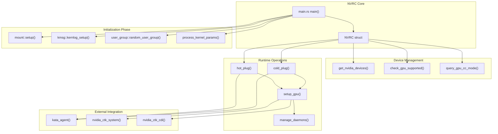
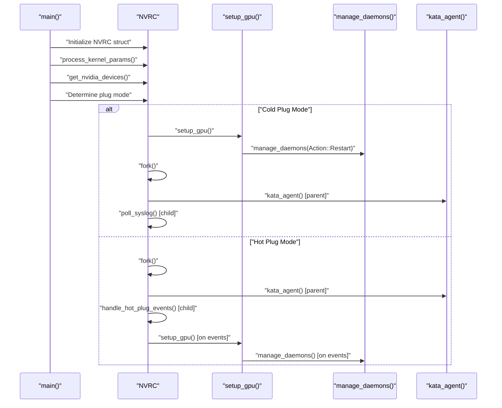

<!-- source: DeepWiki mcp.deepwiki.com · repo NVIDIA/nvrc · page 1 Overview · fetched 2026-10-26 -->

# Overview

Relevant source files

The following files were used as context for generating this wiki page:

- [Cargo.toml](Cargo.toml)
- [README.md](README.md)
- [src/main.rs](src/main.rs)

## Purpose and Scope

NVRC is an NVIDIA GPU management system designed specifically for containerized environments, with primary focus on Kata Containers integration. This system handles GPU device discovery, validation, daemon management, and container runtime integration within secure, isolated execution environments.

This document provides a high-level introduction to NVRC's architecture and operational modes. For detailed information about specific subsystems, see [System Architecture](#2), [GPU Management](#4), [System Services](#5), and [Runtime Operations](#6).

## System Overview

NVRC operates as a specialized init system that bootstraps GPU-enabled containerized environments. The system is built around the central `NVRC` struct which coordinates filesystem setup, device management, daemon lifecycle, and container runtime integration.

### Primary System Architecture

**Sources:** [src/main.rs:39-67](), [src/main.rs:101-219]()

## Core Components

NVRC consists of several interconnected modules that handle different aspects of GPU management and system integration:

| Component | Module | Primary Function |
|-----------|---------|------------------|
| System Orchestrator | `main.rs` | Coordinates initialization and operational mode selection |
| Device Discovery | `get_devices.rs` | Enumerates and identifies NVIDIA hardware |
| Device Validation | `check_supported.rs` | Validates GPU compatibility and support status |
| Daemon Management | `daemon.rs` | Controls NVIDIA service lifecycle |
| Container Integration | `container_toolkit.rs` | Manages NVIDIA Container Toolkit integration |
| Security Framework | `lockdown.rs` | Implements system hardening measures |
| Event Monitoring | `ndev.rs`, `kmsg.rs` | Handles device hot-plug/unplug events |

**Sources:** [src/main.rs:7-23](), [Cargo.toml:1-31]()

## Operational Modes

NVRC operates in two distinct modes based on the runtime environment and device configuration:

### Mode Selection and Execution Flow

**Sources:** [src/main.rs:61-66](), [src/main.rs:101-132](), [src/main.rs:135-194]()

### Cold Plug Mode
In cold plug mode, NVRC performs complete GPU initialization during system startup. The system:
- Discovers all available NVIDIA devices
- Validates device support and configures hardware
- Starts all necessary NVIDIA daemons
- Configures container runtime integration
- Forks to run Kata agent alongside syslog monitoring

### Hot Plug Mode  
Hot plug mode enables dynamic device management where NVRC:
- Monitors for device addition/removal events via `udev` and kernel messages
- Dynamically reconfigures GPU setup when devices change
- Manages daemon lifecycle based on device availability
- Maintains container runtime integration during device transitions

## Key Dependencies and Integration Points

NVRC integrates with several external systems and relies on specific dependencies:

### Runtime Dependencies
- **NVIDIA Container Toolkit**: Provides container runtime GPU integration via `nvidia_ctk_system()` and `nvidia_ctk_cdi()`
- **Kata Containers Agent**: Manages container lifecycle through `kata_agent()` integration
- **NVIDIA Drivers**: Requires NVIDIA kernel modules and userspace libraries
- **System Daemons**: Manages `nvidia-persistenced`, `nv-hostengine`, and `dcgm-exporter`

### Development Dependencies
- **Rust Ecosystem**: Built with async-capable libraries including `nix`, `anyhow`, and `log`
- **System Interfaces**: Direct integration with `udev`, `syslog`, and kernel message interfaces
- **Security Framework**: Implements module loading restrictions and panic handling

**Sources:** [Cargo.toml:6-17](), [src/main.rs:30-33]()

## Security and Hardening Features

NVRC implements several security measures designed for confidential computing and secure container environments:

- **Module Loading Restriction**: Disables dynamic kernel module loading after GPU initialization
- **Panic Hook Management**: Custom panic handling for secure failure modes  
- **Identity Randomization**: Generates random user/group identities for process isolation
- **Filesystem Isolation**: Implements read-only root filesystem with controlled mount points
- **Confidential Computing Support**: Optional feature for hardware-based confidential computing validation

**Sources:** [src/main.rs:40](), [src/main.rs:48-49](), [src/main.rs:211](), [Cargo.toml:30-31]()

This overview establishes the foundation for understanding NVRC's role in GPU-enabled containerized environments. Detailed documentation for each subsystem is available in the corresponding wiki sections referenced above.

---

