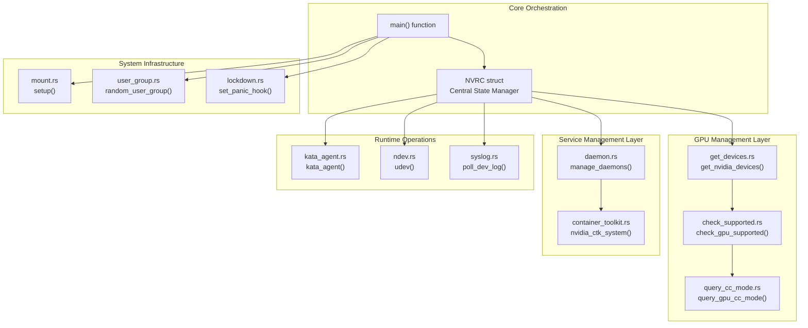
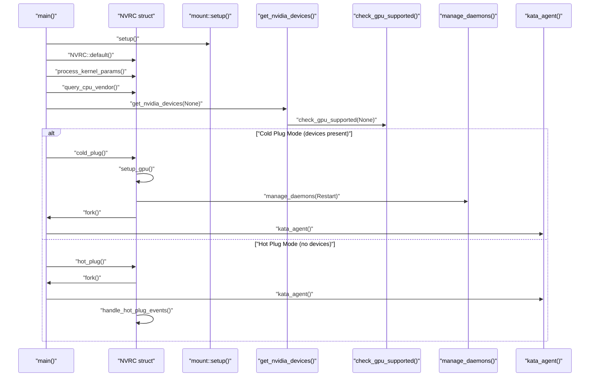
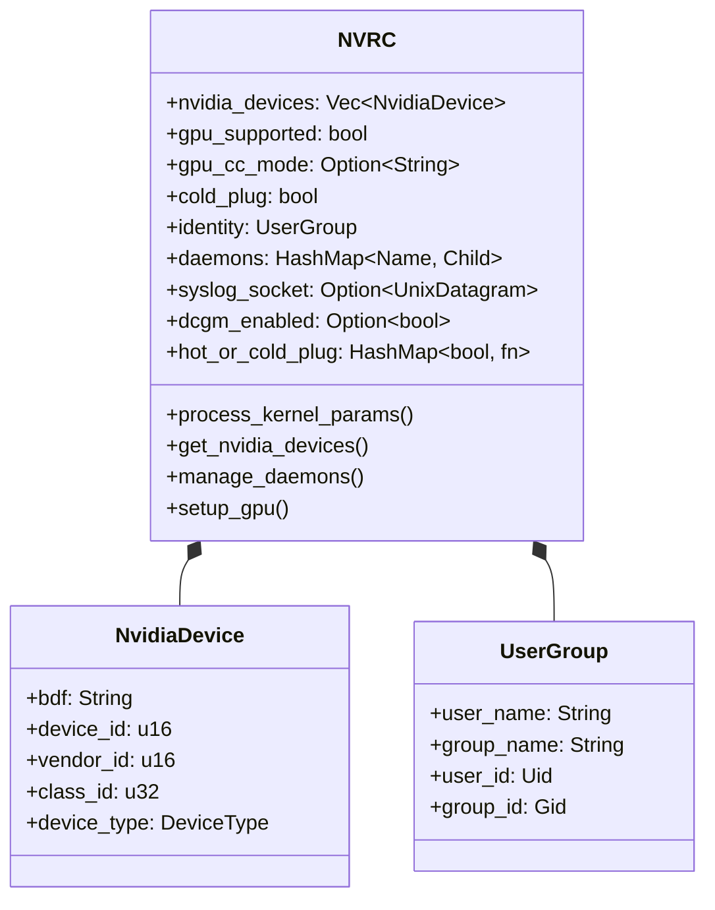

<!-- source: DeepWiki mcp.deepwiki.com · repo NVIDIA/nvrc · page 2 System Architecture · fetched 2026-10-26 -->

# System Architecture

Relevant source files

The following files were used as context for generating this wiki page:

- [src/daemon.rs](src/daemon.rs)
- [src/get_devices.rs](src/get_devices.rs)
- [src/main.rs](src/main.rs)
- [src/nvrc.rs](src/nvrc.rs)

This document describes the high-level architecture of the NVRC system, covering the major components and their interactions. NVRC serves as an NVIDIA GPU management system designed for containerized environments, with particular focus on Kata Containers integration.

For detailed information about individual subsystems, see [GPU Management](#4), [System Services](#5), and [Runtime Operations](#6). For build and deployment processes, see [Development and CI/CD](#7).

## Core System Design

NVRC follows a modular architecture centered around the `NVRC` struct, which acts as the central state manager and orchestrator. The system is designed to handle both cold-plug (devices present at startup) and hot-plug (dynamic device addition/removal) scenarios.

### Primary Components

The architecture consists of several key subsystems:

**System Orchestrator**: The `main` function in `main.rs` serves as the primary entry point and system coordinator, managing initialization sequences and process forking for different operational modes.

**Central State Manager**: The `NVRC` struct maintains system state including device inventory, configuration parameters, daemon processes, and operational mode determination.

**GPU Management Subsystem**: Handles device discovery through PCI bus scanning, device validation against supported hardware lists, and confidential computing mode detection.

**Service Management**: Manages NVIDIA-related daemon processes including persistence daemon, host engine, and DCGM exporter.

**Container Integration**: Interfaces with NVIDIA Container Toolkit to generate CDI specifications and configure container runtime integration.

Sources: [src/main.rs:39-67](), [src/nvrc.rs:47-85]()

## System Component Relationships

Sources: [src/main.rs:39-67](), [src/nvrc.rs:47-85](), [src/get_devices.rs:69-100](), [src/daemon.rs:99-127]()

## Initialization and Runtime Flow

The system follows a structured initialization sequence that prepares the environment, discovers hardware, and establishes runtime operations.

### System Startup Sequence

Sources: [src/main.rs:39-67](), [src/main.rs:101-132](), [src/nvrc.rs:101-117]()

## Operational Modes

NVRC operates in two distinct modes based on hardware presence at startup, with different process management strategies for each.

### Cold Plug vs Hot Plug Architecture

| Mode | Trigger Condition | Primary Process | Child Process | Event Handling |
|------|------------------|-----------------|---------------|----------------|
| Cold Plug | `nvidia_devices.len() > 0` | `kata_agent()` | `poll_syslog()` | Continuous syslog monitoring |
| Hot Plug | `nvidia_devices.len() == 0` | `kata_agent()` | `handle_hot_plug_events()` | `udev` + `kmsg` event watchers |

The mode determination occurs in the `update_device_state` method, which sets the `cold_plug` boolean flag based on device discovery results.

### Process Fork Strategy

Both modes utilize `fork()` to create parent and child processes with distinct responsibilities:

**Parent Process**: Always runs `kata_agent()` to maintain container agent functionality
**Child Process**: Mode-specific operations (syslog polling or event handling)

Sources: [src/main.rs:61-66](), [src/main.rs:101-132](), [src/get_devices.rs:117-131]()

## State Management and Configuration

The `NVRC` struct maintains comprehensive system state through several key data structures and configuration mechanisms.

### Core State Components

### Configuration Parameter Processing

The system processes kernel command line parameters through a handler-based architecture defined in `PARAM_HANDLERS`:

- `nvrc.log`: Sets logging level and enables debug output
- `nvrc.uvm_persistence_mode`: Configures UVM persistence for `nvidia-persistenced`
- `nvrc.dcgm`: Enables/disables DCGM monitoring services
- `nvrc.smi.srs`: Sets SRS (Secure Ready State) configuration for confidential computing

Sources: [src/nvrc.rs:47-85](), [src/nvrc.rs:37-45](), [src/nvrc.rs:101-117](), [src/get_devices.rs:23-31]()

## Integration Points

NVRC interfaces with several external systems and runtime components to provide comprehensive GPU management.

### External System Dependencies

**NVIDIA Container Toolkit**: Integration through `nvidia_ctk_system()` and `nvidia_ctk_cdi()` functions for container runtime configuration and CDI specification generation.

**Kata Containers**: Direct integration via `kata_agent()` function, running as the primary process in both operational modes.

**System Services**: Management of NVIDIA daemon processes including:
- `nvidia-persistenced`: GPU state persistence
- `nv-hostengine`: DCGM host engine for monitoring
- `dcgm-exporter`: Metrics export functionality

**Hardware Abstraction**: PCI device discovery through sysfs (`/sys/bus/pci/devices`) and kernel message monitoring via `/dev/kmsg`.

Sources: [src/container_toolkit.rs](), [src/kata_agent.rs](), [src/daemon.rs:129-223](), [src/get_devices.rs:69-100]()

---

