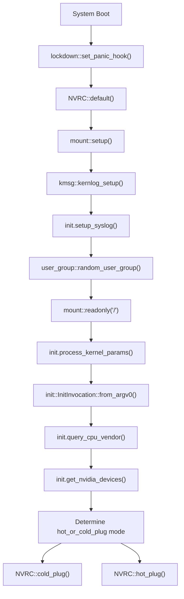
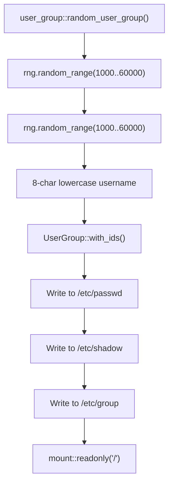
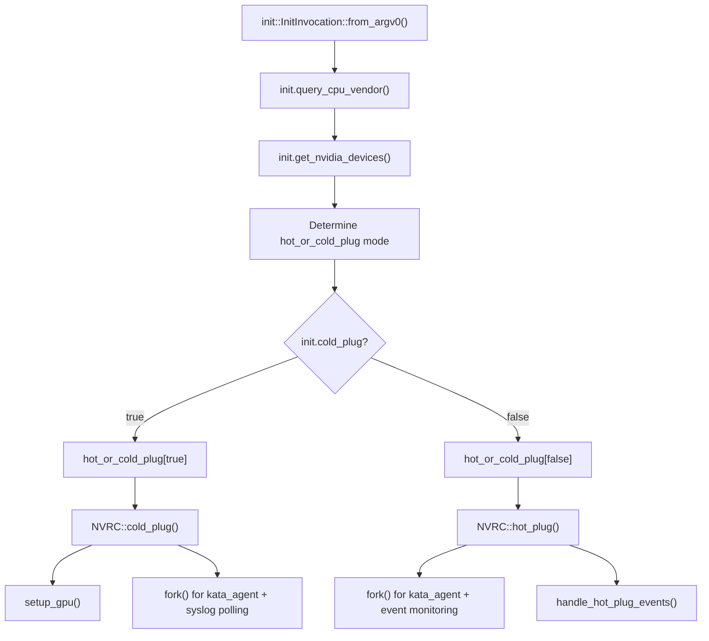

<!-- source: DeepWiki mcp.deepwiki.com · repo NVIDIA/nvrc · page 3 System Initialization · fetched 2026-10-26 -->

# System Initialization

Relevant source files

The following files were used as context for generating this wiki page:

- [src/main.rs](src/main.rs)
- [src/mount.rs](src/mount.rs)
- [src/nvrc.rs](src/nvrc.rs)
- [src/user_group.rs](src/user_group.rs)

This document covers the NVRC system initialization process from boot to ready state, including filesystem setup, configuration processing, device discovery, and mode determination. This encompasses the early boot sequence that prepares the system for GPU management operations.

For information about ongoing device monitoring and event handling during runtime, see [Runtime Operations](#6). For details about daemon management and service orchestration, see [System Services](#5).

## Overview

The NVRC initialization process follows a sequential bootstrap procedure orchestrated by the `main` function. The system transitions through several phases: panic handling setup, filesystem mounting, logging configuration, identity management, parameter processing, and finally mode determination for either cold-plug or hot-plug operation.

Sources: [src/main.rs:39-67]()

## Initialization Sequence

### Phase 1: System Safety and Core Setup

The initialization begins with essential system safety measures and core infrastructure setup. The `main` function first establishes a panic hook to handle system failures gracefully, then creates the central NVRC state management structure.

| Step | Function | Purpose |
|------|----------|---------|
| 1 | `lockdown::set_panic_hook()` | Establish system failure handling |
| 2 | `NVRC::default()` | Initialize central state manager |
| 3 | `mount::setup()` | Mount essential filesystems |
| 4 | `kmsg::kernlog_setup()` | Configure kernel message logging |

Sources: [src/main.rs:40-45]()

### Phase 2: Filesystem Infrastructure

The `mount::setup()` function establishes the complete filesystem hierarchy required for system operation. This includes mounting virtual filesystems and creating essential device nodes.

```mermaid
graph TD
    MountSetup["mount::setup()"] --> ProcMount["mount('proc', '/proc', 'proc')"]
    MountSetup --> DevMount["mount('dev', '/dev', 'devtmpfs')"]
    MountSetup --> SysMount["mount('sysfs', '/sys', 'sysfs')"]
    MountSetup --> RunMount["mount('run', '/run', 'tmpfs')"]
    MountSetup --> TmpMount["mount('tmpfs', '/tmp', 'tmpfs')"]
    MountSetup --> ConditionalMounts["mount_conditional() for securityfs, efivarfs"]
    MountSetup --> DeviceLinks["create_device_symlinks()"]
    MountSetup --> DeviceNodes["create_device_nodes()"]
    
    DeviceLinks --> FdLink["/proc/self/fd -> /dev/fd"]
    DeviceLinks --> StdinLink["/proc/self/fd/0 -> /dev/stdin"]
    DeviceLinks --> StdoutLink["/proc/self/fd/1 -> /dev/stdout"]
    DeviceLinks --> StderrLink["/proc/self/fd/2 -> /dev/stderr"]
    
    DeviceNodes --> NullDev["/dev/null (1,3)"]
    DeviceNodes --> ZeroDev["/dev/zero (1,5)"]
    DeviceNodes --> RandomDev["/dev/random (1,8)"]
    DeviceNodes --> UrandomDev["/dev/urandom (1,9)"]
```

Sources: [src/mount.rs:120-137](), [src/mount.rs:93-118]()

### Phase 3: Logging and Communication Setup

Following filesystem establishment, the system configures logging infrastructure and syslog communication channels. The kernel message logging system is initialized first, followed by syslog socket creation for userspace communication.

The `setup_syslog()` method creates a Unix datagram socket for syslog message processing, storing the socket reference in the NVRC structure for later use during operation.

Sources: [src/main.rs:45-46](), [src/nvrc.rs:88-92]()

### Phase 4: Identity Management and Security

The system establishes security context by creating a random user and group identity. This non-privileged identity is generated with random UIDs and GIDs in the range 1000-60000, with an 8-character lowercase alphabetic username.

The identity creation process writes standard Unix user account entries to system files with disabled passwords and restrictive settings:
- passwd entry: `username:x:uid:gid:username:/nonexistent:/bin/false`
- shadow entry: `username:*:18295:0:99999:7:::`
- group entry: `groupname:x:gid:`

After identity establishment, the root filesystem is remounted as read-only for security hardening.

Sources: [src/main.rs:48-49](), [src/user_group.rs:115-126](), [src/user_group.rs:64-77]()

### Phase 5: Configuration Processing

The system processes kernel command-line parameters to configure runtime behavior. The `process_kernel_params()` method parses `/proc/cmdline` and applies registered parameter handlers.

| Parameter | Handler | Purpose |
|-----------|---------|---------|
| `nvrc.log` | `nvrc_log` | Set logging level and enable debug output |
| `nvrc.uvm_persistence_mode` | `uvm_persistenced_mode` | Configure UVM persistence |
| `nvrc.dcgm` | `nvrc_dcgm` | Enable/disable DCGM monitoring |
| `nvrc.smi.srs` | `nvidia_smi_srs` | Configure nvidia-smi SRS mode |

The parameter processing uses a HashMap-based dispatch system with function pointers for efficient parameter handling.

Sources: [src/main.rs:51-52](), [src/nvrc.rs:101-117](), [src/nvrc.rs:37-45]()

### Phase 6: Hardware Discovery and Mode Selection

The final initialization phase involves CPU vendor detection, NVIDIA device enumeration, and determination of operational mode (hot-plug vs cold-plug).

The mode selection uses a function pointer lookup table stored in the `hot_or_cold_plug` HashMap, mapping boolean values to the appropriate handler functions.

Sources: [src/main.rs:54-66](), [src/nvrc.rs:75-78]()

## Process Forking Strategy

Both operational modes use process forking to separate the Kata agent execution from device management:

- **Cold-plug mode**: Parent process runs `kata_agent()`, child process polls syslog with `COLD_PLUG_POLL_INTERVAL` (1 second)
- **Hot-plug mode**: Parent process runs `kata_agent()`, child process handles device events through `handle_hot_plug_events()`

This separation ensures that the Kata agent remains responsive while device management operations proceed independently.

Sources: [src/main.rs:101-132](), [src/main.rs:35-37]()

---

