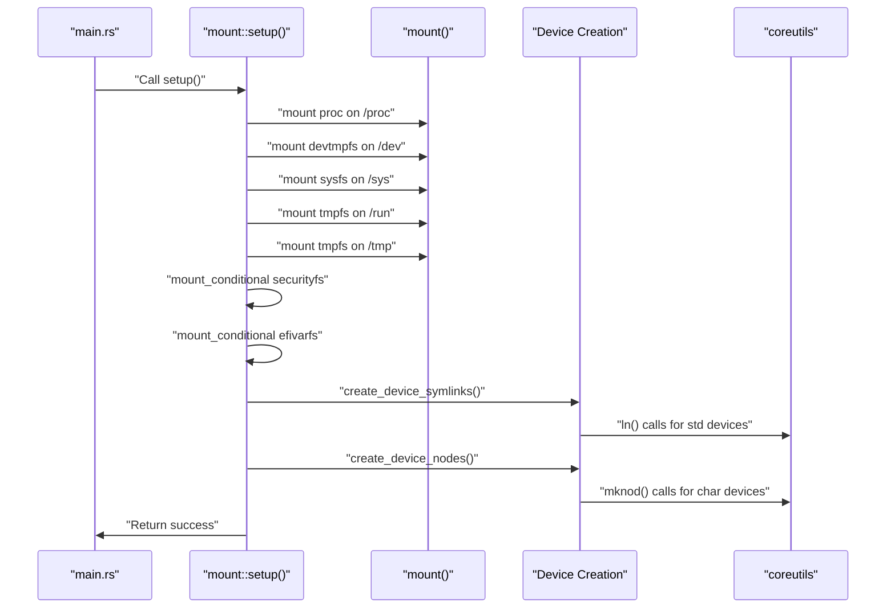
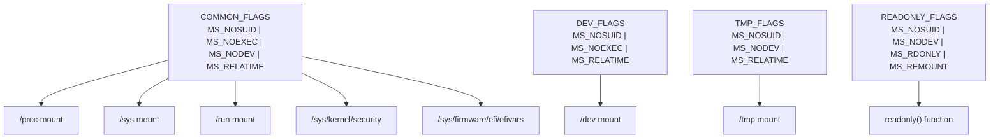
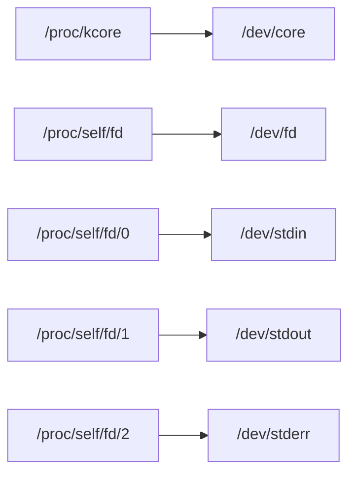

<!-- source: DeepWiki mcp.deepwiki.com · repo NVIDIA/nvrc · page 3.1 Filesystem Setup · fetched 2026-10-26 -->

# Filesystem Setup

Relevant source files

The following files were used as context for generating this wiki page:

- [src/coreutils.rs](src/coreutils.rs)
- [src/mount.rs](src/mount.rs)

## Purpose and Scope

This document covers the initial filesystem mounting and device node creation performed during NVRC system initialization. The filesystem setup establishes the essential directory structure and device files required for the NVRC runtime environment to operate correctly within a containerized context.

This page focuses specifically on the mounting operations and device creation. For information about configuration processing that occurs after filesystem setup, see [Configuration Processing](#3.2). For details about the overall initialization sequence, see [System Initialization](#3).

## Overview

The filesystem setup process is handled by the `setup()` function in [src/mount.rs:120-137]() and represents one of the earliest initialization steps in the NVRC system. This process establishes a minimal but complete Linux filesystem hierarchy with appropriate security constraints for the containerized environment.

Sources: [src/mount.rs:120-137]()

## Core Mount Operations

### Essential Filesystem Mounts

The system performs several critical filesystem mounts during initialization, each with specific security flags and purposes:

| Filesystem | Mount Point | Type | Flags | Purpose |
|------------|-------------|------|-------|---------|
| proc | `/proc` | proc | `COMMON_FLAGS` | Process and kernel information |
| dev | `/dev` | devtmpfs | `DEV_FLAGS` | Device files |
| sysfs | `/sys` | sysfs | `COMMON_FLAGS` | Kernel objects and attributes |
| run | `/run` | tmpfs | `COMMON_FLAGS` | Runtime data |
| tmpfs | `/tmp` | tmpfs | `TMP_FLAGS` | Temporary files |

The `mount()` function in [src/mount.rs:34-47]() handles the actual mounting logic with built-in duplicate mount detection via `is_mounted()`.

### Mount Security Flags

NVRC applies strict security constraints through predefined mount flag combinations:

Sources: [src/mount.rs:8-21]()

### Conditional Mounting

The `mount_conditional()` function in [src/mount.rs:80-91]() performs safety checks before mounting optional filesystems:

- **Filesystem availability**: Checked via `fs_available()` against `/proc/filesystems`
- **Target path existence**: Verified using `Path::new(target).exists()`
- **Mount status**: Ensured not already mounted via `is_mounted()`

This approach safely handles systems where optional filesystems like `securityfs` or `efivarfs` may not be available.

Sources: [src/mount.rs:80-91](), [src/mount.rs:59-67](), [src/mount.rs:49-57]()

## Device Node Creation

### Standard Device Symlinks

The system creates essential device symlinks through `create_device_symlinks()` in [src/mount.rs:93-105]():

### Character Device Nodes

Essential character device nodes are created via `create_device_nodes()` in [src/mount.rs:107-118]() using predefined major/minor number constants:

| Device | Path | Major | Minor | Constant |
|--------|------|-------|-------|----------|
| Null device | `/dev/null` | 1 | 3 | `NULL_MINOR` |
| Zero device | `/dev/zero` | 1 | 5 | `ZERO_MINOR` |
| Random | `/dev/random` | 1 | 8 | `RANDOM_MINOR` |
| Urandom | `/dev/urandom` | 1 | 9 | `URANDOM_MINOR` |

All character devices use major number 1 (`MEM_MAJOR` constant) as defined in [src/mount.rs:23-27]().

Sources: [src/mount.rs:93-118](), [src/mount.rs:23-27]()

## Core Utility Functions

### Symbolic Link Creation

The `ln()` function in [src/coreutils.rs:8-11]() creates symbolic links using the `symlinkat()` system call with proper error context formatting.

### Device Node Creation

The `mknod()` function in [src/coreutils.rs:14-25]() creates device nodes with:
- Existence checking to avoid duplicate creation
- Device number construction via `makedev()`
- Default permissions of `0o666`
- Comprehensive error context

Sources: [src/coreutils.rs:8-25]()

## Error Handling and Robustness

The filesystem setup includes several robustness features:

- **Mount detection**: `is_mounted()` prevents duplicate mounts by parsing `/proc/mounts`
- **Filesystem availability**: `fs_available()` checks `/proc/filesystems` before attempting mounts
- **Conditional operations**: Optional filesystems are only mounted if available and not already mounted
- **Device existence**: Device nodes are only created if they don't already exist

This design allows NVRC to operate correctly in various container environments and handle partial or pre-existing filesystem setups gracefully.

Sources: [src/mount.rs:49-67](), [src/coreutils.rs:14-18]()

## Integration with System Initialization

The filesystem setup occurs early in the NVRC initialization sequence, called directly from the main initialization logic. This establishes the foundation for subsequent operations including:

- Kernel parameter processing
- Device discovery and validation  
- Daemon management
- Container toolkit integration

The `readonly()` function in [src/mount.rs:69-78]() provides the capability to remount filesystems as read-only for security hardening after initialization completes.

Sources: [src/mount.rs:69-78](), [src/mount.rs:120-137]()

---

