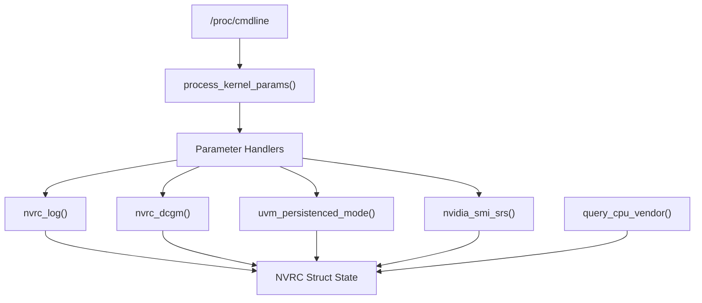
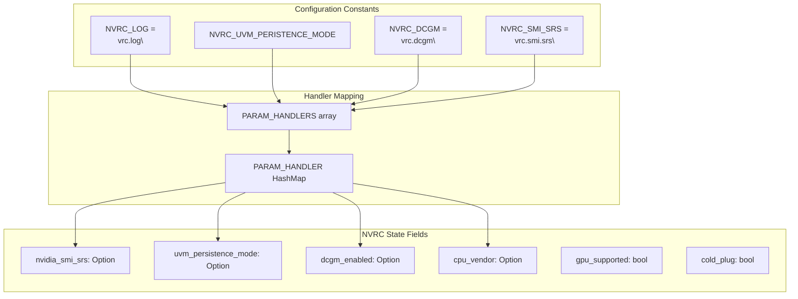
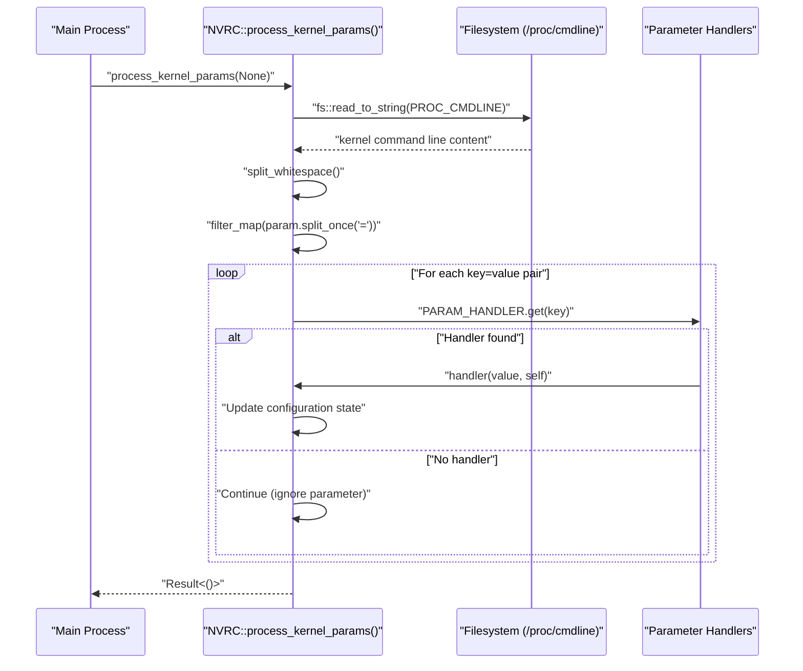

<!-- source: DeepWiki mcp.deepwiki.com · repo NVIDIA/nvrc · page 3.2 Configuration Processing · fetched 2026-10-26 -->

# Configuration Processing

<details>
<summary>Relevant source files</summary>

The following files were used as context for generating this wiki page:

- [src/cpu_vendor.rs](src/cpu_vendor.rs)
- [src/nvrc.rs](src/nvrc.rs)

</details>


This document covers how NVRC processes kernel parameters and system configuration during initialization. The configuration system parses kernel command line parameters to set runtime behavior, log levels, daemon settings, and other system preferences.

For information about the broader system initialization process, see [System Initialization](#3). For details about filesystem setup that occurs before configuration processing, see [Filesystem Setup](#3.1).

## Overview

The configuration processing system in NVRC reads kernel command line parameters from `/proc/cmdline` and applies them to the system state. This allows administrators to control NVRC behavior by passing parameters at boot time. The system uses a handler-based architecture where each supported parameter has a dedicated processing function.



**Sources:** [src/nvrc.rs:101-117](), [src/cpu_vendor.rs:18-31]()

## Configuration Architecture

The NVRC configuration system centers around the `NVRC` struct, which maintains all system state and configuration. Parameter processing uses a static handler mapping that associates parameter names with their processing functions.



**Sources:** [src/nvrc.rs:26-30](), [src/nvrc.rs:37-45](), [src/nvrc.rs:48-62]()

## Kernel Parameter Processing

The `process_kernel_params` method handles the core parameter parsing logic. It reads the kernel command line, splits parameters by whitespace, and processes each key=value pair through the handler system.

| Parameter | Handler Function | Purpose |
|-----------|------------------|---------|
| `nvrc.log` | `nvrc_log()` | Controls logging verbosity and kernel message rate limiting |
| `nvrc.dcgm` | `nvrc_dcgm()` | Enables or disables DCGM daemon management |
| `nvrc.uvm_persistence_mode` | `uvm_persistenced_mode()` | Configures UVM persistence daemon behavior |
| `nvrc.smi.srs` | `nvidia_smi_srs()` | Sets nvidia-smi SRS configuration |



**Sources:** [src/nvrc.rs:101-117](), [src/nvrc.rs:44-45]()

## Configuration Handlers

Each configuration parameter has a dedicated handler function that validates and applies the parameter value to the NVRC state.

### Log Level Handler

The `nvrc_log` handler processes log level configuration and manages kernel message rate limiting. It supports standard log levels (off, error, warn, info, debug, trace) and automatically disables rate limiting for debug modes.

```mermaid
graph TD
    INPUT["nvrc.log parameter value"]
    MATCH["Match log level string"]
    
    INPUT --> MATCH
    
    MATCH --> OFF["\"off\"|\"0\"|\"\": LevelFilter::Off"]
    MATCH --> ERROR["\"error\": LevelFilter::Error"]
    MATCH --> WARN["\"warn\": LevelFilter::Warn"]
    MATCH --> INFO["\"info\": LevelFilter::Info"]
    MATCH --> DEBUG["\"debug\": LevelFilter::Debug"]
    MATCH --> TRACE["\"trace\": LevelFilter::Trace"]
    MATCH --> DEFAULT["other: LevelFilter::Off"]
    
    OFF --> SET_LEVEL["log::set_max_level(level)"]
    ERROR --> SET_LEVEL
    WARN --> SET_LEVEL
    INFO --> SET_LEVEL
    DEBUG --> SET_LEVEL
    TRACE --> SET_LEVEL
    DEFAULT --> SET_LEVEL
    
    SET_LEVEL --> KMSG["Write \"on\" to /proc/sys/kernel/printk_devkmsg"]
```

**Sources:** [src/nvrc.rs:127-146](), [src/nvrc.rs:31-32]()

### Boolean Parameter Parsing

The system implements a `BooleanLike` trait for consistent boolean parameter parsing across handlers. The trait recognizes common boolean representations.

| Value | Result |
|-------|--------|
| "on", "true", "1", "yes" | `true` |
| All other values | `false` |

**Sources:** [src/nvrc.rs:12-24](), [src/nvrc.rs:120-125]()

### DCGM Handler

The `nvrc_dcgm` handler enables or disables DCGM daemon management using boolean parsing.

**Sources:** [src/nvrc.rs:120-125]()

### UVM Persistence Handler

The `uvm_persistenced_mode` handler stores the UVM persistence configuration value as a string for later daemon management.

**Sources:** [src/nvrc.rs:161-165]()

## CPU Vendor Detection

The configuration system includes CPU vendor detection functionality that reads `/proc/cpuinfo` to identify the processor manufacturer. This information is used for architecture-specific optimizations.

```mermaid
graph TD
    CPUINFO["/proc/cpuinfo"]
    READER["BufReader::new(file).lines()"]
    DETECTOR["detect_vendor_from_line()"]
    
    CPUINFO --> READER
    READER --> DETECTOR
    
    DETECTOR --> AMD_CHECK["Contains \"AuthenticAMD\""]
    DETECTOR --> INTEL_CHECK["Contains \"GenuineIntel\""]
    DETECTOR --> ARM_CHECK["Contains \"CPU implementer\" && \"0x41\""]
    
    AMD_CHECK --> AMD_RESULT["\"amd\""]
    INTEL_CHECK --> INTEL_RESULT["\"intel\""]
    ARM_CHECK --> ARM_RESULT["\"arm\""]
    
    AMD_RESULT --> CPU_VENDOR_FIELD["NVRC.cpu_vendor"]
    INTEL_RESULT --> CPU_VENDOR_FIELD
    ARM_RESULT --> CPU_VENDOR_FIELD
```

**Sources:** [src/cpu_vendor.rs:18-43](), [src/cpu_vendor.rs:7-16]()

## Configuration State Management

The NVRC struct maintains configuration state through strongly-typed fields that are populated during parameter processing. Default values are established through the `Default` trait implementation.

| Field | Type | Purpose |
|-------|------|---------|
| `nvidia_smi_srs` | `Option<String>` | nvidia-smi SRS configuration |
| `uvm_persistence_mode` | `Option<String>` | UVM persistence daemon mode |
| `dcgm_enabled` | `Option<bool>` | DCGM daemon enablement flag |
| `cpu_vendor` | `Option<String>` | Detected CPU vendor (amd/intel/arm) |
| `gpu_supported` | `bool` | GPU support validation result |
| `cold_plug` | `bool` | Cold plug operation mode flag |

**Sources:** [src/nvrc.rs:48-62](), [src/nvrc.rs:64-85]()

---

