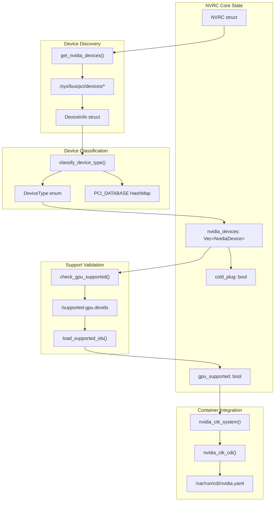
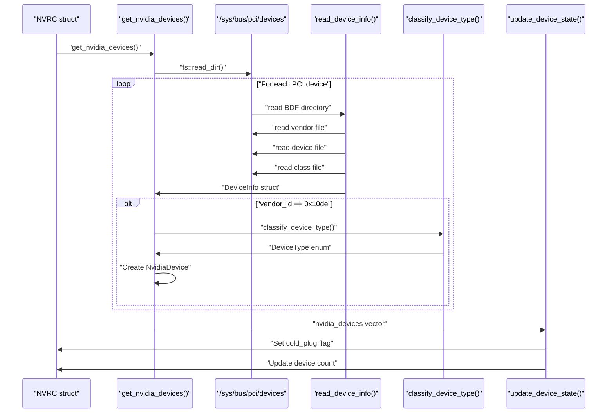
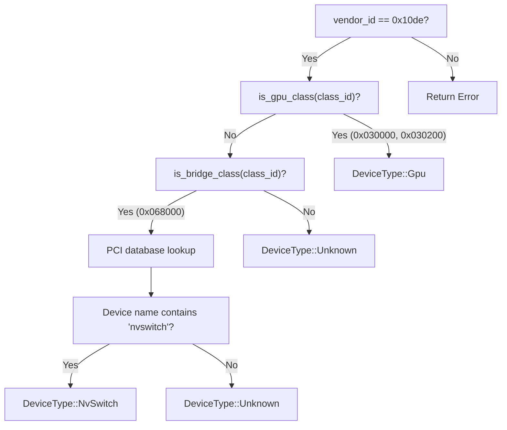
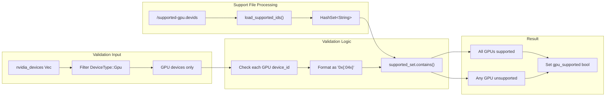
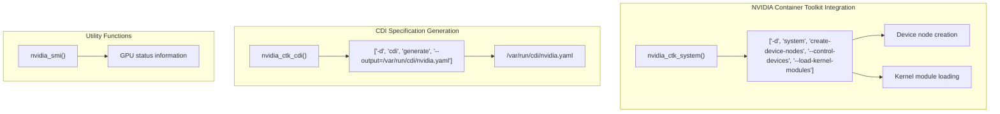

<!-- source: DeepWiki mcp.deepwiki.com · repo NVIDIA/nvrc · page 4 GPU Management · fetched 2026-10-26 -->

# GPU Management

Relevant source files

The following files were used as context for generating this wiki page:

- [download_filtered_pci_ids.sh](download_filtered_pci_ids.sh)
- [src/check_supported.rs](src/check_supported.rs)
- [src/container_toolkit.rs](src/container_toolkit.rs)
- [src/get_devices.rs](src/get_devices.rs)
- [src/pci_ids.rs](src/pci_ids.rs)
- [src/pci_ids_embedded.txt](src/pci_ids_embedded.txt)

This document covers NVRC's comprehensive GPU discovery, validation, and management capabilities. The GPU management subsystem is responsible for detecting NVIDIA hardware on the system, validating device support, and integrating with container runtime environments.

For system initialization and filesystem setup, see [System Initialization](#3). For daemon and service management, see [System Services](#5). For runtime device monitoring, see [Runtime Operations](#6).

## Overview

The GPU management subsystem operates through several coordinated components that handle the complete lifecycle of GPU discovery and validation. The system discovers NVIDIA devices via PCI bus enumeration, validates them against supported device lists, and integrates with container toolkits for runtime access.

**GPU Management Architecture**

Sources: [src/get_devices.rs:1-252](), [src/check_supported.rs:1-147](), [src/container_toolkit.rs:1-43](), [src/pci_ids.rs:1-262]()

## Core Components

The GPU management system centers around the `NVRC` struct which maintains device state and coordinates between discovery, validation, and integration components.

### Device Representation

The `NvidiaDevice` struct represents discovered NVIDIA hardware:

| Field | Type | Purpose |
|-------|------|---------|
| `bdf` | `String` | PCI Bus:Device.Function identifier |
| `device_id` | `u16` | PCI device ID for hardware identification |
| `vendor_id` | `u16` | PCI vendor ID (always `0x10de` for NVIDIA) |
| `class_id` | `u32` | PCI class ID for device type classification |
| `device_type` | `DeviceType` | Classified device type (GPU, NvSwitch, Unknown) |

The `DeviceType` enum categorizes NVIDIA hardware into three types based on PCI class IDs and device database lookups:
- `Gpu` - Graphics processors (class IDs `0x030000`, `0x030200`)
- `NvSwitch` - High-bandwidth interconnect devices (class ID `0x068000` with "nvswitch" in name)
- `Unknown` - Unrecognized NVIDIA devices

Sources: [src/get_devices.rs:23-31](), [src/pci_ids.rs:25-31](), [src/pci_ids.rs:88-139]()

### State Management

The `NVRC` struct maintains GPU management state through key fields:
- `nvidia_devices: Vec<NvidiaDevice>` - Collection of discovered NVIDIA devices
- `gpu_supported: bool` - Flag indicating whether discovered GPUs are supported
- `cold_plug: bool` - Flag indicating presence of devices for cold-plug initialization

Sources: [src/get_devices.rs:117-131](), [src/check_supported.rs:13-51]()

## Device Discovery Process

Device discovery operates through PCI bus enumeration and systematic device information extraction.

**Device Discovery Sequence**

The discovery process reads PCI device information from sysfs filesystem entries at `/sys/bus/pci/devices/*`. For each device directory, it extracts vendor ID, device ID, and class ID from respective files. NVIDIA devices are identified by vendor ID `0x10de` and then classified using the PCI database.

Sources: [src/get_devices.rs:70-131](), [src/get_devices.rs:102-115]()

### PCI Classification System

Device classification uses a multi-stage approach combining PCI class IDs with device name lookups:

**Device Classification Logic**

The classification system ensures accurate device type identification by combining hardware class information with device-specific naming patterns from the embedded PCI database.

Sources: [src/pci_ids.rs:100-139](), [src/pci_ids.rs:80-86](), [src/pci_ids.rs:74-78]()

## Device Support Validation

GPU support validation ensures discovered devices are approved for system operation through allowlist checking.

**GPU Support Validation Flow**

The validation process filters discovered devices to GPU types only, then cross-references each GPU's device ID against the supported device list. The system sets `gpu_supported` to `false` if any GPU is unsupported or if no GPUs are present.

Sources: [src/check_supported.rs:13-51](), [src/check_supported.rs:54-66]()

### Supported Device Management

The support validation system uses a simple text-based allowlist format:

- File location: `/supported-gpu.devids` (configurable)
- Format: One device ID per line in hexadecimal format
- Processing: Case-insensitive, whitespace-trimmed
- Empty lines ignored during parsing

The `load_supported_ids()` method parses the support file into a `HashSet<String>` for efficient lookup operations during validation.

Sources: [src/check_supported.rs:54-66](), [src/check_supported.rs:10]()

## Container Runtime Integration

GPU management integrates with NVIDIA Container Toolkit through standardized interfaces for container GPU access.

**Container Toolkit Integration**

The integration provides two primary functions:
- `nvidia_ctk_system()` - Sets up device nodes and loads kernel modules
- `nvidia_ctk_cdi()` - Generates Container Device Interface specifications

Both functions use the `foreground()` helper to execute NVIDIA Container Toolkit commands synchronously.

Sources: [src/container_toolkit.rs:24-42](), [src/container_toolkit.rs:1-3]()

### CDI Specification Output

The Container Device Interface (CDI) specification generated at `/var/run/cdi/nvidia.yaml` provides container runtimes with standardized GPU access configuration. This specification describes available GPU devices, required device nodes, and necessary environment variables for container GPU access.

Sources: [src/container_toolkit.rs:37-42]()

---

