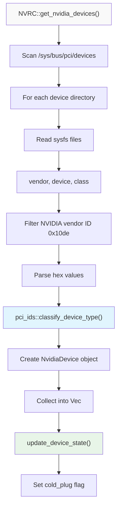
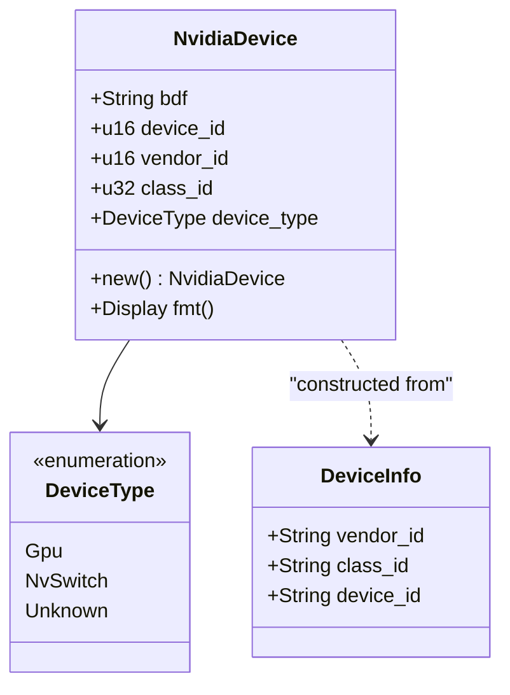
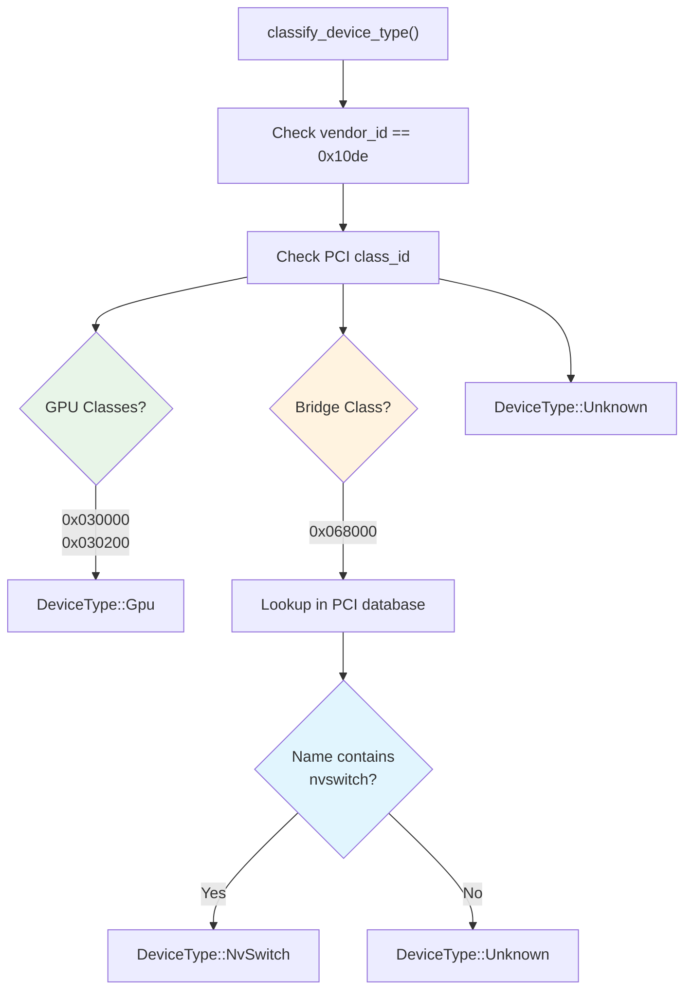
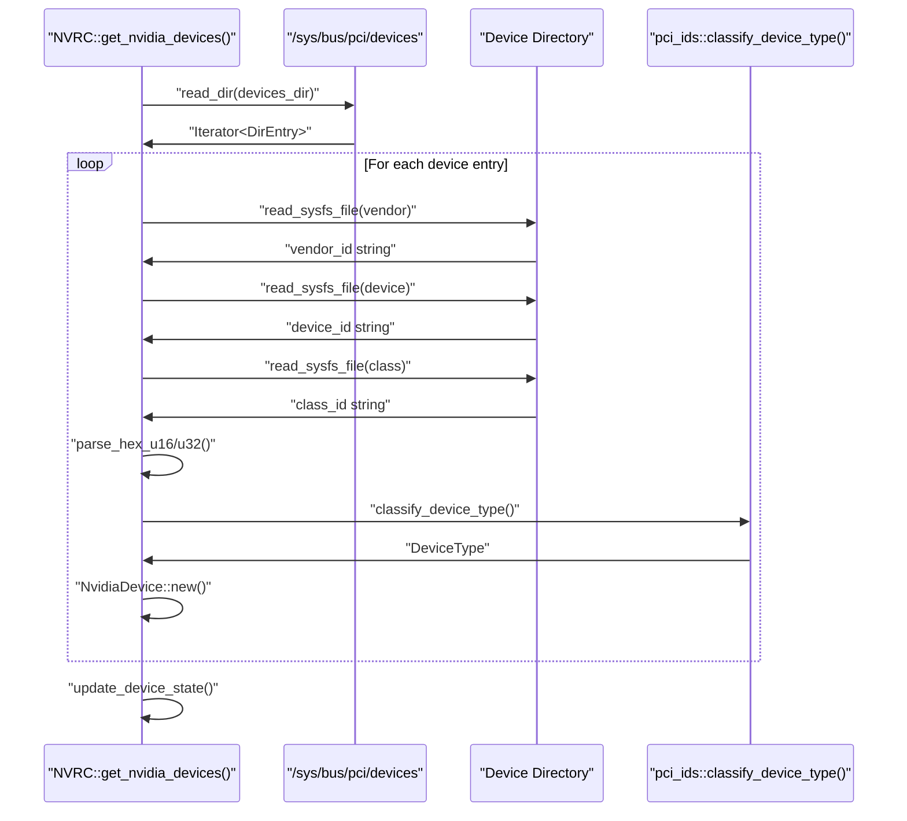
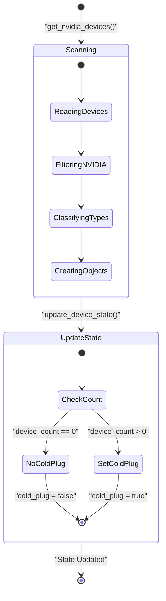
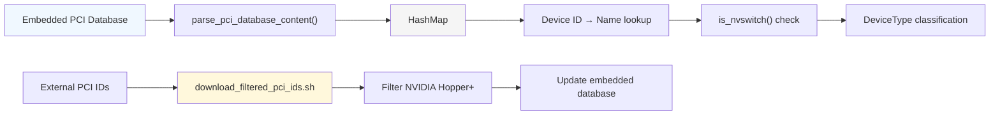
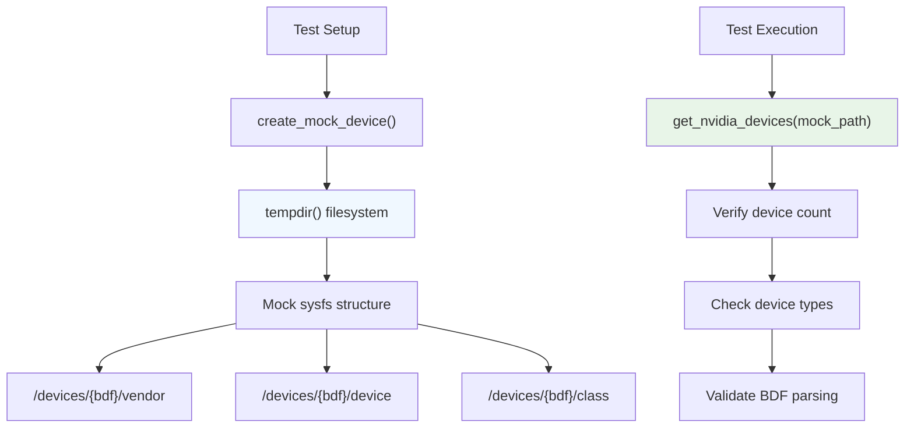

<!-- source: DeepWiki mcp.deepwiki.com · repo NVIDIA/nvrc · page 4.1 Device Discovery · fetched 2026-10-26 -->

# Device Discovery

Relevant source files

The following files were used as context for generating this wiki page:

- [download_filtered_pci_ids.sh](download_filtered_pci_ids.sh)
- [src/get_devices.rs](src/get_devices.rs)
- [src/pci_ids.rs](src/pci_ids.rs)
- [src/pci_ids_embedded.txt](src/pci_ids_embedded.txt)

This document covers how NVRC discovers and enumerates NVIDIA devices present on the system. Device discovery is the first step in GPU management, scanning the PCI bus to identify NVIDIA GPUs and NvSwitch devices that are available for use.

For information about device validation and support checking, see [Device Validation](#4.2). For details about confidential computing mode detection, see [Confidential Computing](#4.3).

## Overview

The device discovery system scans the Linux sysfs PCI bus interface to enumerate all NVIDIA devices on the system. It identifies device types (GPUs vs NvSwitch), extracts hardware identifiers, and updates the NVRC system state accordingly. This information is then used by subsequent GPU management operations.

## Discovery Process Flow

**Sources:** [src/get_devices.rs:70-131]()

## Core Data Structures

The device discovery system uses several key data structures to represent discovered hardware:

### NvidiaDevice Structure

**Sources:** [src/get_devices.rs:23-67](), [src/pci_ids.rs:25-31]()

| Field | Type | Description |
|-------|------|-------------|
| `bdf` | `String` | Bus:Device.Function identifier (e.g., "0000:01:00.0") |
| `device_id` | `u16` | PCI device ID |
| `vendor_id` | `u16` | PCI vendor ID (always 0x10de for NVIDIA) |
| `class_id` | `u32` | PCI class code |
| `device_type` | `DeviceType` | Classified device type (GPU/NvSwitch/Unknown) |

## Device Classification System

Device classification uses both PCI class codes and an embedded device database to determine device types:

**Sources:** [src/pci_ids.rs:99-139](), [src/pci_ids.rs:16-23]()

### PCI Class ID Constants

| Class ID | Constant | Device Type |
|----------|----------|-------------|
| `0x030000` | `VGA_CONTROLLER` | GPU |
| `0x030200` | `DISPLAY_3D_CONTROLLER` | GPU |
| `0x068000` | `BRIDGE_OTHER` | NvSwitch (if name matches) |

## Sysfs Interface Integration

The discovery process reads device information directly from the Linux sysfs PCI interface:

**Sources:** [src/get_devices.rs:102-115](), [src/get_devices.rs:75-96]()

### Sysfs File Paths

For each PCI device at `/sys/bus/pci/devices/{bdf}/`:

| File | Content | Usage |
|------|---------|-------|
| `vendor` | Hexadecimal vendor ID | Filter for NVIDIA (0x10de) |
| `device` | Hexadecimal device ID | Device identification |
| `class` | Hexadecimal class code | Device type classification |

## State Management

The discovery process updates the NVRC system state based on the devices found:

**Sources:** [src/get_devices.rs:117-131]()

The `cold_plug` flag indicates whether NVIDIA devices were found during discovery, which affects subsequent system initialization behavior.

## PCI ID Database

NVRC includes an embedded PCI ID database for device name resolution and NvSwitch identification:

**Sources:** [src/pci_ids.rs:7-12](), [src/pci_ids.rs:37-72](), [download_filtered_pci_ids.sh:46-175]()

### Database Content

The embedded database contains only NVIDIA devices from Hopper generation and newer:
- **Hopper (GH100)**: Device IDs `23xx`
- **Blackwell (GB100/GB200)**: Device IDs `29xx-2fxx`
- **Future generations**: Device IDs `3xxx` and higher

## Error Handling

The discovery system includes robust error handling for common failure scenarios:

| Error Type | Handling | Impact |
|------------|----------|--------|
| Missing sysfs directory | Return `anyhow::Error` | Discovery fails |
| Unreadable device files | Filter out device | Continue with other devices |
| Invalid hex parsing | Skip device | Continue discovery |
| Non-NVIDIA devices | Filter out silently | Normal operation |
| Unknown device types | Mark as `DeviceType::Unknown` | Include in results |

**Sources:** [src/get_devices.rs:11-21](), [src/get_devices.rs:76-96]()

## Testing Infrastructure

The device discovery system includes comprehensive testing capabilities:

**Sources:** [src/get_devices.rs:140-251]()

The test infrastructure creates mock sysfs structures with predefined device information to verify discovery logic without requiring actual hardware.

---

