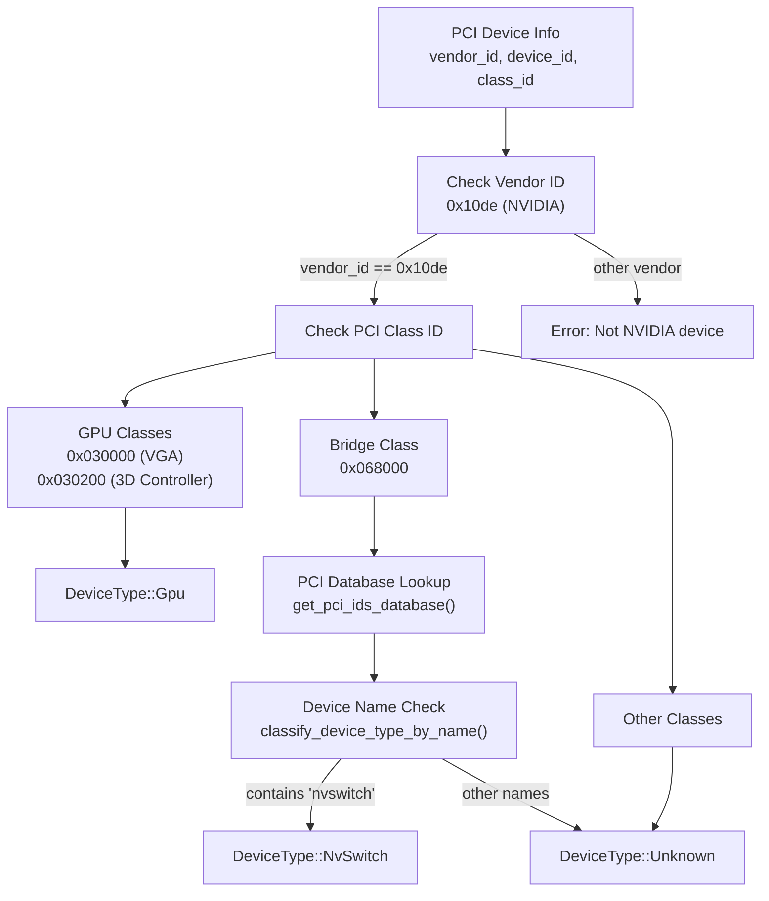
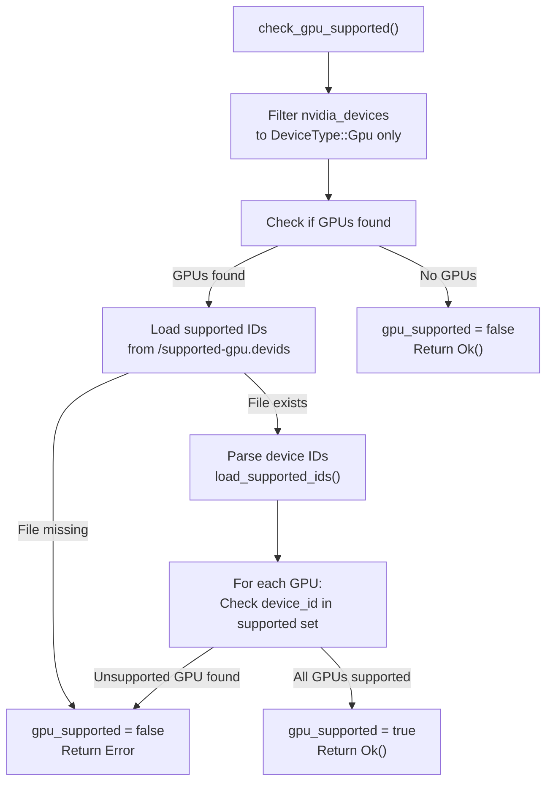
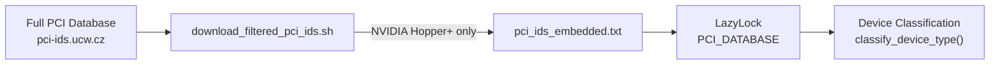
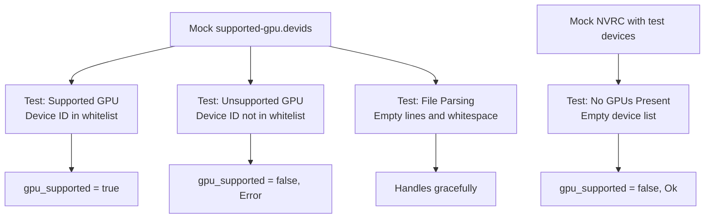

<!-- source: DeepWiki mcp.deepwiki.com · repo NVIDIA/nvrc · page 4.2 Device Validation · fetched 2026-10-26 -->

# Device Validation

Relevant source files

The following files were used as context for generating this wiki page:

- [download_filtered_pci_ids.sh](download_filtered_pci_ids.sh)
- [src/check_supported.rs](src/check_supported.rs)
- [src/pci_ids.rs](src/pci_ids.rs)
- [src/pci_ids_embedded.txt](src/pci_ids_embedded.txt)

This document covers how NVRC validates that discovered NVIDIA devices are supported for use in containerized environments. Device validation ensures that only approved GPU hardware is used and sets the system's `gpu_supported` flag accordingly. 

For information about discovering NVIDIA devices on the system, see [Device Discovery](#4.1). For details about confidential computing validation, see [Confidential Computing](#4.3).

## Device Type Classification

NVRC classifies NVIDIA devices into distinct types using PCI information and an embedded device database. The classification system determines whether devices are GPUs suitable for compute workloads or other NVIDIA hardware.

Sources: [src/pci_ids.rs:99-139](), [src/pci_ids.rs:26-31](), [src/pci_ids.rs:16-23]()

The `classify_device_type` function in `pci_ids.rs` performs this classification by first checking the vendor ID to ensure it's an NVIDIA device (0x10de), then examining the PCI class ID. GPU devices have specific class IDs (VGA controller 0x030000 or 3D controller 0x030200), while NvSwitch devices appear as bridge devices (0x068000) but require name-based verification from the PCI database.

## GPU Support Validation Process

The core validation process determines whether discovered GPU devices are approved for use by checking their device IDs against a supported devices list. This validation is performed by the `check_gpu_supported` method on the NVRC struct.

Sources: [src/check_supported.rs:13-51](), [src/check_supported.rs:54-66]()

The validation process follows these steps:

1. **Filter to GPU devices**: Only devices classified as `DeviceType::Gpu` are validated
2. **Handle empty case**: If no GPUs are found, `gpu_supported` is set to false but no error occurs
3. **Load supported device IDs**: Reads the supported GPU file (default `/supported-gpu.devids`)
4. **Parse device IDs**: Extracts and normalizes device IDs from the file
5. **Validate each GPU**: Checks that every GPU's device ID exists in the supported set
6. **Set result**: Sets `gpu_supported` flag and returns success or error

## Configuration Files and Database

NVRC uses two key data sources for device validation: a supported GPU device IDs file and an embedded PCI database for device classification.

### Supported GPU Device IDs File

The supported GPU file contains a whitelist of approved NVIDIA GPU device IDs in hexadecimal format:

| File Path | Purpose | Format |
|-----------|---------|--------|
| `/supported-gpu.devids` | Default supported GPU list | One device ID per line (e.g., `0x2330`) |
| Custom path via parameter | Override default location | Same format as default |

The `load_supported_ids` function parses this file by reading each line, trimming whitespace, converting to lowercase, and filtering out empty lines. Device IDs are stored in a `HashSet<String>` for efficient lookup during validation.

Sources: [src/check_supported.rs:10](), [src/check_supported.rs:54-66]()

### Embedded PCI Database  

NVRC includes a filtered PCI database containing NVIDIA device information for classification:

Sources: [src/pci_ids.rs:7-12](), [download_filtered_pci_ids.sh:1-230]()

The embedded database is filtered to include only NVIDIA Hopper generation and newer devices (device IDs 23xx and higher), excluding older generations to reduce size. The database is parsed once at startup and cached in a static HashMap for efficient access.

## Error Handling and Edge Cases

The validation system handles several error conditions and edge cases gracefully:

### File System Errors
- **Missing supported GPU file**: Returns error and sets `gpu_supported = false`
- **File read failures**: Propagated as `anyhow::Error` with context
- **Empty or invalid files**: Treated as having no supported devices

### Device Validation Scenarios  
- **No GPUs present**: Sets `gpu_supported = false` but returns `Ok(())` 
- **Mixed supported/unsupported**: Fails validation if any GPU is unsupported
- **Unknown device types**: Classified as `DeviceType::Unknown`, not validated as GPUs
- **Case sensitivity**: Device IDs normalized to lowercase for comparison

Sources: [src/check_supported.rs:20-24](), [src/check_supported.rs:28-34](), [src/check_supported.rs:38-50]()

## Testing and Validation

The validation system includes comprehensive test coverage for different scenarios:

Sources: [src/check_supported.rs:67-146]()

The test suite creates temporary supported GPU files with known device IDs and validates that the `check_gpu_supported` method correctly identifies supported vs unsupported devices, handles empty device lists, and properly parses files with empty lines or whitespace.

---

