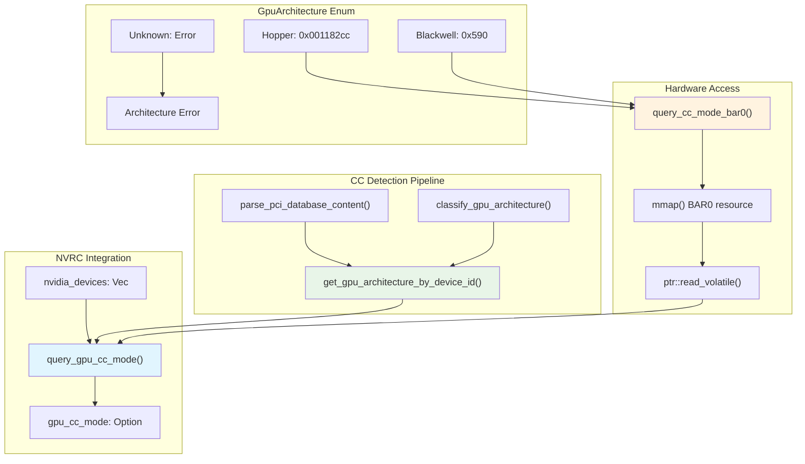
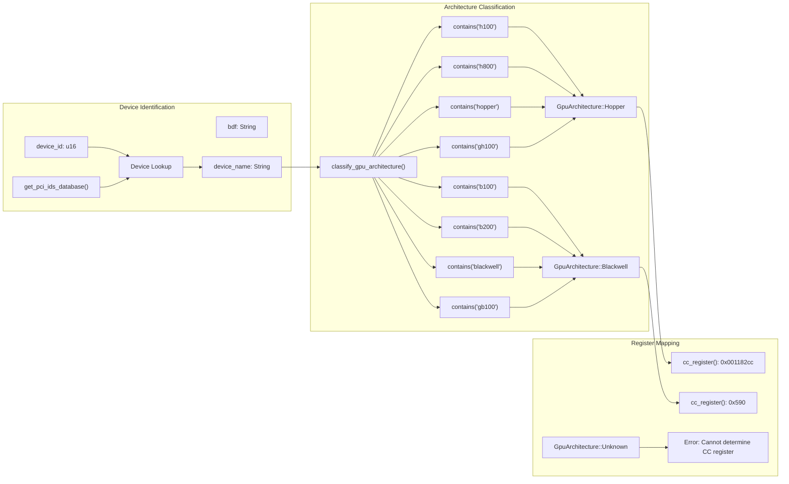
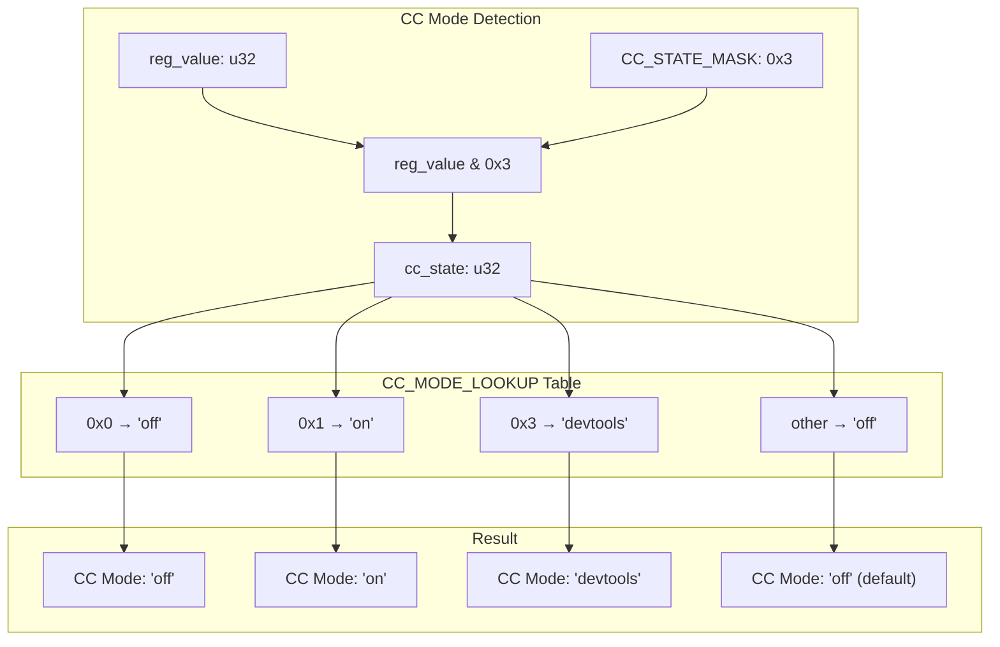
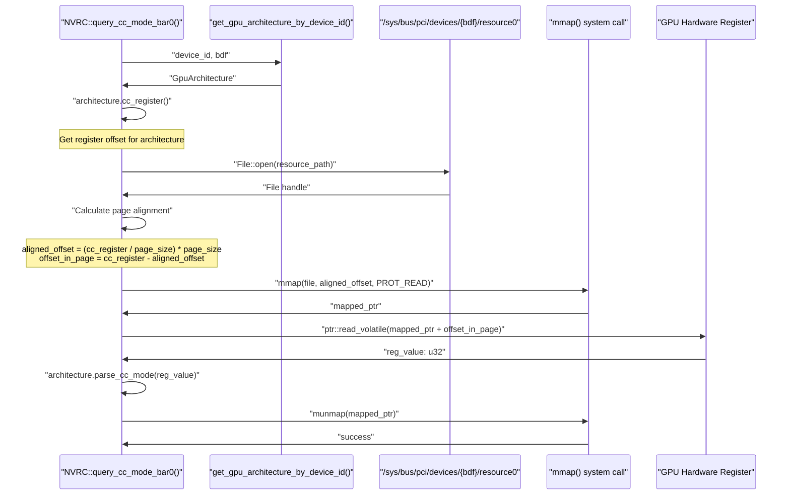
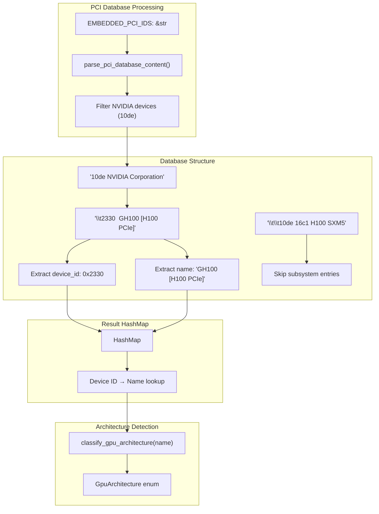
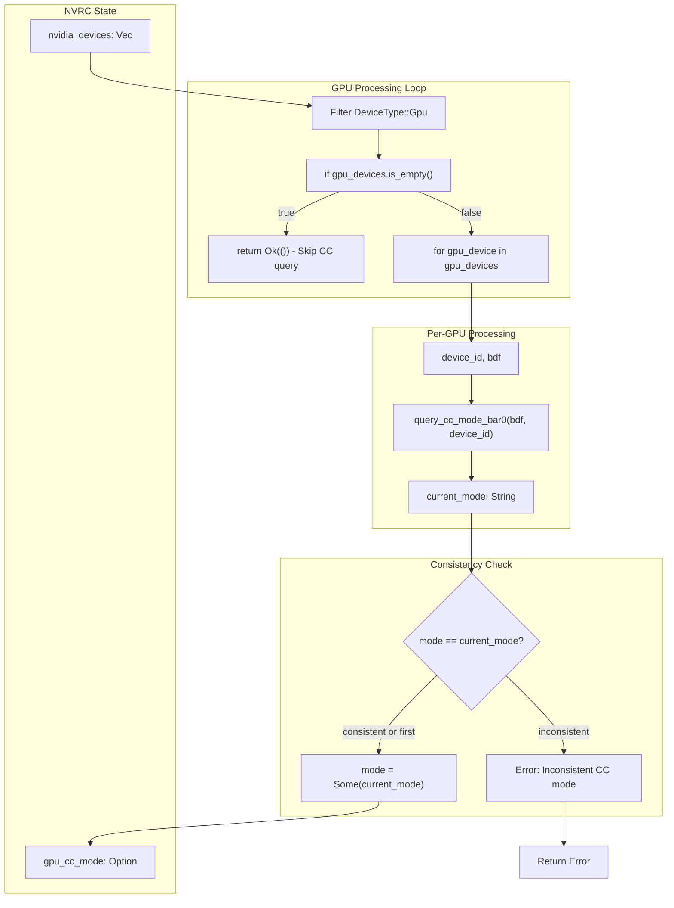
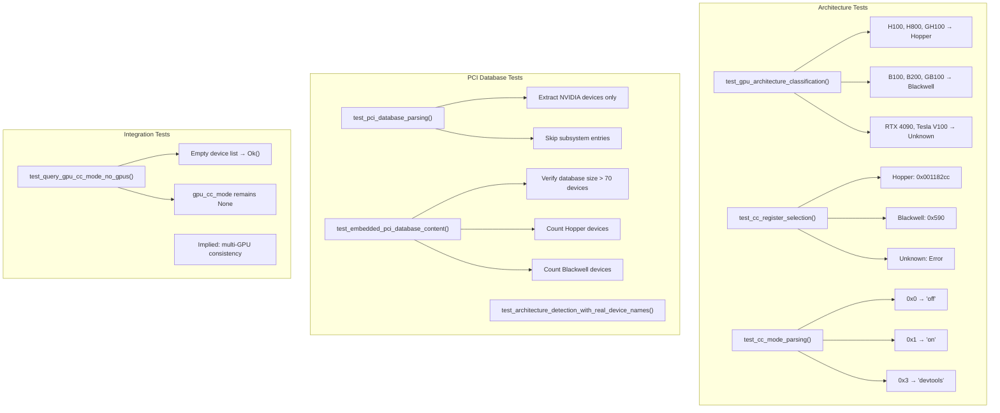

<!-- source: DeepWiki mcp.deepwiki.com · repo NVIDIA/nvrc · page 4.3 Confidential Computing · fetched 2026-10-26 -->

# Confidential Computing

Relevant source files

The following files were used as context for generating this wiki page:

- [src/query_cc_mode.rs](src/query_cc_mode.rs)

This document covers NVRC's confidential computing mode detection and querying capabilities for NVIDIA GPU hardware. The system identifies GPU architectures (Hopper and Blackwell) and reads hardware registers to determine the current confidential computing state. This functionality is only available when the `confidential` feature flag is enabled.

For general GPU device management, see [Device Discovery](#4.1) and [Device Validation](#4.2). For container runtime integration, see [Container Integration](#4.4).

## Overview

The confidential computing subsystem provides hardware-level detection of CC mode states on supported NVIDIA GPU architectures. It combines PCI device identification with direct hardware register access to safely query confidential computing status across multiple GPUs in the system.

Sources: [src/query_cc_mode.rs:1-744]()

## GPU Architecture Detection

The system identifies GPU architectures by parsing device names from an embedded PCI database and matching them against known patterns. The `GpuArchitecture` enum defines supported architectures with their corresponding hardware register offsets.

### Architecture Support Matrix

| Architecture | Register Offset | Supported Devices | Detection Pattern |
|--------------|----------------|-------------------|-------------------|
| `GpuArchitecture::Hopper` | `0x001182cc` | H100, H800, GH100 | Contains "h100", "h800", "hopper", "gh100" |
| `GpuArchitecture::Blackwell` | `0x590` | B100, B200, GB100, GB200 | Contains "b100", "b200", "blackwell", "gb100", "gb200" |
| `GpuArchitecture::Unknown` | Error | All others | No pattern match |

Sources: [src/query_cc_mode.rs:14-98](), [src/query_cc_mode.rs:100-113]()

## Confidential Computing Mode States

The system reads hardware registers to determine CC mode state using a standardized bit mask and lookup table. All supported architectures use the same state encoding despite different register locations.

The `parse_cc_mode()` method extracts the CC state from hardware register values:

- **Mask**: `0x3` extracts the lower 2 bits containing CC state
- **States**: Defined in `CC_MODE_LOOKUP` constant array
- **Default**: Unknown states default to "off" for safety

Sources: [src/query_cc_mode.rs:21-46]()

## Hardware Register Access

The system uses memory-mapped I/O to safely read confidential computing registers from GPU BAR0 resources. This requires careful page alignment and volatile memory access to handle hardware interactions correctly.

### Memory Access Safety

The implementation ensures safe hardware access through several mechanisms:

- **Page Alignment**: Register offsets are aligned to system page boundaries
- **Read-Only Mapping**: Uses `PROT_READ` protection for safe register access  
- **Volatile Reads**: Uses `ptr::read_volatile()` to prevent compiler optimizations
- **Architecture Validation**: Only accesses registers for known GPU architectures
- **Proper Cleanup**: Always unmaps memory regions after use

Sources: [src/query_cc_mode.rs:116-172]()

## PCI Database Integration

The confidential computing system relies on an embedded PCI device database to identify GPU models and architectures. This database is parsed at runtime to map device IDs to human-readable names for architecture classification.

### Database Parsing Rules

The parser extracts only main device entries from the PCI database:

- **Vendor Section**: Lines starting with "10de  NVIDIA Corporation" 
- **Device Entries**: Lines with single tab prefix containing device ID and name
- **Subsystem Entries**: Lines with double tab prefix (ignored)
- **Hex Parsing**: Device IDs parsed from hexadecimal strings to `u16`

Sources: [src/query_cc_mode.rs:49-78](), [src/query_cc_mode.rs:11]()

## System Integration

The confidential computing system integrates with the main NVRC workflow through the `query_gpu_cc_mode()` method, which processes all detected GPUs and ensures consistent CC mode across the system.

### Multi-GPU Consistency

The system enforces consistency across all GPUs in the system:

- **Single Mode**: All GPUs must report the same CC mode
- **Error on Mismatch**: Returns error if GPUs have different CC modes  
- **Early Exit**: Skips CC query if no GPUs are detected
- **State Update**: Sets `gpu_cc_mode` field only if all GPUs are consistent

Sources: [src/query_cc_mode.rs:173-204]()

## Testing Infrastructure

The confidential computing module includes comprehensive unit tests covering architecture detection, register access, PCI database parsing, and integration scenarios.

### Test Coverage Areas

| Test Category | Purpose | Key Test Functions |
|---------------|---------|-------------------|
| Architecture Detection | Verify GPU model classification | `test_gpu_architecture_classification()` |
| Register Access | Validate CC register mappings | `test_cc_register_selection()` |
| Mode Parsing | Test CC state interpretation | `test_cc_mode_parsing()` |
| PCI Database | Verify device database parsing | `test_pci_database_parsing()` |
| Integration | Test system-level behavior | `test_query_gpu_cc_mode_no_gpus()` |

Sources: [src/query_cc_mode.rs:207-743]()

---

