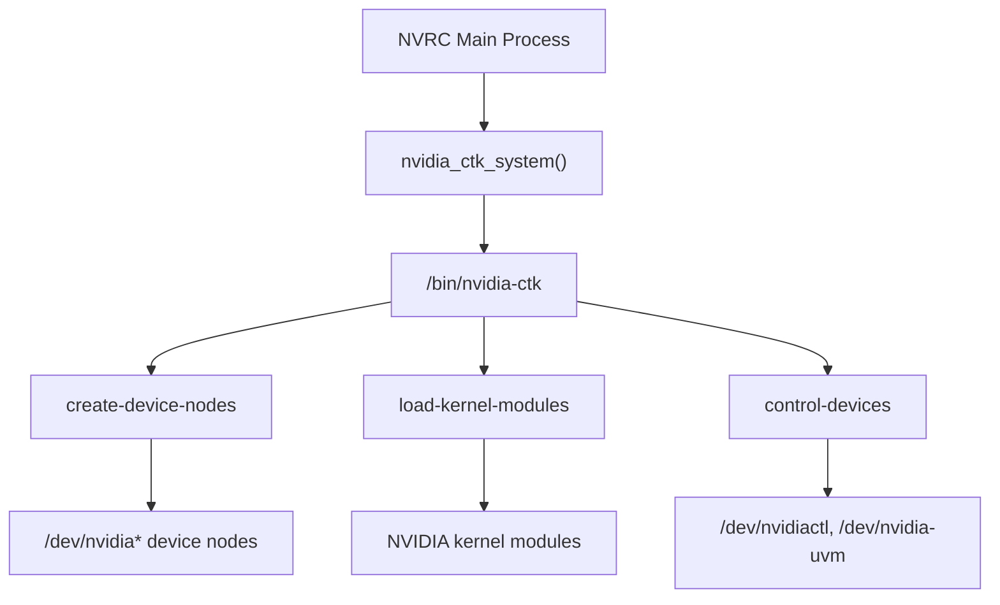
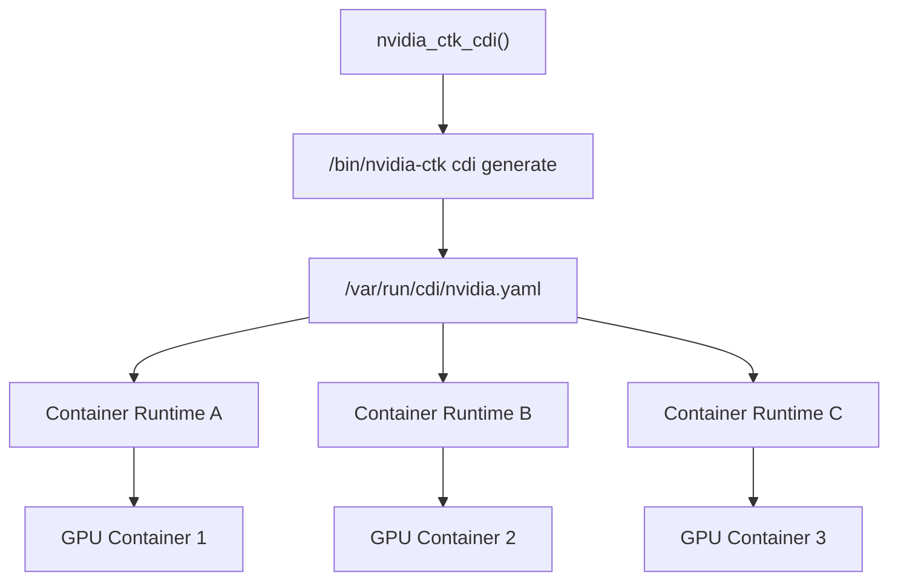
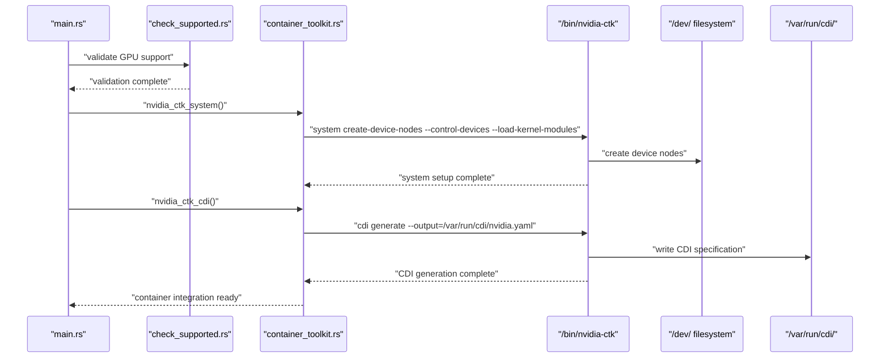
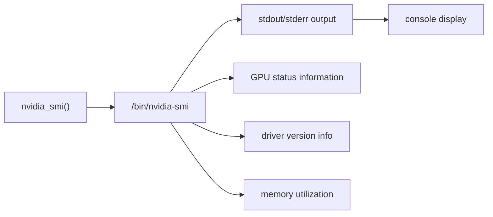

<!-- source: DeepWiki mcp.deepwiki.com · repo NVIDIA/nvrc · page 4.4 Container Integration · fetched 2026-10-26 -->

# Container Integration

Relevant source files

The following files were used as context for generating this wiki page:

- [src/container_toolkit.rs](src/container_toolkit.rs)

This document covers how NVRC integrates with containerized environments, specifically through the NVIDIA Container Toolkit and Container Device Interface (CDI) specification generation. This integration enables GPU access within containers by creating necessary device nodes and generating container runtime configurations.

For GPU device discovery and validation that precedes container integration, see [Device Discovery](#4.1) and [Device Validation](#4.2). For daemon management that coordinates with container integration, see [Daemon Management](#5.1).

## Overview

NVRC's container integration subsystem serves as a bridge between GPU hardware management and container runtime environments. The primary integration point is the NVIDIA Container Toolkit (`nvidia-ctk`), which handles device node creation, kernel module loading, and CDI specification generation.

The container integration process occurs after successful GPU discovery and validation, enabling containers to access NVIDIA GPU resources through standardized container runtime interfaces.

## NVIDIA Container Toolkit Integration

### System Setup Operations

NVRC leverages the NVIDIA Container Toolkit to perform essential system setup operations that prepare the environment for GPU-enabled containers.

The `nvidia_ctk_system()` function executes the NVIDIA Container Toolkit with specific arguments to initialize the GPU environment for container access. This operation creates the necessary device nodes and ensures kernel modules are loaded.

**Sources:** [src/container_toolkit.rs:24-35]()

### Function Implementation

The system setup is implemented through the `nvidia_ctk_system()` function which calls the `foreground()` utility to execute `nvidia-ctk` with the following arguments:

| Argument | Purpose |
|----------|---------|
| `-d` | Enable debug output |
| `system` | Execute system-level operations |
| `create-device-nodes` | Create GPU device nodes in `/dev/` |
| `--control-devices` | Create control device nodes |
| `--load-kernel-modules` | Load required NVIDIA kernel modules |

**Sources:** [src/container_toolkit.rs:24-35]()

## Container Device Interface (CDI) Generation

### CDI Specification Creation

NVRC generates Container Device Interface specifications that describe available GPU resources to container runtimes. CDI provides a standardized way for container runtimes to understand and configure access to specialized hardware devices.

The CDI specification file contains device definitions, mount points, and environment variables required for GPU access within containers.

**Sources:** [src/container_toolkit.rs:37-42]()

### CDI Implementation Details

The `nvidia_ctk_cdi()` function generates the CDI specification by executing `nvidia-ctk` with CDI-specific parameters:

| Argument | Purpose |
|----------|---------|
| `-d` | Enable debug output |
| `cdi` | Execute CDI operations |
| `generate` | Generate CDI specification |
| `--output=/var/run/cdi/nvidia.yaml` | Output location for CDI spec |

The generated specification is written to `/var/run/cdi/nvidia.yaml`, the standard location where container runtimes expect to find CDI device specifications.

**Sources:** [src/container_toolkit.rs:37-42]()

## Integration Workflow

### Container Integration Process Flow

The container integration process follows a specific sequence within the broader NVRC initialization workflow:

Container integration occurs after successful device validation but before daemon startup, ensuring that the container environment is properly configured before NVIDIA services begin operation.

**Sources:** [src/container_toolkit.rs:24-42]()

## Diagnostic Capabilities

### GPU Status Verification

The container integration module includes diagnostic capabilities through the `nvidia_smi()` function, which provides GPU status information for troubleshooting and verification purposes.

While currently marked as `dead_code`, this function demonstrates the integration point for GPU diagnostic operations within the container environment.

**Sources:** [src/container_toolkit.rs:8-22]()

## Error Handling

The container integration functions implement robust error handling using the `anyhow` crate for context-aware error propagation. Each `nvidia-ctk` operation includes appropriate error context to facilitate debugging of container integration failures.

The `foreground()` utility function (imported from the daemon module) handles process execution and captures both successful completion and error conditions, ensuring that container integration failures are properly reported to the calling system.

**Sources:** [src/container_toolkit.rs:1-3](), [src/container_toolkit.rs:24-42]()

---

