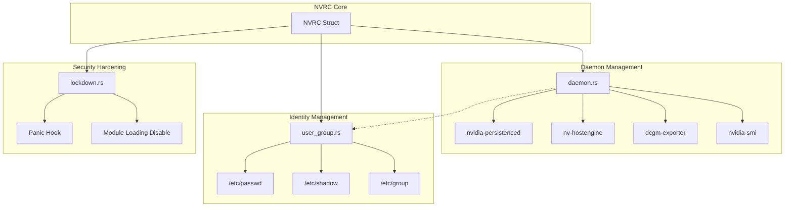
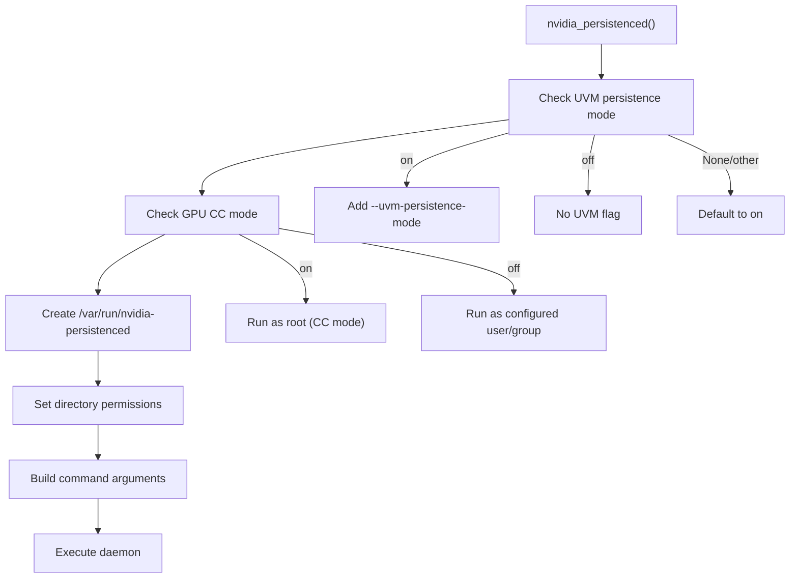
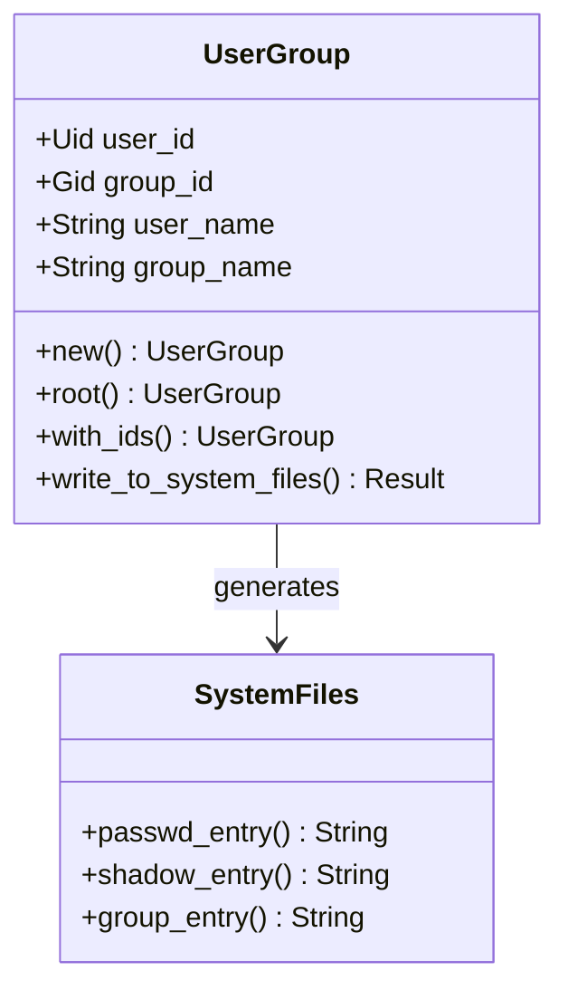
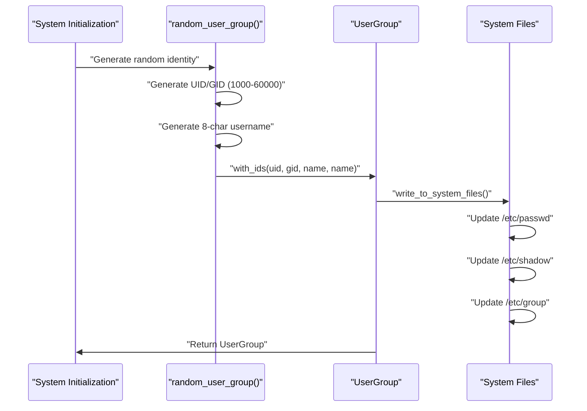
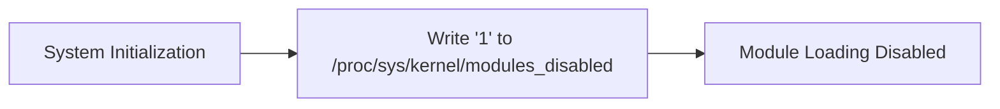

<!-- source: DeepWiki mcp.deepwiki.com · repo NVIDIA/nvrc · page 5 System Services · fetched 2026-10-26 -->

# System Services

Relevant source files

The following files were used as context for generating this wiki page:

- [src/daemon.rs](src/daemon.rs)
- [src/lockdown.rs](src/lockdown.rs)
- [src/user_group.rs](src/user_group.rs)

This page documents the management of system daemons and infrastructure services within NVRC. It covers daemon lifecycle management, user identity management, and security hardening mechanisms that support the overall GPU management system.

For information about filesystem setup and device mounting, see [Filesystem Setup](#3.1). For details about container integration services, see [Container Integration](#4.4).

## Overview

NVRC manages several critical system services that enable GPU functionality in containerized environments. The system services subsystem is responsible for:

- Managing NVIDIA daemon processes (nvidia-persistenced, nv-hostengine, dcgm-exporter)
- Creating and managing user/group identities for service isolation
- Implementing security hardening measures including module loading restrictions
- Handling process lifecycle operations (start, stop, restart)

## System Services Architecture

Sources: [src/daemon.rs:1-224](), [src/user_group.rs:1-377](), [src/lockdown.rs:1-21]()

## Daemon Lifecycle Management

NVRC implements a comprehensive daemon management system through the `daemon.rs` module. The system supports three primary actions for each managed daemon:

| Action | Purpose | Implementation |
|--------|---------|----------------|
| `Start` | Initialize daemon process | `background()` function with process tracking |
| `Stop` | Terminate daemon gracefully | `kill()` followed by `kill_processes_by_comm()` |
| `Restart` | Stop then start sequence | Combined stop and start operations |

### Managed Daemons

#### NVIDIA Persistence Daemon

The `nvidia_persistenced` daemon maintains GPU state across driver unloads. Configuration depends on system settings:

Sources: [src/daemon.rs:129-178]()

#### Data Center GPU Manager Services

For systems with DCGM enabled, NVRC manages two additional services:

- **nv-hostengine**: DCGM host engine service
- **dcgm-exporter**: Metrics exporter for monitoring

Both services are conditionally started based on the `dcgm_enabled` configuration flag.

Sources: [src/daemon.rs:180-208]()

### Process Management Implementation

The daemon management system uses two execution modes:

| Mode | Function | Use Case |
|------|----------|----------|
| Foreground | `foreground()` | One-time commands (nvidia-smi) |
| Background | `background()` | Long-running daemons |

Both modes redirect stdout/stderr to the kernel message buffer via `kmsg()` for centralized logging.

Sources: [src/daemon.rs:47-78]()

## User Identity Management

The `user_group.rs` module provides user and group management capabilities for service isolation and security.

### UserGroup Structure

Sources: [src/user_group.rs:14-44]()

### Random User Generation

For enhanced security, NVRC can generate random user accounts with:

- User IDs in range 1000-60000
- 8-character lowercase alphabetic usernames
- Matching group names
- Disabled password authentication

Sources: [src/user_group.rs:115-126]()

### System File Integration

The user management system writes entries to standard Unix authentication files:

| File | Format | Purpose |
|------|--------|---------|
| `/etc/passwd` | `username:x:uid:gid:username:/nonexistent:/bin/false` | User account database |
| `/etc/shadow` | `username:*:18295:0:99999:7:::` | Password policy (disabled) |
| `/etc/group` | `groupname:x:gid:` | Group membership |

Sources: [src/user_group.rs:64-76]()

## Security Hardening

The `lockdown.rs` module implements critical security measures for the NVRC system.

### Panic Handling

The panic hook ensures system stability by immediately powering off on critical failures, preventing potential security compromises or data corruption.

Sources: [src/lockdown.rs:10-16]()

### Module Loading Restriction

NVRC disables kernel module loading after initialization by writing to `/proc/sys/kernel/modules_disabled`. This prevents runtime injection of unauthorized kernel modules.

Sources: [src/lockdown.rs:18-20]()

## Service Dependencies and Integration

The system services integrate with other NVRC subsystems through well-defined interfaces:

| Service Component | Dependency | Integration Point |
|------------------|------------|-------------------|
| Daemon Management | GPU Detection | Conditional service startup |
| User Management | Filesystem Setup | System file access |
| Security Hardening | System Initialization | Early boot integration |
| All Services | Kernel Logging | `kmsg()` for output redirection |

This architecture ensures that system services are properly sequenced during initialization and maintain appropriate isolation and security boundaries during runtime operation.

Sources: [src/daemon.rs:1-224](), [src/user_group.rs:1-377](), [src/lockdown.rs:1-21]()

---

