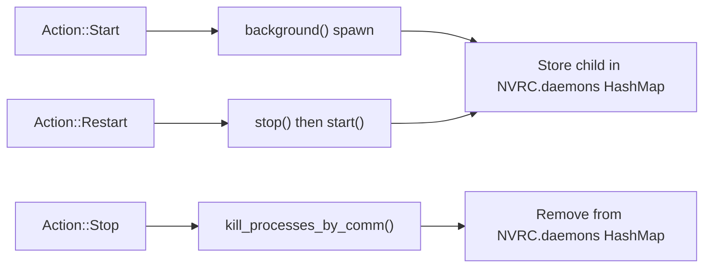
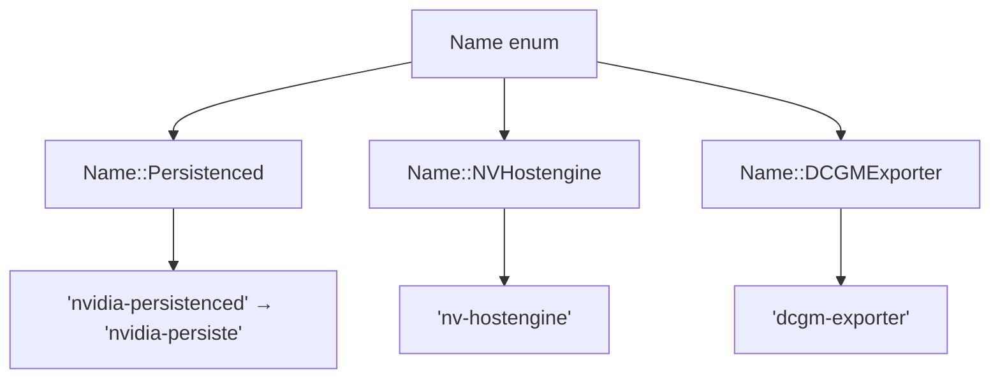
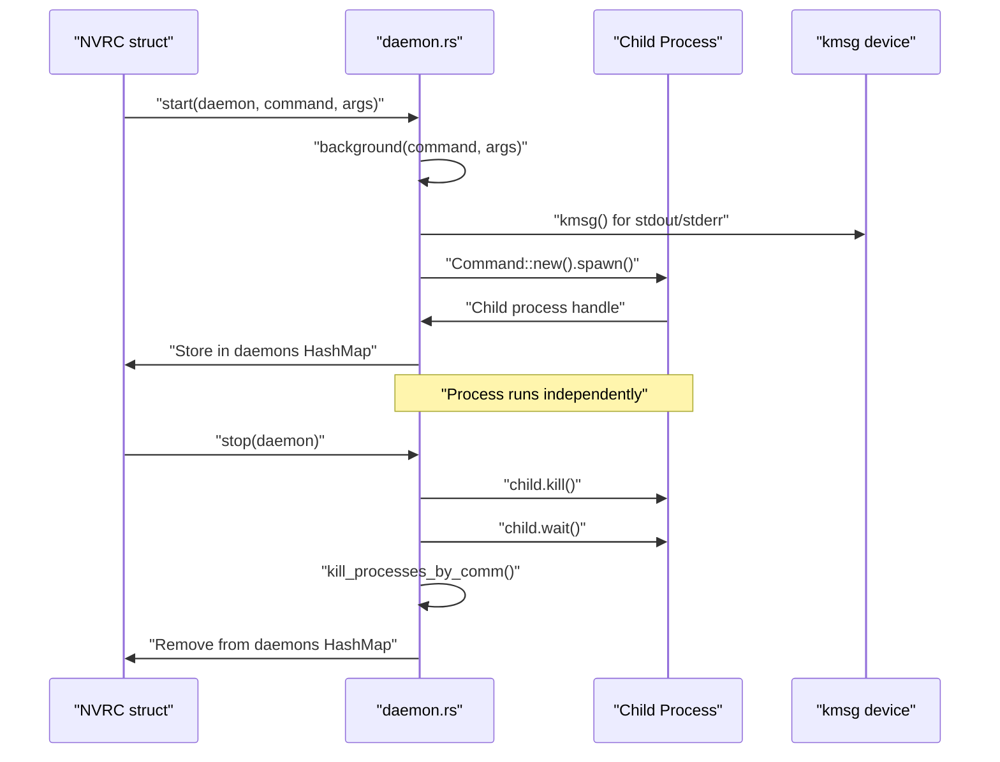
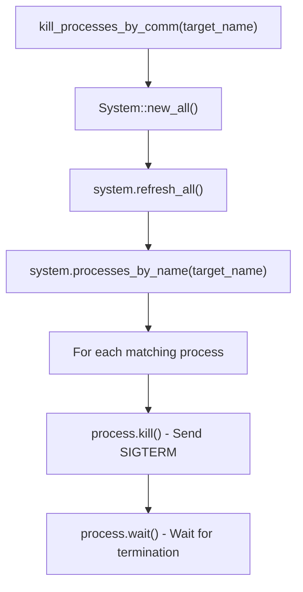
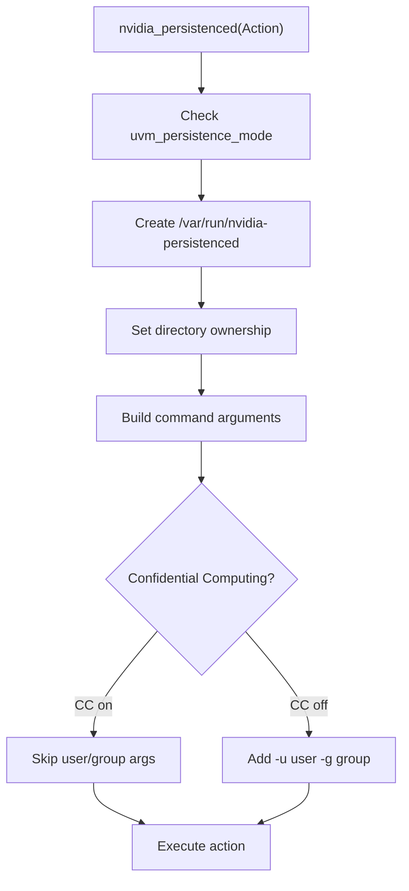
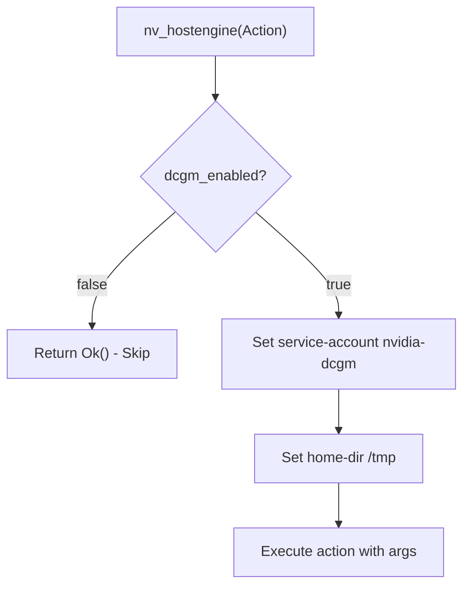
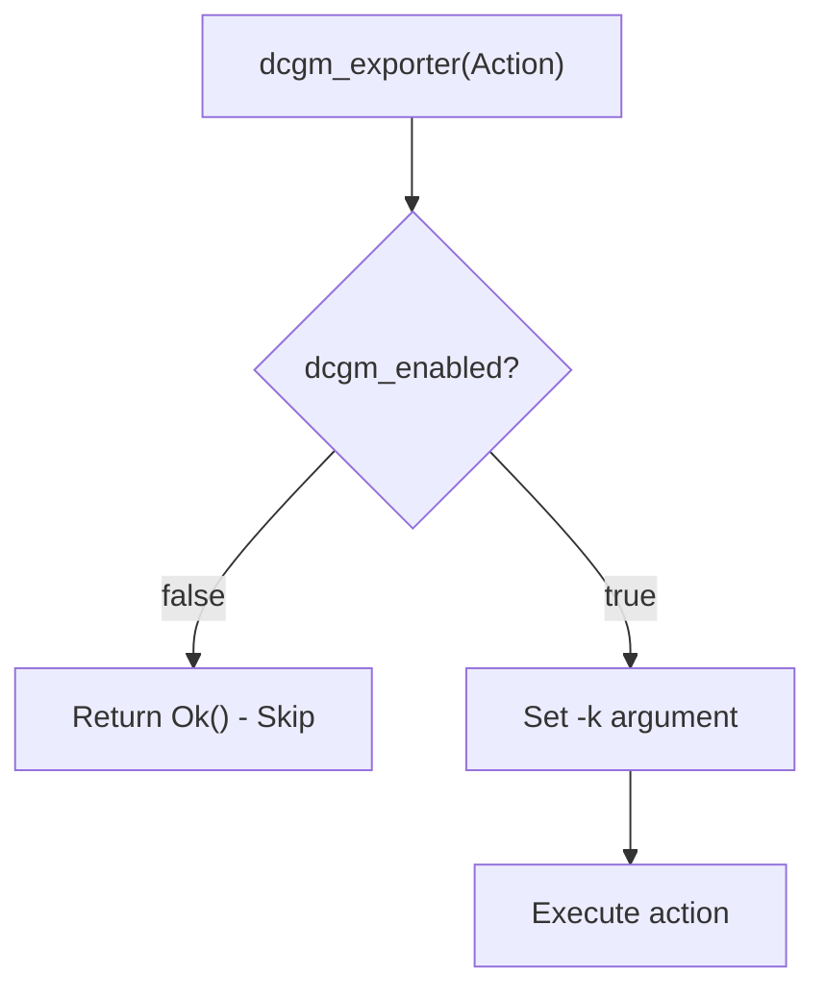
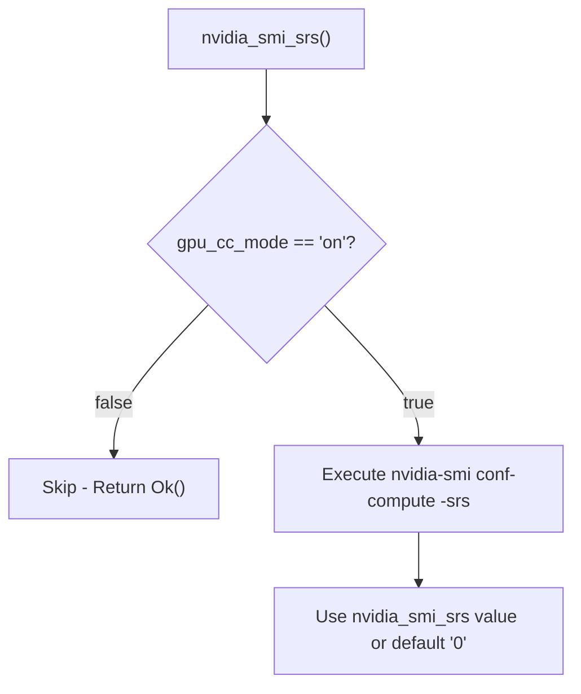

<!-- source: DeepWiki mcp.deepwiki.com · repo NVIDIA/nvrc · page 5.1 Daemon Management · fetched 2026-10-26 -->

# Daemon Management

Relevant source files

The following files were used as context for generating this wiki page:

- [src/daemon.rs](src/daemon.rs)

This document covers NVRC's daemon management subsystem, which controls the lifecycle of NVIDIA-related system services. The daemon management module handles starting, stopping, and restarting critical NVIDIA infrastructure processes including persistence daemons, DCGM components, and GPU configuration utilities.

For information about system initialization and the broader service architecture, see [System Initialization](#3). For security hardening aspects of daemon management, see [Security and Hardening](#5.2).

## Purpose and Scope

The daemon management system in NVRC provides centralized control over NVIDIA GPU-related system services. It manages process lifecycles, handles service dependencies, and ensures proper cleanup of daemon processes. The system supports both cold-plug and hot-plug GPU scenarios by dynamically starting and stopping services as GPU availability changes.

**Sources:** [src/daemon.rs:1-224]()

## Managed Daemon Types

NVRC manages three primary categories of NVIDIA daemons, each serving distinct purposes in the GPU infrastructure stack:

| Daemon | Purpose | Binary Path | Conditional Startup |
|--------|---------|-------------|-------------------|
| `nvidia-persistenced` | GPU state persistence | `/bin/nvidia-persistenced` | Always when GPU supported |
| `nv-hostengine` | DCGM host engine | `/bin/nv-hostengine` | Only when DCGM enabled |
| `dcgm-exporter` | DCGM metrics exporter | `/bin/dcgm-exporter` | Only when DCGM enabled |

### Daemon Process Management

#### Process Action Types

**Sources:** [src/daemon.rs:19-31](), [src/daemon.rs:99-127]()

#### Daemon Name Enumeration
The system uses a `Name` enum to identify daemon types, with display formatting limited to 15 characters to match Linux process name constraints:

**Sources:** [src/daemon.rs:26-45]()

## Process Lifecycle Management

### Background Process Spawning

The daemon management system uses two primary execution modes for process management:

**Sources:** [src/daemon.rs:64-78](), [src/daemon.rs:99-120]()

### Process Discovery and Termination

The `kill_processes_by_comm` function provides comprehensive process cleanup by scanning the system process table:

**Sources:** [src/daemon.rs:80-97]()

## Specific Daemon Implementations

### NVIDIA Persistence Daemon

The `nvidia_persistenced` function manages GPU state persistence with support for UVM persistence modes and confidential computing:

**Key Configuration Points:**
- UVM persistence mode: `on`, `off`, or default (`on`)
- Directory creation: `/var/run/nvidia-persistenced` with proper ownership
- Confidential computing compatibility with modified argument handling

**Sources:** [src/daemon.rs:129-178]()

### DCGM Host Engine

The `nv_hostengine` manages the DCGM host engine daemon with conditional startup based on DCGM enablement:

**Sources:** [src/daemon.rs:180-193]()

### DCGM Exporter

The `dcgm_exporter` provides metrics export functionality, also conditional on DCGM enablement:

**Sources:** [src/daemon.rs:195-208]()

### NVIDIA-SMI Confidential Computing Configuration

The `nvidia_smi_srs` function configures Secure Reset Settings for confidential computing environments:

**Sources:** [src/daemon.rs:210-223]()

## Integration with NVRC State Management

The daemon management system integrates tightly with the main NVRC state structure through several key data fields:

| NVRC Field | Purpose | Usage in Daemon Management |
|------------|---------|---------------------------|
| `daemons: HashMap<Name, Child>` | Process handle storage | Track running daemon processes |
| `dcgm_enabled: Option<bool>` | DCGM feature flag | Conditional DCGM daemon startup |
| `gpu_cc_mode: Option<String>` | Confidential computing mode | Modify daemon arguments for CC |
| `uvm_persistence_mode: Option<String>` | UVM persistence setting | Configure nvidia-persistenced |
| `identity: UserGroup` | User/group configuration | Set daemon process ownership |

**Sources:** [src/daemon.rs:11](), [src/daemon.rs:129-223]()

---

