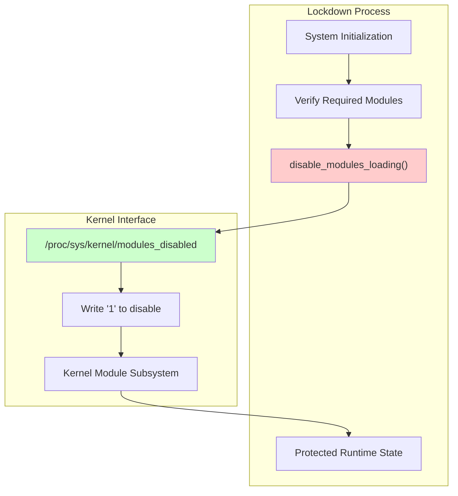
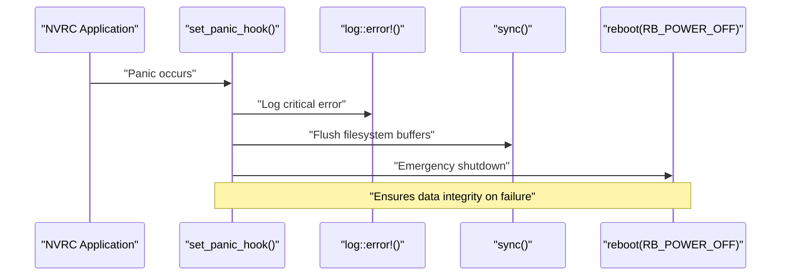
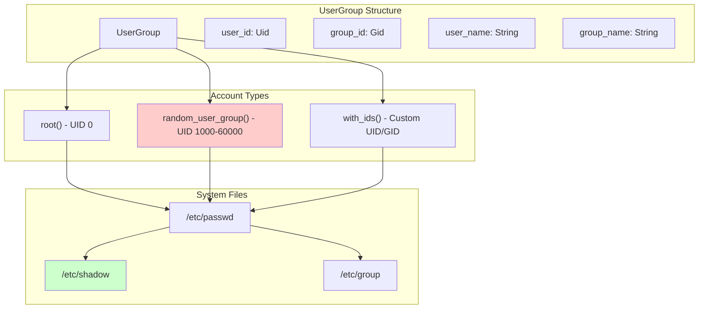
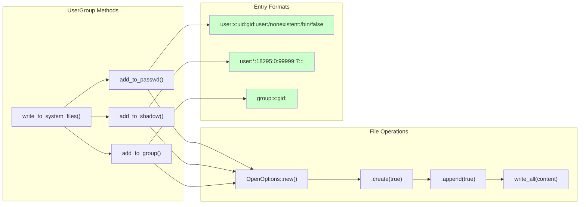
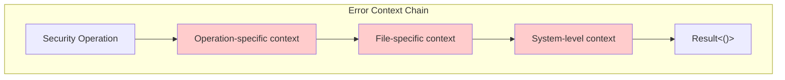

<!-- source: DeepWiki mcp.deepwiki.com · repo NVIDIA/nvrc · page 5.2 Security and Hardening · fetched 2026-10-26 -->

# Security and Hardening

Relevant source files

The following files were used as context for generating this wiki page:

- [src/lockdown.rs](src/lockdown.rs)
- [src/user_group.rs](src/user_group.rs)

This document covers the security measures and system hardening implemented in NVRC to protect the containerized GPU environment. The security framework includes module loading restrictions, panic handling mechanisms, and secure user account management.

For information about daemon process security, see [Daemon Management](#5.1). For runtime security monitoring, see [Device Monitoring](#6.1).

## System Lockdown Framework

NVRC implements a comprehensive system lockdown framework to prevent unauthorized modifications and ensure system integrity during GPU container operations.

### Module Loading Restrictions

The system prevents dynamic loading of kernel modules after initialization to maintain a known-good kernel state:

Sources: [src/lockdown.rs:7-20]()

The `disable_modules_loading()` function writes to the kernel's module control interface to prevent further module loading:

| Security Feature | Implementation | Purpose |
|------------------|----------------|---------|
| Module Restriction | Write "1" to `/proc/sys/kernel/modules_disabled` | Prevent runtime module injection |
| Error Handling | Context-aware error reporting | Ensure lockdown failures are visible |
| System State | Irreversible lockdown | Maintain known-good configuration |

Sources: [src/lockdown.rs:18-20]()

### Panic Handling and Recovery

NVRC implements a custom panic handler that ensures system safety during critical failures:

Sources: [src/lockdown.rs:10-16]()

The panic handler performs these critical operations:
- **Error Logging**: Records panic information via `log::error!` [src/lockdown.rs:12]()
- **Filesystem Sync**: Calls `sync()` to flush pending writes [src/lockdown.rs:13]()
- **Emergency Shutdown**: Forces immediate power-off via `reboot(RebootMode::RB_POWER_OFF)` [src/lockdown.rs:14]()

## User Security Management

NVRC implements secure user account management to isolate processes and restrict permissions appropriately.

### Secure User Account Creation

The `UserGroup` struct provides controlled user account creation with security-focused defaults:

Sources: [src/user_group.rs:14-43](), [src/user_group.rs:115-126]()

### Account Security Features

NVRC implements several security measures for user accounts:

| Security Feature | Implementation | Location |
|------------------|----------------|----------|
| Disabled Login | Shell set to `/bin/false` | [src/user_group.rs:66]() |
| No Home Directory | Home set to `/nonexistent` | [src/user_group.rs:66]() |
| Disabled Password | Shadow entry with `*` | [src/user_group.rs:72]() |
| UID Range Control | Random UIDs between 1000-60000 | [src/user_group.rs:7-8]() |
| Username Generation | 8-character lowercase strings | [src/user_group.rs:9](), [src/user_group.rs:119-121]() |

Sources: [src/user_group.rs:64-77]()

### System File Management

The user management system safely updates system authentication files:

Sources: [src/user_group.rs:45-106]()

## Security Implementation Details

### Random User Generation

The `random_user_group()` function creates unpredictable user accounts for process isolation:

- **UID/GID Range**: Random values between `MIN_USER_ID` (1000) and `MAX_USER_ID` (60000) [src/user_group.rs:117-118]()
- **Username Generation**: 8 random lowercase characters [src/user_group.rs:119-121]()
- **Automatic Registration**: Immediately writes to system files [src/user_group.rs:124]()

Sources: [src/user_group.rs:115-126]()

### File Format Compliance

NVRC ensures all user account entries comply with standard Unix formats:

| File | Format | Security Properties |
|------|--------|-------------------|
| `/etc/passwd` | `user:x:uid:gid:user:/nonexistent:/bin/false` | No shell access, no home directory |
| `/etc/shadow` | `user:*:18295:0:99999:7:::` | Disabled password, aging policies |
| `/etc/group` | `group:x:gid:` | Empty member list |

Sources: [src/user_group.rs:64-76]()

### Error Handling and Context

All security operations include comprehensive error handling:

Sources: [src/user_group.rs:55-61](), [src/user_group.rs:82](), [src/user_group.rs:88](), [src/user_group.rs:94]()

The error handling provides detailed context for security operation failures, enabling proper diagnosis and remediation of security configuration issues.

---

