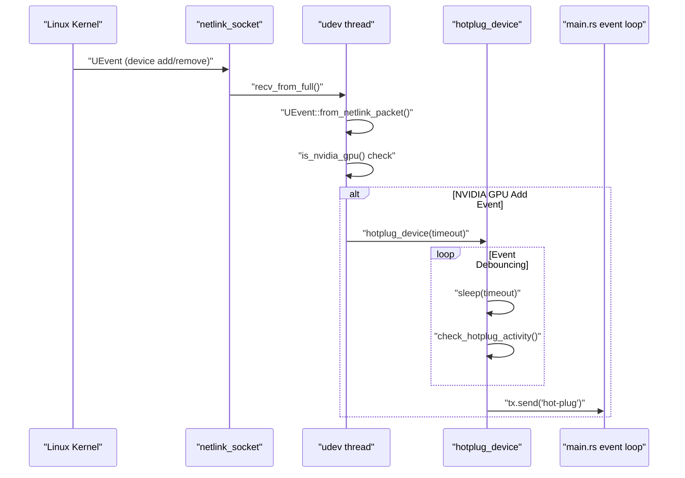

<!-- source: DeepWiki mcp.deepwiki.com · repo NVIDIA/nvrc · page 6 Runtime Operations · fetched 2026-10-26 -->

# Runtime Operations

<details>
<summary>Relevant source files</summary>

The following files were used as context for generating this wiki page:

- [src/init.rs](src/init.rs)
- [src/kata_agent.rs](src/kata_agent.rs)
- [src/kmsg.rs](src/kmsg.rs)
- [src/ndev.rs](src/ndev.rs)
- [src/syslog.rs](src/syslog.rs)

</details>


This document covers the ongoing operational aspects of the NVRC system during runtime, including device monitoring, event handling, logging infrastructure, and process management. Runtime operations encompass all activities that occur after system initialization is complete and the NVRC system is actively managing GPU resources.

For information about system startup and initialization procedures, see [System Initialization](#3). For details about the underlying GPU management capabilities, see [GPU Management](#4).

## Overview

Runtime operations in NVRC are built around an event-driven architecture that handles both hot-plug device events and system communication. The system operates in two primary modes: cold-plug (initial device setup) and hot-plug (dynamic device management), with ongoing monitoring and communication services running continuously.

## Runtime Architecture

The runtime system consists of several concurrent subsystems that communicate through channels and shared state:

```mermaid
graph TB
    subgraph "Runtime Event Loop"
        MainLoop[main.rs "Main Event Loop"]
        NvrcState[NVRC "System State"]
    end
    
    subgraph "Device Monitoring"
        NetlinkSocket[netlink_socket "Kernel UEvent Source"]
        UdevMonitor[udev "NVIDIA GPU Monitor"]
        HotplugDetector[hotplug_device "Event Debouncing"]
    end
    
    subgraph "System Communication"
        KmsgWatcher[watch_for_pattern "Kernel Message Monitor"]
        SyslogSocket[dev_log_setup "Syslog Receiver"]
        SyslogPoller[poll_dev_log "Message Processor"]
    end
    
    subgraph "Process Management"
        KataAgent[kata_agent "Container Agent"]
        ResourceLimits[setrlimit "Resource Configuration"]
    end
    
    subgraph "Event Channels"
        HotplugChannel[mpsc::Sender "hot-plug"]
        UnplugChannel[mpsc::Sender "hot-unplug"]
    end
    
    NetlinkSocket --> UdevMonitor
    UdevMonitor --> HotplugDetector
    HotplugDetector --> HotplugChannel
    
    KmsgWatcher --> UnplugChannel
    SyslogSocket --> SyslogPoller
    
    HotplugChannel --> MainLoop
    UnplugChannel --> MainLoop
    MainLoop --> NvrcState
    
    MainLoop --> KataAgent
    KataAgent --> ResourceLimits
```

Sources: [src/ndev.rs:65-113](), [src/kmsg.rs:45-89](), [src/syslog.rs:100-127](), [src/kata_agent.rs:12-33]()

## Device Event Monitoring

The device monitoring subsystem detects NVIDIA GPU hardware changes using kernel uevents through netlink sockets. This enables dynamic response to device addition and removal during runtime.

### UEvent Processing Pipeline



The `udev` function in [src/ndev.rs:65-113]() creates a dedicated thread that:

1. **Socket Setup**: Creates a netlink socket bound to `NETLINK_KOBJECT_UEVENT` protocol [src/ndev.rs:69-71]()
2. **Event Reception**: Continuously receives kernel uevents via `socket.recv_from_full()` [src/ndev.rs:76-82]()
3. **GPU Filtering**: Uses `is_nvidia_gpu()` to identify relevant events by checking `PCI_ID` and `PCI_CLASS` [src/ndev.rs:17-35]()
4. **Event Debouncing**: Implements `hotplug_device()` with configurable timeout to handle rapid event sequences [src/ndev.rs:44-53]()

### Device Classification Logic

The system identifies NVIDIA GPUs using specific hardware identifiers:

| Constant | Value | Purpose |
|----------|-------|---------|
| `NVIDIA_VENDOR_ID` | "10DE" | NVIDIA PCI vendor identifier |
| `PCI_CLASS_3D` | "30200" | 3D controller device class |
| `PCI_CLASS_DISPLAY` | "30000" | Display controller device class |
| `DEFAULT_HOTPLUG_TIMEOUT` | 5 seconds | Event settling period |

Sources: [src/ndev.rs:10-15](), [src/ndev.rs:17-35]()

## System Communication Infrastructure

NVRC implements multiple communication channels to handle kernel messages, syslog data, and inter-process signaling during runtime operations.

### Kernel Message Monitoring

The kernel message subsystem watches `/dev/kmsg` for specific patterns that indicate hardware state changes:

```mermaid
graph LR
    subgraph "Kernel Space"
        KernelLogs["/dev/kmsg"]
        NetBuffers["Network Buffer Configuration"]
    end
    
    subgraph "NVRC Process"
        KmsgReader[BufReader "Line-by-line parsing"]
        PatternMatcher[watch_for_pattern "String matching"]
        SequenceTracker[parse_kmsg_sequence "Duplicate filtering"]
    end
    
    subgraph "Configuration"
        RmemDefault["/proc/sys/net/core/rmem_default"]
        WmemDefault["/proc/sys/net/core/wmem_default"]
        RmemMax["/proc/sys/net/core/rmem_max"]
        WmemMax["/proc/sys/net/core/wmem_max"]
    end
    
    NetBuffers --> RmemDefault
    NetBuffers --> WmemDefault
    NetBuffers --> RmemMax
    NetBuffers --> WmemMax
    
    KernelLogs --> KmsgReader
    KmsgReader --> PatternMatcher
    PatternMatcher --> SequenceTracker
    SequenceTracker --> MainEventLoop[mpsc::Sender]
```

The `kernlog_setup()` function configures kernel networking buffers to 16MB to handle high-volume logging [src/kmsg.rs:17-31](). The `watch_for_pattern()` function implements sequence-based deduplication to avoid processing duplicate kernel messages [src/kmsg.rs:68-73]().

Sources: [src/kmsg.rs:8-31](), [src/kmsg.rs:45-89](), [src/kmsg.rs:91-93]()

### Syslog Message Processing

The syslog subsystem creates a Unix domain socket at `/dev/log` to receive syslog messages from system processes and forwards them to the structured logging system:

```mermaid
graph TD
    subgraph "Message Sources"
        SystemProcesses["System Processes"]
        Libraries["System Libraries"]
        Daemons["NVIDIA Daemons"]
    end
    
    subgraph "Syslog Processing"
        DevLogSocket["/dev/log UnixDatagram"]
        MessageParser[SyslogMessage::parse "RFC 3164 parsing"]
        SeverityMapper[SyslogSeverity "Priority extraction"]
        LogForwarder[severity.log_message "Structured logging"]
    end
    
    subgraph "Log Levels"
        Emergency["log::error!"]
        Alert["log::error!"]
        Critical["log::error!"]
        Error["log::error!"]
        Warning["log::warn!"]
        Notice["log::info!"]
        Info["log::info!"]
        Debug["log::debug!"]
    end
    
    SystemProcesses --> DevLogSocket
    Libraries --> DevLogSocket
    Daemons --> DevLogSocket
    
    DevLogSocket --> MessageParser
    MessageParser --> SeverityMapper
    SeverityMapper --> LogForwarder
    
    LogForwarder --> Emergency
    LogForwarder --> Warning
    LogForwarder --> Notice
    LogForwarder --> Debug
```

The `SyslogMessage::parse()` function handles both RFC 3164 priority-formatted messages and plain text, with automatic fallback to info level for malformed input [src/syslog.rs:66-93]().

Sources: [src/syslog.rs:18-57](), [src/syslog.rs:100-108](), [src/syslog.rs:110-127]()

## Process Management and Integration

### Kata Agent Lifecycle

The runtime system manages the Kata Containers agent process with specific resource constraints and privilege settings:

```mermaid
graph TB
    subgraph "Resource Configuration"
        NofileLimit[setrlimit "NOFILE: 1024*1024"]
        OomAdjustment["/proc/self/oom_score_adj: -997"]
    end
    
    subgraph "Process Execution"
        KataAgentPath["/usr/bin/kata-agent"]
        ExecCall[Command::exec "Process replacement"]
    end
    
    subgraph "Error Handling"
        ExecError["Exec failure handling"]
        AnyhowContext["Error context propagation"]
    end
    
    NofileLimit --> KataAgentPath
    OomAdjustment --> KataAgentPath
    KataAgentPath --> ExecCall
    ExecCall --> ExecError
    ExecError --> AnyhowContext
```

The `kata_agent()` function configures:
- **File Descriptor Limit**: Sets `NOFILE` to 1,048,576 to handle high connection volumes [src/kata_agent.rs:13-14]()
- **OOM Protection**: Sets OOM score adjustment to -997 to prioritize the agent during memory pressure [src/kata_agent.rs:16-21]()
- **Process Replacement**: Uses `Command::exec()` to replace the current process with the kata-agent [src/kata_agent.rs:27-32]()

Sources: [src/kata_agent.rs:7-11](), [src/kata_agent.rs:12-33]()

## Runtime Event Integration

The runtime operations integrate with the main NVRC control flow through message passing and shared state updates:

| Event Type | Source Module | Channel | Action Triggered |
|------------|---------------|---------|------------------|
| `"hot-plug"` | `ndev.rs` | `mpsc::Sender` | Device re-enumeration |
| `"hot-unplug"` | `kmsg.rs` | `mpsc::Sender` | Device cleanup |
| Syslog messages | `syslog.rs` | Direct logging | Log forwarding |
| Process exec | `kata_agent.rs` | Process replacement | Agent startup |

The system maintains operational state through the main event loop, enabling dynamic response to hardware changes while preserving container isolation and security boundaries.

Sources: [src/ndev.rs:105-108](), [src/kmsg.rs:76-79](), [src/init.rs:6-23]()

---

