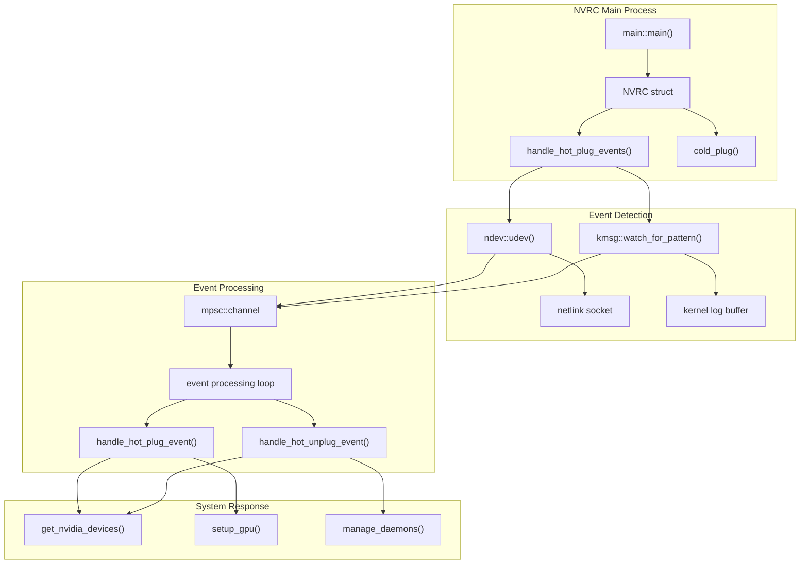
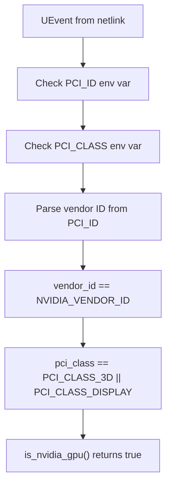
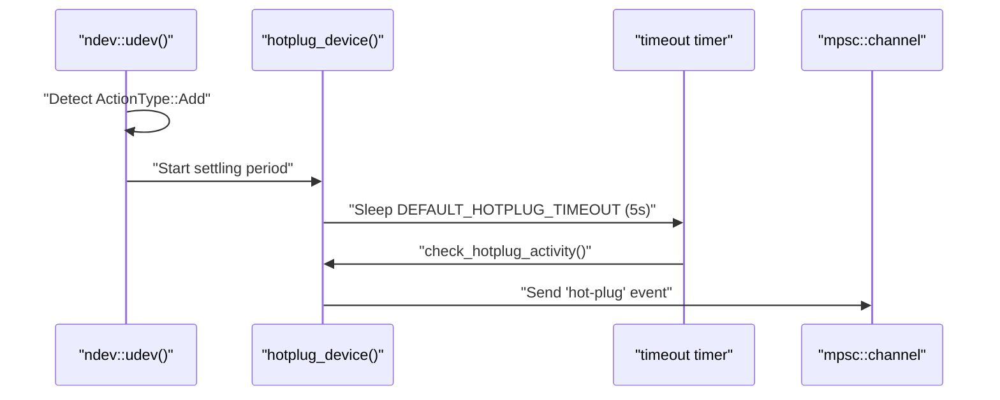
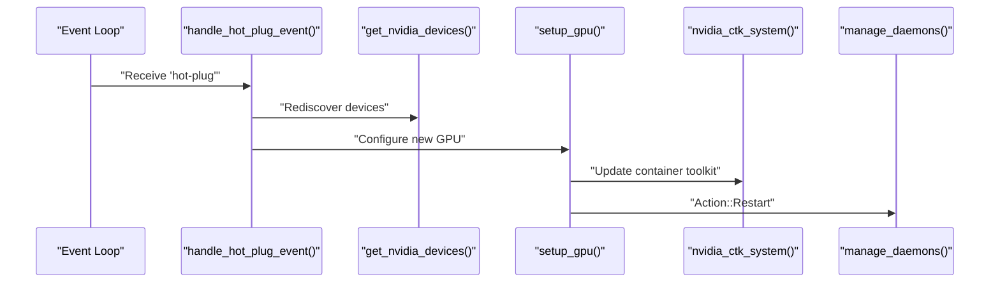
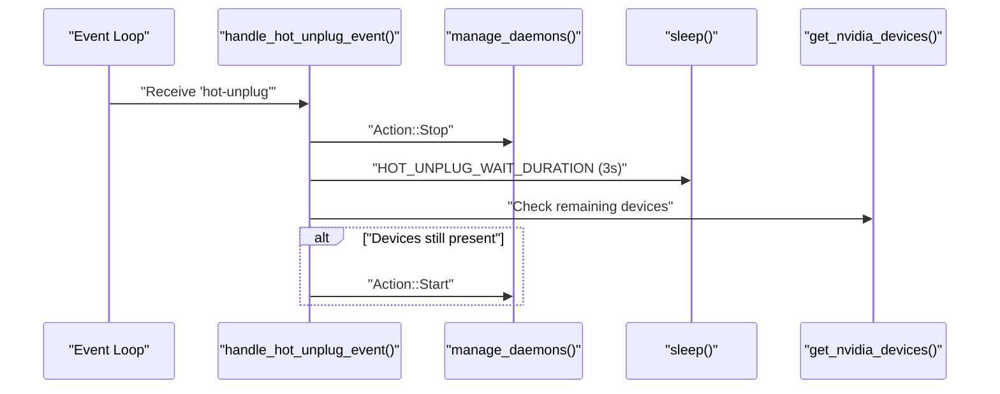
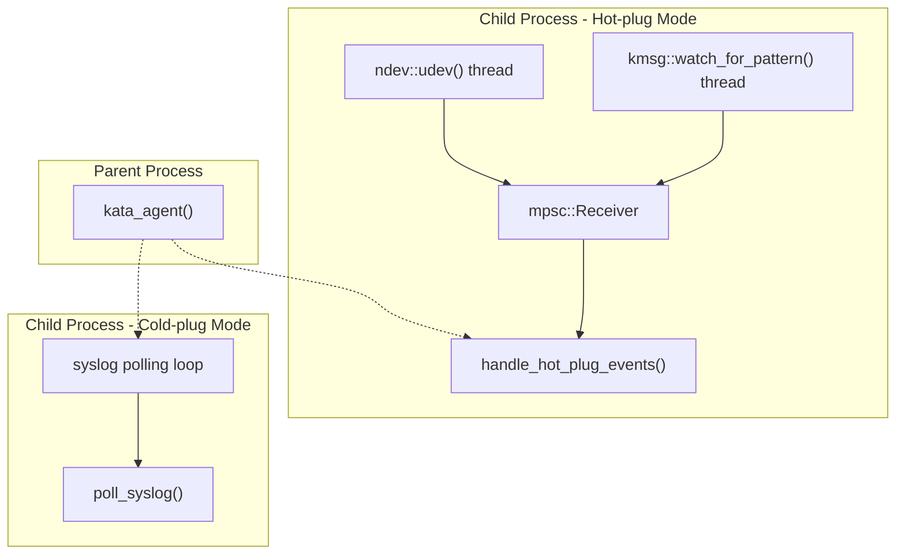

<!-- source: DeepWiki mcp.deepwiki.com · repo NVIDIA/nvrc · page 6.1 Device Monitoring · fetched 2026-10-26 -->

# Device Monitoring

Relevant source files

The following files were used as context for generating this wiki page:

- [src/main.rs](src/main.rs)
- [src/ndev.rs](src/ndev.rs)

This document covers NVRC's device monitoring capabilities, which handle dynamic detection of NVIDIA GPU hot-plug and hot-unplug events during runtime. Device monitoring enables NVRC to respond to GPU hardware changes without requiring system restarts.

For initial device discovery during system startup, see [Device Discovery](#4.1). For daemon lifecycle management triggered by device events, see [Daemon Management](#5.1).

## Monitoring Architecture

NVRC implements device monitoring through a multi-threaded architecture that supports both hot-plug and cold-plug operational modes. The monitoring system uses Linux kernel interfaces to detect hardware changes and coordinate appropriate system responses.

### Device Monitoring Components

Sources: [src/main.rs:119-165](), [src/ndev.rs:65-113]()

## Operational Modes

NVRC supports two distinct device monitoring modes based on the system configuration and deployment scenario.

### Hot-plug Mode

Hot-plug mode provides real-time monitoring of device events through kernel interfaces. This mode is designed for environments where GPUs may be dynamically added or removed during system operation.

| Component | Function | Implementation |
|-----------|----------|----------------|
| **udev monitoring** | `ndev::udev()` | Monitors netlink socket for `ActionType::Add` events |
| **kernel message monitoring** | `kmsg::watch_for_pattern()` | Watches for `GPU_REMOVAL_PATTERN` in kernel logs |
| **event coordination** | `mpsc::channel` | Coordinates between monitoring threads and event processor |
| **timeout handling** | `DEFAULT_HOTPLUG_TIMEOUT` | 5-second settling period for hotplug events |

### Cold-plug Mode  

Cold-plug mode uses periodic polling to detect device changes. This mode is suitable for environments with static GPU configurations where real-time monitoring is not required.

| Component | Interval | Purpose |
|-----------|----------|---------|
| **polling loop** | `COLD_PLUG_POLL_INTERVAL` (1 second) | Regular syslog polling for device changes |
| **syslog monitoring** | `poll_syslog()` | Processes buffered log messages for device events |

Sources: [src/main.rs:35-36](), [src/main.rs:101-117](), [src/main.rs:119-132]()

## Event Detection Mechanisms

### GPU Device Identification

The monitoring system identifies NVIDIA GPUs using PCI hardware identifiers and device classes:

The system uses these constants for device identification:
- `NVIDIA_VENDOR_ID`: `"10DE"` (NVIDIA Corporation PCI vendor ID)
- `PCI_CLASS_3D`: `"30200"` (3D controller device class)
- `PCI_CLASS_DISPLAY`: `"30000"` (Display controller device class)

### Hotplug Event Settling

To handle rapid sequences of device events, the monitoring system implements a settling mechanism:

Sources: [src/ndev.rs:10-15](), [src/ndev.rs:17-35](), [src/ndev.rs:44-63]()

## Event Processing Flow

### Hot-plug Event Processing

When a GPU hot-plug event is detected, NVRC performs a complete device rediscovery and system reconfiguration:

### Hot-unplug Event Processing  

Hot-unplug events trigger a coordinated shutdown and potential restart sequence:

The `HOT_UNPLUG_WAIT_DURATION` constant provides a 3-second delay to ensure device removal operations complete before checking for remaining devices.

Sources: [src/main.rs:134-165](), [src/main.rs:167-193]()

## Daemon State Management

Device monitoring events trigger coordinated management of NVIDIA system daemons to maintain service consistency:

| Daemon | Managed by | Start Action | Stop Action |
|--------|------------|--------------|-------------|
| **nvidia-persistenced** | `nvidia_persistenced()` | Persistence daemon startup | Graceful shutdown |
| **nv-hostengine** | `nv_hostengine()` | Host engine initialization | Process termination |
| **dcgm-exporter** | `dcgm_exporter()` | DCGM metrics export | Service cleanup |

The `manage_daemons()` function coordinates these operations through the `Action` enum:
- `Action::Start`: Initialize all daemons for new GPU
- `Action::Stop`: Shutdown all daemons before GPU removal  
- `Action::Restart`: Full daemon restart cycle for configuration changes

Sources: [src/main.rs:70-99]()

## Process Architecture

Device monitoring operates within NVRC's forked process architecture:

This architecture ensures that device monitoring does not interfere with the primary Kata agent functionality while providing responsive hardware change detection.

Sources: [src/main.rs:105-132](), [src/main.rs:135-165]()

---

