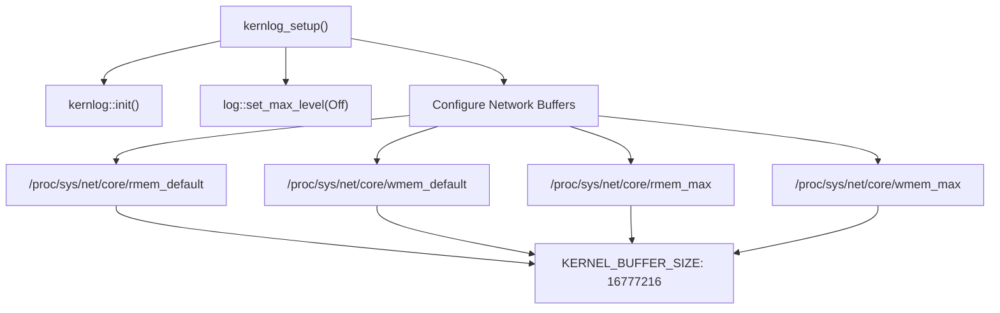
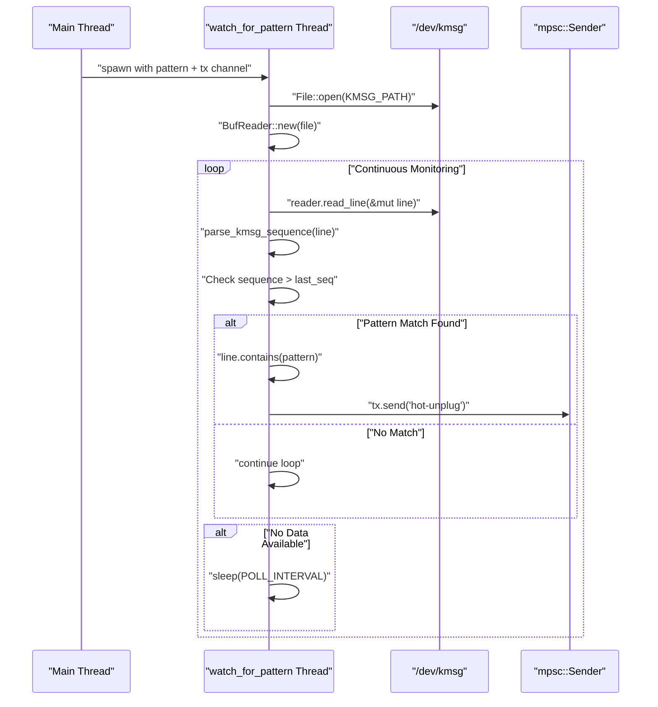
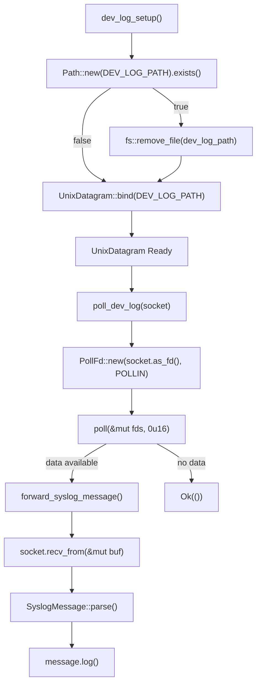
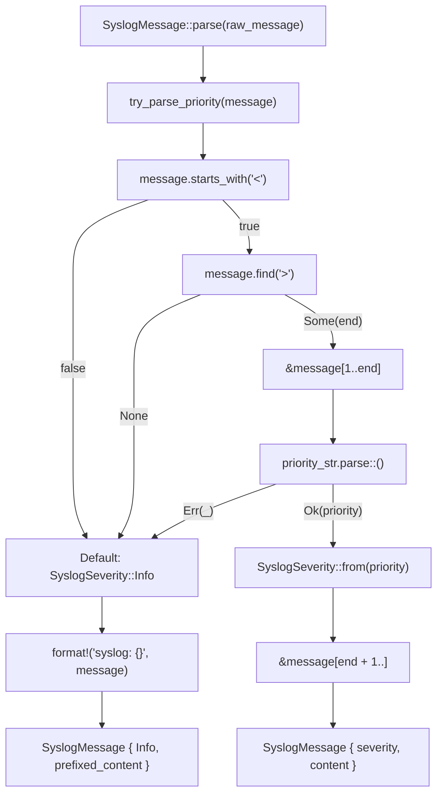
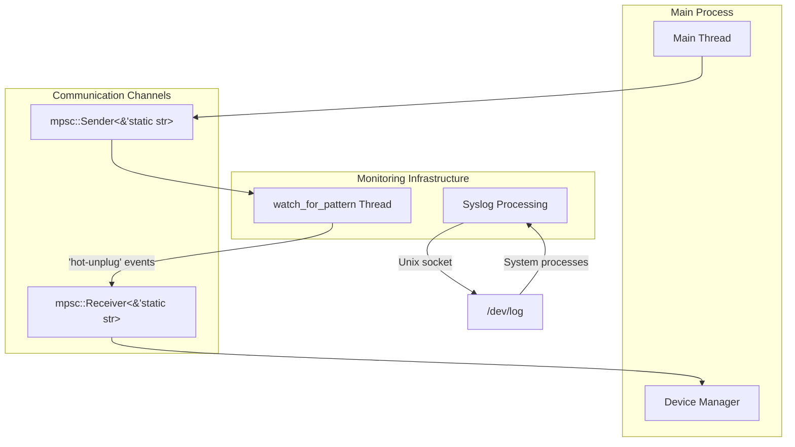
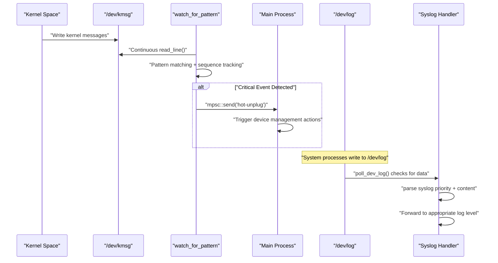

<!-- source: DeepWiki mcp.deepwiki.com · repo NVIDIA/nvrc · page 6.2 Logging and Communication · fetched 2026-10-26 -->

# Logging and Communication

Relevant source files

The following files were used as context for generating this wiki page:

- [src/kmsg.rs](src/kmsg.rs)
- [src/syslog.rs](src/syslog.rs)

This document covers NVRC's logging infrastructure and inter-process communication mechanisms. It details how the system handles kernel messages, processes syslog communications, and manages event-driven communication between system components during runtime operations.

For information about system initialization logging setup, see [System Initialization](#3). For details about device event monitoring that triggers communication, see [Device Monitoring](#6.1).

## Kernel Message Infrastructure

NVRC implements a comprehensive kernel message handling system through the `kmsg` module that manages both logging output and kernel message monitoring for system events.

### Kernel Log Setup

The system initializes kernel logging infrastructure through the `kernlog_setup()` function, which configures both the logging subsystem and network buffer parameters for optimal kernel communication.

Sources: [src/kmsg.rs:17-31]()

The `kmsg()` function provides dynamic log output routing based on the current debug logging level. When debug logging is enabled, messages are written to `/dev/kmsg`; otherwise, they are redirected to `/dev/null` to minimize system overhead.

### Kernel Message Monitoring

NVRC implements real-time kernel message monitoring through the `watch_for_pattern()` function, which enables detection of hardware events such as device hot-unplug operations.

Sources: [src/kmsg.rs:45-89](), [src/kmsg.rs:91-93]()

The monitoring system implements sequence number tracking through `parse_kmsg_sequence()` to prevent duplicate event processing, ensuring each kernel message is handled exactly once.

## Syslog Communication System

NVRC provides a complete syslog implementation that creates a Unix domain socket at `/dev/log` and processes system log messages according to RFC 3164 standards.

### Syslog Socket Management

The system establishes syslog communication through the `dev_log_setup()` function, which creates and manages the primary syslog Unix domain socket.

Sources: [src/syslog.rs:100-108](), [src/syslog.rs:110-127](), [src/syslog.rs:129-138]()

### Message Priority Processing

The syslog system implements comprehensive RFC 3164 priority level parsing through the `SyslogMessage` structure and associated severity handling.

| Severity Level | Numeric Value | Rust Enum | Log Function |
|---------------|---------------|-----------|--------------|
| Emergency | 0 | `SyslogSeverity::Emergency` | `error!()` |
| Alert | 1 | `SyslogSeverity::Alert` | `error!()` |
| Critical | 2 | `SyslogSeverity::Critical` | `error!()` |
| Error | 3 | `SyslogSeverity::Error` | `error!()` |
| Warning | 4 | `SyslogSeverity::Warning` | `warn!()` |
| Notice | 5 | `SyslogSeverity::Notice` | `info!()` |
| Info | 6 | `SyslogSeverity::Info` | `info!()` |
| Debug | 7 | `SyslogSeverity::Debug` | `debug!()` |

Sources: [src/syslog.rs:17-46](), [src/syslog.rs:48-57]()

The message parsing system extracts priority information from standard syslog format messages using the pattern `<priority>message_content`, where priority encodes both facility and severity information.

Sources: [src/syslog.rs:65-98]()

## Inter-Process Communication Architecture

NVRC implements event-driven communication using Rust's `mpsc` channels to coordinate between monitoring threads and the main system process.

### Channel-Based Event System

The system uses message passing for asynchronous communication between kernel message monitoring and device management processes.

Sources: [src/kmsg.rs:4](), [src/kmsg.rs:76-79]()

### Message Flow Integration

The communication system integrates kernel message monitoring with syslog processing to provide comprehensive system event handling and logging capabilities.

Sources: [src/kmsg.rs:45-89](), [src/syslog.rs:110-138]()

The system maintains non-blocking communication patterns through the use of polling mechanisms (`poll()` with zero timeout) and continuous monitoring loops that prevent system blocking while ensuring responsive event handling.

---

