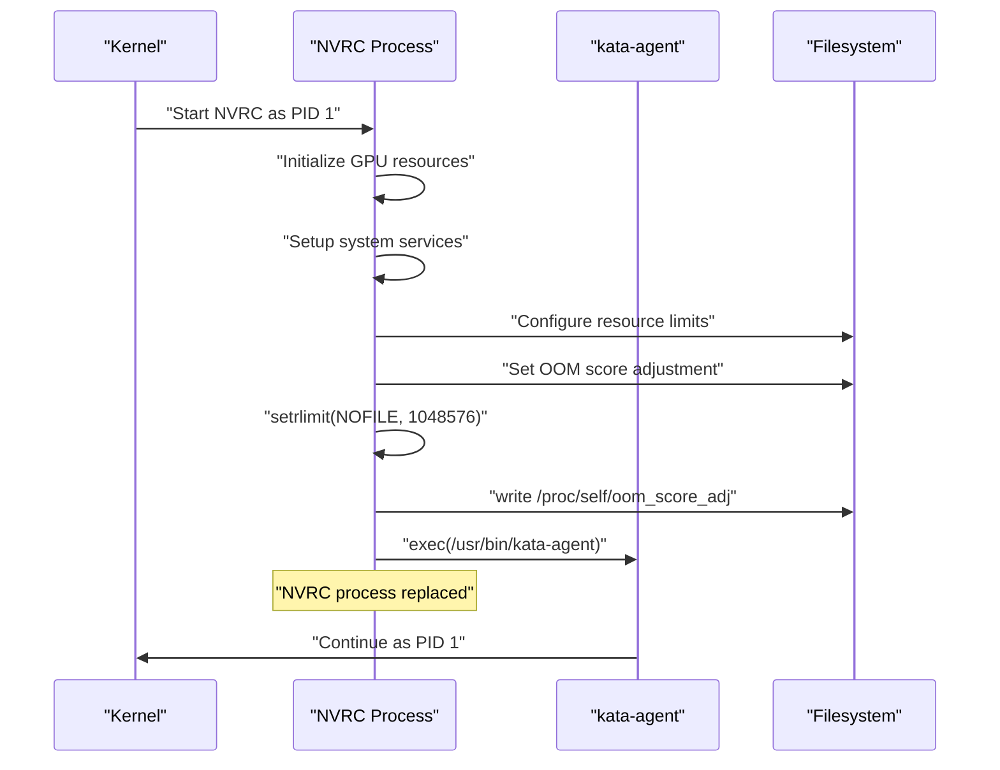
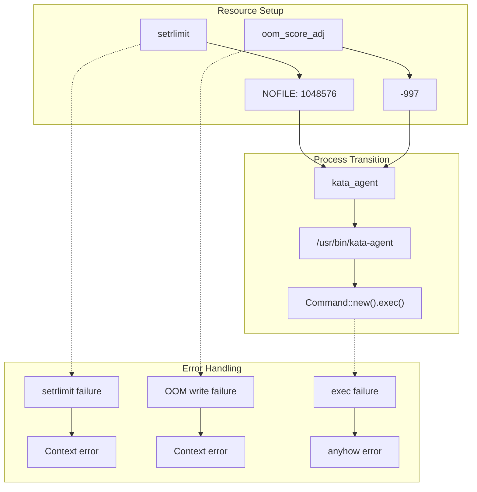
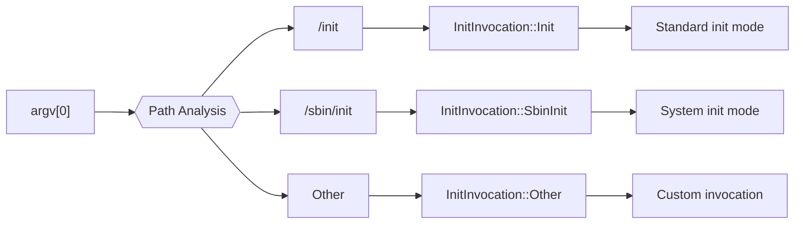
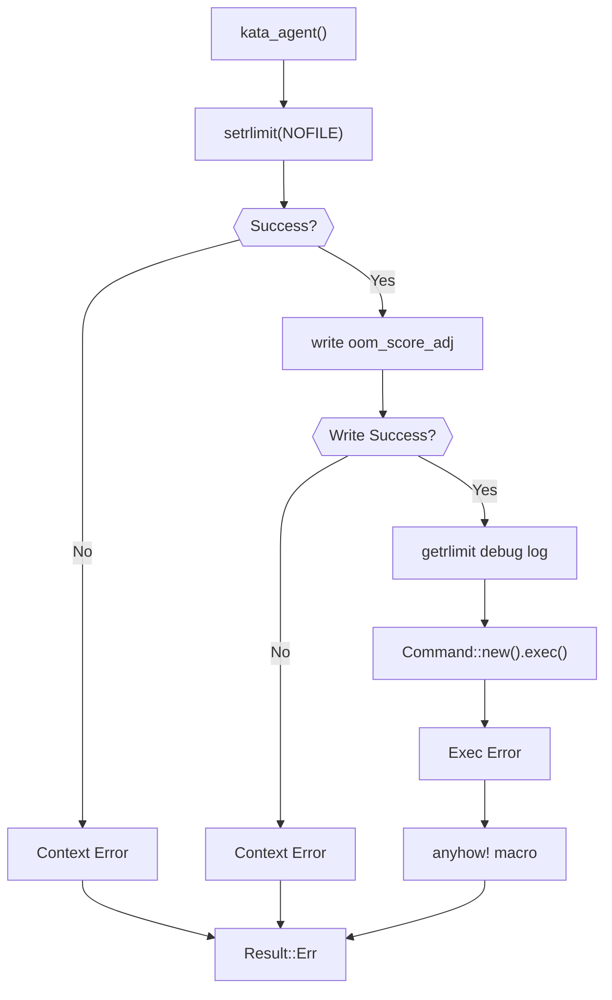

<!-- source: DeepWiki mcp.deepwiki.com · repo NVIDIA/nvrc · page 6.3 Kata Agent Integration · fetched 2026-10-26 -->

# Kata Agent Integration

Relevant source files

The following files were used as context for generating this wiki page:

- [src/init.rs](src/init.rs)
- [src/kata_agent.rs](src/kata_agent.rs)

This document explains how NVRC integrates with the Kata Containers agent, including process management, resource configuration, and the handoff mechanism from NVRC initialization to agent execution. For information about overall runtime operations, see [Runtime Operations](#6). For details about system initialization, see [System Initialization](#3).

## Purpose and Integration Model

NVRC operates as a specialized init system that prepares GPU resources and system configuration before transferring control to the Kata Containers agent. The integration follows a process replacement model where NVRC performs all necessary setup operations and then uses `exec()` to replace itself with the kata-agent process, ensuring efficient resource utilization and clean process management.

The integration supports multiple invocation modes based on the executable path, allowing NVRC to function as either `/init` or `/sbin/init` within the container environment.

## Process Execution Flow

Sources: [src/kata_agent.rs:12-33]()

## Resource Configuration

The kata-agent process requires specific resource limits and system configuration to operate effectively in containerized environments. NVRC configures these parameters before the exec transition:

| Resource | Configuration | Value | Purpose |
|----------|---------------|-------|---------|
| File Descriptors | `NOFILE` limit | 1,048,576 | Support large numbers of concurrent connections |
| OOM Score | Adjustment value | -997 | Protect agent from OOM killer termination |
| Process ID | Inheritance | PID 1 | Maintain init process responsibilities |

The file descriptor limit is set to accommodate the high connection requirements of container orchestration, while the OOM score adjustment ensures the kata-agent remains available even under memory pressure.

Sources: [src/kata_agent.rs:7-10](), [src/kata_agent.rs:13-21]()

## Invocation Mode Detection

NVRC supports multiple invocation modes to accommodate different container initialization scenarios. The invocation type is determined by examining the first command-line argument (`argv[0]`):

Sources: [src/init.rs:6-23]()

## Error Handling and Failure Modes

The kata-agent integration implements comprehensive error handling for resource configuration and process execution failures:

### Resource Configuration Errors
- **NOFILE limit failure**: Returns contextual error with limit value
- **OOM score write failure**: Returns contextual error with file path
- **Resource verification**: Logs current limits for debugging

### Process Execution Errors
- **Exec failure**: Returns anyhow error with command path and system error
- **File not found**: Indicates missing kata-agent binary
- **Permission denied**: Indicates insufficient execution privileges

Sources: [src/kata_agent.rs:13-33]()

## Integration with NVRC Main Flow

The kata-agent execution occurs after NVRC completes all system initialization tasks. In both cold-plug and hot-plug modes, the agent handoff represents the final phase of NVRC operation:

### Cold-Plug Mode Integration
1. GPU device discovery and validation
2. NVIDIA daemon management
3. Container toolkit configuration
4. System service setup
5. **kata-agent exec transition**

### Hot-Plug Mode Integration
1. Background device monitoring setup
2. Event handling configuration
3. Service management preparation
4. **kata-agent exec transition**

The exec-based transition ensures that the kata-agent inherits PID 1 status and all configured resources while eliminating the NVRC process from memory, optimizing resource utilization in the container environment.

Sources: [src/kata_agent.rs:27-32]()

---

