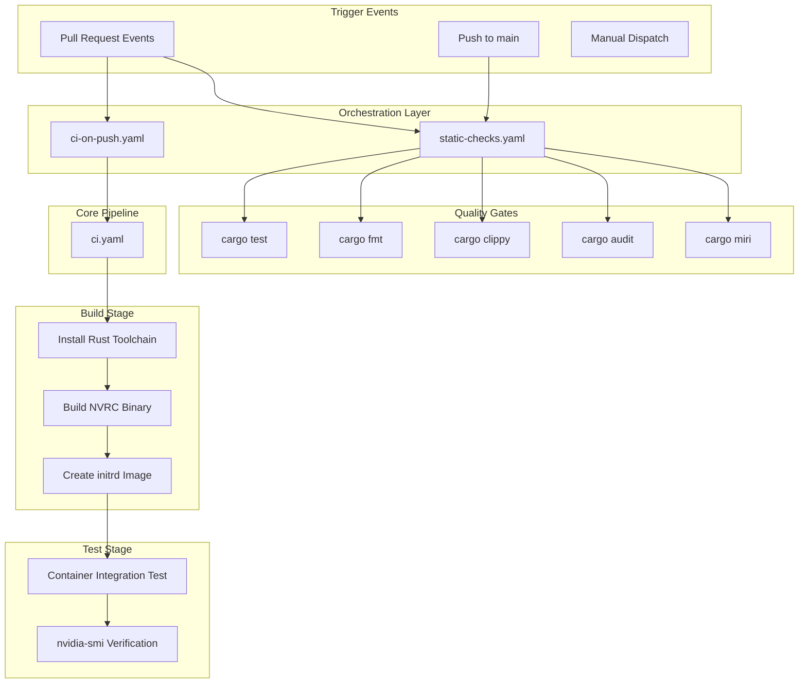
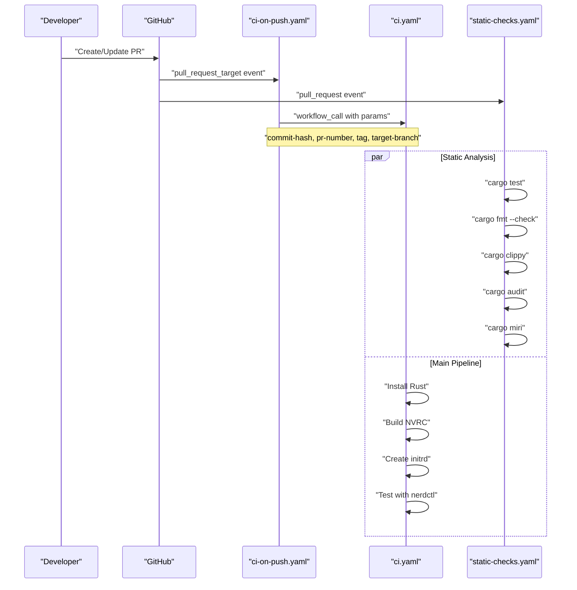
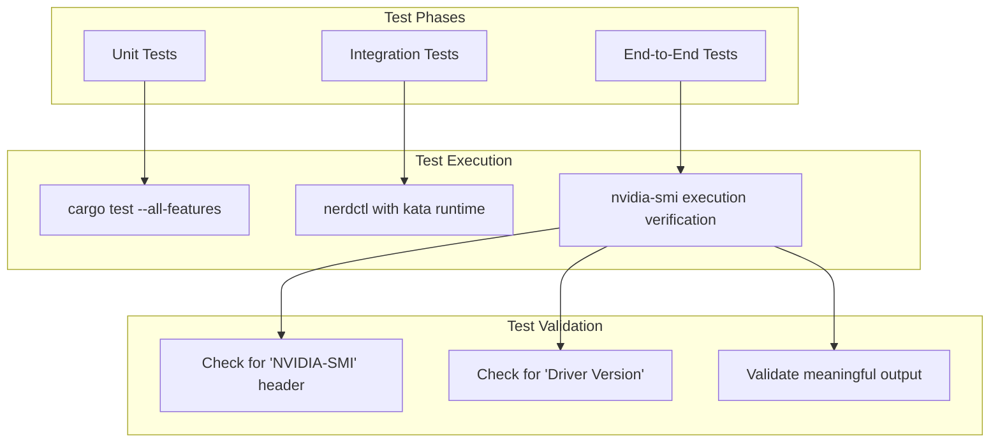

<!-- source: DeepWiki mcp.deepwiki.com · repo NVIDIA/nvrc · page 7 Development and CI/CD · fetched 2026-10-26 -->

# Development and CI/CD

<details>
<summary>Relevant source files</summary>

The following files were used as context for generating this wiki page:

- [.github/workflows/ci-on-push.yaml](.github/workflows/ci-on-push.yaml)
- [.github/workflows/ci.yaml](.github/workflows/ci.yaml)
- [.github/workflows/static-checks.yaml](.github/workflows/static-checks.yaml)
- [tests/install_rust.sh](tests/install_rust.sh)

</details>


This page documents the development workflow and continuous integration/continuous delivery (CI/CD) pipeline for the NVRC system. It covers the automated build processes, code quality assurance, testing strategies, and development practices used to maintain and evolve the codebase.

The CI/CD system ensures that all changes to NVRC are properly validated through automated builds, tests, and quality checks before integration. For detailed information about the build pipeline mechanics, see [Build Pipeline](#7.1). For comprehensive coverage of automated code quality processes, see [Code Quality Assurance](#7.2).

## CI/CD Architecture Overview

The NVRC project employs a multi-stage CI/CD pipeline built on GitHub Actions, designed to validate code changes through comprehensive testing in realistic containerized environments.

### CI/CD Pipeline Flow



Sources: [.github/workflows/ci-on-push.yaml:1-36](), [.github/workflows/ci.yaml:1-60](), [.github/workflows/static-checks.yaml:1-69]()

### Workflow Orchestration

The CI system uses a tiered workflow structure to separate concerns and optimize resource usage:

| Workflow | Purpose | Trigger Events | Target Environment |
|----------|---------|----------------|-------------------|
| `ci-on-push.yaml` | Orchestration layer | PR events, manual dispatch | Any |
| `ci.yaml` | Main build and test | Called by orchestrator | `g5g.metal` runners |
| `static-checks.yaml` | Code quality validation | PR events, push to main | `ubuntu-latest` |

The orchestration workflow [`ci-on-push.yaml`]() handles pull request events and delegates to the main CI workflow with appropriate parameters:



Sources: [.github/workflows/ci-on-push.yaml:23-35](), [.github/workflows/ci.yaml:3-17](), [.github/workflows/static-checks.yaml:16-69]()

## Development Workflow

### Build Process

The core build process follows a cross-compilation strategy targeting ARM64 architecture with musl libc for maximum compatibility:

1. **Toolchain Setup**: The `install_rust.sh` script installs Rust version 1.85.1 with the `aarch64-unknown-linux-musl` target
2. **Binary Compilation**: NVRC is built in release mode with `cargo build --release --target=aarch64-unknown-linux-musl`
3. **Integration**: The resulting binary is copied to the rootfs directory at `$ROOTFS_DIR/bin/NVRC`
4. **Image Creation**: An initrd image is generated using the `initrd_builder.sh` script

### Environment Configuration

The CI environment uses specific directory structures for build artifacts:

| Variable | Path | Purpose |
|----------|------|---------|
| `ROOTFS_DIR` | `/home/ubuntu/actions-runner/_work/kata-containers/build/rootfs-initrd-nvidia-gpu/builddir/initrd-image/ubuntu_rootfs` | Target rootfs for NVRC binary |
| `INITRD_DIR` | `/home/ubuntu/actions-runner/_work/kata-containers/tools/osbuilder/initrd-builder` | Build tools directory |

Sources: [.github/workflows/ci.yaml:22-23](), [.github/workflows/ci.yaml:35-43]()

### Testing Strategy

The CI pipeline employs a comprehensive testing approach that validates NVRC functionality in realistic deployment scenarios:



The end-to-end test executes `nvidia-smi` within a Kata Container to verify complete GPU functionality:

```bash
nerdctl run --runtime io.containerd.kata.v2 --device /dev/vfio/devices/vfio0 --rm ubuntu nvidia-smi
```

Sources: [.github/workflows/ci.yaml:45-59](), [.github/workflows/static-checks.yaml:18-27]()

### Concurrency Control

The CI system implements concurrency controls to prevent resource conflicts and optimize build times:

- **Workflow-level concurrency**: Groups builds by workflow and PR number or git reference
- **Automatic cancellation**: In-progress builds are cancelled when new commits are pushed
- **Resource isolation**: Different workflow types run on different runner pools

Sources: [.github/workflows/ci-on-push.yaml:19-21](), [.github/workflows/static-checks.yaml:12-14]()

## Security and Compliance

### Permissions Model

The CI workflows follow a least-privilege permission model:

| Workflow | Required Permissions | Purpose |
|----------|---------------------|---------|
| `ci-on-push.yaml` | `contents: read`, `packages: write`, `id-token: write`, `attestations: write` | Build artifacts and attestation generation |
| `static-checks.yaml` | Inherits default permissions | Code analysis only |

### Dependency Security

The static checks workflow includes `cargo audit` to scan for known security vulnerabilities in the dependency tree, ensuring that NVRC maintains a secure software supply chain.

Sources: [.github/workflows/ci-on-push.yaml:16-17](), [.github/workflows/ci-on-push.yaml:25-29](), [.github/workflows/static-checks.yaml:50-59]()

---

