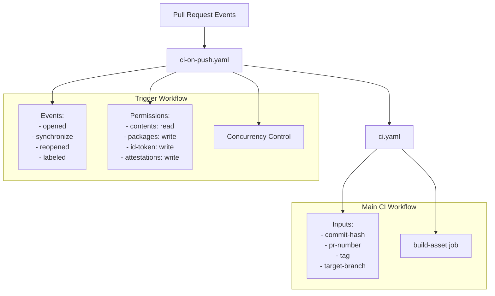
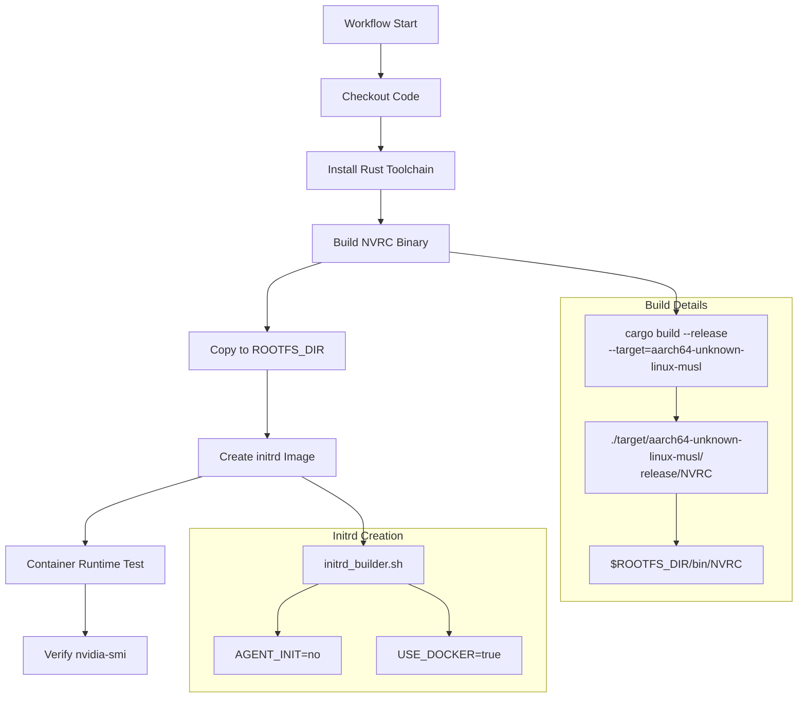
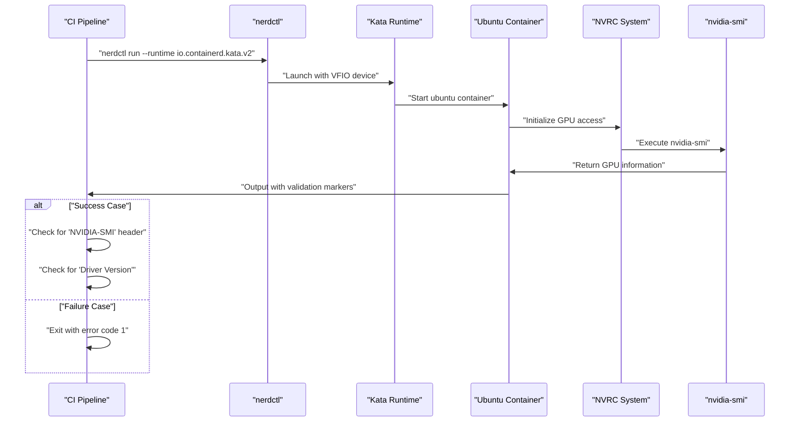

<!-- source: DeepWiki mcp.deepwiki.com · repo NVIDIA/nvrc · page 7.1 Build Pipeline · fetched 2026-10-26 -->

# Build Pipeline

<details>
<summary>Relevant source files</summary>

The following files were used as context for generating this wiki page:

- [.github/workflows/ci-on-push.yaml](.github/workflows/ci-on-push.yaml)
- [.github/workflows/ci.yaml](.github/workflows/ci.yaml)

</details>


This document covers the automated build and testing pipeline for the NVRC system. The pipeline handles compilation of the NVRC binary, creation of initrd images, and validation testing with Kata Containers. For information about code quality checks and static analysis, see [Code Quality Assurance](#7.2).

## Overview

The NVRC build pipeline consists of two GitHub Actions workflows that work together to provide continuous integration for pull requests and main branch changes. The system uses a trigger-based architecture where [ci-on-push.yaml](.github/workflows/ci-on-push.yaml:1-36)() orchestrates the execution of the main build workflow [ci.yaml](.github/workflows/ci.yaml:1-60)().

## Workflow Orchestration

The build pipeline uses a two-tier workflow system for security and flexibility:



Sources: [.github/workflows/ci-on-push.yaml:1-36](), [.github/workflows/ci.yaml:1-24]()

### Trigger Configuration

The `ci-on-push.yaml` workflow activates on pull request events targeting the main branch. It handles four event types: `opened`, `synchronize`, `reopened`, and `labeled` to support the "ok-to-test" approval workflow [.github/workflows/ci-on-push.yaml:6-14](). The workflow implements concurrency control to cancel in-progress runs when new commits are pushed [.github/workflows/ci-on-push.yaml:19-21]().

### Parameter Passing

The trigger workflow passes essential parameters to the main CI workflow:
- `commit-hash`: The specific commit SHA from the pull request head [.github/workflows/ci-on-push.yaml:32]()
- `pr-number`: Pull request identifier for tracking [.github/workflows/ci-on-push.yaml:33]()
- `tag`: Combined PR number and commit hash for unique identification [.github/workflows/ci-on-push.yaml:34]()
- `target-branch`: Base branch of the pull request [.github/workflows/ci-on-push.yaml:35]()

Sources: [.github/workflows/ci-on-push.yaml:24-35](), [.github/workflows/ci.yaml:4-17]()

## Build Environment and Infrastructure

The build process runs on `g5g.metal` runners, which provide ARM64 hardware suitable for building the `aarch64-unknown-linux-musl` target. The environment defines critical paths for the Kata Containers integration:

| Environment Variable | Path | Purpose |
|---------------------|------|---------|
| `ROOTFS_DIR` | `/home/ubuntu/actions-runner/_work/kata-containers/build/rootfs-initrd-nvidia-gpu/builddir/initrd-image/ubuntu_rootfs` | Target filesystem for NVRC binary |
| `INITRD_DIR` | `/home/ubuntu/actions-runner/_work/kata-containers/tools/osbuilder/initrd-builder` | Initrd builder tools location |

Sources: [.github/workflows/ci.yaml:21-23](), [.github/workflows/ci.yaml:26]()

## Build Pipeline Steps



Sources: [.github/workflows/ci.yaml:28-43]()

### Rust Toolchain Installation

The pipeline begins by installing the Rust toolchain using the `install_rust.sh` script [.github/workflows/ci.yaml:33-34](). This ensures the build environment has the necessary compiler tools for cross-compilation to the ARM64 musl target.

### NVRC Binary Compilation

The build process compiles NVRC using Cargo with specific target configuration:
```bash
cargo build --release --target=aarch64-unknown-linux-musl
```

The resulting binary is copied from `./target/aarch64-unknown-linux-musl/release/NVRC` to `$ROOTFS_DIR/bin/NVRC` [.github/workflows/ci.yaml:36-39](). This placement integrates the NVRC binary into the initrd filesystem structure.

### Initrd Image Creation

The initrd creation step uses the Kata Containers `initrd_builder.sh` script with specific environment variables:
- `AGENT_INIT=no`: Disables automatic agent initialization
- `USE_DOCKER=true`: Enables Docker-based building

The script runs in the `$INITRD_DIR` directory and processes the `$ROOTFS_DIR` to create the final initrd image [.github/workflows/ci.yaml:40-43]().

Sources: [.github/workflows/ci.yaml:35-43]()

## Testing and Validation



Sources: [.github/workflows/ci.yaml:45-59]()

### Container Runtime Testing

The pipeline validates the built system by running a container test using `nerdctl` with the Kata Containers runtime. The test command includes:
- Runtime specification: `--runtime io.containerd.kata.v2`
- Device passthrough: `--device /dev/vfio/devices/vfio0`
- Container image: `ubuntu`
- Test command: `nvidia-smi`

This integration test verifies that the entire GPU passthrough stack functions correctly from container creation through NVIDIA driver access [.github/workflows/ci.yaml:45-48]().

### Output Validation

The pipeline implements robust validation of the `nvidia-smi` execution by checking for specific output markers:

1. **Primary check**: Searches for "NVIDIA-SMI" header text
2. **Secondary check**: Searches for "Driver Version" information
3. **Failure handling**: Exits with error code 1 if neither marker is found

This validation ensures that `nvidia-smi` not only executes but produces meaningful GPU information output [.github/workflows/ci.yaml:50-59]().

## Security and Permissions

The build pipeline implements a security model with differentiated permissions between the trigger and execution workflows:

| Workflow | Permission | Scope |
|----------|------------|-------|
| ci-on-push.yaml | `contents: read` | Repository access |
| ci-on-push.yaml | `packages: write` | Container registry |
| ci-on-push.yaml | `id-token: write` | OIDC authentication |
| ci-on-push.yaml | `attestations: write` | Build provenance |
| ci.yaml | `contents: read` | Repository access only |

This separation ensures that the main CI workflow operates with minimal permissions while the trigger workflow handles package publishing and attestation creation [.github/workflows/ci-on-push.yaml:16-17](), [.github/workflows/ci-on-push.yaml:25-29]().

Sources: [.github/workflows/ci-on-push.yaml:16-29](), [.github/workflows/ci.yaml:19-20]()

---

