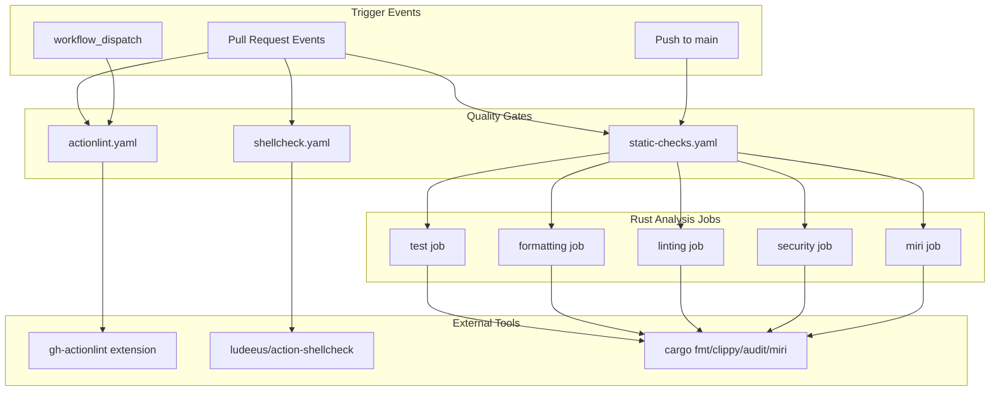
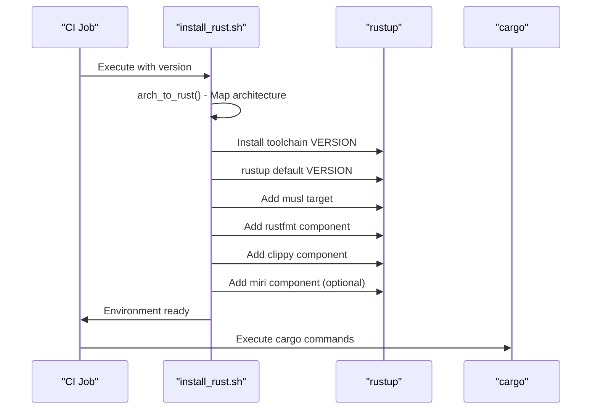
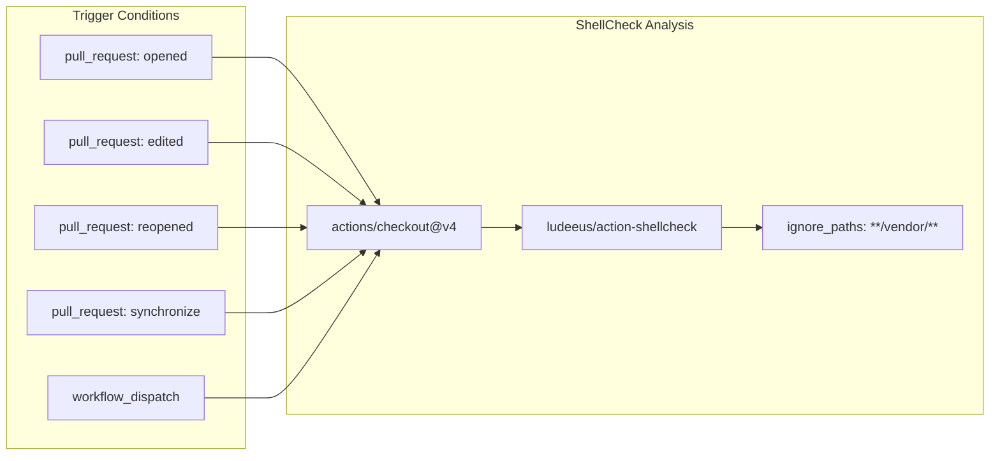
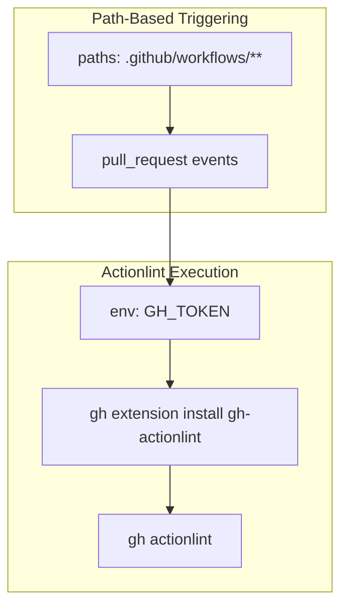
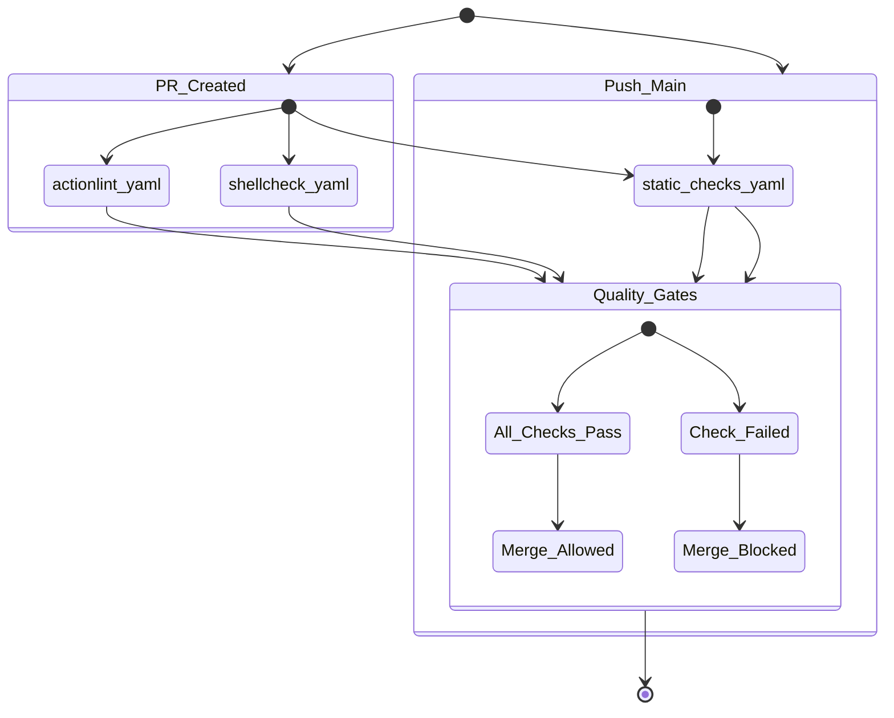

<!-- source: DeepWiki mcp.deepwiki.com · repo NVIDIA/nvrc · page 7.2 Code Quality Assurance · fetched 2026-10-26 -->

# Code Quality Assurance

<details>
<summary>Relevant source files</summary>

The following files were used as context for generating this wiki page:

- [.github/workflows/actionlint.yaml](.github/workflows/actionlint.yaml)
- [.github/workflows/shellcheck.yaml](.github/workflows/shellcheck.yaml)
- [.github/workflows/static-checks.yaml](.github/workflows/static-checks.yaml)
- [tests/install_rust.sh](tests/install_rust.sh)

</details>


This document covers the automated code quality assurance mechanisms in the NVRC system, including static analysis, linting, security auditing, and shell script validation. These quality gates ensure code consistency, security, and maintainability across the project. For information about the main build and testing pipeline, see [Build Pipeline](#7.1).

## Overview

The NVRC project implements a comprehensive code quality assurance system through multiple GitHub Actions workflows that automatically validate different aspects of the codebase. The system performs static analysis on Rust code, validates shell scripts, and ensures GitHub Actions workflow correctness.

## Quality Assurance Workflow Architecture



Sources: [.github/workflows/actionlint.yaml:1-38](), [.github/workflows/shellcheck.yaml:1-33](), [.github/workflows/static-checks.yaml:1-69]()

## Rust Static Analysis Pipeline

The `static-checks.yaml` workflow performs comprehensive Rust code analysis through five distinct jobs that validate different quality aspects:

| Job Name | Purpose | Command | Failure Policy |
|----------|---------|---------|----------------|
| `test` | Unit testing | `cargo test --all-features` | Fail on error |
| `formatting` | Code formatting | `cargo fmt --all -- --check` | Fail on error |
| `linting` | Code quality | `cargo clippy --all-features -- -D warnings` | Fail on error |
| `security` | Dependency audit | `cargo audit` | Fail on error |
| `miri` | Memory safety | `cargo miri test` | Allow errors |

### Rust Toolchain Setup

Each job uses the `install_rust.sh` script to establish a consistent Rust environment:



Sources: [.github/workflows/static-checks.yaml:18-69](), [tests/install_rust.sh:1-40]()

## Shell Script Validation

The `shellcheck.yaml` workflow validates shell scripts across the repository using the ShellCheck static analysis tool:



The workflow excludes vendor directories from analysis through the `ignore_paths` configuration parameter.

Sources: [.github/workflows/shellcheck.yaml:1-33]()

## GitHub Actions Workflow Validation

The `actionlint.yaml` workflow ensures GitHub Actions workflow files are syntactically correct and follow best practices:



The workflow only triggers when files in `.github/workflows/` are modified, optimizing CI resource usage.

Sources: [.github/workflows/actionlint.yaml:1-38]()

## Concurrency Control and Resource Management

All quality assurance workflows implement concurrency control to prevent resource conflicts:

```yaml
concurrency:
  group: ${{ github.workflow }}-${{ github.event.pull_request.number || github.ref }}
  cancel-in-progress: true
```

This configuration ensures that:
- Multiple runs of the same workflow on the same PR are prevented
- New runs automatically cancel previous in-progress runs
- Resource utilization is optimized across concurrent builds

## Quality Gate Integration

The quality assurance system integrates with the broader CI/CD pipeline through trigger coordination:



Sources: [.github/workflows/actionlint.yaml:3-12](), [.github/workflows/shellcheck.yaml:4-11](), [.github/workflows/static-checks.yaml:2-10]()

---

