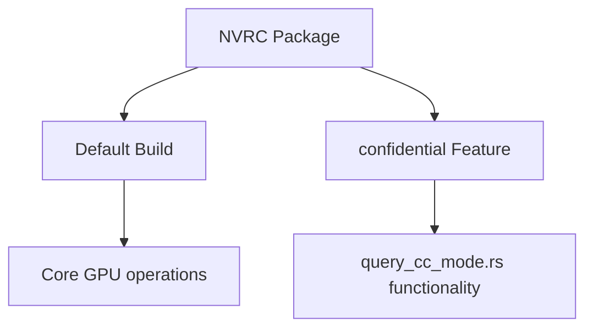
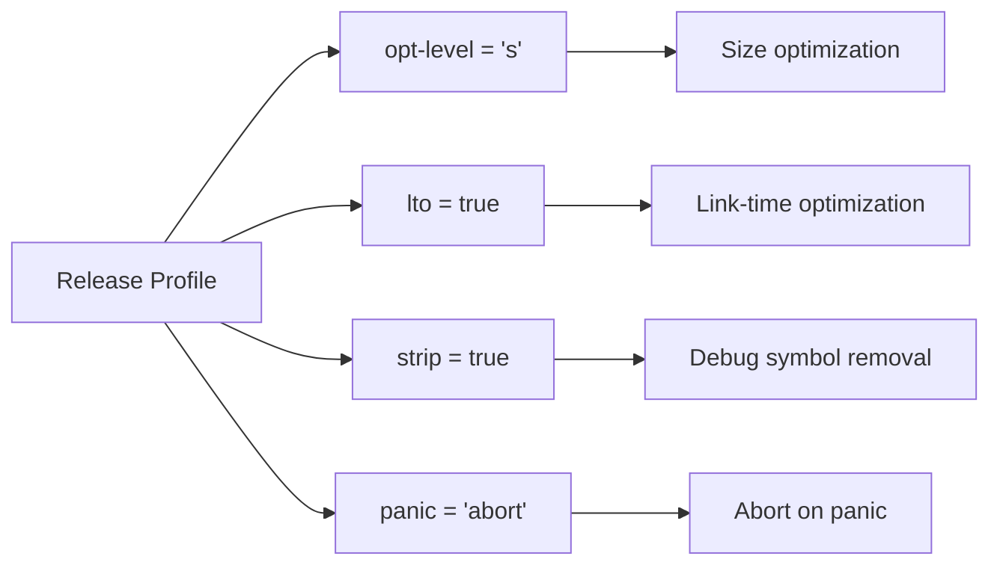
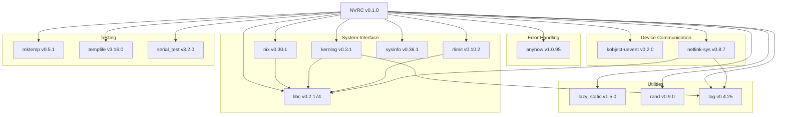
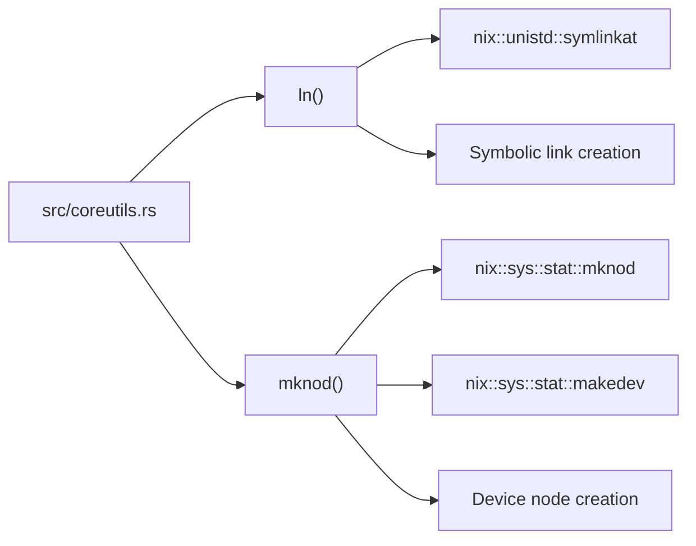
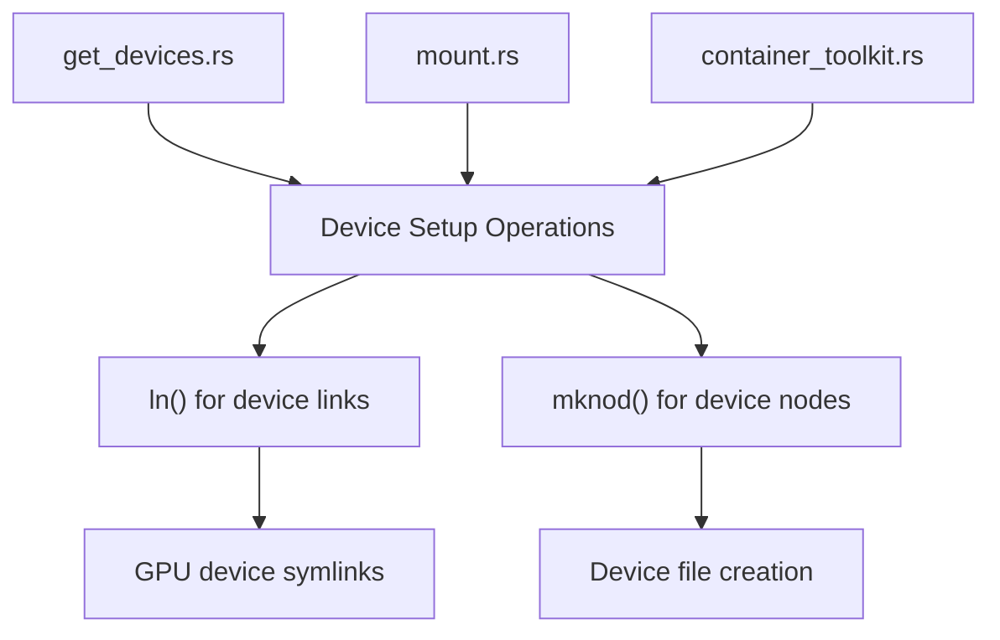

<!-- source: DeepWiki mcp.deepwiki.com · repo NVIDIA/nvrc · page 8 Configuration Reference · fetched 2026-10-26 -->

# Configuration Reference

Relevant source files

The following files were used as context for generating this wiki page:

- [Cargo.lock](Cargo.lock)
- [Cargo.toml](Cargo.toml)
- [src/coreutils.rs](src/coreutils.rs)

This document provides comprehensive reference documentation for NVRC project configuration files, dependency specifications, and low-level utility modules. It covers the build configuration defined in `Cargo.toml`, the locked dependency tree in `Cargo.lock`, and core system utility functions used throughout the codebase.

For information about system initialization and runtime configuration processing, see [Configuration Processing](#3.2). For details about the development build pipeline and testing configuration, see [Development and CI/CD](#7).

## Project Configuration

The NVRC project is configured as a Rust binary package with specialized dependencies for low-level system operations and GPU management.

### Package Metadata

| Property | Value | Purpose |
|----------|-------|---------|
| `name` | `NVRC` | Binary package identifier |
| `version` | `0.1.0` | Current release version |
| `edition` | `2021` | Rust language edition |

### Feature Flags

The project defines a single feature flag:

- **`confidential`**: Enables confidential computing support for GPU architectures that support hardware-based confidentiality modes

Sources: [Cargo.toml:30-31]()

### Release Profile Optimization

The release build profile is optimized for minimal binary size and maximum security:

Sources: [Cargo.toml:19-23]()

## Runtime Dependencies

The project's runtime dependencies provide system-level functionality required for GPU management and container integration.

### Core System Dependencies

| Crate | Version | Features | Purpose |
|-------|---------|----------|---------|
| `anyhow` | 1.0.44 | - | Error handling and context |
| `nix` | 0.30.1 | `fs`, `mount`, `user`, `process`, `reboot`, `signal`, `mman`, `poll` | Unix system calls |
| `libc` | 0.2 | - | C library bindings |
| `log` | 0.4 | - | Logging framework |
| `kernlog` | 0.3 | - | Kernel message logging |

### Device and Network Communication

| Crate | Version | Purpose |
|-------|---------|---------|
| `kobject-uevent` | 0.2.0 | Device hotplug event monitoring |
| `netlink-sys` | 0.8.6 | Netlink socket communication |
| `sysinfo` | 0.36.1 | System information queries |

### Utility Dependencies

| Crate | Version | Purpose |
|-------|---------|---------|
| `lazy_static` | 1.4.0 | Static variable initialization |
| `rand` | 0.9.0 | Random number generation |
| `rlimit` | 0.10.2 | Resource limit management |

Sources: [Cargo.toml:6-17]()

### Development Dependencies

Test-specific dependencies used for development and CI:

| Crate | Version | Purpose |
|-------|---------|---------|
| `mktemp` | 0.5.1 | Temporary directory creation |
| `tempfile` | 3.2.0 | Temporary file management |
| `serial_test` | 3.2.0 | Sequential test execution |

Sources: [Cargo.toml:25-28]()

## Dependency Resolution Tree

The complete dependency graph shows how system-level crates interconnect:

Sources: [Cargo.lock:1-836]()

## Core Utility Modules

The `coreutils` module provides essential system-level operations used throughout NVRC for device management and filesystem setup.

### Filesystem Operations

### Function Specifications

#### `ln(target: &str, linkpath: &str) -> Result<()>`

Creates symbolic links for device nodes and configuration files:

- **Parameters**: 
  - `target`: Path to link target
  - `linkpath`: Path where link will be created
- **Implementation**: Uses `nix::unistd::symlinkat` with `AT_FDCWD`
- **Error Handling**: Returns contextualized error on failure

#### `mknod(path: &str, kind: SFlag, major: u64, minor: u64) -> Result<()>`

Creates device nodes with proper permissions and device numbers:

- **Parameters**:
  - `path`: Device node path
  - `kind`: Device type (`SFlag`)
  - `major`: Major device number
  - `minor`: Minor device number
- **Behavior**: Skips creation if device already exists
- **Permissions**: Sets mode `0o666` for device access
- **Implementation**: Uses `nix::sys::stat::mknod` and `makedev`

### Integration with System Components

Sources: [src/coreutils.rs:1-26]()

The utility functions in `coreutils.rs` serve as foundational building blocks for device management operations throughout the NVRC system, providing safe wrappers around low-level Unix system calls with proper error handling and logging integration.

---

