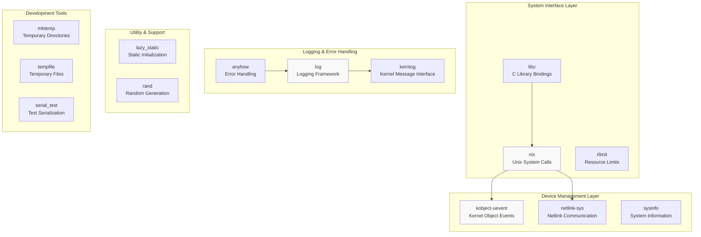
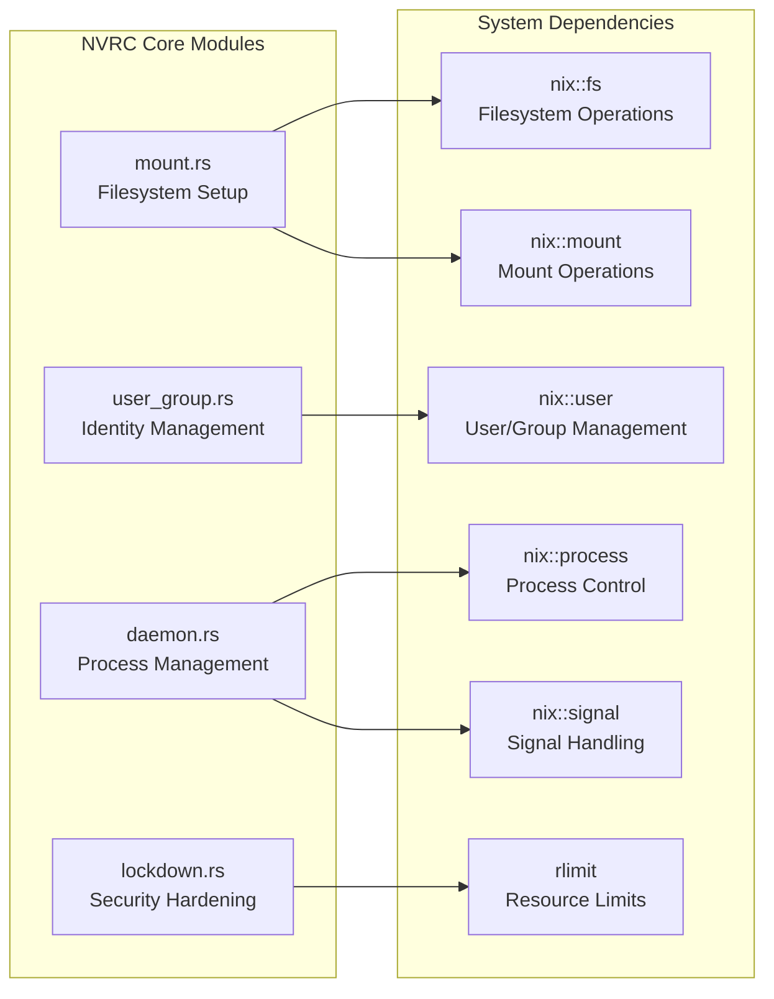

<!-- source: DeepWiki mcp.deepwiki.com · repo NVIDIA/nvrc · page 8.1 Project Dependencies · fetched 2026-10-26 -->

# Project Dependencies

<details>
<summary>Relevant source files</summary>

The following files were used as context for generating this wiki page:

- [Cargo.lock](Cargo.lock)
- [Cargo.toml](Cargo.toml)

</details>


This document provides a comprehensive reference for the Rust dependencies used in the NVRC project and their roles in system functionality. It covers runtime dependencies, development tools, and build configuration that enable NVRC's core capabilities as an NVIDIA GPU management system for containerized environments.

For information about utility modules and helper functions, see [Utility Modules](#8.2). For details about the overall system architecture, see [System Architecture](#2).

## Dependency Overview

NVRC utilizes a focused set of Rust crates to provide system-level GPU management capabilities. The dependencies are organized around core functional areas: system interface abstraction, device monitoring, process management, logging infrastructure, and container integration support.

**Dependency Architecture by Functional Domain**



Sources: [Cargo.toml:6-17]()

## Core System Dependencies

### System Interface and Process Management

The foundational layer provides Unix system call abstractions and process control capabilities essential for NVRC's system initialization and daemon management functions.

| Dependency | Version | Purpose | Key Features Used |
|------------|---------|---------|------------------|
| `nix` | 0.30.1 | Unix system calls wrapper | fs, mount, user, process, reboot, signal, mman, poll |
| `libc` | 0.2 | C library bindings | Direct system call access |
| `rlimit` | 0.10.2 | Resource limit management | Process resource controls |

The `nix` crate serves as the primary system interface, enabling filesystem operations in [mount.rs](), user/group management in [user_group.rs](), and process control in [daemon.rs](). Its extensive feature set supports NVRC's need for low-level system operations during initialization and runtime management.

**System Interface Dependency Mapping**



Sources: [Cargo.toml:8](), [Cargo.toml:15](), [Cargo.toml:17]()

### Device Monitoring and Event Handling

NVRC's device management capabilities depend on kernel event monitoring and system information gathering to support both cold-plug and hot-plug GPU scenarios.

| Dependency | Version | Purpose | Integration Point |
|------------|---------|---------|------------------|
| `kobject-uevent` | 0.2.0 | Kernel object event monitoring | Device hot-plug detection |
| `netlink-sys` | 0.8.6 | Netlink socket interface | Low-level kernel communication |
| `sysinfo` | 0.36.1 | System information retrieval | Hardware enumeration |

The `kobject-uevent` crate enables real-time monitoring of GPU device changes, supporting NVRC's hot-plug functionality in [ndev.rs](). The `netlink-sys` dependency provides the underlying communication mechanism for kernel event delivery.

Sources: [Cargo.toml:11-12](), [Cargo.toml:16]()

### Logging and Error Management

NVRC implements a comprehensive logging system that integrates kernel message handling with structured error propagation.

| Dependency | Version | Purpose | Usage Context |
|------------|---------|---------|---------------|
| `log` | 0.4 | Logging framework | Application-level logging |
| `kernlog` | 0.3 | Kernel message interface | Kernel log integration |
| `anyhow` | 1.0.44 | Error handling and context | Error propagation and reporting |

The logging infrastructure supports both application-level debugging and kernel message processing in [kmsg.rs]() and [syslog.rs](), providing comprehensive system observability.

Sources: [Cargo.toml:7](), [Cargo.toml:9-10]()

### Utility Dependencies

Supporting utilities provide essential functionality for random number generation and static initialization patterns used throughout the codebase.

| Dependency | Version | Purpose | Application |
|------------|---------|---------|-------------|
| `lazy_static` | 1.4.0 | Lazy static initialization | Global state management |
| `rand` | 0.9.0 | Random number generation | Security and testing |

These utilities support various system operations including secure random generation and efficient static resource initialization patterns.

Sources: [Cargo.toml:13-14]()

## Development and Testing Dependencies

Development dependencies support the testing infrastructure and temporary resource management during development and CI/CD operations.

| Dependency | Version | Purpose | Testing Context |
|------------|---------|---------|-----------------|
| `mktemp` | 0.5.1 | Temporary directory creation | Test isolation |
| `tempfile` | 3.2.0 | Temporary file management | Test resource cleanup |
| `serial_test` | 3.2.0 | Test execution serialization | Device access coordination |

The `serial_test` dependency is particularly important for NVRC's testing strategy, as it prevents concurrent access to GPU devices during test execution, ensuring reliable test outcomes in CI environments.

Sources: [Cargo.toml:25-28]()

## Build Configuration and Features

### Release Profile Optimization

NVRC is configured for minimal binary size and maximum runtime performance in production deployments:

```toml
[profile.release]
opt-level = "s"      # Size optimization
lto = true           # Link-time optimization
strip = true         # Symbol stripping
panic = 'abort'      # Direct panic handling
```

The size-optimized build profile (`opt-level = "s"`) balances performance with binary size constraints typical in container initrd environments.

### Feature Flags

NVRC supports conditional compilation through feature flags:

| Feature | Purpose | Dependencies Affected |
|---------|---------|----------------------|
| `confidential` | Confidential computing support | Enables GPU confidential computing mode detection |

The `confidential` feature flag enables specialized GPU hardware register querying functionality used in [query_cc_mode.rs]() for confidential computing environments.

Sources: [Cargo.toml:19-23](), [Cargo.toml:30-31]()

## Dependency Security and Maintenance

### Version Management

All dependencies are pinned to specific major versions to ensure build reproducibility and security consistency. The `Cargo.lock` file maintains exact version resolution for all transitive dependencies, supporting reliable CI/CD pipeline execution.

### Dependency Tree Analysis

The resolved dependency tree shows minimal transitive dependencies, reducing attack surface and build complexity. Key transitive dependencies include:

- `bitflags` (2.8.0) - Used by `nix` for flag constants
- `thiserror` (2.0.12) - Error handling infrastructure for `kobject-uevent`
- `getrandom` (0.2.15, 0.3.1) - Cryptographic random number generation

Sources: [Cargo.lock:1-836]()

---

