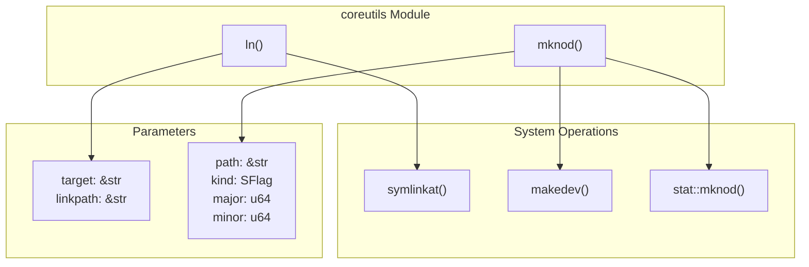
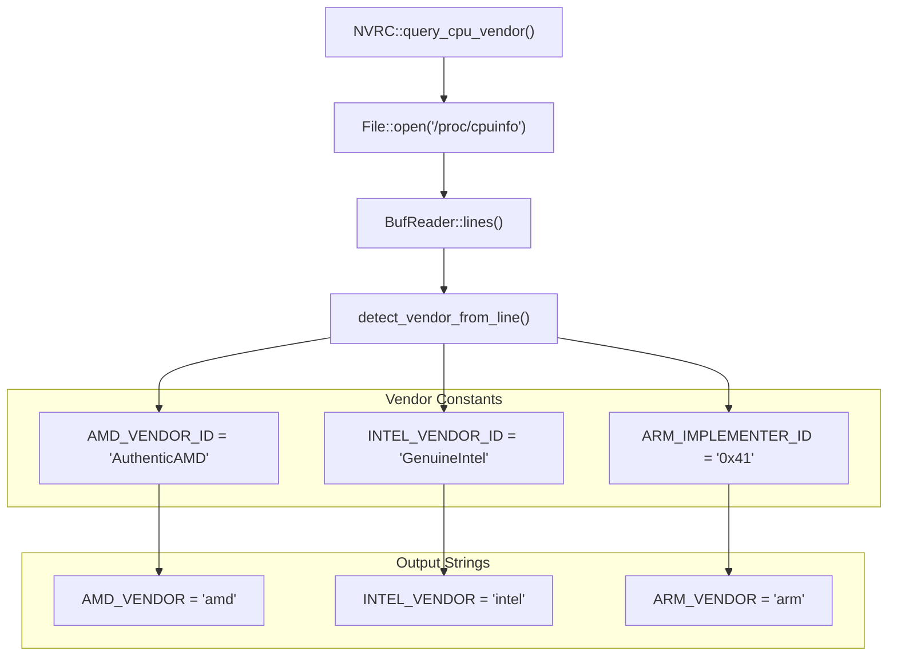
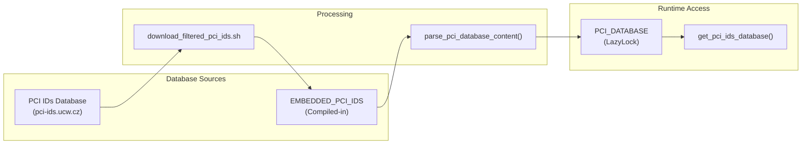
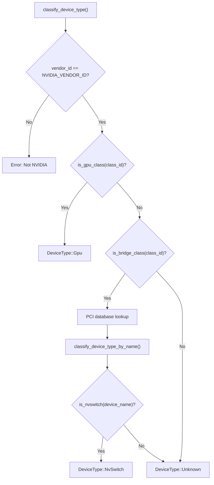

<!-- source: DeepWiki mcp.deepwiki.com · repo NVIDIA/nvrc · page 8.2 Utility Modules · fetched 2026-10-26 -->

# Utility Modules

Relevant source files

The following files were used as context for generating this wiki page:

- [download_filtered_pci_ids.sh](download_filtered_pci_ids.sh)
- [src/coreutils.rs](src/coreutils.rs)
- [src/cpu_vendor.rs](src/cpu_vendor.rs)
- [src/pci_ids.rs](src/pci_ids.rs)
- [src/pci_ids_embedded.txt](src/pci_ids_embedded.txt)

This document covers the low-level utility functions and helper modules that provide foundational functionality for the NVRC system. These modules handle core system operations, hardware detection, and device identification capabilities that are used throughout the NVRC initialization and runtime processes.

For information about higher-level GPU management functionality, see [GPU Management](#4). For system service management utilities, see [System Services](#5).

## Core System Utilities

The `coreutils` module provides essential Unix-style system operations needed during NVRC initialization and device setup.

### Device Node and Symbolic Link Operations

The core utilities provide two primary functions:

- **`ln()`** - Creates symbolic links using `symlinkat()` with error context
- **`mknod()`** - Creates device nodes with existence checking and proper permissions (mode 0o666)

Both functions include comprehensive error handling with contextual error messages using the `anyhow` crate.

**Sources:** [src/coreutils.rs:1-26]()

## CPU Vendor Detection

The CPU vendor detection system identifies the processor architecture to enable architecture-specific optimizations and compatibility checks.

### Vendor Detection Flow

### Detection Implementation

| Function | Purpose | Input | Output |
|----------|---------|-------|--------|
| `query_cpu_vendor()` | Main detection entry point | `/proc/cpuinfo` contents | Sets `NVRC.cpu_vendor` |
| `detect_vendor_from_line()` | Line-by-line parsing | Single cpuinfo line | Optional vendor string |

The detection logic checks for specific vendor ID strings:
- **AMD**: `AuthenticAMD` → `"amd"`
- **Intel**: `GenuineIntel` → `"intel"` 
- **ARM**: `CPU implementer` containing `0x41` → `"arm"`

**Sources:** [src/cpu_vendor.rs:1-91]()

## PCI Device Identification System

The PCI device identification system provides comprehensive device classification and database lookup capabilities for NVIDIA hardware and other PCI devices.

### Device Classification Architecture

```mermaid
graph TB
    subgraph "Classification Functions"
        classify_device_type["classify_device_type()"]
        classify_device_type_by_name["classify_device_type_by_name()"]
    end
    
    subgraph "Input Parameters"
        vendor_id["vendor_id: u16"]
        device_id["device_id: u16"] 
        class_id["class_id: u32"]
        device_name["device_name: &str"]
    end
    
    subgraph "Device Types"
        gpu_type["DeviceType::Gpu"]
        nvswitch_type["DeviceType::NvSwitch"]
        unknown_type["DeviceType::Unknown"]
    end
    
    subgraph "Class Constants"
        vga_controller["VGA_CONTROLLER = 0x030000"]
        display_3d["DISPLAY_3D_CONTROLLER = 0x030200"]
        bridge_other["BRIDGE_OTHER = 0x068000"]
    end
    
    classify_device_type --> vendor_id
    classify_device_type --> device_id
    classify_device_type --> class_id
    classify_device_type_by_name --> device_name
    
    classify_device_type --> vga_controller
    classify_device_type --> display_3d
    classify_device_type --> bridge_other
    
    classify_device_type --> gpu_type
    classify_device_type --> nvswitch_type
    classify_device_type --> unknown_type
```

### PCI Database Management

### Key Constants and Types

| Constant/Type | Value | Purpose |
|---------------|-------|---------|
| `NVIDIA_VENDOR_ID` | `0x10de` | NVIDIA PCI vendor identifier |
| `VGA_CONTROLLER` | `0x030000` | Standard VGA controller class |
| `DISPLAY_3D_CONTROLLER` | `0x030200` | 3D display controller class |
| `BRIDGE_OTHER` | `0x068000` | Bridge device class (NvSwitch) |
| `DeviceType::Gpu` | Enum variant | Standard GPU devices |
| `DeviceType::NvSwitch` | Enum variant | NVIDIA Switch devices |
| `DeviceType::Unknown` | Enum variant | Unrecognized devices |

**Sources:** [src/pci_ids.rs:1-262]()

## Embedded PCI Database

The system includes a pre-filtered PCI IDs database embedded directly in the binary for offline operation and reduced external dependencies.

### Database Content and Filtering

The embedded database contains only NVIDIA and Mellanox devices, filtered from the upstream PCI IDs database. The filtering logic focuses on:

**NVIDIA Device Filtering:**
- **Hopper Generation**: Device IDs `23xx` (GH100)
- **Blackwell Generation**: Device IDs `29xx-2fxx` (GB100/GB200)  
- **Future Generations**: Device IDs `3xxx` and higher
- **Excluded**: Pre-Hopper devices (`00xx-22xx`, `24xx-28xx`)

**Mellanox Devices:**
- All Mellanox devices (vendor ID `15b3`) for networking hardware support

### Database Update Mechanism

The update script (`download_filtered_pci_ids.sh`) provides:
- Automated download from upstream source
- Generation-specific filtering for NVIDIA devices
- Preservation of vendor and device relationships
- Statistics reporting on filtered content

**Sources:** [src/pci_ids_embedded.txt:1-1073](), [download_filtered_pci_ids.sh:1-230]()

## Device Type Classification Logic

The PCI system implements a hierarchical classification approach combining PCI class codes with device name analysis.

### Classification Decision Tree

The classification process uses multiple validation layers:

1. **Vendor Validation**: Ensures device is NVIDIA (`0x10de`)
2. **Class-based Classification**: Uses PCI class codes for primary identification
3. **Name-based Refinement**: Leverages device names for specialized devices like NvSwitch
4. **Fallback Handling**: Returns `Unknown` rather than errors for unrecognized devices

**Sources:** [src/pci_ids.rs:74-140]()