# Page: Overview

# Overview

<details>
<summary>Relevant source files</summary>

The following files were used as context for generating this wiki page:

- [Cargo.toml](Cargo.toml)
- [README.md](README.md)
- [src/main.rs](src/main.rs)

</details>


## Purpose and Scope

NVRC is an NVIDIA GPU management system designed specifically for containerized environments, with primary focus on Kata Containers integration. This system handles GPU device discovery, validation, daemon management, and container runtime integration within secure, isolated execution environments.

This document provides a high-level introduction to NVRC's architecture and operational modes. For detailed information about specific subsystems, see [System Architecture](#2), [GPU Management](#4), [System Services](#5), and [Runtime Operations](#6).

## System Overview

NVRC operates as a specialized init system that bootstraps GPU-enabled containerized environments. The system is built around the central `NVRC` struct which coordinates filesystem setup, device management, daemon lifecycle, and container runtime integration.

### Primary System Architecture

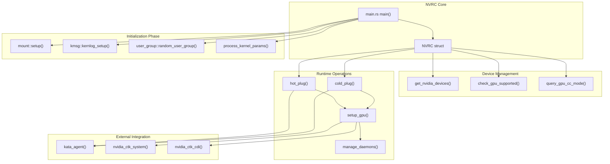

**Sources:** [src/main.rs:39-67](), [src/main.rs:101-219]()

## Core Components

NVRC consists of several interconnected modules that handle different aspects of GPU management and system integration:

| Component | Module | Primary Function |
|-----------|---------|------------------|
| System Orchestrator | `main.rs` | Coordinates initialization and operational mode selection |
| Device Discovery | `get_devices.rs` | Enumerates and identifies NVIDIA hardware |
| Device Validation | `check_supported.rs` | Validates GPU compatibility and support status |
| Daemon Management | `daemon.rs` | Controls NVIDIA service lifecycle |
| Container Integration | `container_toolkit.rs` | Manages NVIDIA Container Toolkit integration |
| Security Framework | `lockdown.rs` | Implements system hardening measures |
| Event Monitoring | `ndev.rs`, `kmsg.rs` | Handles device hot-plug/unplug events |

**Sources:** [src/main.rs:7-23](), [Cargo.toml:1-31]()

## Operational Modes

NVRC operates in two distinct modes based on the runtime environment and device configuration:

### Mode Selection and Execution Flow

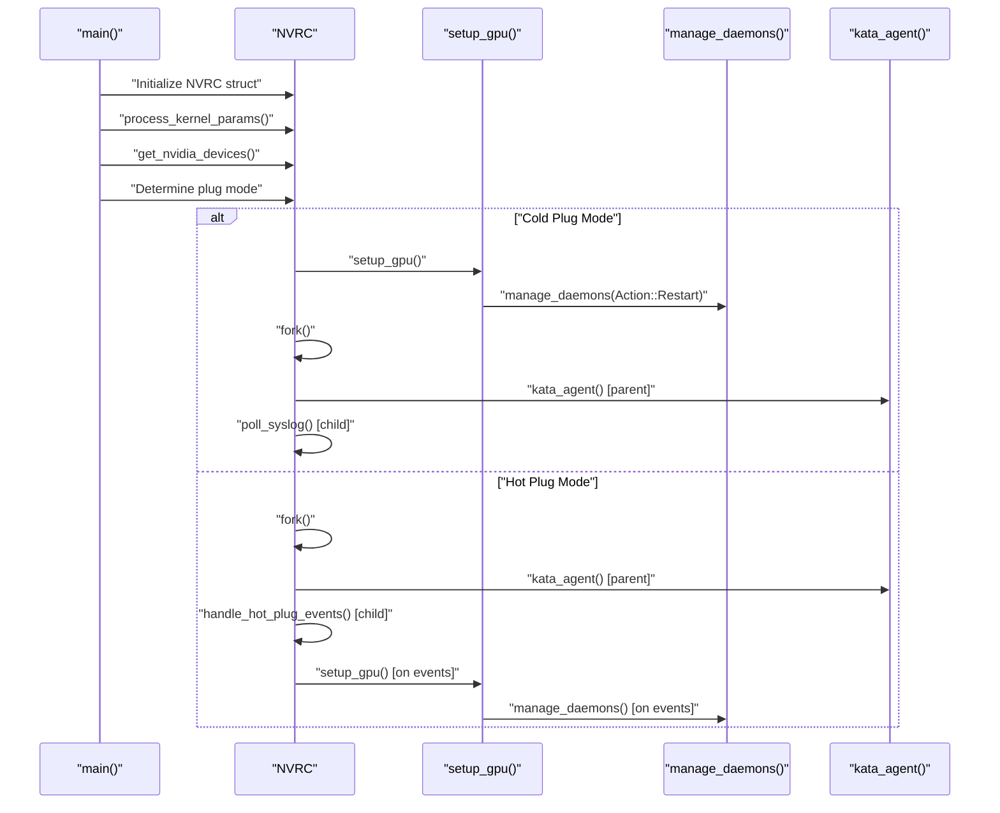

**Sources:** [src/main.rs:61-66](), [src/main.rs:101-132](), [src/main.rs:135-194]()

### Cold Plug Mode
In cold plug mode, NVRC performs complete GPU initialization during system startup. The system:
- Discovers all available NVIDIA devices
- Validates device support and configures hardware
- Starts all necessary NVIDIA daemons
- Configures container runtime integration
- Forks to run Kata agent alongside syslog monitoring

### Hot Plug Mode  
Hot plug mode enables dynamic device management where NVRC:
- Monitors for device addition/removal events via `udev` and kernel messages
- Dynamically reconfigures GPU setup when devices change
- Manages daemon lifecycle based on device availability
- Maintains container runtime integration during device transitions

## Key Dependencies and Integration Points

NVRC integrates with several external systems and relies on specific dependencies:

### Runtime Dependencies
- **NVIDIA Container Toolkit**: Provides container runtime GPU integration via `nvidia_ctk_system()` and `nvidia_ctk_cdi()`
- **Kata Containers Agent**: Manages container lifecycle through `kata_agent()` integration
- **NVIDIA Drivers**: Requires NVIDIA kernel modules and userspace libraries
- **System Daemons**: Manages `nvidia-persistenced`, `nv-hostengine`, and `dcgm-exporter`

### Development Dependencies
- **Rust Ecosystem**: Built with async-capable libraries including `nix`, `anyhow`, and `log`
- **System Interfaces**: Direct integration with `udev`, `syslog`, and kernel message interfaces
- **Security Framework**: Implements module loading restrictions and panic handling

**Sources:** [Cargo.toml:6-17](), [src/main.rs:30-33]()

## Security and Hardening Features

NVRC implements several security measures designed for confidential computing and secure container environments:

- **Module Loading Restriction**: Disables dynamic kernel module loading after GPU initialization
- **Panic Hook Management**: Custom panic handling for secure failure modes  
- **Identity Randomization**: Generates random user/group identities for process isolation
- **Filesystem Isolation**: Implements read-only root filesystem with controlled mount points
- **Confidential Computing Support**: Optional feature for hardware-based confidential computing validation

**Sources:** [src/main.rs:40](), [src/main.rs:48-49](), [src/main.rs:211](), [Cargo.toml:30-31]()

This overview establishes the foundation for understanding NVRC's role in GPU-enabled containerized environments. Detailed documentation for each subsystem is available in the corresponding wiki sections referenced above.

---

# Page: System Architecture

# System Architecture

<details>
<summary>Relevant source files</summary>

The following files were used as context for generating this wiki page:

- [src/daemon.rs](src/daemon.rs)
- [src/get_devices.rs](src/get_devices.rs)
- [src/main.rs](src/main.rs)
- [src/nvrc.rs](src/nvrc.rs)

</details>


This document describes the high-level architecture of the NVRC system, covering the major components and their interactions. NVRC serves as an NVIDIA GPU management system designed for containerized environments, with particular focus on Kata Containers integration.

For detailed information about individual subsystems, see [GPU Management](#4), [System Services](#5), and [Runtime Operations](#6). For build and deployment processes, see [Development and CI/CD](#7).

## Core System Design

NVRC follows a modular architecture centered around the `NVRC` struct, which acts as the central state manager and orchestrator. The system is designed to handle both cold-plug (devices present at startup) and hot-plug (dynamic device addition/removal) scenarios.

### Primary Components

The architecture consists of several key subsystems:

**System Orchestrator**: The `main` function in `main.rs` serves as the primary entry point and system coordinator, managing initialization sequences and process forking for different operational modes.

**Central State Manager**: The `NVRC` struct maintains system state including device inventory, configuration parameters, daemon processes, and operational mode determination.

**GPU Management Subsystem**: Handles device discovery through PCI bus scanning, device validation against supported hardware lists, and confidential computing mode detection.

**Service Management**: Manages NVIDIA-related daemon processes including persistence daemon, host engine, and DCGM exporter.

**Container Integration**: Interfaces with NVIDIA Container Toolkit to generate CDI specifications and configure container runtime integration.

Sources: [src/main.rs:39-67](), [src/nvrc.rs:47-85]()

## System Component Relationships

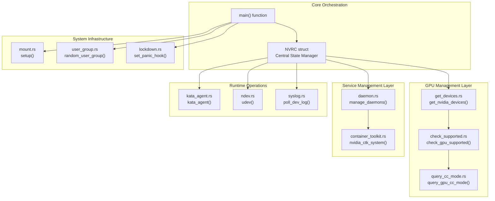

Sources: [src/main.rs:39-67](), [src/nvrc.rs:47-85](), [src/get_devices.rs:69-100](), [src/daemon.rs:99-127]()

## Initialization and Runtime Flow

The system follows a structured initialization sequence that prepares the environment, discovers hardware, and establishes runtime operations.

### System Startup Sequence

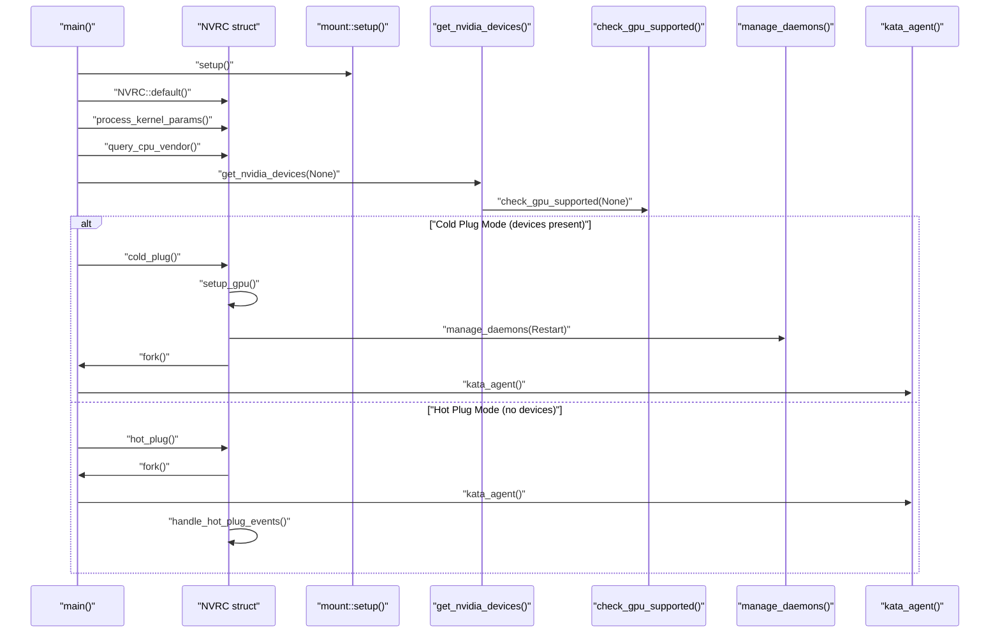

Sources: [src/main.rs:39-67](), [src/main.rs:101-132](), [src/nvrc.rs:101-117]()

## Operational Modes

NVRC operates in two distinct modes based on hardware presence at startup, with different process management strategies for each.

### Cold Plug vs Hot Plug Architecture

| Mode | Trigger Condition | Primary Process | Child Process | Event Handling |
|------|------------------|-----------------|---------------|----------------|
| Cold Plug | `nvidia_devices.len() > 0` | `kata_agent()` | `poll_syslog()` | Continuous syslog monitoring |
| Hot Plug | `nvidia_devices.len() == 0` | `kata_agent()` | `handle_hot_plug_events()` | `udev` + `kmsg` event watchers |

The mode determination occurs in the `update_device_state` method, which sets the `cold_plug` boolean flag based on device discovery results.

### Process Fork Strategy

Both modes utilize `fork()` to create parent and child processes with distinct responsibilities:

**Parent Process**: Always runs `kata_agent()` to maintain container agent functionality
**Child Process**: Mode-specific operations (syslog polling or event handling)

Sources: [src/main.rs:61-66](), [src/main.rs:101-132](), [src/get_devices.rs:117-131]()

## State Management and Configuration

The `NVRC` struct maintains comprehensive system state through several key data structures and configuration mechanisms.

### Core State Components

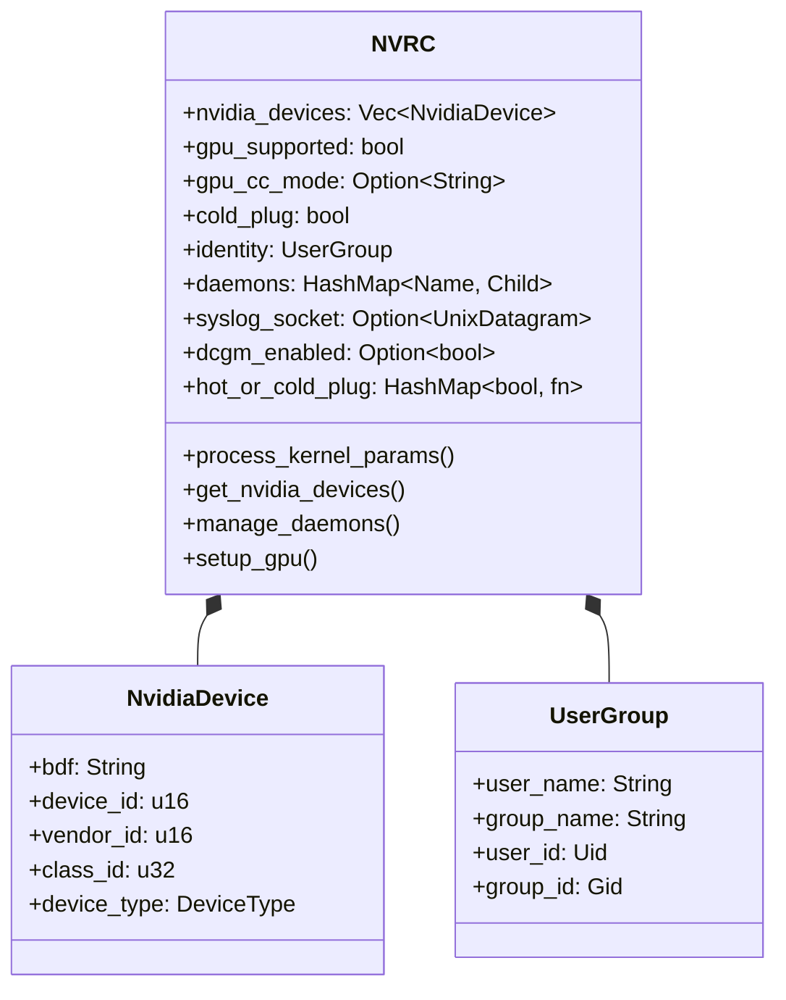

### Configuration Parameter Processing

The system processes kernel command line parameters through a handler-based architecture defined in `PARAM_HANDLERS`:

- `nvrc.log`: Sets logging level and enables debug output
- `nvrc.uvm_persistence_mode`: Configures UVM persistence for `nvidia-persistenced`
- `nvrc.dcgm`: Enables/disables DCGM monitoring services
- `nvrc.smi.srs`: Sets SRS (Secure Ready State) configuration for confidential computing

Sources: [src/nvrc.rs:47-85](), [src/nvrc.rs:37-45](), [src/nvrc.rs:101-117](), [src/get_devices.rs:23-31]()

## Integration Points

NVRC interfaces with several external systems and runtime components to provide comprehensive GPU management.

### External System Dependencies

**NVIDIA Container Toolkit**: Integration through `nvidia_ctk_system()` and `nvidia_ctk_cdi()` functions for container runtime configuration and CDI specification generation.

**Kata Containers**: Direct integration via `kata_agent()` function, running as the primary process in both operational modes.

**System Services**: Management of NVIDIA daemon processes including:
- `nvidia-persistenced`: GPU state persistence
- `nv-hostengine`: DCGM host engine for monitoring
- `dcgm-exporter`: Metrics export functionality

**Hardware Abstraction**: PCI device discovery through sysfs (`/sys/bus/pci/devices`) and kernel message monitoring via `/dev/kmsg`.

Sources: [src/container_toolkit.rs](), [src/kata_agent.rs](), [src/daemon.rs:129-223](), [src/get_devices.rs:69-100]()

---

# Page: System Initialization

# System Initialization

<details>
<summary>Relevant source files</summary>

The following files were used as context for generating this wiki page:

- [src/main.rs](src/main.rs)
- [src/mount.rs](src/mount.rs)
- [src/nvrc.rs](src/nvrc.rs)
- [src/user_group.rs](src/user_group.rs)

</details>


This document covers the NVRC system initialization process from boot to ready state, including filesystem setup, configuration processing, device discovery, and mode determination. This encompasses the early boot sequence that prepares the system for GPU management operations.

For information about ongoing device monitoring and event handling during runtime, see [Runtime Operations](#6). For details about daemon management and service orchestration, see [System Services](#5).

## Overview

The NVRC initialization process follows a sequential bootstrap procedure orchestrated by the `main` function. The system transitions through several phases: panic handling setup, filesystem mounting, logging configuration, identity management, parameter processing, and finally mode determination for either cold-plug or hot-plug operation.

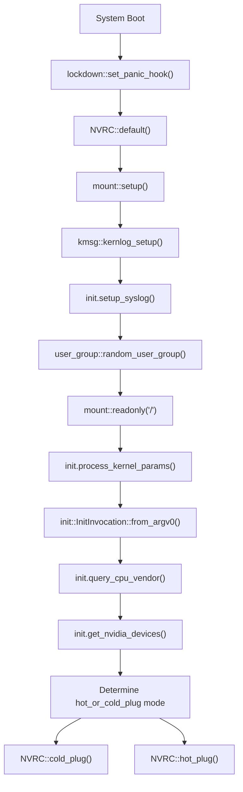

Sources: [src/main.rs:39-67]()

## Initialization Sequence

### Phase 1: System Safety and Core Setup

The initialization begins with essential system safety measures and core infrastructure setup. The `main` function first establishes a panic hook to handle system failures gracefully, then creates the central NVRC state management structure.

| Step | Function | Purpose |
|------|----------|---------|
| 1 | `lockdown::set_panic_hook()` | Establish system failure handling |
| 2 | `NVRC::default()` | Initialize central state manager |
| 3 | `mount::setup()` | Mount essential filesystems |
| 4 | `kmsg::kernlog_setup()` | Configure kernel message logging |

Sources: [src/main.rs:40-45]()

### Phase 2: Filesystem Infrastructure

The `mount::setup()` function establishes the complete filesystem hierarchy required for system operation. This includes mounting virtual filesystems and creating essential device nodes.

```mermaid
graph TD
    MountSetup["mount::setup()"] --> ProcMount["mount('proc', '/proc', 'proc')"]
    MountSetup --> DevMount["mount('dev', '/dev', 'devtmpfs')"]
    MountSetup --> SysMount["mount('sysfs', '/sys', 'sysfs')"]
    MountSetup --> RunMount["mount('run', '/run', 'tmpfs')"]
    MountSetup --> TmpMount["mount('tmpfs', '/tmp', 'tmpfs')"]
    MountSetup --> ConditionalMounts["mount_conditional() for securityfs, efivarfs"]
    MountSetup --> DeviceLinks["create_device_symlinks()"]
    MountSetup --> DeviceNodes["create_device_nodes()"]
    
    DeviceLinks --> FdLink["/proc/self/fd -> /dev/fd"]
    DeviceLinks --> StdinLink["/proc/self/fd/0 -> /dev/stdin"]
    DeviceLinks --> StdoutLink["/proc/self/fd/1 -> /dev/stdout"]
    DeviceLinks --> StderrLink["/proc/self/fd/2 -> /dev/stderr"]
    
    DeviceNodes --> NullDev["/dev/null (1,3)"]
    DeviceNodes --> ZeroDev["/dev/zero (1,5)"]
    DeviceNodes --> RandomDev["/dev/random (1,8)"]
    DeviceNodes --> UrandomDev["/dev/urandom (1,9)"]
```

Sources: [src/mount.rs:120-137](), [src/mount.rs:93-118]()

### Phase 3: Logging and Communication Setup

Following filesystem establishment, the system configures logging infrastructure and syslog communication channels. The kernel message logging system is initialized first, followed by syslog socket creation for userspace communication.

The `setup_syslog()` method creates a Unix datagram socket for syslog message processing, storing the socket reference in the NVRC structure for later use during operation.

Sources: [src/main.rs:45-46](), [src/nvrc.rs:88-92]()

### Phase 4: Identity Management and Security

The system establishes security context by creating a random user and group identity. This non-privileged identity is generated with random UIDs and GIDs in the range 1000-60000, with an 8-character lowercase alphabetic username.

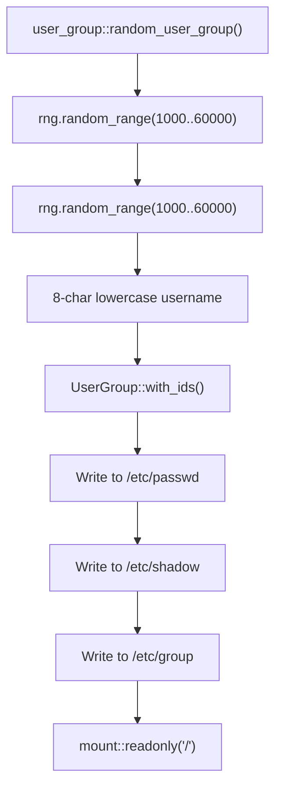

The identity creation process writes standard Unix user account entries to system files with disabled passwords and restrictive settings:
- passwd entry: `username:x:uid:gid:username:/nonexistent:/bin/false`
- shadow entry: `username:*:18295:0:99999:7:::`
- group entry: `groupname:x:gid:`

After identity establishment, the root filesystem is remounted as read-only for security hardening.

Sources: [src/main.rs:48-49](), [src/user_group.rs:115-126](), [src/user_group.rs:64-77]()

### Phase 5: Configuration Processing

The system processes kernel command-line parameters to configure runtime behavior. The `process_kernel_params()` method parses `/proc/cmdline` and applies registered parameter handlers.

| Parameter | Handler | Purpose |
|-----------|---------|---------|
| `nvrc.log` | `nvrc_log` | Set logging level and enable debug output |
| `nvrc.uvm_persistence_mode` | `uvm_persistenced_mode` | Configure UVM persistence |
| `nvrc.dcgm` | `nvrc_dcgm` | Enable/disable DCGM monitoring |
| `nvrc.smi.srs` | `nvidia_smi_srs` | Configure nvidia-smi SRS mode |

The parameter processing uses a HashMap-based dispatch system with function pointers for efficient parameter handling.

Sources: [src/main.rs:51-52](), [src/nvrc.rs:101-117](), [src/nvrc.rs:37-45]()

### Phase 6: Hardware Discovery and Mode Selection

The final initialization phase involves CPU vendor detection, NVIDIA device enumeration, and determination of operational mode (hot-plug vs cold-plug).

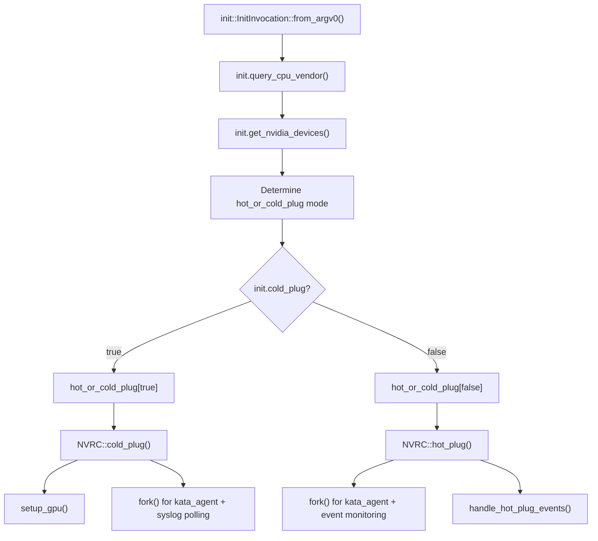

The mode selection uses a function pointer lookup table stored in the `hot_or_cold_plug` HashMap, mapping boolean values to the appropriate handler functions.

Sources: [src/main.rs:54-66](), [src/nvrc.rs:75-78]()

## Process Forking Strategy

Both operational modes use process forking to separate the Kata agent execution from device management:

- **Cold-plug mode**: Parent process runs `kata_agent()`, child process polls syslog with `COLD_PLUG_POLL_INTERVAL` (1 second)
- **Hot-plug mode**: Parent process runs `kata_agent()`, child process handles device events through `handle_hot_plug_events()`

This separation ensures that the Kata agent remains responsive while device management operations proceed independently.

Sources: [src/main.rs:101-132](), [src/main.rs:35-37]()

---

# Page: Filesystem Setup

# Filesystem Setup

<details>
<summary>Relevant source files</summary>

The following files were used as context for generating this wiki page:

- [src/coreutils.rs](src/coreutils.rs)
- [src/mount.rs](src/mount.rs)

</details>


## Purpose and Scope

This document covers the initial filesystem mounting and device node creation performed during NVRC system initialization. The filesystem setup establishes the essential directory structure and device files required for the NVRC runtime environment to operate correctly within a containerized context.

This page focuses specifically on the mounting operations and device creation. For information about configuration processing that occurs after filesystem setup, see [Configuration Processing](#3.2). For details about the overall initialization sequence, see [System Initialization](#3).

## Overview

The filesystem setup process is handled by the `setup()` function in [src/mount.rs:120-137]() and represents one of the earliest initialization steps in the NVRC system. This process establishes a minimal but complete Linux filesystem hierarchy with appropriate security constraints for the containerized environment.

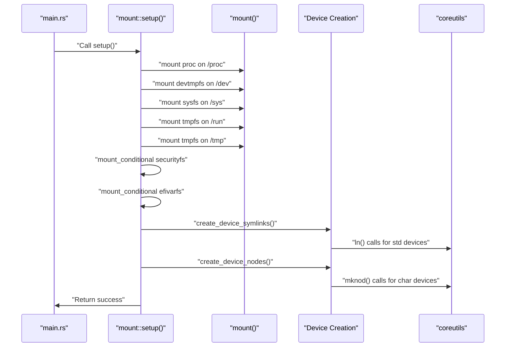

Sources: [src/mount.rs:120-137]()

## Core Mount Operations

### Essential Filesystem Mounts

The system performs several critical filesystem mounts during initialization, each with specific security flags and purposes:

| Filesystem | Mount Point | Type | Flags | Purpose |
|------------|-------------|------|-------|---------|
| proc | `/proc` | proc | `COMMON_FLAGS` | Process and kernel information |
| dev | `/dev` | devtmpfs | `DEV_FLAGS` | Device files |
| sysfs | `/sys` | sysfs | `COMMON_FLAGS` | Kernel objects and attributes |
| run | `/run` | tmpfs | `COMMON_FLAGS` | Runtime data |
| tmpfs | `/tmp` | tmpfs | `TMP_FLAGS` | Temporary files |

The `mount()` function in [src/mount.rs:34-47]() handles the actual mounting logic with built-in duplicate mount detection via `is_mounted()`.

### Mount Security Flags

NVRC applies strict security constraints through predefined mount flag combinations:

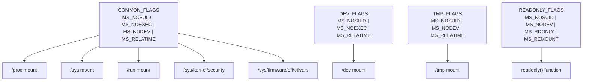

Sources: [src/mount.rs:8-21]()

### Conditional Mounting

The `mount_conditional()` function in [src/mount.rs:80-91]() performs safety checks before mounting optional filesystems:

- **Filesystem availability**: Checked via `fs_available()` against `/proc/filesystems`
- **Target path existence**: Verified using `Path::new(target).exists()`
- **Mount status**: Ensured not already mounted via `is_mounted()`

This approach safely handles systems where optional filesystems like `securityfs` or `efivarfs` may not be available.

Sources: [src/mount.rs:80-91](), [src/mount.rs:59-67](), [src/mount.rs:49-57]()

## Device Node Creation

### Standard Device Symlinks

The system creates essential device symlinks through `create_device_symlinks()` in [src/mount.rs:93-105]():

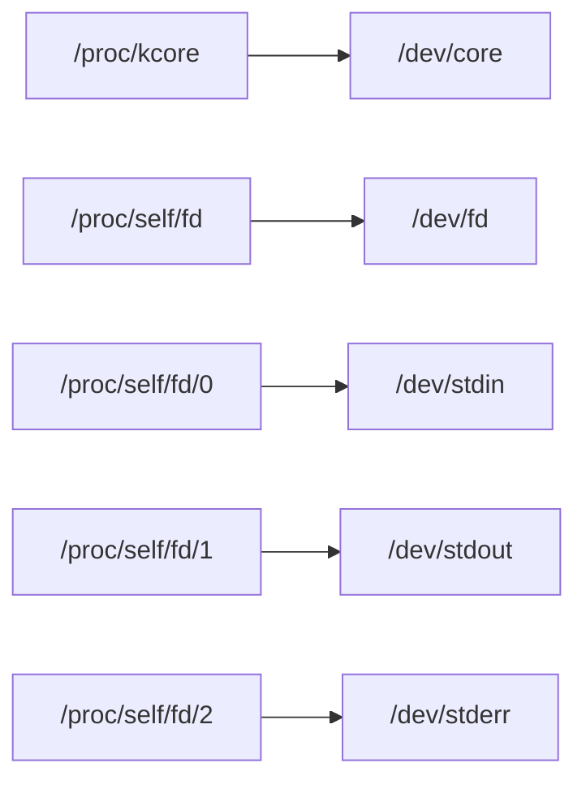

### Character Device Nodes

Essential character device nodes are created via `create_device_nodes()` in [src/mount.rs:107-118]() using predefined major/minor number constants:

| Device | Path | Major | Minor | Constant |
|--------|------|-------|-------|----------|
| Null device | `/dev/null` | 1 | 3 | `NULL_MINOR` |
| Zero device | `/dev/zero` | 1 | 5 | `ZERO_MINOR` |
| Random | `/dev/random` | 1 | 8 | `RANDOM_MINOR` |
| Urandom | `/dev/urandom` | 1 | 9 | `URANDOM_MINOR` |

All character devices use major number 1 (`MEM_MAJOR` constant) as defined in [src/mount.rs:23-27]().

Sources: [src/mount.rs:93-118](), [src/mount.rs:23-27]()

## Core Utility Functions

### Symbolic Link Creation

The `ln()` function in [src/coreutils.rs:8-11]() creates symbolic links using the `symlinkat()` system call with proper error context formatting.

### Device Node Creation

The `mknod()` function in [src/coreutils.rs:14-25]() creates device nodes with:
- Existence checking to avoid duplicate creation
- Device number construction via `makedev()`
- Default permissions of `0o666`
- Comprehensive error context

Sources: [src/coreutils.rs:8-25]()

## Error Handling and Robustness

The filesystem setup includes several robustness features:

- **Mount detection**: `is_mounted()` prevents duplicate mounts by parsing `/proc/mounts`
- **Filesystem availability**: `fs_available()` checks `/proc/filesystems` before attempting mounts
- **Conditional operations**: Optional filesystems are only mounted if available and not already mounted
- **Device existence**: Device nodes are only created if they don't already exist

This design allows NVRC to operate correctly in various container environments and handle partial or pre-existing filesystem setups gracefully.

Sources: [src/mount.rs:49-67](), [src/coreutils.rs:14-18]()

## Integration with System Initialization

The filesystem setup occurs early in the NVRC initialization sequence, called directly from the main initialization logic. This establishes the foundation for subsequent operations including:

- Kernel parameter processing
- Device discovery and validation  
- Daemon management
- Container toolkit integration

The `readonly()` function in [src/mount.rs:69-78]() provides the capability to remount filesystems as read-only for security hardening after initialization completes.

Sources: [src/mount.rs:69-78](), [src/mount.rs:120-137]()

---

# Page: Configuration Processing

# Configuration Processing

<details>
<summary>Relevant source files</summary>

The following files were used as context for generating this wiki page:

- [src/cpu_vendor.rs](src/cpu_vendor.rs)
- [src/nvrc.rs](src/nvrc.rs)

</details>


This document covers how NVRC processes kernel parameters and system configuration during initialization. The configuration system parses kernel command line parameters to set runtime behavior, log levels, daemon settings, and other system preferences.

For information about the broader system initialization process, see [System Initialization](#3). For details about filesystem setup that occurs before configuration processing, see [Filesystem Setup](#3.1).

## Overview

The configuration processing system in NVRC reads kernel command line parameters from `/proc/cmdline` and applies them to the system state. This allows administrators to control NVRC behavior by passing parameters at boot time. The system uses a handler-based architecture where each supported parameter has a dedicated processing function.

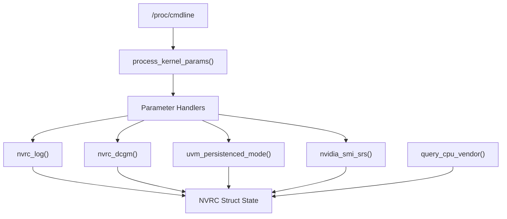

**Sources:** [src/nvrc.rs:101-117](), [src/cpu_vendor.rs:18-31]()

## Configuration Architecture

The NVRC configuration system centers around the `NVRC` struct, which maintains all system state and configuration. Parameter processing uses a static handler mapping that associates parameter names with their processing functions.

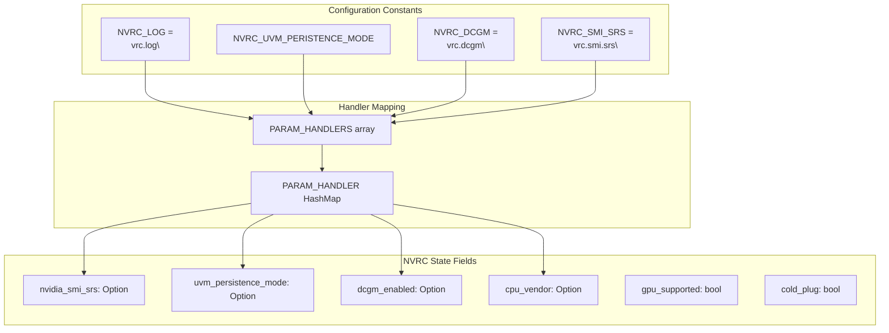

**Sources:** [src/nvrc.rs:26-30](), [src/nvrc.rs:37-45](), [src/nvrc.rs:48-62]()

## Kernel Parameter Processing

The `process_kernel_params` method handles the core parameter parsing logic. It reads the kernel command line, splits parameters by whitespace, and processes each key=value pair through the handler system.

| Parameter | Handler Function | Purpose |
|-----------|------------------|---------|
| `nvrc.log` | `nvrc_log()` | Controls logging verbosity and kernel message rate limiting |
| `nvrc.dcgm` | `nvrc_dcgm()` | Enables or disables DCGM daemon management |
| `nvrc.uvm_persistence_mode` | `uvm_persistenced_mode()` | Configures UVM persistence daemon behavior |
| `nvrc.smi.srs` | `nvidia_smi_srs()` | Sets nvidia-smi SRS configuration |

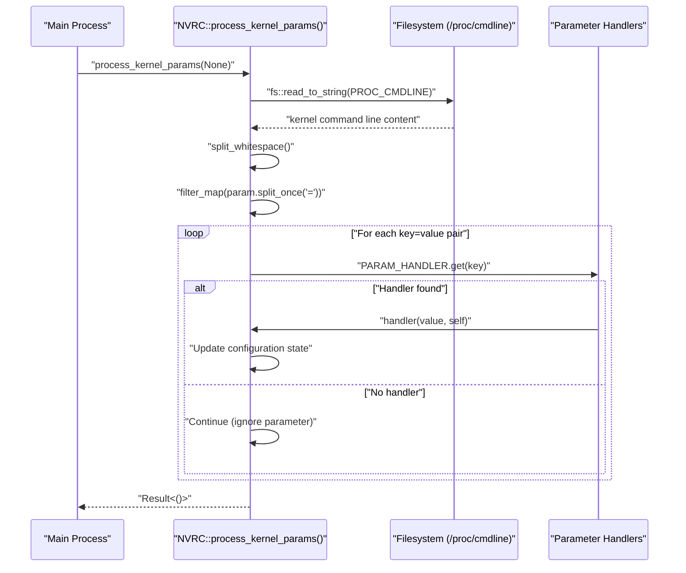

**Sources:** [src/nvrc.rs:101-117](), [src/nvrc.rs:44-45]()

## Configuration Handlers

Each configuration parameter has a dedicated handler function that validates and applies the parameter value to the NVRC state.

### Log Level Handler

The `nvrc_log` handler processes log level configuration and manages kernel message rate limiting. It supports standard log levels (off, error, warn, info, debug, trace) and automatically disables rate limiting for debug modes.

```mermaid
graph TD
    INPUT["nvrc.log parameter value"]
    MATCH["Match log level string"]
    
    INPUT --> MATCH
    
    MATCH --> OFF["\"off\"|\"0\"|\"\": LevelFilter::Off"]
    MATCH --> ERROR["\"error\": LevelFilter::Error"]
    MATCH --> WARN["\"warn\": LevelFilter::Warn"]
    MATCH --> INFO["\"info\": LevelFilter::Info"]
    MATCH --> DEBUG["\"debug\": LevelFilter::Debug"]
    MATCH --> TRACE["\"trace\": LevelFilter::Trace"]
    MATCH --> DEFAULT["other: LevelFilter::Off"]
    
    OFF --> SET_LEVEL["log::set_max_level(level)"]
    ERROR --> SET_LEVEL
    WARN --> SET_LEVEL
    INFO --> SET_LEVEL
    DEBUG --> SET_LEVEL
    TRACE --> SET_LEVEL
    DEFAULT --> SET_LEVEL
    
    SET_LEVEL --> KMSG["Write \"on\" to /proc/sys/kernel/printk_devkmsg"]
```

**Sources:** [src/nvrc.rs:127-146](), [src/nvrc.rs:31-32]()

### Boolean Parameter Parsing

The system implements a `BooleanLike` trait for consistent boolean parameter parsing across handlers. The trait recognizes common boolean representations.

| Value | Result |
|-------|--------|
| "on", "true", "1", "yes" | `true` |
| All other values | `false` |

**Sources:** [src/nvrc.rs:12-24](), [src/nvrc.rs:120-125]()

### DCGM Handler

The `nvrc_dcgm` handler enables or disables DCGM daemon management using boolean parsing.

**Sources:** [src/nvrc.rs:120-125]()

### UVM Persistence Handler

The `uvm_persistenced_mode` handler stores the UVM persistence configuration value as a string for later daemon management.

**Sources:** [src/nvrc.rs:161-165]()

## CPU Vendor Detection

The configuration system includes CPU vendor detection functionality that reads `/proc/cpuinfo` to identify the processor manufacturer. This information is used for architecture-specific optimizations.

```mermaid
graph TD
    CPUINFO["/proc/cpuinfo"]
    READER["BufReader::new(file).lines()"]
    DETECTOR["detect_vendor_from_line()"]
    
    CPUINFO --> READER
    READER --> DETECTOR
    
    DETECTOR --> AMD_CHECK["Contains \"AuthenticAMD\""]
    DETECTOR --> INTEL_CHECK["Contains \"GenuineIntel\""]
    DETECTOR --> ARM_CHECK["Contains \"CPU implementer\" && \"0x41\""]
    
    AMD_CHECK --> AMD_RESULT["\"amd\""]
    INTEL_CHECK --> INTEL_RESULT["\"intel\""]
    ARM_CHECK --> ARM_RESULT["\"arm\""]
    
    AMD_RESULT --> CPU_VENDOR_FIELD["NVRC.cpu_vendor"]
    INTEL_RESULT --> CPU_VENDOR_FIELD
    ARM_RESULT --> CPU_VENDOR_FIELD
```

**Sources:** [src/cpu_vendor.rs:18-43](), [src/cpu_vendor.rs:7-16]()

## Configuration State Management

The NVRC struct maintains configuration state through strongly-typed fields that are populated during parameter processing. Default values are established through the `Default` trait implementation.

| Field | Type | Purpose |
|-------|------|---------|
| `nvidia_smi_srs` | `Option<String>` | nvidia-smi SRS configuration |
| `uvm_persistence_mode` | `Option<String>` | UVM persistence daemon mode |
| `dcgm_enabled` | `Option<bool>` | DCGM daemon enablement flag |
| `cpu_vendor` | `Option<String>` | Detected CPU vendor (amd/intel/arm) |
| `gpu_supported` | `bool` | GPU support validation result |
| `cold_plug` | `bool` | Cold plug operation mode flag |

**Sources:** [src/nvrc.rs:48-62](), [src/nvrc.rs:64-85]()

---

# Page: GPU Management

# GPU Management

<details>
<summary>Relevant source files</summary>

The following files were used as context for generating this wiki page:

- [download_filtered_pci_ids.sh](download_filtered_pci_ids.sh)
- [src/check_supported.rs](src/check_supported.rs)
- [src/container_toolkit.rs](src/container_toolkit.rs)
- [src/get_devices.rs](src/get_devices.rs)
- [src/pci_ids.rs](src/pci_ids.rs)
- [src/pci_ids_embedded.txt](src/pci_ids_embedded.txt)

</details>


This document covers NVRC's comprehensive GPU discovery, validation, and management capabilities. The GPU management subsystem is responsible for detecting NVIDIA hardware on the system, validating device support, and integrating with container runtime environments.

For system initialization and filesystem setup, see [System Initialization](#3). For daemon and service management, see [System Services](#5). For runtime device monitoring, see [Runtime Operations](#6).

## Overview

The GPU management subsystem operates through several coordinated components that handle the complete lifecycle of GPU discovery and validation. The system discovers NVIDIA devices via PCI bus enumeration, validates them against supported device lists, and integrates with container toolkits for runtime access.

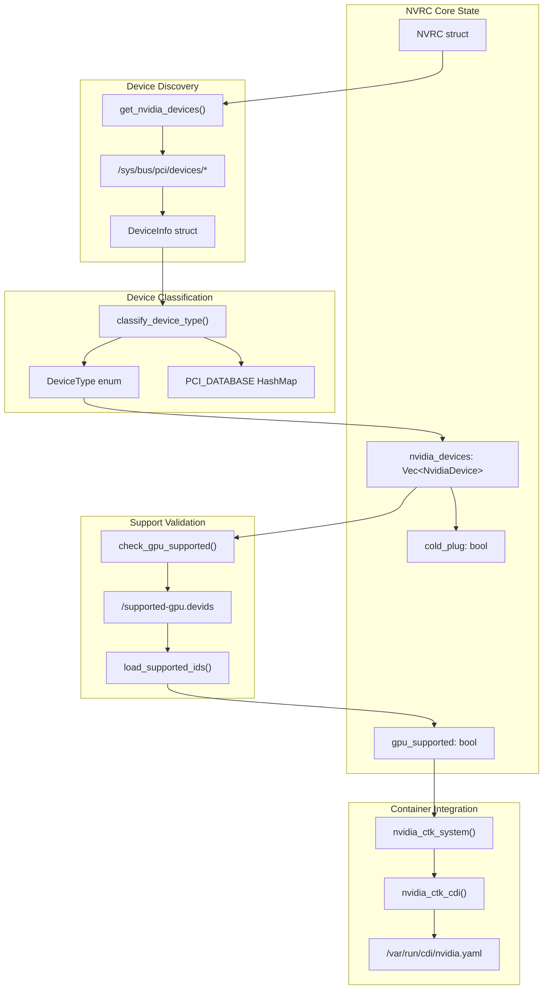

**GPU Management Architecture**

Sources: [src/get_devices.rs:1-252](), [src/check_supported.rs:1-147](), [src/container_toolkit.rs:1-43](), [src/pci_ids.rs:1-262]()

## Core Components

The GPU management system centers around the `NVRC` struct which maintains device state and coordinates between discovery, validation, and integration components.

### Device Representation

The `NvidiaDevice` struct represents discovered NVIDIA hardware:

| Field | Type | Purpose |
|-------|------|---------|
| `bdf` | `String` | PCI Bus:Device.Function identifier |
| `device_id` | `u16` | PCI device ID for hardware identification |
| `vendor_id` | `u16` | PCI vendor ID (always `0x10de` for NVIDIA) |
| `class_id` | `u32` | PCI class ID for device type classification |
| `device_type` | `DeviceType` | Classified device type (GPU, NvSwitch, Unknown) |

The `DeviceType` enum categorizes NVIDIA hardware into three types based on PCI class IDs and device database lookups:
- `Gpu` - Graphics processors (class IDs `0x030000`, `0x030200`)
- `NvSwitch` - High-bandwidth interconnect devices (class ID `0x068000` with "nvswitch" in name)
- `Unknown` - Unrecognized NVIDIA devices

Sources: [src/get_devices.rs:23-31](), [src/pci_ids.rs:25-31](), [src/pci_ids.rs:88-139]()

### State Management

The `NVRC` struct maintains GPU management state through key fields:
- `nvidia_devices: Vec<NvidiaDevice>` - Collection of discovered NVIDIA devices
- `gpu_supported: bool` - Flag indicating whether discovered GPUs are supported
- `cold_plug: bool` - Flag indicating presence of devices for cold-plug initialization

Sources: [src/get_devices.rs:117-131](), [src/check_supported.rs:13-51]()

## Device Discovery Process

Device discovery operates through PCI bus enumeration and systematic device information extraction.

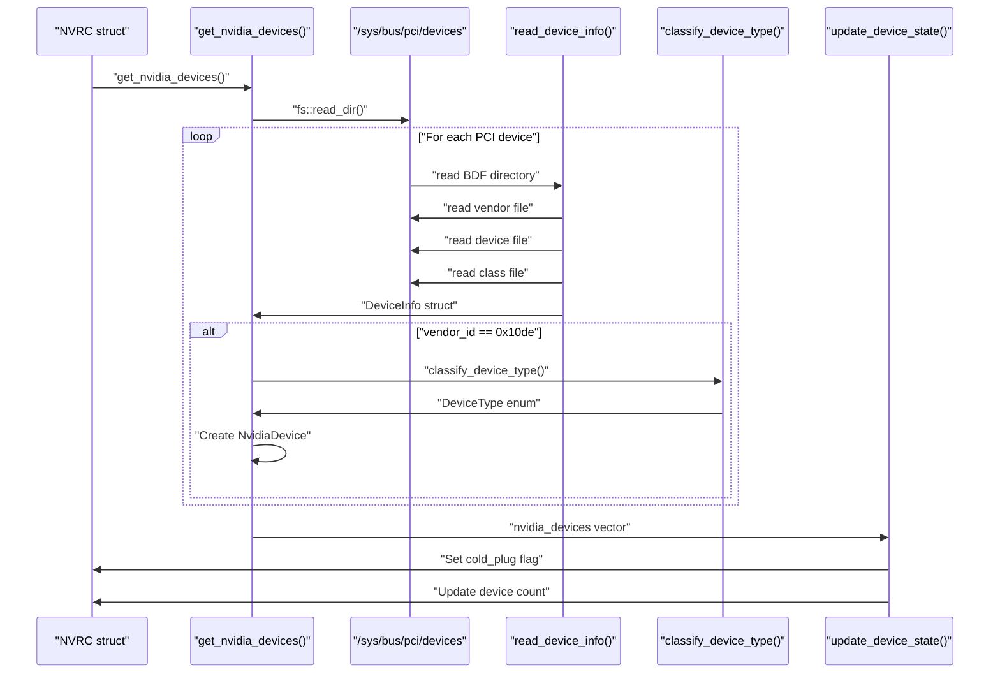

**Device Discovery Sequence**

The discovery process reads PCI device information from sysfs filesystem entries at `/sys/bus/pci/devices/*`. For each device directory, it extracts vendor ID, device ID, and class ID from respective files. NVIDIA devices are identified by vendor ID `0x10de` and then classified using the PCI database.

Sources: [src/get_devices.rs:70-131](), [src/get_devices.rs:102-115]()

### PCI Classification System

Device classification uses a multi-stage approach combining PCI class IDs with device name lookups:

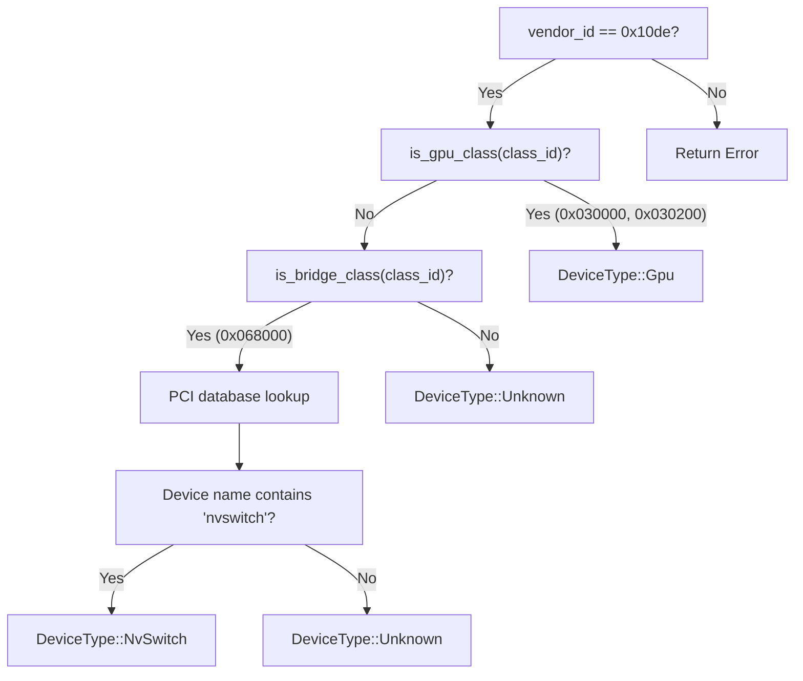

**Device Classification Logic**

The classification system ensures accurate device type identification by combining hardware class information with device-specific naming patterns from the embedded PCI database.

Sources: [src/pci_ids.rs:100-139](), [src/pci_ids.rs:80-86](), [src/pci_ids.rs:74-78]()

## Device Support Validation

GPU support validation ensures discovered devices are approved for system operation through allowlist checking.

```mermaid
graph LR
    subgraph "Validation Input"
        discovered["nvidia_devices Vec"]
        gpu_filter["Filter DeviceType::Gpu"]
        gpu_list["GPU devices only"]
    end
    
    subgraph "Support File Processing"
        support_file["/supported-gpu.devids"]
        load_ids["load_supported_ids()"]
        supported_set["HashSet&lt;String&gt;"]
    end
    
    subgraph "Validation Logic"
        device_check["Check each GPU device_id"]
        format_check["Format as '0x{:04x}'"]
        contains_check["supported_set.contains()"]
    end
    
    subgraph "Result"
        all_supported["All GPUs supported"]
        unsupported["Any GPU unsupported"]
        set_flag["Set gpu_supported bool"]
    end
    
    discovered --> gpu_filter
    gpu_filter --> gpu_list
    gpu_list --> device_check
    
    support_file --> load_ids
    load_ids --> supported_set
    supported_set --> contains_check
    
    device_check --> format_check
    format_check --> contains_check
    contains_check --> all_supported
    contains_check --> unsupported
    all_supported --> set_flag
    unsupported --> set_flag
```

**GPU Support Validation Flow**

The validation process filters discovered devices to GPU types only, then cross-references each GPU's device ID against the supported device list. The system sets `gpu_supported` to `false` if any GPU is unsupported or if no GPUs are present.

Sources: [src/check_supported.rs:13-51](), [src/check_supported.rs:54-66]()

### Supported Device Management

The support validation system uses a simple text-based allowlist format:

- File location: `/supported-gpu.devids` (configurable)
- Format: One device ID per line in hexadecimal format
- Processing: Case-insensitive, whitespace-trimmed
- Empty lines ignored during parsing

The `load_supported_ids()` method parses the support file into a `HashSet<String>` for efficient lookup operations during validation.

Sources: [src/check_supported.rs:54-66](), [src/check_supported.rs:10]()

## Container Runtime Integration

GPU management integrates with NVIDIA Container Toolkit through standardized interfaces for container GPU access.

```mermaid
graph TB
    subgraph "NVIDIA Container Toolkit Integration"
        ctk_system["nvidia_ctk_system()"]
        ctk_args["['-d', 'system', 'create-device-nodes', '--control-devices', '--load-kernel-modules']"]
        device_nodes["Device node creation"]
        kernel_modules["Kernel module loading"]
    end
    
    subgraph "CDI Specification Generation"
        ctk_cdi["nvidia_ctk_cdi()"]
        cdi_args["['-d', 'cdi', 'generate', '--output=/var/run/cdi/nvidia.yaml']"]
        cdi_spec["/var/run/cdi/nvidia.yaml"]
    end
    
    subgraph "Utility Functions"
        nvidia_smi["nvidia_smi()"]
        smi_output["GPU status information"]
    end
    
    ctk_system --> ctk_args
    ctk_args --> device_nodes
    ctk_args --> kernel_modules
    
    ctk_cdi --> cdi_args
    cdi_args --> cdi_spec
    
    nvidia_smi --> smi_output
```

**Container Toolkit Integration**

The integration provides two primary functions:
- `nvidia_ctk_system()` - Sets up device nodes and loads kernel modules
- `nvidia_ctk_cdi()` - Generates Container Device Interface specifications

Both functions use the `foreground()` helper to execute NVIDIA Container Toolkit commands synchronously.

Sources: [src/container_toolkit.rs:24-42](), [src/container_toolkit.rs:1-3]()

### CDI Specification Output

The Container Device Interface (CDI) specification generated at `/var/run/cdi/nvidia.yaml` provides container runtimes with standardized GPU access configuration. This specification describes available GPU devices, required device nodes, and necessary environment variables for container GPU access.

Sources: [src/container_toolkit.rs:37-42]()

---

# Page: Device Discovery

# Device Discovery

<details>
<summary>Relevant source files</summary>

The following files were used as context for generating this wiki page:

- [download_filtered_pci_ids.sh](download_filtered_pci_ids.sh)
- [src/get_devices.rs](src/get_devices.rs)
- [src/pci_ids.rs](src/pci_ids.rs)
- [src/pci_ids_embedded.txt](src/pci_ids_embedded.txt)

</details>


This document covers how NVRC discovers and enumerates NVIDIA devices present on the system. Device discovery is the first step in GPU management, scanning the PCI bus to identify NVIDIA GPUs and NvSwitch devices that are available for use.

For information about device validation and support checking, see [Device Validation](#4.2). For details about confidential computing mode detection, see [Confidential Computing](#4.3).

## Overview

The device discovery system scans the Linux sysfs PCI bus interface to enumerate all NVIDIA devices on the system. It identifies device types (GPUs vs NvSwitch), extracts hardware identifiers, and updates the NVRC system state accordingly. This information is then used by subsequent GPU management operations.

## Discovery Process Flow

```mermaid
flowchart TD
    A["NVRC::get_nvidia_devices()"] --> B["Scan /sys/bus/pci/devices"]
    B --> C["For each device directory"]
    C --> D["Read sysfs files"]
    D --> E["vendor, device, class"]
    E --> F["Filter NVIDIA vendor ID 0x10de"]
    F --> G["Parse hex values"]
    G --> H["pci_ids::classify_device_type()"]
    H --> I["Create NvidiaDevice object"]
    I --> J["Collect into Vec<NvidiaDevice>"]
    J --> K["update_device_state()"]
    K --> L["Set cold_plug flag"]
    
    style A fill:#f9f9f9
    style H fill:#e1f5fe
    style K fill:#e8f5e8
```

**Sources:** [src/get_devices.rs:70-131]()

## Core Data Structures

The device discovery system uses several key data structures to represent discovered hardware:

### NvidiaDevice Structure

```mermaid
classDiagram
    class NvidiaDevice {
        +String bdf
        +u16 device_id
        +u16 vendor_id
        +u32 class_id
        +DeviceType device_type
        +new() NvidiaDevice
        +Display fmt()
    }
    
    class DeviceType {
        <<enumeration>>
        Gpu
        NvSwitch
        Unknown
    }
    
    class DeviceInfo {
        +String vendor_id
        +String class_id
        +String device_id
    }
    
    NvidiaDevice --> DeviceType
    NvidiaDevice ..> DeviceInfo : "constructed from"
```

**Sources:** [src/get_devices.rs:23-67](), [src/pci_ids.rs:25-31]()

| Field | Type | Description |
|-------|------|-------------|
| `bdf` | `String` | Bus:Device.Function identifier (e.g., "0000:01:00.0") |
| `device_id` | `u16` | PCI device ID |
| `vendor_id` | `u16` | PCI vendor ID (always 0x10de for NVIDIA) |
| `class_id` | `u32` | PCI class code |
| `device_type` | `DeviceType` | Classified device type (GPU/NvSwitch/Unknown) |

## Device Classification System

Device classification uses both PCI class codes and an embedded device database to determine device types:

```mermaid
flowchart TD
    A["classify_device_type()"] --> B["Check vendor_id == 0x10de"]
    B --> C["Check PCI class_id"]
    C --> D{"GPU Classes?"}
    C --> E{"Bridge Class?"}
    
    D -->|"0x030000<br/>0x030200"| F["DeviceType::Gpu"]
    E -->|"0x068000"| G["Lookup in PCI database"]
    G --> H{"Name contains<br/>nvswitch?"}
    H -->|Yes| I["DeviceType::NvSwitch"]
    H -->|No| J["DeviceType::Unknown"]
    C --> K["DeviceType::Unknown"]
    
    style D fill:#e8f5e8
    style E fill:#fff3e0
    style H fill:#e1f5fe
```

**Sources:** [src/pci_ids.rs:99-139](), [src/pci_ids.rs:16-23]()

### PCI Class ID Constants

| Class ID | Constant | Device Type |
|----------|----------|-------------|
| `0x030000` | `VGA_CONTROLLER` | GPU |
| `0x030200` | `DISPLAY_3D_CONTROLLER` | GPU |
| `0x068000` | `BRIDGE_OTHER` | NvSwitch (if name matches) |

## Sysfs Interface Integration

The discovery process reads device information directly from the Linux sysfs PCI interface:

```mermaid
sequenceDiagram
    participant NVRC as "NVRC::get_nvidia_devices()"
    participant Sysfs as "/sys/bus/pci/devices"
    participant Device as "Device Directory"
    participant PCI as "pci_ids::classify_device_type()"
    
    NVRC->>Sysfs: "read_dir(devices_dir)"
    Sysfs->>NVRC: "Iterator<DirEntry>"
    
    loop For each device entry
        NVRC->>Device: "read_sysfs_file(vendor)"
        Device->>NVRC: "vendor_id string"
        NVRC->>Device: "read_sysfs_file(device)"
        Device->>NVRC: "device_id string"
        NVRC->>Device: "read_sysfs_file(class)"
        Device->>NVRC: "class_id string"
        
        NVRC->>NVRC: "parse_hex_u16/u32()"
        NVRC->>PCI: "classify_device_type()"
        PCI->>NVRC: "DeviceType"
        NVRC->>NVRC: "NvidiaDevice::new()"
    end
    
    NVRC->>NVRC: "update_device_state()"
```

**Sources:** [src/get_devices.rs:102-115](), [src/get_devices.rs:75-96]()

### Sysfs File Paths

For each PCI device at `/sys/bus/pci/devices/{bdf}/`:

| File | Content | Usage |
|------|---------|-------|
| `vendor` | Hexadecimal vendor ID | Filter for NVIDIA (0x10de) |
| `device` | Hexadecimal device ID | Device identification |
| `class` | Hexadecimal class code | Device type classification |

## State Management

The discovery process updates the NVRC system state based on the devices found:

```mermaid
stateDiagram-v2
    [*] --> Scanning: "get_nvidia_devices()"
    
    state Scanning {
        [*] --> ReadingDevices
        ReadingDevices --> FilteringNVIDIA
        FilteringNVIDIA --> ClassifyingTypes
        ClassifyingTypes --> CreatingObjects
    }
    
    Scanning --> UpdateState: "update_device_state()"
    
    state UpdateState {
        [*] --> CheckCount
        CheckCount --> NoColdPlug: "device_count == 0"
        CheckCount --> SetColdPlug: "device_count > 0"
        
        NoColdPlug --> [*]: "cold_plug = false"
        SetColdPlug --> [*]: "cold_plug = true"
    }
    
    UpdateState --> [*]: "State Updated"
```

**Sources:** [src/get_devices.rs:117-131]()

The `cold_plug` flag indicates whether NVIDIA devices were found during discovery, which affects subsequent system initialization behavior.

## PCI ID Database

NVRC includes an embedded PCI ID database for device name resolution and NvSwitch identification:

```mermaid
flowchart LR
    A["Embedded PCI Database"] --> B["parse_pci_database_content()"]
    B --> C["HashMap<u16, String>"]
    C --> D["Device ID → Name lookup"]
    D --> E["is_nvswitch() check"]
    E --> F["DeviceType classification"]
    
    G["External PCI IDs"] --> H["download_filtered_pci_ids.sh"]
    H --> I["Filter NVIDIA Hopper+"]
    I --> J["Update embedded database"]
    
    style A fill:#f0f8ff
    style C fill:#f5f5f5
    style H fill:#fff8dc
```

**Sources:** [src/pci_ids.rs:7-12](), [src/pci_ids.rs:37-72](), [download_filtered_pci_ids.sh:46-175]()

### Database Content

The embedded database contains only NVIDIA devices from Hopper generation and newer:
- **Hopper (GH100)**: Device IDs `23xx`
- **Blackwell (GB100/GB200)**: Device IDs `29xx-2fxx`
- **Future generations**: Device IDs `3xxx` and higher

## Error Handling

The discovery system includes robust error handling for common failure scenarios:

| Error Type | Handling | Impact |
|------------|----------|--------|
| Missing sysfs directory | Return `anyhow::Error` | Discovery fails |
| Unreadable device files | Filter out device | Continue with other devices |
| Invalid hex parsing | Skip device | Continue discovery |
| Non-NVIDIA devices | Filter out silently | Normal operation |
| Unknown device types | Mark as `DeviceType::Unknown` | Include in results |

**Sources:** [src/get_devices.rs:11-21](), [src/get_devices.rs:76-96]()

## Testing Infrastructure

The device discovery system includes comprehensive testing capabilities:

```mermaid
flowchart TD
    A["Test Setup"] --> B["create_mock_device()"]
    B --> C["tempdir() filesystem"]
    C --> D["Mock sysfs structure"]
    D --> E["/devices/{bdf}/vendor"]
    D --> F["/devices/{bdf}/device"]
    D --> G["/devices/{bdf}/class"]
    
    H["Test Execution"] --> I["get_nvidia_devices(mock_path)"]
    I --> J["Verify device count"]
    J --> K["Check device types"]
    K --> L["Validate BDF parsing"]
    
    style C fill:#f0f8ff
    style I fill:#e8f5e8
```

**Sources:** [src/get_devices.rs:140-251]()

The test infrastructure creates mock sysfs structures with predefined device information to verify discovery logic without requiring actual hardware.

---

# Page: Device Validation

# Device Validation

<details>
<summary>Relevant source files</summary>

The following files were used as context for generating this wiki page:

- [download_filtered_pci_ids.sh](download_filtered_pci_ids.sh)
- [src/check_supported.rs](src/check_supported.rs)
- [src/pci_ids.rs](src/pci_ids.rs)
- [src/pci_ids_embedded.txt](src/pci_ids_embedded.txt)

</details>


This document covers how NVRC validates that discovered NVIDIA devices are supported for use in containerized environments. Device validation ensures that only approved GPU hardware is used and sets the system's `gpu_supported` flag accordingly. 

For information about discovering NVIDIA devices on the system, see [Device Discovery](#4.1). For details about confidential computing validation, see [Confidential Computing](#4.3).

## Device Type Classification

NVRC classifies NVIDIA devices into distinct types using PCI information and an embedded device database. The classification system determines whether devices are GPUs suitable for compute workloads or other NVIDIA hardware.

```mermaid
graph TD
    PCI_INFO["PCI Device Info<br/>vendor_id, device_id, class_id"]
    VENDOR_CHECK["Check Vendor ID<br/>0x10de (NVIDIA)"]
    CLASS_CHECK["Check PCI Class ID"]
    GPU_CLASS["GPU Classes<br/>0x030000 (VGA)<br/>0x030200 (3D Controller)"]
    BRIDGE_CLASS["Bridge Class<br/>0x068000"]
    DATABASE_LOOKUP["PCI Database Lookup<br/>get_pci_ids_database()"]
    NAME_CHECK["Device Name Check<br/>classify_device_type_by_name()"]
    
    DEVICE_GPU["DeviceType::Gpu"]
    DEVICE_NVSWITCH["DeviceType::NvSwitch"]  
    DEVICE_UNKNOWN["DeviceType::Unknown"]
    
    PCI_INFO --> VENDOR_CHECK
    VENDOR_CHECK -->|"vendor_id == 0x10de"| CLASS_CHECK
    VENDOR_CHECK -->|"other vendor"| ERROR["Error: Not NVIDIA device"]
    
    CLASS_CHECK --> GPU_CLASS
    CLASS_CHECK --> BRIDGE_CLASS
    CLASS_CHECK --> OTHER_CLASS["Other Classes"]
    
    GPU_CLASS --> DEVICE_GPU
    BRIDGE_CLASS --> DATABASE_LOOKUP
    OTHER_CLASS --> DEVICE_UNKNOWN
    
    DATABASE_LOOKUP --> NAME_CHECK
    NAME_CHECK -->|"contains 'nvswitch'"| DEVICE_NVSWITCH
    NAME_CHECK -->|"other names"| DEVICE_UNKNOWN
```

Sources: [src/pci_ids.rs:99-139](), [src/pci_ids.rs:26-31](), [src/pci_ids.rs:16-23]()

The `classify_device_type` function in `pci_ids.rs` performs this classification by first checking the vendor ID to ensure it's an NVIDIA device (0x10de), then examining the PCI class ID. GPU devices have specific class IDs (VGA controller 0x030000 or 3D controller 0x030200), while NvSwitch devices appear as bridge devices (0x068000) but require name-based verification from the PCI database.

## GPU Support Validation Process

The core validation process determines whether discovered GPU devices are approved for use by checking their device IDs against a supported devices list. This validation is performed by the `check_gpu_supported` method on the NVRC struct.

```mermaid
graph TD
    START["check_gpu_supported()"]
    FILTER_GPUS["Filter nvidia_devices<br/>to DeviceType::Gpu only"]
    CHECK_EMPTY["Check if GPUs found"]
    LOAD_FILE["Load supported IDs<br/>from /supported-gpu.devids"]
    PARSE_IDS["Parse device IDs<br/>load_supported_ids()"]
    VALIDATE_EACH["For each GPU:<br/>Check device_id in supported set"]
    
    SET_FALSE_EMPTY["gpu_supported = false<br/>Return Ok()"]
    SET_FALSE_UNSUPPORTED["gpu_supported = false<br/>Return Error"]
    SET_TRUE["gpu_supported = true<br/>Return Ok()"]
    
    START --> FILTER_GPUS
    FILTER_GPUS --> CHECK_EMPTY
    CHECK_EMPTY -->|"No GPUs"| SET_FALSE_EMPTY
    CHECK_EMPTY -->|"GPUs found"| LOAD_FILE
    LOAD_FILE -->|"File missing"| SET_FALSE_UNSUPPORTED
    LOAD_FILE -->|"File exists"| PARSE_IDS
    PARSE_IDS --> VALIDATE_EACH
    VALIDATE_EACH -->|"Unsupported GPU found"| SET_FALSE_UNSUPPORTED  
    VALIDATE_EACH -->|"All GPUs supported"| SET_TRUE
```

Sources: [src/check_supported.rs:13-51](), [src/check_supported.rs:54-66]()

The validation process follows these steps:

1. **Filter to GPU devices**: Only devices classified as `DeviceType::Gpu` are validated
2. **Handle empty case**: If no GPUs are found, `gpu_supported` is set to false but no error occurs
3. **Load supported device IDs**: Reads the supported GPU file (default `/supported-gpu.devids`)
4. **Parse device IDs**: Extracts and normalizes device IDs from the file
5. **Validate each GPU**: Checks that every GPU's device ID exists in the supported set
6. **Set result**: Sets `gpu_supported` flag and returns success or error

## Configuration Files and Database

NVRC uses two key data sources for device validation: a supported GPU device IDs file and an embedded PCI database for device classification.

### Supported GPU Device IDs File

The supported GPU file contains a whitelist of approved NVIDIA GPU device IDs in hexadecimal format:

| File Path | Purpose | Format |
|-----------|---------|--------|
| `/supported-gpu.devids` | Default supported GPU list | One device ID per line (e.g., `0x2330`) |
| Custom path via parameter | Override default location | Same format as default |

The `load_supported_ids` function parses this file by reading each line, trimming whitespace, converting to lowercase, and filtering out empty lines. Device IDs are stored in a `HashSet<String>` for efficient lookup during validation.

Sources: [src/check_supported.rs:10](), [src/check_supported.rs:54-66]()

### Embedded PCI Database  

NVRC includes a filtered PCI database containing NVIDIA device information for classification:

```mermaid
graph LR
    FULL_DB["Full PCI Database<br/>pci-ids.ucw.cz"]
    FILTER_SCRIPT["download_filtered_pci_ids.sh"]
    EMBEDDED_DB["pci_ids_embedded.txt"]
    LAZY_STATIC["LazyLock<br/>PCI_DATABASE"]
    CLASSIFICATION["Device Classification<br/>classify_device_type()"]
    
    FULL_DB --> FILTER_SCRIPT
    FILTER_SCRIPT -->|"NVIDIA Hopper+ only"| EMBEDDED_DB
    EMBEDDED_DB --> LAZY_STATIC
    LAZY_STATIC --> CLASSIFICATION
```

Sources: [src/pci_ids.rs:7-12](), [download_filtered_pci_ids.sh:1-230]()

The embedded database is filtered to include only NVIDIA Hopper generation and newer devices (device IDs 23xx and higher), excluding older generations to reduce size. The database is parsed once at startup and cached in a static HashMap for efficient access.

## Error Handling and Edge Cases

The validation system handles several error conditions and edge cases gracefully:

### File System Errors
- **Missing supported GPU file**: Returns error and sets `gpu_supported = false`
- **File read failures**: Propagated as `anyhow::Error` with context
- **Empty or invalid files**: Treated as having no supported devices

### Device Validation Scenarios  
- **No GPUs present**: Sets `gpu_supported = false` but returns `Ok(())` 
- **Mixed supported/unsupported**: Fails validation if any GPU is unsupported
- **Unknown device types**: Classified as `DeviceType::Unknown`, not validated as GPUs
- **Case sensitivity**: Device IDs normalized to lowercase for comparison

Sources: [src/check_supported.rs:20-24](), [src/check_supported.rs:28-34](), [src/check_supported.rs:38-50]()

## Testing and Validation

The validation system includes comprehensive test coverage for different scenarios:

```mermaid
graph TD
    TEST_SUPPORTED["Test: Supported GPU<br/>Device ID in whitelist"]
    TEST_UNSUPPORTED["Test: Unsupported GPU<br/>Device ID not in whitelist"] 
    TEST_NO_GPUS["Test: No GPUs Present<br/>Empty device list"]
    TEST_EMPTY_LINES["Test: File Parsing<br/>Empty lines and whitespace"]
    
    MOCK_FILE["Mock supported-gpu.devids"]
    MOCK_NVRC["Mock NVRC with test devices"]
    
    MOCK_FILE --> TEST_SUPPORTED
    MOCK_FILE --> TEST_UNSUPPORTED  
    MOCK_FILE --> TEST_EMPTY_LINES
    MOCK_NVRC --> TEST_NO_GPUS
    
    TEST_SUPPORTED --> RESULT_OK["gpu_supported = true"]
    TEST_UNSUPPORTED --> RESULT_ERROR["gpu_supported = false, Error"]
    TEST_NO_GPUS --> RESULT_FALSE["gpu_supported = false, Ok"]
    TEST_EMPTY_LINES --> RESULT_OK2["Handles gracefully"]
```

Sources: [src/check_supported.rs:67-146]()

The test suite creates temporary supported GPU files with known device IDs and validates that the `check_gpu_supported` method correctly identifies supported vs unsupported devices, handles empty device lists, and properly parses files with empty lines or whitespace.

---

# Page: Confidential Computing

# Confidential Computing

<details>
<summary>Relevant source files</summary>

The following files were used as context for generating this wiki page:

- [src/query_cc_mode.rs](src/query_cc_mode.rs)

</details>


This document covers NVRC's confidential computing mode detection and querying capabilities for NVIDIA GPU hardware. The system identifies GPU architectures (Hopper and Blackwell) and reads hardware registers to determine the current confidential computing state. This functionality is only available when the `confidential` feature flag is enabled.

For general GPU device management, see [Device Discovery](#4.1) and [Device Validation](#4.2). For container runtime integration, see [Container Integration](#4.4).

## Overview

The confidential computing subsystem provides hardware-level detection of CC mode states on supported NVIDIA GPU architectures. It combines PCI device identification with direct hardware register access to safely query confidential computing status across multiple GPUs in the system.

```mermaid
graph TB
    subgraph "CC Detection Pipeline"
        PCI_DB["parse_pci_database_content()"]
        CLASSIFY["classify_gpu_architecture()"]
        ARCH_DETECT["get_gpu_architecture_by_device_id()"]
        
        PCI_DB --> ARCH_DETECT
        CLASSIFY --> ARCH_DETECT
    end
    
    subgraph "Hardware Access"
        BAR0["query_cc_mode_bar0()"]
        MMAP["mmap() BAR0 resource"]
        READ_REG["ptr::read_volatile()"]
        
        BAR0 --> MMAP
        MMAP --> READ_REG
    end
    
    subgraph "GpuArchitecture Enum"
        HOPPER["Hopper: 0x001182cc"]
        BLACKWELL["Blackwell: 0x590"]
        UNKNOWN["Unknown: Error"]
        
        HOPPER --> BAR0
        BLACKWELL --> BAR0
        UNKNOWN --> ERROR["Architecture Error"]
    end
    
    subgraph "NVRC Integration"
        QUERY_CC["query_gpu_cc_mode()"]
        GPU_DEVICES["nvidia_devices: Vec<NvidiaDevice>"]
        CC_MODE["gpu_cc_mode: Option<String>"]
        
        GPU_DEVICES --> QUERY_CC
        ARCH_DETECT --> QUERY_CC
        READ_REG --> QUERY_CC
        QUERY_CC --> CC_MODE
    end
    
    style QUERY_CC fill:#e1f5fe
    style ARCH_DETECT fill:#e8f5e8
    style BAR0 fill:#fff3e0
```

Sources: [src/query_cc_mode.rs:1-744]()

## GPU Architecture Detection

The system identifies GPU architectures by parsing device names from an embedded PCI database and matching them against known patterns. The `GpuArchitecture` enum defines supported architectures with their corresponding hardware register offsets.

```mermaid
graph LR
    subgraph "Device Identification"
        DEVICE_ID["device_id: u16"]
        BDF["bdf: String"]
        PCI_DB["get_pci_ids_database()"]
        
        DEVICE_ID --> LOOKUP["Device Lookup"]
        PCI_DB --> LOOKUP
        LOOKUP --> DEVICE_NAME["device_name: String"]
    end
    
    subgraph "Architecture Classification"
        DEVICE_NAME --> CLASSIFY["classify_gpu_architecture()"]
        
        CLASSIFY --> H100_CHECK["contains('h100')"]
        CLASSIFY --> H800_CHECK["contains('h800')"]
        CLASSIFY --> HOPPER_CHECK["contains('hopper')"]
        CLASSIFY --> GH100_CHECK["contains('gh100')"]
        
        CLASSIFY --> B100_CHECK["contains('b100')"]
        CLASSIFY --> B200_CHECK["contains('b200')"]
        CLASSIFY --> BLACKWELL_CHECK["contains('blackwell')"]
        CLASSIFY --> GB100_CHECK["contains('gb100')"]
        
        H100_CHECK --> HOPPER_ARCH["GpuArchitecture::Hopper"]
        H800_CHECK --> HOPPER_ARCH
        HOPPER_CHECK --> HOPPER_ARCH
        GH100_CHECK --> HOPPER_ARCH
        
        B100_CHECK --> BLACKWELL_ARCH["GpuArchitecture::Blackwell"]
        B200_CHECK --> BLACKWELL_ARCH
        BLACKWELL_CHECK --> BLACKWELL_ARCH
        GB100_CHECK --> BLACKWELL_ARCH
    end
    
    subgraph "Register Mapping"
        HOPPER_ARCH --> HOPPER_REG["cc_register(): 0x001182cc"]
        BLACKWELL_ARCH --> BLACKWELL_REG["cc_register(): 0x590"]
        UNKNOWN_ARCH["GpuArchitecture::Unknown"] --> REG_ERROR["Error: Cannot determine CC register"]
    end
```

### Architecture Support Matrix

| Architecture | Register Offset | Supported Devices | Detection Pattern |
|--------------|----------------|-------------------|-------------------|
| `GpuArchitecture::Hopper` | `0x001182cc` | H100, H800, GH100 | Contains "h100", "h800", "hopper", "gh100" |
| `GpuArchitecture::Blackwell` | `0x590` | B100, B200, GB100, GB200 | Contains "b100", "b200", "blackwell", "gb100", "gb200" |
| `GpuArchitecture::Unknown` | Error | All others | No pattern match |

Sources: [src/query_cc_mode.rs:14-98](), [src/query_cc_mode.rs:100-113]()

## Confidential Computing Mode States

The system reads hardware registers to determine CC mode state using a standardized bit mask and lookup table. All supported architectures use the same state encoding despite different register locations.

```mermaid
graph TB
    subgraph "CC Mode Detection"
        REG_VALUE["reg_value: u32"]
        MASK["CC_STATE_MASK: 0x3"]
        
        REG_VALUE --> APPLY_MASK["reg_value & 0x3"]
        MASK --> APPLY_MASK
        APPLY_MASK --> CC_STATE["cc_state: u32"]
    end
    
    subgraph "CC_MODE_LOOKUP Table"
        CC_STATE --> LOOKUP_0["0x0 → 'off'"]
        CC_STATE --> LOOKUP_1["0x1 → 'on'"]
        CC_STATE --> LOOKUP_3["0x3 → 'devtools'"]
        CC_STATE --> LOOKUP_OTHER["other → 'off'"]
    end
    
    subgraph "Result"
        LOOKUP_0 --> MODE_OFF["CC Mode: 'off'"]
        LOOKUP_1 --> MODE_ON["CC Mode: 'on'"]
        LOOKUP_3 --> MODE_DEVTOOLS["CC Mode: 'devtools'"]
        LOOKUP_OTHER --> MODE_DEFAULT["CC Mode: 'off' (default)"]
    end
```

The `parse_cc_mode()` method extracts the CC state from hardware register values:

- **Mask**: `0x3` extracts the lower 2 bits containing CC state
- **States**: Defined in `CC_MODE_LOOKUP` constant array
- **Default**: Unknown states default to "off" for safety

Sources: [src/query_cc_mode.rs:21-46]()

## Hardware Register Access

The system uses memory-mapped I/O to safely read confidential computing registers from GPU BAR0 resources. This requires careful page alignment and volatile memory access to handle hardware interactions correctly.

```mermaid
sequenceDiagram
    participant NVRC as "NVRC::query_cc_mode_bar0()"
    participant ARCH as "get_gpu_architecture_by_device_id()"
    participant SYSFS as "/sys/bus/pci/devices/{bdf}/resource0"
    participant MMAP as "mmap() system call"
    participant HW as "GPU Hardware Register"
    
    NVRC->>ARCH: "device_id, bdf"
    ARCH->>NVRC: "GpuArchitecture"
    
    NVRC->>NVRC: "architecture.cc_register()"
    Note over NVRC: Get register offset for architecture
    
    NVRC->>SYSFS: "File::open(resource_path)"
    SYSFS->>NVRC: "File handle"
    
    NVRC->>NVRC: "Calculate page alignment"
    Note over NVRC: aligned_offset = (cc_register / page_size) * page_size<br/>offset_in_page = cc_register - aligned_offset
    
    NVRC->>MMAP: "mmap(file, aligned_offset, PROT_READ)"
    MMAP->>NVRC: "mapped_ptr"
    
    NVRC->>HW: "ptr::read_volatile(mapped_ptr + offset_in_page)"
    HW->>NVRC: "reg_value: u32"
    
    NVRC->>NVRC: "architecture.parse_cc_mode(reg_value)"
    
    NVRC->>MMAP: "munmap(mapped_ptr)"
    MMAP->>NVRC: "success"
```

### Memory Access Safety

The implementation ensures safe hardware access through several mechanisms:

- **Page Alignment**: Register offsets are aligned to system page boundaries
- **Read-Only Mapping**: Uses `PROT_READ` protection for safe register access  
- **Volatile Reads**: Uses `ptr::read_volatile()` to prevent compiler optimizations
- **Architecture Validation**: Only accesses registers for known GPU architectures
- **Proper Cleanup**: Always unmaps memory regions after use

Sources: [src/query_cc_mode.rs:116-172]()

## PCI Database Integration

The confidential computing system relies on an embedded PCI device database to identify GPU models and architectures. This database is parsed at runtime to map device IDs to human-readable names for architecture classification.

```mermaid
graph TB
    subgraph "PCI Database Processing"
        EMBEDDED["EMBEDDED_PCI_IDS: &str"]
        PARSE["parse_pci_database_content()"]
        NVIDIA_FILTER["Filter NVIDIA devices (10de)"]
        
        EMBEDDED --> PARSE
        PARSE --> NVIDIA_FILTER
    end
    
    subgraph "Database Structure"
        VENDOR_LINE["'10de  NVIDIA Corporation'"]
        DEVICE_LINE["'\\t2330  GH100 [H100 PCIe]'"]
        SUBSYSTEM_LINE["'\\t\\t10de 16c1  H100 SXM5'"]
        
        NVIDIA_FILTER --> VENDOR_LINE
        VENDOR_LINE --> DEVICE_LINE
        DEVICE_LINE --> EXTRACT["Extract device_id: 0x2330"]
        DEVICE_LINE --> NAME["Extract name: 'GH100 [H100 PCIe]'"]
        
        SUBSYSTEM_LINE --> SKIP["Skip subsystem entries"]
    end
    
    subgraph "Result HashMap"
        EXTRACT --> DEVICE_MAP["HashMap<u16, String>"]
        NAME --> DEVICE_MAP
        DEVICE_MAP --> LOOKUP["Device ID → Name lookup"]
    end
    
    subgraph "Architecture Detection"
        LOOKUP --> CLASSIFY["classify_gpu_architecture(name)"]
        CLASSIFY --> ARCH_RESULT["GpuArchitecture enum"]
    end
```

### Database Parsing Rules

The parser extracts only main device entries from the PCI database:

- **Vendor Section**: Lines starting with "10de  NVIDIA Corporation" 
- **Device Entries**: Lines with single tab prefix containing device ID and name
- **Subsystem Entries**: Lines with double tab prefix (ignored)
- **Hex Parsing**: Device IDs parsed from hexadecimal strings to `u16`

Sources: [src/query_cc_mode.rs:49-78](), [src/query_cc_mode.rs:11]()

## System Integration

The confidential computing system integrates with the main NVRC workflow through the `query_gpu_cc_mode()` method, which processes all detected GPUs and ensures consistent CC mode across the system.

```mermaid
graph TB
    subgraph "NVRC State"
        NVIDIA_DEVICES["nvidia_devices: Vec<NvidiaDevice>"]
        GPU_CC_MODE["gpu_cc_mode: Option<String>"]
    end
    
    subgraph "GPU Processing Loop"
        FILTER_GPUS["Filter DeviceType::Gpu"]
        CHECK_EMPTY["if gpu_devices.is_empty()"]
        
        NVIDIA_DEVICES --> FILTER_GPUS
        FILTER_GPUS --> CHECK_EMPTY
        CHECK_EMPTY -->|"true"| EARLY_RETURN["return Ok(()) - Skip CC query"]
        CHECK_EMPTY -->|"false"| PROCESS_LOOP["for gpu_device in gpu_devices"]
    end
    
    subgraph "Per-GPU Processing"
        PROCESS_LOOP --> EXTRACT_INFO["device_id, bdf"]
        EXTRACT_INFO --> QUERY_BAR0["query_cc_mode_bar0(bdf, device_id)"]
        QUERY_BAR0 --> CURRENT_MODE["current_mode: String"]
    end
    
    subgraph "Consistency Check"
        CURRENT_MODE --> MODE_CHECK{"mode == current_mode?"}
        MODE_CHECK -->|"inconsistent"| CC_ERROR["Error: Inconsistent CC mode"]
        MODE_CHECK -->|"consistent or first"| UPDATE_MODE["mode = Some(current_mode)"]
    end
    
    UPDATE_MODE --> GPU_CC_MODE
    CC_ERROR --> FAILURE["Return Error"]
```

### Multi-GPU Consistency

The system enforces consistency across all GPUs in the system:

- **Single Mode**: All GPUs must report the same CC mode
- **Error on Mismatch**: Returns error if GPUs have different CC modes  
- **Early Exit**: Skips CC query if no GPUs are detected
- **State Update**: Sets `gpu_cc_mode` field only if all GPUs are consistent

Sources: [src/query_cc_mode.rs:173-204]()

## Testing Infrastructure

The confidential computing module includes comprehensive unit tests covering architecture detection, register access, PCI database parsing, and integration scenarios.

```mermaid
graph TB
    subgraph "Architecture Tests"
        ARCH_CLASSIFICATION["test_gpu_architecture_classification()"]
        CC_REGISTER["test_cc_register_selection()"]
        CC_MODE_PARSING["test_cc_mode_parsing()"]
        
        ARCH_CLASSIFICATION --> HOPPER_TESTS["H100, H800, GH100 → Hopper"]
        ARCH_CLASSIFICATION --> BLACKWELL_TESTS["B100, B200, GB100 → Blackwell"]
        ARCH_CLASSIFICATION --> UNKNOWN_TESTS["RTX 4090, Tesla V100 → Unknown"]
        
        CC_REGISTER --> HOPPER_REG["Hopper: 0x001182cc"]
        CC_REGISTER --> BLACKWELL_REG["Blackwell: 0x590"]
        CC_REGISTER --> UNKNOWN_ERR["Unknown: Error"]
        
        CC_MODE_PARSING --> MODE_0["0x0 → 'off'"]
        CC_MODE_PARSING --> MODE_1["0x1 → 'on'"]
        CC_MODE_PARSING --> MODE_3["0x3 → 'devtools'"]
    end
    
    subgraph "PCI Database Tests"
        PCI_PARSING["test_pci_database_parsing()"]
        EMBEDDED_DB["test_embedded_pci_database_content()"]
        REAL_DEVICES["test_architecture_detection_with_real_device_names()"]
        
        PCI_PARSING --> DEVICE_EXTRACTION["Extract NVIDIA devices only"]
        PCI_PARSING --> SUBSYSTEM_SKIP["Skip subsystem entries"]
        
        EMBEDDED_DB --> DB_SIZE["Verify database size > 70 devices"]
        EMBEDDED_DB --> HOPPER_COUNT["Count Hopper devices"]
        EMBEDDED_DB --> BLACKWELL_COUNT["Count Blackwell devices"]
    end
    
    subgraph "Integration Tests"
        NO_GPUS["test_query_gpu_cc_mode_no_gpus()"]
        CONSISTENCY["Implied: multi-GPU consistency"]
        
        NO_GPUS --> EMPTY_SUCCESS["Empty device list → Ok()"]
        NO_GPUS --> MODE_NONE["gpu_cc_mode remains None"]
    end
```

### Test Coverage Areas

| Test Category | Purpose | Key Test Functions |
|---------------|---------|-------------------|
| Architecture Detection | Verify GPU model classification | `test_gpu_architecture_classification()` |
| Register Access | Validate CC register mappings | `test_cc_register_selection()` |
| Mode Parsing | Test CC state interpretation | `test_cc_mode_parsing()` |
| PCI Database | Verify device database parsing | `test_pci_database_parsing()` |
| Integration | Test system-level behavior | `test_query_gpu_cc_mode_no_gpus()` |

Sources: [src/query_cc_mode.rs:207-743]()

---

# Page: Container Integration

# Container Integration

<details>
<summary>Relevant source files</summary>

The following files were used as context for generating this wiki page:

- [src/container_toolkit.rs](src/container_toolkit.rs)

</details>


This document covers how NVRC integrates with containerized environments, specifically through the NVIDIA Container Toolkit and Container Device Interface (CDI) specification generation. This integration enables GPU access within containers by creating necessary device nodes and generating container runtime configurations.

For GPU device discovery and validation that precedes container integration, see [Device Discovery](#4.1) and [Device Validation](#4.2). For daemon management that coordinates with container integration, see [Daemon Management](#5.1).

## Overview

NVRC's container integration subsystem serves as a bridge between GPU hardware management and container runtime environments. The primary integration point is the NVIDIA Container Toolkit (`nvidia-ctk`), which handles device node creation, kernel module loading, and CDI specification generation.

The container integration process occurs after successful GPU discovery and validation, enabling containers to access NVIDIA GPU resources through standardized container runtime interfaces.

## NVIDIA Container Toolkit Integration

### System Setup Operations

NVRC leverages the NVIDIA Container Toolkit to perform essential system setup operations that prepare the environment for GPU-enabled containers.

```mermaid
graph TD
    NVRC["NVRC Main Process"] --> CTK_SYSTEM["nvidia_ctk_system()"]
    CTK_SYSTEM --> NVIDIA_CTK["/bin/nvidia-ctk"]
    NVIDIA_CTK --> CREATE_NODES["create-device-nodes"]
    NVIDIA_CTK --> LOAD_MODULES["load-kernel-modules"] 
    NVIDIA_CTK --> CONTROL_DEVICES["control-devices"]
    
    CREATE_NODES --> DEVICE_NODES["/dev/nvidia* device nodes"]
    LOAD_MODULES --> KERNEL_MODS["NVIDIA kernel modules"]
    CONTROL_DEVICES --> CONTROL_DEVS["/dev/nvidiactl, /dev/nvidia-uvm"]
```

The `nvidia_ctk_system()` function executes the NVIDIA Container Toolkit with specific arguments to initialize the GPU environment for container access. This operation creates the necessary device nodes and ensures kernel modules are loaded.

**Sources:** [src/container_toolkit.rs:24-35]()

### Function Implementation

The system setup is implemented through the `nvidia_ctk_system()` function which calls the `foreground()` utility to execute `nvidia-ctk` with the following arguments:

| Argument | Purpose |
|----------|---------|
| `-d` | Enable debug output |
| `system` | Execute system-level operations |
| `create-device-nodes` | Create GPU device nodes in `/dev/` |
| `--control-devices` | Create control device nodes |
| `--load-kernel-modules` | Load required NVIDIA kernel modules |

**Sources:** [src/container_toolkit.rs:24-35]()

## Container Device Interface (CDI) Generation

### CDI Specification Creation

NVRC generates Container Device Interface specifications that describe available GPU resources to container runtimes. CDI provides a standardized way for container runtimes to understand and configure access to specialized hardware devices.

```mermaid
graph TD
    CDI_TRIGGER["nvidia_ctk_cdi()"] --> NVIDIA_CTK_CDI["/bin/nvidia-ctk cdi generate"]
    NVIDIA_CTK_CDI --> CDI_OUTPUT["/var/run/cdi/nvidia.yaml"]
    
    CDI_OUTPUT --> RUNTIME_A["Container Runtime A"]
    CDI_OUTPUT --> RUNTIME_B["Container Runtime B"]
    CDI_OUTPUT --> RUNTIME_C["Container Runtime C"]
    
    RUNTIME_A --> CONTAINER_1["GPU Container 1"]
    RUNTIME_B --> CONTAINER_2["GPU Container 2"]
    RUNTIME_C --> CONTAINER_3["GPU Container 3"]
```

The CDI specification file contains device definitions, mount points, and environment variables required for GPU access within containers.

**Sources:** [src/container_toolkit.rs:37-42]()

### CDI Implementation Details

The `nvidia_ctk_cdi()` function generates the CDI specification by executing `nvidia-ctk` with CDI-specific parameters:

| Argument | Purpose |
|----------|---------|
| `-d` | Enable debug output |
| `cdi` | Execute CDI operations |
| `generate` | Generate CDI specification |
| `--output=/var/run/cdi/nvidia.yaml` | Output location for CDI spec |

The generated specification is written to `/var/run/cdi/nvidia.yaml`, the standard location where container runtimes expect to find CDI device specifications.

**Sources:** [src/container_toolkit.rs:37-42]()

## Integration Workflow

### Container Integration Process Flow

The container integration process follows a specific sequence within the broader NVRC initialization workflow:

```mermaid
sequenceDiagram
    participant Main as "main.rs"
    participant DeviceValidation as "check_supported.rs"
    participant ContainerTK as "container_toolkit.rs"
    participant NvidiaCTK as "/bin/nvidia-ctk"
    participant DevNodes as "/dev/ filesystem"
    participant CDISpec as "/var/run/cdi/"
    
    Main->>DeviceValidation: "validate GPU support"
    DeviceValidation-->>Main: "validation complete"
    
    Main->>ContainerTK: "nvidia_ctk_system()"
    ContainerTK->>NvidiaCTK: "system create-device-nodes --control-devices --load-kernel-modules"
    NvidiaCTK->>DevNodes: "create device nodes"
    NvidiaCTK-->>ContainerTK: "system setup complete"
    
    Main->>ContainerTK: "nvidia_ctk_cdi()"
    ContainerTK->>NvidiaCTK: "cdi generate --output=/var/run/cdi/nvidia.yaml"
    NvidiaCTK->>CDISpec: "write CDI specification"
    NvidiaCTK-->>ContainerTK: "CDI generation complete"
    
    ContainerTK-->>Main: "container integration ready"
```

Container integration occurs after successful device validation but before daemon startup, ensuring that the container environment is properly configured before NVIDIA services begin operation.

**Sources:** [src/container_toolkit.rs:24-42]()

## Diagnostic Capabilities

### GPU Status Verification

The container integration module includes diagnostic capabilities through the `nvidia_smi()` function, which provides GPU status information for troubleshooting and verification purposes.

```mermaid
graph LR
    DIAGNOSTIC["nvidia_smi()"] --> NVIDIA_SMI["/bin/nvidia-smi"]
    NVIDIA_SMI --> OUTPUT["stdout/stderr output"]
    OUTPUT --> CONSOLE["console display"]
    
    NVIDIA_SMI --> GPU_STATUS["GPU status information"]
    NVIDIA_SMI --> DRIVER_INFO["driver version info"]
    NVIDIA_SMI --> MEMORY_USAGE["memory utilization"]
```

While currently marked as `dead_code`, this function demonstrates the integration point for GPU diagnostic operations within the container environment.

**Sources:** [src/container_toolkit.rs:8-22]()

## Error Handling

The container integration functions implement robust error handling using the `anyhow` crate for context-aware error propagation. Each `nvidia-ctk` operation includes appropriate error context to facilitate debugging of container integration failures.

The `foreground()` utility function (imported from the daemon module) handles process execution and captures both successful completion and error conditions, ensuring that container integration failures are properly reported to the calling system.

**Sources:** [src/container_toolkit.rs:1-3](), [src/container_toolkit.rs:24-42]()

---

# Page: System Services

# System Services

<details>
<summary>Relevant source files</summary>

The following files were used as context for generating this wiki page:

- [src/daemon.rs](src/daemon.rs)
- [src/lockdown.rs](src/lockdown.rs)
- [src/user_group.rs](src/user_group.rs)

</details>


This page documents the management of system daemons and infrastructure services within NVRC. It covers daemon lifecycle management, user identity management, and security hardening mechanisms that support the overall GPU management system.

For information about filesystem setup and device mounting, see [Filesystem Setup](#3.1). For details about container integration services, see [Container Integration](#4.4).

## Overview

NVRC manages several critical system services that enable GPU functionality in containerized environments. The system services subsystem is responsible for:

- Managing NVIDIA daemon processes (nvidia-persistenced, nv-hostengine, dcgm-exporter)
- Creating and managing user/group identities for service isolation
- Implementing security hardening measures including module loading restrictions
- Handling process lifecycle operations (start, stop, restart)

## System Services Architecture

```mermaid
graph TB
    subgraph "NVRC Core"
        NVRC_STRUCT["NVRC Struct"]
    end
    
    subgraph "Daemon Management"
        DAEMON_RS["daemon.rs"]
        PERSISTENCED["nvidia-persistenced"]
        HOSTENGINE["nv-hostengine"] 
        DCGM_EXPORTER["dcgm-exporter"]
        NVIDIA_SMI["nvidia-smi"]
    end
    
    subgraph "Identity Management"
        USER_GROUP_RS["user_group.rs"]
        PASSWD_FILE["/etc/passwd"]
        SHADOW_FILE["/etc/shadow"]
        GROUP_FILE["/etc/group"]
    end
    
    subgraph "Security Hardening"
        LOCKDOWN_RS["lockdown.rs"]
        PANIC_HOOK["Panic Hook"]
        MODULE_DISABLE["Module Loading Disable"]
    end
    
    NVRC_STRUCT --> DAEMON_RS
    DAEMON_RS --> PERSISTENCED
    DAEMON_RS --> HOSTENGINE
    DAEMON_RS --> DCGM_EXPORTER
    DAEMON_RS --> NVIDIA_SMI
    
    NVRC_STRUCT --> USER_GROUP_RS
    USER_GROUP_RS --> PASSWD_FILE
    USER_GROUP_RS --> SHADOW_FILE
    USER_GROUP_RS --> GROUP_FILE
    
    NVRC_STRUCT --> LOCKDOWN_RS
    LOCKDOWN_RS --> PANIC_HOOK
    LOCKDOWN_RS --> MODULE_DISABLE
    
    DAEMON_RS -.-> USER_GROUP_RS
```

Sources: [src/daemon.rs:1-224](), [src/user_group.rs:1-377](), [src/lockdown.rs:1-21]()

## Daemon Lifecycle Management

NVRC implements a comprehensive daemon management system through the `daemon.rs` module. The system supports three primary actions for each managed daemon:

| Action | Purpose | Implementation |
|--------|---------|----------------|
| `Start` | Initialize daemon process | `background()` function with process tracking |
| `Stop` | Terminate daemon gracefully | `kill()` followed by `kill_processes_by_comm()` |
| `Restart` | Stop then start sequence | Combined stop and start operations |

### Managed Daemons

#### NVIDIA Persistence Daemon

The `nvidia_persistenced` daemon maintains GPU state across driver unloads. Configuration depends on system settings:

```mermaid
flowchart TD
    START["nvidia_persistenced()"]
    CHECK_UVM["Check UVM persistence mode"]
    CHECK_CC["Check GPU CC mode"]
    CREATE_DIR["Create /var/run/nvidia-persistenced"]
    SET_PERMS["Set directory permissions"]
    BUILD_ARGS["Build command arguments"]
    EXECUTE["Execute daemon"]
    
    START --> CHECK_UVM
    CHECK_UVM --> CHECK_CC
    CHECK_CC --> CREATE_DIR
    CREATE_DIR --> SET_PERMS
    SET_PERMS --> BUILD_ARGS
    BUILD_ARGS --> EXECUTE
    
    CHECK_UVM --> |"on"| UVM_ON["Add --uvm-persistence-mode"]
    CHECK_UVM --> |"off"| UVM_OFF["No UVM flag"]
    CHECK_UVM --> |"None/other"| UVM_DEFAULT["Default to on"]
    
    CHECK_CC --> |"on"| CC_ROOT["Run as root (CC mode)"]
    CHECK_CC --> |"off"| CC_USER["Run as configured user/group"]
```

Sources: [src/daemon.rs:129-178]()

#### Data Center GPU Manager Services

For systems with DCGM enabled, NVRC manages two additional services:

- **nv-hostengine**: DCGM host engine service
- **dcgm-exporter**: Metrics exporter for monitoring

Both services are conditionally started based on the `dcgm_enabled` configuration flag.

Sources: [src/daemon.rs:180-208]()

### Process Management Implementation

The daemon management system uses two execution modes:

| Mode | Function | Use Case |
|------|----------|----------|
| Foreground | `foreground()` | One-time commands (nvidia-smi) |
| Background | `background()` | Long-running daemons |

Both modes redirect stdout/stderr to the kernel message buffer via `kmsg()` for centralized logging.

Sources: [src/daemon.rs:47-78]()

## User Identity Management

The `user_group.rs` module provides user and group management capabilities for service isolation and security.

### UserGroup Structure

```mermaid
classDiagram
    class UserGroup {
        +Uid user_id
        +Gid group_id
        +String user_name
        +String group_name
        +new() UserGroup
        +root() UserGroup
        +with_ids() UserGroup
        +write_to_system_files() Result
    }
    
    class SystemFiles {
        +passwd_entry() String
        +shadow_entry() String  
        +group_entry() String
    }
    
    UserGroup --> SystemFiles : generates
```

Sources: [src/user_group.rs:14-44]()

### Random User Generation

For enhanced security, NVRC can generate random user accounts with:

- User IDs in range 1000-60000
- 8-character lowercase alphabetic usernames
- Matching group names
- Disabled password authentication

```mermaid
sequenceDiagram
    participant Caller as "System Initialization"
    participant RNG as "random_user_group()"
    participant UserGroup as "UserGroup"
    participant Files as "System Files"
    
    Caller->>RNG: "Generate random identity"
    RNG->>RNG: "Generate UID/GID (1000-60000)"
    RNG->>RNG: "Generate 8-char username"
    RNG->>UserGroup: "with_ids(uid, gid, name, name)"
    UserGroup->>Files: "write_to_system_files()"
    Files->>Files: "Update /etc/passwd"
    Files->>Files: "Update /etc/shadow"  
    Files->>Files: "Update /etc/group"
    UserGroup->>Caller: "Return UserGroup"
```

Sources: [src/user_group.rs:115-126]()

### System File Integration

The user management system writes entries to standard Unix authentication files:

| File | Format | Purpose |
|------|--------|---------|
| `/etc/passwd` | `username:x:uid:gid:username:/nonexistent:/bin/false` | User account database |
| `/etc/shadow` | `username:*:18295:0:99999:7:::` | Password policy (disabled) |
| `/etc/group` | `groupname:x:gid:` | Group membership |

Sources: [src/user_group.rs:64-76]()

## Security Hardening

The `lockdown.rs` module implements critical security measures for the NVRC system.

### Panic Handling

```mermaid
graph LR
    PANIC["System Panic"]
    HOOK["Panic Hook"]
    LOG["Log Error"]
    SYNC["sync()"]
    REBOOT["Power Off"]
    
    PANIC --> HOOK
    HOOK --> LOG
    LOG --> SYNC
    SYNC --> REBOOT
```

The panic hook ensures system stability by immediately powering off on critical failures, preventing potential security compromises or data corruption.

Sources: [src/lockdown.rs:10-16]()

### Module Loading Restriction

NVRC disables kernel module loading after initialization by writing to `/proc/sys/kernel/modules_disabled`. This prevents runtime injection of unauthorized kernel modules.

```mermaid
flowchart LR
    INIT["System Initialization"]
    WRITE["Write '1' to /proc/sys/kernel/modules_disabled"]
    LOCKED["Module Loading Disabled"]
    
    INIT --> WRITE
    WRITE --> LOCKED
```

Sources: [src/lockdown.rs:18-20]()

## Service Dependencies and Integration

The system services integrate with other NVRC subsystems through well-defined interfaces:

| Service Component | Dependency | Integration Point |
|------------------|------------|-------------------|
| Daemon Management | GPU Detection | Conditional service startup |
| User Management | Filesystem Setup | System file access |
| Security Hardening | System Initialization | Early boot integration |
| All Services | Kernel Logging | `kmsg()` for output redirection |

This architecture ensures that system services are properly sequenced during initialization and maintain appropriate isolation and security boundaries during runtime operation.

Sources: [src/daemon.rs:1-224](), [src/user_group.rs:1-377](), [src/lockdown.rs:1-21]()

---

# Page: Daemon Management

# Daemon Management

<details>
<summary>Relevant source files</summary>

The following files were used as context for generating this wiki page:

- [src/daemon.rs](src/daemon.rs)

</details>


This document covers NVRC's daemon management subsystem, which controls the lifecycle of NVIDIA-related system services. The daemon management module handles starting, stopping, and restarting critical NVIDIA infrastructure processes including persistence daemons, DCGM components, and GPU configuration utilities.

For information about system initialization and the broader service architecture, see [System Initialization](#3). For security hardening aspects of daemon management, see [Security and Hardening](#5.2).

## Purpose and Scope

The daemon management system in NVRC provides centralized control over NVIDIA GPU-related system services. It manages process lifecycles, handles service dependencies, and ensures proper cleanup of daemon processes. The system supports both cold-plug and hot-plug GPU scenarios by dynamically starting and stopping services as GPU availability changes.

**Sources:** [src/daemon.rs:1-224]()

## Managed Daemon Types

NVRC manages three primary categories of NVIDIA daemons, each serving distinct purposes in the GPU infrastructure stack:

| Daemon | Purpose | Binary Path | Conditional Startup |
|--------|---------|-------------|-------------------|
| `nvidia-persistenced` | GPU state persistence | `/bin/nvidia-persistenced` | Always when GPU supported |
| `nv-hostengine` | DCGM host engine | `/bin/nv-hostengine` | Only when DCGM enabled |
| `dcgm-exporter` | DCGM metrics exporter | `/bin/dcgm-exporter` | Only when DCGM enabled |

### Daemon Process Management

#### Process Action Types
```mermaid
graph LR
    A["Action::Start"] --> B["background() spawn"]
    C["Action::Stop"] --> D["kill_processes_by_comm()"]
    E["Action::Restart"] --> F["stop() then start()"]
    
    B --> G["Store child in NVRC.daemons HashMap"]
    D --> H["Remove from NVRC.daemons HashMap"]
    F --> G
```

**Sources:** [src/daemon.rs:19-31](), [src/daemon.rs:99-127]()

#### Daemon Name Enumeration
The system uses a `Name` enum to identify daemon types, with display formatting limited to 15 characters to match Linux process name constraints:

```mermaid
graph TD
    A["Name enum"] --> B["Name::Persistenced"]
    A --> C["Name::NVHostengine"] 
    A --> D["Name::DCGMExporter"]
    
    B --> E["'nvidia-persistenced' → 'nvidia-persiste'"]
    C --> F["'nv-hostengine'"]
    D --> G["'dcgm-exporter'"]
```

**Sources:** [src/daemon.rs:26-45]()

## Process Lifecycle Management

### Background Process Spawning

The daemon management system uses two primary execution modes for process management:

```mermaid
sequenceDiagram
    participant NVRC as "NVRC struct"
    participant DM as "daemon.rs"
    participant Proc as "Child Process"
    participant Kmsg as "kmsg device"
    
    NVRC->>DM: "start(daemon, command, args)"
    DM->>DM: "background(command, args)"
    DM->>Kmsg: "kmsg() for stdout/stderr"
    DM->>Proc: "Command::new().spawn()"
    Proc->>DM: "Child process handle"
    DM->>NVRC: "Store in daemons HashMap"
    
    Note over DM,Proc: "Process runs independently"
    
    NVRC->>DM: "stop(daemon)"
    DM->>Proc: "child.kill()"
    DM->>Proc: "child.wait()"
    DM->>DM: "kill_processes_by_comm()"
    DM->>NVRC: "Remove from daemons HashMap"
```

**Sources:** [src/daemon.rs:64-78](), [src/daemon.rs:99-120]()

### Process Discovery and Termination

The `kill_processes_by_comm` function provides comprehensive process cleanup by scanning the system process table:

```mermaid
graph TD
    A["kill_processes_by_comm(target_name)"] --> B["System::new_all()"]
    B --> C["system.refresh_all()"]
    C --> D["system.processes_by_name(target_name)"]
    D --> E["For each matching process"]
    E --> F["process.kill() - Send SIGTERM"]
    F --> G["process.wait() - Wait for termination"]
```

**Sources:** [src/daemon.rs:80-97]()

## Specific Daemon Implementations

### NVIDIA Persistence Daemon

The `nvidia_persistenced` function manages GPU state persistence with support for UVM persistence modes and confidential computing:

```mermaid
graph TD
    A["nvidia_persistenced(Action)"] --> B["Check uvm_persistence_mode"]
    B --> C["Create /var/run/nvidia-persistenced"]
    C --> D["Set directory ownership"]
    D --> E["Build command arguments"]
    E --> F{"Confidential Computing?"}
    F -->|"CC on"| G["Skip user/group args"]
    F -->|"CC off"| H["Add -u user -g group"]
    G --> I["Execute action"]
    H --> I
```

**Key Configuration Points:**
- UVM persistence mode: `on`, `off`, or default (`on`)
- Directory creation: `/var/run/nvidia-persistenced` with proper ownership
- Confidential computing compatibility with modified argument handling

**Sources:** [src/daemon.rs:129-178]()

### DCGM Host Engine

The `nv_hostengine` manages the DCGM host engine daemon with conditional startup based on DCGM enablement:

```mermaid
graph TD
    A["nv_hostengine(Action)"] --> B{"dcgm_enabled?"}
    B -->|"false"| C["Return Ok() - Skip"]
    B -->|"true"| D["Set service-account nvidia-dcgm"]
    D --> E["Set home-dir /tmp"]
    E --> F["Execute action with args"]
```

**Sources:** [src/daemon.rs:180-193]()

### DCGM Exporter

The `dcgm_exporter` provides metrics export functionality, also conditional on DCGM enablement:

```mermaid
graph TD
    A["dcgm_exporter(Action)"] --> B{"dcgm_enabled?"}
    B -->|"false"| C["Return Ok() - Skip"]
    B -->|"true"| D["Set -k argument"]
    D --> E["Execute action"]
```

**Sources:** [src/daemon.rs:195-208]()

### NVIDIA-SMI Confidential Computing Configuration

The `nvidia_smi_srs` function configures Secure Reset Settings for confidential computing environments:

```mermaid
graph TD
    A["nvidia_smi_srs()"] --> B{"gpu_cc_mode == 'on'?"}
    B -->|"false"| C["Skip - Return Ok()"]
    B -->|"true"| D["Execute nvidia-smi conf-compute -srs"]
    D --> E["Use nvidia_smi_srs value or default '0'"]
```

**Sources:** [src/daemon.rs:210-223]()

## Integration with NVRC State Management

The daemon management system integrates tightly with the main NVRC state structure through several key data fields:

| NVRC Field | Purpose | Usage in Daemon Management |
|------------|---------|---------------------------|
| `daemons: HashMap<Name, Child>` | Process handle storage | Track running daemon processes |
| `dcgm_enabled: Option<bool>` | DCGM feature flag | Conditional DCGM daemon startup |
| `gpu_cc_mode: Option<String>` | Confidential computing mode | Modify daemon arguments for CC |
| `uvm_persistence_mode: Option<String>` | UVM persistence setting | Configure nvidia-persistenced |
| `identity: UserGroup` | User/group configuration | Set daemon process ownership |

**Sources:** [src/daemon.rs:11](), [src/daemon.rs:129-223]()

---

# Page: Security and Hardening

# Security and Hardening

<details>
<summary>Relevant source files</summary>

The following files were used as context for generating this wiki page:

- [src/lockdown.rs](src/lockdown.rs)
- [src/user_group.rs](src/user_group.rs)

</details>


This document covers the security measures and system hardening implemented in NVRC to protect the containerized GPU environment. The security framework includes module loading restrictions, panic handling mechanisms, and secure user account management.

For information about daemon process security, see [Daemon Management](#5.1). For runtime security monitoring, see [Device Monitoring](#6.1).

## System Lockdown Framework

NVRC implements a comprehensive system lockdown framework to prevent unauthorized modifications and ensure system integrity during GPU container operations.

### Module Loading Restrictions

The system prevents dynamic loading of kernel modules after initialization to maintain a known-good kernel state:

```mermaid
graph TB
    subgraph "Lockdown Process"
        Init["System Initialization"]
        Check["Verify Required Modules"]
        Disable["disable_modules_loading()"]
        Protect["Protected Runtime State"]
    end
    
    subgraph "Kernel Interface"
        ProcSys["/proc/sys/kernel/modules_disabled"]
        Write["Write '1' to disable"]
        Kernel["Kernel Module Subsystem"]
    end
    
    Init --> Check
    Check --> Disable
    Disable --> ProcSys
    ProcSys --> Write
    Write --> Kernel
    Kernel --> Protect
    
    style Disable fill:#ffcccc
    style ProcSys fill:#ccffcc
```

Sources: [src/lockdown.rs:7-20]()

The `disable_modules_loading()` function writes to the kernel's module control interface to prevent further module loading:

| Security Feature | Implementation | Purpose |
|------------------|----------------|---------|
| Module Restriction | Write "1" to `/proc/sys/kernel/modules_disabled` | Prevent runtime module injection |
| Error Handling | Context-aware error reporting | Ensure lockdown failures are visible |
| System State | Irreversible lockdown | Maintain known-good configuration |

Sources: [src/lockdown.rs:18-20]()

### Panic Handling and Recovery

NVRC implements a custom panic handler that ensures system safety during critical failures:

```mermaid
sequenceDiagram
    participant App as "NVRC Application"
    participant Handler as "set_panic_hook()"
    participant Log as "log::error!()"
    participant Sync as "sync()"
    participant Reboot as "reboot(RB_POWER_OFF)"
    
    App->>Handler: "Panic occurs"
    Handler->>Log: "Log critical error"
    Handler->>Sync: "Flush filesystem buffers"
    Handler->>Reboot: "Emergency shutdown"
    
    Note over Handler,Reboot: "Ensures data integrity on failure"
```

Sources: [src/lockdown.rs:10-16]()

The panic handler performs these critical operations:
- **Error Logging**: Records panic information via `log::error!` [src/lockdown.rs:12]()
- **Filesystem Sync**: Calls `sync()` to flush pending writes [src/lockdown.rs:13]()
- **Emergency Shutdown**: Forces immediate power-off via `reboot(RebootMode::RB_POWER_OFF)` [src/lockdown.rs:14]()

## User Security Management

NVRC implements secure user account management to isolate processes and restrict permissions appropriately.

### Secure User Account Creation

The `UserGroup` struct provides controlled user account creation with security-focused defaults:

```mermaid
graph TB
    subgraph "UserGroup Structure"
        UG["UserGroup"]
        UID["user_id: Uid"]
        GID["group_id: Gid"] 
        UNAME["user_name: String"]
        GNAME["group_name: String"]
    end
    
    subgraph "Account Types"
        Root["root() - UID 0"]
        Random["random_user_group() - UID 1000-60000"]
        Custom["with_ids() - Custom UID/GID"]
    end
    
    subgraph "System Files"
        Passwd["/etc/passwd"]
        Shadow["/etc/shadow"]
        Group["/etc/group"]
    end
    
    UG --> Root
    UG --> Random
    UG --> Custom
    
    Root --> Passwd
    Random --> Passwd
    Custom --> Passwd
    
    Passwd --> Shadow
    Passwd --> Group
    
    style Random fill:#ffcccc
    style Shadow fill:#ccffcc
```

Sources: [src/user_group.rs:14-43](), [src/user_group.rs:115-126]()

### Account Security Features

NVRC implements several security measures for user accounts:

| Security Feature | Implementation | Location |
|------------------|----------------|----------|
| Disabled Login | Shell set to `/bin/false` | [src/user_group.rs:66]() |
| No Home Directory | Home set to `/nonexistent` | [src/user_group.rs:66]() |
| Disabled Password | Shadow entry with `*` | [src/user_group.rs:72]() |
| UID Range Control | Random UIDs between 1000-60000 | [src/user_group.rs:7-8]() |
| Username Generation | 8-character lowercase strings | [src/user_group.rs:9](), [src/user_group.rs:119-121]() |

Sources: [src/user_group.rs:64-77]()

### System File Management

The user management system safely updates system authentication files:

```mermaid
graph LR
    subgraph "UserGroup Methods"
        Write["write_to_system_files()"]
        Passwd["add_to_passwd()"]
        Shadow["add_to_shadow()"]
        Group["add_to_group()"]
    end
    
    subgraph "File Operations"
        Open["OpenOptions::new()"]
        Create[".create(true)"]
        Append[".append(true)"]
        WriteAll["write_all(content)"]
    end
    
    subgraph "Entry Formats"
        PE["user:x:uid:gid:user:/nonexistent:/bin/false"]
        SE["user:*:18295:0:99999:7:::"]
        GE["group:x:gid:"]
    end
    
    Write --> Passwd
    Write --> Shadow  
    Write --> Group
    
    Passwd --> Open
    Shadow --> Open
    Group --> Open
    
    Open --> Create
    Create --> Append
    Append --> WriteAll
    
    Passwd --> PE
    Shadow --> SE
    Group --> GE
    
    style PE fill:#ccffcc
    style SE fill:#ccffcc
    style GE fill:#ccffcc
```

Sources: [src/user_group.rs:45-106]()

## Security Implementation Details

### Random User Generation

The `random_user_group()` function creates unpredictable user accounts for process isolation:

- **UID/GID Range**: Random values between `MIN_USER_ID` (1000) and `MAX_USER_ID` (60000) [src/user_group.rs:117-118]()
- **Username Generation**: 8 random lowercase characters [src/user_group.rs:119-121]()
- **Automatic Registration**: Immediately writes to system files [src/user_group.rs:124]()

Sources: [src/user_group.rs:115-126]()

### File Format Compliance

NVRC ensures all user account entries comply with standard Unix formats:

| File | Format | Security Properties |
|------|--------|-------------------|
| `/etc/passwd` | `user:x:uid:gid:user:/nonexistent:/bin/false` | No shell access, no home directory |
| `/etc/shadow` | `user:*:18295:0:99999:7:::` | Disabled password, aging policies |
| `/etc/group` | `group:x:gid:` | Empty member list |

Sources: [src/user_group.rs:64-76]()

### Error Handling and Context

All security operations include comprehensive error handling:

```mermaid
graph TB
    subgraph "Error Context Chain"
        Op["Security Operation"]
        Ctx1["Operation-specific context"]
        Ctx2["File-specific context"] 
        Ctx3["System-level context"]
        Result["Result<()>"]
    end
    
    Op --> Ctx1
    Ctx1 --> Ctx2
    Ctx2 --> Ctx3
    Ctx3 --> Result
    
    style Ctx1 fill:#ffcccc
    style Ctx2 fill:#ffcccc
    style Ctx3 fill:#ffcccc
```

Sources: [src/user_group.rs:55-61](), [src/user_group.rs:82](), [src/user_group.rs:88](), [src/user_group.rs:94]()

The error handling provides detailed context for security operation failures, enabling proper diagnosis and remediation of security configuration issues.

---

# Page: Runtime Operations

# Runtime Operations

<details>
<summary>Relevant source files</summary>

The following files were used as context for generating this wiki page:

- [src/init.rs](src/init.rs)
- [src/kata_agent.rs](src/kata_agent.rs)
- [src/kmsg.rs](src/kmsg.rs)
- [src/ndev.rs](src/ndev.rs)
- [src/syslog.rs](src/syslog.rs)

</details>


This document covers the ongoing operational aspects of the NVRC system during runtime, including device monitoring, event handling, logging infrastructure, and process management. Runtime operations encompass all activities that occur after system initialization is complete and the NVRC system is actively managing GPU resources.

For information about system startup and initialization procedures, see [System Initialization](#3). For details about the underlying GPU management capabilities, see [GPU Management](#4).

## Overview

Runtime operations in NVRC are built around an event-driven architecture that handles both hot-plug device events and system communication. The system operates in two primary modes: cold-plug (initial device setup) and hot-plug (dynamic device management), with ongoing monitoring and communication services running continuously.

## Runtime Architecture

The runtime system consists of several concurrent subsystems that communicate through channels and shared state:

```mermaid
graph TB
    subgraph "Runtime Event Loop"
        MainLoop[main.rs "Main Event Loop"]
        NvrcState[NVRC "System State"]
    end
    
    subgraph "Device Monitoring"
        NetlinkSocket[netlink_socket "Kernel UEvent Source"]
        UdevMonitor[udev "NVIDIA GPU Monitor"]
        HotplugDetector[hotplug_device "Event Debouncing"]
    end
    
    subgraph "System Communication"
        KmsgWatcher[watch_for_pattern "Kernel Message Monitor"]
        SyslogSocket[dev_log_setup "Syslog Receiver"]
        SyslogPoller[poll_dev_log "Message Processor"]
    end
    
    subgraph "Process Management"
        KataAgent[kata_agent "Container Agent"]
        ResourceLimits[setrlimit "Resource Configuration"]
    end
    
    subgraph "Event Channels"
        HotplugChannel[mpsc::Sender "hot-plug"]
        UnplugChannel[mpsc::Sender "hot-unplug"]
    end
    
    NetlinkSocket --> UdevMonitor
    UdevMonitor --> HotplugDetector
    HotplugDetector --> HotplugChannel
    
    KmsgWatcher --> UnplugChannel
    SyslogSocket --> SyslogPoller
    
    HotplugChannel --> MainLoop
    UnplugChannel --> MainLoop
    MainLoop --> NvrcState
    
    MainLoop --> KataAgent
    KataAgent --> ResourceLimits
```

Sources: [src/ndev.rs:65-113](), [src/kmsg.rs:45-89](), [src/syslog.rs:100-127](), [src/kata_agent.rs:12-33]()

## Device Event Monitoring

The device monitoring subsystem detects NVIDIA GPU hardware changes using kernel uevents through netlink sockets. This enables dynamic response to device addition and removal during runtime.

### UEvent Processing Pipeline

```mermaid
sequenceDiagram
    participant Kernel as "Linux Kernel"
    participant Netlink as "netlink_socket"
    participant UdevThread as "udev thread"
    participant HotplugLogic as "hotplug_device"
    participant MainLoop as "main.rs event loop"
    
    Kernel->>Netlink: "UEvent (device add/remove)"
    Netlink->>UdevThread: "recv_from_full()"
    UdevThread->>UdevThread: "UEvent::from_netlink_packet()"
    UdevThread->>UdevThread: "is_nvidia_gpu() check"
    
    alt NVIDIA GPU Add Event
        UdevThread->>HotplugLogic: "hotplug_device(timeout)"
        loop Event Debouncing
            HotplugLogic->>HotplugLogic: "sleep(timeout)"
            HotplugLogic->>HotplugLogic: "check_hotplug_activity()"
        end
        HotplugLogic->>MainLoop: "tx.send('hot-plug')"
    end
```

The `udev` function in [src/ndev.rs:65-113]() creates a dedicated thread that:

1. **Socket Setup**: Creates a netlink socket bound to `NETLINK_KOBJECT_UEVENT` protocol [src/ndev.rs:69-71]()
2. **Event Reception**: Continuously receives kernel uevents via `socket.recv_from_full()` [src/ndev.rs:76-82]()
3. **GPU Filtering**: Uses `is_nvidia_gpu()` to identify relevant events by checking `PCI_ID` and `PCI_CLASS` [src/ndev.rs:17-35]()
4. **Event Debouncing**: Implements `hotplug_device()` with configurable timeout to handle rapid event sequences [src/ndev.rs:44-53]()

### Device Classification Logic

The system identifies NVIDIA GPUs using specific hardware identifiers:

| Constant | Value | Purpose |
|----------|-------|---------|
| `NVIDIA_VENDOR_ID` | "10DE" | NVIDIA PCI vendor identifier |
| `PCI_CLASS_3D` | "30200" | 3D controller device class |
| `PCI_CLASS_DISPLAY` | "30000" | Display controller device class |
| `DEFAULT_HOTPLUG_TIMEOUT` | 5 seconds | Event settling period |

Sources: [src/ndev.rs:10-15](), [src/ndev.rs:17-35]()

## System Communication Infrastructure

NVRC implements multiple communication channels to handle kernel messages, syslog data, and inter-process signaling during runtime operations.

### Kernel Message Monitoring

The kernel message subsystem watches `/dev/kmsg` for specific patterns that indicate hardware state changes:

```mermaid
graph LR
    subgraph "Kernel Space"
        KernelLogs["/dev/kmsg"]
        NetBuffers["Network Buffer Configuration"]
    end
    
    subgraph "NVRC Process"
        KmsgReader[BufReader "Line-by-line parsing"]
        PatternMatcher[watch_for_pattern "String matching"]
        SequenceTracker[parse_kmsg_sequence "Duplicate filtering"]
    end
    
    subgraph "Configuration"
        RmemDefault["/proc/sys/net/core/rmem_default"]
        WmemDefault["/proc/sys/net/core/wmem_default"]
        RmemMax["/proc/sys/net/core/rmem_max"]
        WmemMax["/proc/sys/net/core/wmem_max"]
    end
    
    NetBuffers --> RmemDefault
    NetBuffers --> WmemDefault
    NetBuffers --> RmemMax
    NetBuffers --> WmemMax
    
    KernelLogs --> KmsgReader
    KmsgReader --> PatternMatcher
    PatternMatcher --> SequenceTracker
    SequenceTracker --> MainEventLoop[mpsc::Sender]
```

The `kernlog_setup()` function configures kernel networking buffers to 16MB to handle high-volume logging [src/kmsg.rs:17-31](). The `watch_for_pattern()` function implements sequence-based deduplication to avoid processing duplicate kernel messages [src/kmsg.rs:68-73]().

Sources: [src/kmsg.rs:8-31](), [src/kmsg.rs:45-89](), [src/kmsg.rs:91-93]()

### Syslog Message Processing

The syslog subsystem creates a Unix domain socket at `/dev/log` to receive syslog messages from system processes and forwards them to the structured logging system:

```mermaid
graph TD
    subgraph "Message Sources"
        SystemProcesses["System Processes"]
        Libraries["System Libraries"]
        Daemons["NVIDIA Daemons"]
    end
    
    subgraph "Syslog Processing"
        DevLogSocket["/dev/log UnixDatagram"]
        MessageParser[SyslogMessage::parse "RFC 3164 parsing"]
        SeverityMapper[SyslogSeverity "Priority extraction"]
        LogForwarder[severity.log_message "Structured logging"]
    end
    
    subgraph "Log Levels"
        Emergency["log::error!"]
        Alert["log::error!"]
        Critical["log::error!"]
        Error["log::error!"]
        Warning["log::warn!"]
        Notice["log::info!"]
        Info["log::info!"]
        Debug["log::debug!"]
    end
    
    SystemProcesses --> DevLogSocket
    Libraries --> DevLogSocket
    Daemons --> DevLogSocket
    
    DevLogSocket --> MessageParser
    MessageParser --> SeverityMapper
    SeverityMapper --> LogForwarder
    
    LogForwarder --> Emergency
    LogForwarder --> Warning
    LogForwarder --> Notice
    LogForwarder --> Debug
```

The `SyslogMessage::parse()` function handles both RFC 3164 priority-formatted messages and plain text, with automatic fallback to info level for malformed input [src/syslog.rs:66-93]().

Sources: [src/syslog.rs:18-57](), [src/syslog.rs:100-108](), [src/syslog.rs:110-127]()

## Process Management and Integration

### Kata Agent Lifecycle

The runtime system manages the Kata Containers agent process with specific resource constraints and privilege settings:

```mermaid
graph TB
    subgraph "Resource Configuration"
        NofileLimit[setrlimit "NOFILE: 1024*1024"]
        OomAdjustment["/proc/self/oom_score_adj: -997"]
    end
    
    subgraph "Process Execution"
        KataAgentPath["/usr/bin/kata-agent"]
        ExecCall[Command::exec "Process replacement"]
    end
    
    subgraph "Error Handling"
        ExecError["Exec failure handling"]
        AnyhowContext["Error context propagation"]
    end
    
    NofileLimit --> KataAgentPath
    OomAdjustment --> KataAgentPath
    KataAgentPath --> ExecCall
    ExecCall --> ExecError
    ExecError --> AnyhowContext
```

The `kata_agent()` function configures:
- **File Descriptor Limit**: Sets `NOFILE` to 1,048,576 to handle high connection volumes [src/kata_agent.rs:13-14]()
- **OOM Protection**: Sets OOM score adjustment to -997 to prioritize the agent during memory pressure [src/kata_agent.rs:16-21]()
- **Process Replacement**: Uses `Command::exec()` to replace the current process with the kata-agent [src/kata_agent.rs:27-32]()

Sources: [src/kata_agent.rs:7-11](), [src/kata_agent.rs:12-33]()

## Runtime Event Integration

The runtime operations integrate with the main NVRC control flow through message passing and shared state updates:

| Event Type | Source Module | Channel | Action Triggered |
|------------|---------------|---------|------------------|
| `"hot-plug"` | `ndev.rs` | `mpsc::Sender` | Device re-enumeration |
| `"hot-unplug"` | `kmsg.rs` | `mpsc::Sender` | Device cleanup |
| Syslog messages | `syslog.rs` | Direct logging | Log forwarding |
| Process exec | `kata_agent.rs` | Process replacement | Agent startup |

The system maintains operational state through the main event loop, enabling dynamic response to hardware changes while preserving container isolation and security boundaries.

Sources: [src/ndev.rs:105-108](), [src/kmsg.rs:76-79](), [src/init.rs:6-23]()

---

# Page: Device Monitoring

# Device Monitoring

<details>
<summary>Relevant source files</summary>

The following files were used as context for generating this wiki page:

- [src/main.rs](src/main.rs)
- [src/ndev.rs](src/ndev.rs)

</details>


This document covers NVRC's device monitoring capabilities, which handle dynamic detection of NVIDIA GPU hot-plug and hot-unplug events during runtime. Device monitoring enables NVRC to respond to GPU hardware changes without requiring system restarts.

For initial device discovery during system startup, see [Device Discovery](#4.1). For daemon lifecycle management triggered by device events, see [Daemon Management](#5.1).

## Monitoring Architecture

NVRC implements device monitoring through a multi-threaded architecture that supports both hot-plug and cold-plug operational modes. The monitoring system uses Linux kernel interfaces to detect hardware changes and coordinate appropriate system responses.

### Device Monitoring Components

```mermaid
graph TB
    subgraph "NVRC Main Process"
        MAIN["main::main()"]
        NVRC_STRUCT["NVRC struct"]
        HOT_PLUG_HANDLER["handle_hot_plug_events()"]
        COLD_PLUG_HANDLER["cold_plug()"]
    end
    
    subgraph "Event Detection"
        NDEV["ndev::udev()"]
        KMSG_WATCH["kmsg::watch_for_pattern()"]
        NETLINK["netlink socket"]
        KERNEL_LOG["kernel log buffer"]
    end
    
    subgraph "Event Processing"
        CHANNEL["mpsc::channel"]
        EVENT_LOOP["event processing loop"]
        HOT_PLUG_EVENT["handle_hot_plug_event()"]
        HOT_UNPLUG_EVENT["handle_hot_unplug_event()"]
    end
    
    subgraph "System Response"
        GET_DEVICES["get_nvidia_devices()"]
        SETUP_GPU["setup_gpu()"]
        MANAGE_DAEMONS["manage_daemons()"]
    end
    
    MAIN --> NVRC_STRUCT
    NVRC_STRUCT --> HOT_PLUG_HANDLER
    NVRC_STRUCT --> COLD_PLUG_HANDLER
    
    HOT_PLUG_HANDLER --> NDEV
    HOT_PLUG_HANDLER --> KMSG_WATCH
    NDEV --> NETLINK
    KMSG_WATCH --> KERNEL_LOG
    
    NDEV --> CHANNEL
    KMSG_WATCH --> CHANNEL
    CHANNEL --> EVENT_LOOP
    EVENT_LOOP --> HOT_PLUG_EVENT
    EVENT_LOOP --> HOT_UNPLUG_EVENT
    
    HOT_PLUG_EVENT --> GET_DEVICES
    HOT_UNPLUG_EVENT --> GET_DEVICES
    HOT_PLUG_EVENT --> SETUP_GPU
    HOT_UNPLUG_EVENT --> MANAGE_DAEMONS
```

Sources: [src/main.rs:119-165](), [src/ndev.rs:65-113]()

## Operational Modes

NVRC supports two distinct device monitoring modes based on the system configuration and deployment scenario.

### Hot-plug Mode

Hot-plug mode provides real-time monitoring of device events through kernel interfaces. This mode is designed for environments where GPUs may be dynamically added or removed during system operation.

| Component | Function | Implementation |
|-----------|----------|----------------|
| **udev monitoring** | `ndev::udev()` | Monitors netlink socket for `ActionType::Add` events |
| **kernel message monitoring** | `kmsg::watch_for_pattern()` | Watches for `GPU_REMOVAL_PATTERN` in kernel logs |
| **event coordination** | `mpsc::channel` | Coordinates between monitoring threads and event processor |
| **timeout handling** | `DEFAULT_HOTPLUG_TIMEOUT` | 5-second settling period for hotplug events |

### Cold-plug Mode  

Cold-plug mode uses periodic polling to detect device changes. This mode is suitable for environments with static GPU configurations where real-time monitoring is not required.

| Component | Interval | Purpose |
|-----------|----------|---------|
| **polling loop** | `COLD_PLUG_POLL_INTERVAL` (1 second) | Regular syslog polling for device changes |
| **syslog monitoring** | `poll_syslog()` | Processes buffered log messages for device events |

Sources: [src/main.rs:35-36](), [src/main.rs:101-117](), [src/main.rs:119-132]()

## Event Detection Mechanisms

### GPU Device Identification

The monitoring system identifies NVIDIA GPUs using PCI hardware identifiers and device classes:

```mermaid
flowchart TD
    UEVENT["UEvent from netlink"]
    CHECK_PCI_ID["Check PCI_ID env var"]
    CHECK_PCI_CLASS["Check PCI_CLASS env var"]
    PARSE_VENDOR["Parse vendor ID from PCI_ID"]
    VALIDATE_NVIDIA["vendor_id == NVIDIA_VENDOR_ID"]
    VALIDATE_CLASS["pci_class == PCI_CLASS_3D || PCI_CLASS_DISPLAY"]
    IS_NVIDIA_GPU["is_nvidia_gpu() returns true"]
    
    UEVENT --> CHECK_PCI_ID
    CHECK_PCI_ID --> CHECK_PCI_CLASS
    CHECK_PCI_CLASS --> PARSE_VENDOR
    PARSE_VENDOR --> VALIDATE_NVIDIA
    VALIDATE_NVIDIA --> VALIDATE_CLASS
    VALIDATE_CLASS --> IS_NVIDIA_GPU
```

The system uses these constants for device identification:
- `NVIDIA_VENDOR_ID`: `"10DE"` (NVIDIA Corporation PCI vendor ID)
- `PCI_CLASS_3D`: `"30200"` (3D controller device class)
- `PCI_CLASS_DISPLAY`: `"30000"` (Display controller device class)

### Hotplug Event Settling

To handle rapid sequences of device events, the monitoring system implements a settling mechanism:

```mermaid
sequenceDiagram
    participant NDEV as "ndev::udev()"
    participant HOTPLUG as "hotplug_device()"
    participant TIMER as "timeout timer"
    participant CHANNEL as "mpsc::channel"
    
    NDEV->>NDEV: "Detect ActionType::Add"
    NDEV->>HOTPLUG: "Start settling period"
    HOTPLUG->>TIMER: "Sleep DEFAULT_HOTPLUG_TIMEOUT (5s)"
    TIMER->>HOTPLUG: "check_hotplug_activity()"
    HOTPLUG->>CHANNEL: "Send 'hot-plug' event"
```

Sources: [src/ndev.rs:10-15](), [src/ndev.rs:17-35](), [src/ndev.rs:44-63]()

## Event Processing Flow

### Hot-plug Event Processing

When a GPU hot-plug event is detected, NVRC performs a complete device rediscovery and system reconfiguration:

```mermaid
sequenceDiagram
    participant EVENT as "Event Loop"
    participant HANDLER as "handle_hot_plug_event()"
    participant GET_DEV as "get_nvidia_devices()"
    participant SETUP as "setup_gpu()"
    participant CTK as "nvidia_ctk_system()"
    participant DAEMONS as "manage_daemons()"
    
    EVENT->>HANDLER: "Receive 'hot-plug'"
    HANDLER->>GET_DEV: "Rediscover devices"
    HANDLER->>SETUP: "Configure new GPU"
    SETUP->>CTK: "Update container toolkit"
    SETUP->>DAEMONS: "Action::Restart"
```

### Hot-unplug Event Processing  

Hot-unplug events trigger a coordinated shutdown and potential restart sequence:

```mermaid
sequenceDiagram
    participant EVENT as "Event Loop"
    participant HANDLER as "handle_hot_unplug_event()"
    participant DAEMONS as "manage_daemons()"
    participant SLEEP as "sleep()"
    participant GET_DEV as "get_nvidia_devices()"
    
    EVENT->>HANDLER: "Receive 'hot-unplug'"
    HANDLER->>DAEMONS: "Action::Stop"
    HANDLER->>SLEEP: "HOT_UNPLUG_WAIT_DURATION (3s)"
    HANDLER->>GET_DEV: "Check remaining devices"
    alt "Devices still present"
        HANDLER->>DAEMONS: "Action::Start"
    end
```

The `HOT_UNPLUG_WAIT_DURATION` constant provides a 3-second delay to ensure device removal operations complete before checking for remaining devices.

Sources: [src/main.rs:134-165](), [src/main.rs:167-193]()

## Daemon State Management

Device monitoring events trigger coordinated management of NVIDIA system daemons to maintain service consistency:

| Daemon | Managed by | Start Action | Stop Action |
|--------|------------|--------------|-------------|
| **nvidia-persistenced** | `nvidia_persistenced()` | Persistence daemon startup | Graceful shutdown |
| **nv-hostengine** | `nv_hostengine()` | Host engine initialization | Process termination |
| **dcgm-exporter** | `dcgm_exporter()` | DCGM metrics export | Service cleanup |

The `manage_daemons()` function coordinates these operations through the `Action` enum:
- `Action::Start`: Initialize all daemons for new GPU
- `Action::Stop`: Shutdown all daemons before GPU removal  
- `Action::Restart`: Full daemon restart cycle for configuration changes

Sources: [src/main.rs:70-99]()

## Process Architecture

Device monitoring operates within NVRC's forked process architecture:

```mermaid
graph TB
    subgraph "Parent Process"
        KATA["kata_agent()"]
    end
    
    subgraph "Child Process - Hot-plug Mode"
        EVENT_HANDLING["handle_hot_plug_events()"]
        UDEV_THREAD["ndev::udev() thread"]
        KMSG_THREAD["kmsg::watch_for_pattern() thread"]
        CHANNEL_RX["mpsc::Receiver"]
    end
    
    subgraph "Child Process - Cold-plug Mode"
        POLL_LOOP["syslog polling loop"]
        POLL_SYSLOG["poll_syslog()"]
    end
    
    KATA -.-> EVENT_HANDLING
    KATA -.-> POLL_LOOP
    
    UDEV_THREAD --> CHANNEL_RX
    KMSG_THREAD --> CHANNEL_RX
    CHANNEL_RX --> EVENT_HANDLING
    
    POLL_LOOP --> POLL_SYSLOG
```

This architecture ensures that device monitoring does not interfere with the primary Kata agent functionality while providing responsive hardware change detection.

Sources: [src/main.rs:105-132](), [src/main.rs:135-165]()

---

# Page: Logging and Communication

# Logging and Communication

<details>
<summary>Relevant source files</summary>

The following files were used as context for generating this wiki page:

- [src/kmsg.rs](src/kmsg.rs)
- [src/syslog.rs](src/syslog.rs)

</details>


This document covers NVRC's logging infrastructure and inter-process communication mechanisms. It details how the system handles kernel messages, processes syslog communications, and manages event-driven communication between system components during runtime operations.

For information about system initialization logging setup, see [System Initialization](#3). For details about device event monitoring that triggers communication, see [Device Monitoring](#6.1).

## Kernel Message Infrastructure

NVRC implements a comprehensive kernel message handling system through the `kmsg` module that manages both logging output and kernel message monitoring for system events.

### Kernel Log Setup

The system initializes kernel logging infrastructure through the `kernlog_setup()` function, which configures both the logging subsystem and network buffer parameters for optimal kernel communication.

```mermaid
flowchart TD
    kernlog_setup["kernlog_setup()"] --> kernlog_init["kernlog::init()"]
    kernlog_setup --> set_max_level["log::set_max_level(Off)"]
    kernlog_setup --> buffer_config["Configure Network Buffers"]
    
    buffer_config --> rmem_default["/proc/sys/net/core/rmem_default"]
    buffer_config --> wmem_default["/proc/sys/net/core/wmem_default"] 
    buffer_config --> rmem_max["/proc/sys/net/core/rmem_max"]
    buffer_config --> wmem_max["/proc/sys/net/core/wmem_max"]
    
    rmem_default --> kernel_buffer_size["KERNEL_BUFFER_SIZE: 16777216"]
    wmem_default --> kernel_buffer_size
    rmem_max --> kernel_buffer_size
    wmem_max --> kernel_buffer_size
```

Sources: [src/kmsg.rs:17-31]()

The `kmsg()` function provides dynamic log output routing based on the current debug logging level. When debug logging is enabled, messages are written to `/dev/kmsg`; otherwise, they are redirected to `/dev/null` to minimize system overhead.

### Kernel Message Monitoring

NVRC implements real-time kernel message monitoring through the `watch_for_pattern()` function, which enables detection of hardware events such as device hot-unplug operations.

```mermaid
sequenceDiagram
    participant Main as "Main Thread"
    participant WatchThread as "watch_for_pattern Thread"
    participant KmsgFile as "/dev/kmsg"
    participant Channel as "mpsc::Sender"
    
    Main->>WatchThread: "spawn with pattern + tx channel"
    WatchThread->>KmsgFile: "File::open(KMSG_PATH)"
    WatchThread->>WatchThread: "BufReader::new(file)"
    
    loop "Continuous Monitoring"
        WatchThread->>KmsgFile: "reader.read_line(&mut line)"
        WatchThread->>WatchThread: "parse_kmsg_sequence(line)"
        WatchThread->>WatchThread: "Check sequence > last_seq"
        
        alt "Pattern Match Found"
            WatchThread->>WatchThread: "line.contains(pattern)"
            WatchThread->>Channel: "tx.send('hot-unplug')"
        else "No Match"
            WatchThread->>WatchThread: "continue loop"
        end
        
        alt "No Data Available"
            WatchThread->>WatchThread: "sleep(POLL_INTERVAL)"
        end
    end
```

Sources: [src/kmsg.rs:45-89](), [src/kmsg.rs:91-93]()

The monitoring system implements sequence number tracking through `parse_kmsg_sequence()` to prevent duplicate event processing, ensuring each kernel message is handled exactly once.

## Syslog Communication System

NVRC provides a complete syslog implementation that creates a Unix domain socket at `/dev/log` and processes system log messages according to RFC 3164 standards.

### Syslog Socket Management

The system establishes syslog communication through the `dev_log_setup()` function, which creates and manages the primary syslog Unix domain socket.

```mermaid
flowchart TD
    dev_log_setup["dev_log_setup()"] --> check_exists["Path::new(DEV_LOG_PATH).exists()"]
    check_exists --> |"true"| remove_file["fs::remove_file(dev_log_path)"]
    check_exists --> |"false"| bind_socket["UnixDatagram::bind(DEV_LOG_PATH)"]
    remove_file --> bind_socket
    bind_socket --> socket_ready["UnixDatagram Ready"]
    
    socket_ready --> poll_dev_log["poll_dev_log(socket)"]
    poll_dev_log --> poll_fds["PollFd::new(socket.as_fd(), POLLIN)"]
    poll_fds --> poll_call["poll(&mut fds, 0u16)"]
    
    poll_call --> |"data available"| forward_message["forward_syslog_message()"]
    poll_call --> |"no data"| return_ok["Ok(())"]
    
    forward_message --> recv_from["socket.recv_from(&mut buf)"]
    recv_from --> parse_message["SyslogMessage::parse()"]
    parse_message --> log_output["message.log()"]
```

Sources: [src/syslog.rs:100-108](), [src/syslog.rs:110-127](), [src/syslog.rs:129-138]()

### Message Priority Processing

The syslog system implements comprehensive RFC 3164 priority level parsing through the `SyslogMessage` structure and associated severity handling.

| Severity Level | Numeric Value | Rust Enum | Log Function |
|---------------|---------------|-----------|--------------|
| Emergency | 0 | `SyslogSeverity::Emergency` | `error!()` |
| Alert | 1 | `SyslogSeverity::Alert` | `error!()` |
| Critical | 2 | `SyslogSeverity::Critical` | `error!()` |
| Error | 3 | `SyslogSeverity::Error` | `error!()` |
| Warning | 4 | `SyslogSeverity::Warning` | `warn!()` |
| Notice | 5 | `SyslogSeverity::Notice` | `info!()` |
| Info | 6 | `SyslogSeverity::Info` | `info!()` |
| Debug | 7 | `SyslogSeverity::Debug` | `debug!()` |

Sources: [src/syslog.rs:17-46](), [src/syslog.rs:48-57]()

The message parsing system extracts priority information from standard syslog format messages using the pattern `<priority>message_content`, where priority encodes both facility and severity information.

```mermaid
flowchart TD
    parse["SyslogMessage::parse(raw_message)"] --> try_parse["try_parse_priority(message)"]
    
    try_parse --> check_bracket["message.starts_with('<')"]
    check_bracket --> |"false"| default_info["Default: SyslogSeverity::Info"]
    check_bracket --> |"true"| find_end["message.find('>')"]
    
    find_end --> |"Some(end)"| extract_priority["&message[1..end]"]
    find_end --> |"None"| default_info
    
    extract_priority --> parse_u8["priority_str.parse::<u8>()"]
    parse_u8 --> |"Ok(priority)"| create_severity["SyslogSeverity::from(priority)"]
    parse_u8 --> |"Err(_)"| default_info
    
    create_severity --> extract_content["&message[end + 1..]"]
    extract_content --> complete_message["SyslogMessage { severity, content }"]
    
    default_info --> prefix_content["format!('syslog: {}', message)"]
    prefix_content --> default_message["SyslogMessage { Info, prefixed_content }"]
```

Sources: [src/syslog.rs:65-98]()

## Inter-Process Communication Architecture

NVRC implements event-driven communication using Rust's `mpsc` channels to coordinate between monitoring threads and the main system process.

### Channel-Based Event System

The system uses message passing for asynchronous communication between kernel message monitoring and device management processes.

```mermaid
graph TD
    subgraph "Main Process"
        main_thread["Main Thread"]
        device_manager["Device Manager"]
    end
    
    subgraph "Monitoring Infrastructure"
        kmsg_monitor["watch_for_pattern Thread"]
        syslog_processor["Syslog Processing"]
    end
    
    subgraph "Communication Channels"
        mpsc_sender["mpsc::Sender<&'static str>"]
        mpsc_receiver["mpsc::Receiver<&'static str>"]
    end
    
    main_thread --> mpsc_sender
    mpsc_sender --> kmsg_monitor
    kmsg_monitor --> |"'hot-unplug' events"| mpsc_receiver
    mpsc_receiver --> device_manager
    
    syslog_processor --> |"Unix socket"| dev_log["/dev/log"]
    dev_log --> |"System processes"| syslog_processor
```

Sources: [src/kmsg.rs:4](), [src/kmsg.rs:76-79]()

### Message Flow Integration

The communication system integrates kernel message monitoring with syslog processing to provide comprehensive system event handling and logging capabilities.

```mermaid
sequenceDiagram
    participant KernelSpace as "Kernel Space"
    participant KmsgDev as "/dev/kmsg"
    participant WatchThread as "watch_for_pattern"
    participant MainProcess as "Main Process"
    participant SyslogSocket as "/dev/log"
    participant SyslogProcessor as "Syslog Handler"
    
    KernelSpace->>KmsgDev: "Write kernel messages"
    WatchThread->>KmsgDev: "Continuous read_line()"
    WatchThread->>WatchThread: "Pattern matching + sequence tracking"
    
    alt "Critical Event Detected"
        WatchThread->>MainProcess: "mpsc::send('hot-unplug')"
        MainProcess->>MainProcess: "Trigger device management actions"
    end
    
    Note over SyslogSocket: "System processes write to /dev/log"
    SyslogSocket->>SyslogProcessor: "poll_dev_log() checks for data"
    SyslogProcessor->>SyslogProcessor: "parse syslog priority + content"
    SyslogProcessor->>SyslogProcessor: "Forward to appropriate log level"
```

Sources: [src/kmsg.rs:45-89](), [src/syslog.rs:110-138]()

The system maintains non-blocking communication patterns through the use of polling mechanisms (`poll()` with zero timeout) and continuous monitoring loops that prevent system blocking while ensuring responsive event handling.

---

# Page: Kata Agent Integration

# Kata Agent Integration

<details>
<summary>Relevant source files</summary>

The following files were used as context for generating this wiki page:

- [src/init.rs](src/init.rs)
- [src/kata_agent.rs](src/kata_agent.rs)

</details>


This document explains how NVRC integrates with the Kata Containers agent, including process management, resource configuration, and the handoff mechanism from NVRC initialization to agent execution. For information about overall runtime operations, see [Runtime Operations](#6). For details about system initialization, see [System Initialization](#3).

## Purpose and Integration Model

NVRC operates as a specialized init system that prepares GPU resources and system configuration before transferring control to the Kata Containers agent. The integration follows a process replacement model where NVRC performs all necessary setup operations and then uses `exec()` to replace itself with the kata-agent process, ensuring efficient resource utilization and clean process management.

The integration supports multiple invocation modes based on the executable path, allowing NVRC to function as either `/init` or `/sbin/init` within the container environment.

## Process Execution Flow

```mermaid
sequenceDiagram
    participant K as "Kernel"
    participant N as "NVRC Process"
    participant KA as "kata-agent"
    participant FS as "Filesystem"
    
    K->>N: "Start NVRC as PID 1"
    N->>N: "Initialize GPU resources"
    N->>N: "Setup system services"
    N->>FS: "Configure resource limits"
    N->>FS: "Set OOM score adjustment"
    N->>N: "setrlimit(NOFILE, 1048576)"
    N->>FS: "write /proc/self/oom_score_adj"
    N->>KA: "exec(/usr/bin/kata-agent)"
    Note over N: "NVRC process replaced"
    KA->>K: "Continue as PID 1"
```

Sources: [src/kata_agent.rs:12-33]()

## Resource Configuration

The kata-agent process requires specific resource limits and system configuration to operate effectively in containerized environments. NVRC configures these parameters before the exec transition:

| Resource | Configuration | Value | Purpose |
|----------|---------------|-------|---------|
| File Descriptors | `NOFILE` limit | 1,048,576 | Support large numbers of concurrent connections |
| OOM Score | Adjustment value | -997 | Protect agent from OOM killer termination |
| Process ID | Inheritance | PID 1 | Maintain init process responsibilities |

The file descriptor limit is set to accommodate the high connection requirements of container orchestration, while the OOM score adjustment ensures the kata-agent remains available even under memory pressure.

```mermaid
graph TD
    subgraph "Resource Setup"
        A[setrlimit] --> B["NOFILE: 1048576"]
        C[oom_score_adj] --> D["-997"]
    end
    
    subgraph "Process Transition"
        E[kata_agent] --> F["/usr/bin/kata-agent"]
        F --> G["Command::new().exec()"]
    end
    
    B --> E
    D --> E
    
    subgraph "Error Handling"
        H["setrlimit failure"] --> I["Context error"]
        J["OOM write failure"] --> K["Context error"]
        L["exec failure"] --> M["anyhow error"]
    end
    
    A -.-> H
    C -.-> J
    G -.-> L
```

Sources: [src/kata_agent.rs:7-10](), [src/kata_agent.rs:13-21]()

## Invocation Mode Detection

NVRC supports multiple invocation modes to accommodate different container initialization scenarios. The invocation type is determined by examining the first command-line argument (`argv[0]`):

```mermaid
graph LR
    A["argv[0]"] --> B{{"Path Analysis"}}
    B --> C["/init"]
    B --> D["/sbin/init"]
    B --> E["Other"]
    
    C --> F["InitInvocation::Init"]
    D --> G["InitInvocation::SbinInit"]
    E --> H["InitInvocation::Other"]
    
    F --> I["Standard init mode"]
    G --> J["System init mode"]
    H --> K["Custom invocation"]
```

Sources: [src/init.rs:6-23]()

## Error Handling and Failure Modes

The kata-agent integration implements comprehensive error handling for resource configuration and process execution failures:

### Resource Configuration Errors
- **NOFILE limit failure**: Returns contextual error with limit value
- **OOM score write failure**: Returns contextual error with file path
- **Resource verification**: Logs current limits for debugging

### Process Execution Errors
- **Exec failure**: Returns anyhow error with command path and system error
- **File not found**: Indicates missing kata-agent binary
- **Permission denied**: Indicates insufficient execution privileges

```mermaid
flowchart TD
    A["kata_agent()"] --> B["setrlimit(NOFILE)"]
    B --> C{{"Success?"}}
    C -->|No| D["Context Error"]
    C -->|Yes| E["write oom_score_adj"]
    
    E --> F{{"Write Success?"}}
    F -->|No| G["Context Error"]
    F -->|Yes| H["getrlimit debug log"]
    
    H --> I["Command::new().exec()"]
    I --> J["Exec Error"]
    
    D --> K["Result::Err"]
    G --> K
    J --> L["anyhow! macro"]
    L --> K
```

Sources: [src/kata_agent.rs:13-33]()

## Integration with NVRC Main Flow

The kata-agent execution occurs after NVRC completes all system initialization tasks. In both cold-plug and hot-plug modes, the agent handoff represents the final phase of NVRC operation:

### Cold-Plug Mode Integration
1. GPU device discovery and validation
2. NVIDIA daemon management
3. Container toolkit configuration
4. System service setup
5. **kata-agent exec transition**

### Hot-Plug Mode Integration
1. Background device monitoring setup
2. Event handling configuration
3. Service management preparation
4. **kata-agent exec transition**

The exec-based transition ensures that the kata-agent inherits PID 1 status and all configured resources while eliminating the NVRC process from memory, optimizing resource utilization in the container environment.

Sources: [src/kata_agent.rs:27-32]()

---

# Page: Development and CI/CD

# Development and CI/CD

<details>
<summary>Relevant source files</summary>

The following files were used as context for generating this wiki page:

- [.github/workflows/ci-on-push.yaml](.github/workflows/ci-on-push.yaml)
- [.github/workflows/ci.yaml](.github/workflows/ci.yaml)
- [.github/workflows/static-checks.yaml](.github/workflows/static-checks.yaml)
- [tests/install_rust.sh](tests/install_rust.sh)

</details>


This page documents the development workflow and continuous integration/continuous delivery (CI/CD) pipeline for the NVRC system. It covers the automated build processes, code quality assurance, testing strategies, and development practices used to maintain and evolve the codebase.

The CI/CD system ensures that all changes to NVRC are properly validated through automated builds, tests, and quality checks before integration. For detailed information about the build pipeline mechanics, see [Build Pipeline](#7.1). For comprehensive coverage of automated code quality processes, see [Code Quality Assurance](#7.2).

## CI/CD Architecture Overview

The NVRC project employs a multi-stage CI/CD pipeline built on GitHub Actions, designed to validate code changes through comprehensive testing in realistic containerized environments.

### CI/CD Pipeline Flow

```mermaid
graph TB
    subgraph "Trigger Events"
        PR["Pull Request Events"]
        PUSH["Push to main"]
        MANUAL["Manual Dispatch"]
    end
    
    subgraph "Orchestration Layer"
        CI_ON_PUSH["ci-on-push.yaml"]
        STATIC_CHECKS["static-checks.yaml"]
    end
    
    subgraph "Core Pipeline"
        CI_MAIN["ci.yaml"]
    end
    
    subgraph "Build Stage"
        RUST_INSTALL["Install Rust Toolchain"]
        BUILD_NVRC["Build NVRC Binary"]
        CREATE_INITRD["Create initrd Image"]
    end
    
    subgraph "Test Stage"
        CONTAINER_TEST["Container Integration Test"]
        NVIDIA_SMI_VERIFY["nvidia-smi Verification"]
    end
    
    subgraph "Quality Gates"
        CARGO_TEST["cargo test"]
        CARGO_FMT["cargo fmt"]
        CARGO_CLIPPY["cargo clippy"]
        CARGO_AUDIT["cargo audit"]
        MIRI["cargo miri"]
    end
    
    PR --> CI_ON_PUSH
    PR --> STATIC_CHECKS
    PUSH --> STATIC_CHECKS
    
    CI_ON_PUSH --> CI_MAIN
    STATIC_CHECKS --> CARGO_TEST
    STATIC_CHECKS --> CARGO_FMT
    STATIC_CHECKS --> CARGO_CLIPPY
    STATIC_CHECKS --> CARGO_AUDIT
    STATIC_CHECKS --> MIRI
    
    CI_MAIN --> RUST_INSTALL
    RUST_INSTALL --> BUILD_NVRC
    BUILD_NVRC --> CREATE_INITRD
    CREATE_INITRD --> CONTAINER_TEST
    CONTAINER_TEST --> NVIDIA_SMI_VERIFY
```

Sources: [.github/workflows/ci-on-push.yaml:1-36](), [.github/workflows/ci.yaml:1-60](), [.github/workflows/static-checks.yaml:1-69]()

### Workflow Orchestration

The CI system uses a tiered workflow structure to separate concerns and optimize resource usage:

| Workflow | Purpose | Trigger Events | Target Environment |
|----------|---------|----------------|-------------------|
| `ci-on-push.yaml` | Orchestration layer | PR events, manual dispatch | Any |
| `ci.yaml` | Main build and test | Called by orchestrator | `g5g.metal` runners |
| `static-checks.yaml` | Code quality validation | PR events, push to main | `ubuntu-latest` |

The orchestration workflow [`ci-on-push.yaml`]() handles pull request events and delegates to the main CI workflow with appropriate parameters:

```mermaid
sequenceDiagram
    participant DEV as "Developer"
    participant GH as "GitHub"
    participant ORCH as "ci-on-push.yaml"
    participant MAIN as "ci.yaml"
    participant STATIC as "static-checks.yaml"
    
    DEV->>GH: "Create/Update PR"
    GH->>ORCH: "pull_request_target event"
    GH->>STATIC: "pull_request event"
    
    ORCH->>MAIN: "workflow_call with params"
    Note over ORCH,MAIN: "commit-hash, pr-number, tag, target-branch"
    
    par Static Analysis
        STATIC->>STATIC: "cargo test"
        STATIC->>STATIC: "cargo fmt --check"
        STATIC->>STATIC: "cargo clippy"
        STATIC->>STATIC: "cargo audit"
        STATIC->>STATIC: "cargo miri"
    and Main Pipeline
        MAIN->>MAIN: "Install Rust"
        MAIN->>MAIN: "Build NVRC"
        MAIN->>MAIN: "Create initrd"
        MAIN->>MAIN: "Test with nerdctl"
    end
```

Sources: [.github/workflows/ci-on-push.yaml:23-35](), [.github/workflows/ci.yaml:3-17](), [.github/workflows/static-checks.yaml:16-69]()

## Development Workflow

### Build Process

The core build process follows a cross-compilation strategy targeting ARM64 architecture with musl libc for maximum compatibility:

1. **Toolchain Setup**: The `install_rust.sh` script installs Rust version 1.85.1 with the `aarch64-unknown-linux-musl` target
2. **Binary Compilation**: NVRC is built in release mode with `cargo build --release --target=aarch64-unknown-linux-musl`
3. **Integration**: The resulting binary is copied to the rootfs directory at `$ROOTFS_DIR/bin/NVRC`
4. **Image Creation**: An initrd image is generated using the `initrd_builder.sh` script

### Environment Configuration

The CI environment uses specific directory structures for build artifacts:

| Variable | Path | Purpose |
|----------|------|---------|
| `ROOTFS_DIR` | `/home/ubuntu/actions-runner/_work/kata-containers/build/rootfs-initrd-nvidia-gpu/builddir/initrd-image/ubuntu_rootfs` | Target rootfs for NVRC binary |
| `INITRD_DIR` | `/home/ubuntu/actions-runner/_work/kata-containers/tools/osbuilder/initrd-builder` | Build tools directory |

Sources: [.github/workflows/ci.yaml:22-23](), [.github/workflows/ci.yaml:35-43]()

### Testing Strategy

The CI pipeline employs a comprehensive testing approach that validates NVRC functionality in realistic deployment scenarios:

```mermaid
graph TD
    subgraph "Test Phases"
        UNIT["Unit Tests"]
        INTEGRATION["Integration Tests"]
        E2E["End-to-End Tests"]
    end
    
    subgraph "Test Execution"
        CARGO_TEST["cargo test --all-features"]
        NERDCTL_TEST["nerdctl with kata runtime"]
        NVIDIA_SMI_CHECK["nvidia-smi execution verification"]
    end
    
    subgraph "Test Validation"
        HEADER_CHECK["Check for 'NVIDIA-SMI' header"]
        DRIVER_CHECK["Check for 'Driver Version'"]
        OUTPUT_VALIDATION["Validate meaningful output"]
    end
    
    UNIT --> CARGO_TEST
    INTEGRATION --> NERDCTL_TEST
    E2E --> NVIDIA_SMI_CHECK
    
    NVIDIA_SMI_CHECK --> HEADER_CHECK
    NVIDIA_SMI_CHECK --> DRIVER_CHECK
    NVIDIA_SMI_CHECK --> OUTPUT_VALIDATION
```

The end-to-end test executes `nvidia-smi` within a Kata Container to verify complete GPU functionality:

```bash
nerdctl run --runtime io.containerd.kata.v2 --device /dev/vfio/devices/vfio0 --rm ubuntu nvidia-smi
```

Sources: [.github/workflows/ci.yaml:45-59](), [.github/workflows/static-checks.yaml:18-27]()

### Concurrency Control

The CI system implements concurrency controls to prevent resource conflicts and optimize build times:

- **Workflow-level concurrency**: Groups builds by workflow and PR number or git reference
- **Automatic cancellation**: In-progress builds are cancelled when new commits are pushed
- **Resource isolation**: Different workflow types run on different runner pools

Sources: [.github/workflows/ci-on-push.yaml:19-21](), [.github/workflows/static-checks.yaml:12-14]()

## Security and Compliance

### Permissions Model

The CI workflows follow a least-privilege permission model:

| Workflow | Required Permissions | Purpose |
|----------|---------------------|---------|
| `ci-on-push.yaml` | `contents: read`, `packages: write`, `id-token: write`, `attestations: write` | Build artifacts and attestation generation |
| `static-checks.yaml` | Inherits default permissions | Code analysis only |

### Dependency Security

The static checks workflow includes `cargo audit` to scan for known security vulnerabilities in the dependency tree, ensuring that NVRC maintains a secure software supply chain.

Sources: [.github/workflows/ci-on-push.yaml:16-17](), [.github/workflows/ci-on-push.yaml:25-29](), [.github/workflows/static-checks.yaml:50-59]()

---

# Page: Build Pipeline

# Build Pipeline

<details>
<summary>Relevant source files</summary>

The following files were used as context for generating this wiki page:

- [.github/workflows/ci-on-push.yaml](.github/workflows/ci-on-push.yaml)
- [.github/workflows/ci.yaml](.github/workflows/ci.yaml)

</details>


This document covers the automated build and testing pipeline for the NVRC system. The pipeline handles compilation of the NVRC binary, creation of initrd images, and validation testing with Kata Containers. For information about code quality checks and static analysis, see [Code Quality Assurance](#7.2).

## Overview

The NVRC build pipeline consists of two GitHub Actions workflows that work together to provide continuous integration for pull requests and main branch changes. The system uses a trigger-based architecture where [ci-on-push.yaml](.github/workflows/ci-on-push.yaml:1-36)() orchestrates the execution of the main build workflow [ci.yaml](.github/workflows/ci.yaml:1-60)().

## Workflow Orchestration

The build pipeline uses a two-tier workflow system for security and flexibility:

```mermaid
graph TD
    PR["Pull Request Events"] --> TRIGGER["ci-on-push.yaml"]
    TRIGGER --> MAIN["ci.yaml"]
    
    subgraph "Trigger Workflow"
        EVENTS["Events:<br/>- opened<br/>- synchronize<br/>- reopened<br/>- labeled"]
        PERMS["Permissions:<br/>- contents: read<br/>- packages: write<br/>- id-token: write<br/>- attestations: write"]
        CONCURRENCY["Concurrency Control"]
    end
    
    subgraph "Main CI Workflow"
        INPUTS["Inputs:<br/>- commit-hash<br/>- pr-number<br/>- tag<br/>- target-branch"]
        BUILDJOB["build-asset job"]
    end
    
    TRIGGER --> EVENTS
    TRIGGER --> PERMS
    TRIGGER --> CONCURRENCY
    MAIN --> INPUTS
    MAIN --> BUILDJOB
```

Sources: [.github/workflows/ci-on-push.yaml:1-36](), [.github/workflows/ci.yaml:1-24]()

### Trigger Configuration

The `ci-on-push.yaml` workflow activates on pull request events targeting the main branch. It handles four event types: `opened`, `synchronize`, `reopened`, and `labeled` to support the "ok-to-test" approval workflow [.github/workflows/ci-on-push.yaml:6-14](). The workflow implements concurrency control to cancel in-progress runs when new commits are pushed [.github/workflows/ci-on-push.yaml:19-21]().

### Parameter Passing

The trigger workflow passes essential parameters to the main CI workflow:
- `commit-hash`: The specific commit SHA from the pull request head [.github/workflows/ci-on-push.yaml:32]()
- `pr-number`: Pull request identifier for tracking [.github/workflows/ci-on-push.yaml:33]()
- `tag`: Combined PR number and commit hash for unique identification [.github/workflows/ci-on-push.yaml:34]()
- `target-branch`: Base branch of the pull request [.github/workflows/ci-on-push.yaml:35]()

Sources: [.github/workflows/ci-on-push.yaml:24-35](), [.github/workflows/ci.yaml:4-17]()

## Build Environment and Infrastructure

The build process runs on `g5g.metal` runners, which provide ARM64 hardware suitable for building the `aarch64-unknown-linux-musl` target. The environment defines critical paths for the Kata Containers integration:

| Environment Variable | Path | Purpose |
|---------------------|------|---------|
| `ROOTFS_DIR` | `/home/ubuntu/actions-runner/_work/kata-containers/build/rootfs-initrd-nvidia-gpu/builddir/initrd-image/ubuntu_rootfs` | Target filesystem for NVRC binary |
| `INITRD_DIR` | `/home/ubuntu/actions-runner/_work/kata-containers/tools/osbuilder/initrd-builder` | Initrd builder tools location |

Sources: [.github/workflows/ci.yaml:21-23](), [.github/workflows/ci.yaml:26]()

## Build Pipeline Steps

```mermaid
flowchart TD
    START["Workflow Start"] --> CHECKOUT["Checkout Code"]
    CHECKOUT --> RUST["Install Rust Toolchain"]
    RUST --> BUILD["Build NVRC Binary"]
    BUILD --> COPY["Copy to ROOTFS_DIR"]
    COPY --> INITRD["Create initrd Image"]
    INITRD --> TEST["Container Runtime Test"]
    TEST --> VERIFY["Verify nvidia-smi"]
    
    subgraph "Build Details"
        CARGO["cargo build --release<br/>--target=aarch64-unknown-linux-musl"]
        TARGET["./target/aarch64-unknown-linux-musl/<br/>release/NVRC"]
        DESTINATION["$ROOTFS_DIR/bin/NVRC"]
    end
    
    subgraph "Initrd Creation"
        BUILDER["initrd_builder.sh"]
        AGENTINIT["AGENT_INIT=no"]
        DOCKER["USE_DOCKER=true"]
    end
    
    BUILD --> CARGO
    CARGO --> TARGET
    TARGET --> DESTINATION
    INITRD --> BUILDER
    BUILDER --> AGENTINIT
    BUILDER --> DOCKER
```

Sources: [.github/workflows/ci.yaml:28-43]()

### Rust Toolchain Installation

The pipeline begins by installing the Rust toolchain using the `install_rust.sh` script [.github/workflows/ci.yaml:33-34](). This ensures the build environment has the necessary compiler tools for cross-compilation to the ARM64 musl target.

### NVRC Binary Compilation

The build process compiles NVRC using Cargo with specific target configuration:
```bash
cargo build --release --target=aarch64-unknown-linux-musl
```

The resulting binary is copied from `./target/aarch64-unknown-linux-musl/release/NVRC` to `$ROOTFS_DIR/bin/NVRC` [.github/workflows/ci.yaml:36-39](). This placement integrates the NVRC binary into the initrd filesystem structure.

### Initrd Image Creation

The initrd creation step uses the Kata Containers `initrd_builder.sh` script with specific environment variables:
- `AGENT_INIT=no`: Disables automatic agent initialization
- `USE_DOCKER=true`: Enables Docker-based building

The script runs in the `$INITRD_DIR` directory and processes the `$ROOTFS_DIR` to create the final initrd image [.github/workflows/ci.yaml:40-43]().

Sources: [.github/workflows/ci.yaml:35-43]()

## Testing and Validation

```mermaid
sequenceDiagram
    participant CI as "CI Pipeline"
    participant NERDCTL as "nerdctl"
    participant KATA as "Kata Runtime"
    participant CONTAINER as "Ubuntu Container"
    participant NVRC as "NVRC System"
    participant NVIDIA as "nvidia-smi"
    
    CI->>NERDCTL: "nerdctl run --runtime io.containerd.kata.v2"
    NERDCTL->>KATA: "Launch with VFIO device"
    KATA->>CONTAINER: "Start ubuntu container"
    CONTAINER->>NVRC: "Initialize GPU access"
    NVRC->>NVIDIA: "Execute nvidia-smi"
    NVIDIA->>CONTAINER: "Return GPU information"
    CONTAINER->>CI: "Output with validation markers"
    
    alt "Success Case"
        CI->>CI: "Check for 'NVIDIA-SMI' header"
        CI->>CI: "Check for 'Driver Version'"
    else "Failure Case"
        CI->>CI: "Exit with error code 1"
    end
```

Sources: [.github/workflows/ci.yaml:45-59]()

### Container Runtime Testing

The pipeline validates the built system by running a container test using `nerdctl` with the Kata Containers runtime. The test command includes:
- Runtime specification: `--runtime io.containerd.kata.v2`
- Device passthrough: `--device /dev/vfio/devices/vfio0`
- Container image: `ubuntu`
- Test command: `nvidia-smi`

This integration test verifies that the entire GPU passthrough stack functions correctly from container creation through NVIDIA driver access [.github/workflows/ci.yaml:45-48]().

### Output Validation

The pipeline implements robust validation of the `nvidia-smi` execution by checking for specific output markers:

1. **Primary check**: Searches for "NVIDIA-SMI" header text
2. **Secondary check**: Searches for "Driver Version" information
3. **Failure handling**: Exits with error code 1 if neither marker is found

This validation ensures that `nvidia-smi` not only executes but produces meaningful GPU information output [.github/workflows/ci.yaml:50-59]().

## Security and Permissions

The build pipeline implements a security model with differentiated permissions between the trigger and execution workflows:

| Workflow | Permission | Scope |
|----------|------------|-------|
| ci-on-push.yaml | `contents: read` | Repository access |
| ci-on-push.yaml | `packages: write` | Container registry |
| ci-on-push.yaml | `id-token: write` | OIDC authentication |
| ci-on-push.yaml | `attestations: write` | Build provenance |
| ci.yaml | `contents: read` | Repository access only |

This separation ensures that the main CI workflow operates with minimal permissions while the trigger workflow handles package publishing and attestation creation [.github/workflows/ci-on-push.yaml:16-17](), [.github/workflows/ci-on-push.yaml:25-29]().

Sources: [.github/workflows/ci-on-push.yaml:16-29](), [.github/workflows/ci.yaml:19-20]()

---

# Page: Code Quality Assurance

# Code Quality Assurance

<details>
<summary>Relevant source files</summary>

The following files were used as context for generating this wiki page:

- [.github/workflows/actionlint.yaml](.github/workflows/actionlint.yaml)
- [.github/workflows/shellcheck.yaml](.github/workflows/shellcheck.yaml)
- [.github/workflows/static-checks.yaml](.github/workflows/static-checks.yaml)
- [tests/install_rust.sh](tests/install_rust.sh)

</details>


This document covers the automated code quality assurance mechanisms in the NVRC system, including static analysis, linting, security auditing, and shell script validation. These quality gates ensure code consistency, security, and maintainability across the project. For information about the main build and testing pipeline, see [Build Pipeline](#7.1).

## Overview

The NVRC project implements a comprehensive code quality assurance system through multiple GitHub Actions workflows that automatically validate different aspects of the codebase. The system performs static analysis on Rust code, validates shell scripts, and ensures GitHub Actions workflow correctness.

## Quality Assurance Workflow Architecture

```mermaid
graph TD
    subgraph "Trigger Events"
        PR["Pull Request Events"]
        PUSH["Push to main"]
        MANUAL["workflow_dispatch"]
    end
    
    subgraph "Quality Gates"
        ACTIONLINT["actionlint.yaml"]
        SHELLCHECK["shellcheck.yaml"] 
        STATIC["static-checks.yaml"]
    end
    
    subgraph "Rust Analysis Jobs"
        TEST["test job"]
        FORMAT["formatting job"]
        LINT["linting job"]
        SECURITY["security job"]
        MIRI["miri job"]
    end
    
    subgraph "External Tools"
        GH_ACTIONLINT["gh-actionlint extension"]
        LUDEEUS_SHELLCHECK["ludeeus/action-shellcheck"]
        CARGO_TOOLS["cargo fmt/clippy/audit/miri"]
    end
    
    PR --> ACTIONLINT
    PR --> SHELLCHECK
    PR --> STATIC
    PUSH --> STATIC
    MANUAL --> ACTIONLINT
    
    ACTIONLINT --> GH_ACTIONLINT
    SHELLCHECK --> LUDEEUS_SHELLCHECK
    
    STATIC --> TEST
    STATIC --> FORMAT
    STATIC --> LINT
    STATIC --> SECURITY
    STATIC --> MIRI
    
    TEST --> CARGO_TOOLS
    FORMAT --> CARGO_TOOLS
    LINT --> CARGO_TOOLS
    SECURITY --> CARGO_TOOLS
    MIRI --> CARGO_TOOLS
```

Sources: [.github/workflows/actionlint.yaml:1-38](), [.github/workflows/shellcheck.yaml:1-33](), [.github/workflows/static-checks.yaml:1-69]()

## Rust Static Analysis Pipeline

The `static-checks.yaml` workflow performs comprehensive Rust code analysis through five distinct jobs that validate different quality aspects:

| Job Name | Purpose | Command | Failure Policy |
|----------|---------|---------|----------------|
| `test` | Unit testing | `cargo test --all-features` | Fail on error |
| `formatting` | Code formatting | `cargo fmt --all -- --check` | Fail on error |
| `linting` | Code quality | `cargo clippy --all-features -- -D warnings` | Fail on error |
| `security` | Dependency audit | `cargo audit` | Fail on error |
| `miri` | Memory safety | `cargo miri test` | Allow errors |

### Rust Toolchain Setup

Each job uses the `install_rust.sh` script to establish a consistent Rust environment:

```mermaid
sequenceDiagram
    participant Job as "CI Job"
    participant Script as "install_rust.sh"
    participant Rustup as "rustup"
    participant Cargo as "cargo"
    
    Job->>Script: Execute with version
    Script->>Script: arch_to_rust() - Map architecture
    Script->>Rustup: Install toolchain VERSION
    Script->>Rustup: rustup default VERSION
    Script->>Rustup: Add musl target
    Script->>Rustup: Add rustfmt component
    Script->>Rustup: Add clippy component
    Script->>Rustup: Add miri component (optional)
    Script->>Job: Environment ready
    Job->>Cargo: Execute cargo commands
```

Sources: [.github/workflows/static-checks.yaml:18-69](), [tests/install_rust.sh:1-40]()

## Shell Script Validation

The `shellcheck.yaml` workflow validates shell scripts across the repository using the ShellCheck static analysis tool:

```mermaid
graph LR
    subgraph "Trigger Conditions"
        PR_OPEN["pull_request: opened"]
        PR_EDIT["pull_request: edited"]  
        PR_REOPEN["pull_request: reopened"]
        PR_SYNC["pull_request: synchronize"]
        WF_DISPATCH["workflow_dispatch"]
    end
    
    subgraph "ShellCheck Analysis"
        CHECKOUT["actions/checkout@v4"]
        SHELLCHECK_ACTION["ludeeus/action-shellcheck"]
        IGNORE_VENDOR["ignore_paths: **/vendor/**"]
    end
    
    PR_OPEN --> CHECKOUT
    PR_EDIT --> CHECKOUT
    PR_REOPEN --> CHECKOUT
    PR_SYNC --> CHECKOUT
    WF_DISPATCH --> CHECKOUT
    
    CHECKOUT --> SHELLCHECK_ACTION
    SHELLCHECK_ACTION --> IGNORE_VENDOR
```

The workflow excludes vendor directories from analysis through the `ignore_paths` configuration parameter.

Sources: [.github/workflows/shellcheck.yaml:1-33]()

## GitHub Actions Workflow Validation

The `actionlint.yaml` workflow ensures GitHub Actions workflow files are syntactically correct and follow best practices:

```mermaid
graph TD
    subgraph "Path-Based Triggering"
        PATH_FILTER["paths: .github/workflows/**"]
        PR_EVENTS["pull_request events"]
    end
    
    subgraph "Actionlint Execution"
        GH_TOKEN["env: GH_TOKEN"]
        INSTALL_EXT["gh extension install gh-actionlint"]
        RUN_LINT["gh actionlint"]
    end
    
    PATH_FILTER --> PR_EVENTS
    PR_EVENTS --> GH_TOKEN
    GH_TOKEN --> INSTALL_EXT
    INSTALL_EXT --> RUN_LINT
```

The workflow only triggers when files in `.github/workflows/` are modified, optimizing CI resource usage.

Sources: [.github/workflows/actionlint.yaml:1-38]()

## Concurrency Control and Resource Management

All quality assurance workflows implement concurrency control to prevent resource conflicts:

```yaml
concurrency:
  group: ${{ github.workflow }}-${{ github.event.pull_request.number || github.ref }}
  cancel-in-progress: true
```

This configuration ensures that:
- Multiple runs of the same workflow on the same PR are prevented
- New runs automatically cancel previous in-progress runs
- Resource utilization is optimized across concurrent builds

## Quality Gate Integration

The quality assurance system integrates with the broader CI/CD pipeline through trigger coordination:

```mermaid
stateDiagram-v2
    [*] --> PR_Created
    [*] --> Push_Main
    
    state PR_Created {
        [*] --> actionlint_yaml
        [*] --> shellcheck_yaml
        [*] --> static_checks_yaml
        
        actionlint_yaml --> Quality_Gates
        shellcheck_yaml --> Quality_Gates
        static_checks_yaml --> Quality_Gates
    }
    
    state Push_Main {
        [*] --> static_checks_yaml
        static_checks_yaml --> Quality_Gates
    }
    
    state Quality_Gates {
        [*] --> All_Checks_Pass
        [*] --> Check_Failed
        
        All_Checks_Pass --> Merge_Allowed
        Check_Failed --> Merge_Blocked
    }
    
    Quality_Gates --> [*]
```

Sources: [.github/workflows/actionlint.yaml:3-12](), [.github/workflows/shellcheck.yaml:4-11](), [.github/workflows/static-checks.yaml:2-10]()

---

# Page: Configuration Reference

# Configuration Reference

<details>
<summary>Relevant source files</summary>

The following files were used as context for generating this wiki page:

- [Cargo.lock](Cargo.lock)
- [Cargo.toml](Cargo.toml)
- [src/coreutils.rs](src/coreutils.rs)

</details>


This document provides comprehensive reference documentation for NVRC project configuration files, dependency specifications, and low-level utility modules. It covers the build configuration defined in `Cargo.toml`, the locked dependency tree in `Cargo.lock`, and core system utility functions used throughout the codebase.

For information about system initialization and runtime configuration processing, see [Configuration Processing](#3.2). For details about the development build pipeline and testing configuration, see [Development and CI/CD](#7).

## Project Configuration

The NVRC project is configured as a Rust binary package with specialized dependencies for low-level system operations and GPU management.

### Package Metadata

| Property | Value | Purpose |
|----------|-------|---------|
| `name` | `NVRC` | Binary package identifier |
| `version` | `0.1.0` | Current release version |
| `edition` | `2021` | Rust language edition |

### Feature Flags

```mermaid
graph TD
    Package["NVRC Package"]
    Default["Default Build"]
    Confidential["confidential Feature"]
    
    Package --> Default
    Package --> Confidential
    
    Confidential --> CCMode["query_cc_mode.rs functionality"]
    Default --> CoreOps["Core GPU operations"]
```

The project defines a single feature flag:

- **`confidential`**: Enables confidential computing support for GPU architectures that support hardware-based confidentiality modes

Sources: [Cargo.toml:30-31]()

### Release Profile Optimization

The release build profile is optimized for minimal binary size and maximum security:

```mermaid
graph LR
    ReleaseProfile["Release Profile"]
    OptLevel["opt-level = 's'"]
    LTO["lto = true"]
    Strip["strip = true"] 
    Panic["panic = 'abort'"]
    
    ReleaseProfile --> OptLevel
    ReleaseProfile --> LTO
    ReleaseProfile --> Strip
    ReleaseProfile --> Panic
    
    OptLevel --> SizeOpt["Size optimization"]
    LTO --> LinkOpt["Link-time optimization"]
    Strip --> BinaryOpt["Debug symbol removal"]
    Panic --> SecurityOpt["Abort on panic"]
```

Sources: [Cargo.toml:19-23]()

## Runtime Dependencies

The project's runtime dependencies provide system-level functionality required for GPU management and container integration.

### Core System Dependencies

| Crate | Version | Features | Purpose |
|-------|---------|----------|---------|
| `anyhow` | 1.0.44 | - | Error handling and context |
| `nix` | 0.30.1 | `fs`, `mount`, `user`, `process`, `reboot`, `signal`, `mman`, `poll` | Unix system calls |
| `libc` | 0.2 | - | C library bindings |
| `log` | 0.4 | - | Logging framework |
| `kernlog` | 0.3 | - | Kernel message logging |

### Device and Network Communication

| Crate | Version | Purpose |
|-------|---------|---------|
| `kobject-uevent` | 0.2.0 | Device hotplug event monitoring |
| `netlink-sys` | 0.8.6 | Netlink socket communication |
| `sysinfo` | 0.36.1 | System information queries |

### Utility Dependencies

| Crate | Version | Purpose |
|-------|---------|---------|
| `lazy_static` | 1.4.0 | Static variable initialization |
| `rand` | 0.9.0 | Random number generation |
| `rlimit` | 0.10.2 | Resource limit management |

Sources: [Cargo.toml:6-17]()

### Development Dependencies

Test-specific dependencies used for development and CI:

| Crate | Version | Purpose |
|-------|---------|---------|
| `mktemp` | 0.5.1 | Temporary directory creation |
| `tempfile` | 3.2.0 | Temporary file management |
| `serial_test` | 3.2.0 | Sequential test execution |

Sources: [Cargo.toml:25-28]()

## Dependency Resolution Tree

The complete dependency graph shows how system-level crates interconnect:

```mermaid
graph TD
    NVRC["NVRC v0.1.0"]
    
    subgraph "Error Handling"
        anyhow["anyhow v1.0.95"]
    end
    
    subgraph "System Interface"
        nix["nix v0.30.1"]
        libc["libc v0.2.174"]
        kernlog["kernlog v0.3.1"]
        rlimit["rlimit v0.10.2"]
        sysinfo["sysinfo v0.36.1"]
    end
    
    subgraph "Device Communication"
        kobject["kobject-uevent v0.2.0"]
        netlink["netlink-sys v0.8.7"]
    end
    
    subgraph "Utilities"
        lazy_static["lazy_static v1.5.0"]
        rand["rand v0.9.0"]
        log["log v0.4.25"]
    end
    
    subgraph "Testing"
        mktemp["mktemp v0.5.1"]
        tempfile["tempfile v3.16.0"]
        serial_test["serial_test v3.2.0"]
    end
    
    NVRC --> anyhow
    NVRC --> nix
    NVRC --> libc
    NVRC --> kernlog
    NVRC --> kobject
    NVRC --> netlink
    NVRC --> lazy_static
    NVRC --> rand
    NVRC --> rlimit
    NVRC --> sysinfo
    NVRC --> log
    NVRC --> mktemp
    NVRC --> tempfile
    NVRC --> serial_test
    
    nix --> libc
    kernlog --> libc
    kernlog --> log
    rlimit --> libc
    netlink --> libc
    netlink --> log
```

Sources: [Cargo.lock:1-836]()

## Core Utility Modules

The `coreutils` module provides essential system-level operations used throughout NVRC for device management and filesystem setup.

### Filesystem Operations

```mermaid
graph LR
    coreutils["src/coreutils.rs"]
    
    ln_func["ln()"]
    mknod_func["mknod()"]
    
    coreutils --> ln_func
    coreutils --> mknod_func
    
    ln_func --> symlinkat["nix::unistd::symlinkat"]
    mknod_func --> stat_mknod["nix::sys::stat::mknod"]
    mknod_func --> makedev["nix::sys::stat::makedev"]
    
    ln_func --> LinkCreation["Symbolic link creation"]
    mknod_func --> DeviceCreation["Device node creation"]
```

### Function Specifications

#### `ln(target: &str, linkpath: &str) -> Result<()>`

Creates symbolic links for device nodes and configuration files:

- **Parameters**: 
  - `target`: Path to link target
  - `linkpath`: Path where link will be created
- **Implementation**: Uses `nix::unistd::symlinkat` with `AT_FDCWD`
- **Error Handling**: Returns contextualized error on failure

#### `mknod(path: &str, kind: SFlag, major: u64, minor: u64) -> Result<()>`

Creates device nodes with proper permissions and device numbers:

- **Parameters**:
  - `path`: Device node path
  - `kind`: Device type (`SFlag`)
  - `major`: Major device number
  - `minor`: Minor device number
- **Behavior**: Skips creation if device already exists
- **Permissions**: Sets mode `0o666` for device access
- **Implementation**: Uses `nix::sys::stat::mknod` and `makedev`

### Integration with System Components

```mermaid
graph TD
    DeviceSetup["Device Setup Operations"]
    
    GetDevices["get_devices.rs"]
    Mount["mount.rs"]
    ContainerTK["container_toolkit.rs"]
    
    DeviceSetup --> ln_usage["ln() for device links"]
    DeviceSetup --> mknod_usage["mknod() for device nodes"]
    
    GetDevices --> DeviceSetup
    Mount --> DeviceSetup  
    ContainerTK --> DeviceSetup
    
    ln_usage --> GPULinks["GPU device symlinks"]
    mknod_usage --> DeviceNodes["Device file creation"]
```

Sources: [src/coreutils.rs:1-26]()

The utility functions in `coreutils.rs` serve as foundational building blocks for device management operations throughout the NVRC system, providing safe wrappers around low-level Unix system calls with proper error handling and logging integration.

---

# Page: Project Dependencies

# Project Dependencies

<details>
<summary>Relevant source files</summary>

The following files were used as context for generating this wiki page:

- [Cargo.lock](Cargo.lock)
- [Cargo.toml](Cargo.toml)

</details>


This document provides a comprehensive reference for the Rust dependencies used in the NVRC project and their roles in system functionality. It covers runtime dependencies, development tools, and build configuration that enable NVRC's core capabilities as an NVIDIA GPU management system for containerized environments.

For information about utility modules and helper functions, see [Utility Modules](#8.2). For details about the overall system architecture, see [System Architecture](#2).

## Dependency Overview

NVRC utilizes a focused set of Rust crates to provide system-level GPU management capabilities. The dependencies are organized around core functional areas: system interface abstraction, device monitoring, process management, logging infrastructure, and container integration support.

**Dependency Architecture by Functional Domain**

```mermaid
graph TB
    subgraph "System Interface Layer"
        nix["nix<br/>Unix System Calls"]
        libc["libc<br/>C Library Bindings"]
        rlimit["rlimit<br/>Resource Limits"]
    end
    
    subgraph "Device Management Layer"
        kobject["kobject-uevent<br/>Kernel Object Events"]
        netlink["netlink-sys<br/>Netlink Communication"]
        sysinfo["sysinfo<br/>System Information"]
    end
    
    subgraph "Logging & Error Handling"
        log["log<br/>Logging Framework"]
        kernlog["kernlog<br/>Kernel Message Interface"]
        anyhow["anyhow<br/>Error Handling"]
    end
    
    subgraph "Utility & Support"
        lazy_static["lazy_static<br/>Static Initialization"]
        rand["rand<br/>Random Generation"]
    end
    
    subgraph "Development Tools"
        mktemp["mktemp<br/>Temporary Directories"]
        tempfile["tempfile<br/>Temporary Files"]
        serial_test["serial_test<br/>Test Serialization"]
    end
    
    nix --> kobject
    nix --> netlink
    libc --> nix
    log --> kernlog
    anyhow --> log
    
    style nix fill:#f9f9f9
    style kobject fill:#f9f9f9
    style log fill:#f9f9f9
```

Sources: [Cargo.toml:6-17]()

## Core System Dependencies

### System Interface and Process Management

The foundational layer provides Unix system call abstractions and process control capabilities essential for NVRC's system initialization and daemon management functions.

| Dependency | Version | Purpose | Key Features Used |
|------------|---------|---------|------------------|
| `nix` | 0.30.1 | Unix system calls wrapper | fs, mount, user, process, reboot, signal, mman, poll |
| `libc` | 0.2 | C library bindings | Direct system call access |
| `rlimit` | 0.10.2 | Resource limit management | Process resource controls |

The `nix` crate serves as the primary system interface, enabling filesystem operations in [mount.rs](), user/group management in [user_group.rs](), and process control in [daemon.rs](). Its extensive feature set supports NVRC's need for low-level system operations during initialization and runtime management.

**System Interface Dependency Mapping**

```mermaid
graph LR
    subgraph "NVRC Core Modules"
        mount_rs["mount.rs<br/>Filesystem Setup"]
        daemon_rs["daemon.rs<br/>Process Management"]
        user_group_rs["user_group.rs<br/>Identity Management"]
        lockdown_rs["lockdown.rs<br/>Security Hardening"]
    end
    
    subgraph "System Dependencies"
        nix_fs["nix::fs<br/>Filesystem Operations"]
        nix_mount["nix::mount<br/>Mount Operations"]
        nix_user["nix::user<br/>User/Group Management"]
        nix_process["nix::process<br/>Process Control"]
        nix_signal["nix::signal<br/>Signal Handling"]
        rlimit_pkg["rlimit<br/>Resource Limits"]
    end
    
    mount_rs --> nix_fs
    mount_rs --> nix_mount
    user_group_rs --> nix_user
    daemon_rs --> nix_process
    daemon_rs --> nix_signal
    lockdown_rs --> rlimit_pkg
```

Sources: [Cargo.toml:8](), [Cargo.toml:15](), [Cargo.toml:17]()

### Device Monitoring and Event Handling

NVRC's device management capabilities depend on kernel event monitoring and system information gathering to support both cold-plug and hot-plug GPU scenarios.

| Dependency | Version | Purpose | Integration Point |
|------------|---------|---------|------------------|
| `kobject-uevent` | 0.2.0 | Kernel object event monitoring | Device hot-plug detection |
| `netlink-sys` | 0.8.6 | Netlink socket interface | Low-level kernel communication |
| `sysinfo` | 0.36.1 | System information retrieval | Hardware enumeration |

The `kobject-uevent` crate enables real-time monitoring of GPU device changes, supporting NVRC's hot-plug functionality in [ndev.rs](). The `netlink-sys` dependency provides the underlying communication mechanism for kernel event delivery.

Sources: [Cargo.toml:11-12](), [Cargo.toml:16]()

### Logging and Error Management

NVRC implements a comprehensive logging system that integrates kernel message handling with structured error propagation.

| Dependency | Version | Purpose | Usage Context |
|------------|---------|---------|---------------|
| `log` | 0.4 | Logging framework | Application-level logging |
| `kernlog` | 0.3 | Kernel message interface | Kernel log integration |
| `anyhow` | 1.0.44 | Error handling and context | Error propagation and reporting |

The logging infrastructure supports both application-level debugging and kernel message processing in [kmsg.rs]() and [syslog.rs](), providing comprehensive system observability.

Sources: [Cargo.toml:7](), [Cargo.toml:9-10]()

### Utility Dependencies

Supporting utilities provide essential functionality for random number generation and static initialization patterns used throughout the codebase.

| Dependency | Version | Purpose | Application |
|------------|---------|---------|-------------|
| `lazy_static` | 1.4.0 | Lazy static initialization | Global state management |
| `rand` | 0.9.0 | Random number generation | Security and testing |

These utilities support various system operations including secure random generation and efficient static resource initialization patterns.

Sources: [Cargo.toml:13-14]()

## Development and Testing Dependencies

Development dependencies support the testing infrastructure and temporary resource management during development and CI/CD operations.

| Dependency | Version | Purpose | Testing Context |
|------------|---------|---------|-----------------|
| `mktemp` | 0.5.1 | Temporary directory creation | Test isolation |
| `tempfile` | 3.2.0 | Temporary file management | Test resource cleanup |
| `serial_test` | 3.2.0 | Test execution serialization | Device access coordination |

The `serial_test` dependency is particularly important for NVRC's testing strategy, as it prevents concurrent access to GPU devices during test execution, ensuring reliable test outcomes in CI environments.

Sources: [Cargo.toml:25-28]()

## Build Configuration and Features

### Release Profile Optimization

NVRC is configured for minimal binary size and maximum runtime performance in production deployments:

```toml
[profile.release]
opt-level = "s"      # Size optimization
lto = true           # Link-time optimization
strip = true         # Symbol stripping
panic = 'abort'      # Direct panic handling
```

The size-optimized build profile (`opt-level = "s"`) balances performance with binary size constraints typical in container initrd environments.

### Feature Flags

NVRC supports conditional compilation through feature flags:

| Feature | Purpose | Dependencies Affected |
|---------|---------|----------------------|
| `confidential` | Confidential computing support | Enables GPU confidential computing mode detection |

The `confidential` feature flag enables specialized GPU hardware register querying functionality used in [query_cc_mode.rs]() for confidential computing environments.

Sources: [Cargo.toml:19-23](), [Cargo.toml:30-31]()

## Dependency Security and Maintenance

### Version Management

All dependencies are pinned to specific major versions to ensure build reproducibility and security consistency. The `Cargo.lock` file maintains exact version resolution for all transitive dependencies, supporting reliable CI/CD pipeline execution.

### Dependency Tree Analysis

The resolved dependency tree shows minimal transitive dependencies, reducing attack surface and build complexity. Key transitive dependencies include:

- `bitflags` (2.8.0) - Used by `nix` for flag constants
- `thiserror` (2.0.12) - Error handling infrastructure for `kobject-uevent`
- `getrandom` (0.2.15, 0.3.1) - Cryptographic random number generation

Sources: [Cargo.lock:1-836]()

---

# Page: Utility Modules

# Utility Modules

<details>
<summary>Relevant source files</summary>

The following files were used as context for generating this wiki page:

- [download_filtered_pci_ids.sh](download_filtered_pci_ids.sh)
- [src/coreutils.rs](src/coreutils.rs)
- [src/cpu_vendor.rs](src/cpu_vendor.rs)
- [src/pci_ids.rs](src/pci_ids.rs)
- [src/pci_ids_embedded.txt](src/pci_ids_embedded.txt)

</details>


This document covers the low-level utility functions and helper modules that provide foundational functionality for the NVRC system. These modules handle core system operations, hardware detection, and device identification capabilities that are used throughout the NVRC initialization and runtime processes.

For information about higher-level GPU management functionality, see [GPU Management](#4). For system service management utilities, see [System Services](#5).

## Core System Utilities

The `coreutils` module provides essential Unix-style system operations needed during NVRC initialization and device setup.

### Device Node and Symbolic Link Operations

```mermaid
graph TB
    subgraph "coreutils Module"
        ln_func["ln()"]
        mknod_func["mknod()"]
    end
    
    subgraph "System Operations"
        symlink["symlinkat()"]
        makedev["makedev()"]
        stat_mknod["stat::mknod()"]
    end
    
    subgraph "Parameters"
        ln_params["target: &str<br/>linkpath: &str"]
        mknod_params["path: &str<br/>kind: SFlag<br/>major: u64<br/>minor: u64"]
    end
    
    ln_func --> ln_params
    mknod_func --> mknod_params
    ln_func --> symlink
    mknod_func --> makedev
    mknod_func --> stat_mknod
```

The core utilities provide two primary functions:

- **`ln()`** - Creates symbolic links using `symlinkat()` with error context
- **`mknod()`** - Creates device nodes with existence checking and proper permissions (mode 0o666)

Both functions include comprehensive error handling with contextual error messages using the `anyhow` crate.

**Sources:** [src/coreutils.rs:1-26]()

## CPU Vendor Detection

The CPU vendor detection system identifies the processor architecture to enable architecture-specific optimizations and compatibility checks.

### Vendor Detection Flow

```mermaid
flowchart TD
    query_start["NVRC::query_cpu_vendor()"]
    open_cpuinfo["File::open('/proc/cpuinfo')"]
    read_lines["BufReader::lines()"]
    detect_vendor["detect_vendor_from_line()"]
    
    subgraph "Vendor Constants"
        amd_id["AMD_VENDOR_ID = 'AuthenticAMD'"]
        intel_id["INTEL_VENDOR_ID = 'GenuineIntel'"]
        arm_id["ARM_IMPLEMENTER_ID = '0x41'"]
    end
    
    subgraph "Output Strings"
        amd_str["AMD_VENDOR = 'amd'"]
        intel_str["INTEL_VENDOR = 'intel'"]
        arm_str["ARM_VENDOR = 'arm'"]
    end
    
    query_start --> open_cpuinfo
    open_cpuinfo --> read_lines
    read_lines --> detect_vendor
    detect_vendor --> amd_id
    detect_vendor --> intel_id
    detect_vendor --> arm_id
    
    amd_id --> amd_str
    intel_id --> intel_str
    arm_id --> arm_str
```

### Detection Implementation

| Function | Purpose | Input | Output |
|----------|---------|-------|--------|
| `query_cpu_vendor()` | Main detection entry point | `/proc/cpuinfo` contents | Sets `NVRC.cpu_vendor` |
| `detect_vendor_from_line()` | Line-by-line parsing | Single cpuinfo line | Optional vendor string |

The detection logic checks for specific vendor ID strings:
- **AMD**: `AuthenticAMD` → `"amd"`
- **Intel**: `GenuineIntel` → `"intel"` 
- **ARM**: `CPU implementer` containing `0x41` → `"arm"`

**Sources:** [src/cpu_vendor.rs:1-91]()

## PCI Device Identification System

The PCI device identification system provides comprehensive device classification and database lookup capabilities for NVIDIA hardware and other PCI devices.

### Device Classification Architecture

```mermaid
graph TB
    subgraph "Classification Functions"
        classify_device_type["classify_device_type()"]
        classify_device_type_by_name["classify_device_type_by_name()"]
    end
    
    subgraph "Input Parameters"
        vendor_id["vendor_id: u16"]
        device_id["device_id: u16"] 
        class_id["class_id: u32"]
        device_name["device_name: &str"]
    end
    
    subgraph "Device Types"
        gpu_type["DeviceType::Gpu"]
        nvswitch_type["DeviceType::NvSwitch"]
        unknown_type["DeviceType::Unknown"]
    end
    
    subgraph "Class Constants"
        vga_controller["VGA_CONTROLLER = 0x030000"]
        display_3d["DISPLAY_3D_CONTROLLER = 0x030200"]
        bridge_other["BRIDGE_OTHER = 0x068000"]
    end
    
    classify_device_type --> vendor_id
    classify_device_type --> device_id
    classify_device_type --> class_id
    classify_device_type_by_name --> device_name
    
    classify_device_type --> vga_controller
    classify_device_type --> display_3d
    classify_device_type --> bridge_other
    
    classify_device_type --> gpu_type
    classify_device_type --> nvswitch_type
    classify_device_type --> unknown_type
```

### PCI Database Management

```mermaid
graph LR
    subgraph "Database Sources"
        embedded_db["EMBEDDED_PCI_IDS<br/>(Compiled-in)"]
        remote_db["PCI IDs Database<br/>(pci-ids.ucw.cz)"]
    end
    
    subgraph "Processing"
        parse_func["parse_pci_database_content()"]
        filter_script["download_filtered_pci_ids.sh"]
    end
    
    subgraph "Runtime Access"
        pci_database["PCI_DATABASE<br/>(LazyLock<HashMap>)"]
        get_db_func["get_pci_ids_database()"]
    end
    
    embedded_db --> parse_func
    remote_db --> filter_script
    filter_script --> embedded_db
    parse_func --> pci_database
    pci_database --> get_db_func
```

### Key Constants and Types

| Constant/Type | Value | Purpose |
|---------------|-------|---------|
| `NVIDIA_VENDOR_ID` | `0x10de` | NVIDIA PCI vendor identifier |
| `VGA_CONTROLLER` | `0x030000` | Standard VGA controller class |
| `DISPLAY_3D_CONTROLLER` | `0x030200` | 3D display controller class |
| `BRIDGE_OTHER` | `0x068000` | Bridge device class (NvSwitch) |
| `DeviceType::Gpu` | Enum variant | Standard GPU devices |
| `DeviceType::NvSwitch` | Enum variant | NVIDIA Switch devices |
| `DeviceType::Unknown` | Enum variant | Unrecognized devices |

**Sources:** [src/pci_ids.rs:1-262]()

## Embedded PCI Database

The system includes a pre-filtered PCI IDs database embedded directly in the binary for offline operation and reduced external dependencies.

### Database Content and Filtering

The embedded database contains only NVIDIA and Mellanox devices, filtered from the upstream PCI IDs database. The filtering logic focuses on:

**NVIDIA Device Filtering:**
- **Hopper Generation**: Device IDs `23xx` (GH100)
- **Blackwell Generation**: Device IDs `29xx-2fxx` (GB100/GB200)  
- **Future Generations**: Device IDs `3xxx` and higher
- **Excluded**: Pre-Hopper devices (`00xx-22xx`, `24xx-28xx`)

**Mellanox Devices:**
- All Mellanox devices (vendor ID `15b3`) for networking hardware support

### Database Update Mechanism

```mermaid
flowchart LR
    upstream["Upstream PCI DB<br/>(pci-ids.ucw.cz)"]
    download_script["download_filtered_pci_ids.sh"]
    filter_awk["AWK Filter Logic"]
    filtered_db["Filtered Database"]
    embed_process["Build Process<br/>(include_str!)"]
    runtime_db["Runtime HashMap"]
    
    upstream --> download_script
    download_script --> filter_awk
    filter_awk --> filtered_db
    filtered_db --> embed_process
    embed_process --> runtime_db
```

The update script (`download_filtered_pci_ids.sh`) provides:
- Automated download from upstream source
- Generation-specific filtering for NVIDIA devices
- Preservation of vendor and device relationships
- Statistics reporting on filtered content

**Sources:** [src/pci_ids_embedded.txt:1-1073](), [download_filtered_pci_ids.sh:1-230]()

## Device Type Classification Logic

The PCI system implements a hierarchical classification approach combining PCI class codes with device name analysis.

### Classification Decision Tree

```mermaid
flowchart TD
    start["classify_device_type()"]
    check_vendor{"vendor_id == NVIDIA_VENDOR_ID?"}
    check_gpu_class{"is_gpu_class(class_id)?"}
    check_bridge_class{"is_bridge_class(class_id)?"}
    lookup_name["PCI database lookup"]
    name_classify["classify_device_type_by_name()"]
    nvswitch_check{"is_nvswitch(device_name)?"}
    
    gpu_result["DeviceType::Gpu"]
    nvswitch_result["DeviceType::NvSwitch"] 
    unknown_result["DeviceType::Unknown"]
    error_result["Error: Not NVIDIA"]
    
    start --> check_vendor
    check_vendor -->|No| error_result
    check_vendor -->|Yes| check_gpu_class
    check_gpu_class -->|Yes| gpu_result
    check_gpu_class -->|No| check_bridge_class
    check_bridge_class -->|Yes| lookup_name
    check_bridge_class -->|No| unknown_result
    lookup_name --> name_classify
    name_classify --> nvswitch_check
    nvswitch_check -->|Yes| nvswitch_result
    nvswitch_check -->|No| unknown_result
```

The classification process uses multiple validation layers:

1. **Vendor Validation**: Ensures device is NVIDIA (`0x10de`)
2. **Class-based Classification**: Uses PCI class codes for primary identification
3. **Name-based Refinement**: Leverages device names for specialized devices like NvSwitch
4. **Fallback Handling**: Returns `Unknown` rather than errors for unrecognized devices

**Sources:** [src/pci_ids.rs:74-140]()