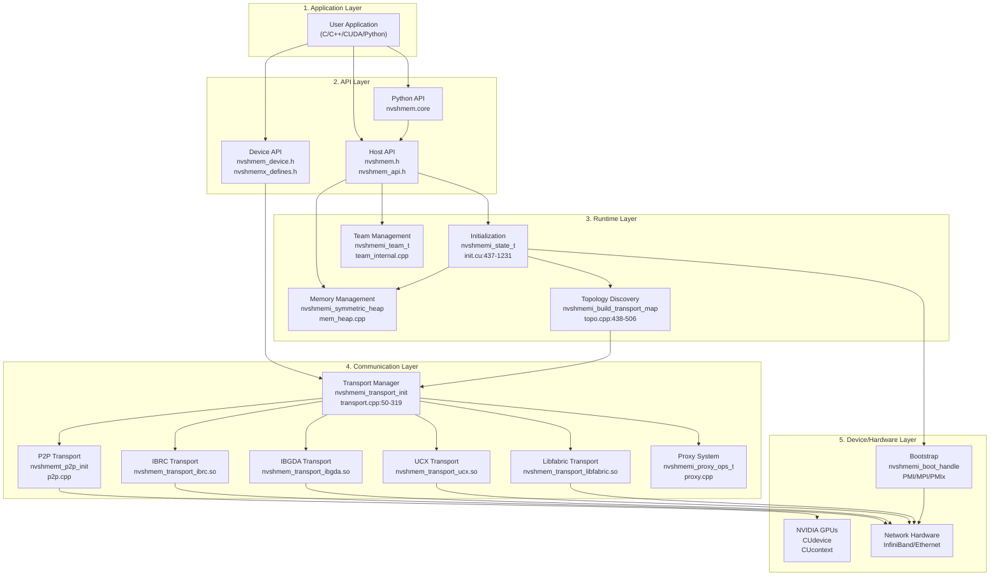
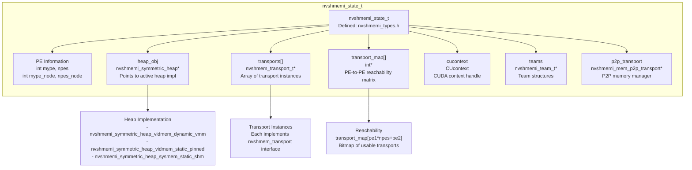
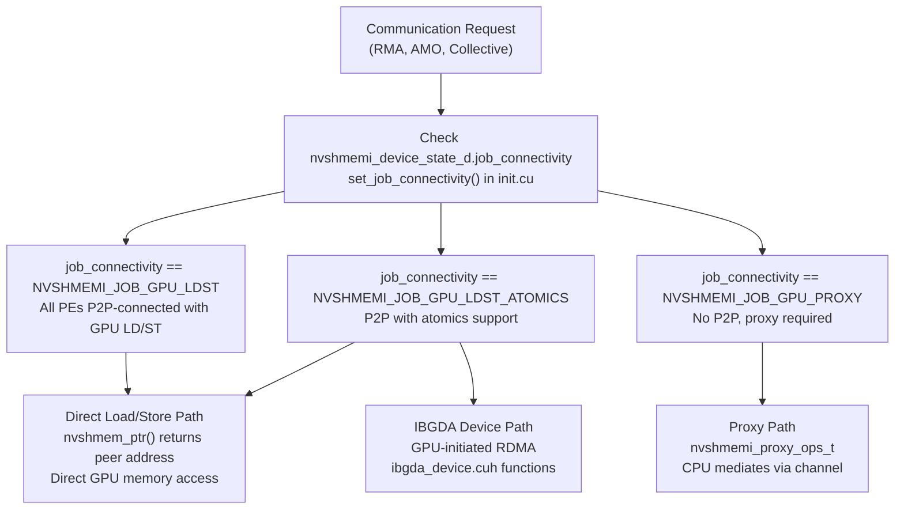
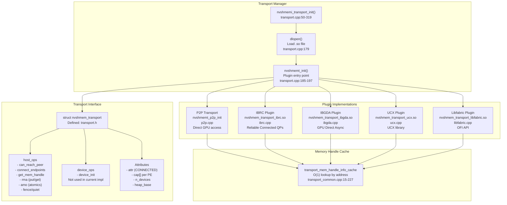
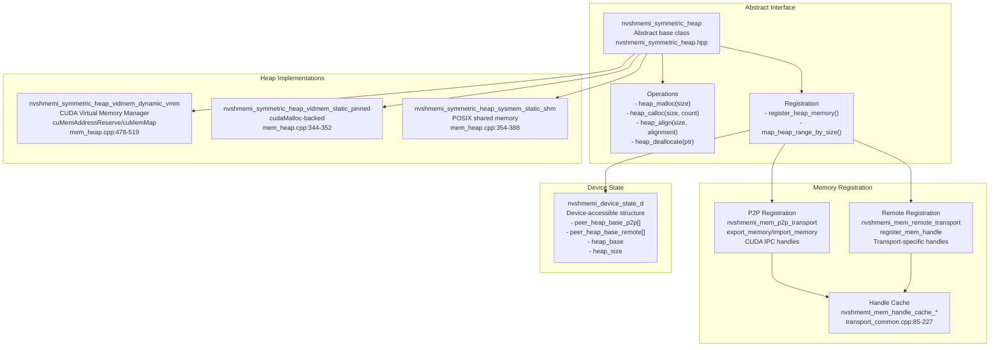
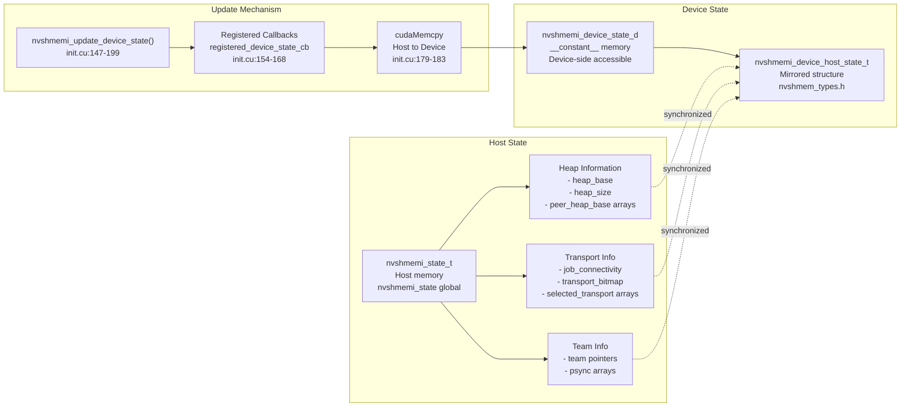
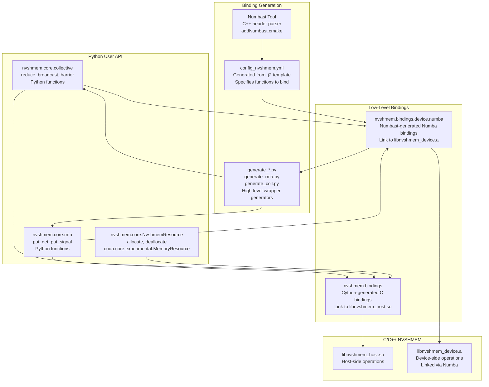

<!-- source: DeepWiki mcp.deepwiki.com · repo NVIDIA/nvshmem · page 2 Architecture · fetched 2026-10-26 -->

# Architecture

Relevant source files

The following files were used as context for generating this wiki page:

- [cmake_config/NVSHMEMEnv.cmake](cmake_config/NVSHMEMEnv.cmake)
- [nvshmem4py/scripts/generate_pyproject_toml.py](nvshmem4py/scripts/generate_pyproject_toml.py)
- [src/CMakeLists.txt](src/CMakeLists.txt)
- [src/host/init/init.cu](src/host/init/init.cu)
- [src/host/mem/mem_heap.cpp](src/host/mem/mem_heap.cpp)
- [src/host/topo/topo.cpp](src/host/topo/topo.cpp)
- [src/host/transport/transport.cpp](src/host/transport/transport.cpp)
- [src/include/non_abi/device/coll/utils.cuh](src/include/non_abi/device/coll/utils.cuh)
- [src/modules/transport/common/transport_common.cpp](src/modules/transport/common/transport_common.cpp)

This page provides a high-level architectural overview of NVSHMEM, explaining the layered design from application APIs down to hardware, and how the major subsystems interact. For detailed information on specific subsystems, see the child pages: [Core Library Architecture](#2.1), [Transport Layer](#2.2), [Device Programming Model](#2.3), [Memory Management and Symmetric Heap](#2.4), [Host Proxy Architecture](#2.5), [Team Management](#2.6), and [Python Bindings Architecture](#2.7).

## Five-Layer Design

NVSHMEM implements a five-layer architecture that separates concerns from high-level API abstractions down to hardware-specific communication mechanisms:

**Layer Architecture**

**Sources:** [src/host/init/init.cu:437-1231](), [src/host/transport/transport.cpp:50-319](), [src/host/mem/mem_heap.cpp:74-119](), [src/host/topo/topo.cpp:438-506]()

The layers provide clear separation:
- **Application Layer**: User code written in C/C++, CUDA kernels, or Python
- **API Layer**: Public interfaces (`nvshmem.h`, `nvshmemx.h`, Python `nvshmem.core`)
- **Runtime Layer**: State management, memory allocation, team operations
- **Communication Layer**: Pluggable transport system with proxy fallback
- **Device/Hardware Layer**: CUDA runtime, network hardware, bootstrap coordination

## Core State Management

The central state object `nvshmemi_state_t` (defined in [src/include/internal/host/nvshmemi_types.h]()) coordinates all subsystems:

**State Object Structure**

**Sources:** [src/include/internal/host/nvshmemi_types.h](), [src/host/init/init.cu:437-446]()

The state object is initialized in `nvshmemi_init_nvshmemi_state()` at [src/host/init/init.cu:437-446]() and accessed globally via the `nvshmemi_state` pointer.

## Initialization Flow

Initialization follows a carefully orchestrated sequence to establish process coordination, select hardware, allocate memory, and set up communication:

**Initialization Sequence**

```mermaid
graph TB
    START["nvshmem_init() / nvshmemx_init_attr()"]
    
    OPTIONS["nvshmemi_options_init()<br/>Parse environment variables<br/>bootstrap_host_transport/env_defs_internal.h"]
    
    BOOTSTRAP_PRE["nvshmemi_bootstrap_preinit()<br/>Discover network topology<br/>init.cu:322-328"]
    
    BOOTSTRAP["nvshmemi_bootstrap()<br/>Establish PE ranks, counts<br/>init.cu:330-435"]
    
    GPU_SELECT["nvshmemi_get_cucontext()<br/>Select/retain GPU context<br/>init.cu:495-597"]
    
    STATE_INIT["nvshmemi_init_nvshmemi_state()<br/>Initialize state object<br/>init.cu:437-446"]
    
    DETECT["nvshmemi_detect_same_device()<br/>Detect multi-process-per-GPU<br/>topo.cpp:523-573"]
    
    HEAP_INIT["nvshmemi_init_symmetric_heap()<br/>Allocate symmetric memory<br/>mem_heap.cpp:74-100"]
    
    TRANSPORT_INIT["nvshmemi_transport_init()<br/>Load transport plugins<br/>transport.cpp:50-319"]
    
    BUILD_MAP["nvshmemi_build_transport_map()<br/>Build PE reachability matrix<br/>topo.cpp:438-506"]
    
    CONNECT["nvshmemi_setup_connections()<br/>Connect transport endpoints<br/>transport.cpp:372-456"]
    
    REGISTER["register_heap_memory()<br/>Register heap with transports<br/>mem_heap.cpp:681-683"]
    
    TEAM_INIT["nvshmemi_team_init()<br/>Create default teams<br/>team_internal.cpp"]
    
    DEVICE_STATE["nvshmemi_update_device_state()<br/>Copy state to GPU<br/>init.cu:147-199"]
    
    READY["Initialization Complete<br/>nvshmemi_is_initialized = 1"]
    
    START --> OPTIONS
    OPTIONS --> BOOTSTRAP_PRE
    BOOTSTRAP_PRE --> BOOTSTRAP
    BOOTSTRAP --> GPU_SELECT
    GPU_SELECT --> STATE_INIT
    STATE_INIT --> DETECT
    DETECT --> HEAP_INIT
    HEAP_INIT --> TRANSPORT_INIT
    TRANSPORT_INIT --> BUILD_MAP
    BUILD_MAP --> CONNECT
    CONNECT --> REGISTER
    REGISTER --> TEAM_INIT
    TEAM_INIT --> DEVICE_STATE
    DEVICE_STATE --> READY
```

**Sources:** [src/host/init/init.cu:322-328](), [src/host/init/init.cu:330-435](), [src/host/init/init.cu:495-597](), [src/host/mem/mem_heap.cpp:74-100](), [src/host/transport/transport.cpp:50-319](), [src/host/topo/topo.cpp:438-506]()

Key initialization steps:

1. **Options Parsing**: Environment variables configure behavior (e.g., `NVSHMEM_SYMMETRIC_SIZE`, `NVSHMEM_DISABLE_P2P`)
2. **Bootstrap**: PMI/MPI establishes process group, determines `mype` and `npes`
3. **GPU Selection**: CUDA context is obtained or created
4. **Topology Detection**: Determines if multiple PEs share a GPU (MPG mode)
5. **Heap Allocation**: Symmetric memory allocated based on heap kind (VMM/static/sysmem)
6. **Transport Loading**: Plugins dynamically loaded (`.so` files for IBRC, UCX, etc.)
7. **Reachability Matrix**: Each PE determines which transports can reach which peers
8. **Endpoint Connection**: Transport-specific setup (QP creation, memory registration)
9. **Device State Copy**: Host state copied to device-accessible `nvshmemi_device_state_d`

## Communication Path Selection

NVSHMEM selects communication paths based on PE connectivity and operation type. The decision is made at runtime using the `job_connectivity` metric and transport capabilities:

**Communication Path Decision Tree**

**Sources:** [src/host/init/init.cu:1094-1164](), [src/include/non_abi/device/pt-to-pt/nvshmemi_transfer_api.cuh]()

The `job_connectivity` value is computed in `set_job_connectivity()` at [src/host/init/init.cu:1094-1164]() and considers:

- **NVSHMEMI_JOB_GPU_LDST**: All PEs can perform direct load/store via `nvshmem_ptr()`
- **NVSHMEMI_JOB_GPU_LDST_ATOMICS**: P2P connections support GPU-side atomics
- **NVSHMEMI_JOB_GPU_PROXY**: Operations must go through CPU proxy

Device-side code checks this at [src/include/non_abi/device/pt-to-pt/nvshmemi_transfer_api.cuh]() to route operations correctly.

## Transport Plugin Architecture

Transports implement the `nvshmem_transport` interface defined in [src/include/internal/host_transport/transport.h](). The transport manager dynamically loads plugins and builds a reachability matrix:

**Transport Plugin System**

**Sources:** [src/host/transport/transport.cpp:50-319](), [src/include/internal/host_transport/transport.h](), [src/modules/transport/common/transport_common.cpp:85-227]()

Transport loading sequence:

1. **Plugin Selection**: Based on `NVSHMEM_REMOTE_TRANSPORT` environment variable (defaults to IBRC)
2. **Dynamic Loading**: `dlopen()` loads shared object at [src/host/transport/transport.cpp:179]()
3. **Initialization**: Each transport's `nvshmemt_init()` function called at [src/host/transport/transport.cpp:185-197]()
4. **Capability Detection**: `can_reach_peer()` determines PE-to-PE connectivity
5. **Endpoint Connection**: `connect_endpoints()` sets up communication channels
6. **Memory Registration**: Heap registered via `get_mem_handle()`, cached in `transport_mem_handle_info_cache`

The reachability matrix `transport_map[pe1*npes + pe2]` (built at [src/host/topo/topo.cpp:438-506]()) is a bitmap indicating which transports can connect each PE pair.

## Memory Management Components

The memory subsystem uses a polymorphic design with three heap implementations sharing a common interface:

**Symmetric Heap Architecture**

**Sources:** [src/include/internal/host/nvshmemi_symmetric_heap.hpp](), [src/host/mem/mem_heap.cpp:74-100](), [src/host/mem/mem_heap.cpp:344-388](), [src/host/mem/mem_heap.cpp:478-519](), [src/modules/transport/common/transport_common.cpp:85-227]()

Heap selection logic in `nvshmemi_init_symmetric_heap()` at [src/host/mem/mem_heap.cpp:74-100]():

- **VMM Heap**: Used when `NVSHMEM_USE_CUDA_VMM=1` or dynamically required
  - Provides fine-grained allocation control
  - Supports on-demand physical memory backing
  - Required for NVLS (NVLINK SHARP) features
  
- **Static VIDMEM**: Default GPU memory heap
  - Single `cudaMalloc()` allocation at [src/host/mem/mem_heap.cpp:344-352]()
  - Fixed size determined by `NVSHMEM_SYMMETRIC_SIZE`
  
- **SYSMEM**: System memory heap for intra-node only
  - POSIX shared memory (`shm_open()`) at [src/host/mem/mem_heap.cpp:354-388]()
  - Accessible by all PEs on same node
  - Registered with `cudaHostRegister()` for GPU access

Memory registration creates two handle types:
- **P2P handles**: CUDA IPC or VMM handles for direct GPU access
- **Remote handles**: Transport-specific (IB lkey/rkey, UCX rkey, etc.)

All handles cached in `transport_mem_handle_info_cache` for O(1) lookup during RMA operations.

## Device State Synchronization

The host-side `nvshmemi_state_t` structure is mirrored on the device as `nvshmemi_device_state_d`, a device-accessible constant structure:

**Device State Copy Mechanism**

**Sources:** [src/host/init/init.cu:147-199](), [src/include/device_host/nvshmem_types.h]()

State synchronization flow:

1. **Callback Registration**: Device libraries register callbacks to receive state pointer via `nvshmemx_device_lib_init_cb`
2. **State Update**: `nvshmemi_update_device_state()` at [src/host/init/init.cu:147-199]() invoked after state changes
3. **Memory Copy**: `cudaMemcpy()` transfers `nvshmemi_device_host_state_t` to all registered device pointers at [src/host/init/init.cu:179-183]()
4. **Device Access**: GPU kernels read from `nvshmemi_device_state_d` via `__ldg()` or direct access

Critical fields synchronized to device:
- `peer_heap_base_p2p[]`: Base addresses for direct P2P access
- `peer_heap_base_remote[]`: Base addresses for remote operations
- `job_connectivity`: Communication path selection
- `selected_transport_for_rma[]`, `selected_transport_for_amo[]`: Per-PE transport indices

## Python Bindings Integration

The Python bindings (`nvshmem4py`) provide a three-tier architecture that bridges Python to the C/C++ implementation:

**Python Bindings Layers**

**Sources:** [nvshmem4py/scripts/generate_pyproject_toml.py:1-106](), [cmake_config/NVSHMEMEnv.cmake:54-55]()

Python binding generation occurs at build time:
1. **Numbast Processing**: CMake invokes Numbast tool (configured at [cmake_config/NVSHMEMEnv.cmake:54-55]()) to parse C++ headers
2. **YAML Configuration**: `config_nvshmem.yml.j2` template generates configuration specifying which functions to bind
3. **Numba Bindings**: Numbast produces raw Numba-compatible bindings for device functions
4. **Wrapper Generation**: Python scripts (`generate_rma.py`, `generate_coll.py`) create ergonomic high-level APIs
5. **Package Assembly**: `generate_pyproject_toml.py` at [nvshmem4py/scripts/generate_pyproject_toml.py:1-106]() creates final package metadata

The bindings integrate with:
- **PyTorch**: Via tensor interop
- **CuPy**: Via ndarray support
- **CUDA Python**: Via `cuda.core.experimental.MemoryResource` interface

For detailed Python architecture, see [Python Bindings Architecture](#2.7).

## Summary

NVSHMEM's architecture provides:

- **Layered Abstraction**: Clean separation from API to hardware
- **Pluggable Transports**: Dynamic loading of network-specific implementations
- **Flexible Memory**: Three heap types for different use cases
- **Dual Programming Model**: Both host and device APIs
- **Path Optimization**: Runtime selection between P2P, IBGDA, and proxy paths
- **Language Bindings**: Native Python support via Cython and Numbast

The architecture enables NVSHMEM to support diverse GPU clusters (single-node NVLink, multi-node InfiniBand, cloud EFA) with a single unified API while optimizing communication paths based on available hardware capabilities.

---

