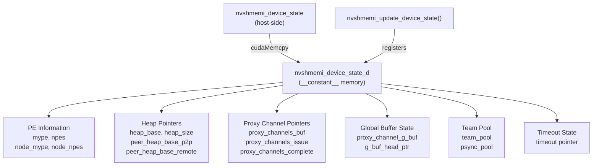
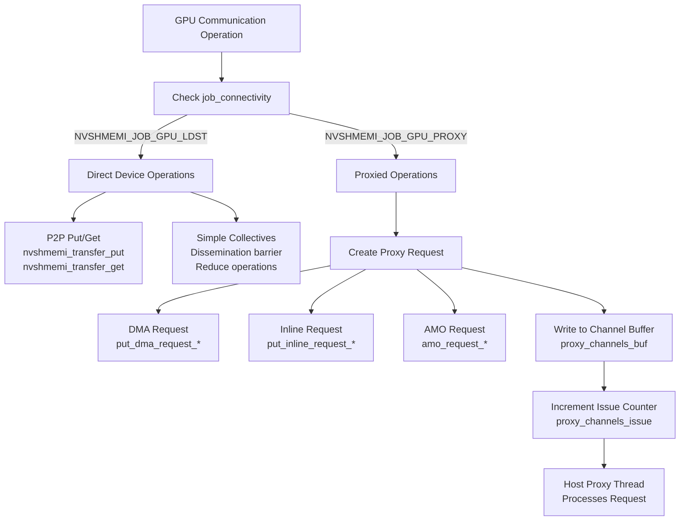
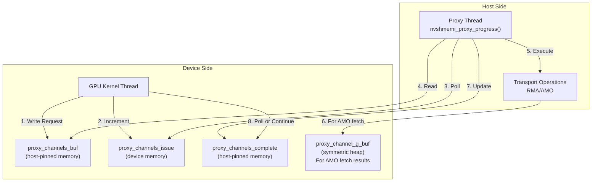
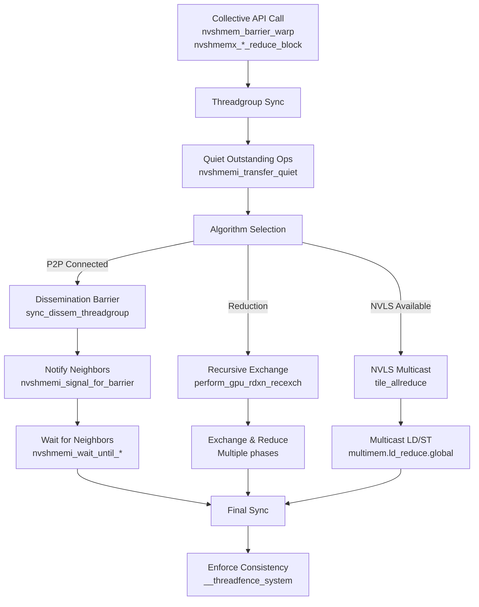
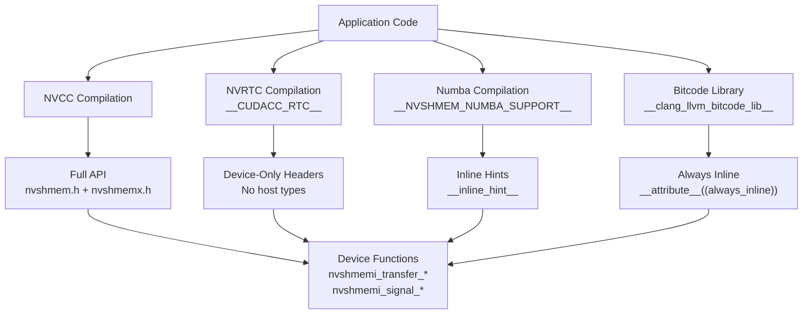
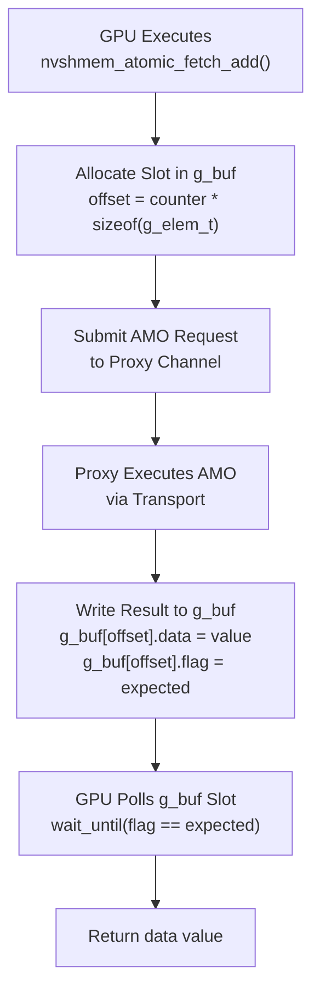
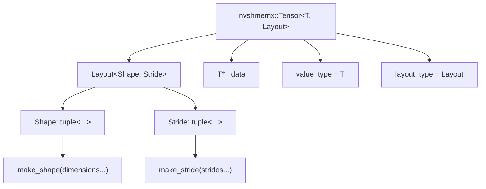
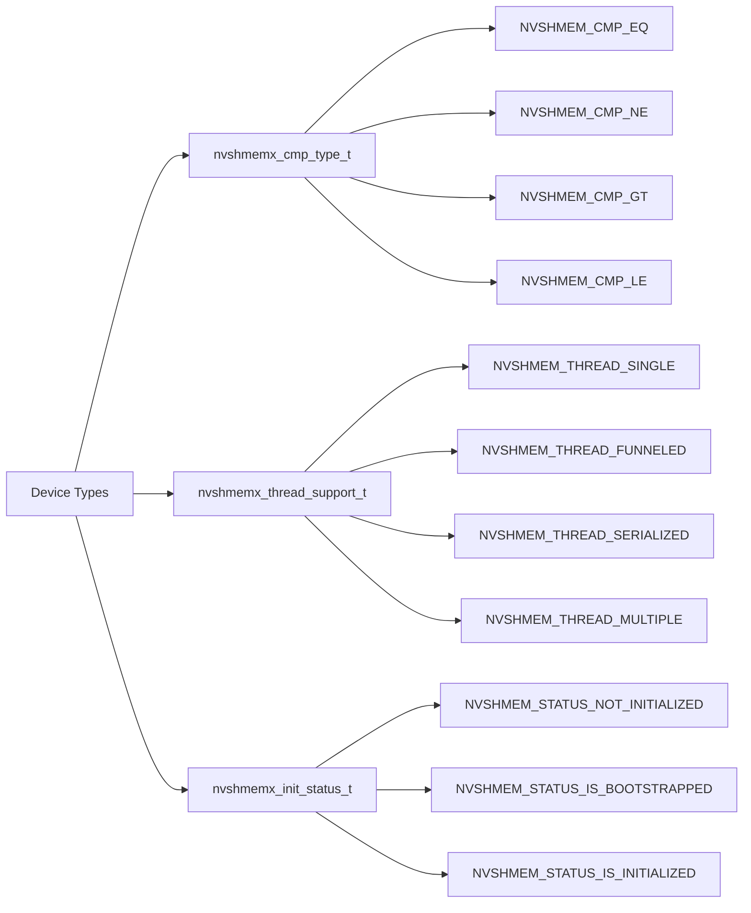
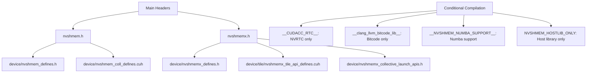
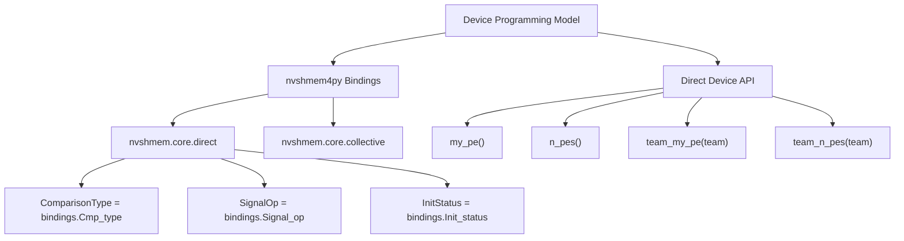

<!-- source: DeepWiki mcp.deepwiki.com · repo NVIDIA/nvshmem · page 2.3 Device Programming Model · fetched 2026-10-26 -->

# Device Programming Model

<details>
<summary>Relevant source files</summary>

The following files were used as context for generating this wiki page:

- [src/host/init/init.cu](src/host/init/init.cu)
- [src/host/mem/mem_heap.cpp](src/host/mem/mem_heap.cpp)
- [src/include/internal/non_abi/nvshmemi_h_to_d_coll_defs.cuh](src/include/internal/non_abi/nvshmemi_h_to_d_coll_defs.cuh)
- [src/include/non_abi/device/coll/fcollect.cuh](src/include/non_abi/device/coll/fcollect.cuh)
- [src/include/non_abi/device/coll/reduce.cuh](src/include/non_abi/device/coll/reduce.cuh)
- [src/include/non_abi/device/coll/reducescatter.cuh](src/include/non_abi/device/coll/reducescatter.cuh)
- [src/include/non_abi/device/coll/utils.cuh](src/include/non_abi/device/coll/utils.cuh)
- [src/include/non_abi/device/pt-to-pt/ibgda_device.cuh](src/include/non_abi/device/pt-to-pt/ibgda_device.cuh)
- [src/include/non_abi/device/pt-to-pt/nvshmemi_transfer_api.cuh](src/include/non_abi/device/pt-to-pt/nvshmemi_transfer_api.cuh)
- [src/modules/transport/ibdevx/ibdevx.cpp](src/modules/transport/ibdevx/ibdevx.cpp)
- [src/modules/transport/ibgda/ibgda.cpp](src/modules/transport/ibgda/ibgda.cpp)
- [src/modules/transport/ibrc/ibrc.cpp](src/modules/transport/ibrc/ibrc.cpp)

</details>


## Purpose and Scope

This document explains how NVSHMEM enables GPU-initiated communication, covering device state management, the distinction between direct and proxied operations, and the mechanisms that allow GPU threads to perform distributed communication. The device programming model is fundamental to understanding how CUDA kernels interact with the NVSHMEM runtime to execute communication operations.

For host-side details, see [Host Proxy Architecture](#2.5). For memory management, see [Memory Management and Symmetric Heap](#2.4).

## Device State Management

NVSHMEM maintains shared state between the host and device to enable GPU-initiated communication. This state is stored in GPU constant memory for fast access and is synchronized during initialization and runtime.

### Device State Structure

**Diagram: Device State Organization**



The device state is defined in `nvshmemi_device_host_state_t` and includes:

| Field | Purpose |
|-------|---------|
| `mype`, `npes` | PE identification and count |
| `heap_base`, `heap_size` | Symmetric heap information |
| `peer_heap_base_p2p` | Peer heap base addresses for P2P access |
| `proxy_channels_*` | Proxy channel communication pointers |
| `proxy_channel_g_buf` | Global buffer for fetching AMO results |
| `team_pool` | Array of team structures |
| `job_connectivity` | Connection type (LDST, proxy, etc.) |
| `atomics_complete_on_quiet` | Whether atomics need consistency ops |

**Sources:** [src/include/device_host/nvshmem_types.h:327-388](), [src/host/init/init.cu:89-91](), [src/host/init/init.cu:146-196]()

### State Synchronization

State updates are handled through `nvshmemi_update_device_state()`:

1. Registered device state pointers are maintained in `registered_device_states` map
2. When state changes, `cudaMemcpy` transfers `nvshmemi_device_state` to `nvshmemi_device_state_d`
3. Multiple device libraries can register their device state pointers for updates

**Sources:** [src/host/init/init.cu:146-196]()

## Communication Paths: Direct vs Proxied Operations

NVSHMEM provides two primary communication paths from GPU devices, selected based on operation complexity and hardware capabilities.

**Diagram: Communication Path Selection**



**Sources:** [src/include/non_abi/device/pt-to-pt/proxy_device.cuh:1-100](), [src/host/proxy/proxy.cpp:381-458]()

### Direct Device Operations

Direct operations execute entirely on the GPU without host involvement:

| Operation Type | Implementation | Requirements |
|---------------|----------------|--------------|
| P2P Put/Get | GPU load/store or RDMA | `NVSHMEMI_JOB_GPU_LDST` connectivity |
| Simple Collectives | Dissemination algorithm | All PEs P2P connected |
| Device Atomics | GPU atomic instructions | Hardware atomic support |

Direct operations use `nvshmemi_transfer_*` functions that check `job_connectivity` and select the fastest path.

**Sources:** [src/include/non_abi/device/pt-to-pt/transfer_device.cuh.in:1-50]()

### Proxied Operations

Complex operations requiring host CPU execution use the proxy mechanism:

1. **GPU Side**: Constructs request in channel buffer and increments issue counter
2. **Host Proxy Thread**: Polls channel, processes request, updates complete counter
3. **GPU Side**: Polls complete counter or continues asynchronously

**Sources:** [src/host/proxy/proxy.cpp:381-558]()

## Proxy Channel Architecture

The proxy channel mechanism enables GPU-initiated communication for operations requiring host processing.

**Diagram: Proxy Channel Structure**



**Sources:** [src/host/proxy/proxy.cpp:76-145](), [src/include/device_host/nvshmem_proxy_channel.h:1-100]()

### Channel Buffer Layout

Each proxy channel has a circular buffer with fixed-size entries:

| Field | Size | Description |
|-------|------|-------------|
| Buffer | `CHANNEL_BUF_SIZE` (4MB) | Circular request buffer |
| Issue Counter | 8 bytes | GPU-incremented request counter (device memory) |
| Complete Counter | 8 bytes | Host-updated completion counter |
| Quiet Issue/Ack | 8 bytes each | For quiet operations |
| CST Issue/Ack | 8 bytes each | For consistency operations |

**Sources:** [src/host/proxy/proxy.cpp:157-201](), [src/include/device_host_transport/nvshmem_constants.h:23-44]()

### Request Types

**Put DMA Request** (24 bytes):
- `base_request_t`: Operation type, remote offset (8 bytes)
- `put_dma_request_0_t`: Local address high bits, flag (8 bytes)
- `put_dma_request_1_t`: Local address low, size (8 bytes)
- `put_dma_request_2_t`: PE, QP index (optional, 8 bytes)

**Inline Request** (16-24 bytes):
- Used for small data (≤8 bytes) embedded in the request
- Avoids DMA for sub-word operations

**AMO Request** (32-40 bytes):
- Atomic operation type, operands, return buffer location
- Uses global buffer (`g_buf`) for fetch results

**Sources:** [src/host/proxy/proxy.cpp:381-686](), [src/include/device_host/nvshmem_proxy_channel.h:50-150]()

### Request Processing Flow

1. **GPU enqueues request**: Writes request to wrapped position in channel buffer using flags
2. **GPU increments issue**: Atomic increment of `proxy_channels_issue`
3. **Proxy polls**: Compares `issue` vs `processed` counters
4. **Proxy processes**: Calls `process_channel_dma()`, `process_channel_inline()`, or `process_channel_amo()`
5. **Proxy updates complete**: Writes to `proxy_channels_complete` every ~1KB processed
6. **GPU polls or continues**: Non-blocking operations continue; blocking operations poll `complete`

**Sources:** [src/host/proxy/proxy.cpp:381-686]()

## Device-Initiated Collective Operations

NVSHMEM supports GPU-initiated collectives where all threads in a threadgroup cooperate to perform multi-PE operations.

**Diagram: Collective Operation Flow**



**Sources:** [src/include/non_abi/device/coll/barrier.cuh:24-251](), [src/include/non_abi/device/coll/reduce.cuh:1-500]()

### Collective Primitives

NVSHMEM provides several collective primitive implementations:

| Primitive | Algorithm | Best For |
|-----------|-----------|----------|
| Barrier | Dissemination (k-ary) | Synchronization across PEs |
| Reduce | Recursive Exchange | Small data, arbitrary PE counts |
| Reduce | NVLS Multicast | Large data, NVLS-capable hardware |
| Broadcast | Tree-based | One-to-many distribution |
| AllGather | Ring algorithm | Gathering distributed arrays |

**Sources:** [src/include/non_abi/device/coll/barrier.cuh:1-282](), [src/include/non_abi/device/coll/reduce.cuh:1-500]()

### Dissemination Barrier Implementation

The dissemination barrier uses a k-ary tree pattern:

1. Each PE notifies k-1 neighbors at distance `j * pow_k` in phase i
2. Each PE waits for k-1 neighbors at distance `-j * pow_k`
3. Phases continue until all PEs are synchronized
4. Counter-based signaling avoids race conditions across barriers

**Sources:** [src/include/non_abi/device/coll/barrier.cuh:24-176]()

## Threadgroup Programming Model

GPU threads in NVSHMEM are organized into hierarchical threadgroups that define cooperation scope for collective operations.

### Threadgroup Scopes

| Scope | Enumeration | Size | Synchronization |
|-------|-------------|------|----------------|
| Thread | `NVSHMEMI_THREADGROUP_THREAD` | 1 thread | None |
| Warp | `NVSHMEMI_THREADGROUP_WARP` | 32 threads | `__syncwarp()` |
| Warpgroup | `NVSHMEMI_THREADGROUP_WARPGROUP` | 128 threads | Named barriers |
| Block | `NVSHMEMI_THREADGROUP_BLOCK` | Block size | `__syncthreads()` |

**Sources:** [src/include/non_abi/device/threadgroup/nvshmemi_common_device_defines.cuh:32-41]()

### Threadgroup Utilities

Template functions provide threadgroup abstractions:

```cpp
template <threadgroup_t SCOPE>
__device__ int nvshmemi_thread_id_in_threadgroup();

template <threadgroup_t SCOPE>
__device__ int nvshmemi_threadgroup_size();

template <threadgroup_t SCOPE>
__device__ void nvshmemi_threadgroup_sync();
```

These templates specialize based on scope:
- **Warp scope**: Uses `%laneid` for thread ID, `__syncwarp()` for sync
- **Block scope**: Uses `threadIdx` calculations, `__syncthreads()` for sync

**Sources:** [src/include/non_abi/device/threadgroup/nvshmemi_common_device_defines.cuh:45-120]()

## Device API Organization

NVSHMEM exposes device-side APIs through a carefully structured header hierarchy designed to support multiple compilation paths (NVCC, NVRTC, Clang, Numba).

**Diagram: Device API Compilation Paths**



**Sources:** [src/include/device/nvshmem_device_macros.h:15-60](), [src/include/nvshmem.h:16-29]()

### API Categories

| Category | Scope Variants | Purpose |
|----------|---------------|----------|
| Point-to-Point | Thread, Warp, Block | `nvshmem_put`, `nvshmem_get` operations |
| Collective | Warp, Block | `nvshmem_barrier`, `nvshmem_broadcast` |
| Synchronization | Thread, Warp, Block | `nvshmem_quiet`, `nvshmem_fence` |
| Atomics | Thread | `nvshmem_atomic_add`, `nvshmem_atomic_fetch_add` |
| Memory Ordering | Thread | `nvshmem_fence`, `nvshmem_quiet` |

**Sources:** [src/include/host/nvshmemx_api.h:1-100]()

## Global Buffer for AMO Results

Fetching atomic operations require a mechanism to return values from remote PEs to the initiating GPU thread.

**Diagram: Global Buffer Architecture**



The global buffer (`proxy_channel_g_buf`) is allocated in symmetric heap with size `G_BUF_SIZE` (default 512KB). Each slot contains:

```cpp
typedef struct g_elem {
    uint64_t data;  // Return value
    uint64_t flag;  // Completion flag
} g_elem_t;
```

**Sources:** [src/host/proxy/proxy.cpp:118-144](), [src/host/proxy/proxy.cpp:646-662]()

## Memory and Data Structures

### Tensor Layout System

NVSHMEM provides a tensor abstraction for multi-dimensional data operations:



**Sources:** [src/include/device_host/nvshmem_tensor.h:47-103]()

### Constants and Configuration

The system defines various constants and enumerations used throughout the device programming model:

| Constant | Value | Purpose |
|----------|-------|---------|
| `CHANNEL_BUF_SIZE` | `1 << 22` (4MB) | Communication channel buffer size |
| `CHANNEL_ENTRY_BYTES` | 8 | Size of each channel entry |
| `NVSHMEM_MAX_NAME_LEN` | 256 | Maximum length for names |

**Sources:** [src/include/device_host_transport/nvshmem_constants.h:23-44]()

### Comparison and Thread Support Types



**Sources:** [src/include/device_host_transport/nvshmem_constants.h:46-84]()

## API Headers and Integration

### Header Structure

The device programming model is exposed through a hierarchical header structure:



**Sources:** [src/include/nvshmem.h:16-29](), [src/include/nvshmemx.h:18-29]()

### Integration with Framework Bindings

The device programming model integrates with higher-level framework bindings:



**Sources:** [nvshmem4py/nvshmem/core/direct.py:16-92]()

---

