<!-- source: DeepWiki mcp.deepwiki.com · repo NVIDIA/nvshmem · page 2.4 Memory Management and Symmetric Heap · fetched 2026-10-26 -->

# Memory Management and Symmetric Heap

<details>
<summary>Relevant source files</summary>

The following files were used as context for generating this wiki page:

- [src/host/init/init.cu](src/host/init/init.cu)
- [src/host/mem/mem_heap.cpp](src/host/mem/mem_heap.cpp)
- [src/host/mem/mem_transport.cpp](src/host/mem/mem_transport.cpp)
- [src/host/topo/topo.cpp](src/host/topo/topo.cpp)
- [src/host/transport/transport.cpp](src/host/transport/transport.cpp)
- [src/include/non_abi/device/coll/utils.cuh](src/include/non_abi/device/coll/utils.cuh)
- [src/modules/transport/common/transport_common.cpp](src/modules/transport/common/transport_common.cpp)
- [src/modules/transport/libfabric/libfabric.h](src/modules/transport/libfabric/libfabric.h)
- [test/host/interop/CMakeLists.txt](test/host/interop/CMakeLists.txt)
- [test/unit/mem/heap/internal/host/nvshmemi_mem_transport.hpp](test/unit/mem/heap/internal/host/nvshmemi_mem_transport.hpp)

</details>


## Purpose and Scope

This page provides detailed documentation of NVSHMEM's memory management system and the symmetric heap concept. It covers:
- The symmetric heap architecture and allocation strategies (VMM, cudaMalloc, system memory)
- Memory allocation, registration, and deallocation mechanisms  
- Remote memory access patterns (peer and multicast)
- Python memory management via `NvshmemResource`
- Transport-specific memory handle management and caching

For information about device-initiated operations on symmetric memory, see [Device Programming Model](#2.3). For Python API usage examples, see [Core Types and Memory Management](#4.2). For C/C++ host API details, see [Host API](#5.1). For transport-specific memory registration details, see [Transport Layer](#2.2).

## Symmetric Heap Concept

The **symmetric heap** is the cornerstone of NVSHMEM's memory model. It is a region of memory that exists at consistent virtual addresses across all Processing Elements (PEs) in a NVSHMEM job. This property enables efficient address translation for remote memory operations.

### Key Properties

| Property | Description |
|----------|-------------|
| **Address Consistency** | Memory allocated at address `A` on PE 0 corresponds to address `A` on all other PEs |
| **Collective Allocation** | All PEs must participate in symmetric heap allocations synchronously |
| **Transport Registration** | Memory is registered with all active transports for RDMA operations |
| **GPU Visibility** | Memory is GPU-accessible for device-initiated operations |

The symmetric heap is represented by `heap_base` and `heap_size` fields in `nvshmemi_device_host_state_t`. For VMM heaps, addresses are truly identical across PEs. For non-VMM heaps, address translation follows:

```
remote_address = local_symmetric_address + (target_pe - local_pe) * heap_stride
```

**Sources:** [src/include/device_host/nvshmem_types.h:453-509](), [src/host/init/init.cu:473-479]()

## Heap Allocation Strategies

NVSHMEM supports three allocation strategies for the symmetric heap, implemented through a class hierarchy rooted at `nvshmemi_symmetric_heap`. The strategy is selected at initialization based on system capabilities and configuration.

### Heap Class Hierarchy

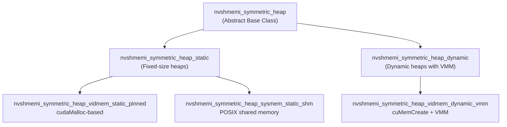

**Sources:** [src/host/mem/mem_heap.cpp:74-119]()

### Allocation Strategy Selection

The selection occurs in `nvshmemi_init_symmetric_heap()` at [src/host/mem/mem_heap.cpp:74-100]():

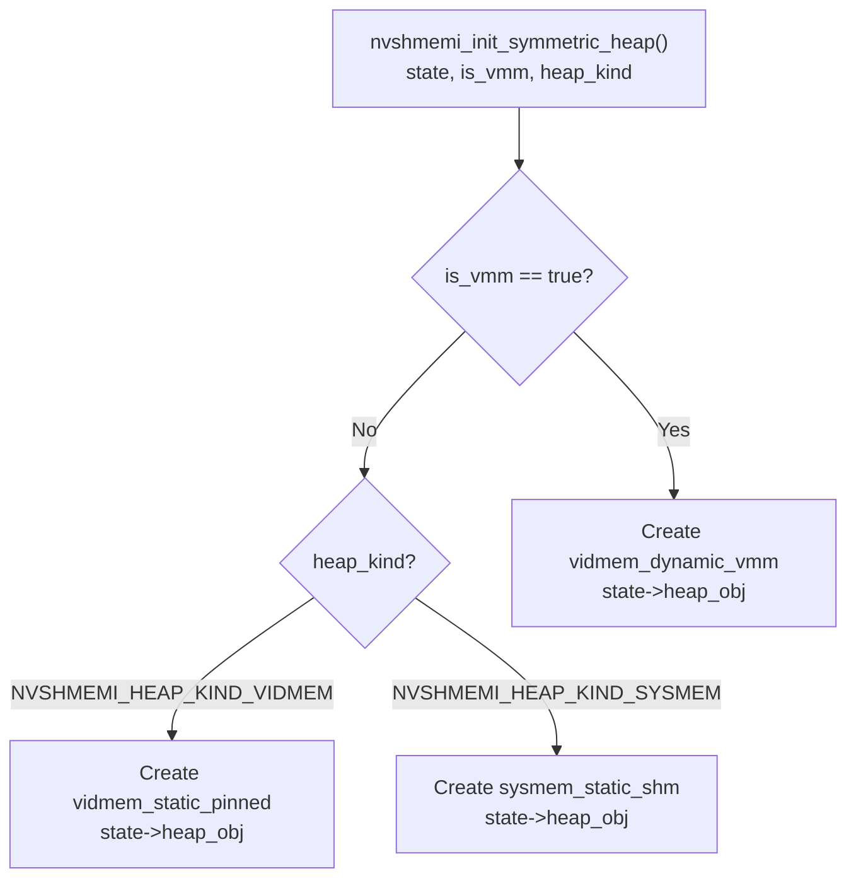

**Sources:** [src/host/mem/mem_heap.cpp:74-100]()

### VMM Heap (nvshmemi_symmetric_heap_vidmem_dynamic_vmm)

The VMM heap uses CUDA's Virtual Memory Management APIs for fine-grained control over memory allocation and mapping. Implementation at [src/host/mem/mem_heap.cpp:478-519]().

**Key Operations:**

| Operation | CUDA API | Purpose |
|-----------|----------|---------|
| Address reservation | `cuMemAddressReserve()` | Reserve virtual address space for all P2P-connected PEs |
| Physical allocation | `cuMemCreate()` | Create physical memory with specific handle type |
| Mapping | `cuMemMap()` | Map physical memory to virtual addresses |
| Access control | `cuMemSetAccess()` | Configure which PEs can access the memory |
| Handle export | `cuMemExportToShareableHandle()` | Export for P2P access (IPC or Fabric) |

**Characteristics:**
- True address symmetry across all PEs
- Supports NVLS (NVLink SHARP) multicast operations
- Required for hardware-accelerated collectives
- Handle type: `CU_MEM_HANDLE_TYPE_POSIX_FILE_DESCRIPTOR` or `CU_MEM_HANDLE_TYPE_FABRIC` (MNNVL)

**Heap Reservation:**
```
reserved_heap_size = heap_size * num_p2p_connected_pes
global_heap_base = cuMemAddressReserve(reserved_heap_size)
heap_base = global_heap_base  // Local PE's region
peer_heap_base_p2p[i] = global_heap_base + heap_size * i  // Peer i's region
```

**Sources:** [src/host/mem/mem_heap.cpp:478-519](), [src/host/mem/mem_heap.cpp:635-672]()

### Static VIDMEM Heap (nvshmemi_symmetric_heap_vidmem_static_pinned)

Uses traditional `cudaMalloc()` for GPU device memory allocation. Implementation at [src/host/mem/mem_heap.cpp:344-353]().

**Key Operations:**

| Operation | CUDA API | Purpose |
|-----------|----------|---------|
| Allocation | `cudaMalloc()` | Allocate GPU memory |
| IPC export | `cudaIpcGetMemHandle()` | Export for P2P access |
| Synchronization | `cuPointerSetAttribute(SYNC_MEMOPS)` | Enable synchronous memory operations |

**Characteristics:**
- No true address symmetry (each PE may have different base address)
- No NVLS support
- Compatible with CUDA 10.0+
- Address translation via `peer_heap_base_p2p[]` array

**Address Translation:**
For remote address `remote_addr` on PE `target_pe`:
```
local_offset = remote_addr - peer_heap_base_remote[target_pe]
local_ptr = peer_heap_base_p2p[target_pe] + local_offset
```

**Sources:** [src/host/mem/mem_heap.cpp:344-353](), [src/host/mem/mem_heap.cpp:436-476]()

### System Memory Heap (nvshmemi_symmetric_heap_sysmem_static_shm)

Uses POSIX shared memory (`shm_open()`) for intra-node symmetric allocation. Implementation at [src/host/mem/mem_heap.cpp:354-388]().

**Key Operations:**

| Operation | API | Purpose |
|-----------|-----|---------|
| Shared memory creation | `shared_memory_create()` / `shm_open()` | Create shared memory segment |
| GPU registration | `cudaHostRegister()` | Make accessible from GPU |
| Device pointer | `cudaHostGetDevicePointer()` | Get GPU-accessible pointer |

**Memory Layout:**
```
|<-------- PE 0 ------->|<-------- PE 1 ------->|<-------- PE 2 ------->|
[     heap_size bytes   ][     heap_size bytes   ][     heap_size bytes   ]
^                        ^                        ^
global_heap_base         PE 1 region              PE 2 region

heap_base[PE i] = global_heap_base + i * heap_size
```

**Characteristics:**
- Shared within a node (all PEs on same host share the same memory mapping)
- No IPC handle exchange needed for intra-node PEs
- Lower performance for GPU operations compared to VIDMEM heaps
- Requires `cudaHostRegister()` for GPU accessibility

**Sources:** [src/host/mem/mem_heap.cpp:354-388](), [src/host/mem/mem_heap.cpp:706-717]()

### Memory Space (mspace) Management

All heap types use a custom allocator (`mspace` class) for managing allocations within the symmetric heap. The allocator is created at [src/host/mem/mem_heap.cpp:402-414]().

**Key Components:**

- `heap_mspace_`: Allocator for symmetric heap allocations
- `mmap_mspace_`: (VMM only) Allocator for dynamically mapped user buffers
- Granularity-based allocation: Memory is allocated in chunks of `mem_granularity_` size
- Large chunk tracking: `track_large_chunks(1)` enables efficient coalescing

**Sources:** [src/host/mem/mem_heap.cpp:402-414]()

## Memory Allocation and Deallocation

### Core Allocation Flow

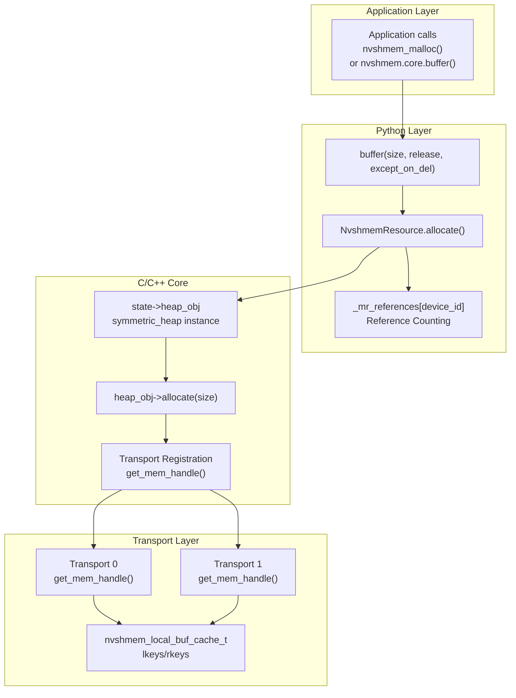

**Sources:** [nvshmem4py/nvshmem/core/memory.py:54-92](), [src/include/internal/host/nvshmem_internal.h:135-153]()

### Python Memory Allocation

The Python API provides high-level memory management through the `NvshmemResource` class:

```python
def buffer(size, release=False, except_on_del=True) -> Buffer
```

**Parameters:**

| Parameter | Type | Description |
|-----------|------|-------------|
| `size` | int | Size in bytes to allocate |
| `release` | bool | If True, skip internal tracking (user must maintain references) |
| `except_on_del` | bool | If True, raise exception on double-free; if False, log error |

**Return:** `cuda.core.experimental.Buffer` object (DLPack-compatible)

**Collective Property:** This is a collective operation - all PEs must call it synchronously.

**Internal Flow:**
1. Check initialization status via `_is_initialized`
2. Get or create `NvshmemResource` for current device from `_mr_references`
3. Call `resource.allocate(size, release, except_on_del)`
4. Track allocation in `_mr_references[device_id]._mem_references` if `release=False`

**Sources:** [nvshmem4py/nvshmem/core/memory.py:54-92](), [nvshmem4py/nvshmem/core/_internal_tracking.py:18-45]()

### NvshmemResource Class

The `NvshmemResource` class manages memory allocation and tracking per GPU device.

**Key Responsibilities:**
- Wraps NVSHMEM's C API for Python
- Maintains reference counts for allocated buffers
- Integrates with `cuda.core.experimental.Buffer`
- Provides lifecycle management (allocation/deallocation)

**Global State:**
```python
_mr_references = {}  # Map: device_id -> NvshmemResource instance
```

**Per-Resource State:**
Each `NvshmemResource` maintains `_mem_references`, a map of `int(buffer.handle)` to metadata dict:

```python
{
    "buffer": Buffer,           # cuda.core Buffer object
    "ref_count": int,           # Reference count
    "freed": bool,              # Has free() been called?
    "type": BufferTypes,        # NORMAL, PEER, MULTICAST, EXTERNAL
    "released": bool,           # Skip tracking if release=True
    "except_on_del": bool       # Exception vs warning on error
}
```

**Sources:** [nvshmem4py/nvshmem/core/_internal_tracking.py:18-45](), [nvshmem4py/nvshmem/core/interop/cupy.py:55-62]()

### Deallocation

```python
def free(buffer: Buffer) -> None
```

Frees a previously allocated symmetric buffer. This is also a collective operation.

**Flow:**
1. Validate buffer is NVSHMEM-managed via `isinstance(buffer, Buffer)` and `hasattr(buffer, "handle")`
2. Mark buffer as freed in tracking metadata
3. Call `buffer.memory_resource.set_freed(buffer)`
4. Close the buffer handle with `buffer.close()`

**Automatic Cleanup:** At finalization, `_free_all_buffers()` scans `_mr_references` and frees any remaining allocations with `freed=False`, logging warnings for memory leaks.

**Sources:** [nvshmem4py/nvshmem/core/memory.py:94-123](), [nvshmem4py/nvshmem/core/memory.py:28-52]()

## Memory Registration

Memory registration establishes the mapping between symmetric memory regions and transport-specific resources (e.g., RDMA memory handles). This occurs in two phases: **P2P registration** for direct GPU access and **remote registration** for network-based RDMA.

### Registration Architecture

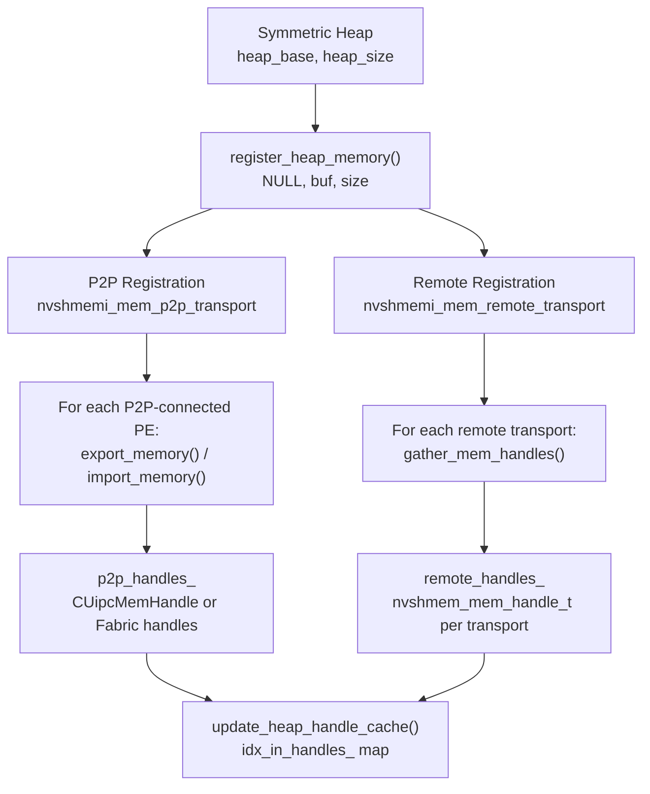

**Sources:** [src/host/mem/mem_heap.cpp:1104-1287]()

### P2P Registration Flow

P2P registration enables direct GPU-to-GPU memory access via NVLink or PCIe. Managed by the singleton `nvshmemi_mem_p2p_transport` class at [src/host/mem/mem_transport.cpp:88-271]().

**Handle Type Detection:**

The P2P transport detects the appropriate handle type based on platform capabilities:

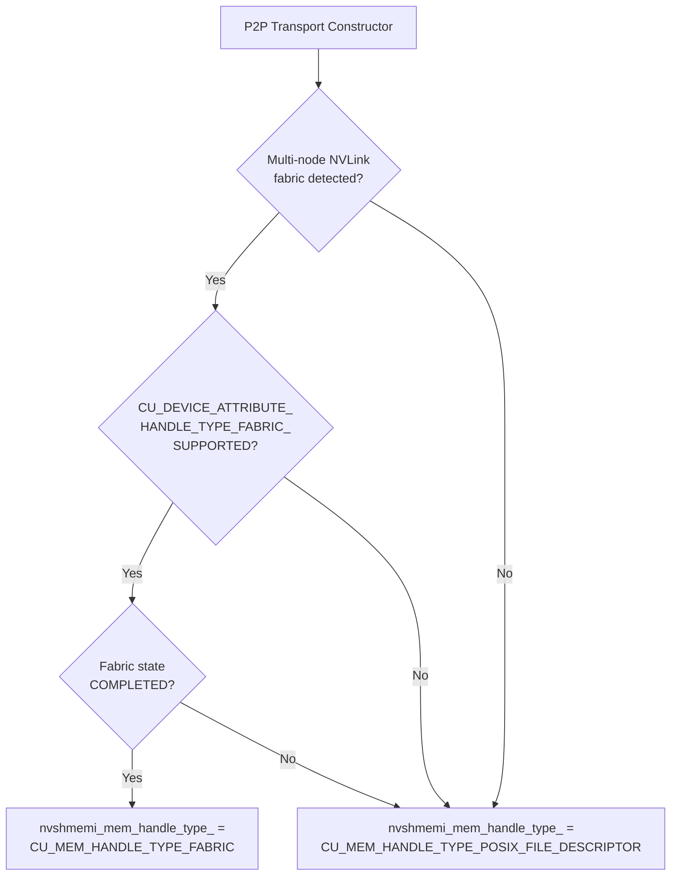

**Sources:** [src/host/mem/mem_transport.cpp:163-228]()

**Export/Import Process:**

For VMM heaps, memory is exported and imported using file descriptors or fabric handles:

1. **Export** (at [src/host/mem/mem_heap.cpp:1188-1221]()):
   - `cuMemExportToShareableHandle()` - Export to file descriptor or fabric handle
   - Store handle in `p2p_handles_.back()[pe_id * num_transports + transport_idx]`

2. **Exchange** (at [src/host/mem/mem_heap.cpp:743-853]()):
   - Use IPC sockets (`ipcOpenSocket`, `ipcSendFd`, `ipcRecvFd`) for handle exchange
   - Handles are sent between P2P-connected processes identified by PID

3. **Import** (at [src/host/mem/mem_heap.cpp:1223-1286]()):
   - `cuMemImportFromShareableHandle()` - Import remote PE's memory handle
   - `cuMemMap()` - Map to local virtual address space
   - `cuMemSetAccess()` - Grant access permissions

For static heaps, the process uses `cudaIpcGetMemHandle()` and `cudaIpcOpenMemHandle()`.

**Sources:** [src/host/mem/mem_heap.cpp:1104-1287](), [src/host/mem/mem_heap.cpp:743-853]()

### Remote Registration Flow

Remote registration creates transport-specific memory handles for network-based RDMA operations. Managed by `nvshmemi_mem_remote_transport` singleton at [src/host/mem/mem_transport.cpp:285-340]().

**Per-Transport Handle Creation:**

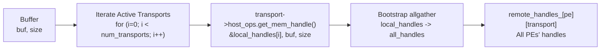

**Sources:** [src/host/mem/mem_heap.cpp:1104-1148]()

**Transport-Specific Handle Structure:**

Each transport defines its own memory handle format (e.g., at [src/modules/transport/libfabric/libfabric.h:426-439]()):

```c
typedef struct {
    struct fid_mr *mr;           // Memory region object
    uint64_t key;                // RDMA key
    void *local_desc;            // Local descriptor for operations
} nvshmemt_libfabric_mem_handle_ep_t;

typedef struct {
    void *buf;                   // Buffer pointer
    nvshmemt_libfabric_mem_handle_ep_t hdls[2];  // Per-endpoint handles
} nvshmemt_libfabric_mem_handle_t;
```

**Handle Registration Process:**

1. **Local Registration**: `transport->host_ops.get_mem_handle()` registers memory with the transport
2. **Exchange**: Bootstrap `allgather()` exchanges handles across all PEs
3. **Storage**: Handles stored in `remote_handles_[pe * num_transports + transport_idx]`
4. **Caching**: Index mapping stored in `idx_in_handles_` for fast lookup

**Sources:** [src/modules/transport/libfabric/libfabric.h:426-439](), [src/host/mem/mem_heap.cpp:1104-1148]()

### External Buffer Registration

External buffers (e.g., user-allocated via `cudaMalloc()`) can be registered for use in NVSHMEM operations via `nvshmemx_buffer_register()`.

**Registration Flow:**

1. Call `heap_obj->register_ext_buffer(buf, size)` 
2. For each transport: `transport->host_ops.get_mem_handle()` 
3. Bootstrap exchange of handles 
4. Store in `remote_mmap_handles_` (separate from symmetric heap handles)
5. Update handle cache with `idx_in_mmap_handles_` mapping

**Deregistration:**

`nvshmemx_buffer_unregister()` calls `heap_obj->unmap_mem()`, which:
- Unmaps P2P memory regions (`cuMemUnmap()` for VMM heaps)
- Releases transport handles (`transport->host_ops.release_mem_handle()`)
- Removes from handle cache

**Sources:** [src/host/mem/mem_heap.cpp:1289-1393](), [src/host/mem/mem_heap.cpp:1395-1475]()

### Memory Handle Cache

NVSHMEM maintains two types of handle caches for efficient memory handle lookup:

1. **Symmetric Heap Cache** (`idx_in_handles_`): Maps heap addresses to handle indices
2. **Transport Handle Cache** (`transport_mem_handle_info_cache`): Per-transport RDMA handle lookup

**Symmetric Heap Cache Architecture:**

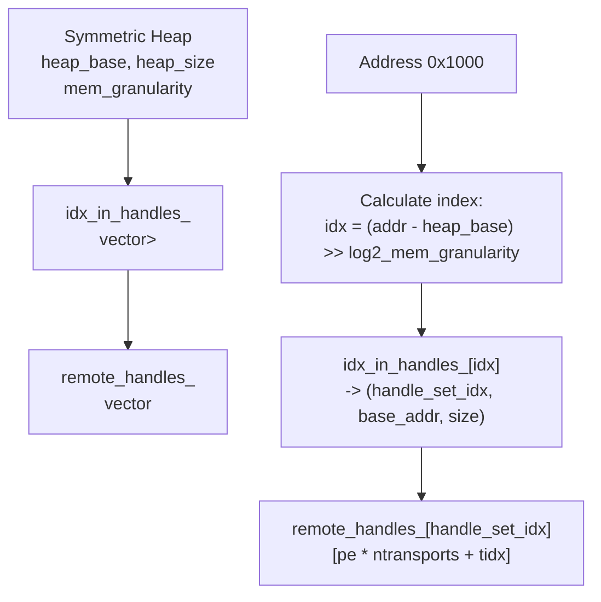

**Update Process** (at [src/host/mem/mem_heap.cpp:193-204]()):

After each registration, `update_idx_in_handle()` populates the cache:
```
addr_idx = (buf - heap_base) >> log2_mem_granularity
for (i = 0; i < size / mem_granularity; i++) {
    idx_in_handles_[addr_idx + i] = (handle_set_idx, buf, size)
}
```

**Sources:** [src/host/mem/mem_heap.cpp:193-204](), [src/host/mem/mem_heap.cpp:317-339]()

**Transport Memory Handle Cache:**

Each transport maintains its own handle cache implemented in [src/modules/transport/common/transport_common.cpp:15-227]():

```c
struct transport_mem_handle_info_cache {
    void **cache;                      // Array of handle pointers
    uint64_t size;                     // Cache size
    uint64_t address_granularity;      // Granularity (from transport)
    uintptr_t address_mask;            // Mask for alignment
};
```

**Cache Operations:**

| Function | Purpose | Implementation |
|----------|---------|----------------|
| `nvshmemt_mem_handle_cache_init()` | Initialize cache with 1000 entries | [transport_common.cpp:85-112]() |
| `nvshmemt_mem_handle_cache_add()` | Add handle for address | [transport_common.cpp:114-151]() |
| `nvshmemt_mem_handle_cache_get()` | Lookup handle by address | [transport_common.cpp:153-174]() |
| `nvshmemt_mem_handle_cache_remove()` | Remove handle | [transport_common.cpp:187-212]() |

**Address Calculation:**
```c
addr_offset = (char *)addr - (char *)t->heap_base;
aligned_addr = addr_offset & cache->address_mask;
arr_idx = aligned_addr / cache->address_granularity;
return cache->cache[arr_idx];
```

**Dynamic Growth:** Cache doubles in size when capacity is exceeded (at [transport_common.cpp:133-147]()).

**Sources:** [src/modules/transport/common/transport_common.cpp:15-227]()

### NVLS (NVLink SHARP) Integration

NVLS provides hardware-accelerated multicast for symmetric memory when using VMM heaps on supported platforms. Managed by `nvshmemi_nvls_rsc` class.

**NVLS Resource Lifecycle:**

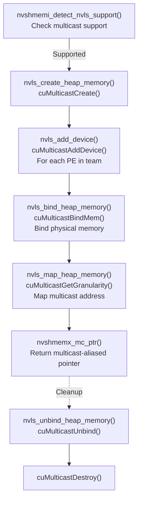

**NVLS Requirements** (checked at [src/host/init/init.cu:448-492]()):

1. VMM heap: `dynamic_cast<nvshmemi_symmetric_heap_vidmem_dynamic_vmm *>(state->heap_obj) != nullptr`
2. Hardware support: `cuDeviceGetAttribute(CU_DEVICE_ATTRIBUTE_MULTICAST_SUPPORTED) == 1`
3. CUDA 12.1+ driver with `cuMulticast*` APIs available
4. Not disabled via `NVSHMEM_DISABLE_NVLS=1`

**Multicast Handle Management:**

Each team with P2P connectivity gets an NVLS resource:

```c
struct nvshmemi_nvls_rsc {
    CUmulticastObjectProp mc_prop;        // Multicast properties
    size_t mc_granularity;                 // Granularity
    CUmemGenericAllocationHandle mc_handle;  // Multicast handle
    void *mc_ptr;                          // Multicast-aliased pointer
    size_t mc_size;                        // Size of multicast region
};
```

**Multicast Pointer Translation:**

For address `addr` in symmetric heap:
```c
offset = (char *)addr - (char *)heap_base;
mc_addr = (char *)nvls_rsc->mc_ptr + offset;
return mc_addr;  // Write to this broadcasts to all PEs in team
```

**Sources:** [src/host/init/init.cu:448-492](), [src/include/internal/host/nvshmemi_nvls_rsc.hpp:1-85]()

## Remote Memory Access

NVSHMEM provides two primary patterns for remote memory access: peer access and multicast access.

### Peer Access (nvshmem_ptr)

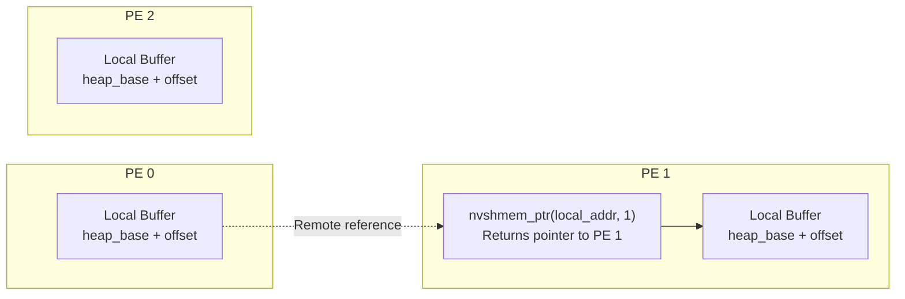

#### C/C++ API

```c
void *nvshmem_ptr(const void *dest, int pe);
```

Returns a pointer to a symmetric object on a remote PE, allowing direct loads and stores from device code.

**Use Case:** Efficient for patterns with multiple reads/writes to the same remote location that don't match standard RMA patterns (put/get).

**Constraint:** Only works when peer-to-peer (P2P) GPU access is available (e.g., NVLink). Returns NULL if P2P is not available.

**Sources:** [nvshmem4py/nvshmem/core/memory.py:125-164]()

#### Python API

```python
def get_peer_buffer(buffer: Buffer, pe: int) -> Buffer
```

Returns a `Buffer` object representing the peer's memory.

**Implementation:**
1. Retrieve buffer metadata from `mr._mem_references`
2. Call C API `nvshmem_ptr()` via bindings
3. Wrap returned pointer in new `Buffer` with `BufferTypes.PEER`
4. Return buffer marked as not owned (no-op on free)

**Example Usage:**
```python
# Allocate symmetric buffer
buf = nvshmem.buffer(1024)

# Get peer buffer for PE 1
peer_buf = nvshmem.get_peer_buffer(buf, pe=1)

# peer_buf can be passed to kernels for direct access
# DO NOT call nvshmem.free(peer_buf) - memory is not owned
```

**Framework Integration:**
- `get_peer_tensor(tensor, pe)` - PyTorch variant
- `get_peer_array(array, pe)` - CuPy variant

**Sources:** [nvshmem4py/nvshmem/core/memory.py:125-164](), [nvshmem4py/nvshmem/core/interop/torch.py:137-145](), [nvshmem4py/nvshmem/core/interop/cupy.py:131-139]()

### Multicast Access (nvshmemx_mc_ptr)

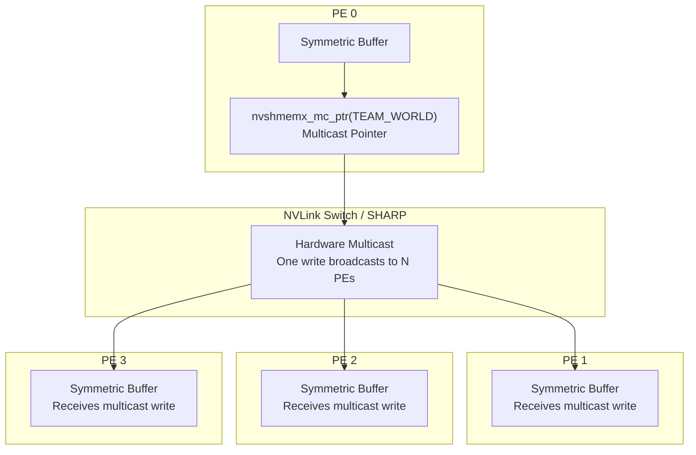

#### C/C++ API

```c
void *nvshmemx_mc_ptr(void *dest, nvshmem_team_t team);
```

Returns a multicast-aliased pointer for use with NVLink SHARP (NVLS) hardware acceleration.

**Properties:**
- **Device-Only Access:** Cannot be accessed from host (CPU) code - will segfault
- **Team-Scoped:** Multicast applies to all PEs in the specified team
- **Hardware Acceleration:** Leverages NVSwitch for efficient one-to-many operations

**Requirements:**
- VMM heap allocation (`nvshmemi_symmetric_heap_vidmem_dynamic_vmm`)
- NVLS platform support (detected via `nvshmemi_detect_nvls_support()`)
- CUDA 12.1+ driver with `cuMulticast*` APIs
- NVSwitch hardware

**Sources:** [src/host/init/init.cu:446-492]()

#### Python API

```python
def get_multicast_buffer(team: Teams, buffer: Buffer) -> Buffer
```

Returns a multicast-aliased `Buffer` for the specified team.

**Implementation:**
1. Extract buffer from `mr._mem_references`
2. Call C API `nvshmemx_mc_ptr()` via bindings
3. Wrap in new `Buffer` with `BufferTypes.MULTICAST`
4. Return buffer marked as alias (no-op on free)

**Example with Triton:**
```python
# Allocate symmetric tensor
tensor = nvshmem.tensor((512,), dtype=torch.float32)

# Get multicast pointer
mc_tensor = nvshmem.get_multicast_tensor(nvshmem.Teams.TEAM_WORLD, tensor)

# Use in Triton kernel
@triton.jit
def broadcast_kernel(src_ptr, mc_ptr, n_elements):
    # Load from local, multicast store to all PEs
    val = tl.load(src_ptr)
    multimem_st_b64(mc_ptr, val)  # Hardware broadcast

broadcast_kernel[(n_elements,)](tensor, mc_tensor, n_elements)
```

See [nvshmem4py/examples/triton_comm_kernels.py:1-159]() for complete example.

**Framework Integration:**
- `get_multicast_tensor(team, tensor)` - PyTorch
- `get_multicast_array(team, array)` - CuPy

**Important Limitations:**
- Cannot use `copy_from()` or `copy_to()` on multicast buffers
- Only valid within GPU kernels
- Must synchronize with corresponding team barriers

**Sources:** [nvshmem4py/nvshmem/core/memory.py:227-272](), [nvshmem4py/nvshmem/core/interop/torch.py:147-180](), [nvshmem4py/nvshmem/core/interop/cupy.py:141-175]()

## Python Memory Management Details

### Framework Interoperability

NVSHMEM's Python bindings provide seamless integration with PyTorch and CuPy through DLPack.

#### PyTorch Integration

```python
# Allocation
tensor = nvshmem.tensor(shape=(1024,), dtype=torch.float32)

# Framework operations work transparently
tensor += 1.0
result = torch.sum(tensor)

# Cleanup
nvshmem.free_tensor(tensor)
```

**Memory Order Support:**
- `morder="C"` - Row-major (C-style) layout (default)
- `morder="F"` - Column-major (Fortran-style) layout

Fortran-style layout implemented via `as_strided()`:
```python
strides = [1]
for dim in shape[:-1]:
    strides.append(strides[-1] * dim)
view = tensor.as_strided(size=shape, stride=strides)
```

**Tensor Extraction:**
```python
def tensor_get_buffer(tensor: Tensor) -> Tuple[Buffer, int, str]:
    mr = _mr_references.get(int(tensor.get_device()))
    buf = mr._mem_references.get(int(tensor.data_ptr()), {}).get("buffer")
    return buf, (torch.numel(tensor) * tensor.element_size()), str(tensor.dtype)
```

**Sources:** [nvshmem4py/nvshmem/core/interop/torch.py:70-108](), [nvshmem4py/nvshmem/core/interop/torch.py:55-68]()

#### CuPy Integration

```python
# Allocation  
array = nvshmem.array(shape=(1024,), dtype="float32")

# CuPy operations
result = cupy.sum(array)
array *= 2.0

# Cleanup
nvshmem.free_array(array)
```

**Array Extraction:**
```python
def array_get_buffer(array: ndarray) -> Tuple[Buffer, int, str]:
    mr = _mr_references.get(array.device.id)
    buf = mr._mem_references.get(int(array.data.ptr), {}).get("buffer")
    return buf, get_size(array.shape, array.dtype), str(array.dtype)
```

**Byte Array Variant:**
Both frameworks provide `bytetensor()`/`bytearray()` functions that allocate raw byte memory (dtype=uint8/int8) sized for the requested shape and dtype, useful for low-level operations.

**Sources:** [nvshmem4py/nvshmem/core/interop/cupy.py:65-129](), [nvshmem4py/nvshmem/core/interop/cupy.py:49-62]()

### Reference Counting and Lifecycle

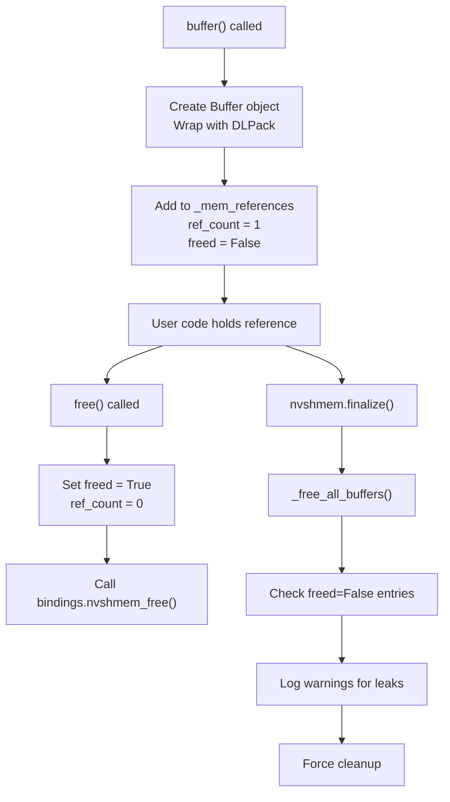

**Buffer Metadata Dictionary:**
```python
{
    "buffer": Buffer,           # cuda.core Buffer object
    "ref_count": int,           # Reference count
    "freed": bool,              # Has free() been called?
    "type": BufferTypes,        # NORMAL, PEER, MULTICAST, EXTERNAL
    "released": bool,           # Skip tracking if release=True
    "except_on_del": bool       # Exception vs warning on error
}
```

**Sources:** [nvshmem4py/nvshmem/core/_internal_tracking.py:18-45](), [nvshmem4py/nvshmem/core/memory.py:28-52]()

### Buffer Type Categories

```python
class BufferTypes(IntEnum):
    NORMAL = 0      # Standard symmetric allocation
    PEER = 1        # Peer pointer (nvshmem_ptr)
    MULTICAST = 2   # Multicast pointer (nvshmemx_mc_ptr)
    EXTERNAL = 3    # Registered external buffer
```

**Type-Specific Behavior:**
- `NORMAL`: Full lifecycle management, collective free required
- `PEER`: No-op on free (memory not owned, alias of remote buffer)
- `MULTICAST`: No-op on free (alias of symmetric buffer)
- `EXTERNAL`: Call `nvshmemx_buffer_unregister()` on free

**Sources:** [nvshmem4py/nvshmem/core/interop/cupy.py:16]()

## Memory Visibility and Device State

The device-side view of symmetric memory is maintained through `nvshmemi_device_host_state_t`, copied to device constant memory via `cudaMemcpy`.

### Device State Memory Fields

```c
typedef struct {
    int version;
    int mype, npes;
    // ... initialization fields ...
    
    void *heap_base;                  // Base address of symmetric heap
    size_t heap_size;                 // Total heap size in bytes
    void **peer_heap_base_p2p;        // P2P-mapped peer base addresses
    void **peer_heap_base_remote;     // Remote peer base addresses (via transport)
    bool symmetric_heap_kind;         // true = vidmem, false = sysmem
    
    // ... proxy channel and team fields ...
} nvshmemi_device_host_state_t;
```

**Update Mechanism:**
```c
int nvshmemi_update_device_state() {
    // For each registered device state pointer:
    for (auto it = registered_device_states.cbegin(); 
         it != registered_device_states.cend(); ++it) {
        status = cudaMemcpy(it->first, &nvshmemi_device_state,
                           sizeof(nvshmemi_device_host_state_t),
                           cudaMemcpyHostToDevice);
    }
}
```

**Called During:**
- Initialization after heap setup via `nvshmemi_common_init()`
- When registering new device modules via `nvshmemx_cumodule_init()`
- After memory topology changes

**Sources:** [src/include/device_host/nvshmem_types.h:453-509](), [src/host/init/init.cu:146-197]()

## Initialization and Configuration

### Heap Initialization Flow

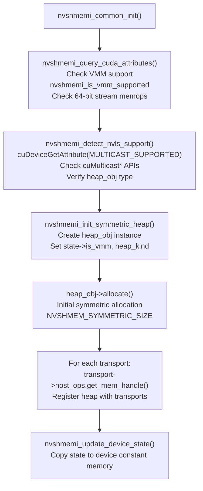

**Environment Variables:**
- `NVSHMEM_SYMMETRIC_SIZE` - Heap size in bytes (0 = system memory)
- `NVSHMEM_DISABLE_CUDA_VMM` - Force disable VMM even if supported
- `NVSHMEM_DISABLE_NVLS` - Disable NVLS multicast support

**Sources:** [src/host/init/init.cu:446-492](), [src/host/init/init.cu:949-1017]()

### Python Initialization with Memory Context

```python
from cuda.core.experimental import Device
import nvshmem.core as nvshmem

# Select and set device
dev = Device(0)
dev.set_current()

# Initialize with device context
nvshmem.init(device=dev, mpi_comm=MPI.COMM_WORLD)

# Device is cached in _cached_device
# Memory allocations automatically use cached device
buf = nvshmem.buffer(1024)  # Uses cached device context
```

**Cached Device Management:**
```python
_cached_device = {"device": None}  # Global cache

def _get_device():
    """Returns (nvshmem_device, other_device_if_switched)"""
    user_nvshmem_dev = _cached_device["device"]
    other_dev = None
    
    if user_nvshmem_dev != Device():  # Current device differs
        other_dev = Device()
        user_nvshmem_dev.set_current()
    
    return user_nvshmem_dev, other_dev
```

This caching avoids repeated `Device()` calls, improving performance in tight allocation loops.

**Sources:** [nvshmem4py/nvshmem/core/_internal_tracking.py:38-40](), [nvshmem4py/nvshmem/core/memory.py:76-92]()

---

**Additional Sources:**
- [src/include/internal/host/nvshmem_internal.h:1-221]()
- [nvshmem4py/nvshmem/core/_internal_tracking.py:1-46]()
- [nvshmem4py/examples/triton_comm_kernels.py:1-159]()

---

