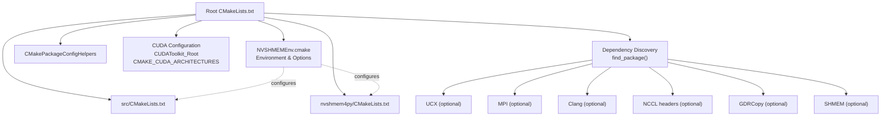
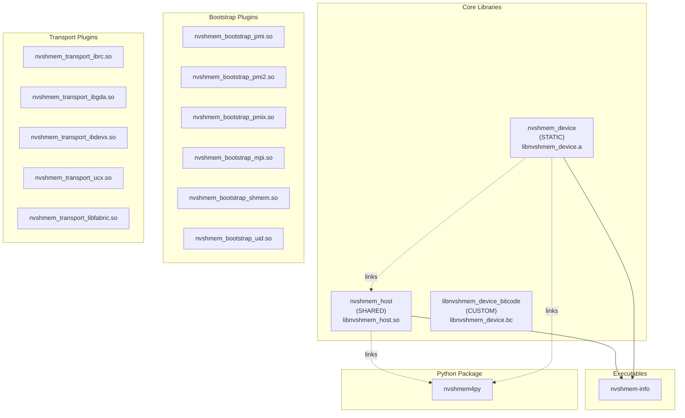
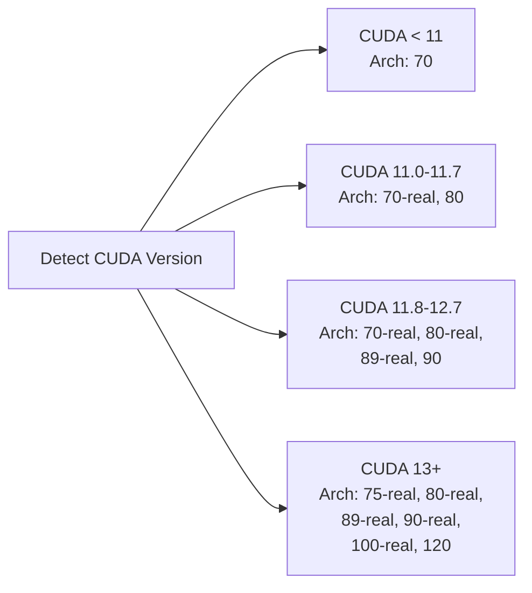
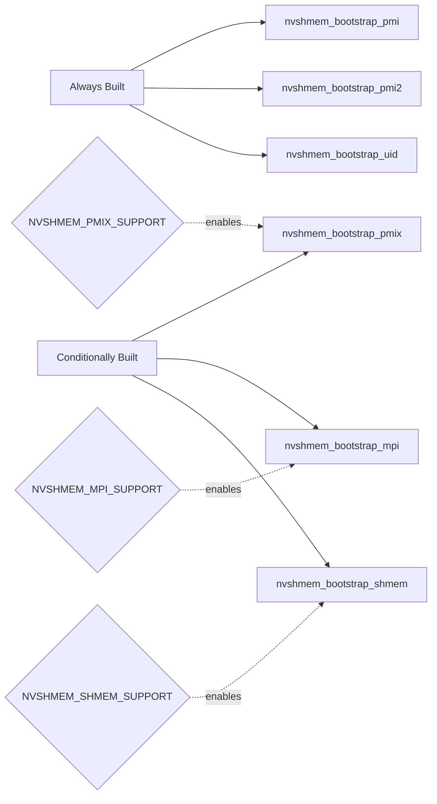
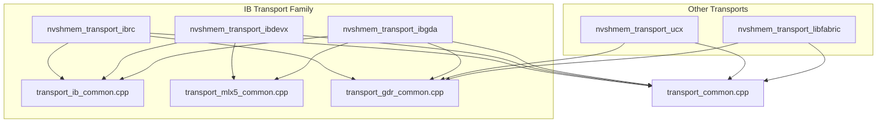
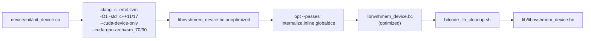
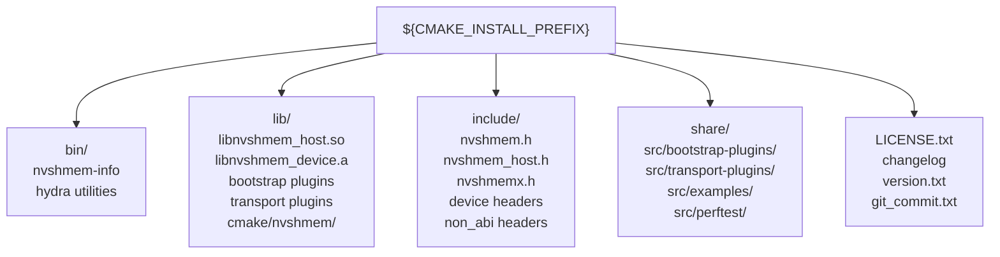
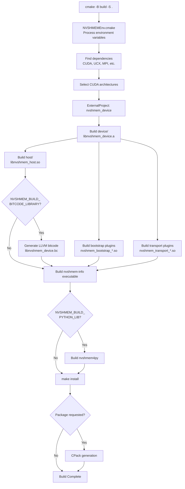

<!-- source: DeepWiki mcp.deepwiki.com · repo NVIDIA/nvshmem · page 3 Build System · fetched 2026-10-26 -->

# Build System

<details>
<summary>Relevant source files</summary>

The following files were used as context for generating this wiki page:

- [CMakeLists.txt](CMakeLists.txt)
- [cmake_config/NVSHMEMEnv.cmake](cmake_config/NVSHMEMEnv.cmake)
- [nvshmem4py/scripts/generate_pyproject_toml.py](nvshmem4py/scripts/generate_pyproject_toml.py)
- [src/CMakeLists.txt](src/CMakeLists.txt)

</details>


## Purpose and Scope

This document provides an overview of NVSHMEM's CMake-based build system, covering build configuration, dependency discovery, and the generation of core libraries, plugin modules, and executables. For detailed information about building the C/C++ core library and plugins, see [Core Library Build](#3.1). For Python bindings build specifics, see [Python Bindings Build](#3.2).

---

## Build System Architecture

NVSHMEM uses a hierarchical CMake build system with three primary configuration files:

1. **[CMakeLists.txt:1-189]()** - Root configuration: project setup, CUDA configuration, and top-level build orchestration
2. **[src/CMakeLists.txt:1-1066]()** - Core library build: host/device libraries, bootstrap/transport plugins, and installation rules
3. **[cmake_config/NVSHMEMEnv.cmake:1-178]()** - Environment variable configuration and build option management

### CMake Configuration Flow



**Sources:** [CMakeLists.txt:1-189](), [cmake_config/NVSHMEMEnv.cmake:1-178]()

---

## Build Configuration Options

NVSHMEM's build is controlled by environment variables that are transformed into CMake options via macros defined in `NVSHMEMEnv.cmake`. Options are categorized as enabled-by-default or disabled-by-default.

### Configuration Macros

| Macro | Purpose | Default Behavior |
|-------|---------|------------------|
| `nvshmem_add_default_on_option` | Define option enabled by default | ON if env var unset |
| `nvshmem_add_default_off_option` | Define option disabled by default | OFF if env var unset |
| `nvshmem_add_default_environment_path` | Define path variable | Uses provided default |

**Sources:** [cmake_config/NVSHMEMEnv.cmake:9-34]()

### Key Build Options

#### Transport Support (Default: ON)
- `NVSHMEM_IBRC_SUPPORT` - InfiniBand Reliable Connected transport
- `NVSHMEM_IBGDA_SUPPORT` - InfiniBand GPU Direct Async transport (Default: OFF)
- `NVSHMEM_IBDEVX_SUPPORT` - InfiniBand DEVX transport (Default: OFF)
- `NVSHMEM_UCX_SUPPORT` - UCX transport (Default: OFF)
- `NVSHMEM_LIBFABRIC_SUPPORT` - Libfabric transport (Default: OFF)

#### Bootstrap Support
- `NVSHMEM_MPI_SUPPORT` - MPI bootstrap (Default: ON)
- `NVSHMEM_PMIX_SUPPORT` - PMIx bootstrap (Default: OFF)
- `NVSHMEM_SHMEM_SUPPORT` - SHMEM bootstrap (Default: OFF)

#### Feature Flags
- `NVSHMEM_USE_GDRCOPY` - GDRCopy integration for CPU-side GPU memory access (Default: ON)
- `NVSHMEM_USE_NCCL` - NCCL integration for collectives (Default: OFF)
- `NVSHMEM_ENABLE_ALL_DEVICE_INLINING` - Inline all device code (Default: OFF)

**Sources:** [cmake_config/NVSHMEMEnv.cmake:36-87]()

### Dependency Paths

| Variable | Default | Description |
|----------|---------|-------------|
| `CUDA_HOME` | `/usr/local/cuda` | CUDA Toolkit installation |
| `UCX_HOME` | `/usr/local/ucx` | UCX installation |
| `LIBFABRIC_HOME` | `/usr/local/libfabric` | Libfabric installation |
| `MPI_HOME` | `/usr/local/ompi` | MPI implementation |
| `GDRCOPY_HOME` | `/usr/local/gdrdrv` | GDRCopy installation |
| `NVSHMEM_PREFIX` | `/usr/local/nvshmem` | Installation prefix |

**Sources:** [cmake_config/NVSHMEMEnv.cmake:90-103]()

---

## Build Targets and Output Artifacts

### Build Target Hierarchy



**Sources:** [src/CMakeLists.txt:22-45](), [src/CMakeLists.txt:121-220](), [src/CMakeLists.txt:399-570](), [src/CMakeLists.txt:624-630]()

### Library Versioning

#### Host Library
- **Major.Minor.Patch:** `${PROJECT_VERSION_MAJOR}.${PROJECT_VERSION_MINOR}.${PROJECT_VERSION_PATCH}`
- **SOVERSION:** `${PROJECT_VERSION_MAJOR}`
- Configured at: [src/CMakeLists.txt:245-246]()

#### Bootstrap Plugins
- **Version:** `3.0.0` (MAJOR.MINOR.PATCH)
- **SOVERSION:** `3`
- Configured at: [src/CMakeLists.txt:8-10](), [src/CMakeLists.txt:222-226]()

#### Transport Plugins
- **Version:** `4.0.0` (MAJOR.MINOR.PATCH)
- **SOVERSION:** `4`
- Configured at: [src/CMakeLists.txt:400-402](), [src/CMakeLists.txt:563-569]()

**Sources:** [src/CMakeLists.txt:8-10](), [src/CMakeLists.txt:245-246](), [src/CMakeLists.txt:400-402]()

---

## CUDA Architecture Configuration

NVSHMEM automatically selects appropriate CUDA architectures based on the detected CUDA Toolkit version:



Users can override this by setting `CMAKE_CUDA_ARCHITECTURES` before invoking CMake.

**Sources:** [CMakeLists.txt:35-85]()

---

## Dependency Discovery Process

### Package Discovery Order

```mermaid
graph TD
    START["CMake Configuration"]
    
    CUDA["find_package(CUDAToolkit)<br/>Required"]
    CCCL["find_package(CCCL)<br/>Optional for CUDA 12+"]
    
    UCX_CHECK{"NVSHMEM_UCX_SUPPORT?"}
    UCX_FIND["find_package(UCX)<br/>REQUIRED"]
    
    MPI_CHECK{"NVSHMEM_MPI_SUPPORT?"}
    MPI_FIND["find_package(MPI)<br/>REQUIRED"]
    
    CLANG_CHECK{"NVSHMEM_BUILD_<br/>BITCODE_LIBRARY?"}
    CLANG_FIND["find_package(Clang)<br/>REQUIRED"]
    
    NCCL_CHECK{"NVSHMEM_USE_NCCL?"}
    NCCL_FIND["find_path(NCCL_INCLUDE<br/>nccl.h)"]
    
    GDR_CHECK{"NVSHMEM_USE_GDRCOPY?"}
    GDR_FIND["find_path(GDRCOPY_INCLUDE<br/>gdrapi.h)"]
    
    SHMEM_CHECK{"NVSHMEM_SHMEM_SUPPORT?"}
    SHMEM_FIND["find_library(SHMEM_LIB<br/>oshmem)"]
    
    START --> CUDA
    CUDA --> CCCL
    CCCL --> UCX_CHECK
    
    UCX_CHECK -->|Yes| UCX_FIND
    UCX_CHECK -->|No| MPI_CHECK
    UCX_FIND --> MPI_CHECK
    
    MPI_CHECK -->|Yes| MPI_FIND
    MPI_CHECK -->|No| CLANG_CHECK
    MPI_FIND --> CLANG_CHECK
    
    CLANG_CHECK -->|Yes| CLANG_FIND
    CLANG_CHECK -->|No| NCCL_CHECK
    CLANG_FIND --> NCCL_CHECK
    
    NCCL_CHECK -->|Yes| NCCL_FIND
    NCCL_CHECK -->|No| GDR_CHECK
    NCCL_FIND --> GDR_CHECK
    
    GDR_CHECK -->|Yes| GDR_FIND
    GDR_CHECK -->|No| SHMEM_CHECK
    GDR_FIND --> SHMEM_CHECK
    
    SHMEM_CHECK -->|Yes| SHMEM_FIND
    SHMEM_CHECK -->|No| END["Continue Build"]
    SHMEM_FIND --> END
```



**Sources:** [CMakeLists.txt:63-142]()

### InfiniBand Hardware Capability Detection

The build system performs compile-time checks for InfiniBand features:

| Check | Macro | Purpose |
|-------|-------|---------|
| `IBV_ACCESS_RELAXED_ORDERING` | `HAVE_IBV_ACCESS_RELAXED_ORDERING` | Relaxed ordering support |
| `MLX5DV_UAR_ALLOC_TYPE_NC_DEDICATED` | `HAVE_MLX5DV_UAR_ALLOC_TYPE_NC_DEDICATED` | Dedicated non-cached UAR allocation |
| `MLX5DV_UMEM_MASK_DMABUF` | `HAVE_MLX5DV_UMEM_MASK_DMABUF` | DMA-BUF support |

**Sources:** [src/CMakeLists.txt:404-501]()

---

## Source File Organization

### Host Library Sources

The `nvshmem_host` shared library is built from multiple source categories:

#### CUDA-Compiled Sources with Register Limits
Files compiled with `--maxrregcount=32`:
- RMA operations: `host/comm/rma.cu`
- Stream-based operations: `host/stream/comm/*.cu`
- Stream-based collectives: `host/stream/coll/**/*.cu`

**Sources:** [src/CMakeLists.txt:291-314](), [src/CMakeLists.txt:617]()

#### Host-Only Sources
C++ sources without register count limits:
- Bootstrap: `host/bootstrap/*.cpp`
- Collectives: `host/coll/**/*.cpp`
- Communication: `host/comm/*.cpp`
- Initialization: `host/init/*.cu`, `host/init/*.cpp`
- Memory management: `host/mem/*.cpp`
- Team management: `host/team/*.cpp`, `host/team/*.cu`
- Topology: `host/topo/topo.cpp`
- Utilities: `host/util/*.cpp`

**Sources:** [src/CMakeLists.txt:316-359]()

### Device Library Sources

The `nvshmem_device` static library is built via an `ExternalProject`:
- Device initialization: `device/init/init_device.cu`
- Collective launch: `device/launch/collective_launch.cpp`
- Optional transfer device: `device/comm/transfer_device.cu` (if not using all-inline mode)

**Sources:** [src/CMakeLists.txt:22-45](), [src/CMakeLists.txt:286-289](), [src/CMakeLists.txt:604-611]()

---

## Bootstrap and Transport Plugin Build

### Bootstrap Plugin Configuration

All bootstrap plugins are built as shared libraries with versioned symbols. The `ACTIVE_BOOTSTRAPS` list tracks which plugins are enabled:



**Sources:** [src/CMakeLists.txt:120-220]()

#### Bootstrap Common Dependencies

All bootstrap plugins link against:
- `modules/bootstrap/common/bootstrap_util.cpp`
- Version script: `nvshmem_bootstrap.sym`

**Sources:** [src/CMakeLists.txt:125-128](), [src/CMakeLists.txt:144]()

### Transport Plugin Configuration

Transport plugins are similarly managed via the `ACTIVE_TRANSPORTS` list:



**Sources:** [src/CMakeLists.txt:410-561]()

#### Transport-Specific Dependencies

| Transport | Required Libraries | Optional Features |
|-----------|-------------------|-------------------|
| `ibrc` | `libibverbs` | GDRCopy, Relaxed Ordering |
| `ibdevx` | `libibverbs`, `libmlx5` | Relaxed Ordering |
| `ibgda` | `libibverbs`, `libmlx5` | GDRCopy, Dedicated UAR, DMA-BUF |
| `ucx` | `ucx::ucs`, `ucx::ucp` | GDRCopy |
| `libfabric` | `libfabric` | GDRCopy |

**Sources:** [src/CMakeLists.txt:436-461](), [src/CMakeLists.txt:468-489](), [src/CMakeLists.txt:491-535](), [src/CMakeLists.txt:412-434](), [src/CMakeLists.txt:537-561]()

---

## Bitcode Library Generation

When `NVSHMEM_BUILD_BITCODE_LIBRARY=ON`, an LLVM bitcode library is generated using Clang:

### Bitcode Build Process



**Key internalized symbols:** `nvshmem_*`, `nvshmemx_*`, `nvshmemi_device_lib_version_d`, `nvshmemi_device_state_d`

**Sources:** [src/CMakeLists.txt:60-101]()

---

## Compilation Configuration

### Compiler Base Configuration Macro

The `nvshmem_library_set_base_config` macro applies common settings to all NVSHMEM libraries:

#### Platform-Specific Defines
- `NVSHMEM_X86_64` for x86_64 architecture
- `NVSHMEM_PPC64LE` for ppc64le architecture
- `NVSHMEM_AARCH64` for aarch64 architecture

#### Build Type Flags
- **Debug:** `-O0 -g -G` (CUDA), `-O0 -g` (C++)
- **Release:** `-O3`

#### CUDA-Specific Options
- `-Xptxas -v` when `NVSHMEM_VERBOSE=ON`
- `-t4` for parallel NVCC compilation (if supported)
- `__STDC_LIMIT_MACROS` and `__STDC_CONSTANT_MACROS` defines

#### Development Mode
When `NVSHMEM_DEVEL=ON`, strict warnings are enabled:
- CUDA: `-Werror all-warnings`
- C++: `-Werror -Wall -Wextra` (with some exceptions)

**Sources:** [src/CMakeLists.txt:249-280]()

---

## Installation Layout

### Install Directories



**Sources:** [src/CMakeLists.txt:162-164](), [src/CMakeLists.txt:884-967]()

### CMake Package Configuration Files

Installed CMake files enable `find_package(NVSHMEM)`:
- `NVSHMEMConfig.cmake` - Main configuration file
- `NVSHMEMVersion.cmake` - Version compatibility information
- `NVSHMEMTargets.cmake` - Exported target definitions
- `NVSHMEMDeviceTargets.cmake` - Device library target

**Sources:** [CMakeLists.txt:166-174](), [src/CMakeLists.txt:862-914]()

### Plugin Source Distribution

Source code for creating custom plugins is installed to `share/src/`:

#### Bootstrap Plugin Template
- Source files: `modules/bootstrap/**/*.cpp`, `modules/bootstrap/**/*.c`
- Headers: Selected from `include/bootstrap_*/`, `include/internal/bootstrap_*/`
- Build system: `CMakeLists.txt.in` templates
- Symbol export: `nvshmem_bootstrap.sym`

**Sources:** [src/CMakeLists.txt:689-744]()

#### Transport Plugin Template
- Source files: `modules/transport/**/*.cpp`, `modules/transport/**/*.h`
- Headers: Selected from `include/*_transport/`, `include/internal/host_transport/`
- Build system: `CMakeLists.txt.in` templates
- Symbol export: `nvshmem_transport.sym`

**Sources:** [src/CMakeLists.txt:746-805]()

---

## Package Generation

NVSHMEM supports multiple package formats controlled by build options:

### Package Types

| Option | Generator | Package Format |
|--------|-----------|----------------|
| `NVSHMEM_BUILD_TGZ_PACKAGE` | TGZ | Gzipped tar archive |
| `NVSHMEM_BUILD_TXZ_PACKAGE` | TXZ | XZ-compressed tar archive (default ON) |
| `NVSHMEM_BUILD_RPM_PACKAGE` | RPM | Red Hat package |
| `NVSHMEM_BUILD_DEB_PACKAGE` | DEB | Debian package |

### Package Naming Convention

**Binary Package:**
```
libnvshmem_${VERSION_MAJOR}.${VERSION_MINOR}.${VERSION_PATCH}-${VERSION_TWEAK}+cuda${CUDA_MAJOR}.${CUDA_MINOR}_${ARCH}
```

**Source Package:**
```
nvshmem_src_${VERSION_MAJOR}.${VERSION_MINOR}.${VERSION_PATCH}-${VERSION_TWEAK}
```

**Sources:** [src/CMakeLists.txt:971-1044]()

### Version Information Generation

The `git_commit` custom target generates version metadata:
- Extracts git commit hash (if available)
- Records `NVSHMEM_MAJOR`, `NVSHMEM_MINOR`, `NVSHMEM_PATCH`, `NVSHMEM_PACKAGE`
- Creates `git_commit.txt` and `version.txt` files

**Sources:** [src/CMakeLists.txt:809-817]()

---

## Build Process Summary



**Sources:** [CMakeLists.txt:1-189](), [src/CMakeLists.txt:22-1066]()

---

## Key Build System Files

| File | Purpose |
|------|---------|
| `CMakeLists.txt` | Root project configuration |
| `src/CMakeLists.txt` | Core library and plugin builds |
| `device/CMakeLists.txt` | Device library external project |
| `cmake_config/NVSHMEMEnv.cmake` | Environment variable configuration |
| `cmake_config/NVSHMEMConfig.cmake.in` | CMake package config template |
| `nvshmem_host.sym` | Host library symbol export list |
| `nvshmem_bootstrap.sym` | Bootstrap plugin symbol export list |
| `nvshmem_transport.sym` | Transport plugin symbol export list |

**Sources:** [CMakeLists.txt:1-189](), [src/CMakeLists.txt:1-1066](), [cmake_config/NVSHMEMEnv.cmake:1-178]()

---

