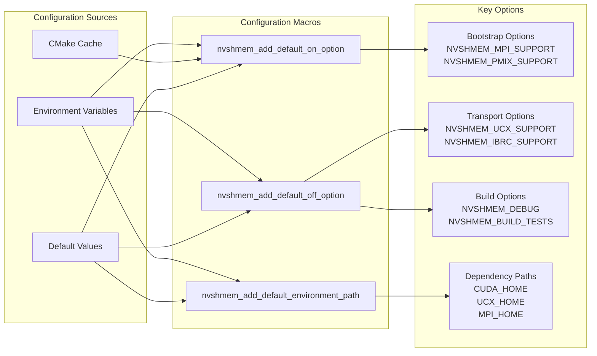

<!-- source: DeepWiki mcp.deepwiki.com · repo NVIDIA/nvshmem · page 3.1 Core Library Build · fetched 2026-10-26 -->

# Core Library Build

<details>
<summary>Relevant source files</summary>

The following files were used as context for generating this wiki page:

- [CMakeLists.txt](CMakeLists.txt)
- [cmake_config/NVSHMEMEnv.cmake](cmake_config/NVSHMEMEnv.cmake)
- [nvshmem4py/scripts/generate_pyproject_toml.py](nvshmem4py/scripts/generate_pyproject_toml.py)
- [src/CMakeLists.txt](src/CMakeLists.txt)

</details>


This document covers the build system for the core NVSHMEM C/C++ library, including CMake configuration, transport options, bootstrap methods, and installation procedures. The build system is primarily defined in the main CMakeLists.txt file and produces the core libraries that provide NVSHMEM functionality.

For information about building the Python bindings, see [Python Bindings Build](#3.2). For details about the core library architecture, see [Core Library Architecture](#2.1).

## Build System Overview

The NVSHMEM core library build system uses CMake and is structured as a multi-component system that produces several libraries and utilities:

```mermaid
graph TD
    CMakeLists["src/CMakeLists.txt<br/>Main Build Configuration"]
    
    subgraph "Core Libraries"
        nvshmem_static["nvshmem (static)<br/>Combined library"]
        nvshmem_host["nvshmem_host (shared)<br/>Host-side library"]
        nvshmem_device["nvshmem_device (static)<br/>Device-side library"]
        bitcode["libnvshmem_device.bc<br/>Optional bitcode library"]
    end
    
    subgraph "Bootstrap Libraries"
        bootstrap_pmi["nvshmem_bootstrap_pmi"]
        bootstrap_pmi2["nvshmem_bootstrap_pmi2"] 
        bootstrap_mpi["nvshmem_bootstrap_mpi"]
        bootstrap_pmix["nvshmem_bootstrap_pmix"]
        bootstrap_shmem["nvshmem_bootstrap_shmem"]
        bootstrap_uid["nvshmem_bootstrap_uid"]
    end
    
    subgraph "Transport Libraries"
        transport_ucx["nvshmem_transport_ucx"]
        transport_ibrc["nvshmem_transport_ibrc"]
        transport_ibdevx["nvshmem_transport_ibdevx"]
        transport_ibgda["nvshmem_transport_ibgda"]
        transport_libfabric["nvshmem_transport_libfabric"]
    end
    
    subgraph "Utilities"
        nvshmem_info["nvshmem-info<br/>System information utility"]
    end
    
    CMakeLists --> nvshmem_static
    CMakeLists --> nvshmem_host
    CMakeLists --> nvshmem_device
    CMakeLists --> bitcode
    CMakeLists --> bootstrap_pmi
    CMakeLists --> bootstrap_pmi2
    CMakeLists --> bootstrap_mpi
    CMakeLists --> bootstrap_pmix
    CMakeLists --> bootstrap_shmem
    CMakeLists --> bootstrap_uid
    CMakeLists --> transport_ucx
    CMakeLists --> transport_ibrc
    CMakeLists --> transport_ibdevx
    CMakeLists --> transport_ibgda
    CMakeLists --> transport_libfabric
    CMakeLists --> nvshmem_info
    
    nvshmem_device --> nvshmem_host
    nvshmem_static -.-> nvshmem_device
    nvshmem_static -.-> nvshmem_host
```



Sources: [src/CMakeLists.txt:1-1070]()

## CMake Configuration and Environment Variables

The build system uses a comprehensive set of environment variables and CMake options to control compilation. The configuration is managed through macros defined in the environment configuration:



Key configuration categories include:

| Category | Default State | Examples |
|----------|---------------|----------|
| Bootstrap | ON | `NVSHMEM_MPI_SUPPORT`, `NVSHMEM_PMIX_SUPPORT` |
| Transport | Mixed | `NVSHMEM_IBRC_SUPPORT` (ON), `NVSHMEM_UCX_SUPPORT` (OFF) |
| Build | Mixed | `NVSHMEM_BUILD_TESTS` (ON), `NVSHMEM_DEBUG` (OFF) |
| Functionality | ON | `NVSHMEM_USE_GDRCOPY`, `NVSHMEM_NVTX` |

Sources: [cmake_config/NVSHMEMEnv.cmake:1-176](), [src/CMakeLists.txt:12-20]()

## Core Library Targets

The build system produces three main library targets that form the core of NVSHMEM:

### Static Library (`nvshmem`)

The combined static library includes both host and device code:

- **Target**: `nvshmem` (static library)
- **Sources**: Host sources, device sources, and device sources without max register count
- **Properties**: Position-independent code, CUDA separable compilation
- **Standards**: C++11/C++17 depending on CUDA version

### Shared Host Library (`nvshmem_host`)

The host-only shared library for runtime loading:

- **Target**: `nvshmem_host` (shared library)  
- **Dependencies**: Links with `nvshmem_device` static library
- **Version Script**: Uses `nvshmem_host.sym` for symbol control
- **Sources**: Host sources only (no device compilation)

### Device Library (`nvshmem_device`)

The device-side library built as an external project:

- **Build**: ExternalProject with separate CMake configuration
- **Location**: `device/` subdirectory with its own build system
- **Output**: `libnvshmem_device.a` static library
- **Integration**: Imported target linked into host library

Sources: [src/CMakeLists.txt:22-43](), [src/CMakeLists.txt:223-243](), [src/CMakeLists.txt:605-614]()

## Transport Library System

Transport libraries provide communication backends and are built conditionally based on configuration options:

```mermaid
graph TD
    subgraph "Transport Build Logic"
        transport_check["Transport Support Check<br/>NVSHMEM_*_SUPPORT variables"]
        common_sources["Common Transport Sources<br/>transport_common.cpp<br/>transport_ib_common.cpp"]
        version_script["Version Script<br/>nvshmem_transport.sym"]
    end
    
    subgraph "Available Transports"
        ucx["UCX Transport<br/>nvshmem_transport_ucx<br/>ucx.cpp"]
        ibrc["InfiniBand RC<br/>nvshmem_transport_ibrc<br/>ibrc.cpp"]
        ibdevx["InfiniBand DevX<br/>nvshmem_transport_ibdevx<br/>ibdevx.cpp"]
        ibgda["InfiniBand GDA<br/>nvshmem_transport_ibgda<br/>ibgda.cpp"]
        libfabric["Libfabric<br/>nvshmem_transport_libfabric<br/>libfabric.cpp"]
    end
    
    subgraph "Dependencies"
        ucx_deps["UCX Libraries<br/>ucx::ucs, ucx::ucp"]
        ib_deps["InfiniBand Libraries<br/>mlx5, ibverbs"]
        fabric_deps["Libfabric Library<br/>fabric"]
        gdr_deps["GDRCopy (optional)<br/>transport_gdr_common.cpp"]
    end
    
    transport_check --> ucx
    transport_check --> ibrc
    transport_check --> ibdevx
    transport_check --> ibgda
    transport_check --> libfabric
    
    common_sources --> ucx
    common_sources --> ibrc
    common_sources --> ibdevx
    common_sources --> ibgda
    common_sources --> libfabric
    
    version_script --> ucx
    version_script --> ibrc
    version_script --> ibdevx
    version_script --> ibgda
    version_script --> libfabric
    
    ucx_deps --> ucx
    ib_deps --> ibrc
    ib_deps --> ibdevx
    ib_deps --> ibgda
    fabric_deps --> libfabric
    gdr_deps -.-> ucx
    gdr_deps -.-> ibrc
    gdr_deps -.-> ibgda
    gdr_deps -.-> libfabric
```



Each transport library:
- Uses the `nvshmem_library_set_base_config()` macro for consistent compilation settings
- Links against CUDA runtime (`CUDA::cudart_static`)
- Optionally includes GDRCopy support for GPU memory optimization
- Has version information (`TRANSPORT_VERSION_MAJOR.MINOR.PATCH`)

Sources: [src/CMakeLists.txt:390-561](), [src/CMakeLists.txt:403-424](), [src/CMakeLists.txt:427-453]()

## Bootstrap Library System

Bootstrap libraries handle process initialization and are built based on available dependencies:

```mermaid
graph TD
    subgraph "Bootstrap Libraries"
        pmi["nvshmem_bootstrap_pmi<br/>Simple PMI"]
        pmi2["nvshmem_bootstrap_pmi2<br/>PMI-2 API"]
        mpi["nvshmem_bootstrap_mpi<br/>MPI Bootstrap"]
        pmix["nvshmem_bootstrap_pmix<br/>PMIX Bootstrap"]
        shmem["nvshmem_bootstrap_shmem<br/>SHMEM Bootstrap"]
        uid["nvshmem_bootstrap_uid<br/>UID Bootstrap"]
    end
    
    subgraph "Common Components"
        util["bootstrap_util.cpp"]
        socket["ncclSocket implementation"]
    end
    
    subgraph "Dependencies"
        mpi_dep["MPI::MPI_C"]
        pmix_dep["pmix library"]
        shmem_dep["shmem library"]
        no_deps["No external dependencies"]
    end
    
    subgraph "Configuration"
        build_pmi2["NVSHMEM_BUILD_PMI2 definition"]
        version_script["nvshmem_bootstrap.sym"]
        bootstrap_version["BOOTSTRAP_VERSION_MAJOR.MINOR.PATCH"]
    end
    
    util --> pmi
    util --> pmi2
    util --> mpi
    util --> pmix
    util --> shmem
    util --> uid
    
    socket --> uid
    
    mpi_dep --> mpi
    pmix_dep --> pmix
    shmem_dep --> shmem
    no_deps --> pmi
    no_deps --> pmi2
    no_deps --> uid
    
    build_pmi2 --> pmi2
    version_script --> pmi2
    bootstrap_version --> pmi
    bootstrap_version --> pmi2
    bootstrap_version --> mpi
    bootstrap_version --> pmix
    bootstrap_version --> shmem
    bootstrap_version --> uid
```



The UID bootstrap (`nvshmem_bootstrap_uid`) is always built as it has no external dependencies and includes a socket-based implementation derived from NCCL.

Sources: [src/CMakeLists.txt:112-220](), [src/CMakeLists.txt:194-211](), [src/CMakeLists.txt:162-176]()

## Bitcode Library Support

For LLVM-based compilation workflows, NVSHMEM can optionally build a bitcode library:

The bitcode build process:
1. **Clang Compilation**: Uses Clang to compile device code to LLVM bitcode
2. **Optimization**: Applies LLVM optimization passes (`internalize`, `inline`, `globaldce`)
3. **Symbol Export**: Maintains public API symbols (`nvshmem_*`, `nvshmemx_*`)
4. **Cleanup**: Processes the bitcode file to remove unwanted symbols

Build targets:
- **Condition**: `NVSHMEM_BUILD_BITCODE_LIBRARY=ON`
- **Output**: `libnvshmem_device.bc`
- **Architecture**: `sm_70` (CUDA < 12) or `sm_90` (CUDA >= 12)
- **Standard**: C++11 (CUDA < 13) or C++17 (CUDA >= 13)

Sources: [src/CMakeLists.txt:44-96](), [src/CMakeLists.txt:71-86]()

## Installation and Packaging

The build system provides comprehensive installation and packaging options:

### Installation Targets

| Component | Destination | Purpose |
|-----------|-------------|---------|
| Libraries | `lib/` | Core NVSHMEM libraries and transports |
| Headers | `include/` | Public API headers |
| Binaries | `bin/` | nvshmem-info utility, examples, tests |
| Sources | `share/src/` | Bootstrap and transport plugin sources |
| Documentation | `./` | License, changelog, version information |

### Package Generation

The system supports multiple package formats:
- **TGZ/TXZ**: Compressed archives (default)
- **RPM**: Red Hat Package Manager
- **DEB**: Debian package format

Package naming follows the pattern:
```
libnvshmem_${MAJOR}.${MINOR}.${PATCH}-${TWEAK}+cuda${CUDA_MAJOR}.${CUDA_MINOR}_${ARCH}
```

### CMake Integration

NVSHMEM provides CMake targets for downstream projects:
- **Export Target**: `NVSHMEM::nvshmem`
- **Config Files**: `NVSHMEMConfig.cmake`, `NVSHMEMVersion.cmake`
- **Target Files**: `NVSHMEMTargets.cmake`, `NVSHMEMDeviceTargets.cmake`

Sources: [src/CMakeLists.txt:824-959](), [src/CMakeLists.txt:962-1047](), [src/CMakeLists.txt:853-884]()

---

