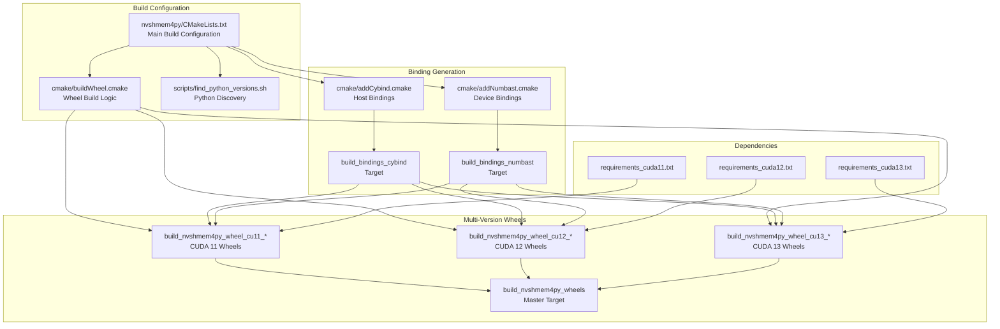
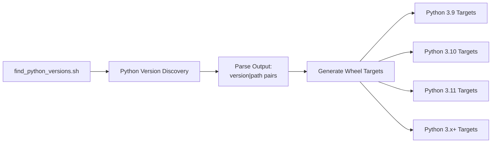
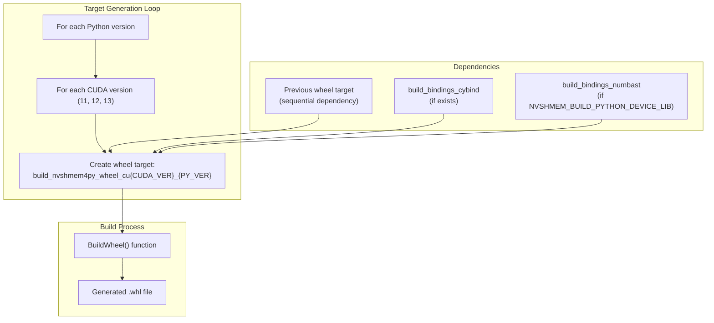
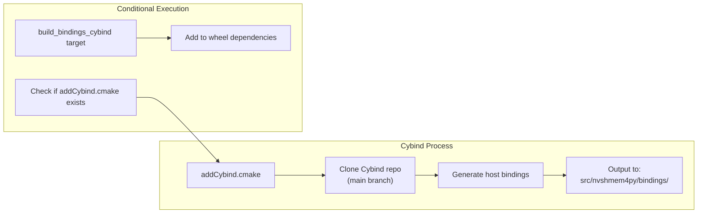
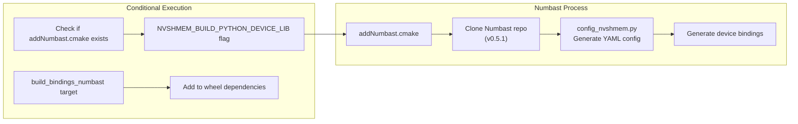
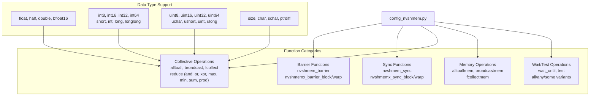
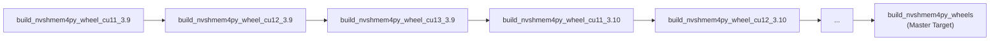

<!-- source: DeepWiki mcp.deepwiki.com · repo NVIDIA/nvshmem · page 3.2 Python Bindings Build · fetched 2026-10-26 -->

# Python Bindings Build

<details>
<summary>Relevant source files</summary>

The following files were used as context for generating this wiki page:

- [nvshmem4py/build_assets/numbast/config_nvshmem.py](nvshmem4py/build_assets/numbast/config_nvshmem.py)
- [nvshmem4py/build_assets/numbast/numbast_entry_point.h](nvshmem4py/build_assets/numbast/numbast_entry_point.h)
- [nvshmem4py/build_assets/numbast/templates/config_nvshmem.yml.j2](nvshmem4py/build_assets/numbast/templates/config_nvshmem.yml.j2)
- [nvshmem4py/cmake/addNumbast.cmake](nvshmem4py/cmake/addNumbast.cmake)
- [nvshmem4py/examples/device_custom_kernel.py](nvshmem4py/examples/device_custom_kernel.py)
- [nvshmem4py/nvshmem/core/device/numba/__init__.py](nvshmem4py/nvshmem/core/device/numba/__init__.py)
- [nvshmem4py/nvshmem/core/device/numba/direct.py](nvshmem4py/nvshmem/core/device/numba/direct.py)
- [nvshmem4py/requirements_cuda12.txt](nvshmem4py/requirements_cuda12.txt)
- [nvshmem4py/requirements_cuda13.txt](nvshmem4py/requirements_cuda13.txt)

</details>


This page documents the build system for nvshmem4py, the Python bindings for NVSHMEM. It covers the CMake-based build system that generates Python wheels for multiple CUDA and Python versions, dependency management, and the automated binding generation process.

For information about building the core NVSHMEM C/C++ library that these bindings depend on, see [Core Library Build](#3.1). For details on the Python API that these bindings expose, see [Python API Reference](#4).

## Build System Overview

The nvshmem4py build system is implemented using CMake and focuses on generating distributable Python wheels for multiple combinations of Python and CUDA versions. The build process involves several key components:

### Build System Architecture



Sources: [nvshmem4py/CMakeLists.txt:1-99]()

## Dependencies and Requirements

The build system manages dependencies through version-specific requirements files that specify the exact versions of runtime dependencies needed for each CUDA version.

### CUDA Version Dependencies

| CUDA Version | Requirements File | Key Dependencies |
|--------------|-------------------|------------------|
| CUDA 11 | `requirements_cuda11.txt` | nvidia-nvshmem-cu11>=3.2.5, cuda-python>=11.0,<=11.8.0 |
| CUDA 12 | `requirements_cuda12.txt` | nvidia-nvshmem-cu12, cuda-python>=12.0,<=12.9.1 |
| CUDA 13 | `requirements_cuda13.txt` | nvidia-nvshmem-cu13, cuda-python>=13.0 |

### Common Dependencies

All CUDA versions share these common dependencies:
- `cuda.core==0.3.0` - CUDA core Python bindings
- `numpy` - Numerical computing library (version 1.24.3 for CUDA 11, latest for others)
- `Cython>=0.29.24` - Python to C compiler for extensions

Sources: [nvshmem4py/requirements_cuda11.txt:1-8](), [nvshmem4py/requirements_cuda12.txt:1-8](), [nvshmem4py/requirements_cuda13.txt:1-8]()

## Build Process

### Python Version Discovery

The build system automatically discovers available Python versions using a shell script:



The discovery process generates pairs of Python version and executable path, which are then used to create individual wheel build targets for each Python/CUDA combination.

Sources: [nvshmem4py/CMakeLists.txt:44-53]()

### Wheel Build Targets

Each wheel build target follows the naming convention `build_nvshmem4py_wheel_cu{CUDA_VER}_{PY_VER}`:



Sources: [nvshmem4py/CMakeLists.txt:59-86]()

## Binding Generation

The Python bindings are generated using two different tools depending on whether host-side or device-side bindings are needed.

### Cybind for Host Bindings

Cybind generates 1:1 Python bindings for NVSHMEM host functions:



Sources: [nvshmem4py/CMakeLists.txt:23-30](), [nvshmem4py/CMakeLists.txt:76-78]()

### Numbast for Device Bindings

Numbast generates device-side bindings for GPU kernel code:



### Device Function Configuration

The `config_nvshmem.py` script generates a comprehensive list of NVSHMEM device functions that require cooperative kernel launch:



Sources: [nvshmem4py/CMakeLists.txt:35-40](), [nvshmem4py/CMakeLists.txt:80-82](), [nvshmem4py/build_assets/numbast/config_nvshmem.py:6-116]()

## Multi-Version Support

The build system creates a matrix of wheels covering all supported Python and CUDA version combinations:

### Build Matrix

| Python Version | CUDA 11 | CUDA 12 | CUDA 13 |
|----------------|---------|---------|---------|
| 3.9 | ✓ | ✓ | ✓ |
| 3.10 | ✓ | ✓ | ✓ |
| 3.11 | ✓ | ✓ | ✓ |
| 3.x+ | ✓ | ✓ | ✓ |

### Sequential Build Dependencies

To manage build resources efficiently, wheel targets are built sequentially with each target depending on the previous one:



Sources: [nvshmem4py/CMakeLists.txt:64-86](), [nvshmem4py/CMakeLists.txt:89-92]()

## Installation and Distribution

The build system generates distributable wheels that are installed to a standardized location:

### Output Structure

```
build/dist/
├── nvshmem4py-<version>-cp39-cp39-linux_x86_64.whl
├── nvshmem4py-<version>-cp310-cp310-linux_x86_64.whl
└── ...
```

The install step copies the entire `dist` directory to `lib/python/` in the installation target for packaging into tarballs.

Sources: [nvshmem4py/CMakeLists.txt:94-98]()

---

