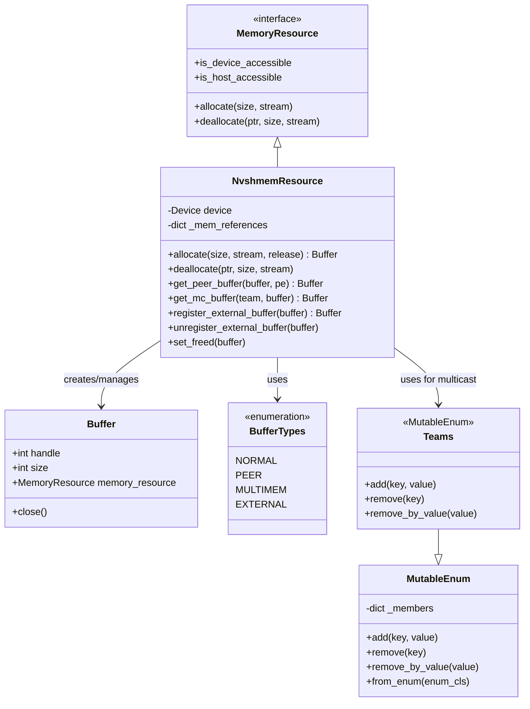
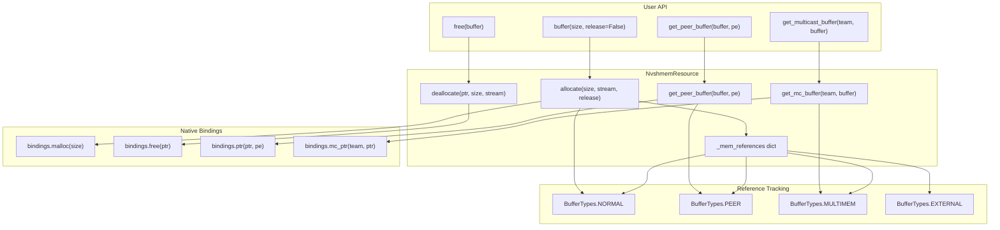
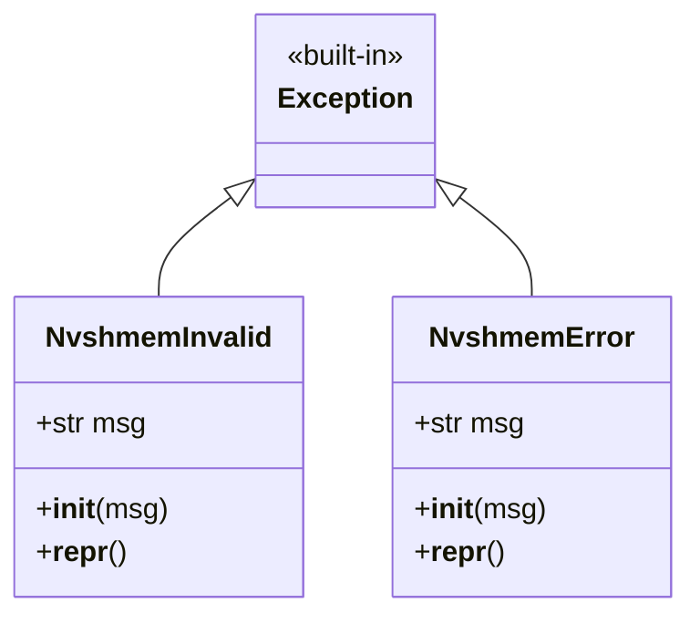
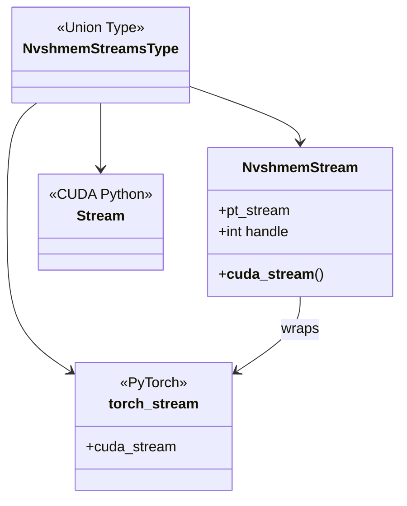
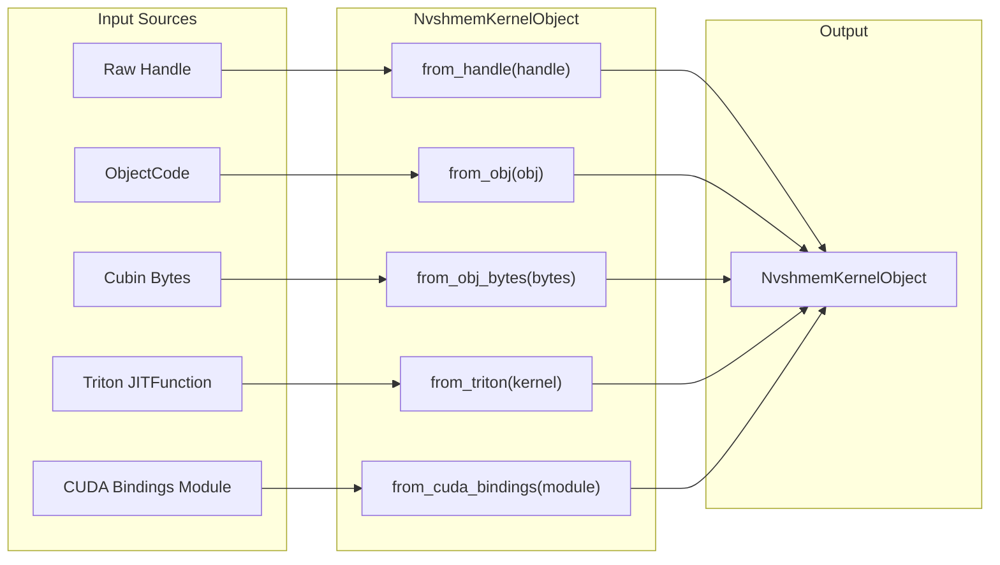

<!-- source: DeepWiki mcp.deepwiki.com · repo NVIDIA/nvshmem · page 4.2 Core Types and Memory Management · fetched 2026-10-26 -->

# Core Types and Memory Management

<details>
<summary>Relevant source files</summary>

The following files were used as context for generating this wiki page:

- [nvshmem4py/examples/torch_triton_interop.py](nvshmem4py/examples/torch_triton_interop.py)
- [nvshmem4py/nvshmem/core/collective.py](nvshmem4py/nvshmem/core/collective.py)
- [nvshmem4py/nvshmem/core/nvshmem_types.py](nvshmem4py/nvshmem/core/nvshmem_types.py)
- [nvshmem4py/nvshmem/core/rma.py](nvshmem4py/nvshmem/core/rma.py)

</details>


This document covers the core data types and memory management functionality in nvshmem4py, the Python bindings for NVSHMEM. It focuses on the foundational classes, enums, and memory resource management that enable symmetric memory allocation and buffer operations across processing elements (PEs).

For information about collective operations and remote memory access patterns, see [Collective Operations and RMA](#4.2). For framework-specific integration details, see [Framework Interoperability](#4.4).

## Core Type Hierarchy

The nvshmem4py library defines several fundamental types that enable memory management and inter-PE communication. The following diagram shows the primary classes and their relationships:



**Sources:** [nvshmem4py/nvshmem/core/nvshmem_types.py:231-520](), [nvshmem4py/nvshmem/core/nvshmem_types.py:221-226](), [nvshmem4py/nvshmem/core/nvshmem_types.py:41-110](), [nvshmem4py/nvshmem/core/nvshmem_types.py:116]()

## Memory Management Architecture

The memory management system in nvshmem4py centers around the `NvshmemResource` class, which implements the CUDA Python `MemoryResource` interface. The following diagram illustrates the memory allocation and tracking workflow:



**Sources:** [nvshmem4py/nvshmem/core/memory.py:48-84](), [nvshmem4py/nvshmem/core/memory.py:86-116](), [nvshmem4py/nvshmem/core/nvshmem_types.py:270-299](), [nvshmem4py/nvshmem/core/nvshmem_types.py:301-369]()

## Buffer Types and Reference Management

The `NvshmemResource` class maintains internal reference tracking through the `_mem_references` dictionary, which stores metadata for each allocated buffer. The system supports four distinct buffer types:

| Buffer Type | Description | Lifecycle Management |
|-------------|-------------|---------------------|
| `NORMAL` | Standard symmetric heap allocation via `nvshmem_malloc` | Explicitly freed via `nvshmem_free` |
| `PEER` | Remote PE buffer access via `nvshmem_ptr` | Managed by NVSHMEM internally |
| `MULTIMEM` | Multicast memory buffer via `nvshmemx_mc_ptr` | Managed by NVSHMEM internally |
| `EXTERNAL` | User-provided buffer registered via `nvshmemx_buffer_register` | Unregistered via `nvshmemx_buffer_unregister` |

The reference tracking structure for each buffer contains:

```python
{
    "ref_count": int,      # Reference count for the buffer
    "resource": NvshmemResource,  # Associated memory resource
    "buffer": Buffer,      # CUDA Python Buffer object
    "type": BufferTypes,   # Buffer type enum value
    "freed": bool,         # Whether buffer has been freed
    "released": bool       # Whether tracking is disabled
}
```

**Sources:** [nvshmem4py/nvshmem/core/nvshmem_types.py:221-226](), [nvshmem4py/nvshmem/core/nvshmem_types.py:249-267](), [nvshmem4py/nvshmem/core/nvshmem_types.py:317-341]()

## Exception Handling and Error Types

The library defines specific exception types for error handling:



- `NvshmemInvalid`: Raised for invalid operations or uninitialized library state
- `NvshmemError`: Raised for runtime errors during NVSHMEM operations

**Sources:** [nvshmem4py/nvshmem/core/nvshmem_types.py:204-216]()

## Integration with CUDA Python Ecosystem

The core types integrate seamlessly with the CUDA Python ecosystem through several key interfaces:

### Stream Integration

The `NvshmemStream` class provides compatibility with various stream types:



**Sources:** [nvshmem4py/nvshmem/core/nvshmem_types.py:189-198]()

### Team Management

The `Teams` object is a `MutableEnum` that allows dynamic addition and removal of team identifiers, enabling flexible process group management:

```python
# Teams starts as MutableEnum copy of Team_id enum
Teams = MutableEnum.from_enum(Team_id)

# Dynamic team creation adds new entries
Teams.add("CUSTOM_TEAM", team_handle)

# Teams can be removed by value when destroyed
Teams.remove_by_value(team_handle)
```

**Sources:** [nvshmem4py/nvshmem/core/nvshmem_types.py:111-116](), [nvshmem4py/nvshmem/core/nvshmem_types.py:63-80]()

### Version Information

The `Version` class provides comprehensive version information across the NVSHMEM stack:

```python
class Version:
    openshmem_spec_version: str    # OpenSHMEM specification version
    nvshmem4py_version: str       # Python bindings version  
    libnvshmem_version: str       # Core library version
```

**Sources:** [nvshmem4py/nvshmem/core/nvshmem_types.py:172-184]()

## Kernel Object Integration

The `NvshmemKernelObject` class provides a unified interface for various kernel object types, enabling integration with different CUDA compilation toolchains:



**Sources:** [nvshmem4py/nvshmem/core/nvshmem_types.py:118-167]()

---

