<!-- source: DeepWiki mcp.deepwiki.com · repo NVIDIA/nvshmem · page 4.4 Team Management · fetched 2026-10-26 -->

# Team Management

Relevant source files

The following files were used as context for generating this wiki page:

- [nvshmem4py/nvshmem/core/__init__.py](nvshmem4py/nvshmem/core/__init__.py)
- [nvshmem4py/nvshmem/core/teams.py](nvshmem4py/nvshmem/core/teams.py)
- [nvshmem4py/requirements_optional_cuda12.txt](nvshmem4py/requirements_optional_cuda12.txt)
- [nvshmem4py/requirements_optional_cuda13.txt](nvshmem4py/requirements_optional_cuda13.txt)
- [src/host/team/team.cu](src/host/team/team.cu)
- [src/host/team/team_internal.cpp](src/host/team/team_internal.cpp)
- [src/include/non_abi/device/coll/barrier.cuh](src/include/non_abi/device/coll/barrier.cuh)
- [src/include/non_abi/device/team/nvshmemi_team_defines.cuh](src/include/non_abi/device/team/nvshmemi_team_defines.cuh)

## Purpose and Scope

This document describes NVSHMEM's team management system, which enables collective operations and communication patterns on subsets of processing elements (PEs). Teams provide a mechanism to partition PEs into groups for optimized communication patterns and resource allocation.

For details on collective operations that use teams, see [Device Programming Model](#2.3). For information on NVLS resources used by teams, see [Memory Management and Symmetric Heap](#2.4).

## Team Concepts

A team in NVSHMEM represents a collection of PEs that can perform collective operations together. Each team maintains:

- **PE Membership**: A mapping of team-local PE indices to global PE indices
- **Synchronization State**: pSync arrays for collective operations
- **Hardware Context**: Information about P2P connectivity and NVLS support
- **Resource Ownership**: NCCL communicators and NVLS multicast resources

The core team structure is defined in `nvshmemi_team_t` [src/host/team/team_internal.cpp:1-100]().

### Team Structure

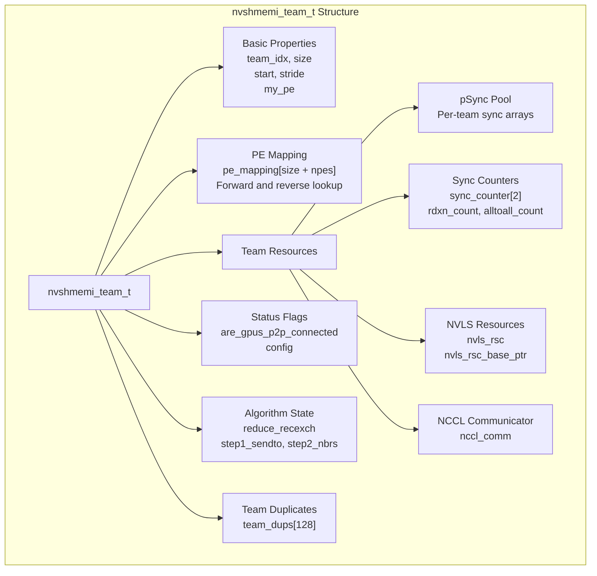

**Sources**: [src/host/team/team_internal.cpp:1-100]()

### PE Mapping Structure

Teams use a dual-purpose `pe_mapping` array of size `size + npes`:
- **First `size` entries**: Team PE index → Global PE index (forward mapping)
- **Last `npes` entries**: Global PE index → Team PE index (reverse mapping)

This structure enables O(1) PE translation in both directions [src/host/team/team_internal.cpp:167-169]().

## Predefined Teams

NVSHMEM provides six predefined teams representing different hardware and process topologies:

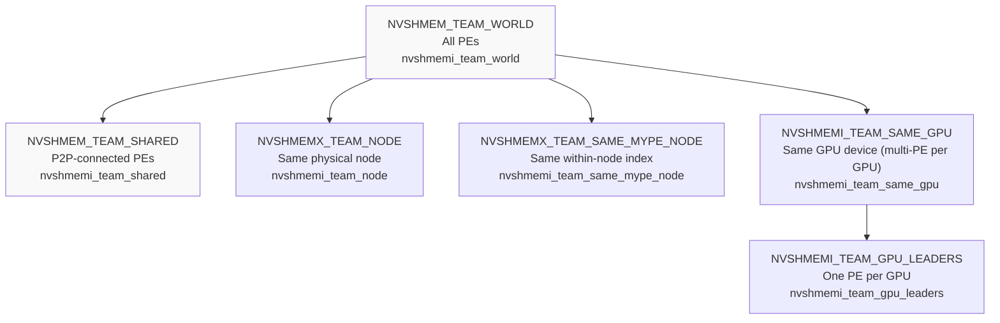

**Sources**: [src/host/team/team_internal.cpp:73-85]()

### Team Initialization Order

Teams are initialized during `nvshmem_init()` in the following order [src/host/team/team_internal.cpp:1173-1358]():

1. **NVSHMEM_TEAM_WORLD**: All PEs in the job
2. **NVSHMEMX_TEAM_NODE**: PEs on the same physical node
3. **NVSHMEMX_TEAM_SAME_MYPE_NODE**: PEs with the same intra-node rank across nodes
4. **NVSHMEMI_TEAM_SAME_GPU**: PEs mapped to the same GPU (if multiple PEs per GPU)
5. **NVSHMEMI_TEAM_GPU_LEADERS**: One PE per GPU (if multiple PEs per GPU)
6. **NVSHMEM_TEAM_SHARED**: PEs that can communicate via P2P (GPU direct access)

## Team Creation Operations

### team_split_strided

Creates a team from a parent team using arithmetic progression. The new team contains PEs at positions: `start, start + stride, start + 2*stride, ..., start + (size-1)*stride`.

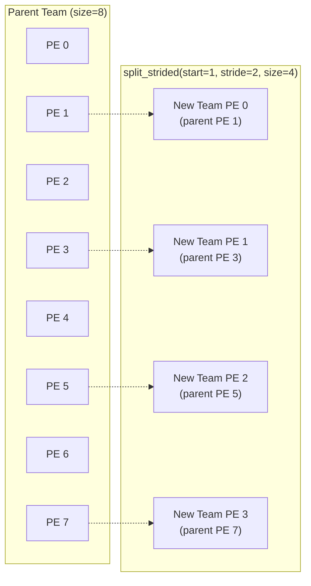

**C API**: `nvshmem_team_split_strided()` [src/host/team/team.cu:60-71]()  
**Python API**: `team_split_strided()` [nvshmem4py/nvshmem/core/teams.py:46-108]()  
**Implementation**: `nvshmemi_team_split_strided()` [src/host/team/team_internal.cpp:1454-1591]()

Non-participating PEs receive `NVSHMEM_TEAM_INVALID` (-1) [nvshmem4py/nvshmem/core/teams.py:103-105]().

### team_split_2d

Partitions a parent team into two orthogonal teams representing rows and columns of a 2D grid.

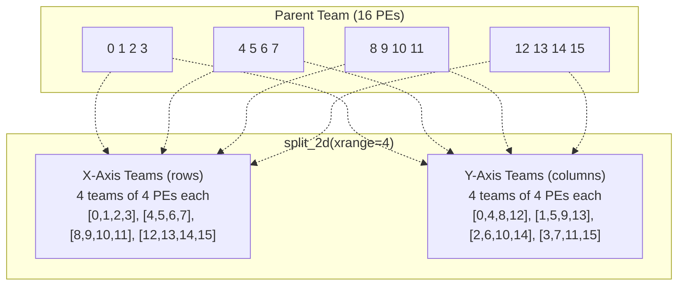

**C API**: `nvshmem_team_split_2d()` [src/host/team/team.cu:86-99]()  
**Python API**: `team_split_2d()` [nvshmem4py/nvshmem/core/teams.py:110-182]()  
**Implementation**: `nvshmemi_team_split_2d()` [src/host/team/team_internal.cpp:1593-1753]()

Each PE receives two team handles: one for its row (x-axis) and one for its column (y-axis). PEs that don't fit evenly may receive `NVSHMEM_TEAM_INVALID` for one or both axes.

### team_init

Manually constructs a team with explicit PE membership, requiring coordination across all participating PEs.

**C API**: `nvshmemx_team_init()` [src/host/team/team.cu:79-84]()  
**Python API**: `team_init()` [nvshmem4py/nvshmem/core/teams.py:212-248]()  
**Implementation**: `nvshmemi_team_create()` [src/host/team/team_internal.cpp:1755-1910]()

This operation uses `nvshmemx_team_uniqueid_t` to coordinate team creation across PEs. A unique ID must be generated on one PE and broadcast to all participating PEs [nvshmem4py/nvshmem/core/teams.py:30-44]().

## Team Resources

### pSync Pool

Each team allocates a pSync pool from the symmetric heap for collective operation synchronization. The pool is partitioned for different operations:

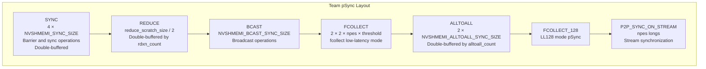

**Sources**: [src/host/team/team_internal.cpp:594-632](), [src/include/non_abi/device/team/nvshmemi_team_defines.cuh:126-173]()

The pSync pool size is calculated per team using `get_psync_len_per_team()` [src/host/team/team_internal.cpp:616-632](), and total memory requirements are computed by `nvshmemi_get_teams_mem_requirement()` [src/host/team/team_internal.cpp:634-648]().

### Sync Counters

Each team maintains per-PE synchronization counters in the symmetric heap:

- **sync_counter[0]**: Barrier/sync operation counter (incremented on each operation)
- **sync_counter[1]**: Reserved for future use
- **rdxn_count**: Reduction double-buffer index
- **alltoall_count**: Alltoall double-buffer index

Device kernels access these via `nvshmemi_team_get_sync_counter()` [src/include/non_abi/device/team/nvshmemi_team_defines.cuh:175-178]().

**Sources**: [src/host/team/team_internal.cpp:68-69]()

### NVLS Resources

Teams with P2P-connected PEs can leverage NVLS (NVLINK SHARP) for hardware-accelerated multicast operations:

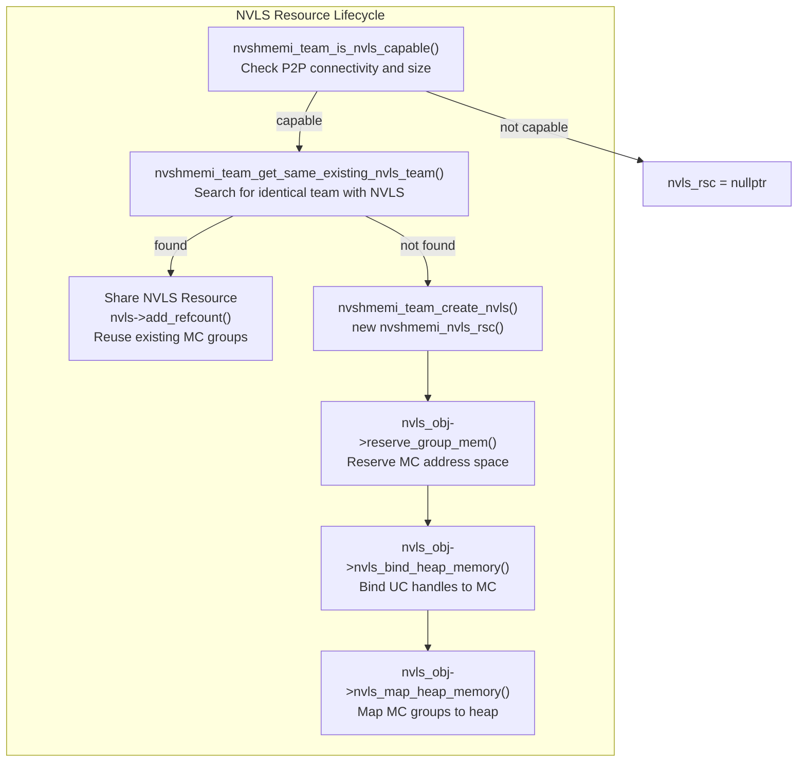

**Sources**: [src/host/team/team_internal.cpp:686-854]()

NVLS resource sharing is controlled by `NVSHMEM_DISABLE_NVLS_SHARING` [src/host/team/team_internal.cpp:702-704](). When enabled (default), teams with identical PE membership share a single NVLS resource to conserve multicast groups.

Ownership tracking ensures proper cleanup: when destroying a team, if it's the last reference, the NVLS resource is freed [src/host/team/team_internal.cpp:717-750]().

### NCCL Communicators

Teams can optionally create NCCL communicators for GPU-native collective operations when `NVSHMEM_USE_NCCL` is enabled:

**Sources**: [src/host/team/team_internal.cpp:650-681]()

The NCCL unique ID is broadcast using the REDUCE pSync array as temporary storage [src/host/team/team_internal.cpp:661-665](), coordinated with a barrier to ensure all PEs receive the ID before communicator initialization.

## PE Translation

PE translation maps PE indices between different team numbering spaces:

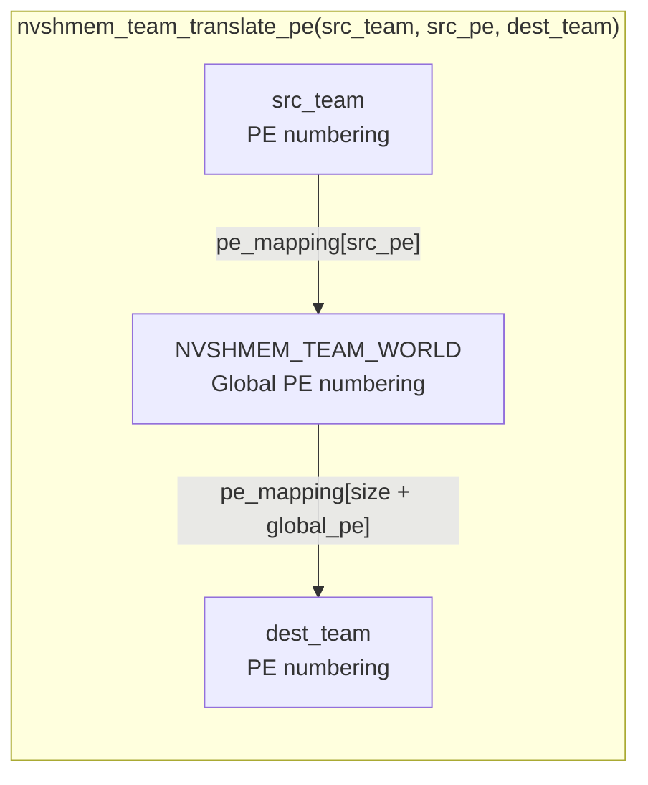

**Host API**: `nvshmem_team_translate_pe()` [src/host/team/team.cu:50-58]()  
**Device API**: `nvshmemi_team_translate_pe()` [src/include/non_abi/device/team/nvshmemi_team_defines.cuh:107-124]()  
**Python API**: `team_translate_pe()` [nvshmem4py/nvshmem/core/teams.py:250-297]()

The implementation uses the dual-purpose `pe_mapping` array:
1. Forward lookup: `src_team->pe_mapping[src_pe]` → global PE
2. Reverse lookup: `dest_team->pe_mapping[dest_team->size + global_pe]` → dest PE

**Sources**: [src/host/team/team_internal.cpp:574-592]()

## Team Algorithms

### Recursive-Exchange Reduction

Teams pre-compute neighbor communication patterns for recursive-exchange (reduce-scatter + allgather) reduction algorithms:

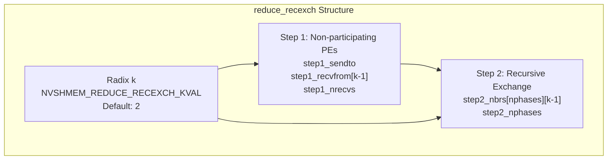

**Sources**: [src/host/team/team_internal.cpp:287-466]()

The algorithm partitions PEs into:
- **Participating PEs**: `num_pes - rem` PEs that perform the recursive exchange
- **Non-participating PEs**: `rem` PEs that send data to participating neighbors

The recursive exchange proceeds in `log_k(p_of_k)` phases, where `p_of_k` is the largest power of k less than the number of PEs [src/host/team/team_internal.cpp:304-316]().

### Dissemination Barrier

Device-side barrier implementations use dissemination algorithms with configurable radix:

**Sources**: [src/include/non_abi/device/coll/barrier.cuh:24-251]()

The radix `k` is selected based on:
- Environment variable: `NVSHMEM_BARRIER_TG_DISSEM_KVAL`
- P2P connectivity: If `are_gpus_p2p_connected` and block scope, use `k = size` (single-phase)
- Otherwise: Use power-of-2 radix (2, 4, 8, 16, 32) or general dissemination

For strided teams, an optimized path uses `sync_dissem_pow2_threadgroup()` [src/include/non_abi/device/coll/barrier.cuh:24-72](). For non-strided teams, `sync_dissem_threadgroup_non_strided()` uses the `pe_mapping` array [src/include/non_abi/device/coll/barrier.cuh:75-125]().

## Team Lifecycle

### Team Creation Flow

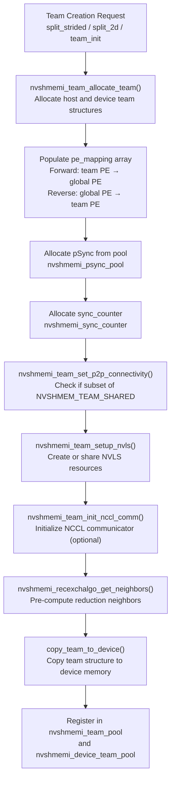

**Sources**: [src/host/team/team_internal.cpp:1360-1452]()

### Team Destruction

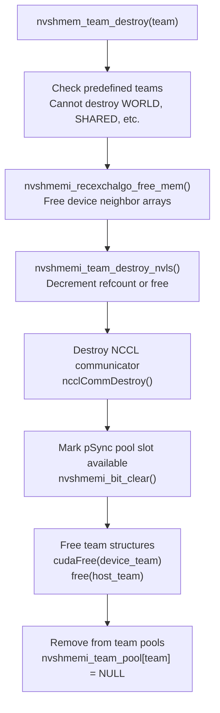

**Sources**: [src/host/team/team_internal.cpp:1912-1998]()

NVLS destruction is reference-counted. If multiple teams share an NVLS resource, only the final destruction actually frees the multicast groups [src/host/team/team_internal.cpp:722-733]().

## Device-Side Team Usage

Device kernels access teams through the global `nvshmemi_device_state_d.team_pool` array:

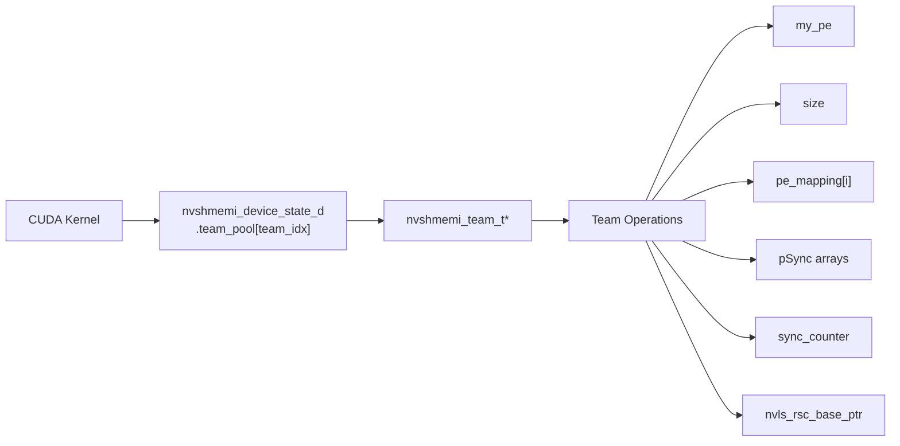

**Helper Functions**:
- `nvshmemi_team_my_pe(team)`: Get team-local PE index [src/include/non_abi/device/team/nvshmemi_team_defines.cuh:14-24]()
- `nvshmemi_team_n_pes(team)`: Get team size [src/include/non_abi/device/team/nvshmemi_team_defines.cuh:26-35]()
- `nvshmemi_team_get_psync(team, op)`: Get pSync for operation [src/include/non_abi/device/team/nvshmemi_team_defines.cuh:126-173]()
- `nvshmemi_team_get_sync_counter(team)`: Get sync counter [src/include/non_abi/device/team/nvshmemi_team_defines.cuh:175-178]()
- `nvshmemi_team_translate_pe_to_team_world_wrap()`: Forward translation [src/include/non_abi/device/team/nvshmemi_team_defines.cuh:77-80]()
- `nvshmemi_team_translate_pe_from_team_world()`: Reverse translation [src/include/non_abi/device/team/nvshmemi_team_defines.cuh:82-85]()

**Sources**: [src/include/non_abi/device/team/nvshmemi_team_defines.cuh:1-182]()

## Configuration

Team behavior is controlled by environment variables:

| Variable | Default | Description |
|----------|---------|-------------|
| `NVSHMEM_MAX_TEAMS` | Platform-dependent | Maximum number of teams (min: `NVSHMEM_TEAMS_MIN`) |
| `NVSHMEM_DISABLE_NVLS_SHARING` | 0 | Disable NVLS resource sharing between identical teams |
| `NVSHMEM_REDUCE_RECEXCH_KVAL` | 2 | Radix for recursive-exchange reduction |
| `NVSHMEM_BARRIER_TG_DISSEM_KVAL` | 2 | Radix for dissemination barrier |

**Sources**: [src/host/team/team_internal.cpp:857-871]()

On NVLS-capable platforms, `NVSHMEM_MAX_TEAMS` defaults to at least 64 to support NVLS multicast team duplication [src/host/team/team_internal.cpp:860-865]().

---

