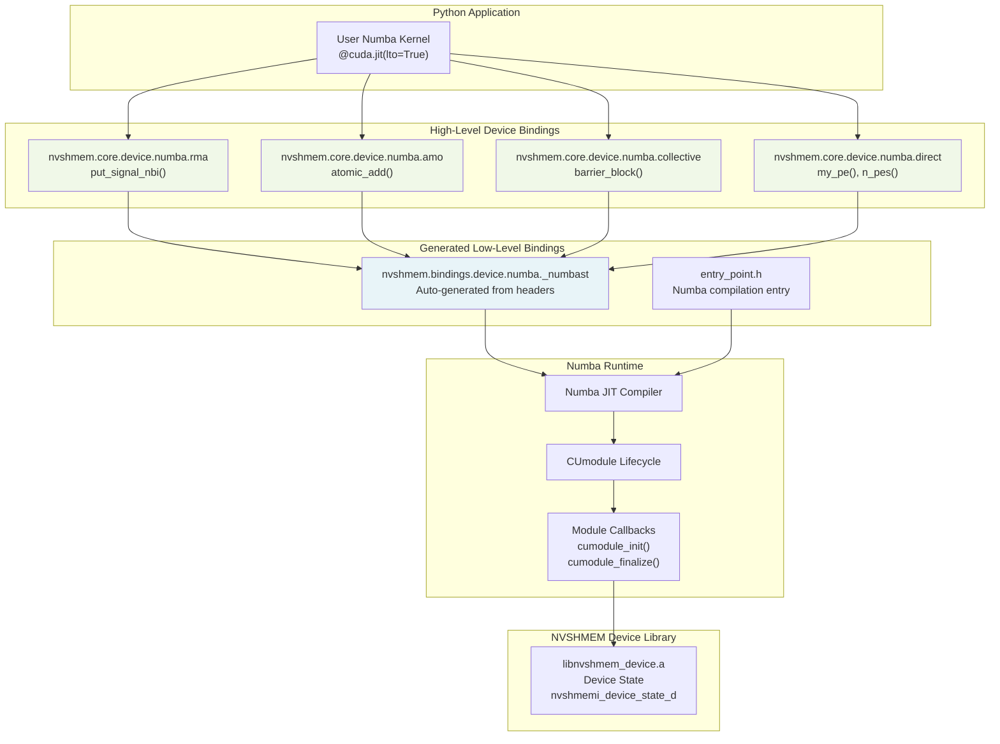
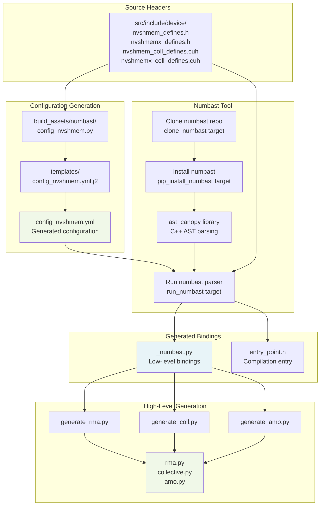
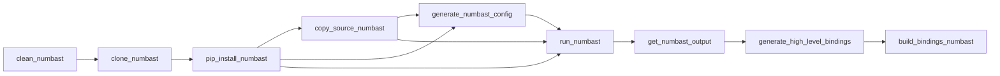
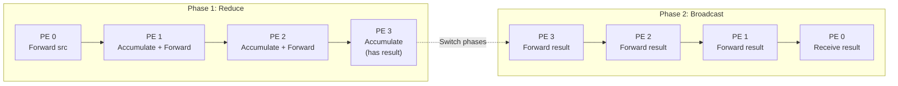
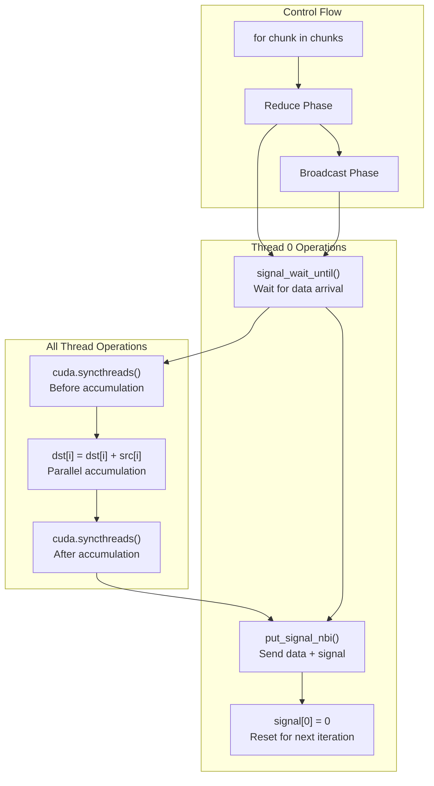

<!-- source: DeepWiki mcp.deepwiki.com · repo NVIDIA/nvshmem · page 4.6 Device Programming with Numba · fetched 2026-10-26 -->

# Device Programming with Numba

<details>
<summary>Relevant source files</summary>

The following files were used as context for generating this wiki page:

- [nvshmem4py/build_assets/numbast/config_nvshmem.py](nvshmem4py/build_assets/numbast/config_nvshmem.py)
- [nvshmem4py/build_assets/numbast/numbast_entry_point.h](nvshmem4py/build_assets/numbast/numbast_entry_point.h)
- [nvshmem4py/build_assets/numbast/templates/config_nvshmem.yml.j2](nvshmem4py/build_assets/numbast/templates/config_nvshmem.yml.j2)
- [nvshmem4py/cmake/addNumbast.cmake](nvshmem4py/cmake/addNumbast.cmake)
- [nvshmem4py/examples/device_custom_kernel.py](nvshmem4py/examples/device_custom_kernel.py)
- [nvshmem4py/nvshmem/core/device/numba/__init__.py](nvshmem4py/nvshmem/core/device/numba/__init__.py)
- [nvshmem4py/nvshmem/core/device/numba/direct.py](nvshmem4py/nvshmem/core/device/numba/direct.py)

</details>


## Purpose and Scope

This page describes how to write custom CUDA kernels in Python that use NVSHMEM device-side communication operations using the Numba JIT compiler. These bindings enable Python developers to implement custom GPU communication patterns without writing C++/CUDA code directly.

**Scope**: This page covers the Numba-based device bindings generated by the Numbast tool, including setup, available device functions, and usage patterns. For host-side collective and RMA operations initiated from Python, see [Collective Operations and RMA](#4.3). For advanced communication with Triton kernels, see [Custom Communication with Triton](#4.7). For the native C/C++ device API, see [Device API](#5.2).

## Overview of Numba Device Bindings

The nvshmem4py package provides device-side Python bindings that allow Numba-compiled CUDA kernels to call NVSHMEM operations directly from GPU code. These bindings are automatically generated from the NVSHMEM C/C++ headers using the Numbast tool, which parses device function declarations and creates Python wrappers suitable for Numba's CUDA compilation pipeline.

### Architecture



**Sources**: [nvshmem4py/nvshmem/core/device/numba/__init__.py:1-27](), [nvshmem4py/examples/device_custom_kernel.py:1-98]()

### Key Components

| Component | Location | Purpose |
|-----------|----------|---------|
| `_numbast.py` | `nvshmem/bindings/device/numba/` | Auto-generated low-level bindings from NVSHMEM headers |
| `entry_point.h` | `nvshmem/bindings/device/numba/` | C++ header used by Numba during kernel compilation |
| High-level modules | `nvshmem/core/device/numba/` | User-friendly wrappers: `rma.py`, `amo.py`, `collective.py`, `direct.py` |
| Module callbacks | `nvshmem.bindings` | Setup/teardown functions called for each CUmodule lifecycle |

**Sources**: [nvshmem4py/cmake/addNumbast.cmake:35-37,155-157](), [nvshmem4py/build_assets/numbast/templates/config_nvshmem.yml.j2:39-44]()

## Binding Generation Process

The Numba device bindings are generated at build time through a multi-stage process orchestrated by CMake and the Numbast tool.

### Build Workflow



**Sources**: [nvshmem4py/cmake/addNumbast.cmake:1-184]()

### Configuration Generation

The Numbast configuration file is generated from a Jinja2 template by the `config_nvshmem.py` script. This script dynamically constructs a list of functions requiring cooperative kernel launch (barriers, syncs, and collectives) based on NVSHMEM's type system.

Key configuration settings in [config_nvshmem.yml.j2:1-44]():

| Setting | Value | Purpose |
|---------|-------|---------|
| Entry Point | `numbast_entry_point.h` | Header parsed to extract declarations |
| File List | Device header files | Source of API declarations |
| GPU Arch | `sm_70` | Architecture used for parsing (runtime uses actual CC) |
| Macro-expanded Prefixes | `nvshmem_`, `nvshmemx_` | Function families to extract |
| Predefined Macros | `__NVSHMEM_NUMBA_SUPPORT__` | Conditional compilation macro |
| Module Callbacks | `cumodule_init()`, `cumodule_finalize()` | Per-module lifecycle hooks |

The cooperative launch function list is generated by [config_nvshmem.py:6-116](), which enumerates all type variants for barriers, syncs, collectives, and wait operations.

**Sources**: [nvshmem4py/build_assets/numbast/config_nvshmem.py:1-163](), [nvshmem4py/build_assets/numbast/templates/config_nvshmem.yml.j2:1-44]()

### CMake Build Targets

The binding generation is divided into eight sequential CMake targets:



**Sources**: [nvshmem4py/cmake/addNumbast.cmake:60-183]()

## Device Function Categories

The generated `_numbast.py` module exposes all device-side NVSHMEM functions with API prefix removal (`nvshmem_` and `nvshmemx_` are stripped). Functions are organized into the following categories:

### Function Categories

| Category | Example Functions | High-Level Module | Description |
|----------|------------------|-------------------|-------------|
| **Information** | `my_pe()`, `n_pes()`, `team_my_pe()` | `direct.py` | PE information and team queries |
| **RMA Non-blocking** | `put_nbi()`, `get_nbi()`, `putmem_nbi()` | `rma.py` | Asynchronous remote memory access |
| **RMA Signaling** | `put_signal_nbi()`, `signal_wait_until()` | `rma.py` | Signaled RMA operations |
| **Atomic Operations** | `atomic_add()`, `atomic_swap()`, `atomic_compare_swap()` | `amo.py` | Atomic memory operations |
| **Barriers** | `barrier()`, `barrier_all()`, `barrier_block()`, `barrier_warp()` | `collective.py` | Synchronization primitives |
| **Collectives** | `alltoall()`, `broadcast()`, `fcollect()`, `*_reduce()` | `collective.py` | Data movement and reduction operations |
| **Memory Fences** | `fence()`, `quiet()` | `rma.py` | Memory ordering and completion |
| **Wait/Test** | `wait_until()`, `test()`, `test_all()` | `rma.py` | Point-to-point synchronization |

**Sources**: [nvshmem4py/build_assets/numbast/config_nvshmem.py:6-116](), [nvshmem4py/nvshmem/core/device/numba/__init__.py:16-21]()

### Threadgroup Variants

Many collective operations have variants for different threadgroup scopes:

| Variant Suffix | Threadgroup Size | Use Case |
|----------------|------------------|----------|
| (none) | Single thread | Fine-grained control, thread-level parallelism |
| `_warp` | 32 threads | Warp-collective operations |
| `_block` | All threads in block | Block-collective operations |
| `_warpgroup` | 128 threads (Hopper+) | Large threadgroup collectives |

**Sources**: [nvshmem4py/build_assets/numbast/config_nvshmem.py:22-23,53-70]()

## Using NVSHMEM in Numba Kernels

### Kernel Compilation Requirements

To use NVSHMEM device functions in a Numba kernel:

1. **LTO Required**: Use `@cuda.jit(lto=True)` decorator to enable link-time optimization, which is necessary for linking with the NVSHMEM device library
2. **Import Device Functions**: Import functions from `nvshmem.bindings.device.numba` or the high-level modules
3. **Module Lifecycle**: NVSHMEM automatically registers setup/teardown callbacks with Numba

### Entry Point Configuration

The entry point header [entry_point.h:1-4]() defines a special macro and includes the NVSHMEM device headers:

```c++
#define __NVSHMEM_NUMBA_SUPPORT__
#include <nvshmem.h>
#include <nvshmemx.h>
```

The `__NVSHMEM_NUMBA_SUPPORT__` macro enables Numba-specific code paths in NVSHMEM headers. This header serves dual purposes:
1. Parsed by Numbast to extract function declarations
2. Included by Numba during runtime kernel compilation

**Sources**: [nvshmem4py/bindings/device/numba/entry_point.h:1-4](), [nvshmem4py/build_assets/numbast/numbast_entry_point.h:1-4]()

### Module Callbacks

The Numbast configuration specifies module lifecycle callbacks [config_nvshmem.yml.j2:39-41]():

```yaml
Module Callbacks:
  setup: "lambda x: nvshmem.bindings.cumodule_init(int(x))"
  teardown: "lambda x: nvshmem.bindings.cumodule_finalize(int(x))"
```

These callbacks are invoked automatically by Numba for each compiled CUDA module:
- `cumodule_init(module_ptr)`: Called after module compilation, initializes NVSHMEM device state for the module
- `cumodule_finalize(module_ptr)`: Called before module destruction, cleans up NVSHMEM state

**Sources**: [nvshmem4py/build_assets/numbast/templates/config_nvshmem.yml.j2:39-44]()

### Basic Example: Query PE Information

```python
from numba import cuda
from nvshmem.bindings.device.numba import my_pe, n_pes

@cuda.jit(lto=True)
def print_pe_info(output):
    """Simple kernel that stores PE information."""
    tid = cuda.threadIdx.x
    if tid == 0:
        output[0] = my_pe()
        output[1] = n_pes()
```

Both `my_pe()` and `n_pes()` are device functions that query the NVSHMEM device state structure `nvshmemi_device_state_d` stored in GPU constant memory.

**Sources**: [nvshmem4py/examples/device_custom_kernel.py:3,17-18]()

### RMA Example: Signaled Put Operation

```python
from numba import cuda
from nvshmem.bindings.device.numba import put_signal_nbi
from nvshmem.core import SignalOp

SIGNAL_ADD = SignalOp.ADD.value

@cuda.jit(lto=True)
def signaled_transfer(local_data, signal, peer_pe):
    """Transfer data to peer and signal completion."""
    tid = cuda.threadIdx.x
    if tid == 0:
        # Put 64 elements and increment remote signal by 1
        put_signal_nbi(
            dest=local_data,      # Remote destination (symmetric address)
            source=local_data,    # Local source
            nelems=64,           # Number of elements
            sig_addr=signal,      # Remote signal address
            signal=1,            # Signal value to add
            sig_op=SIGNAL_ADD,   # Signal operation
            pe=peer_pe           # Target PE
        )
```

The `put_signal_nbi()` function performs a non-blocking put operation followed by a signal update on the remote PE. The signaling operation is atomic.

**Sources**: [nvshmem4py/examples/device_custom_kernel.py:3,9,55-56]()

## Complete Example: Ring Reduce

The example at [device_custom_kernel.py:1-98]() demonstrates a custom ring-based reduction algorithm implemented entirely on the GPU using NVSHMEM device operations.

### Algorithm Overview



### Kernel Implementation Structure

The [ring_reduce kernel:15-72]() uses three main device functions:



**Sources**: [nvshmem4py/examples/device_custom_kernel.py:15-73]()

### Key Functions Used

| Function | Usage in Example | Purpose |
|----------|-----------------|---------|
| `my_pe()` | [device_custom_kernel.py:17]() | Determine current PE's rank |
| `n_pes()` | [device_custom_kernel.py:18]() | Get total PE count |
| `put_signal_nbi()` | [device_custom_kernel.py:55-56,68-69]() | Transfer chunk and signal completion |
| `signal_wait_until()` | [device_custom_kernel.py:46,65]() | Wait for incoming data signal |

### Signal Operations

The example uses signals to coordinate data transfers between PEs:

- **Signal type**: `uint64` array with one element per block ([device_custom_kernel.py:94]())
- **Signal operation**: `SignalOp.ADD` to increment signal counter ([device_custom_kernel.py:9,12]())
- **Comparison**: `ComparisonType.GE` to wait until signal reaches threshold ([device_custom_kernel.py:10,13]())

Each chunk transfer increments the signal by 1, allowing the receiver to track how many chunks have arrived.

**Sources**: [nvshmem4py/examples/device_custom_kernel.py:9-13,46,55-56,65,68-69,72,94]()

### Initialization and Execution

The example demonstrates proper setup:

```python
# Initialize NVSHMEM with MPI
nvshmem.core.init(device=dev, mpi_comm=MPI.COMM_WORLD, 
                  initializer_method="mpi")

# Allocate symmetric memory
src = nvshmem.core.array((size,), dtype="float32")
dst = nvshmem.core.array((size,), dtype="float32")
signal = nvshmem.core.array((1,), dtype="uint64")

# Launch kernel with LTO enabled
ring_reduce[1, 1](dst, src, size, signal, chunk_size)
```

Memory allocated through `nvshmem.core.array()` is placed in the symmetric heap and accessible by all PEs at the same virtual address. The `@cuda.jit(lto=True)` decorator on the kernel enables linking with the NVSHMEM device library.

**Sources**: [nvshmem4py/examples/device_custom_kernel.py:88-96]()

## Available High-Level Bindings

If the bindings are successfully generated during build, the high-level modules are available in `nvshmem.core.device.numba`:

### Module Organization

| Module | Functions | Description |
|--------|-----------|-------------|
| `rma` | `put_nbi()`, `get_nbi()`, `put_signal_nbi()`, `signal_wait_until()`, `fence()`, `quiet()` | Remote memory access operations |
| `amo` | `atomic_add()`, `atomic_inc()`, `atomic_fetch()`, `atomic_swap()`, `atomic_compare_swap()` | Atomic memory operations |
| `collective` | `barrier()`, `barrier_all()`, `barrier_block()`, `barrier_warp()`, collectives with type/operator variants | Collective and synchronization operations |
| `direct` | `my_pe()`, `n_pes()`, `team_my_pe()`, `team_n_pes()` | PE information queries |

The [__init__.py:16-21]() module conditionally imports these if the binding files exist, issuing a warning if they are not available.

### Accessing Low-Level Bindings

For functions not wrapped by the high-level modules, import directly from the generated `_numbast` module:

```python
from nvshmem.bindings.device.numba._numbast import (
    float_p,           # Direct float put (blocking)
    int64_wait_until,  # Wait on int64 value
    team_sync,         # Team synchronization
)
```

The low-level bindings preserve the full function names with only the `nvshmem_`/`nvshmemx_` prefix removed, as configured in [config_nvshmem.yml.j2:31-34]().

**Sources**: [nvshmem4py/nvshmem/core/device/numba/__init__.py:16-26](), [nvshmem4py/build_assets/numbast/templates/config_nvshmem.yml.j2:31-34](), [nvshmem4py/cmake/addNumbast.cmake:162-179]()

## Troubleshooting

### Bindings Not Available Warning

If you see the warning "Numba device bindings are not enabled" ([__init__.py:23]()), the binding generation failed or was skipped during build. This can occur if:

1. Numbast dependencies are not installed
2. The CMake target `build_bindings_numbast` was not executed
3. The generated files were not copied to the package directory

Check that `nvshmem/bindings/device/numba/_numbast.py` exists in the installation.

### LTO Compilation Errors

If kernel compilation fails with linker errors, ensure:

1. The `@cuda.jit` decorator includes `lto=True`
2. NVSHMEM is properly initialized before kernel launch
3. The CUDA toolkit version matches the nvshmem4py package CUDA version

### Cooperative Launch Requirements

Functions listed in the cooperative launch configuration ([config_nvshmem.py:6-116]()) require cooperative kernel launch semantics. Numba automatically handles this if the function is properly marked in the Numbast configuration. If a kernel deadlocks or hangs, verify that barrier and collective operations are used correctly according to NVSHMEM semantics.

**Sources**: [nvshmem4py/nvshmem/core/device/numba/__init__.py:22-26](), [nvshmem4py/build_assets/numbast/config_nvshmem.py:6-116](), [nvshmem4py/build_assets/numbast/templates/config_nvshmem.yml.j2:28-29]()

---

