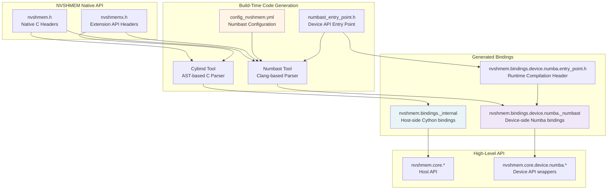
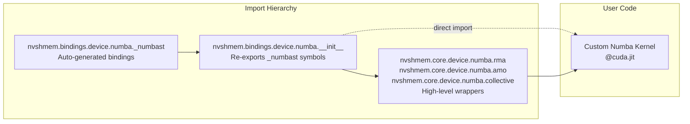
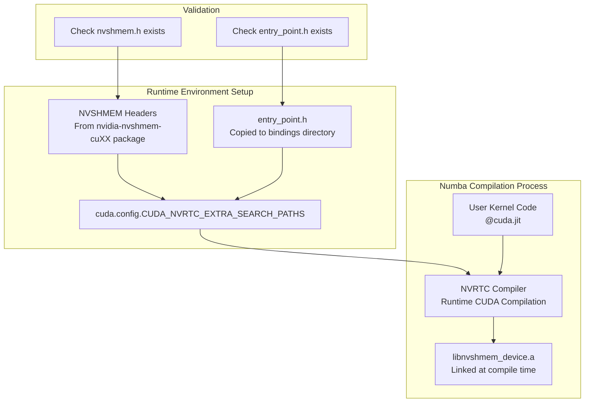
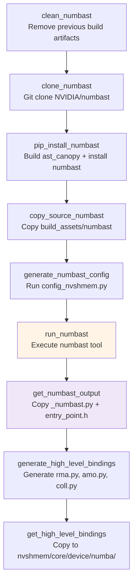
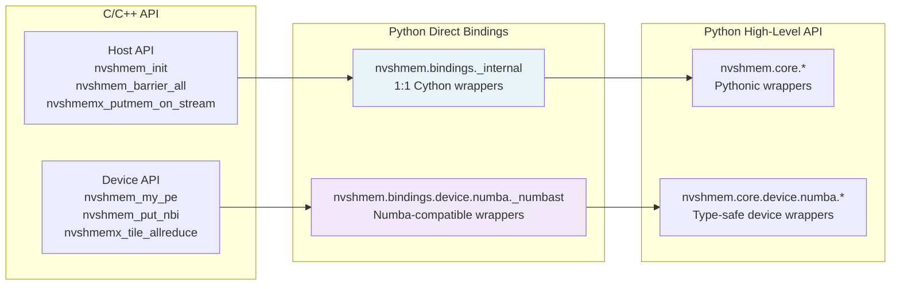

<!-- source: DeepWiki mcp.deepwiki.com · repo NVIDIA/nvshmem · page 4.8 Direct Bindings Access · fetched 2026-10-26 -->

# Direct Bindings Access

<details>
<summary>Relevant source files</summary>

The following files were used as context for generating this wiki page:

- [nvshmem4py/cmake/addNumbast.cmake](nvshmem4py/cmake/addNumbast.cmake)
- [nvshmem4py/examples/device_custom_kernel.py](nvshmem4py/examples/device_custom_kernel.py)
- [nvshmem4py/examples/torch_triton_interop.py](nvshmem4py/examples/torch_triton_interop.py)
- [nvshmem4py/nvshmem/core/collective.py](nvshmem4py/nvshmem/core/collective.py)
- [nvshmem4py/nvshmem/core/device/numba/__init__.py](nvshmem4py/nvshmem/core/device/numba/__init__.py)
- [nvshmem4py/nvshmem/core/device/numba/direct.py](nvshmem4py/nvshmem/core/device/numba/direct.py)
- [nvshmem4py/nvshmem/core/nvshmem_types.py](nvshmem4py/nvshmem/core/nvshmem_types.py)
- [nvshmem4py/nvshmem/core/rma.py](nvshmem4py/nvshmem/core/rma.py)

</details>


This page documents low-level access to the automatically generated Python bindings for NVSHMEM. These direct bindings provide 1:1 mappings to the native NVSHMEM C/C++ API and are intended for advanced users who need fine-grained control or access to functions not exposed through the high-level API. For typical usage of device kernels with Numba, see [Device Programming with Numba](#4.6). For host-side collective and RMA operations, see [Collective Operations and RMA](#4.3).

## Overview

The nvshmem4py package provides two layers of bindings:

1. **High-level API** (`nvshmem.core.*`) - Pythonic interfaces with framework integration, memory management, and convenient wrappers
2. **Direct bindings** (`nvshmem.bindings.*`) - Auto-generated 1:1 mappings to the native NVSHMEM API

Direct bindings are generated by two tools during the build process:
- **Cybind**: Generates host-side Python bindings from NVSHMEM's C API headers
- **Numbast**: Generates device-side Numba bindings for use in CUDA kernels

The high-level API is built on top of these direct bindings, providing additional features like automatic type conversion, reference counting, and integration with PyTorch/CuPy.

## Binding Generation Architecture



**Diagram 1: Binding Generation Pipeline**

Sources: [nvshmem4py/cmake/addNumbast.cmake:1-184](), [nvshmem4py/CMakeLists.txt:23-41]()

## Host-Side Direct Bindings (Cybind)

### Location and Access

The Cybind-generated host bindings are located at `nvshmem.bindings._internal` and provide direct access to NVSHMEM's C API functions. These bindings are typically not imported directly by users but are consumed by the high-level `nvshmem.core` API.

### Binding Structure

Cybind generates 1:1 Python wrappers for C functions using Cython, providing:
- Direct function calls with minimal overhead
- Automatic type conversion between Python and C types
- Error handling through Python exceptions
- Pointer management for memory operations

### When to Use Cybind Bindings

Use Cybind bindings directly when:
- You need access to NVSHMEM functions not exposed in the high-level API
- You require precise control over C-level parameters
- You are implementing custom memory management or transport operations
- Performance profiling requires isolating binding overhead

### Example Access Pattern

```python
# High-level API (recommended)
import nvshmem.core as nvshmem

# Direct binding access (advanced)
from nvshmem.bindings._internal import nvshmem_barrier_all
```

The high-level API adds features like stream integration, error handling, and reference tracking on top of the direct bindings.

Sources: [nvshmem4py/CMakeLists.txt:23-30]()

## Device-Side Direct Bindings (Numbast)

### Location and Access

The Numbast-generated device bindings are located at `nvshmem.bindings.device.numba._numbast` and provide access to NVSHMEM's device API for use in Numba CUDA kernels.



**Diagram 2: Device Binding Import Paths**

Sources: [nvshmem4py/nvshmem/bindings/device/numba/__init__.py:20-39](), [nvshmem4py/nvshmem/core/device/numba/__init__.py:16-26]()

### Generated Binding Content

The `_numbast.py` module contains Numba-compatible Python wrappers for NVSHMEM device functions, generated from parsing NVSHMEM headers. Each function includes:

| Component | Purpose |
|-----------|---------|
| Function signature | Python function with type annotations matching C API |
| Numba decorator | `@cuda.jit(device=True, link=...)` for device compilation |
| External linkage | References to NVSHMEM device library symbols |
| Type conversions | Automatic pointer and size type handling |

### Runtime Compilation Requirements

The Numbast bindings require specific setup at runtime to enable Numba to compile NVSHMEM device calls:



**Diagram 3: Runtime Compilation Dependencies**

The initialization code ensures these paths are configured:

[nvshmem4py/nvshmem/bindings/device/numba/__init__.py:23-35]()

- Locates NVSHMEM headers using `cuda.pathfinder.find_nvidia_header_directory()`
- Validates `nvshmem.h` exists in the header directory
- Adds both header directory and local `entry_point.h` to `CUDA_NVRTC_EXTRA_SEARCH_PATHS`
- Raises `RuntimeError` if headers are missing

Sources: [nvshmem4py/nvshmem/bindings/device/numba/__init__.py:11-39]()

### Available Functions in _numbast

The Numbast-generated module provides device-callable functions including:

| Function Category | Examples |
|------------------|----------|
| PE Information | `my_pe()`, `n_pes()` |
| Point-to-Point RMA | `put_nbi()`, `get_nbi()`, `put_signal_nbi()` |
| Signaling Operations | `signal_wait_until()`, `signal_add()` |
| Atomic Operations | `atomic_add()`, `atomic_fetch()`, `atomic_compare_swap()` |
| Synchronization | `barrier_all()`, `quiet()`, `fence()` |
| Collective Operations | `allreduce()`, `broadcast()`, `alltoall()` |

Each function is type-specialized with suffixes for different data types (e.g., `put_nbi_float32`, `put_nbi_int64`).

Sources: [nvshmem4py/examples/device_custom_kernel.py:3-3]()

### Direct Binding Usage Example

Here's how to use direct Numbast bindings in a custom kernel:

```python
from numba import cuda
from nvshmem.bindings.device.numba import (
    my_pe, n_pes, put_signal_nbi, signal_wait_until
)

@cuda.jit(lto=True)
def custom_communication_kernel(data, signal, peer):
    # Direct access to low-level NVSHMEM functions
    mype = my_pe()
    
    # Signal operation constants must be provided as values
    SIGNAL_ADD = 1  # SignalOp.ADD.value
    CMP_GE = 2      # ComparisonType.GE.value
    
    # Direct binding call
    put_signal_nbi(data, data, len(data), signal, 1, SIGNAL_ADD, peer)
    
    # Wait for signal from peer
    signal_wait_until(signal, CMP_GE, 1)
```

This example shows direct use of `_numbast` functions without the high-level wrappers from `nvshmem.core.device.numba`.

Sources: [nvshmem4py/examples/device_custom_kernel.py:1-70]()

## Build Process Details

### Numbast Generation Workflow



**Diagram 4: Numbast Build Pipeline**

Sources: [nvshmem4py/cmake/addNumbast.cmake:60-182]()

### Key Build Artifacts

| Artifact | Location | Purpose |
|----------|----------|---------|
| `_numbast.py` | `nvshmem/bindings/device/numba/` | Generated low-level device bindings |
| `entry_point.h` | `nvshmem/bindings/device/numba/` | Header for Numba runtime compilation |
| `config_nvshmem.yml` | `build/externals/numbast/build_assets/numbast/` | Numbast configuration file |
| `rma.py`, `amo.py`, `coll.py` | `nvshmem/core/device/numba/` | Generated high-level wrappers |

### Configuration Generation

The Numbast configuration is dynamically generated by `config_nvshmem.py`:

[nvshmem4py/cmake/addNumbast.cmake:115-133]()

This script:
1. Parses NVSHMEM headers to discover available functions
2. Generates `config_nvshmem.yml` with function signatures and type mappings
3. Specifies which functions should be exposed in the bindings
4. Defines type specializations for generic functions

Sources: [nvshmem4py/cmake/addNumbast.cmake:115-133]()

## Conditional Availability

Both direct binding modules are conditionally available based on build configuration:

### Device Bindings Check

[nvshmem4py/nvshmem/bindings/device/numba/__init__.py:20-39]()

The module checks for `_numbast.py` existence at import time. If not found, it issues a warning and sets `_numbast = None`.

### High-Level Wrapper Check

[nvshmem4py/nvshmem/core/device/numba/__init__.py:16-26]()

Similarly, the high-level device API checks for generated `rma.py`, `amo.py`, etc., and warns if Numba device bindings are disabled.

This allows the package to function in environments where device bindings cannot be built (e.g., systems without CUDA development tools).

Sources: [nvshmem4py/nvshmem/bindings/device/numba/__init__.py:20-39](), [nvshmem4py/nvshmem/core/device/numba/__init__.py:16-26]()

## Dependencies for Direct Binding Usage

### Host Bindings (Cybind)

| Dependency | Version | Purpose |
|------------|---------|---------|
| Cython | ≥0.29.24 | Compile Cython-generated binding code |
| numpy | ≥1.20.0 | Array type conversions |
| nvidia-nvshmem-cuXX | Runtime | Native NVSHMEM library |

### Device Bindings (Numbast)

| Dependency | Version | Purpose |
|------------|---------|---------|
| numba-cuda | 0.20.0 | CUDA kernel compilation |
| cuda-python | Latest | NVRTC header path discovery |
| nvidia-nvshmem-cuXX | Runtime | NVSHMEM headers and device library |

Sources: [nvshmem4py/requirements_build.txt:1-20](), [nvshmem4py/scripts/generate_pyproject_toml.py:24-28]()

## Advanced Usage: Bypassing High-Level API

### When to Use Direct Bindings

Consider using direct bindings when:

1. **Performance-critical paths**: Eliminate wrapper overhead in tight loops
2. **Unsupported functions**: Access newly added NVSHMEM functions not yet wrapped
3. **Custom memory management**: Implement specialized allocation strategies
4. **Low-level debugging**: Isolate issues in NVSHMEM calls vs. Python wrappers
5. **Integration with other C extensions**: Pass NVSHMEM handles to other native code

### Risks and Considerations

Using direct bindings bypasses several safety mechanisms:
- No automatic reference counting for memory
- No stream synchronization guarantees
- No automatic error checking or exception translation
- Potential for memory leaks if not carefully managed
- Loss of framework integration (PyTorch/CuPy interop)

**Recommendation**: Use high-level API whenever possible. Only use direct bindings when profiling demonstrates measurable benefit or when accessing unsupported functionality.

## Relationship to C/C++ API

The direct bindings provide nearly 1:1 correspondence to the native API documented in [C/C++ API Reference](#5):



**Diagram 5: API Layer Correspondence**

Sources: [nvshmem4py/CMakeLists.txt:23-41]()

## Summary

Direct bindings in nvshmem4py provide:
- **Cybind host bindings** (`nvshmem.bindings._internal`): 1:1 Cython wrappers for C API
- **Numbast device bindings** (`nvshmem.bindings.device.numba._numbast`): Numba-compatible device functions
- **Automatic generation**: Built during package compilation from NVSHMEM headers
- **Conditional availability**: Gracefully degrades if build tools unavailable
- **Advanced use cases**: Enable fine-grained control for expert users

For most applications, use the high-level APIs documented in [Core Types and Memory Management](#4.2), [Collective Operations and RMA](#4.3), and [Device Programming with Numba](#4.6). Direct bindings are reserved for advanced scenarios requiring maximum control or access to bleeding-edge NVSHMEM features.

---

