<!-- source: DeepWiki mcp.deepwiki.com · repo NVIDIA/nvshmem · page 5.1 Transport Interface and Common Code · fetched 2026-10-26 -->

# Transport Interface and Common Code

<details>
<summary>Relevant source files</summary>

The following files were used as context for generating this wiki page:

- [src/host/mem/mem_transport.cpp](src/host/mem/mem_transport.cpp)
- [src/host/topo/topo.cpp](src/host/topo/topo.cpp)
- [src/host/transport/transport.cpp](src/host/transport/transport.cpp)
- [src/modules/transport/common/transport_common.cpp](src/modules/transport/common/transport_common.cpp)
- [src/modules/transport/libfabric/libfabric.h](src/modules/transport/libfabric/libfabric.h)
- [test/host/interop/CMakeLists.txt](test/host/interop/CMakeLists.txt)
- [test/unit/mem/heap/internal/host/nvshmemi_mem_transport.hpp](test/unit/mem/heap/internal/host/nvshmemi_mem_transport.hpp)

</details>


## Purpose and Scope

This page documents the common transport infrastructure that all NVSHMEM transport implementations share. This includes the standardized transport interface (`nvshmem_transport` struct), transport manager for plugin loading and lifecycle management, topology discovery for optimal NIC-GPU pairing, memory handle caching for RDMA operations, and HCA list parsing utilities.

For documentation of specific transport implementations, see [Libfabric Transport](#5.2), [InfiniBand Transports](#5.3), and [UCX Transport](#5.4). For the overall transport architecture, see [Transport Layer](#2.2).

---

## Transport Interface

All transport plugins implement a common interface defined by the `nvshmem_transport` structure. This interface provides a uniform API for the runtime to interact with different network backends.

### Core Transport Structure

The transport interface is defined through function pointers organized into host-side and device-side operation groups:

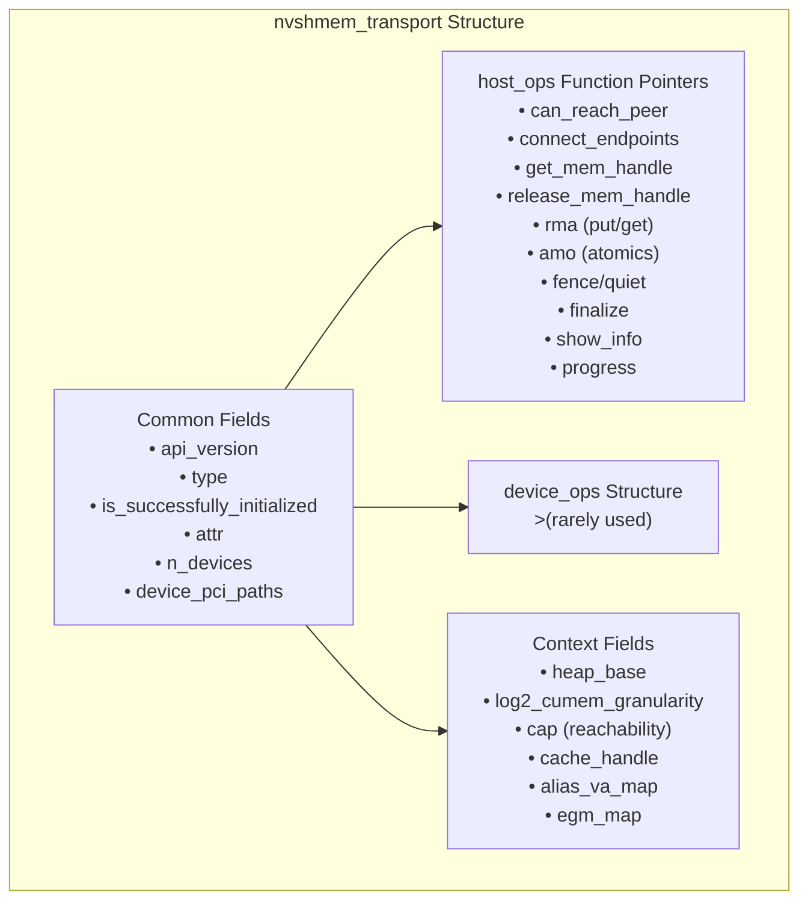

**Sources:** [src/modules/transport/libfabric/libfabric.h:1-456](), high-level Diagram 3

### Key Interface Operations

| Operation Category | Function Pointer | Purpose |
|-------------------|------------------|---------|
| **Initialization** | `can_reach_peer` | Determine if PE is reachable via this transport |
| | `connect_endpoints` | Establish connections to remote PEs |
| **Memory Management** | `get_mem_handle` | Register memory for RDMA operations |
| | `release_mem_handle` | Unregister memory handle |
| | `add_device_remote_mem_handles` | Add memory handles for device-side access |
| **Data Transfer** | `rma` | Remote memory access (put/get) |
| | `amo` | Atomic memory operations |
| | `put_signal` | Combined put and signal operation |
| **Ordering** | `fence` | Order operations to a specific PE |
| | `quiet` | Wait for all outstanding operations |
| **Progress** | `progress` | Advance transport progress (for proxy) |

**Sources:** High-level Diagram 3, [src/host/transport/transport.cpp:1-457]()

### Transport Attributes

Each transport declares its capabilities through attribute flags:

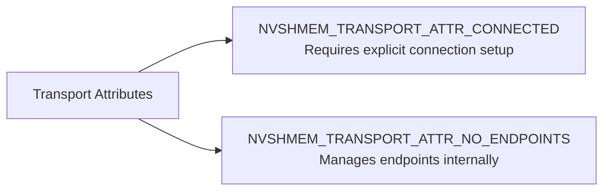

**Sources:** [src/host/transport/transport.cpp:383-385]()

---

## Transport Manager

The transport manager handles dynamic loading of transport plugins, initialization, connection establishment, and lifecycle management.

### Transport Initialization Flow

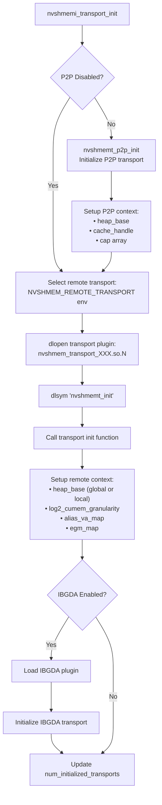

**Sources:** [src/host/transport/transport.cpp:50-319]()

### Transport Selection

Transports are selected based on environment variables and build configuration:

1. **P2P Transport**: Always initialized first unless `NVSHMEM_DISABLE_P2P=1`
2. **Remote Transport**: Selected via `NVSHMEM_REMOTE_TRANSPORT` (values: `ibrc`, `ucx`, `ibdevx`, `libfabric`)
3. **IBGDA Transport**: Optionally loaded if `NVSHMEM_IB_ENABLE_IBGDA=1`

**Sources:** [src/host/transport/transport.cpp:70-95](), [src/host/transport/transport.cpp:98-168](), [src/host/transport/transport.cpp:230-291]()

### Connection Setup

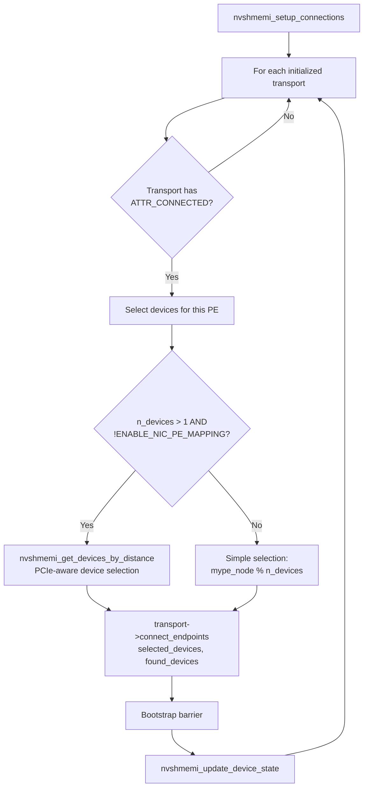

**Sources:** [src/host/transport/transport.cpp:372-456]()

---

## Topology Discovery

Topology discovery determines optimal NIC-GPU pairing based on PCIe distance to minimize latency and maximize bandwidth.

### PCIe Distance Classification

The system classifies PCIe paths into five categories based on topology:

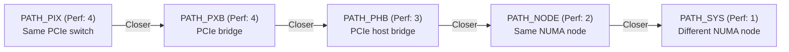

| Distance | Performance Score | Description |
|----------|-------------------|-------------|
| `PATH_PIX` | 4 | GPU and NIC on same PCIe switch (optimal) |
| `PATH_PXB` | 4 | Connected via PCIe bridge |
| `PATH_PHB` | 3 | Connected via PCIe host bridge |
| `PATH_NODE` | 2 | Same NUMA node but different paths |
| `PATH_SYS` | 1 | Different NUMA nodes |

**Sources:** [src/host/topo/topo.cpp:41-50]()

### PCIe Distance Calculation

The distance is computed by analyzing sysfs paths:

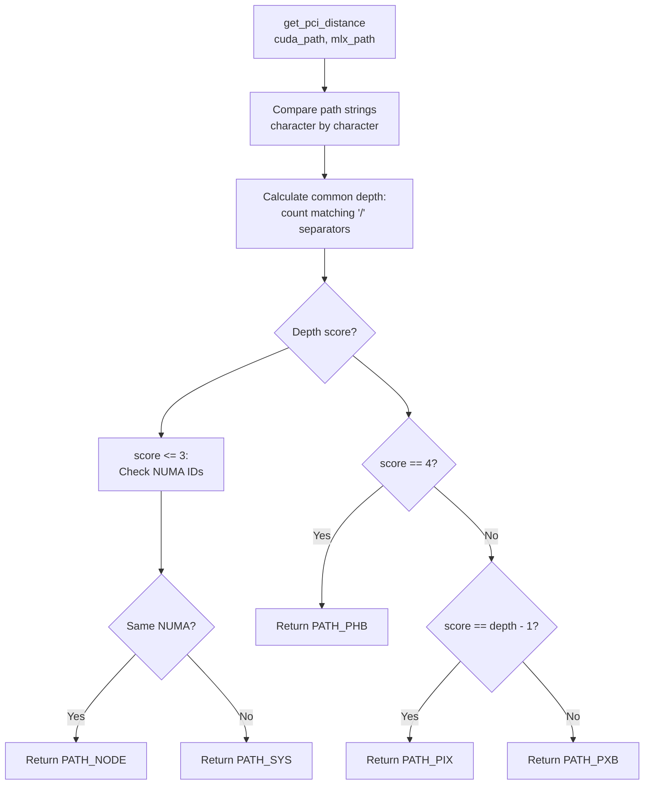

**Sources:** [src/host/topo/topo.cpp:109-130]()

### Device Selection Algorithm

The `nvshmemi_get_devices_by_distance` function implements a two-phase algorithm for optimal NIC-GPU pairing:

**Phase 1: Initial Assignment**
- Build sorted list of (PE, device, distance) tuples
- For each tuple in distance order:
  - If GPU has no device assigned, assign this device
  - If device is less optimal than already assigned, mark GPU as complete

**Phase 2: Load Balancing**
- For each assigned (GPU, device) pair:
  - If device is used by ≥2 GPUs, search for alternative
  - Only switch to equally optimal device with lower utilization
  - Maintain load difference threshold of ≥2

**Sources:** [src/host/topo/topo.cpp:138-436]()

### Transport Reachability Map

After topology discovery, the system builds a reachability matrix:

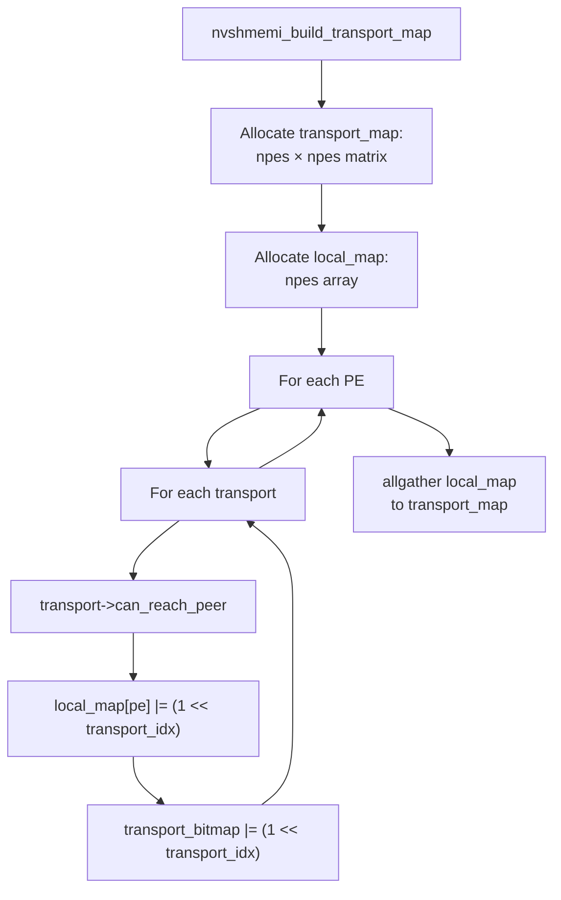

The resulting `transport_map` is a 2D matrix where `transport_map[pe][target_pe]` is a bitmask indicating which transports can reach `target_pe` from `pe`.

**Sources:** [src/host/topo/topo.cpp:438-506]()

---

## Memory Handle Cache

The memory handle cache provides O(1) lookup of transport-specific memory handles for registered heap regions. This is critical for performance as every RMA operation needs the handle for the target address.

### Cache Structure

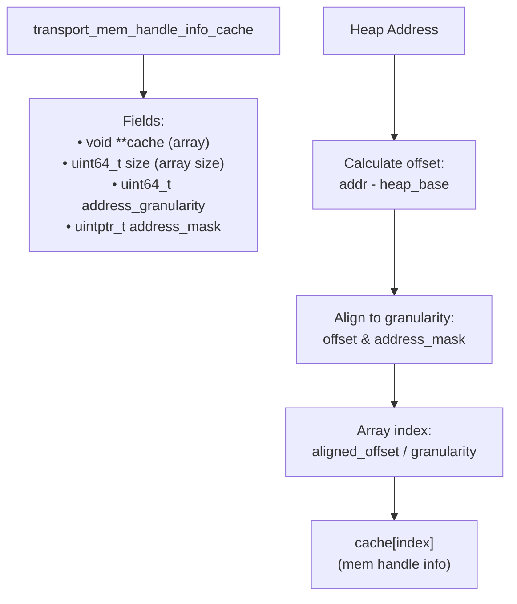

**Sources:** [src/modules/transport/common/transport_common.cpp:15-20]()

### Cache Operations

#### Initialization

```c
nvshmemt_mem_handle_cache_init(nvshmem_transport_t t,
                               transport_mem_handle_info_cache **cache)
```

- Allocates cache structure with initial size of 1000 entries
- Sets `address_granularity` from transport's `log2_cumem_granularity`
- Computes `address_mask` for fast alignment: `~(granularity - 1)`

**Sources:** [src/modules/transport/common/transport_common.cpp:85-112]()

#### Adding Handles

```c
nvshmemt_mem_handle_cache_add(nvshmem_transport_t t,
                              transport_mem_handle_info_cache *cache,
                              void *addr, void *mem_handle_info)
```

Algorithm:
1. Validate `addr >= heap_base`
2. Calculate offset: `addr - heap_base`
3. Verify alignment to `address_granularity`
4. Compute index: `offset / granularity`
5. Resize cache if needed (doubles size or grows to `index + 1`)
6. Store handle: `cache[index] = mem_handle_info`

**Sources:** [src/modules/transport/common/transport_common.cpp:114-151]()

#### Lookup

```c
void* nvshmemt_mem_handle_cache_get(nvshmem_transport_t t,
                                    transport_mem_handle_info_cache *cache,
                                    void *addr)
```

Algorithm:
1. Calculate offset: `addr - heap_base`
2. Align to granularity: `offset & address_mask`
3. Compute index: `aligned_offset / granularity`
4. Return `cache[index]`

This operation is O(1) with no branching in the common case.

**Sources:** [src/modules/transport/common/transport_common.cpp:153-174]()

#### Removal

```c
nvshmemt_mem_handle_cache_remove(nvshmem_transport_t t,
                                 transport_mem_handle_info_cache *cache,
                                 void *addr)
```

Similar to add operation but sets `cache[index] = NULL`.

**Sources:** [src/modules/transport/common/transport_common.cpp:187-212]()

### Cache Usage Example

When a transport needs to perform RMA to address `target_addr` on remote PE:

1. Get cache: `cache = transport->cache_handle`
2. Lookup: `handle_info = nvshmemt_mem_handle_cache_get(transport, cache, target_addr)`
3. Extract transport-specific handle from `handle_info`
4. Use handle for RDMA operation

**Sources:** [src/modules/transport/common/transport_common.cpp:153-174]()

---

## HCA List Parsing

Transports with multiple devices (NICs/HCAs) use a common parser to interpret user-specified device lists from environment variables.

### HCA Info Structure

```c
struct nvshmemt_hca_info {
    char name[NVSHMEM_HCA_NAME_LEN];  // Device name (e.g., "mlx5_0")
    int port;                          // Port number or -1 for any
    int count;                         // Number of instances
    int found;                         // Whether device was found
};
```

**Sources:** Implicit from [src/modules/transport/common/transport_common.cpp:22-83]()

### Parsing Format

The `nvshmemt_parse_hca_list` function parses strings with format:

```
device1:port1:count1,device2:port2:count2,...
```

Examples:
- `"mlx5_0"` → Single device, any port, count=1
- `"mlx5_0:1"` → Single device, port 1, count=1
- `"mlx5_0:1:2"` → Device mlx5_0 port 1, use 2 instances
- `"mlx5_0,mlx5_1"` → Two devices, any port, count=1 each

**Sources:** [src/modules/transport/common/transport_common.cpp:22-83]()

### Parsing Algorithm

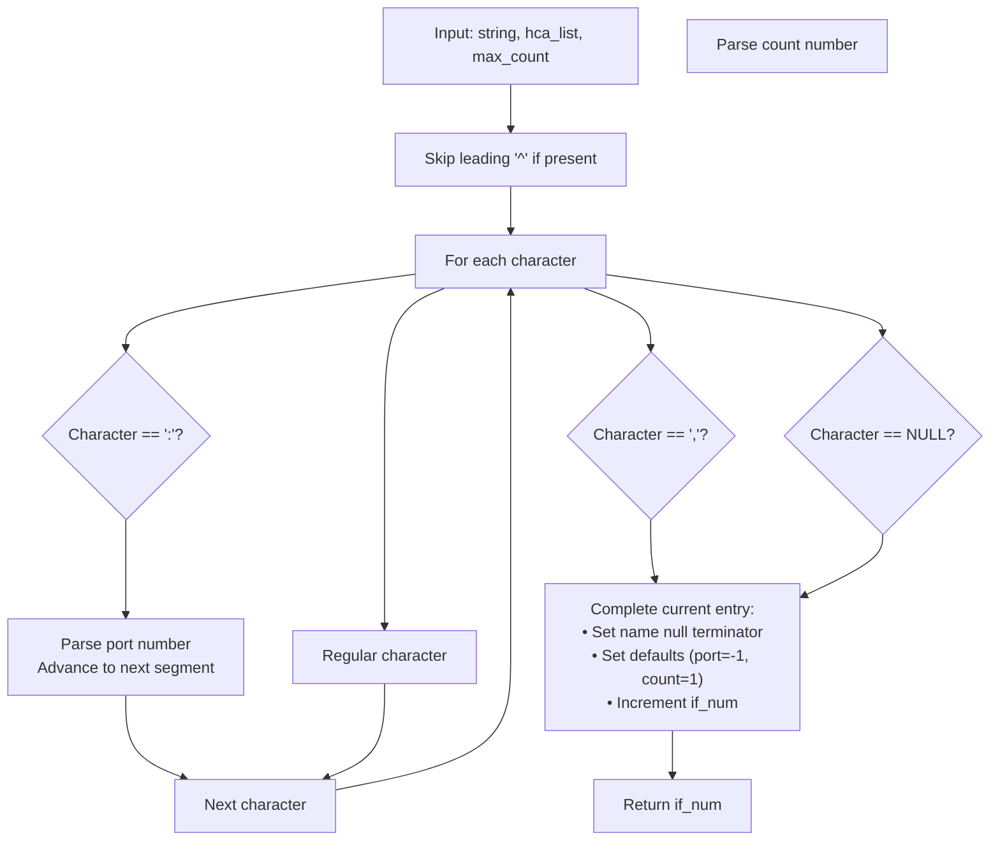

**Sources:** [src/modules/transport/common/transport_common.cpp:22-83]()

---

## Common Transport Operations

### Put-Signal Implementation

The `nvshmemt_put_signal` function provides a reference implementation for transports that don't have native put-signal support:

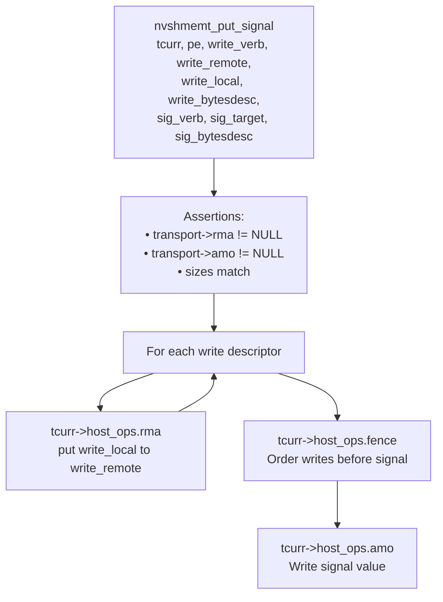

This implementation:
1. Issues all put operations via `transport->host_ops.rma`
2. Ensures ordering with `transport->host_ops.fence`
3. Issues signal operation via `transport->host_ops.amo`

**Sources:** [src/modules/transport/common/transport_common.cpp:229-256]()

### EGM Detection

The `check_egm` function determines if an address belongs to Extended GPU Memory:

```c
bool check_egm(void *addr, std::unordered_map<void *, size_t> *egm_map)
```

Algorithm:
1. If `egm_map` is NULL, return false
2. Check for exact match in map keys
3. If not found, iterate through all EGM regions
4. Check if `addr` falls within any `[base, base + size)` range

This is used by transports to apply special handling for EGM allocations.

**Sources:** [src/modules/transport/common/transport_common.cpp:258-272]()

---

## Transport Context Fields

Each transport instance maintains context information shared across all transport implementations:

| Field | Type | Purpose |
|-------|------|---------|
| `heap_base` | `void*` | Base address of symmetric heap |
| `log2_cumem_granularity` | `int` | Log2 of CUDA memory granularity for cache alignment |
| `cap` | `int*` | Per-PE capability bitmask (reachability flags) |
| `index` | `int` | Transport index in state->transports array |
| `my_pe` | `int` | Local PE rank |
| `n_pes` | `int` | Total number of PEs |
| `cache_handle` | `void*` | Pointer to `nvshmem_local_buf_cache_t` |
| `alias_va_map` | `std::unordered_map*` | Virtual address alias mapping for VMM |
| `egm_map` | `std::unordered_map*` | Extended GPU Memory regions |

**Sources:** [src/host/transport/transport.cpp:74-87](), [src/host/transport/transport.cpp:197-217](), [src/host/transport/transport.cpp:256-275]()

---

## Transport Lifecycle

### Initialization Summary

1. **P2P Transport**: Initialize if not disabled
2. **Remote Transport Selection**: Based on `NVSHMEM_REMOTE_TRANSPORT`
3. **Plugin Loading**: `dlopen` shared library
4. **Symbol Resolution**: `dlsym` for `nvshmemt_init`
5. **Transport Init**: Call plugin's init function
6. **Context Setup**: Populate transport structure fields
7. **IBGDA Loading**: Optional second remote transport
8. **Topology Discovery**: Build transport reachability map
9. **Connection Setup**: Establish endpoints with selected devices

**Sources:** [src/host/transport/transport.cpp:50-319]()

### Finalization

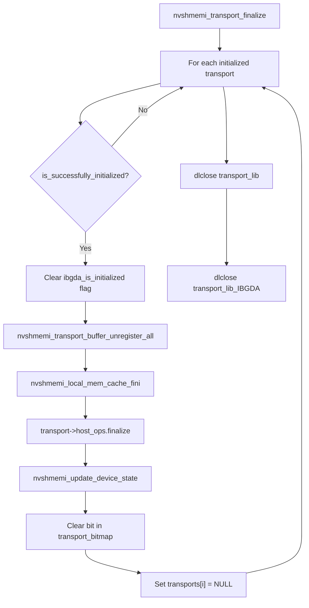

**Sources:** [src/host/transport/transport.cpp:347-370](), [src/host/transport/transport.cpp:321-345]()

---

## Summary

The transport interface and common code provide a unified abstraction layer that allows NVSHMEM to support multiple network backends through a plugin architecture. Key components include:

- **Transport Interface**: Standardized function pointers for initialization, memory management, data transfer, and synchronization
- **Transport Manager**: Dynamic plugin loading, initialization coordination, and lifecycle management
- **Topology Discovery**: PCIe-aware NIC-GPU pairing for optimal performance
- **Memory Handle Cache**: O(1) lookup structure for RDMA operation handles
- **HCA Parsing**: Flexible device selection from environment variables
- **Common Operations**: Shared implementations for operations like put-signal

This architecture enables transport implementations to focus on hardware-specific logic while sharing common infrastructure for device selection, topology optimization, and memory handle management.

**Sources:** [src/host/transport/transport.cpp:1-457](), [src/host/topo/topo.cpp:1-574](), [src/modules/transport/common/transport_common.cpp:1-273]()

---

