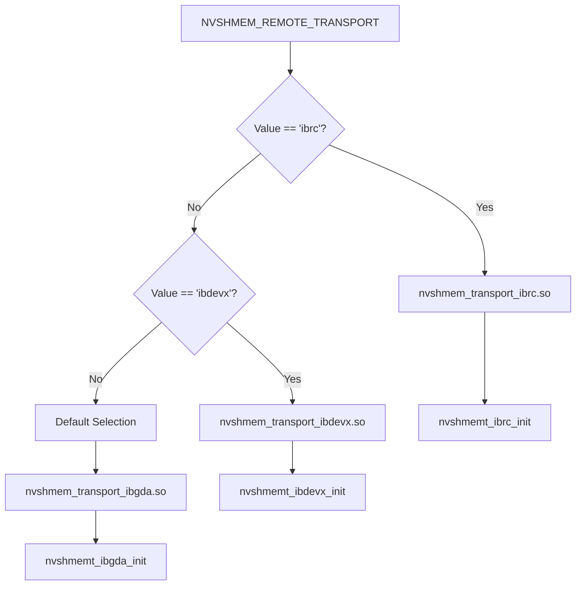
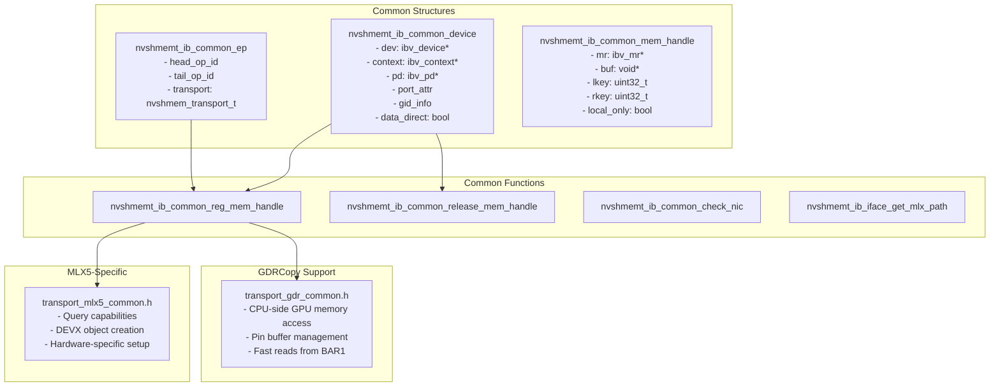
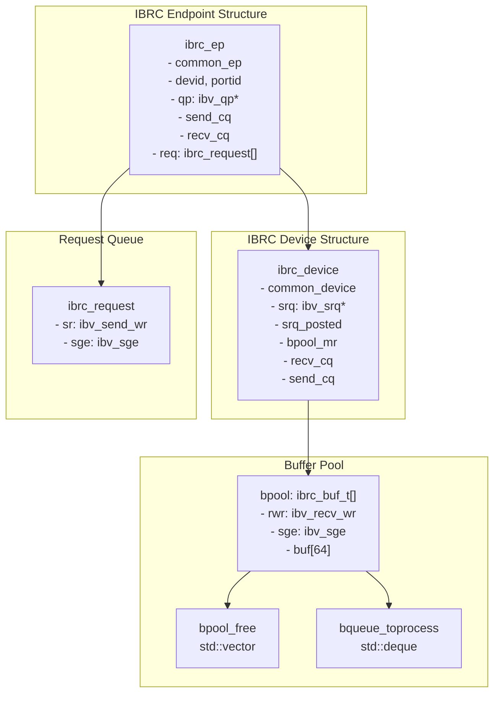
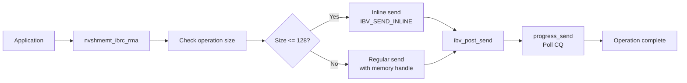
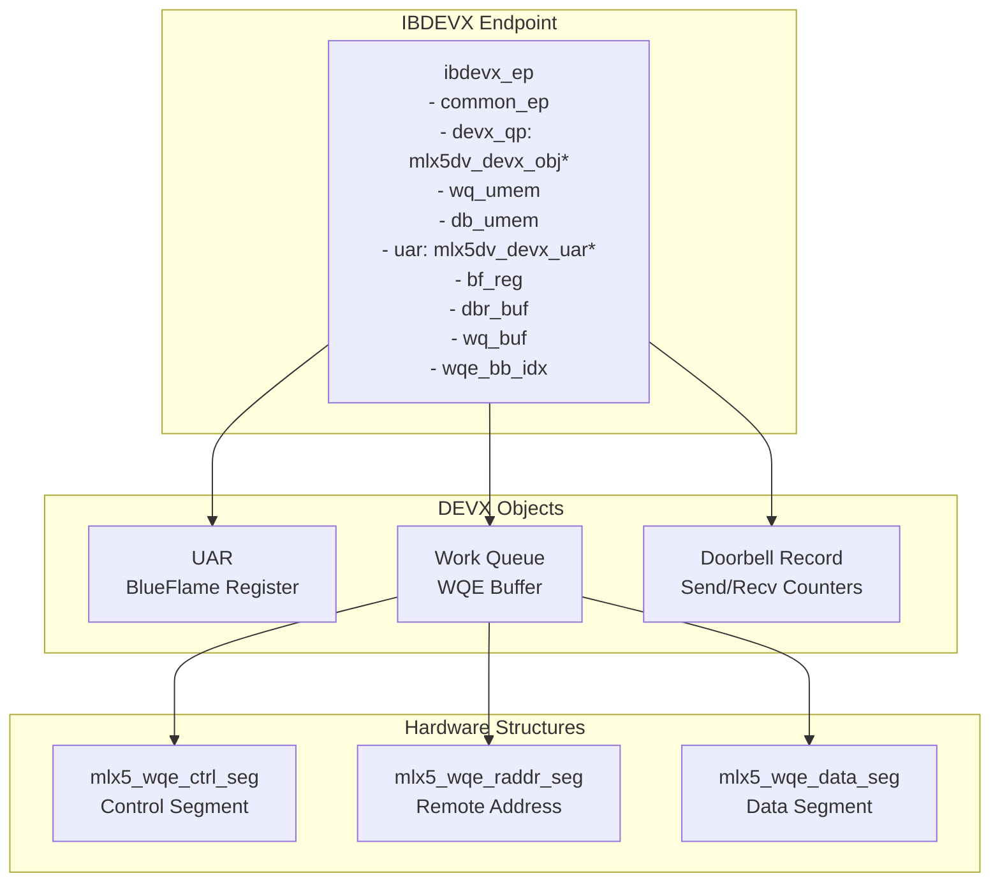
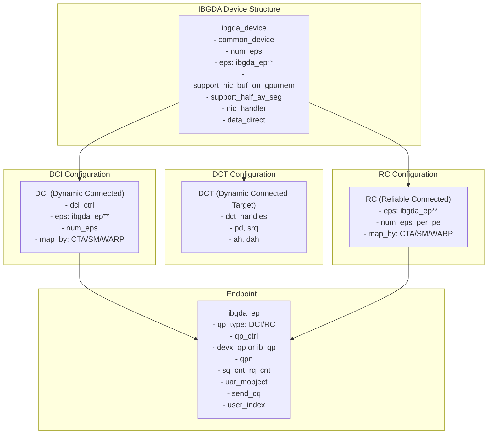
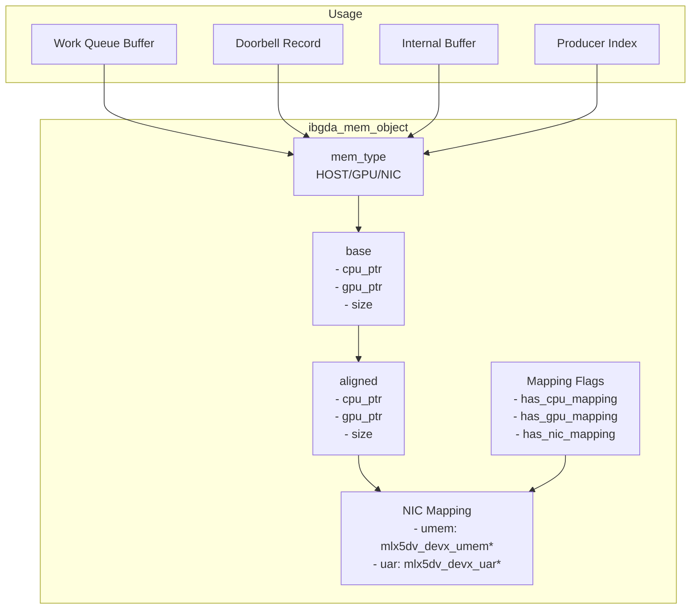
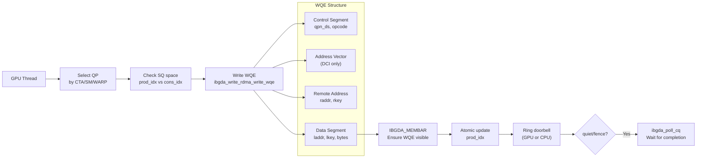
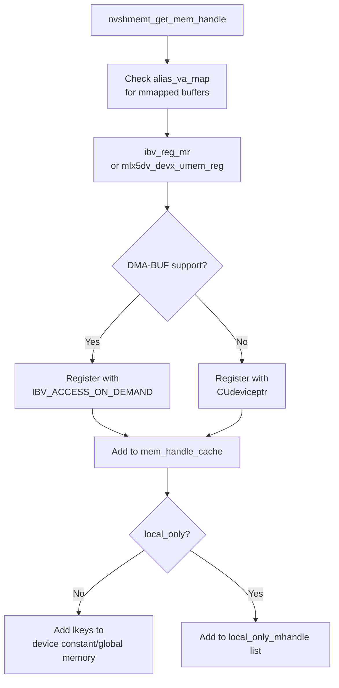
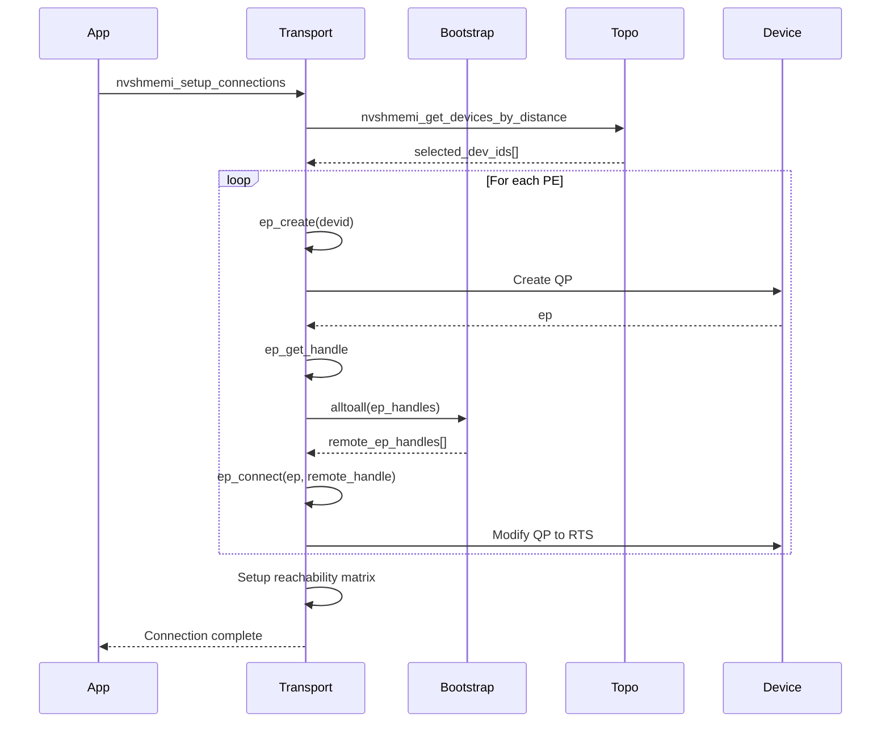

<!-- source: DeepWiki mcp.deepwiki.com · repo NVIDIA/nvshmem · page 5.3 InfiniBand Transports · fetched 2026-10-26 -->

# InfiniBand Transports

<details>
<summary>Relevant source files</summary>

The following files were used as context for generating this wiki page:

- [src/host/topo/topo.cpp](src/host/topo/topo.cpp)
- [src/host/transport/transport.cpp](src/host/transport/transport.cpp)
- [src/include/internal/non_abi/nvshmemi_h_to_d_coll_defs.cuh](src/include/internal/non_abi/nvshmemi_h_to_d_coll_defs.cuh)
- [src/include/non_abi/device/coll/fcollect.cuh](src/include/non_abi/device/coll/fcollect.cuh)
- [src/include/non_abi/device/coll/reduce.cuh](src/include/non_abi/device/coll/reduce.cuh)
- [src/include/non_abi/device/coll/reducescatter.cuh](src/include/non_abi/device/coll/reducescatter.cuh)
- [src/include/non_abi/device/pt-to-pt/ibgda_device.cuh](src/include/non_abi/device/pt-to-pt/ibgda_device.cuh)
- [src/include/non_abi/device/pt-to-pt/nvshmemi_transfer_api.cuh](src/include/non_abi/device/pt-to-pt/nvshmemi_transfer_api.cuh)
- [src/modules/transport/common/transport_common.cpp](src/modules/transport/common/transport_common.cpp)
- [src/modules/transport/ibdevx/ibdevx.cpp](src/modules/transport/ibdevx/ibdevx.cpp)
- [src/modules/transport/ibgda/ibgda.cpp](src/modules/transport/ibgda/ibgda.cpp)
- [src/modules/transport/ibrc/ibrc.cpp](src/modules/transport/ibrc/ibrc.cpp)

</details>


## Purpose and Scope

This page documents NVSHMEM's three InfiniBand transport implementations: IBRC, IBDEVX, and IBGDA. These transports provide high-performance remote memory access over InfiniBand and RoCE networks using Mellanox/NVIDIA ConnectX hardware. For general transport architecture and the pluggable transport interface, see [Transport Layer](#2.2). For other network transports, see [Libfabric Transport](#5.2) and [UCX Transport](#5.4).

The three InfiniBand transports differ in their programming model and performance characteristics:

- **IBRC**: Traditional CPU-mediated transport using standard InfiniBand verbs
- **IBDEVX**: CPU-mediated transport with direct hardware access via DEVX API
- **IBGDA**: GPU-initiated transport with GPU Direct Async capabilities

## Transport Selection and Capabilities

### Selection Hierarchy

The InfiniBand transport is selected via the `NVSHMEM_REMOTE_TRANSPORT` environment variable. When set to `ibrc`, `ibdevx`, or left unspecified (with appropriate build flags), NVSHMEM loads the corresponding transport plugin at initialization.



**Sources:** [src/host/transport/transport.cpp:98-173]()

### Capability Reporting

All three transports implement the `can_reach_peer` function to report capabilities:

| Transport | CPU Write | CPU Read | CPU Atomics | GPU Write | GPU Read | GPU Atomics |
|-----------|-----------|----------|-------------|-----------|----------|-------------|
| IBRC      | ✓         | ✓        | ✓           | ✗         | ✗        | ✗           |
| IBDEVX    | ✓         | ✓        | ✓           | ✗         | ✗        | ✗           |
| IBGDA     | ✓         | ✓        | ✓           | ✓         | ✓        | ✓           |

**Sources:** [src/modules/transport/ibrc/ibrc.cpp:248-256](), [src/modules/transport/ibdevx/ibdevx.cpp:264-272](), [src/modules/transport/ibgda/ibgda.cpp:472-480]()

## Common InfiniBand Infrastructure

### Shared Structures and Code

All three transports share common infrastructure for InfiniBand device management and memory registration:



**Sources:** [src/modules/transport/common/transport_ib_common.h](), [src/modules/transport/common/transport_mlx5_common.h](), [src/modules/transport/common/transport_gdr_common.h]()

### Device Discovery and Selection

All InfiniBand transports use a common device discovery mechanism:

1. **HCA Enumeration**: Query all InfiniBand devices via `ibv_get_device_list`
2. **Filtering**: Apply `NVSHMEM_HCA_LIST` environment variable to filter devices
3. **Topology-Based Selection**: Use PCIe distance calculation to assign optimal NICs to GPUs
4. **Port Selection**: For each device, select active ports with appropriate link layer (IB or Ethernet)

The topology discovery ranks GPU-NIC pairs by PCIe distance:
- **PIX**: Same PCIe switch
- **PXB**: Same PCIe bridge
- **PHB**: Same PCIe host bridge  
- **NODE**: Same NUMA node
- **SYS**: Different NUMA nodes

**Sources:** [src/host/topo/topo.cpp:109-130](), [src/modules/transport/ibgda/ibgda.cpp:1290-1450]()

## IBRC Transport (Reliable Connected)

### Architecture Overview

IBRC implements a traditional InfiniBand transport using the verbs API with CPU-mediated operations. It uses a Shared Receive Queue (SRQ) for handling incoming atomic operations.



**Sources:** [src/modules/transport/ibrc/ibrc.cpp:86-148]()

### Connection Establishment

IBRC establishes point-to-point Reliable Connected (RC) queue pairs:

1. **QP Creation**: Create RC QP with specified depth (`NVSHMEM_IBRC_QP_DEPTH`)
2. **QP Initialization**: Transition to INIT state with port and access flags
3. **Handle Exchange**: Exchange QPN, LID/GID via bootstrap
4. **RTR Transition**: Move to Ready-To-Receive with remote QP information
5. **RTS Transition**: Move to Ready-To-Send with timeout and retry parameters
6. **SRQ Setup**: Post receive buffers to shared receive queue

**Sources:** [src/modules/transport/ibrc/ibrc.cpp:258-433]()

### Operation Execution

#### RMA Operations

IBRC performs RMA (put/get) operations via CPU:



**Sources:** [src/modules/transport/ibrc/ibrc.cpp:1074-1180]()

#### Atomic Operations

IBRC handles atomics differently based on hardware support:

- **Native IB Atomics**: Use `IBV_WR_ATOMIC_*` work requests for 64-bit operations
- **Emulated Atomics**: Use SRQ-based request/response for unsupported operations

For emulated atomics:
1. Client posts atomic request to server's SRQ
2. Server receives request in buffer pool
3. Server performs atomic operation on CPU
4. Server sends result back via RDMA write
5. Client polls for completion

**Sources:** [src/modules/transport/ibrc/ibrc.cpp:842-1072]()

### Progress Engine

IBRC requires explicit progress to complete asynchronous operations:

```c
int progress_send(nvshmemt_ib_common_state_t ibrc_state) {
    // Poll send completion queue
    for each device:
        ibv_poll_cq(device->send_cq, ...)
        // Update tail_op_id for completed operations
    
    // Process received atomic requests
    process_atomics()
}
```

The progress function is called during `quiet` and `fence` operations, and can be explicitly invoked via `nvshmem_quiet`.

**Sources:** [src/modules/transport/ibrc/ibrc.cpp:174-223]()

## IBDEVX Transport

### Architecture Overview

IBDEVX provides direct hardware access using the DEVX API, allowing fine-grained control over queue pairs and work queue entries while remaining CPU-mediated.



**Sources:** [src/modules/transport/ibdevx/ibdevx.cpp:201-222]()

### DEVX Queue Pair Creation

IBDEVX creates queue pairs directly using DEVX:

1. **Query HCA Capabilities**: Get BlueFlame register size via `MLX5_CMD_OP_QUERY_HCA_CAP`
2. **Allocate UAR**: `mlx5dv_devx_alloc_uar` for doorbell register
3. **Register Memory**: `mlx5dv_devx_umem_reg` for WQ buffer and doorbell record
4. **Create QP**: Use `mlx5dv_devx_obj_create` with MLX5 QP context structure
5. **Initialize State**: Transition QP through INIT → RTR → RTS states

**Sources:** [src/modules/transport/ibdevx/ibdevx.cpp:296-525]()

### Work Request Construction

IBDEVX manually constructs hardware-level work queue entries:

```c
struct ibdevx_rw_wqe {
    struct mlx5_wqe_ctrl_seg ctrl;  // Control segment
    struct mlx5_wqe_raddr_seg raddr; // Remote address
    union {
        struct mlx5_wqe_data_seg data_seg;       // Scatter-gather
        struct ibdevx_rw_inline_data_seg data_inl; // Inline data
    } data;
};
```

For each operation:
1. Get next WQE slot from work queue
2. Populate control segment (opcode, QPN, WQE index)
3. Set remote address and rkey
4. Set local data pointer or inline data
5. Update doorbell record
6. Ring doorbell via UAR

**Sources:** [src/modules/transport/ibdevx/ibdevx.cpp:100-124](), [src/modules/transport/ibdevx/ibdevx.cpp:817-938]()

## IBGDA Transport (GPU Direct Async)

### Architecture Overview

IBGDA is the most sophisticated InfiniBand transport, enabling GPU threads to directly initiate RDMA operations without CPU involvement.



**Sources:** [src/modules/transport/ibgda/ibgda.cpp:236-278]()

### QP Type Selection

IBGDA supports two queue pair types:

**Dynamic Connected Transport (DCI/DCT)**:
- Multiple GPUs connect to shared DCTs
- More scalable for large PE counts
- Requires half or full address vector per operation
- Set via `NVSHMEM_IBGDA_ENABLE_DCI=1`

**Reliable Connected (RC)**:
- Point-to-point connections
- Better performance for small PE counts
- No address vector overhead
- Default when DCI disabled

**Sources:** [src/modules/transport/ibgda/ibgda.cpp:2488-2641]()

### QP Mapping Strategies

IBGDA maps queue pairs to GPU execution units based on `NVSHMEM_IBGDA_DCI_MAP_BY` / `NVSHMEM_IBGDA_RC_MAP_BY`:

| Strategy | Description | Use Case |
|----------|-------------|----------|
| CTA | One QP per thread block | Fine-grained parallelism |
| SM | One QP per streaming multiprocessor | Medium parallelism |
| WARP | One QP per warp | High parallelism |
| DCT | All threads share DCT (DCI only) | Maximum scalability |

**Sources:** [src/modules/transport/ibgda/ibgda.cpp:379-407]()

### Memory Object Management

IBGDA uses a sophisticated memory object abstraction to handle GPU, host, and NIC memory:



Memory objects support:
- **CPU Mapping**: For CPU-side progress and initialization
- **GPU Mapping**: For device-side direct access
- **NIC Mapping**: Registration with hardware via DEVX UMEM

The `nic_handler` setting controls which path is used:
- `AUTO`: Choose based on hardware capabilities
- `GPU`: GPU directly accesses NIC control structures
- `CPU_GDRCOPY`: CPU accesses GPU memory via GDRCopy
- `CPU_HOST_MEMORY`: Use host memory for NIC structures

**Sources:** [src/modules/transport/ibgda/ibgda.cpp:145-167](), [src/modules/transport/ibgda/ibgda.cpp:917-1008]()

### Device-Side Operation Path

IBGDA's key innovation is GPU-initiated RDMA:



**Sources:** [src/include/non_abi/device/pt-to-pt/ibgda_device.cuh:665-730]()

### GPU-Side WQE Construction

Device code constructs work queue entries directly:

```c
template <bool support_half_av_seg>
__device__ void ibgda_write_rdma_write_wqe(
    nvshmemi_ibgda_device_qp_t *qp,
    uint32_t dct_idx,          // DCT index (DCI only)
    uint64_t laddr, __be32 lkey, // Local address
    uint64_t raddr, __be32 rkey, // Remote address
    uint32_t bytes,            // Transfer size
    uint16_t wqe_idx,          // WQE index
    uint8_t fm_ce_se,          // Fence/CE/SE flags
    void **out_wqes)           // Output WQE pointers
{
    // Construct control segment
    ctrl_seg.qpn_ds = HTOBE32((qp->qpn << 8) | ds);
    ctrl_seg.fm_ce_se = fm_ce_se;
    ctrl_seg.opmod_idx_opcode = HTOBE32((wqe_idx << 8) | MLX5_OPCODE_RDMA_WRITE);
    
    // Write address vector (DCI only)
    if (support_half_av_seg) {
        IBGDA_STORE_DCT_AV_SEG(dct_idx, av_seg_ptr);
    }
    
    // Write remote address segment
    raddr_seg.raddr = HTOBE64(raddr);
    raddr_seg.rkey = rkey;
    
    // Write data segment
    data_seg.byte_count = HTOBE32(bytes);
    data_seg.lkey = lkey;
    data_seg.addr = HTOBE64(laddr);
    
    // Use relaxed stores for all segments
    ibgda_store_relaxed(...);
}
```

**Sources:** [src/include/non_abi/device/pt-to-pt/ibgda_device.cuh:665-730]()

### Completion Queue Polling

GPU threads can poll completion queues directly:

```c
__device__ int ibgda_poll_cq(
    nvshmemi_ibgda_device_cq_t *cq,
    uint64_t idx,              // Wait for this index
    int *error)
{
    struct mlx5_cqe64 *cqe64 = (struct mlx5_cqe64 *)cq->cqe;
    uint64_t cons_idx = ibgda_atomic_read(cq->cons_idx);
    
    // Wait for producer to catch up
    while (ibgda_atomic_read(cq->prod_idx) < idx);
    
    // Poll wqe_counter from CQE
    do {
        new_wqe_counter = ibgda_atomic_read(&cqe64->wqe_counter);
        wqe_counter = BSWAP16(new_wqe_counter);
    } while (wqe_counter + 1 < idx);
    
    // Update consumer index
    atomicMax(cq->cons_idx, new_cons_idx);
    
    // Check for errors
    if (opcode == MLX5_CQE_REQ_ERR) {
        *error = cqe_err->syndrome;
        return -1;
    }
}
```

**Sources:** [src/include/non_abi/device/pt-to-pt/ibgda_device.cuh:483-607]()

### CPU Progress Path

For systems without GPU-side doorbell ringing support:

```c
int ibgda_dci_progress(nvshmem_transport_t t) {
    // For each device
    for (int j = 0; j < n_devs_selected; j++) {
        // Read producer indices from GPU memory
        #ifdef NVSHMEM_USE_GDRCOPY
        if (nic_handler == CPU_GDRCOPY) {
            gdrcopy_ftable.copy_from_mapping(
                mh, prod_idx_snapshot, prod_idx_array, ...);
        }
        #endif
        
        // Ring doorbells for updated indices
        for (int i = 0; i < num_prod_idx_slots; ++i) {
            if (prod_idx_cache[i] < prod_idx_snapshot[i]) {
                // Write control segment to doorbell
                IBGDA_WRITE_ONCE(*dbrec, htobe32(prod_idx & 0xffff));
                IBGDA_WRITE_ONCE(*bf, ctrl_seg);
                prod_idx_cache[i] = prod_idx;
            }
        }
    }
}
```

**Sources:** [src/modules/transport/ibgda/ibgda.cpp:491-621]()

## Memory Registration

### Common Registration Flow

All InfiniBand transports register memory for RDMA access:



**Sources:** [src/modules/transport/ibgda/ibgda.cpp:711-907](), [src/modules/transport/ibrc/ibrc.cpp:453-610]()

### IBGDA Memory Handle Structure

IBGDA maintains memory handles per device and optimizes key lookup:

```c
struct ibgda_mem_handle {
    struct nvshmemt_ib_common_mem_handle 
        dev_mem_handles[NVSHMEMI_IBGDA_MAX_DEVICES_PER_PE];
    int num_devs;
};

// Device-side key lookup
typedef struct {
    __be32 key;
    uint64_t next_addr;  // For chunked lookup
} nvshmemi_ibgda_device_key_t;

// Keys stored in constant memory for fast access
nvshmemi_ibgda_device_key_t lkeys[NVSHMEMI_IBGDA_MAX_CONST_LKEYS];
```

For large heaps, keys are stored in:
1. **Constant memory**: First `NVSHMEMI_IBGDA_MAX_CONST_LKEYS` entries
2. **Global memory**: Overflow entries

**Sources:** [src/modules/transport/ibgda/ibgda.cpp:218-221](), [src/modules/transport/ibgda/ibgda.cpp:815-881]()

### GDRCopy Integration

When `NVSHMEM_USE_GDRCOPY` is enabled, IBRC and IBGDA support fast CPU reads from GPU memory:

```c
#ifdef NVSHMEM_USE_GDRCOPY
typedef struct ibrc_mem_handle_info {
    struct ibv_mr *mr;
    void *ptr;
    size_t size;
    void *cpu_ptr;       // CPU-accessible mapping
    void *cpu_ptr_base;  // Base of BAR1 mapping
    gdr_mh_t mh;         // GDRCopy handle
} ibrc_mem_handle_info_t;

// Pin GPU memory for CPU access
gdr_pin_buffer(gdr_desc, gpu_ptr, size, 0, 0, &mh);
gdr_map(gdr_desc, mh, &cpu_ptr_base, size);
cpu_ptr = cpu_ptr_base + offset;

// Fast CPU read from GPU memory
gdr_copy_from_mapping(mh, dest, gpu_ptr, size);
#endif
```

This enables efficient CPU-side progress for atomic operations and doorbell ringing.

**Sources:** [src/modules/transport/ibrc/ibrc.cpp:136-144](), [src/modules/transport/ibgda/ibgda.cpp:511-522]()

## Connection Setup

### Connection Manager Flow

All transports follow a common connection establishment pattern:



**Sources:** [src/modules/transport/ibgda/ibgda.cpp:3449-3775]()

### IBGDA-Specific Connection Setup

IBGDA performs additional setup for device-side access:

1. **Allocate Device State**:
   - Create `nvshmemi_ibgda_device_state_t` in device memory
   - Copy QP handles, CQ pointers, DCT information

2. **Setup Address Vectors** (DCI mode):
   - For each DCT, populate address vector in constant/global memory
   - Store half or full AV based on hardware support

3. **Initialize Producer Indices**:
   - Allocate GPU-visible producer index arrays
   - Set up GDRCopy mappings if needed

4. **Configure Memory Keys**:
   - Populate lkey/rkey arrays for registered memory
   - Setup local-only memory handle linked list

**Sources:** [src/modules/transport/ibgda/ibgda.cpp:3449-3775]()

## Performance Considerations

### Transport Selection Guidelines

| Scenario | Recommended Transport | Rationale |
|----------|----------------------|-----------|
| Small PE count (<16) | IBGDA with RC | Lowest latency, no AV overhead |
| Large PE count (>64) | IBGDA with DCI | Better scalability |
| CPU-heavy workload | IBRC | Mature, well-tested |
| GPU-initiated ops | IBGDA | Direct GPU access |
| Mixed CPU/GPU ops | IBDEVX | Balance of control and performance |

**Sources:** [src/modules/transport/ibgda/ibgda.cpp:2488-2641]()

### IBGDA Optimization Flags

Key environment variables for tuning IBGDA:

- `NVSHMEM_IBGDA_SUPPORT_GPUMEM_ONLY`: Enable GPU memory for all NIC structures
- `NVSHMEM_IBGDA_DCI_MAP_BY`: QP mapping strategy (CTA/SM/WARP/DCT)
- `NVSHMEM_IBGDA_ENABLE_DCI`: Use DCI instead of RC
- `NVSHMEM_IBGDA_NIC_HANDLER`: Control doorbell path (GPU/CPU/AUTO)
- `NVSHMEM_IBGDA_QP_DEPTH`: Queue pair depth

**Sources:** [src/modules/transport/ibgda/ibgda.cpp:2144-2245]()

### Hardware Requirements

IBGDA requires:
- **GPU Architecture**: Compute capability 7.0+ (Volta or newer)
- **NIC**: Mellanox ConnectX-5 or newer with DEVX support
- **Driver**: MLNX_OFED 5.0+ or upstream kernel with DEVX
- **Optional**: GDRCopy for CPU-side progress optimization

IBRC and IBDEVX work with older hardware but provide CPU-mediated operation only.

**Sources:** [src/modules/transport/ibgda/ibgda.cpp:1936-2143]()

---

