<!-- source: DeepWiki mcp.deepwiki.com · repo NVIDIA/nvshmem · page 5.4 UCX Transport · fetched 2026-10-26 -->

# UCX Transport

<details>
<summary>Relevant source files</summary>

The following files were used as context for generating this wiki page:

- [src/host/proxy/proxy.cpp](src/host/proxy/proxy.cpp)
- [src/host/topo/topo.cpp](src/host/topo/topo.cpp)
- [src/host/transport/transport.cpp](src/host/transport/transport.cpp)
- [src/include/internal/host/util.h](src/include/internal/host/util.h)
- [src/modules/transport/common/transport_common.cpp](src/modules/transport/common/transport_common.cpp)
- [src/modules/transport/libfabric/libfabric.cpp](src/modules/transport/libfabric/libfabric.cpp)
- [src/modules/transport/ucx/ucx.cpp](src/modules/transport/ucx/ucx.cpp)

</details>


## Purpose and Scope

The UCX (Unified Communication X) Transport is a network transport plugin for NVSHMEM that provides RDMA-based communication over InfiniBand, RoCE, and other high-performance interconnects. This transport implements the standard NVSHMEM transport interface and supports both CPU-initiated and proxy-mediated operations.

This page documents the UCX transport implementation, including its initialization, memory management, RMA operations, and atomic operations. For information about the transport plugin architecture and how transports are selected, see [Transport Interface and Common Code](#5.1). For details about other transport implementations, see [InfiniBand Transports](#5.3) and [Libfabric Transport](#5.2).

Sources: [src/modules/transport/ucx/ucx.cpp:1-1492]()

## Architecture Overview

The UCX transport consists of several key components that work together to provide efficient communication:

```mermaid
graph TB
    subgraph "UCX Transport Components"
        INIT["nvshmemt_init()<br/>ucx.cpp:1249"]
        STATE["transport_ucx_state_t<br/>Worker, Endpoints, Buffers"]
        CONNECT["nvshmemt_ucx_connect_endpoints()<br/>ucx.cpp:424"]
        
        subgraph "Memory Management"
            GET_HANDLE["nvshmemt_ucx_get_mem_handle()<br/>ucx.cpp:292"]
            REL_HANDLE["nvshmemt_ucx_release_mem_handle()<br/>ucx.cpp:235"]
            MEM_CACHE["Memory Handle Cache<br/>transport_common.cpp"]
        end
        
        subgraph "Communication Operations"
            RMA["nvshmemt_ucx_rma()<br/>ucx.cpp:558"]
            LOCAL_AMO["nvshmemt_ucx_local_amo()<br/>ucx.cpp:781"]
            REMOTE_AMO["nvshmemt_ucx_remote_amo()<br/>ucx.cpp:843"]
        end
        
        subgraph "Active Messaging (GDRCopy)"
            SEND_AM_CB["nvshmemt_ucx_recv_send_am_data_cb()<br/>ucx.cpp:140"]
            RESP_AM_CB["ucx_recv_resp_am_data_cb()<br/>ucx.cpp:193"]
            PROCESS_AMO["nvshmemt_ucx_process_amos()<br/>ucx.cpp:729"]
            HANDLE_AMO["nvshmemt_ucx_handle_amo()<br/>ucx.cpp:635"]
        end
        
        subgraph "Progress & Completion"
            PROGRESS["nvshmemt_ucx_progress()<br/>ucx.cpp:1069"]
            QUIET["nvshmemt_ucx_quiet()<br/>ucx.cpp:1024"]
            FENCE["nvshmemt_ucx_fence()<br/>ucx.cpp:1012"]
        end
        
        subgraph "Resource Pools"
            BOUNCE_POOL["Bounce Buffer Pool<br/>NVSHMEMT_UCX_BOUNCE_BUFFER_POOL_SIZE"]
            HEADER_POOL["AM Header Pool<br/>NVSHMEMT_UCX_ATOMIC_POOL_SIZE"]
        end
    end
    
    subgraph "UCX Library"
        UCP_WORKER["ucp_worker_context"]
        UCP_EPS["ucp_endpoints[]<br/>Per PE + Proxy"]
        UCP_RKEY["ucp_rkey_h<br/>Remote Keys"]
    end
    
    subgraph "GDRCopy (Optional)"
        GDR_DESC["gdr_desc"]
        GDR_MAP["CPU-side GPU Memory"]
    end
    
    INIT --> STATE
    INIT --> UCP_WORKER
    CONNECT --> UCP_EPS
    
    GET_HANDLE --> MEM_CACHE
    GET_HANDLE --> UCP_RKEY
    GET_HANDLE --> GDR_MAP
    
    RMA --> UCP_EPS
    RMA --> UCP_RKEY
    RMA --> BOUNCE_POOL
    
    LOCAL_AMO --> SEND_AM_CB
    LOCAL_AMO --> HEADER_POOL
    REMOTE_AMO --> UCP_EPS
    REMOTE_AMO --> BOUNCE_POOL
    
    SEND_AM_CB --> PROCESS_AMO
    PROCESS_AMO --> HANDLE_AMO
    HANDLE_AMO --> RESP_AM_CB
    HANDLE_AMO --> GDR_MAP
    
    PROGRESS --> UCP_WORKER
    PROGRESS --> PROCESS_AMO
    
    QUIET --> UCP_WORKER
```

**Key Components:**
- **transport_ucx_state_t**: Main state structure containing UCX worker, endpoints, and resource pools
- **Endpoints**: Multiple endpoints per PE (host and proxy) for different operation types
- **Bounce Buffers**: Pre-registered host memory for small transfers
- **Active Messaging**: GDRCopy-based path for CPU-side atomic processing
- **Memory Handle Cache**: Fast lookup for registered memory regions

Sources: [src/modules/transport/ucx/ucx.cpp:1-1492]()

## Initialization and Configuration

### Transport Initialization

The UCX transport is initialized through the `nvshmemt_init()` function, which is dynamically loaded by the transport manager:

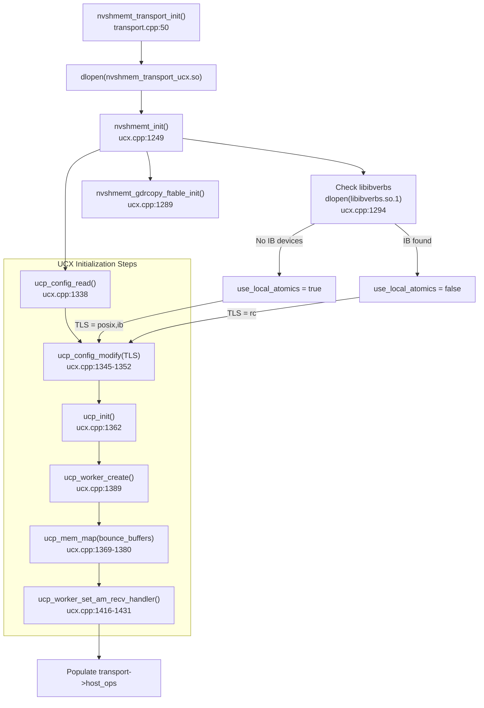

**Configuration Decisions:**

| Condition | Configuration | Impact |
|-----------|--------------|---------|
| No IB devices detected | `use_local_atomics = true`<br/>`TLS = "posix,ib"` | Atomics processed via Active Messages with GDRCopy |
| IB devices present | `use_local_atomics = false`<br/>`TLS = "rc"` | Atomics use UCX native operations (RC transport) |
| GDRCopy available | `use_gdrcopy = true` | CPU-side GPU memory access for atomics |
| GDRCopy disabled | `use_gdrcopy = false` | Fallback to UCX operations only |

Sources: [src/modules/transport/ucx/ucx.cpp:1249-1491](), [src/host/transport/transport.cpp:115-131]()

### Environment Variables

The UCX transport sets critical environment variables during initialization:

```c
// Enable small get operations
setenv("UCX_RC_TX_INLINE_RESP", "0", 1);
```

This configuration allows g/get operations of 64 bytes or less to be inlined.

Sources: [src/modules/transport/ucx/ucx.cpp:1314-1318]()

## Connection Management

### Endpoint Structure

The UCX transport maintains multiple endpoints per PE to support different operation types:

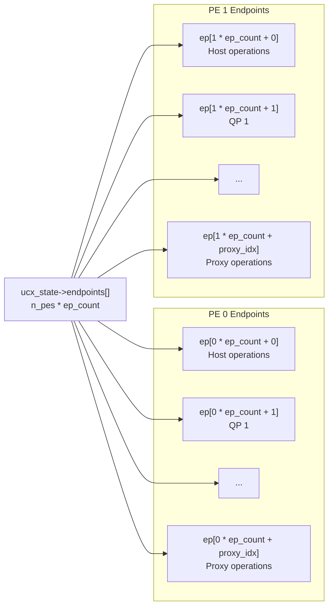

**Endpoint Calculation:**
```c
// Host operations
ep_index = pe * ucx_state->ep_count + 0

// Proxy operations  
ep_index = pe * ucx_state->ep_count + ucx_state->proxy_ep_idx
```

Where `ep_count = MAX_TRANSPORT_EP_COUNT + 1` and `proxy_ep_idx = MAX_TRANSPORT_EP_COUNT`.

Sources: [src/modules/transport/ucx/ucx.cpp:437-439](), [src/modules/transport/ucx/ucx.cpp:578-584]()

### Connection Establishment

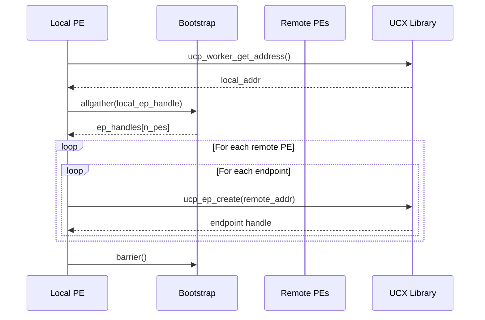

The connection process exchanges worker addresses via the bootstrap interface, then creates UCX endpoints to each remote PE.

Sources: [src/modules/transport/ucx/ucx.cpp:424-504]()

## Memory Handle Management

### Memory Registration

Memory registration involves mapping GPU memory with UCX and optionally with GDRCopy for CPU-side access:

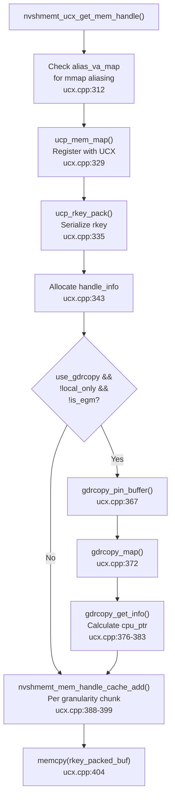

**Memory Handle Structure:**

```c
typedef struct nvshmemt_ucx_mem_handle {
    ucp_mem_h mem_handle;                           // UCX memory handle
    ucp_rkey_h ep_rkey_host;                       // Unpacked rkey for host EP
    ucp_rkey_h ep_rkey_proxy;                      // Unpacked rkey for proxy EP
    uint8_t rkey_packed_buf[NVSHMEMT_UCP_RKEY_PACKED_MAX_LEN];  // Serialized rkey
    size_t rkey_packed_buf_len;
    void *ptr;                                     // Original GPU pointer
    bool local_only;                               // Skip remote registration
} nvshmemt_ucx_mem_handle_t;
```

**Memory Handle Info (Cached):**

```c
typedef struct nvshmemt_ucx_mem_handle_info {
    nvshmemt_ucx_mem_handle_t *mem_handle;        // Parent handle
    void *ptr;                                     // GPU pointer
    size_t size;                                   // Buffer size
    void *cpu_ptr_base;                           // GDRCopy base address
    void *cpu_ptr;                                // GDRCopy aligned address
    gdr_mh_t mh;                                  // GDRCopy handle
} nvshmemt_ucx_mem_handle_info_t;
```

Sources: [src/modules/transport/ucx/ucx.cpp:292-422](), [src/modules/transport/ucx/ucx.h]()

### GDRCopy Memory Mapping

When GDRCopy is enabled, GPU memory is mapped into CPU address space for direct access:

```
GPU Memory:     [============================================]
                 ^
                 buf (0x7f0000001234)
                 
GDRCopy Map:    [============================================]
                 ^              ^
                 info.va        cpu_ptr_base (64KB aligned)
                 (0x7f0000000000)
                 
Offset Calc:    cpu_ptr = cpu_ptr_base + (buf - info.va)
```

This allows CPU-side atomic operations to directly read/modify GPU memory without going through the GPU.

Sources: [src/modules/transport/ucx/ucx.cpp:367-383]()

## RMA Operations

### RMA Implementation

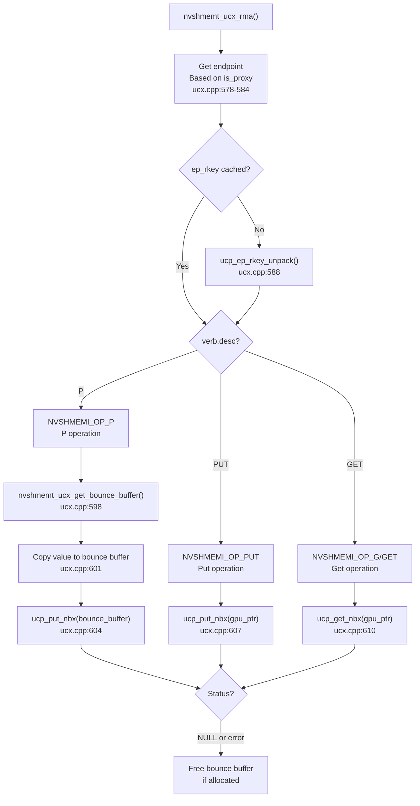

**Operation Parameters:**

```c
ucp_request_param_t param;
param.op_attr_mask = UCP_OP_ATTR_FIELD_CALLBACK | 
                     UCP_OP_ATTR_FIELD_MEMORY_TYPE;
param.cb.send = nvshmemt_ucx_send_request_cb;
param.memory_type = UCS_MEMORY_TYPE_CUDA;  // Or HOST for bounce buffer
```

For P operations, the memory type is set to `UCS_MEMORY_TYPE_HOST` since the value is copied to a bounce buffer first.

Sources: [src/modules/transport/ucx/ucx.cpp:558-631]()

## Atomic Operations

### Atomic Operation Modes

The UCX transport supports two modes for atomic operations:

| Mode | Trigger | Implementation | Device Access |
|------|---------|----------------|---------------|
| **Local Atomics** | No IB devices detected | Active Messages + GDRCopy | CPU reads/writes GPU memory |
| **Remote Atomics** | IB devices present | UCX native atomics (ucp_atomic_*) | NIC performs operations |

Sources: [src/modules/transport/ucx/ucx.cpp:1294-1311](), [src/modules/transport/ucx/ucx.cpp:1439-1443]()

### Local Atomic Flow (Active Messaging)

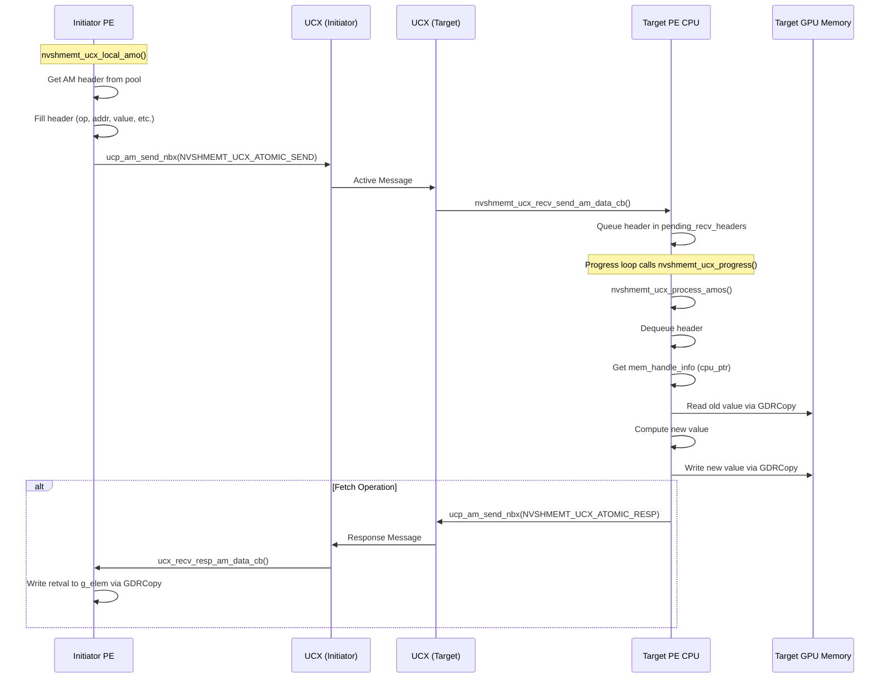

**Active Message Headers:**

```c
typedef struct nvshmemt_ucx_am_send_header {
    ucp_ep_h ep;              // Reply endpoint
    void *addr;               // Target GPU address
    uint8_t op_size;          // 2, 4, or 8 bytes
    uint64_t value;           // Swap/add value
    uint64_t cmp;             // Compare value (for CSWAP)
    void *retptr;             // Return value pointer
    uint64_t retflag;         // Return flag
    nvshmemi_amo_t op;        // Operation type
} nvshmemt_ucx_am_send_header_t;

typedef struct nvshmemt_ucx_am_resp_header {
    void *retptr;             // Return value pointer
    uint64_t retval;          // Return value
    uint64_t retflag;         // Return flag
} nvshmemt_ucx_am_resp_header_t;
```

Sources: [src/modules/transport/ucx/ucx.cpp:781-841](), [src/modules/transport/ucx/ucx.cpp:140-191](), [src/modules/transport/ucx/ucx.cpp:729-778](), [src/modules/transport/ucx/ucx.cpp:635-727]()

### Remote Atomic Flow (UCX Native)

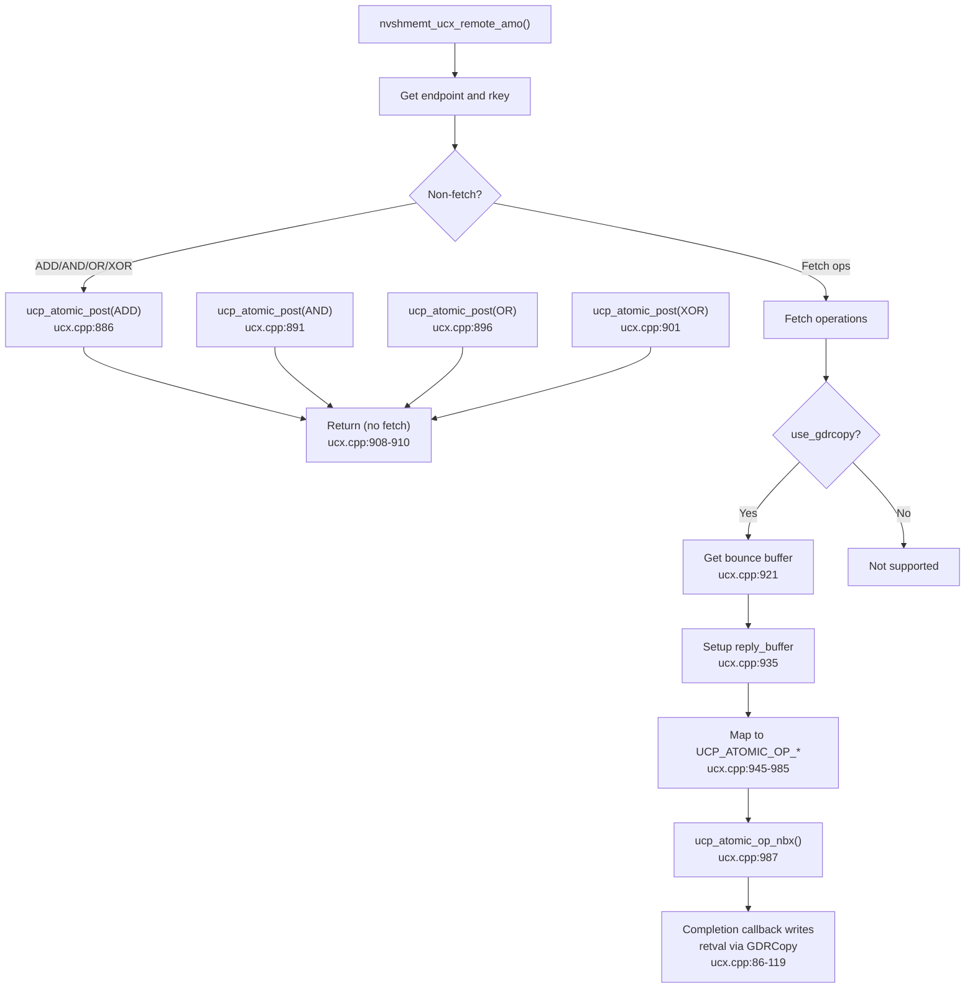

**Supported Remote Atomic Operations:**

| NVSHMEM Operation | UCX Opcode | Fetch Support |
|-------------------|------------|---------------|
| `NVSHMEMI_AMO_ADD` | `UCP_ATOMIC_POST_OP_ADD` | No |
| `NVSHMEMI_AMO_AND` | `UCP_ATOMIC_POST_OP_AND` | No |
| `NVSHMEMI_AMO_OR` | `UCP_ATOMIC_POST_OP_OR` | No |
| `NVSHMEMI_AMO_XOR` | `UCP_ATOMIC_POST_OP_XOR` | No |
| `NVSHMEMI_AMO_FETCH_ADD` | `UCP_ATOMIC_OP_ADD` | Yes (GDRCopy) |
| `NVSHMEMI_AMO_FETCH_AND` | `UCP_ATOMIC_OP_AND` | Yes (GDRCopy) |
| `NVSHMEMI_AMO_FETCH_OR` | `UCP_ATOMIC_OP_OR` | Yes (GDRCopy) |
| `NVSHMEMI_AMO_FETCH_XOR` | `UCP_ATOMIC_OP_XOR` | Yes (GDRCopy) |
| `NVSHMEMI_AMO_SWAP` | `UCP_ATOMIC_OP_SWAP` | Yes (GDRCopy) |
| `NVSHMEMI_AMO_COMPARE_SWAP` | `UCP_ATOMIC_OP_CSWAP` | Yes (GDRCopy) |

Sources: [src/modules/transport/ucx/ucx.cpp:843-1010]()

### Atomic Operation Template

Both local and remote atomic paths use a template function for CPU-side processing:

```c
template <typename T>
int nvshmemt_ucx_handle_amo(struct nvshmem_transport *transport, 
                             ucp_ep_h ep, nvshmemi_amo_t op,
                             void *ptr, uint64_t swap_add, 
                             uint64_t compare, void *retptr,
                             uint64_t retflag, bool is_proxy);
```

This template is instantiated for `uint16_t`, `uint32_t`, and `uint64_t` to handle 2, 4, and 8-byte atomics respectively.

Sources: [src/modules/transport/ucx/ucx.cpp:635-727]()

## Progress and Completion

### Progress Mechanism

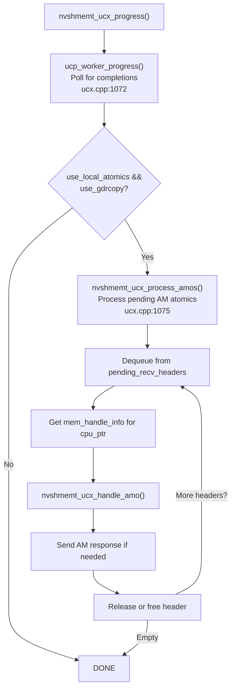

Progress is driven by:
1. **Proxy thread**: Continuously calls `transport->host_ops.progress()` 
2. **Host API**: Called before blocking operations
3. **Resource starvation**: Called when bounce buffers or headers are exhausted

Sources: [src/modules/transport/ucx/ucx.cpp:1069-1080](), [src/host/proxy/proxy.cpp:235-255]()

### Quiet Operation

The `quiet` operation ensures all outstanding operations have completed:

```c
int nvshmemt_ucx_quiet(struct nvshmem_transport *tcurr, 
                       int pe, int qp_index) {
    // Wait for active message atomics to complete
    if (use_gdrcopy) {
        if (qp_index != NVSHMEMX_QP_HOST) {
            while (nvshmemt_ucx_submitted_proxy_atomics > 
                   nvshmemt_ucx_completed_proxy_atomics) {
                nvshmemt_ucx_progress(tcurr);
            }
        } else {
            while (nvshmemt_ucx_submitted_host_atomics > 
                   nvshmemt_ucx_completed_host_atomics) {
                nvshmemt_ucx_progress(tcurr);
            }
        }
    }
    
    // Flush UCX worker
    ucs_status = ucp_worker_flush_nbx(ucx_state->worker_context, &param);
    // ... wait for completion
}
```

Separate counters track proxy and host atomics to ensure proper completion ordering.

Sources: [src/modules/transport/ucx/ucx.cpp:1024-1067]()

### Fence Operation

```c
int nvshmemt_ucx_fence(struct nvshmem_transport *tcurr, 
                       int pe, int qp_index, int is_multi) {
    return ucp_worker_fence(ucx_state->worker_context);
}
```

Fence ensures ordering of operations but doesn't guarantee completion (unlike quiet).

Sources: [src/modules/transport/ucx/ucx.cpp:1012-1022]()

## Bounce Buffers and Resource Management

### Bounce Buffer Pool

Bounce buffers are used for small transfers and atomic operations to avoid synchronous GPU operations:

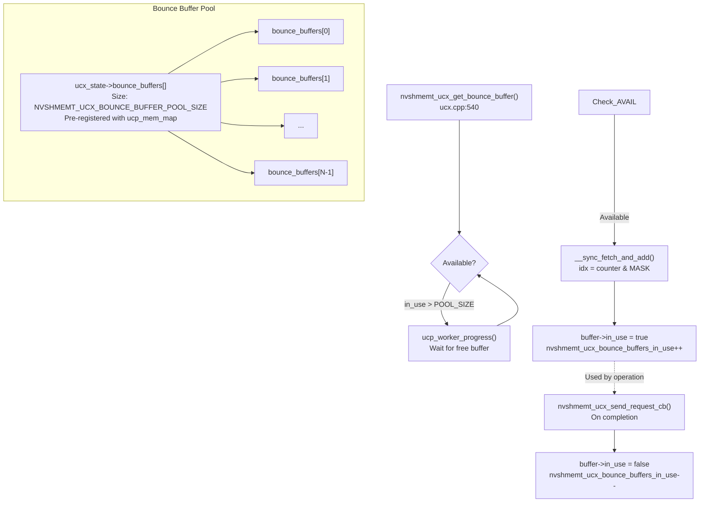

**Bounce Buffer Structure:**

```c
typedef struct nvshmemt_ucx_bounce_buffer {
    bool in_use;                      // Allocation flag
    uint64_t value;                   // Data payload
    uint64_t retvalue;                // Atomic return value
    bool amo_has_retval;              // Atomic return flag
    void *amo_device_retptr;          // Return pointer
    uint64_t amo_retflag;             // Return flag value
    bool is_proxy;                    // Proxy operation flag
    // ... additional fields
} nvshmemt_ucx_bounce_buffer_t;
```

Sources: [src/modules/transport/ucx/ucx.cpp:540-556](), [src/modules/transport/ucx/ucx.h]()

### AM Header Pool

Active message headers are similarly pooled:

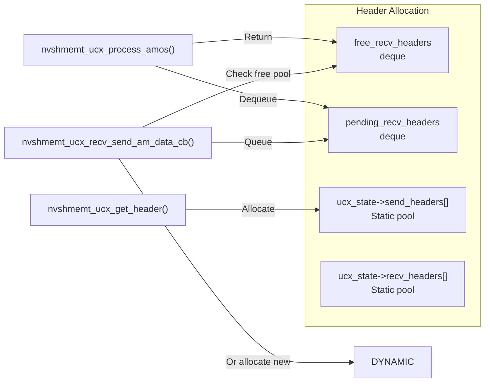

**Header Management:**
- **send_headers**: Pre-allocated array for outgoing active messages
- **recv_headers**: Pre-allocated array for incoming active messages
- **Dynamic allocation**: If pools exhausted, dynamically allocate (tracked with `dynamic_alloc` flag)

Sources: [src/modules/transport/ucx/ucx.cpp:514-538](), [src/modules/transport/ucx/ucx.cpp:140-191](), [src/modules/transport/ucx/ucx.cpp:1332-1336]()

## Transport Interface Implementation

The UCX transport implements the standard `nvshmem_transport` interface:

```mermaid
graph TB
    TRANSPORT["struct nvshmem_transport"]
    
    subgraph "Required Function Pointers"
        CAN_REACH["host_ops.can_reach_peer<br/>nvshmemt_ucx_can_reach_peer"]
        CONNECT["host_ops.connect_endpoints<br/>nvshmemt_ucx_connect_endpoints"]
        GET_HANDLE["host_ops.get_mem_handle<br/>nvshmemt_ucx_get_mem_handle"]
        REL_HANDLE["host_ops.release_mem_handle<br/>nvshmemt_ucx_release_mem_handle"]
        RMA_OP["host_ops.rma<br/>nvshmemt_ucx_rma"]
        AMO_OP["host_ops.amo<br/>local_amo or remote_amo"]
        FENCE_OP["host_ops.fence<br/>nvshmemt_ucx_fence"]
        QUIET_OP["host_ops.quiet<br/>nvshmemt_ucx_quiet"]
        PROG["host_ops.progress<br/>nvshmemt_ucx_progress"]
        CST["host_ops.enforce_cst<br/>nvshmemt_ucx_enforce_cst_at_target"]
        FINAL["host_ops.finalize<br/>nvshmemt_ucx_finalize"]
        INFO["host_ops.show_info<br/>nvshmemt_ucx_show_info"]
        PUT_SIG["host_ops.put_signal<br/>nvshmemt_put_signal (common)"]
    end
    
    subgraph "Transport Attributes"
        ATTR["attr = NVSHMEM_TRANSPORT_ATTR_CONNECTED"]
        STATE["state = ucx_state"]
        DEVICES["n_devices = 0<br/>device_pci_paths = NULL"]
        VERSION["api_version"]
    end
    
    TRANSPORT --> CAN_REACH
    TRANSPORT --> CONNECT
    TRANSPORT --> GET_HANDLE
    TRANSPORT --> REL_HANDLE
    TRANSPORT --> RMA_OP
    TRANSPORT --> AMO_OP
    TRANSPORT --> FENCE_OP
    TRANSPORT --> QUIET_OP
    TRANSPORT --> PROG
    TRANSPORT --> CST
    TRANSPORT --> FINAL
    TRANSPORT --> INFO
    TRANSPORT --> PUT_SIG
    
    TRANSPORT --> ATTR
    TRANSPORT --> STATE
    TRANSPORT --> DEVICES
    TRANSPORT --> VERSION
```

**Key Interface Properties:**

| Property | Value | Notes |
|----------|-------|-------|
| `attr` | `NVSHMEM_TRANSPORT_ATTR_CONNECTED` | Connection-oriented transport |
| `n_devices` | 0 | UCX manages devices internally |
| `can_reach_peer` | Always returns `CPU_WRITE | CPU_READ | CPU_ATOMICS` | Universal reachability |
| `enforce_cst_at_target` | NULL | CST enforcement handled by `enforce_cst` |

**AMO Function Selection:**

```c
if (use_local_atomics) {
    transport->host_ops.amo = nvshmemt_ucx_local_amo;  // Active messaging
} else {
    transport->host_ops.amo = nvshmemt_ucx_remote_amo; // UCX atomics
}
```

Sources: [src/modules/transport/ucx/ucx.cpp:1434-1461](), [src/include/internal/host_transport/transport.h]()

## Consistency Operations

### Enforce CST at Target

The UCX transport implements memory consistency enforcement through a read-back operation:

```c
int nvshmemt_ucx_enforce_cst_at_target(struct nvshmem_transport *tcurr) {
    // With GDRCopy: direct CPU read from GPU memory
    if (use_gdrcopy) {
        int temp;
        gdrcopy_ftable.copy_from_mapping(mem_handle_info->mh, &temp, 
                                        mem_handle_info->cpu_ptr, 
                                        sizeof(int));
        return 0;
    }
    
    // Without GDRCopy: perform a get to flush writes
    ucs_ptr_rc = ucp_get_nbx(ep, &local_int, sizeof(int), 
                             (uint64_t)mem_handle_info->ptr, 
                             rkey, &param);
    // ... wait for completion
}
```

This operation is called by the proxy to ensure GPU writes from the NIC are visible to the GPU before proceeding with dependent operations.

Sources: [src/modules/transport/ucx/ucx.cpp:1183-1242]()

## Error Handling and Completion Callbacks

### Completion Callbacks

The UCX transport uses several specialized callbacks for different operation types:

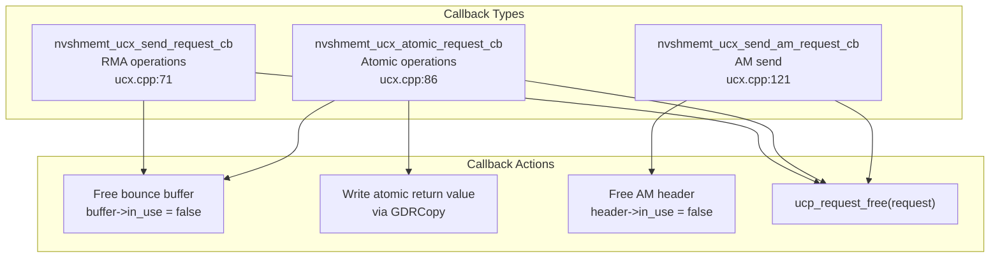

**Callback Flow for Fetch Atomic:**

```c
// Operation submission
buffer = nvshmemt_ucx_get_bounce_buffer(ucx_state);
buffer->amo_device_retptr = remote->retptr;
buffer->amo_retflag = remote->retflag;
param.user_data = buffer;
param.cb.send = nvshmemt_ucx_atomic_request_cb;

// Callback execution
void nvshmemt_ucx_atomic_request_cb(void *request, 
                                   ucs_status_t status, 
                                   void *user_data) {
    buffer = (nvshmemt_ucx_bounce_buffer_t *)user_data;
    
    if (buffer->amo_has_retval) {
        // Get CPU pointer via cache lookup
        mem_handle_info = get_mem_handle_info(...);
        cpu_ptr = mem_handle_info->cpu_ptr + offset;
        
        // Write return value
        elem = (g_elem_t *)cpu_ptr;
        elem->data = buffer->retvalue;
        elem->flag = buffer->amo_retflag;
    }
    
    buffer->in_use = false;
    ucp_request_free(request);
}
```

Sources: [src/modules/transport/ucx/ucx.cpp:71-137]()

## Finalization

The finalization process cleanly shuts down all UCX resources:

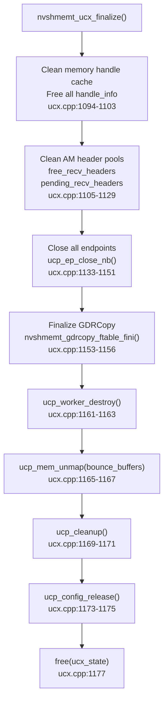

**Cleanup Considerations:**
- **Pending operations**: Endpoint closure uses `UCP_EP_CLOSE_MODE_FLUSH` to ensure completion
- **AM headers**: Checks for uncompleted active messages and warns if found
- **Memory handles**: Iterates through cache and frees all `handle_info` structures
- **GDRCopy**: Only cleaned up if it was successfully initialized

Sources: [src/modules/transport/ucx/ucx.cpp:1082-1181]()

---

