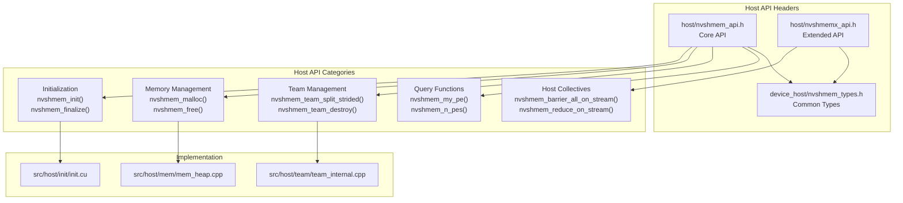
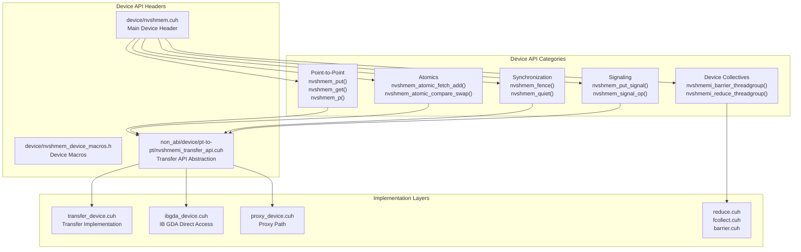
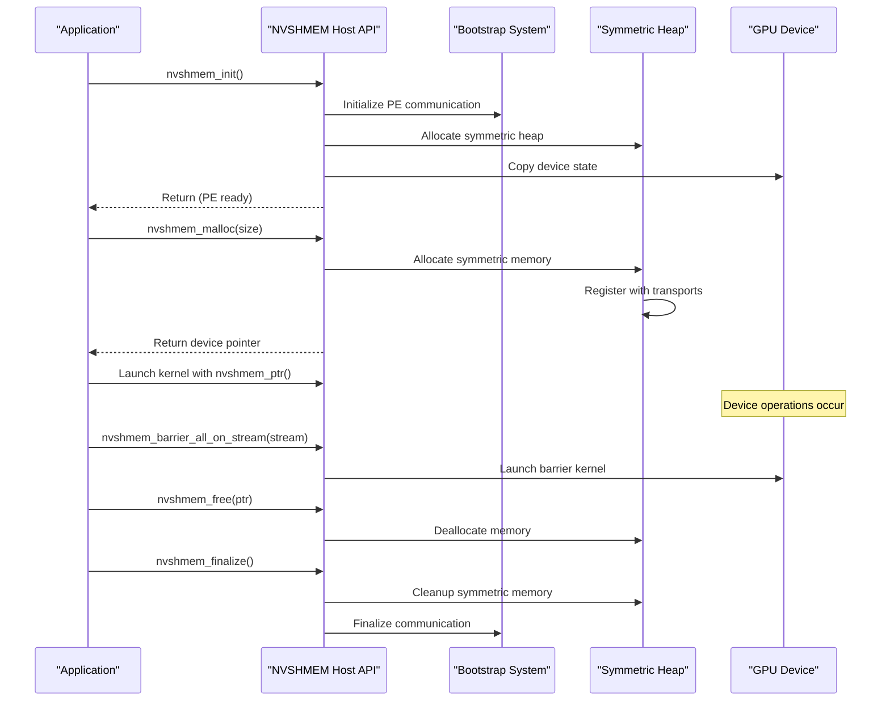
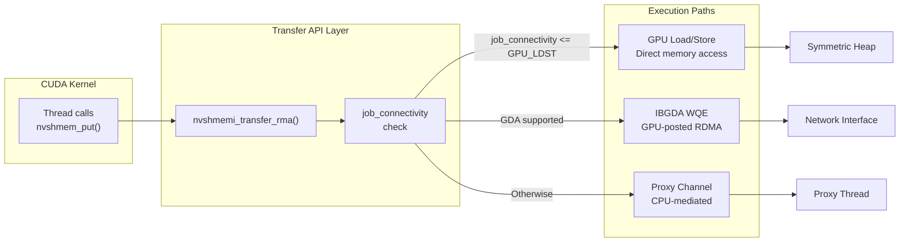
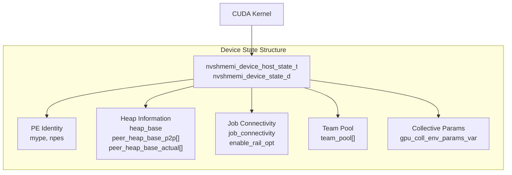
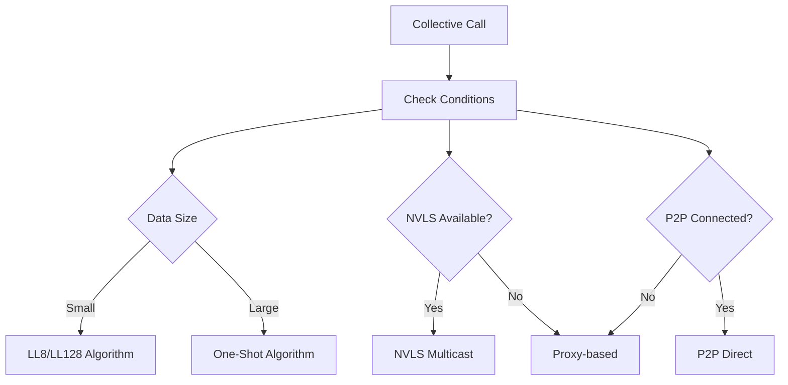
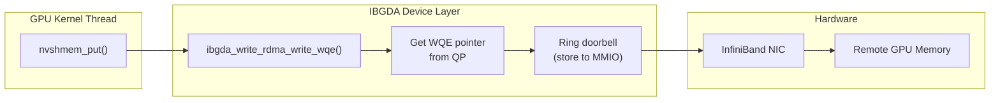

<!-- source: DeepWiki mcp.deepwiki.com · repo NVIDIA/nvshmem · page 6 C/C++ API Reference · fetched 2026-10-26 -->

# C/C++ API Reference

<details>
<summary>Relevant source files</summary>

The following files were used as context for generating this wiki page:

- [src/host/init/init.cu](src/host/init/init.cu)
- [src/host/mem/mem_heap.cpp](src/host/mem/mem_heap.cpp)
- [src/include/internal/non_abi/nvshmemi_h_to_d_coll_defs.cuh](src/include/internal/non_abi/nvshmemi_h_to_d_coll_defs.cuh)
- [src/include/non_abi/device/coll/fcollect.cuh](src/include/non_abi/device/coll/fcollect.cuh)
- [src/include/non_abi/device/coll/reduce.cuh](src/include/non_abi/device/coll/reduce.cuh)
- [src/include/non_abi/device/coll/reducescatter.cuh](src/include/non_abi/device/coll/reducescatter.cuh)
- [src/include/non_abi/device/coll/utils.cuh](src/include/non_abi/device/coll/utils.cuh)
- [src/include/non_abi/device/pt-to-pt/ibgda_device.cuh](src/include/non_abi/device/pt-to-pt/ibgda_device.cuh)
- [src/include/non_abi/device/pt-to-pt/nvshmemi_transfer_api.cuh](src/include/non_abi/device/pt-to-pt/nvshmemi_transfer_api.cuh)

</details>


This document provides a comprehensive reference for the NVSHMEM C/C++ APIs. It covers both host-side APIs (functions callable from CPU code) and device-side APIs (functions callable from CUDA kernels). 

For detailed transport plugin interface documentation, see [Transport Interface](#6.3). For Python bindings, see [Python API Reference](#4).

## API Organization

NVSHMEM provides two distinct API surfaces that work together to enable symmetric memory operations:

**Host API**: Functions executed on the CPU for initialization, memory management, team operations, and host-initiated collective operations. These functions are prefixed with `nvshmem_` or `nvshmemx_` (for experimental/extended features).

**Device API**: Functions callable from within CUDA kernels (`__device__` functions) for GPU-initiated point-to-point operations, collectives, and atomic memory operations. These functions are also prefixed with `nvshmem_` or `nvshmemx_`.

The two APIs share common types and constants but differ significantly in implementation and usage patterns.

### Host API Structure



**Sources**: [src/host/init/init.cu:1-850](), [src/host/mem/mem_heap.cpp:1-400]()

### Device API Structure



**Sources**: [src/include/non_abi/device/pt-to-pt/nvshmemi_transfer_api.cuh:1-76](), [src/include/non_abi/device/coll/reduce.cuh:1-50]()

## Function Categories

NVSHMEM APIs are organized into functional categories:

| Category | Host Functions | Device Functions | Description |
|----------|---------------|------------------|-------------|
| **Initialization** | `nvshmem_init()`, `nvshmem_finalize()`, `nvshmemx_init_attr()` | N/A | Library lifecycle management |
| **Memory Management** | `nvshmem_malloc()`, `nvshmem_free()`, `nvshmem_align()`, `nvshmem_calloc()` | N/A | Symmetric heap allocation |
| **Query** | `nvshmem_my_pe()`, `nvshmem_n_pes()`, `nvshmem_ptr()` | `nvshmem_my_pe()`, `nvshmem_n_pes()`, `nvshmem_ptr()` | PE information |
| **Point-to-Point RMA** | N/A | `nvshmem_put()`, `nvshmem_get()`, `nvshmem_put_nbi()`, `nvshmem_get_nbi()` | Remote memory access |
| **Point-to-Point Signaling** | N/A | `nvshmem_put_signal()`, `nvshmem_signal_op()` | RMA with completion signaling |
| **Atomic Memory Operations** | N/A | `nvshmem_atomic_fetch_add()`, `nvshmem_atomic_compare_swap()`, `nvshmem_atomic_swap()` | Atomic RMA operations |
| **Memory Ordering** | N/A | `nvshmem_fence()`, `nvshmem_quiet()` | Enforce ordering and completion |
| **Collectives (Host)** | `nvshmem_barrier_all_on_stream()`, `nvshmem_reduce_on_stream()`, `nvshmem_broadcast_on_stream()` | N/A | Host-initiated GPU collectives |
| **Collectives (Device)** | N/A | `nvshmemi_barrier_threadgroup()`, `nvshmemi_reduce_threadgroup()`, `nvshmemi_fcollect_threadgroup()` | GPU-initiated collectives |
| **Team Management** | `nvshmem_team_split_strided()`, `nvshmem_team_split_2d()`, `nvshmem_team_destroy()` | N/A | Create and manage PE subgroups |

**Sources**: [src/host/init/init.cu:269-290](), [src/include/non_abi/device/pt-to-pt/nvshmemi_transfer_api.cuh:28-72]()

## API Naming Conventions

NVSHMEM follows consistent naming conventions to indicate function properties:

### Prefixes

- **`nvshmem_`**: Standard API functions (both host and device)
- **`nvshmemx_`**: Extended/experimental functions (may change between versions)
- **`nvshmemi_`**: Internal implementation functions (not part of public API)

### Suffixes and Modifiers

- **`_nbi`**: Non-blocking operations (e.g., `nvshmem_put_nbi()`)
- **`_signal`**: Operations with signaling (e.g., `nvshmem_put_signal()`)
- **`_on_stream`**: Host operations launched on CUDA stream (e.g., `nvshmem_barrier_all_on_stream()`)
- **`_threadgroup`**: Internal device functions accepting threadgroup scope (e.g., `nvshmemi_reduce_threadgroup<SCOPE>()`)

### Type Suffixes

Many functions are type-generic and follow OpenSHMEM conventions with type suffixes:

```c
// Examples of type-specific functions
nvshmem_int_put(int *dest, const int *source, size_t nelems, int pe);
nvshmem_float_put(float *dest, const float *source, size_t nelems, int pe);
nvshmem_double_get(double *dest, const double *source, size_t nelems, int pe);
```

For C++/CUDA, templates are often used instead of explicit type suffixes in device code.

**Sources**: [src/include/non_abi/device/pt-to-pt/nvshmemi_transfer_api.cuh:28-60]()

## Host API Usage Pattern



**Sources**: [src/host/init/init.cu:437-597](), [src/host/mem/mem_heap.cpp:150-191]()

## Device API Usage Pattern

Device APIs are designed for use within CUDA kernels and support different threadgroup scopes:

### Threadgroup Scopes

Device collective operations accept a threadgroup scope template parameter:

```cpp
// From nvshmemi_common_device_defines.cuh
typedef enum {
    NVSHMEMI_THREADGROUP_THREAD = 0,  // Single thread
    NVSHMEMI_THREADGROUP_WARP = 1,    // Warp (32 threads)
    NVSHMEMI_THREADGROUP_BLOCK = 2    // Thread block
} threadgroup_t;
```

Operations can be performed by individual threads, warps, or entire blocks cooperatively.

### Device Operation Flow



**Sources**: [src/include/non_abi/device/pt-to-pt/nvshmemi_transfer_api.cuh:36-48](), [src/include/non_abi/device/pt-to-pt/ibgda_device.cuh:665-730]()

## Type System

NVSHMEM defines several key types used across both host and device APIs:

### Core Types

| Type | Definition | Description |
|------|------------|-------------|
| `nvshmem_team_t` | `int` | Team handle (index into team pool) |
| `nvshmemx_qp_handle_t` | `int` | Queue pair handle for multi-rail |
| `nvshmemi_amo_t` | `enum` | Atomic memory operation type |
| `nvshmemi_op_t` | `enum` | Channel operation type (PUT/GET) |
| `rdxn_ops_t` | `enum` | Reduction operation type |

### Reduction Operations

```cpp
// From device_host/nvshmem_common_transport.h
typedef enum {
    RDXN_OPS_SUM = 0,
    RDXN_OPS_PROD,
    RDXN_OPS_AND,
    RDXN_OPS_OR,
    RDXN_OPS_XOR,
    RDXN_OPS_MIN,
    RDXN_OPS_MAX,
    RDXN_OPS_MAXLOC  // Maximum with location
} rdxn_ops_t;
```

**Sources**: [src/include/non_abi/device/coll/reduce.cuh:49-105]()

### Atomic Operations

```cpp
// From device_host_transport/nvshmem_constants.h
typedef enum {
    NVSHMEMI_AMO_SIGNAL,
    NVSHMEMI_AMO_SET,
    NVSHMEMI_AMO_ADD,
    NVSHMEMI_AMO_FETCH_ADD,
    NVSHMEMI_AMO_SWAP,
    NVSHMEMI_AMO_FETCH_SWAP,
    NVSHMEMI_AMO_COMPARE_SWAP,
    NVSHMEMI_AMO_FETCH_AND,
    NVSHMEMI_AMO_FETCH_OR,
    NVSHMEMI_AMO_FETCH_XOR
} nvshmemi_amo_t;
```

**Sources**: [src/include/non_abi/device/pt-to-pt/nvshmemi_transfer_api.cuh:52-59]()

## Device State Access

Device-side operations access a global device state structure containing PE information, heap pointers, and transport metadata:



The device state is copied from host to device during initialization:

**Sources**: [src/host/init/init.cu:147-199]()

## Collective Operation Templates

Device-side collective operations are implemented as C++ templates accepting type and scope parameters:

```cpp
// Generic device collective signature pattern
template <typename TYPE, rdxn_ops_t OP, threadgroup_t SCOPE>
__device__ void nvshmemi_reduce_threadgroup(
    nvshmem_team_t team,
    TYPE *dest,
    const TYPE *source,
    size_t nreduce
);

// Example instantiation for sum reduction at block scope
nvshmemi_reduce_threadgroup<float, RDXN_OPS_SUM, NVSHMEMI_THREADGROUP_BLOCK>(
    NVSHMEM_TEAM_WORLD, dest, source, nelems
);
```

### Collective Algorithm Selection

Collectives automatically select algorithms based on:
- Team connectivity (P2P, NVLS available)
- Data size and type
- Environment variable settings



**Sources**: [src/include/non_abi/device/coll/reduce.cuh:113-122](), [src/include/non_abi/device/coll/fcollect.cuh:334-468]()

## Memory Ordering and Synchronization

Device operations provide fine-grained control over memory ordering:

### Fence vs Quiet

```cpp
// Fence: Order operations to a specific PE or all PEs
template <threadgroup_t SCOPE>
__device__ void nvshmemi_transfer_fence(
    int pe = NVSHMEMX_PE_ALL,
    nvshmemx_qp_handle_t *qp_handle = NULL,
    int num_qps = NVSHMEMX_QP_ALL
);

// Quiet: Ensure completion of all operations
template <threadgroup_t SCOPE>
__device__ void nvshmemi_transfer_quiet(
    bool use_membar,
    int pe = NVSHMEMX_PE_ALL,
    nvshmemx_qp_handle_t *qp_handle = NULL,
    int num_qps = NVSHMEMX_QP_ALL
);
```

**Fence** ensures ordering of subsequent operations after prior operations to specified PEs complete.

**Quiet** ensures all prior operations have completed and their results are visible at target PEs.

**Sources**: [src/include/non_abi/device/pt-to-pt/nvshmemi_transfer_api.cuh:62-68]()

## IBGDA Device Functions

For InfiniBand GDA (GPU Direct Async), device code can directly post work queue entries:



### Work Queue Entry Construction

IBGDA allows GPU threads to construct and post RDMA work queue entries directly:

```cpp
// From ibgda_device.cuh - Device function to write RDMA write WQE
template <bool support_half_av_seg>
__device__ void ibgda_write_rdma_write_wqe(
    nvshmemi_ibgda_device_qp_t *qp,
    uint32_t dct_idx,
    uint64_t laddr,
    __be32 lkey,
    uint64_t raddr,
    __be32 rkey,
    uint32_t bytes,
    uint16_t wqe_idx,
    uint8_t fm_ce_se,
    void **out_wqes
);
```

This bypasses CPU involvement entirely for RDMA operations.

**Sources**: [src/include/non_abi/device/pt-to-pt/ibgda_device.cuh:665-730](), [src/include/non_abi/device/pt-to-pt/ibgda_device.cuh:483-607]()

## Host-Launched Device Collectives

Host code can launch device collectives asynchronously on CUDA streams:

```cpp
// Pattern for host-launched device collective
template <typename TYPE>
__global__ void fcollect_on_stream_kernel(
    nvshmem_team_t team,
    TYPE *dest,
    const TYPE *source,
    size_t nelems,
    int in_cuda_graph
) {
    nvshmemi_fcollect_threadgroup<TYPE, NVSHMEMI_THREADGROUP_BLOCK>(
        team, dest, source, dest_offset, nelems
    );
}

// Host API calls this kernel
int nvshmem_fcollect_on_stream(
    nvshmem_team_t team,
    void *dest,
    const void *source,
    size_t nelems,
    cudaStream_t stream
);
```

These kernels are defined in [src/include/internal/non_abi/nvshmemi_h_to_d_coll_defs.cuh:76-95]().

**Sources**: [src/include/internal/non_abi/nvshmemi_h_to_d_coll_defs.cuh:33-151]()

## Error Handling

Host API functions return integer status codes:

```cpp
// Success codes
#define NVSHMEMX_SUCCESS 0

// Error codes
#define NVSHMEMX_ERROR_INTERNAL -1
#define NVSHMEMX_ERROR_OUT_OF_MEMORY -2
#define NVSHMEMX_ERROR_INVALID_VALUE -3
#define NVSHMEMX_ERROR_GPU_NOT_SELECTED -4
#define NVSHMEMX_ERROR_SYMMETRY -5
```

Device API functions typically do not return errors but may use `assert()` for debugging builds.

## Performance Considerations

### Operation Latency

| Operation Type | Typical Path | Latency Characteristics |
|----------------|--------------|-------------------------|
| GPU Load/Store (P2P) | Direct memory access | Lowest (~100s ns) |
| IBGDA Put/Get | GPU-posted WQE | Low (~1-2 μs) |
| Proxy-mediated | CPU thread forwards | Higher (~5-10 μs) |
| Collective (NVLS) | Hardware multicast | Low for small messages |
| Collective (Software) | Multiple point-to-point | Scales with team size |

### Optimization Guidelines

1. **Use non-blocking operations** (`_nbi`) when possible to overlap communication with computation
2. **Batch operations** to amortize overhead
3. **Align to threadgroup scope** matching your kernel's parallelism for collectives
4. **Minimize `quiet()` calls** - use `fence()` when only ordering is needed
5. **Leverage NVLS** for intra-node collectives on supported platforms

**Sources**: [src/include/non_abi/device/pt-to-pt/ibgda_device.cuh:393-397](), [src/include/non_abi/device/coll/reduce.cuh:146-176]()

## API Subsections

For detailed function-by-function documentation:

- **[Host API](#6.1)**: Complete reference for all host-side functions including initialization, memory allocation, team management, and host-launched collectives
- **[Device API](#6.2)**: Complete reference for device-side functions including point-to-point RMA, atomics, synchronization, and GPU-initiated collectives
- **[Transport Interface](#6.3)**: Internal transport plugin interface for implementing custom transport backends

**Sources**: [src/host/init/init.cu:1-850](), [src/host/mem/mem_heap.cpp:1-1500](), [src/include/non_abi/device/pt-to-pt/nvshmemi_transfer_api.cuh:1-76](), [src/include/non_abi/device/coll/reduce.cuh:1-600]()

---

