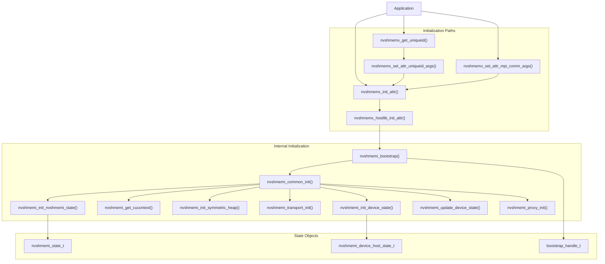
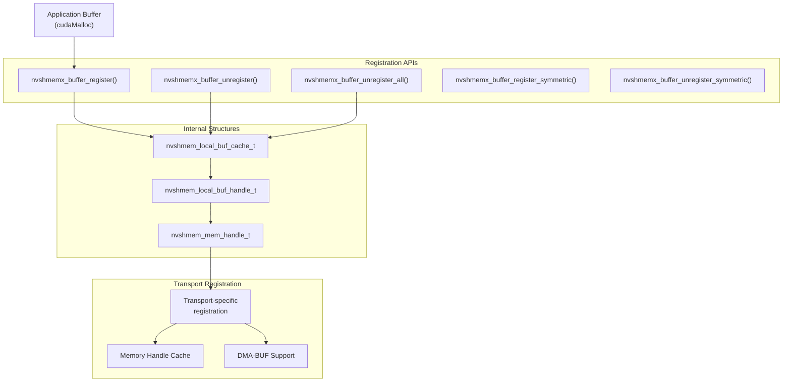
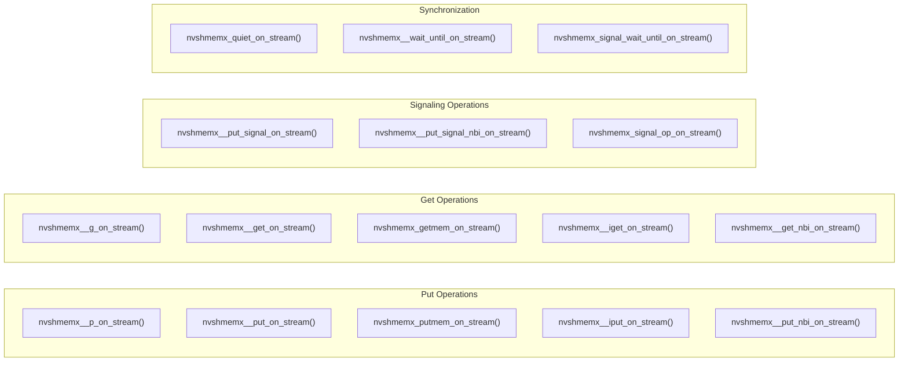

<!-- source: DeepWiki mcp.deepwiki.com · repo NVIDIA/nvshmem · page 6.1 Host API · fetched 2026-10-26 -->

# Host API

<details>
<summary>Relevant source files</summary>

The following files were used as context for generating this wiki page:

- [src/host/init/init.cu](src/host/init/init.cu)
- [src/host/mem/mem_heap.cpp](src/host/mem/mem_heap.cpp)
- [src/host/team/team_internal.cpp](src/host/team/team_internal.cpp)
- [src/include/non_abi/device/coll/barrier.cuh](src/include/non_abi/device/coll/barrier.cuh)
- [src/include/non_abi/device/coll/utils.cuh](src/include/non_abi/device/coll/utils.cuh)
- [src/include/non_abi/device/team/nvshmemi_team_defines.cuh](src/include/non_abi/device/team/nvshmemi_team_defines.cuh)

</details>


This page documents the host-side C/C++ API for NVSHMEM, which provides functions callable from CPU code to initialize the library, manage memory, and issue asynchronous communication operations. For device-side APIs callable from CUDA kernels, see [Device API](#5.2). For details on implementing custom transport layers, see [Transport Interface](#5.3).

## Overview

The NVSHMEM Host API consists of functions prefixed with `nvshmemx_` that execute on the CPU and coordinate NVSHMEM operations. These APIs fall into several categories:

- **Initialization/Finalization**: Bootstrap NVSHMEM with various methods (MPI, unique ID, etc.)
- **Memory Management**: Register external buffers for NVSHMEM communication
- **Module Management**: Initialize device code in CUDA modules/libraries
- **Stream-based Operations**: Issue asynchronous RMA and synchronization operations on CUDA streams
- **Queue Pair Management**: Create and manage multiple communication channels

Sources: [src/include/host/nvshmemx_api.h:1-612]()

## Initialization and Finalization

### Initialization Flow

NVSHMEM initialization occurs in multiple stages, coordinating between the bootstrap mechanism, host library, and device state.

**Initialization Flow Diagram**



Sources: [src/host/init/init.cu:994-1182](), [src/include/host/nvshmemx_api.h:52-66]()

### Initialization Functions

#### `nvshmemx_init_attr()`

Primary initialization function that bootstraps NVSHMEM with configurable attributes.

```c
int nvshmemx_init_attr(unsigned int flags, nvshmemx_init_attr_t *attributes);
```

**Parameters**:
- `flags`: Initialization mode (e.g., `NVSHMEMX_INIT_WITH_MPI_COMM`, `NVSHMEMX_INIT_WITH_UNIQUEID`)
- `attributes`: Pointer to `nvshmemx_init_attr_t` structure

**Initialization Flags**:

| Flag | Description |
|------|-------------|
| `NVSHMEMX_INIT_WITH_MPI_COMM` | Bootstrap using MPI communicator |
| `NVSHMEMX_INIT_WITH_UNIQUEID` | Bootstrap using unique ID |
| `NVSHMEMX_INIT_WITH_SHMEM` | Bootstrap using OpenSHMEM |
| `NVSHMEMX_INIT_THREAD_PES` | Enable thread-level PEs |

Sources: [src/include/host/nvshmemx_api.h:55-66](), [src/include/host/nvshmemx_api.h:38-44]()

#### `nvshmemx_get_uniqueid()` and `nvshmemx_set_attr_uniqueid_args()`

For environments without MPI, NVSHMEM supports a two-stage initialization using unique IDs:

```c
int nvshmemx_get_uniqueid(nvshmemx_uniqueid_t *uid);
int nvshmemx_set_attr_uniqueid_args(const int myrank, const int nranks,
                                    const nvshmemx_uniqueid_t *uniqueid,
                                    nvshmemx_init_attr_t *attr);
```

**Usage Pattern**:
1. Rank 0 calls `nvshmemx_get_uniqueid()` to obtain a unique ID
2. Rank 0 broadcasts the unique ID to all ranks via out-of-band mechanism
3. Each rank calls `nvshmemx_set_attr_uniqueid_args()` with its rank, total ranks, and the unique ID
4. Each rank calls `nvshmemx_init_attr()` with the configured attributes

Sources: [src/host/init/init.cu:267-288](), [src/host/init/init.cu:291-303]()

#### `nvshmemx_init_status()`

Query the current initialization status:

```c
int nvshmemx_init_status();
```

**Return Values**:

| Status | Value | Description |
|--------|-------|-------------|
| `NVSHMEM_STATUS_NOT_INITIALIZED` | 0 | Not yet initialized |
| `NVSHMEM_STATUS_IS_BOOTSTRAPPED` | 1 | Bootstrap complete, initialization pending |
| `NVSHMEM_STATUS_IS_INITIALIZED` | 2 | Fully initialized |
| `NVSHMEM_STATUS_LIMITED_MPG` | 3 | Multiple PEs per GPU with limited support |
| `NVSHMEM_STATUS_FULL_MPG` | 4 | Multiple PEs per GPU with full support |

Sources: [src/host/init/init.cu:1205-1216](), [src/host/init/init.cu:1218]()

### Initialization Attributes Structure

**`nvshmemx_init_attr_t` Structure**

```c
typedef struct {
    int version;                      // Version identifier
    void *mpi_comm;                   // MPI communicator (if using MPI)
    nvshmemx_init_args_t args;        // Initialization arguments
} nvshmemx_init_attr_t;
```

**`nvshmemx_init_args_t` Structure**

```c
typedef struct {
    int version;                      // Version identifier
    nvshmemx_uniqueid_args_t uid_args; // Unique ID arguments
    int cuda_device_id;               // Explicit CUDA device selection
    char content[INIT_ARGS_V2_PADDING];
} nvshmemx_init_args_t;
```

**Initializer Macros**:
- `NVSHMEMX_INIT_ATTR_INITIALIZER`: Initialize with default values
- `NVSHMEMX_INIT_ARGS_V2_INITIALIZER`: Initialize args structure

Sources: [src/include/device_host/nvshmem_types.h:266-280](), [src/include/device_host/nvshmem_types.h:249-264]()

### Finalization

#### `nvshmemx_hostlib_finalize()`

Cleanly shut down NVSHMEM and release all resources:

```c
void nvshmemx_hostlib_finalize();
```

This function:
- Tears down the proxy thread
- Finalizes all transports
- Releases symmetric heap memory
- Cleans up CUDA resources
- Finalizes the bootstrap mechanism

Sources: [src/include/host/nvshmemx_api.h:53]()

## Memory Management

NVSHMEM allows registration of external (non-symmetric) memory buffers to enable communication from arbitrary GPU memory allocations.

### Memory Registration Flow

**Memory Registration Diagram**



Sources: [src/include/host/nvshmemx_api.h:47-50](), [src/include/internal/host/nvshmem_internal.h:67-81]()

### Registration Functions

#### `nvshmemx_buffer_register()`

Register an external GPU buffer for NVSHMEM communication:

```c
int nvshmemx_buffer_register(void *addr, size_t length);
```

**Parameters**:
- `addr`: Base address of the buffer (must be GPU memory)
- `length`: Size of the buffer in bytes

**Notes**:
- The buffer must be allocated with `cudaMalloc()` or similar CUDA allocation functions
- Maximum registration size is limited by `NVSHMEMI_DMA_BUF_MAX_LENGTH` (4GB)
- Registered buffers can be used as source in RMA operations

Sources: [src/include/host/nvshmemx_api.h:47]()

#### `nvshmemx_buffer_unregister()`

Unregister a previously registered buffer:

```c
int nvshmemx_buffer_unregister(void *addr);
```

**Parameters**:
- `addr`: Base address of the buffer to unregister

Sources: [src/include/host/nvshmemx_api.h:48]()

#### `nvshmemx_buffer_unregister_all()`

Unregister all previously registered buffers:

```c
void nvshmemx_buffer_unregister_all();
```

Sources: [src/include/host/nvshmemx_api.h:49]()

#### `nvshmemx_buffer_register_symmetric()` and `nvshmemx_buffer_unregister_symmetric()`

Register buffers as symmetric memory (advanced use case):

```c
void *nvshmemx_buffer_register_symmetric(void *buf_ptr, size_t size, int flags);
int nvshmemx_buffer_unregister_symmetric(void *mmap_ptr, size_t size);
```

These functions are typically used for custom symmetric heap implementations.

Sources: [src/include/host/nvshmemx_api.h:77-78]()

### Memory Handle Cache

Internally, NVSHMEM maintains a cache of registered buffers using `nvshmem_local_buf_cache_t`:

**`nvshmem_local_buf_handle_t` Structure**

```c
typedef struct nvshmem_local_buf_handle {
    void *ptr;                        // Buffer base address
    size_t length;                    // Buffer length
    nvshmem_mem_handle_t *handle;     // Transport handle
    bool registered_by_us;            // Registration ownership flag
    bool linked_with_prev;            // Cache linking flag
    bool linked_with_next;            // Cache linking flag
} nvshmem_local_buf_handle_t;
```

**`nvshmem_local_buf_cache_t` Structure**

```c
typedef struct nvshmem_local_buf_cache {
    size_t array_size;                // Cache capacity
    size_t array_used;                // Number of cached buffers
    nvshmem_local_buf_handle_t **buffers; // Array of handles
    pthread_rwlock_t buffer_lock;     // Thread-safe access lock
} nvshmem_local_buf_cache_t;
```

Sources: [src/include/internal/host/nvshmem_internal.h:67-81]()

## Module Management

NVSHMEM supports integration with dynamically loaded CUDA modules and libraries, allowing device code to be loaded and initialized at runtime.

### Module API

#### `nvshmemx_cumodule_init()` and `nvshmemx_cumodule_finalize()`

Initialize and finalize NVSHMEM for a specific CUDA module:

```c
int nvshmemx_cumodule_init(CUmodule module);
int nvshmemx_cumodule_finalize(CUmodule module);
```

**Parameters**:
- `module`: CUDA module handle obtained from `cuModuleLoad()` or similar

**Usage**: After loading a CUDA module containing NVSHMEM device code, call `nvshmemx_cumodule_init()` to initialize device state for that module.

Sources: [src/include/host/nvshmemx_api.h:74-75]()

#### `nvshmemx_culibrary_init()` and `nvshmemx_culibrary_finalize()`

Initialize and finalize NVSHMEM for a CUDA library (CUDA 12+ feature):

```c
int nvshmemx_culibrary_init(CUlibrary library);
int nvshmemx_culibrary_finalize(CUlibrary library);
```

**Parameters**:
- `library`: CUDA library handle

Sources: [src/include/host/nvshmemx_api.h:89-90]()

## Stream-based Operations

Stream-based operations allow asynchronous execution of NVSHMEM communication on CUDA streams, enabling overlap with computation and other CUDA operations.

### Stream Operation Categories

**Stream-based RMA Operations Overview**



Sources: [src/include/host/nvshmemx_api.h:92-276]()

### Put Operations

#### Scalar Put

```c
void nvshmemx_<type>_p_on_stream(TYPE *dest, const TYPE value, int pe, 
                                 cudaStream_t cstrm);
```

Write a single scalar value to remote PE on a stream. Types: `float`, `double`, `char`, `short`, `int`, `long`, `longlong`, `uchar`, `ushort`, `uint`, `ulong`, `ulonglong`, `int32`, `int64`, `uint32`, `uint64`, `size`.

Sources: [src/include/host/nvshmemx_api.h:94-98]()

#### Contiguous Put

```c
void nvshmemx_<type>_put_on_stream(TYPE *dest, const TYPE *source, 
                                   size_t nelems, int pe, cudaStream_t cstrm);
void nvshmemx_putmem_on_stream(void *dest, const void *source, 
                               size_t bytes, int pe, cudaStream_t cstrm);
void nvshmemx_put<size>_on_stream(void *dest, const void *source, 
                                  size_t nelems, int pe, cudaStream_t cstrm);
```

Transfer contiguous data to remote PE on a stream. Size variants: `8`, `16`, `32`, `64`, `128`.

Sources: [src/include/host/nvshmemx_api.h:100-115]()

#### Strided Put

```c
void nvshmemx_<type>_iput_on_stream(TYPE *dest, const TYPE *source, 
                                    ptrdiff_t dst, ptrdiff_t sst, 
                                    size_t nelems, int pe, cudaStream_t cstrm);
```

Transfer strided data (every `dst`-th element at destination, every `sst`-th at source).

Sources: [src/include/host/nvshmemx_api.h:157-171]()

#### Non-blocking Put

```c
void nvshmemx_<type>_put_nbi_on_stream(TYPE *dest, const TYPE *source, 
                                       size_t nelems, int pe, cudaStream_t cstrm);
```

Non-blocking put operation. Completion must be ensured with `nvshmemx_quiet_on_stream()`.

Sources: [src/include/host/nvshmemx_api.h:173-188]()

### Get Operations

#### Scalar Get

```c
TYPE nvshmemx_<type>_g_on_stream(const TYPE *src, int pe, cudaStream_t cstrm);
```

Read a single scalar value from remote PE on a stream.

Sources: [src/include/host/nvshmemx_api.h:192-196]()

#### Contiguous Get

```c
void nvshmemx_<type>_get_on_stream(TYPE *dest, const TYPE *source, 
                                   size_t nelems, int pe, cudaStream_t cstrm);
void nvshmemx_getmem_on_stream(void *dest, const void *source, 
                               size_t bytes, int pe, cudaStream_t cstrm);
```

Transfer contiguous data from remote PE on a stream.

Sources: [src/include/host/nvshmemx_api.h:198-221]()

#### Strided Get

```c
void nvshmemx_<type>_iget_on_stream(TYPE *dest, const TYPE *source, 
                                    ptrdiff_t dst, ptrdiff_t sst, 
                                    size_t nelems, int pe, cudaStream_t cstrm);
```

Transfer strided data from remote PE.

Sources: [src/include/host/nvshmemx_api.h:205-229]()

#### Non-blocking Get

```c
void nvshmemx_<type>_get_nbi_on_stream(TYPE *dest, const TYPE *source, 
                                       size_t nelems, int pe, cudaStream_t cstrm);
```

Non-blocking get operation.

Sources: [src/include/host/nvshmemx_api.h:231-246]()

### Put with Signal Operations

Put-with-signal operations atomically update a signal variable after data transfer completes.

```c
void nvshmemx_<type>_put_signal_on_stream(TYPE *dest, const TYPE *source, 
                                          size_t nelems, uint64_t *sig_addr, 
                                          uint64_t signal, int sig_op, int pe, 
                                          cudaStream_t cstrm);
void nvshmemx_putmem_signal_on_stream(void *dest, const void *source, 
                                      size_t bytes, uint64_t *sig_addr, 
                                      uint64_t signal, int sig_op, int pe, 
                                      cudaStream_t cstrm);
```

**Parameters**:
- `sig_addr`: Address of signal variable on remote PE
- `signal`: Signal value to write
- `sig_op`: Signal operation (`NVSHMEM_SIGNAL_SET` or `NVSHMEM_SIGNAL_ADD`)

**Non-blocking Variants**:
```c
void nvshmemx_<type>_put_signal_nbi_on_stream(...);
void nvshmemx_putmem_signal_nbi_on_stream(...);
```

Sources: [src/include/host/nvshmemx_api.h:117-156]()

### Synchronization Operations

#### `nvshmemx_quiet_on_stream()`

Ensure all outstanding communication operations on a stream have completed:

```c
void nvshmemx_quiet_on_stream(cudaStream_t cstrm);
```

This function blocks the stream until all previously issued non-blocking operations on that stream have completed at the target PE.

Sources: [src/include/host/nvshmemx_api.h:250]()

#### `nvshmemx_signal_op_on_stream()`

Issue a signal operation on a stream:

```c
void nvshmemx_signal_op_on_stream(uint64_t *sig_addr, uint64_t signal, 
                                  int sig_op, int pe, cudaStream_t cstrm);
```

Sources: [src/include/host/nvshmemx_api.h:252-253]()

#### Wait Operations

```c
void nvshmemx_<type>_wait_until_on_stream(TYPE *ivar, int cmp, TYPE cmp_value, 
                                          cudaStream_t cstream);
void nvshmemx_<type>_wait_until_all_on_stream(TYPE *ivars, size_t nelems, 
                                              const int *status, int cmp, 
                                              TYPE cmp_value, cudaStream_t cstream);
void nvshmemx_<type>_wait_until_all_vector_on_stream(TYPE *ivars, size_t nelems, 
                                                     const int *status, int cmp, 
                                                     TYPE *cmp_value, 
                                                     cudaStream_t cstream);
void nvshmemx_signal_wait_until_on_stream(uint64_t *sig_addr, int cmp, 
                                          uint64_t cmp_value, cudaStream_t cstream);
```

Wait until memory location(s) satisfy a comparison condition. Comparison operators:
- `NVSHMEM_CMP_EQ`: Equal
- `NVSHMEM_CMP_NE`: Not equal
- `NVSHMEM_CMP_GT`: Greater than
- `NVSHMEM_CMP_GE`: Greater than or equal
- `NVSHMEM_CMP_LT`: Less than
- `NVSHMEM_CMP_LE`: Less than or equal

Sources: [src/include/host/nvshmemx_api.h:255-276]()

## Queue Pair Management

Queue pairs provide multiple independent communication channels to a destination PE, enabling finer-grained control over ordering and performance.

### `nvshmemx_qp_create()`

Create multiple queue pairs for advanced communication patterns:

```c
int nvshmemx_qp_create(int num_qps, nvshmemx_qp_handle_t **out_qp_array);
```

**Parameters**:
- `num_qps`: Number of queue pairs to create
- `out_qp_array`: Output array of queue pair handles

**Return Value**: `NVSHMEMX_SUCCESS` on success, error code otherwise.

**Notes**:
- Queue pairs are used with device-side QP operations (see [Device API](#5.2))
- Enables independent progress tracking for different communication streams
- Primary use case is for IBGDA transport with multiple DCI/DCT queue pairs

Sources: [src/include/host/nvshmemx_api.h:469]()

## Internal State Management

### State Structures

NVSHMEM maintains several key state structures:

**Host State: `nvshmemi_state_t`**

The primary host-side state structure contains:
- PE information (`mype`, `npes`, `mype_node`, `npes_node`)
- Transport array and selection maps
- CUDA context and streams
- Symmetric heap object
- Proxy thread state

**Device State: `nvshmemi_device_host_state_t`**

Shared state visible to both host and device code:

```c
typedef struct {
    int version;
    int mype, npes;
    int node_mype, node_npes;
    nvshmemi_pe_dist_t pe_dist;
    int proxy;
    int atomics_sync;
    int job_connectivity;
    bool proxy_ops_are_ordered;
    bool atomics_complete_on_quiet;
    void *heap_base;
    size_t heap_size;
    void **peer_heap_base_p2p;
    void **peer_heap_base_remote;
    bool symmetric_heap_kind;
    // ... proxy channel pointers
    // ... team pool and collective state
    bool nvshmemi_is_nvshmem_initialized;
    bool nvshmemi_is_nvshmem_bootstrapped;
} nvshmemi_device_host_state_t;
```

**State Synchronization**:

The function `nvshmemi_update_device_state()` synchronizes host state to device via `cudaMemcpy()`:

```c
int nvshmemi_update_device_state();
```

This function copies the `nvshmemi_device_host_state_t` structure to device constant memory (`nvshmemi_device_state_d`), making it accessible to device kernels.

Sources: [src/include/device_host/nvshmem_types.h:452-509](), [src/host/init/init.cu:146-197]()

## Error Handling

NVSHMEM Host API functions return error codes defined in `nvshmemx_error.h`:

| Error Code | Value | Description |
|------------|-------|-------------|
| `NVSHMEMX_SUCCESS` | 0 | Operation completed successfully |
| `NVSHMEMX_ERROR_INTERNAL` | -1 | Internal error |
| `NVSHMEMX_ERROR_OUT_OF_MEMORY` | -2 | Memory allocation failed |
| `NVSHMEMX_ERROR_INVALID_VALUE` | -3 | Invalid parameter value |
| `NVSHMEMX_ERROR_GPU_NOT_SELECTED` | -4 | CUDA device not selected |

Most functions return 0 on success and non-zero on error.

## Usage Examples

### Example: MPI-based Initialization

```c
#include <mpi.h>
#include <nvshmem.h>
#include <nvshmemx.h>

int main(int argc, char **argv) {
    MPI_Init(&argc, &argv);
    
    nvshmemx_init_attr_t attr;
    attr.mpi_comm = &MPI_COMM_WORLD;
    
    int status = nvshmemx_init_attr(NVSHMEMX_INIT_WITH_MPI_COMM, &attr);
    if (status != 0) {
        // Handle error
    }
    
    int mype = nvshmem_my_pe();
    int npes = nvshmem_n_pes();
    
    // ... NVSHMEM operations ...
    
    nvshmemx_hostlib_finalize();
    MPI_Finalize();
    return 0;
}
```

### Example: Unique ID Initialization

```c
#include <nvshmem.h>
#include <nvshmemx.h>

int main(int argc, char **argv) {
    int myrank = /* get from command line */;
    int nranks = /* get from command line */;
    
    nvshmemx_uniqueid_t uid;
    if (myrank == 0) {
        nvshmemx_get_uniqueid(&uid);
        // Broadcast uid to all ranks via out-of-band mechanism
    } else {
        // Receive uid from rank 0
    }
    
    nvshmemx_init_attr_t attr = NVSHMEMX_INIT_ATTR_INITIALIZER;
    nvshmemx_set_attr_uniqueid_args(myrank, nranks, &uid, &attr);
    
    int status = nvshmemx_init_attr(NVSHMEMX_INIT_WITH_UNIQUEID, &attr);
    // ... rest of application ...
}
```

### Example: Stream-based Communication

```c
#include <cuda_runtime.h>
#include <nvshmem.h>
#include <nvshmemx.h>

void async_communication_example() {
    cudaStream_t stream;
    cudaStreamCreate(&stream);
    
    float *d_send = /* GPU buffer */;
    float *d_recv = /* GPU buffer */;
    int target_pe = 1;
    size_t nelems = 1024;
    
    // Asynchronous put operation
    nvshmemx_float_put_on_stream(nvshmem_ptr(d_recv, target_pe), 
                                  d_send, nelems, target_pe, stream);
    
    // Ensure completion
    nvshmemx_quiet_on_stream(stream);
    
    // Stream can now be synchronized
    cudaStreamSynchronize(stream);
    cudaStreamDestroy(stream);
}
```

### Example: External Buffer Registration

```c
#include <cuda_runtime.h>
#include <nvshmem.h>
#include <nvshmemx.h>

void register_external_buffer_example() {
    size_t buffer_size = 1024 * sizeof(float);
    float *d_buffer;
    
    // Allocate buffer with cudaMalloc
    cudaMalloc(&d_buffer, buffer_size);
    
    // Register with NVSHMEM
    int status = nvshmemx_buffer_register(d_buffer, buffer_size);
    if (status != 0) {
        // Handle error
    }
    
    // Buffer can now be used as source in RMA operations
    float *dest = nvshmem_ptr(symmetric_dest, target_pe);
    cudaStream_t stream;
    cudaStreamCreate(&stream);
    nvshmemx_float_put_on_stream(dest, d_buffer, 1024, target_pe, stream);
    nvshmemx_quiet_on_stream(stream);
    
    // Cleanup
    cudaStreamSynchronize(stream);
    cudaStreamDestroy(stream);
    nvshmemx_buffer_unregister(d_buffer);
    cudaFree(d_buffer);
}
```

Sources: Based on API patterns from [src/include/host/nvshmemx_api.h:1-612]()

---

