<!-- source: DeepWiki mcp.deepwiki.com · repo NVIDIA/nvshmem · page 6.2 Device API · fetched 2026-10-26 -->

# Device API

Relevant source files

The following files were used as context for generating this wiki page:

- [src/host/team/team_internal.cpp](src/host/team/team_internal.cpp)
- [src/include/internal/non_abi/nvshmemi_h_to_d_coll_defs.cuh](src/include/internal/non_abi/nvshmemi_h_to_d_coll_defs.cuh)
- [src/include/non_abi/device/coll/barrier.cuh](src/include/non_abi/device/coll/barrier.cuh)
- [src/include/non_abi/device/coll/fcollect.cuh](src/include/non_abi/device/coll/fcollect.cuh)
- [src/include/non_abi/device/coll/reduce.cuh](src/include/non_abi/device/coll/reduce.cuh)
- [src/include/non_abi/device/coll/reducescatter.cuh](src/include/non_abi/device/coll/reducescatter.cuh)
- [src/include/non_abi/device/pt-to-pt/ibgda_device.cuh](src/include/non_abi/device/pt-to-pt/ibgda_device.cuh)
- [src/include/non_abi/device/pt-to-pt/nvshmemi_transfer_api.cuh](src/include/non_abi/device/pt-to-pt/nvshmemi_transfer_api.cuh)
- [src/include/non_abi/device/team/nvshmemi_team_defines.cuh](src/include/non_abi/device/team/nvshmemi_team_defines.cuh)

This document covers the NVSHMEM device-side C/C++ API that executes within GPU kernels. The Device API enables GPU threads to directly perform collective operations, remote memory access, and synchronization without requiring host intervention. For host-side initialization and management functions, see [Host API](#5.1).

## Overview

The NVSHMEM Device API provides a comprehensive programming model for GPU-accelerated distributed computing. It allows CUDA kernels to directly initiate communication operations, perform collective computations, and coordinate across multiple processing elements (PEs) without CPU involvement.

### Core Concepts

The Device API is built around several key abstractions:

- **Threadgroups**: Hierarchical groupings of GPU threads (thread, warp, warp group, block) that cooperatively perform operations
- **Point-to-Point Operations**: Remote memory access (put, get) and atomic operations callable from GPU threads
- **Collective Operations**: Coordinated operations across teams (reductions, broadcasts, barriers, alltoall, fcollect)
- **Synchronization**: Ordering and completion primitives (fence, quiet) for GPU-initiated operations
- **Teams**: Subsets of PEs that can perform collective operations independently
- **Tensor Operations**: Multi-dimensional data layouts for advanced collective patterns

Sources: [src/include/nvshmem.h:23-28](), [src/include/nvshmemx.h:25-29]()
</thinking>

## Communication Architecture

The device API supports two primary communication paths:

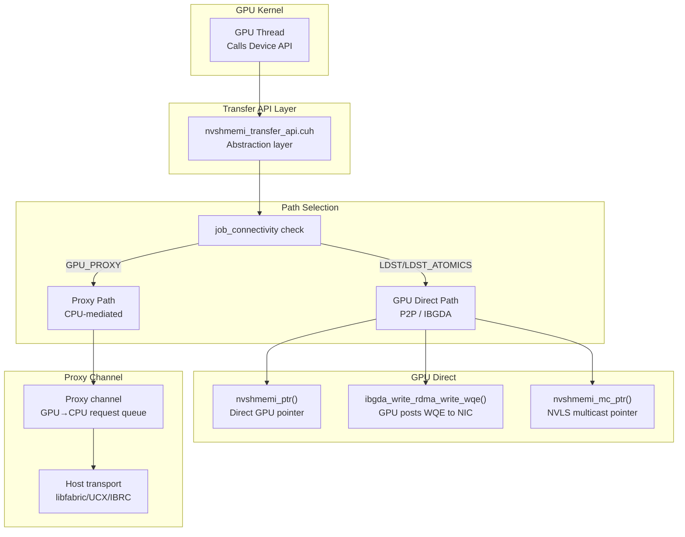

Sources: [src/include/non_abi/device/pt-to-pt/nvshmemi_transfer_api.cuh:1-76](), [src/include/non_abi/device/pt-to-pt/ibgda_device.cuh:664-730]()

## Threadgroup Programming Model

The Device API supports a hierarchical threadgroup model that allows operations to be performed at different levels of GPU thread organization.

### Threadgroup Hierarchy

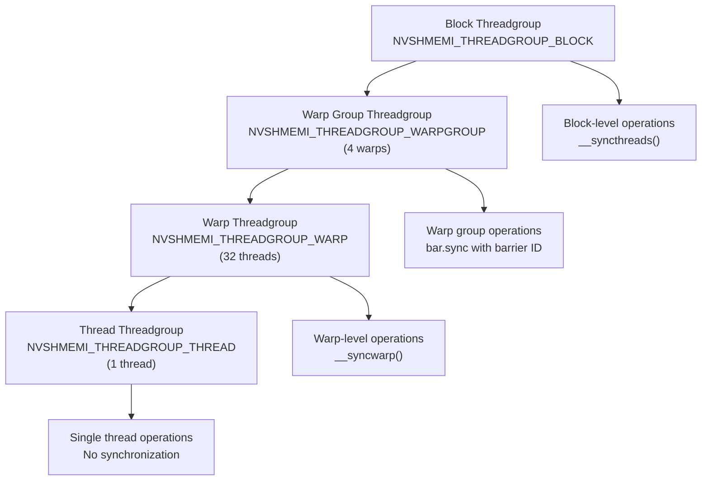

### Threadgroup Functions

The core threadgroup functionality is provided through template functions that operate on different scopes:

| Function | Purpose | Supported Scopes |
|----------|---------|------------------|
| `nvshmemi_thread_id_in_threadgroup<scope>()` | Get thread ID within threadgroup | Thread, Warp, Warp Group, Block |
| `nvshmemi_threadgroup_size<scope>()` | Get threadgroup size | Thread, Warp, Warp Group, Block |
| `nvshmemi_threadgroup_sync<scope>()` | Synchronize threadgroup | Thread, Warp, Warp Group, Block |

Sources: [src/include/non_abi/device/threadgroup/nvshmemi_common_device_defines.cuh:32-41](), [src/include/non_abi/device/threadgroup/nvshmemi_common_device_defines.cuh:45-121]()

## Point-to-Point Operations

The transfer API provides the low-level interface for RMA operations on device:

### Transfer API Functions

| Function Template | Operation | Description |
|------------------|-----------|-------------|
| `nvshmemi_transfer_rma_p<T>()` | Put single element | Write single value to remote PE |
| `nvshmemi_transfer_rma_g<T>()` | Get single element | Read single value from remote PE |
| `nvshmemi_transfer_rma<SCOPE, op>()` | Blocking RMA | Blocking put or get operation |
| `nvshmemi_transfer_rma_nbi<SCOPE, op>()` | Non-blocking RMA | Non-blocking put or get operation |
| `nvshmemi_transfer_put_signal<SCOPE>()` | Put with signal | Put with remote signaling |
| `nvshmemi_transfer_amo_fetch<T>()` | Fetching atomic | Atomic operation returning old value |
| `nvshmemi_transfer_amo_nonfetch<T>()` | Non-fetching atomic | Atomic operation without return |

Sources: [src/include/non_abi/device/pt-to-pt/nvshmemi_transfer_api.cuh:28-59]()

### GPU-Initiated RDMA (IBGDA)

For InfiniBand GPU Direct Async transport, GPU threads can directly post RDMA work queue entries:

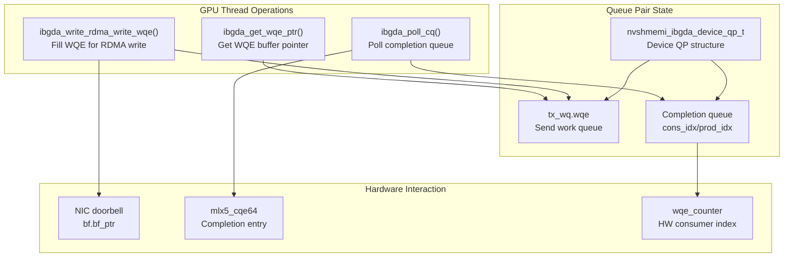

Sources: [src/include/non_abi/device/pt-to-pt/ibgda_device.cuh:439-444](), [src/include/non_abi/device/pt-to-pt/ibgda_device.cuh:664-730](), [src/include/non_abi/device/pt-to-pt/ibgda_device.cuh:483-607]()

### Pointer Conversion Functions

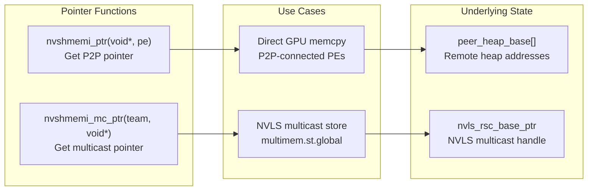

Sources: [src/include/non_abi/device/common/nvshmemi_common_device.cuh:1-100]()

## Atomic Operations

Atomic operations are performed through the transfer API with operation type specified:

### Supported Atomic Operations

| Operation Type | `nvshmemi_amo_t` | Description |
|----------------|------------------|-------------|
| Fetch and Add | `NVSHMEMI_AMO_FETCH_ADD` | Add value, return old |
| Fetch and Inc | `NVSHMEMI_AMO_FETCH_INC` | Increment, return old |
| Fetch and And | `NVSHMEMI_AMO_FETCH_AND` | Bitwise AND, return old |
| Fetch and Or | `NVSHMEMI_AMO_FETCH_OR` | Bitwise OR, return old |
| Fetch and Xor | `NVSHMEMI_AMO_FETCH_XOR` | Bitwise XOR, return old |
| Compare and Swap | `NVSHMEMI_AMO_FETCH_COMPARE_SWAP` | CAS operation |
| Swap | `NVSHMEMI_AMO_FETCH_SWAP` | Exchange values |
| Set | `NVSHMEMI_AMO_SET` | Set value (non-fetching) |
| Add | `NVSHMEMI_AMO_ADD` | Add value (non-fetching) |

For IBGDA transport, atomics can be implemented using extended atomic segments:

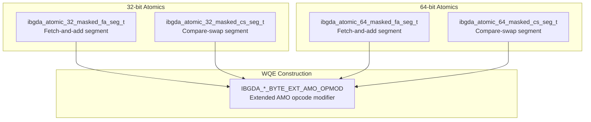

Sources: [src/include/non_abi/device/pt-to-pt/nvshmemi_transfer_api.cuh:52-59](), [src/include/non_abi/device/pt-to-pt/ibgda_device.cuh:154-191]()

## Synchronization Operations

### Fence and Quiet

| Function | Scope | Purpose |
|----------|-------|---------|
| `nvshmemi_transfer_fence<SCOPE>()` | Per-threadgroup | Order operations to a PE or all PEs |
| `nvshmemi_transfer_quiet<SCOPE>()` | Per-threadgroup | Ensure completion of operations |

Both functions support:
- PE-specific or all-PE synchronization
- QP-specific or all-QP synchronization
- Optional memory barrier control

For GPU-direct paths, these compile to PTX fence instructions and polling:

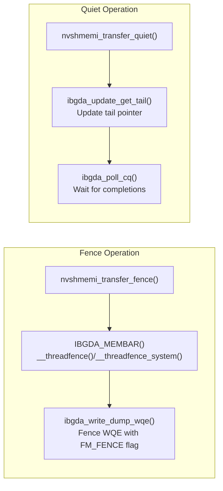

Sources: [src/include/non_abi/device/pt-to-pt/nvshmemi_transfer_api.cuh:61-73](), [src/include/non_abi/device/pt-to-pt/ibgda_device.cuh:609-663]()

## Collective Operations

### Barrier and Synchronization

The barrier implementation uses a dissemination algorithm with configurable radix:

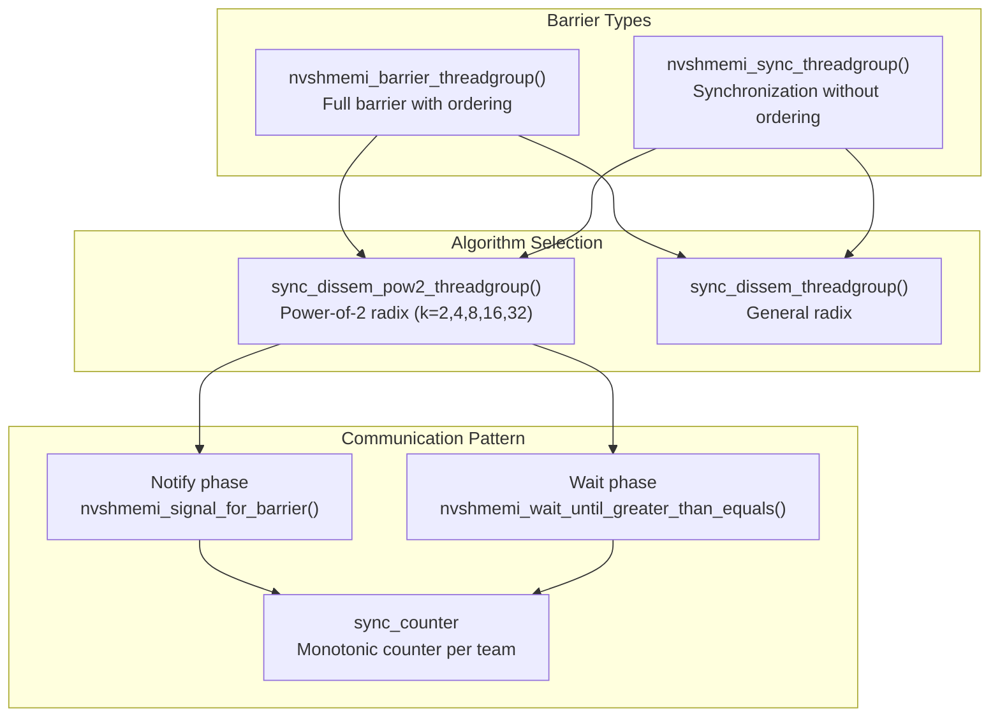

Sources: [src/include/non_abi/device/coll/barrier.cuh:24-72](), [src/include/non_abi/device/coll/barrier.cuh:179-225](), [src/include/non_abi/device/coll/barrier.cuh:228-251]()

### Reduction Operations

Reduction collectives support multiple data types and operation types:

| Reduction Type | Enum | Supported Types |
|----------------|------|-----------------|
| Sum | `RDXN_OPS_SUM` | All numeric types |
| Product | `RDXN_OPS_PROD` | All numeric types |
| Minimum | `RDXN_OPS_MIN` | All numeric types |
| Maximum | `RDXN_OPS_MAX` | All numeric types |
| Bitwise AND | `RDXN_OPS_AND` | Integer types only |
| Bitwise OR | `RDXN_OPS_OR` | Integer types only |
| Bitwise XOR | `RDXN_OPS_XOR` | Integer types only |
| Max with location | `RDXN_OPS_MAXLOC` | `double2` type |

The reduction implementation uses `perform_gpu_rdxn<T, op>()` template function with type-based overloading for integral vs. floating-point types.

Sources: [src/include/non_abi/device/coll/reduce.cuh:49-105](), [src/include/non_abi/device/coll/reduce.cuh:113-122]()

### NVLS Hardware Acceleration

For teams with NVLS support, hardware multicast operations accelerate collectives:

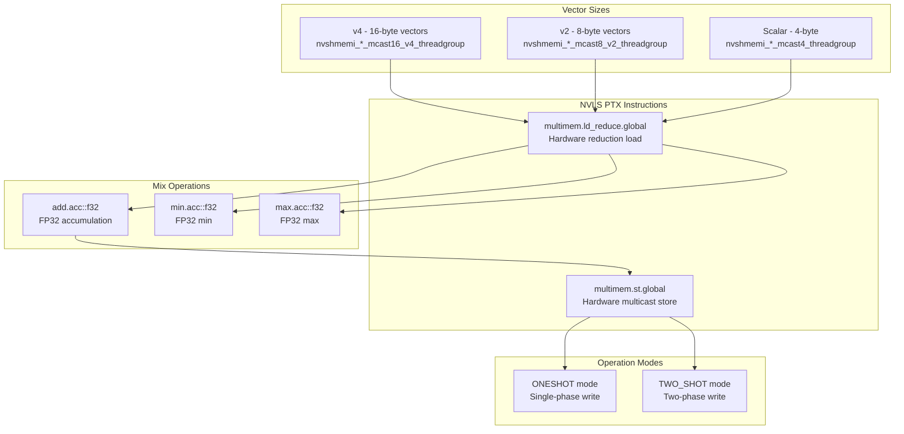

Sources: [src/include/non_abi/device/coll/reduce.cuh:145-176](), [src/include/non_abi/device/coll/reduce.cuh:178-223]()

### Fcollect Operations

Fcollect (concatenation) uses different algorithms based on data size and connectivity:

| Algorithm | Enum | Use Case |
|-----------|------|----------|
| Low-latency 8-bit | `FCOLLECT_LL8` | Small messages with P2P connectivity |
| Low-latency 128-bit | `FCOLLECT_LL128` | Medium messages with P2P connectivity |
| One-shot P2P | `FCOLLECT_ONESHOT` | Direct GPU memory copies |
| NVLS one-shot | `FCOLLECT_NVLS` | Hardware multicast for aligned data |
| NVLS low-latency | `FCOLLECT_NVLS_LL` | Hardware multicast for small data |

The LL (low-latency) variants pack data with flags for pipelined communication:

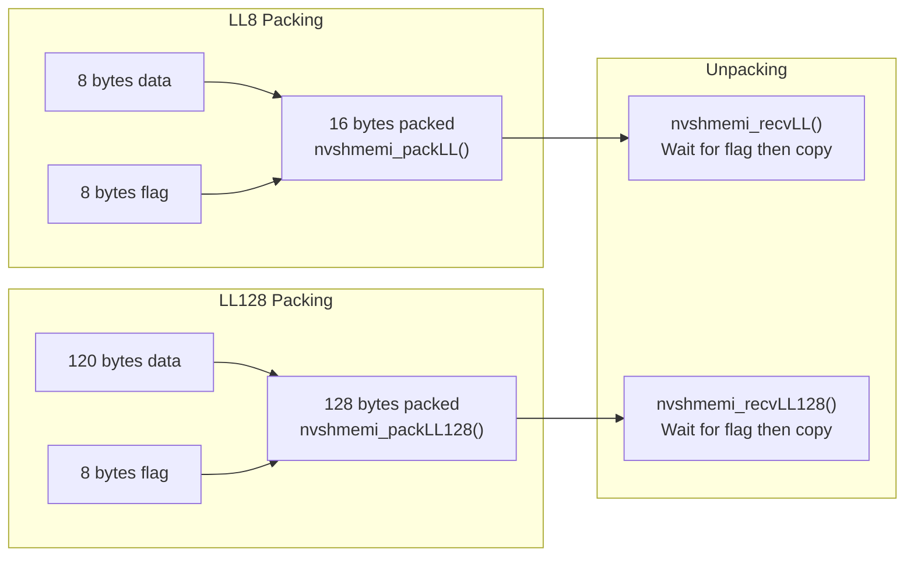

Sources: [src/include/non_abi/device/coll/fcollect.cuh:73-287](), [src/include/non_abi/device/coll/fcollect.cuh:289-317](), [src/include/non_abi/device/coll/fcollect.cuh:319-468]()

### Reduce-Scatter Operations

Reduce-scatter combines reduction with data partitioning:

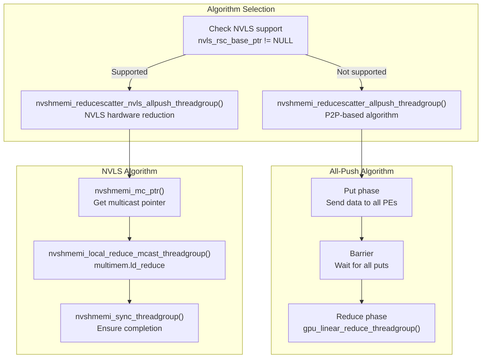

Sources: [src/include/non_abi/device/coll/reducescatter.cuh:36-89](), [src/include/non_abi/device/coll/reducescatter.cuh:92-110](), [src/include/non_abi/device/coll/reducescatter.cuh:113-181]()

## Team Management

Teams enable subsets of PEs to perform collectives independently:

### Team Functions

| Function | Purpose |
|----------|---------|
| `nvshmemi_team_my_pe(team)` | Get PE's rank within team |
| `nvshmemi_team_n_pes(team)` | Get number of PEs in team |
| `nvshmemi_team_translate_pe(src_team, src_pe, dest_team)` | Translate PE number between teams |

### Team Resources

Each team maintains resources for collective operations:

```mermaid
graph TB
    subgraph "Team Structure (nvshmemi_team_t)"
        TeamIdx["team_idx<br/>Global team index"]
        MyPE["my_pe<br/>PE rank in team"]
        Size["size<br/>Number of PEs"]
        PEMapping["pe_mapping[]<br/>Global PE numbers"]
    end
    
    subgraph "pSync Pool"
        SyncBuffer["SYNC buffers<br/>Barrier/sync operations"]
        ReduceBuffer["REDUCE buffers<br/>Two alternating pWrk"]
        BcastBuffer["BCAST buffer<br/>Broadcast operations"]
        FcollectBuffer["FCOLLECT buffers<br/>LL and LL128"]
        AlltoallBuffer["ALLTOALL buffers<br/>Two alternating"]
    end
    
    subgraph "Counters and State"
        SyncCounter["sync_counter[]<br/>Monotonic barrier counter"]
        RdxnCount["rdxn_count<br/>Reduction counter"]
        FcollectCount["fcollect_count<br/>Fcollect counter"]
    end
    
    subgraph "Optional Resources"
        NVLSRsc["nvls_rsc_base_ptr<br/>NVLS multicast handle"]
        NCCLComm["nccl_comm<br/>NCCL communicator"]
    end
    
    TeamIdx --> SyncBuffer
    TeamIdx --> ReduceBuffer
    TeamIdx --> BcastBuffer
    
    MyPE --> PEMapping
    Size --> PEMapping
    
    TeamIdx --> SyncCounter
    TeamIdx --> RdxnCount
    
    TeamIdx --> NVLSRsc
    TeamIdx --> NCCLComm
```

The `nvshmemi_team_get_psync(team, op)` function returns the appropriate pSync buffer for a given collective operation type.

Sources: [src/include/non_abi/device/team/nvshmemi_team_defines.cuh:14-35](), [src/include/non_abi/device/team/nvshmemi_team_defines.cuh:77-124](), [src/include/non_abi/device/team/nvshmemi_team_defines.cuh:126-178]()

## Tensor Operations

The Device API provides a flexible tensor abstraction for multi-dimensional collective operations on non-contiguous data.

### Tensor Structure

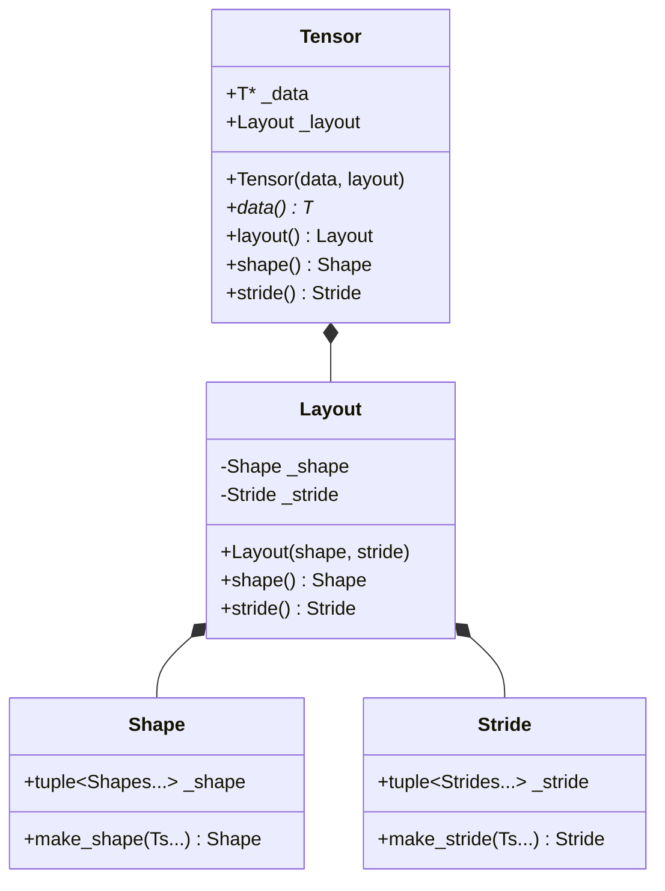

### Tile Collective Algorithms

Tile operations support different NVLS-based algorithms:

| Algorithm | Description | Data Flow |
|-----------|-------------|-----------|
| `NVLS_ONE_SHOT_PUSH_NBI` | Single-phase push-based | GPU writes to remote via NVLS |
| `NVLS_ONE_SHOT_PULL_NBI` | Single-phase pull-based | GPU reads from remote via NVLS |
| `NVLS_TWO_SHOT_PUSH_NBI` | Two-phase push-based | GPU writes with intermediate buffer |
| `NVLS_TWO_SHOT_PULL_NBI` | Two-phase pull-based | GPU reads with intermediate buffer |

The tile API handles boundary checking for partial tiles using predicate tuples:

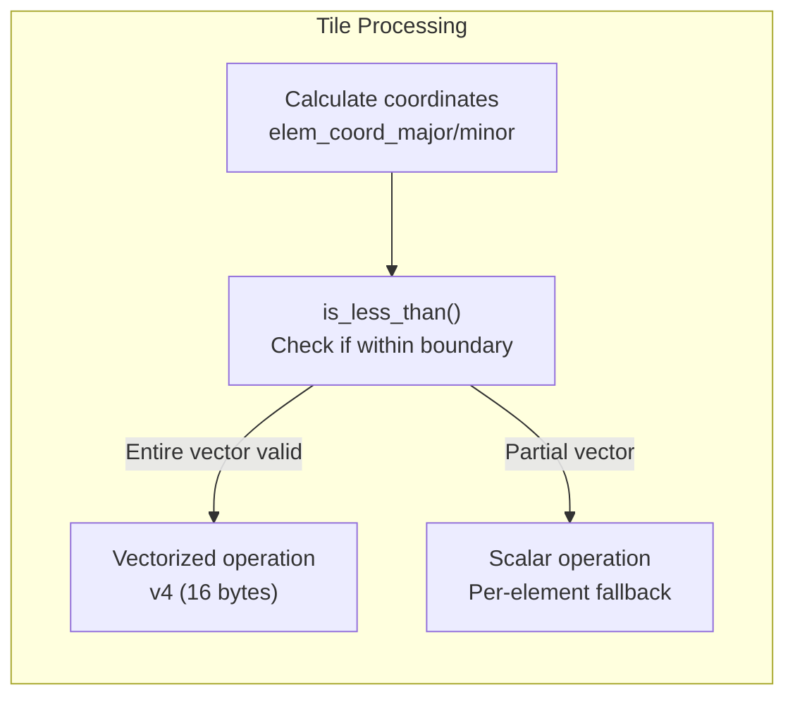

Sources: [src/include/device_host/nvshmem_tensor.h:83-112](), [src/include/non_abi/device/coll/reduce.cuh:232-354]()

## Device-Specific Macros and Configuration

The Device API uses a sophisticated macro system to optimize code generation for different compilation contexts.

### Inlining Control

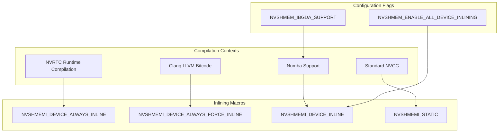

### Macro Definitions by Context

| Macro | Standard NVCC | Clang Bitcode | Numba Support |
|-------|---------------|---------------|---------------|
| `NVSHMEMI_DEVICE_INLINE` | `inline` or `__noinline__` | `__attribute__((always_inline))` | `__inline_hint__` |
| `NVSHMEMI_DEVICE_ALWAYS_INLINE` | `inline` | `__attribute__((always_inline))` | `__inline_hint__` |
| `NVSHMEMI_STATIC` | `static` | (empty) | (empty) |

Sources: [src/include/device/nvshmem_device_macros.h:15-60]()

## API Organization

The Device API is organized into several header categories:

### Core Device Headers

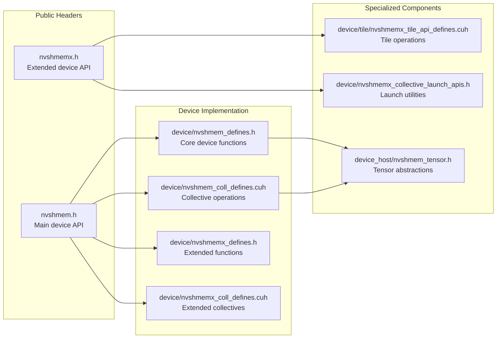

The Device API provides conditional compilation to exclude host-only components when compiling for device execution contexts like NVRTC or Numba.

Sources: [src/include/nvshmem.h:17-28](), [src/include/nvshmemx.h:18-29]()

---

