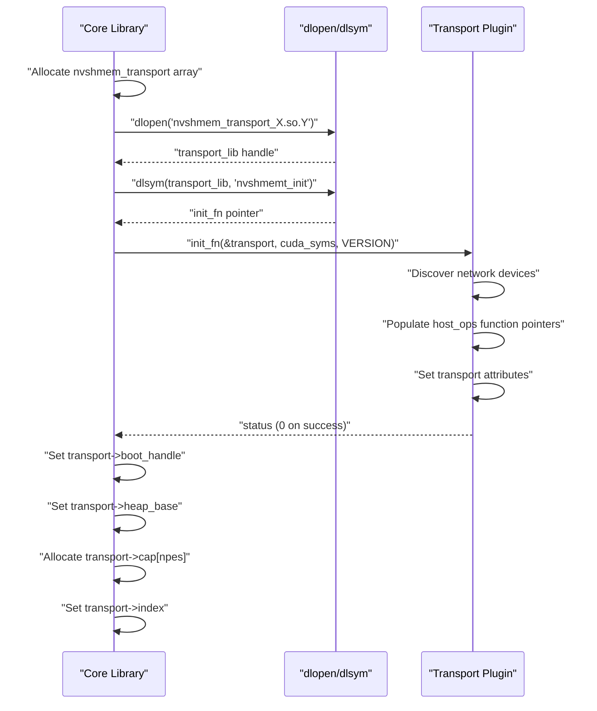
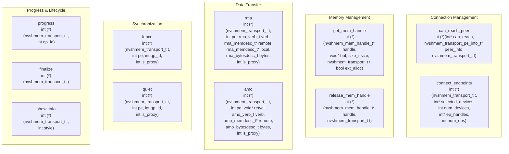
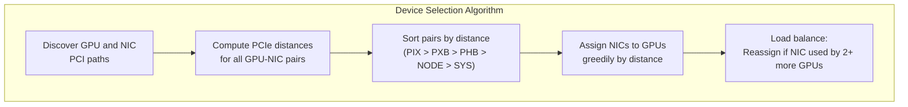
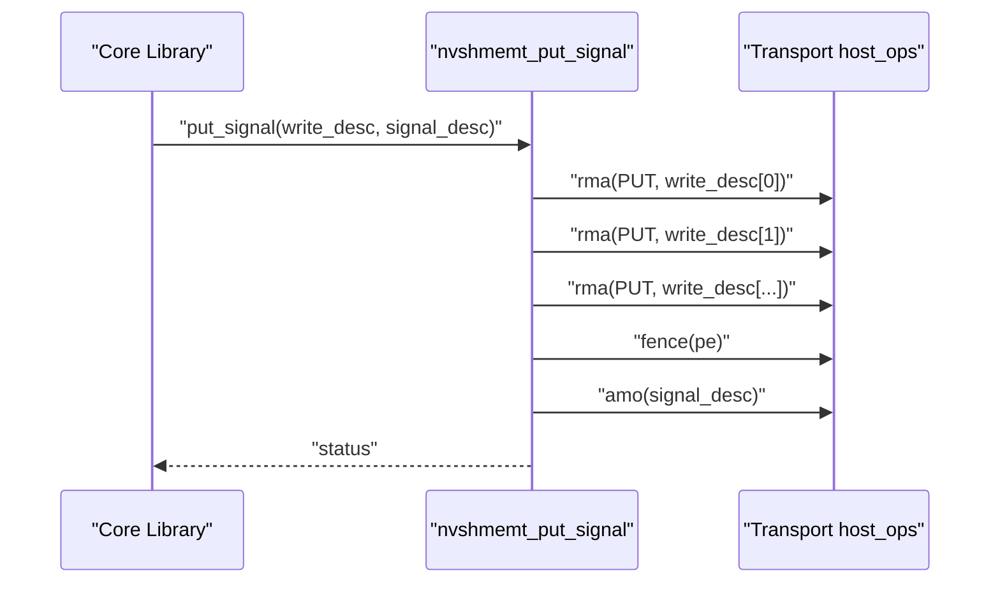

<!-- source: DeepWiki mcp.deepwiki.com · repo NVIDIA/nvshmem · page 6.3 Transport Interface · fetched 2026-10-26 -->

# Transport Interface

<details>
<summary>Relevant source files</summary>

The following files were used as context for generating this wiki page:

- [src/host/mem/mem_transport.cpp](src/host/mem/mem_transport.cpp)
- [src/host/topo/topo.cpp](src/host/topo/topo.cpp)
- [src/host/transport/transport.cpp](src/host/transport/transport.cpp)
- [src/modules/transport/common/transport_common.cpp](src/modules/transport/common/transport_common.cpp)
- [src/modules/transport/libfabric/libfabric.h](src/modules/transport/libfabric/libfabric.h)
- [test/host/interop/CMakeLists.txt](test/host/interop/CMakeLists.txt)
- [test/unit/mem/heap/internal/host/nvshmemi_mem_transport.hpp](test/unit/mem/heap/internal/host/nvshmemi_mem_transport.hpp)

</details>


This page documents the internal transport plugin interface (`nvshmem_transport`) that must be implemented to create custom transport plugins for NVSHMEM. This interface defines the contract between the NVSHMEM core library and transport implementations.

For information about specific transport implementations (IBRC, IBGDA, UCX, Libfabric), see [Transport Implementations](#5). For high-level architectural overview of the transport layer, see [Transport Layer](#2.2).

## Overview

NVSHMEM uses a plugin architecture where transport implementations are dynamically loaded shared libraries. Each transport plugin exports a single initialization function `nvshmemt_init` that populates a `nvshmem_transport` structure with function pointers and metadata. The transport manager in the core library calls these function pointers to perform network operations.

Transport plugins must:
- Export a `nvshmemt_init` symbol with signature `int nvshmemt_init(nvshmem_transport_t*, struct nvshmemi_cuda_fn_table*, int api_version)`
- Implement the required host operations in the `host_ops` structure
- Manage network device resources and connections
- Handle memory registration for RDMA operations
- Provide peer reachability information

Sources: [src/host/transport/transport.cpp:50-319]()

## Transport Structure

The `nvshmem_transport` structure is the primary interface between the core library and transport plugins. Key fields include:

| Field | Type | Purpose |
|-------|------|---------|
| `host_ops` | struct | Function pointers for host-side operations |
| `device_ops` | struct | Function pointers for device-side operations (optional) |
| `attr` | int | Transport attributes bitfield |
| `cap` | int* | Per-PE capability flags (allocated by core) |
| `index` | int | Transport index in global transport array |
| `type` | int | Transport type identifier |
| `api_version` | int | Transport API version implemented |
| `heap_base` | void* | Base address of symmetric heap |
| `boot_handle` | void* | Bootstrap handle for collective operations |
| `n_devices` | int | Number of network devices |
| `device_pci_paths` | char** | PCI paths of network devices |
| `log2_cumem_granularity` | int | Log2 of CUDA memory allocation granularity |
| `cache_handle` | void* | Memory handle cache structure |
| `max_op_len` | size_t | Maximum single operation length |

The transport structure is allocated and partially initialized by the core library, then completed by the transport's `nvshmemt_init` function.

Sources: [src/host/transport/transport.cpp:64-86](), [src/host/transport/transport.cpp:197-219]()

## Initialization Protocol



The initialization sequence follows these steps:

1. **Dynamic Loading**: Core library uses `dlopen` to load the transport shared object file named `nvshmem_transport_<name>.so.<major_version>`

2. **Symbol Resolution**: Core library uses `dlsym` to find the `nvshmemt_init` function

3. **Transport Initialization**: Core calls `nvshmemt_init` with:
   - Pointer to `nvshmem_transport` structure to populate
   - CUDA function table for device operations
   - API version for compatibility checking

4. **Core Completion**: After successful initialization, core library:
   - Sets bootstrap handle for collective operations
   - Sets symmetric heap base address
   - Allocates per-PE capability array
   - Assigns transport index
   - Initializes memory handle cache

Sources: [src/host/transport/transport.cpp:179-228]()

## Host Operations Interface

The `host_ops` structure contains function pointers for all host-side transport operations. All transports must implement these operations:

### Required Operations



### Operation Descriptions

**`can_reach_peer`**: Determines if this transport can communicate with a specific PE
- Input: PE information including PCI attributes and host hash
- Output: Bitfield of capabilities (e.g., `NVSHMEM_TRANSPORT_CAP_MAP`, `NVSHMEM_TRANSPORT_CAP_CPU_WRITE`)
- Called during topology discovery phase

**`connect_endpoints`**: Establishes connections to all PEs using selected network devices
- Input: Array of device indices selected by topology algorithm
- Performs collective exchange of endpoint addresses
- Allocates transport-specific per-PE connection state

**`get_mem_handle`**: Registers symmetric heap memory and creates transport-specific memory handle
- Must be callable multiple times for different heap regions
- Handle format is transport-specific but fits in `nvshmem_mem_handle_t`
- Must support both internal allocations and external (user-provided) memory

**`release_mem_handle`**: Deregisters memory and releases transport-specific resources
- Must be idempotent (safe to call multiple times)
- Called during heap deallocation and finalization

**`rma`**: Performs remote memory access (put/get operations)
- Supports `NVSHMEMI_AMO_PUT`, `NVSHMEMI_AMO_GET`, `NVSHMEMI_AMO_PUTV`, etc.
- `is_proxy` flag indicates if called from proxy thread
- Must handle arbitrary byte counts up to `max_op_len`

**`amo`**: Performs atomic memory operations
- Supports fetch operations (return old value) and non-fetch operations
- Operations include add, compare-swap, fetch-and, fetch-or, etc.
- Must provide atomic semantics as defined by OpenSHMEM

**`fence`**: Orders operations to a specific PE
- Ensures all prior operations to `pe` complete before subsequent operations
- `qp_id` parameter allows per-queue-pair fencing

**`quiet`**: Ensures all operations complete
- Blocks until all outstanding operations complete
- Must drain all queues and receive acknowledgments

**`progress`**: Advances transport state machine
- Called by proxy thread and during host-initiated operations
- Processes completions, receives messages, posts receives

Sources: [src/host/transport/transport.cpp:432-434](), [src/host/topo/topo.cpp:467-469]()

## Memory Handle Management

Transports must implement memory registration to enable RDMA operations. The memory handle cache provides O(1) lookup of registered memory handles by address.

### Memory Handle Cache Functions

The core library provides helper functions for managing memory handle caches:


**Cache Structure**: The cache maps heap addresses to transport-specific memory handle information. It uses address granularity alignment for efficient lookup:

| Function | Purpose |
|----------|---------|
| `nvshmemt_mem_handle_cache_init` | Allocates cache structure with initial capacity of 1000 entries |
| `nvshmemt_mem_handle_cache_add` | Adds memory handle at specific heap address, auto-grows cache if needed |
| `nvshmemt_mem_handle_cache_get` | Retrieves handle for address (rounds down to granularity boundary) |
| `nvshmemt_mem_handle_cache_remove` | Removes handle from cache |
| `nvshmemt_mem_handle_cache_fini` | Frees all cache resources |

**Address Granularity**: Cache uses `log2_cumem_granularity` to determine alignment:
- Addresses must be aligned to `2^log2_cumem_granularity` bytes
- Cache index = `(address - heap_base) / granularity`
- Automatically handles unaligned lookups by rounding down

**Cache Growth**: Cache automatically doubles in size when capacity is exceeded, ensuring O(1) amortized insertion cost.

Sources: [src/modules/transport/common/transport_common.cpp:15-227]()

## Connection Management

### Topology-Aware Device Selection

Before `connect_endpoints` is called, the core library performs topology-aware NIC-to-GPU mapping:



**PCIe Distance Metrics**:

| Distance | Performance | Description |
|----------|-------------|-------------|
| PIX | 4 | Same PCIe switch |
| PXB | 4 | Same PCIe bridge |
| PHB | 3 | Same PCIe host bridge |
| NODE | 2 | Same NUMA node |
| SYS | 1 | Different NUMA nodes |

The algorithm in `nvshmemi_get_devices_by_distance` ensures optimal NIC selection by:
1. Pairing each GPU with closest NICs
2. Breaking ties to balance load across NICs
3. Supporting multiple NICs per GPU for bandwidth aggregation

Sources: [src/host/topo/topo.cpp:138-436]()

### Peer Reachability

The `can_reach_peer` function determines communication capabilities:

**Capability Flags**:
- `NVSHMEM_TRANSPORT_CAP_MAP`: GPU can map remote memory for load/store
- `NVSHMEM_TRANSPORT_CAP_CPU_WRITE`: CPU can write to remote memory
- `NVSHMEM_TRANSPORT_CAP_CPU_READ`: CPU can read from remote memory
- `NVSHMEM_TRANSPORT_CAP_CPU_ATOMICS`: CPU can perform atomic operations

**Reachability Determination** typically based on:
- Hostname matching (same node for P2P)
- Network fabric connectivity (for IB/Ethernet)
- PCIe topology (for peer-to-peer access)

The core library builds a global transport map by:
1. Calling `can_reach_peer` for each PE
2. Performing `allgather` to exchange reachability information
3. Creating `transport_map[mype * npes + pe]` bitfield indicating which transports can reach each PE

Sources: [src/host/topo/topo.cpp:438-506]()

## Transport Attributes

The `attr` field is a bitfield defining transport characteristics:

### Attribute Flags

**`NVSHMEM_TRANSPORT_ATTR_CONNECTED`**: Transport requires explicit connection setup
- Set by transports that need `connect_endpoints` to establish peer connections
- Unset by connectionless transports (rare)

**`NVSHMEM_TRANSPORT_ATTR_NO_MULTIRAIL`**: Transport manages devices internally
- When set, core library passes all devices to `connect_endpoints`
- When unset, core library performs device selection per PE

Example from initialization:
```
if (!(tcurr->attr & NVSHMEM_TRANSPORT_ATTR_CONNECTED)) {
    continue;  // Skip connection setup
}
```

### Transport Type Identifiers

Each transport sets a unique `type` identifier:
- `NVSHMEM_TRANSPORT_LIB_CODE_P2P`: P2P transport
- `NVSHMEM_TRANSPORT_LIB_CODE_IBRC`: InfiniBand RC transport
- `NVSHMEM_TRANSPORT_LIB_CODE_IBGDA`: InfiniBand GPU Direct Async
- `NVSHMEM_TRANSPORT_LIB_CODE_IBDEVX`: InfiniBand DEVX
- `NVSHMEM_TRANSPORT_LIB_CODE_UCX`: UCX transport
- `NVSHMEM_TRANSPORT_LIB_CODE_LIBFABRIC`: Libfabric transport

Sources: [src/host/transport/transport.cpp:383-385](), [src/host/transport/transport.cpp:426-429]()

## Helper Functions

### HCA List Parsing

The `nvshmemt_parse_hca_list` function parses device specification strings from environment variables:

**Format**: `device[:port][:count][,device[:port][:count]...]`

Examples:
- `mlx5_0`: Use first port of mlx5_0
- `mlx5_0:1`: Use port 1 of mlx5_0
- `mlx5_0:1:2`: Use 2 instances of port 1 of mlx5_0
- `mlx5_0,mlx5_1`: Use first ports of mlx5_0 and mlx5_1

**Negative Selection**: Prefix with `^` to exclude devices:
- `^mlx5_0`: Use all devices except mlx5_0

The function populates `nvshmemt_hca_info` structures with parsed device names, ports, and counts.

Sources: [src/modules/transport/common/transport_common.cpp:22-83]()

### Put-Signal Implementation

The `nvshmemt_put_signal` helper implements put-signal semantics using separate RMA and AMO operations:



The helper ensures:
1. All writes complete before signal
2. Signal is atomic
3. Proper ordering through fence

Transports can use this helper if they don't have native put-signal support, or implement optimized versions directly.

Sources: [src/modules/transport/common/transport_common.cpp:229-256]()

## Implementing a Custom Transport

### Checklist

To implement a custom transport plugin:

1. **Create Plugin Structure**:
   - Source file `src/modules/transport/<name>/<name>.cpp`
   - Header file `src/modules/transport/<name>/<name>.h`
   - Export `nvshmemt_init` symbol

2. **Implement Initialization**:
   - Discover network devices
   - Set `device_pci_paths` for topology discovery
   - Populate `host_ops` function pointers
   - Set `attr` flags
   - Set `max_op_len`
   - Return API version

3. **Implement Core Operations**:
   - `can_reach_peer`: Check network connectivity
   - `connect_endpoints`: Exchange addresses, create QPs
   - `get_mem_handle`: Register memory with NIC
   - `release_mem_handle`: Deregister memory
   - `rma`: Implement put/get
   - `amo`: Implement atomic operations
   - `fence`: Order operations
   - `quiet`: Complete all operations
   - `progress`: Process completions
   - `finalize`: Clean up resources

4. **Handle Memory Management**:
   - Use memory handle cache for lookups
   - Support external allocations
   - Handle multiple registrations of same memory

5. **Build Integration**:
   - Add CMake build target for `nvshmem_transport_<name>.so.<version>`
   - Add compile-time option `NVSHMEM_<NAME>_SUPPORT`

### Example Transport Initialization Skeleton

```c
int nvshmemt_init(nvshmem_transport_t *t, 
                  struct nvshmemi_cuda_fn_table *cuda_syms,
                  int api_version) {
    // Check API version compatibility
    if (MAJOR_VERSION(api_version) != MAJOR_VERSION(MY_VERSION)) {
        return NVSHMEMX_ERROR_INVALID_VALUE;
    }
    
    // Set version
    t->api_version = MY_API_VERSION;
    t->type = NVSHMEM_TRANSPORT_LIB_CODE_CUSTOM;
    
    // Discover devices
    t->n_devices = discover_network_devices(&t->device_pci_paths);
    
    // Populate operations
    t->host_ops.can_reach_peer = my_can_reach_peer;
    t->host_ops.connect_endpoints = my_connect_endpoints;
    t->host_ops.get_mem_handle = my_get_mem_handle;
    t->host_ops.release_mem_handle = my_release_mem_handle;
    t->host_ops.rma = my_rma;
    t->host_ops.amo = my_amo;
    t->host_ops.fence = my_fence;
    t->host_ops.quiet = my_quiet;
    t->host_ops.progress = my_progress;
    t->host_ops.finalize = my_finalize;
    t->host_ops.show_info = my_show_info;
    
    // Set attributes
    t->attr = NVSHMEM_TRANSPORT_ATTR_CONNECTED;
    t->max_op_len = MAX_SINGLE_OP_SIZE;
    
    return NVSHMEMX_SUCCESS;
}
```

Sources: [src/host/transport/transport.cpp:197-219]()

## Version Compatibility

The transport interface uses version numbers for forward/backward compatibility:

**Version Encoding**: `NVSHMEM_TRANSPORT_MAJOR_MINOR_VERSION(version)`
- Major version: Incompatible changes
- Minor version: Backward-compatible additions

**Compatibility Check**:
```c
assert(NVSHMEM_TRANSPORT_MAJOR_MINOR_VERSION(transports[index]->api_version) <=
       NVSHMEM_TRANSPORT_MAJOR_MINOR_VERSION(NVSHMEM_TRANSPORT_INTERFACE_VERSION));
```

Transports must implement the interface version they were compiled against. The core library ensures compatibility by rejecting transports with incompatible major versions.

Sources: [src/host/transport/transport.cpp:199-200](), [src/host/transport/transport.cpp:259-260]()

---

