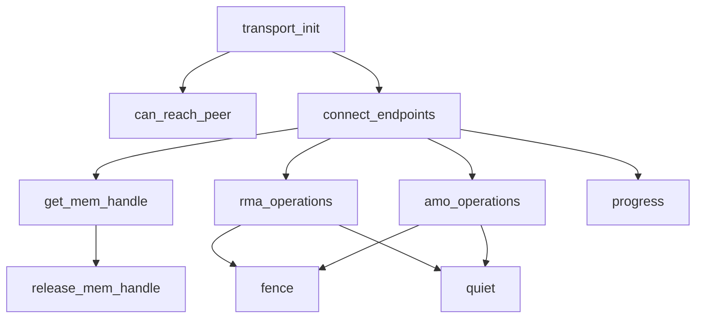

<!-- source: DeepWiki mcp.deepwiki.com · repo NVIDIA/nvshmem · page 8 Development Guide · fetched 2026-10-26 -->

# Development Guide

<details>
<summary>Relevant source files</summary>

The following files were used as context for generating this wiki page:

- [CMakeLists.txt](CMakeLists.txt)
- [cmake_config/NVSHMEMEnv.cmake](cmake_config/NVSHMEMEnv.cmake)
- [nvshmem4py/scripts/generate_pyproject_toml.py](nvshmem4py/scripts/generate_pyproject_toml.py)
- [src/CMakeLists.txt](src/CMakeLists.txt)

</details>


This guide provides essential information for developers working on NVSHMEM itself—those who want to contribute code, add new transports, extend Python bindings, or modify the core library. It covers the codebase structure, detailed build procedures, transport plugin development, Python binding generation, and contribution workflows.

For information about using NVSHMEM, see the [C/C++ API Reference](#6) and [Python API Reference](#4). For high-level architectural concepts, see [Architecture](#2).

## Project Structure

The NVSHMEM repository follows a modular architecture with clear separation between host-side runtime code, device-side GPU libraries, pluggable transports, and Python bindings.

### Repository Layout

**Directory Structure**

```
nvshmem/
├── src/                          # Core C/C++ library
│   ├── host/                     # Host-side runtime
│   │   ├── init/                 # Initialization (init.cu, cudawrap.cpp)
│   │   ├── mem/                  # Memory management (mem_heap.cpp)
│   │   ├── comm/                 # Communication (putget.cpp, amo.cpp)
│   │   ├── coll/                 # Host-side collectives
│   │   ├── proxy/                # CPU proxy system (proxy.cpp)
│   │   ├── team/                 # Team management (team_internal.cpp)
│   │   ├── topo/                 # Topology discovery (topo.cpp)
│   │   └── transport/            # Transport manager (transport.cpp)
│   ├── device/                   # Device-side libraries
│   │   ├── init/                 # Device initialization (init_device.cu)
│   │   ├── coll/                 # GPU collectives
│   │   └── launch/               # Collective launch helpers
│   ├── modules/                  # Plugin modules
│   │   ├── transport/            # Transport plugins
│   │   │   ├── common/           # Shared transport code
│   │   │   ├── ucx/              # UCX transport (ucx.cpp)
│   │   │   ├── ibrc/             # InfiniBand RC (ibrc.cpp)
│   │   │   ├── ibdevx/           # InfiniBand DevX (ibdevx.cpp)
│   │   │   ├── ibgda/            # GPU Direct Async (ibgda.cpp)
│   │   │   └── libfabric/        # Libfabric (libfabric.cpp)
│   │   └── bootstrap/            # Bootstrap plugins
│   │       ├── common/           # Shared bootstrap code
│   │       ├── mpi/              # MPI bootstrap (bootstrap_mpi.c)
│   │       ├── pmi/              # PMI/PMI2 bootstrap
│   │       ├── pmix/             # PMIx bootstrap
│   │       ├── shmem/            # SHMEM bootstrap
│   │       └── uid/              # UID bootstrap (bootstrap_uid.cpp)
│   ├── include/                  # Public and internal headers
│   │   ├── host/                 # Host API headers
│   │   ├── device/               # Device API headers
│   │   ├── device_host/          # Shared headers
│   │   ├── non_abi/              # Internal headers
│   │   └── *.h                   # Top-level headers (nvshmem.h)
│   └── CMakeLists.txt            # Main build configuration
├── nvshmem4py/                   # Python bindings
│   ├── nvshmem/
│   │   ├── core/                 # High-level Python API
│   │   │   ├── collective.py     # Collective operations
│   │   │   ├── rma.py            # RMA operations
│   │   │   ├── teams.py          # Team management
│   │   │   ├── nvshmem_types.py  # Type system
│   │   │   └── device/numba/     # Numba device bindings
│   │   └── bindings/             # Low-level bindings
│   │       ├── _internal/        # Cython bindings
│   │       └── device/numba/     # Numbast-generated bindings
│   ├── cmake/                    # Python build configuration
│   └── scripts/                  # Build scripts
├── cmake_config/                 # CMake modules
│   └── NVSHMEMEnv.cmake          # Environment variable handling
├── examples/                     # Example programs
├── perftest/                     # Performance benchmarks
├── test/                         # Functional tests
└── scripts/                      # Build and utility scripts
```

Sources: [src/CMakeLists.txt:282-359](), [src/CMakeLists.txt:113-212](), [src/CMakeLists.txt:403-561]()

### Build Output Structure

**CMake Target Dependencies**

```mermaid
graph TB
    ROOT[CMakeLists.txt]
    SRC_CMAKE[src/CMakeLists.txt]
    DEVICE_CMAKE[device/CMakeLists.txt]
    
    NVSHMEM_HOST[nvshmem_host.so]
    NVSHMEM_DEVICE[nvshmem_device.a]
    
    BOOTSTRAP_MPI[nvshmem_bootstrap_mpi.so]
    BOOTSTRAP_PMI[nvshmem_bootstrap_pmi.so]
    BOOTSTRAP_PMI2[nvshmem_bootstrap_pmi2.so]
    BOOTSTRAP_PMIX[nvshmem_bootstrap_pmix.so]
    BOOTSTRAP_UID[nvshmem_bootstrap_uid.so]
    
    TRANSPORT_UCX[nvshmem_transport_ucx.so]
    TRANSPORT_IBRC[nvshmem_transport_ibrc.so]
    TRANSPORT_IBDEVX[nvshmem_transport_ibdevx.so]
    TRANSPORT_IBGDA[nvshmem_transport_ibgda.so]
    TRANSPORT_LIBFABRIC[nvshmem_transport_libfabric.so]
    
    NVSHMEM_INFO[nvshmem-info]
    BITCODE[libnvshmem_device.bc]
    
    ROOT --> SRC_CMAKE
    SRC_CMAKE --> DEVICE_CMAKE
    SRC_CMAKE --> NVSHMEM_HOST
    
    DEVICE_CMAKE --> NVSHMEM_DEVICE
    NVSHMEM_HOST --> NVSHMEM_DEVICE
    
    SRC_CMAKE --> BOOTSTRAP_MPI
    SRC_CMAKE --> BOOTSTRAP_PMI
    SRC_CMAKE --> BOOTSTRAP_PMI2
    SRC_CMAKE --> BOOTSTRAP_PMIX
    SRC_CMAKE --> BOOTSTRAP_UID
    
    SRC_CMAKE --> TRANSPORT_UCX
    SRC_CMAKE --> TRANSPORT_IBRC
    SRC_CMAKE --> TRANSPORT_IBDEVX
    SRC_CMAKE --> TRANSPORT_IBGDA
    SRC_CMAKE --> TRANSPORT_LIBFABRIC
    
    SRC_CMAKE --> NVSHMEM_INFO
    SRC_CMAKE --> BITCODE
```



Sources: [src/CMakeLists.txt:22-41](), [src/CMakeLists.txt:231-247](), [src/CMakeLists.txt:113-212](), [src/CMakeLists.txt:403-561]()

### Source File Organization by Functional Area

| Component | Source Files | Purpose |
|-----------|--------------|---------|
| **Host Initialization** | `host/init/init.cu`, `host/init/cudawrap.cpp`, `host/init/query_host.cpp` | Library initialization, CUDA runtime wrapping |
| **Memory Management** | `host/mem/mem.cpp`, `host/mem/mem_heap.cpp`, `host/mem/mem_transport.cpp` | Symmetric heap allocation, memory registration |
| **Communication** | `host/comm/putget.cpp`, `host/comm/amo.cpp`, `host/comm/fence.cpp`, `host/comm/quiet.cpp` | Host-side RMA and atomic operations |
| **Host Collectives** | `host/coll/barrier/barrier.cpp`, `host/coll/rdxn/rdxn.cpp`, `host/coll/alltoall/alltoall.cpp` | CPU-side collective implementations |
| **Stream Collectives** | `host/stream/coll/barrier/barrier.cu`, `host/stream/coll/rdxn/reduce_*.cu` | CUDA stream-based collectives |
| **Proxy System** | `host/proxy/proxy.cpp` | CPU proxy for device-initiated operations |
| **Team Management** | `host/team/team.cu`, `host/team/team_internal.cpp`, `host/team/team_internal_cuda.cu` | Team creation, pSync management |
| **Topology** | `host/topo/topo.cpp` | PCIe/NVLink topology discovery |
| **Transport Manager** | `host/transport/transport.cpp`, `host/transport/p2p/p2p.cpp` | Transport plugin loading, connection management |
| **Device Library** | `device/init/init_device.cu`, `device/launch/collective_launch.cpp` | GPU-side state initialization |

Sources: [src/CMakeLists.txt:282-359]()

### Header Organization

**Public API Headers** (installed to `include/`):

- `nvshmem.h` - Main entry point
- `nvshmem_host.h` - Host-side API declarations
- `nvshmemx.h` - Extension API declarations
- `host/nvshmem_api.h` - Host API function declarations
- `device/nvshmem_defines.h` - Device-side macros and types
- `device/nvshmem_device_macros.h` - Device function macros
- `device/tile/nvshmemx_tile_api.hpp` - Tile API for collectives

**Internal Headers** (not installed):

- `non_abi/device/pt-to-pt/nvshmemi_transfer_api.cuh` - Transfer API abstraction
- `non_abi/device/pt-to-pt/ibgda_device.cuh` - GPU Direct Async device functions
- `non_abi/device/pt-to-pt/proxy_device.cuh` - Proxy channel device interface
- `non_abi/device/coll/` - Device collective implementations (barrier.cuh, reduce.cuh, etc.)
- `internal/host_transport/transport.h` - Transport plugin interface
- `internal/bootstrap_host/nvshmemi_bootstrap.h` - Bootstrap plugin interface

Sources: [src/CMakeLists.txt:628-682]()

## Building from Source

This section provides detailed instructions for building NVSHMEM from source, including environment configuration, dependency management, and build options.

### Prerequisites

**Required Dependencies**

| Component | Minimum Version | Purpose |
|-----------|----------------|---------|
| **CMake** | 3.19 | Build system generator |
| **CUDA Toolkit** | 10.2+ | GPU programming support |
| **C++ Compiler** | GCC or Clang | Host code compilation |

**Optional Dependencies**

| Component | Environment Variable | Default Path | Required For |
|-----------|---------------------|--------------|--------------|
| **MPI** | `MPI_HOME` | `/usr/local/ompi` | MPI bootstrap, `nvshmem_bootstrap_mpi.so` |
| **UCX** | `UCX_HOME` | `/usr/local/ucx` | UCX transport, `nvshmem_transport_ucx.so` |
| **Libfabric** | `LIBFABRIC_HOME` | `/usr/local/libfabric` | Libfabric transport, `nvshmem_transport_libfabric.so` |
| **GDRCopy** | `GDRCOPY_HOME` | `/usr/local/gdrdrv` | CPU-side GPU memory access optimization |
| **NCCL** | `NCCL_HOME` | `/usr/local/nccl` | NCCL-based collective optimizations |
| **PMIx** | `PMIX_HOME` | `/usr` | PMIx bootstrap, `nvshmem_bootstrap_pmix.so` |
| **Python** | N/A | System Python | nvshmem4py bindings (requires 3.9+) |

Sources: [CMakeLists.txt:26-105](), [cmake_config/NVSHMEMEnv.cmake:92-103]()

### Environment Configuration

**CMake Configuration Options**

NVSHMEM uses environment variables that map to CMake options via `NVSHMEMEnv.cmake`. These can be set as environment variables or passed directly to CMake.

**Bootstrap Options:**

```bash
export NVSHMEM_MPI_SUPPORT=ON          # Enable MPI bootstrap (default: ON)
export NVSHMEM_DEFAULT_PMI2=OFF        # Use PMI2 as default (default: OFF)
export NVSHMEM_DEFAULT_PMIX=OFF        # Use PMIx as default (default: OFF)
export NVSHMEM_PMIX_SUPPORT=OFF        # Build PMIx bootstrap (default: OFF)
export NVSHMEM_SHMEM_SUPPORT=OFF       # Build SHMEM bootstrap (default: OFF)
```

**Transport Options:**

```bash
export NVSHMEM_IBRC_SUPPORT=ON         # InfiniBand RC transport (default: ON)
export NVSHMEM_IBGDA_SUPPORT=OFF       # GPU Direct Async (default: OFF)
export NVSHMEM_IBDEVX_SUPPORT=OFF      # InfiniBand DevX (default: OFF)
export NVSHMEM_UCX_SUPPORT=OFF         # UCX transport (default: OFF)
export NVSHMEM_LIBFABRIC_SUPPORT=OFF   # Libfabric transport (default: OFF)
export NVSHMEM_DEFAULT_UCX=OFF         # Use UCX as default (default: OFF)
```

**Feature Options:**

```bash
export NVSHMEM_USE_GDRCOPY=ON          # Enable GDRCopy (default: ON)
export NVSHMEM_USE_NCCL=OFF            # Enable NCCL integration (default: OFF)
export NVSHMEM_NVTX=ON                 # Enable NVTX profiling (default: ON)
export NVSHMEM_USE_DLMALLOC=OFF        # Use dlmalloc heap allocator (default: OFF)
```

**Build Options:**

```bash
export NVSHMEM_BUILD_TESTS=ON          # Build performance and functional tests (default: ON)
export NVSHMEM_BUILD_EXAMPLES=ON       # Build example programs (default: ON)
export NVSHMEM_BUILD_PYTHON_LIB=ON     # Build nvshmem4py (default: ON, requires Python 3.9+)
export NVSHMEM_DEBUG=OFF               # Debug build with -O0 -g (default: OFF)
export NVSHMEM_DEVEL=OFF               # Enable -Werror for development (default: OFF)
export NVSHMEM_VERBOSE=OFF             # Enable verbose compilation output (default: OFF)
```

Sources: [cmake_config/NVSHMEMEnv.cmake:36-87]()

### CUDA Architecture Selection

NVSHMEM automatically selects CUDA architectures based on the CUDA Toolkit version. You can override this:

```bash
export CMAKE_CUDA_ARCHITECTURES="70-real;80-real;90"  # Volta, Ampere, Hopper
```

**Default Architecture Selection:**

| CUDA Version | Default Architectures |
|--------------|----------------------|
| CUDA 10.2-11.7 | `70` |
| CUDA 11.8 | `70-real;80` |
| CUDA 12.0-12.7 | `70-real;80-real;89-real;90` |
| CUDA 13.0+ | `75-real;80-real;89-real;90-real;100-real;120` |

Sources: [CMakeLists.txt:66-82]()

### Build Process

**Basic Build:**

```bash
# Clone the repository
git clone https://github.com/NVIDIA/nvshmem.git
cd nvshmem

# Configure environment (example with UCX and MPI)
export CUDA_HOME=/usr/local/cuda
export MPI_HOME=/usr/local/openmpi
export UCX_HOME=/usr/local/ucx
export NVSHMEM_UCX_SUPPORT=ON
export NVSHMEM_MPI_SUPPORT=ON

# Create build directory
mkdir -p build
cd build

# Configure with CMake
cmake .. \
    -DCMAKE_BUILD_TYPE=Release \
    -DCMAKE_INSTALL_PREFIX=/usr/local/nvshmem

# Build
make -j$(nproc)

# Install
sudo make install
```

**Development Build:**

```bash
# Enable debug symbols and warnings
export NVSHMEM_DEBUG=ON
export NVSHMEM_DEVEL=ON
export NVSHMEM_VERBOSE=ON

cmake .. -DCMAKE_BUILD_TYPE=Debug
make -j$(nproc)
```

Sources: [CMakeLists.txt:1-52](), [src/CMakeLists.txt:236-247]()

### Build Artifacts

**Installation Structure:**

```
${CMAKE_INSTALL_PREFIX}/
├── lib/
│   ├── libnvshmem_host.so                  # Main host library
│   ├── libnvshmem_device.a                 # Device library
│   ├── libnvshmem_device.bc                # LLVM bitcode (if enabled)
│   ├── nvshmem_bootstrap_*.so              # Bootstrap plugins
│   ├── nvshmem_transport_*.so              # Transport plugins
│   └── cmake/nvshmem/                      # CMake config files
├── include/
│   ├── nvshmem.h                           # Main header
│   ├── nvshmem_host.h                      # Host API
│   ├── nvshmemx.h                          # Extensions
│   ├── host/                               # Host headers
│   ├── device/                             # Device headers
│   └── non_abi/                            # Internal headers
├── bin/
│   └── nvshmem-info                        # Configuration utility
└── share/
    ├── src/
    │   ├── bootstrap-plugins/              # Bootstrap plugin sources
    │   ├── transport-plugins/              # Transport plugin sources
    │   ├── examples/                       # Example source code
    │   └── perftest/                       # Performance test sources
    └── doc/                                # Documentation (if built)
```

Sources: [src/CMakeLists.txt:862-967]()

### Python Bindings Build

Python bindings require Python 3.9+ and are built automatically if `NVSHMEM_BUILD_PYTHON_LIB=ON`:

```bash
# Ensure Python dependencies are available
pip install numpy scipy cython

# Build includes Python wheel generation
cmake .. -DNVSHMEM_BUILD_PYTHON_LIB=ON
make -j$(nproc)

# Python wheel is created in nvshmem4py/dist/
pip install nvshmem4py/dist/nvshmem4py-*.whl
```

The Python build process:
1. Configures `pyproject.toml` from `requirements_cuda*.txt` based on CUDA version ([nvshmem4py/scripts/generate_pyproject_toml.py:77-97]())
2. Runs Numbast tool to generate Numba device bindings from C++ headers
3. Compiles Cython extensions for host-side bindings
4. Generates Python wrapper code for collectives and RMA operations
5. Creates wheel package with all components

Sources: [CMakeLists.txt:178-188](), [nvshmem4py/scripts/generate_pyproject_toml.py:1-106]()

### Compiler Configuration

**Compiler Selection:**

```bash
export CC=/usr/bin/gcc-11
export CXX=/usr/bin/g++-11
export CMAKE_CUDA_HOST_COMPILER=/usr/bin/g++-11

cmake .. -DCMAKE_C_COMPILER=$CC -DCMAKE_CXX_COMPILER=$CXX
```

**Compile Flags (when NVSHMEM_DEVEL=ON):**

| Language | Flags Applied |
|----------|---------------|
| **CUDA** | `-Werror all-warnings`, `-Xptxas -v` (if verbose), `--maxrregcount=32` |
| **C++** | `-Werror -Wall -Wextra -Wno-unused-function -Wno-unused-parameter -Wno-missing-field-initializers` |
| **Release** | `-O3` |
| **Debug** | `-O0 -g -G` (CUDA), `-O0 -g` (C++) |

Sources: [src/CMakeLists.txt:249-280](), [src/CMakeLists.txt:617]()

### Packaging

NVSHMEM supports multiple package formats:

```bash
# Enable packaging
export NVSHMEM_BUILD_PACKAGES=ON
export NVSHMEM_BUILD_TXZ_PACKAGE=ON     # .tar.xz (default)
export NVSHMEM_BUILD_TGZ_PACKAGE=ON     # .tar.gz
export NVSHMEM_BUILD_RPM_PACKAGE=ON     # RPM package
export NVSHMEM_BUILD_DEB_PACKAGE=ON     # Debian package

cmake ..
make -j$(nproc)
make package

# Creates: libnvshmem_<version>+cuda<cuda_ver>_<arch>.tar.xz
```

Sources: [src/CMakeLists.txt:971-1056]()

## Transport Development

This section guides developers through implementing custom transport plugins for NVSHMEM. Transport plugins enable NVSHMEM to support different network fabrics while maintaining a consistent API.

### Transport Plugin Interface

All transports implement the `nvshmem_transport` structure defined in `internal/host_transport/transport.h`. This interface provides function pointers for initialization, memory registration, data transfer, and synchronization operations.

**Core Transport Interface Functions:**

```c
typedef struct nvshmem_transport {
    // Initialization and topology
    int (*can_reach_peer)(int *access, struct nvshmem_transport_pe_info *peer_info, 
                          int transport_id);
    int (*connect_endpoints)(int npes, int mype);
    
    // Memory management
    int (*get_mem_handle)(nvshmem_mem_handle_t *mem_handle, void *buf, size_t length, 
                         int pe, bool local_only);
    int (*release_mem_handle)(nvshmem_mem_handle_t *mem_handle);
    
    // Data transfer operations
    int (*rma)(rma_verb_t rma_verb, rma_memdesc_t *memdesc, int pe);
    int (*amo)(amo_verb_t amo_verb, amo_memdesc_t *memdesc, int pe);
    
    // Synchronization
    int (*fence)(int pe);
    int (*quiet)(int pe);
    
    // Asynchronous progress
    int (*progress)(void);
    
    // Special operations
    int (*put_signal)(void *dest, const void *source, size_t nelems, uint64_t *sig_addr,
                     uint64_t signal, int pe);
} nvshmem_transport_t;
```

Sources: Transport interface defined in `internal/host_transport/transport.h` (referenced in [src/CMakeLists.txt:750-760]())

### Transport Implementation Structure

**Standard Transport Implementation Pattern:**



Sources: [src/CMakeLists.txt:767-790]()

### Example: Implementing a Transport Plugin

**Directory Structure for New Transport:**

```
modules/transport/mytransport/
├── mytransport.cpp           # Main implementation
├── mytransport.h             # Transport-specific structures
└── CMakeLists.txt.in         # Build configuration template
```

**Step 1: Implement Core Functions**

Key functions to implement in `mytransport.cpp`:

1. **`mytransport_init()`** - Initialize transport state, allocate resources
2. **`mytransport_can_reach_peer()`** - Check if this transport can communicate with peer
3. **`mytransport_connect_endpoints()`** - Establish connections to all reachable peers
4. **`mytransport_get_mem_handle()`** - Register memory for RDMA operations
5. **`mytransport_rma()`** - Execute put/get operations
6. **`mytransport_amo()`** - Execute atomic operations
7. **`mytransport_fence()`** - Order operations to specific PE
8. **`mytransport_quiet()`** - Complete all pending operations
9. **`mytransport_finalize()`** - Clean up transport resources

**Step 2: Register Transport**

Create transport descriptor:

```c
nvshmem_transport_t nvshmem_transport_mytransport = {
    .cap = NVSHMEM_TRANSPORT_CAP_CPU_READ | NVSHMEM_TRANSPORT_CAP_CPU_WRITE,
    .can_reach_peer = mytransport_can_reach_peer,
    .connect_endpoints = mytransport_connect_endpoints,
    .get_mem_handle = mytransport_get_mem_handle,
    .release_mem_handle = mytransport_release_mem_handle,
    .rma = mytransport_rma,
    .amo = mytransport_amo,
    .fence = mytransport_fence,
    .quiet = mytransport_quiet,
    .progress = mytransport_progress,
    .finalize = mytransport_finalize
};
```

**Step 3: Add Build Configuration**

Create `modules/transport/mytransport/CMakeLists.txt.in`:

```cmake
add_library(nvshmem_transport_mytransport SHARED)
nvshmem_library_set_base_config(nvshmem_transport_mytransport)

target_sources(nvshmem_transport_mytransport PRIVATE
    mytransport.cpp
    ../common/transport_common.cpp
)

target_link_options(nvshmem_transport_mytransport PRIVATE 
    "-Wl,--version-script=${CMAKE_CURRENT_SOURCE_DIR}/../../../nvshmem_transport.sym")

target_include_directories(nvshmem_transport_mytransport PRIVATE
    ../../include
    ../common
)

target_link_libraries(nvshmem_transport_mytransport PRIVATE 
    my_fabric_library
    CUDA::cudart_static
)
```

**Step 4: Integrate into Main Build**

Add to `src/CMakeLists.txt`:

```cmake
if(NVSHMEM_MYTRANSPORT_SUPPORT)
  find_library(MYTRANSPORT_lib NAMES myfabric HINTS "${MYTRANSPORT_HOME}/lib")
  
  add_library(nvshmem_transport_mytransport SHARED)
  nvshmem_library_set_base_config(nvshmem_transport_mytransport)
  
  target_sources(nvshmem_transport_mytransport PRIVATE
      modules/transport/mytransport/mytransport.cpp
      modules/transport/common/transport_common.cpp
  )
  
  target_link_libraries(nvshmem_transport_mytransport PRIVATE 
      ${MYTRANSPORT_lib} 
      CUDA::cudart_static
  )
  
  set(ACTIVE_TRANSPORTS ${ACTIVE_TRANSPORTS} nvshmem_transport_mytransport)
endif()
```

Sources: [src/CMakeLists.txt:412-434](), [src/CMakeLists.txt:537-561]()

### Using Transport Common Code

The `transport_common.cpp` provides shared functionality:

**Memory Handle Cache:**

```c
// Add handle to cache
nvshmemt_mem_handle_cache_add(nvshmemi_mem_remote_transport, pe, 
                              buf, length, mem_handle);

// Retrieve cached handle
nvshmemt_mem_handle_cache_get(nvshmemi_mem_remote_transport, pe,
                              buf, &cached_handle);

// Remove from cache
nvshmemt_mem_handle_cache_remove(nvshmemi_mem_remote_transport, pe, buf);
```

**HCA List Parsing:**

```c
// Parse comma-separated HCA list from environment variable
int count = nvshmemt_parse_hca_list(hca_list_str, &hca_names);
```

**Utility Functions:**

- `nvshmemt_common_get_device()` - Get CUDA device for PE
- `nvshmemt_common_init_device()` - Initialize device-side structures
- `nvshmemt_common_can_reach_peer()` - Default reachability check

Sources: Common transport utilities in `modules/transport/common/transport_common.cpp` (referenced in [src/CMakeLists.txt:419-420](), [src/CMakeLists.txt:443-444]())

### GDRCopy Integration

If your transport benefits from CPU-side GPU memory access optimization, integrate GDRCopy:

**Add GDRCopy Support:**

```cpp
#ifdef NVSHMEM_USE_GDRCOPY
#include "transport_gdr_common.h"

typedef struct {
    gdr_t gdr_desc;
    gdr_mh_t mh;
    void *cpu_ptr;
} mytransport_gdr_handle_t;

int mytransport_register_with_gdr(void *gpu_buf, size_t size, 
                                   mytransport_gdr_handle_t *handle) {
    // Use shared GDRCopy functions
    return nvshmemt_gdrcopy_ftable.gdr_pin_buffer(handle->gdr_desc, 
                                                   (unsigned long)gpu_buf,
                                                   size, 0, 0, &handle->mh);
}
#endif
```

Enable in CMakeLists.txt:

```cmake
if(NVSHMEM_USE_GDRCOPY)
    target_include_directories(nvshmem_transport_mytransport PRIVATE ${GDRCOPY_INCLUDE})
    target_sources(nvshmem_transport_mytransport PRIVATE
        modules/transport/common/transport_gdr_common.cpp
    )
endif()
```

Sources: [src/CMakeLists.txt:428-432](), [src/CMakeLists.txt:519-523]()

### Testing Transport Plugins

**Runtime Transport Selection:**

```bash
# Test with your transport
export NVSHMEM_TRANSPORT=mytransport
export NVSHMEM_MYTRANSPORT_SUPPORT=1

# Run examples
mpirun -np 4 ./put_example

# Run performance tests
mpirun -np 4 ./perftest/device/pt-to-pt/nvshmem_put_bw
```

**Debug Transport Issues:**

```bash
export NVSHMEM_DEBUG=1
export NVSHMEM_TRANSPORT_DEBUG=1  # If transport supports it
```

Sources: Runtime configuration documented in [Configuration and Environment](#7)

## Contributing Guidelines

### Issue Reporting

The project provides structured issue templates for different types of contributions:

- **Bug Reports**: Use the `ISSUE.yaml` template for crashes, performance issues, or data corruption
- **Feature Requests**: Use the `RFE.yaml` template for enhancement proposals  
- **Questions**: Use the `QUESTION.yaml` template for usage questions

Sources: [.github/ISSUE_TEMPLATE/ISSUE.yaml:1-76](), [.github/ISSUE_TEMPLATE/RFE.yaml:1-22]()

### Development Environment Setup

1. **Prerequisites**: Ensure CUDA Toolkit, CMake 3.19+, and relevant transport libraries are installed
2. **Environment Variables**: Configure paths using the variables defined in `NVSHMEMEnv.cmake`
3. **Build Configuration**: Enable development options:
   ```bash
   export NVSHMEM_DEBUG=ON
   export NVSHMEM_DEVEL=ON
   export NVSHMEM_VERBOSE=ON
   ```

### Code Standards

The build system enforces code quality through compiler flags when `NVSHMEM_DEVEL=ON`:

- CUDA: `-Werror all-warnings`
- C++: `-Werror -Wall -Wextra -Wno-unused-function -Wno-unused-parameter`

Sources: [src/CMakeLists.txt:263-275]()

### Testing and Validation

The repository includes comprehensive testing infrastructure:

- **Performance Tests**: Located in `perftest/` directory
- **Functional Tests**: Located in `test/` directory  
- **Examples**: Located in `examples/` directory

Build with `NVSHMEM_BUILD_TESTS=ON` to enable test compilation.

Sources: [src/CMakeLists.txt:97-110]()

---

