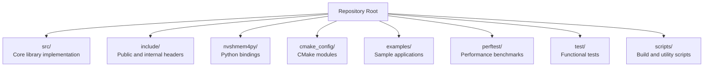
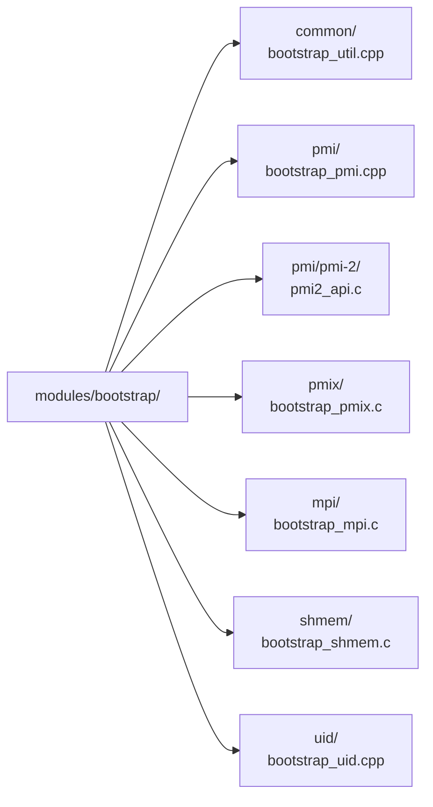
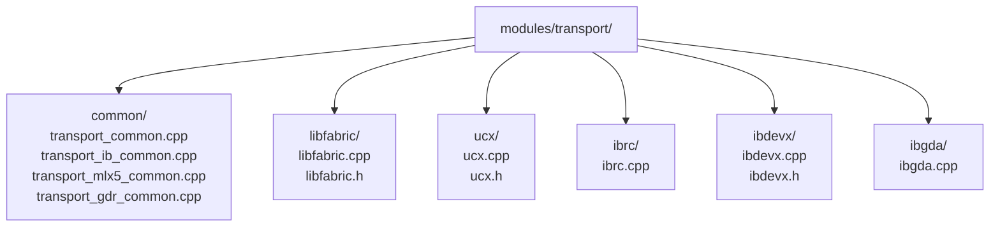
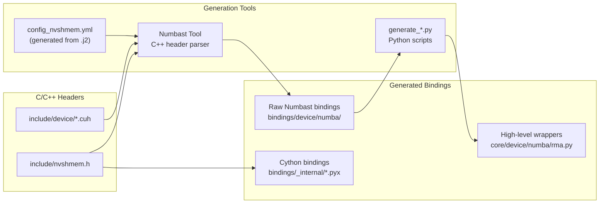
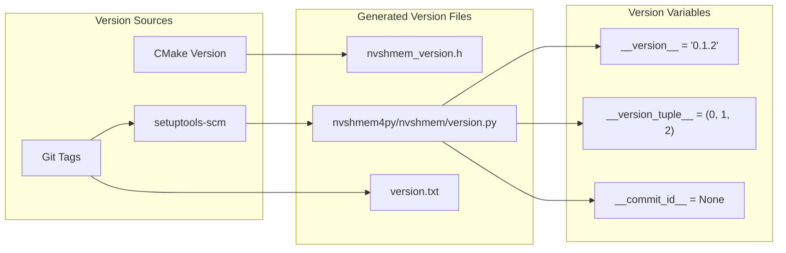

<!-- source: DeepWiki mcp.deepwiki.com · repo NVIDIA/nvshmem · page 8.1 Project Structure · fetched 2026-10-26 -->

# Project Structure

Relevant source files

The following files were used as context for generating this wiki page:

- [CMakeLists.txt](CMakeLists.txt)
- [cmake_config/NVSHMEMEnv.cmake](cmake_config/NVSHMEMEnv.cmake)
- [nvshmem4py/scripts/generate_pyproject_toml.py](nvshmem4py/scripts/generate_pyproject_toml.py)
- [src/CMakeLists.txt](src/CMakeLists.txt)

This document explains the organization of the NVSHMEM codebase, including directory layout and how different components map to the filesystem. It covers both the core C/C++ NVSHMEM library and the nvshmem4py Python bindings.

For build system details, see [Core Library Build](#3.1) and [Python Bindings Build](#3.2). For architectural concepts, see [Architecture](#2).

## Top-Level Directory Structure

The repository root contains the following major directories:

**Top-Level Files**:
- `CMakeLists.txt`: Root CMake configuration, defines project version and dependencies
- `License.txt`: Software license
- `changelog`: Version history

Sources: [CMakeLists.txt:1-189](), [.gitignore:1-98]()
</thinking>

## src/ Directory Organization

The `src/` directory contains all implementation code for the core C/C++ library, organized by functional subsystem:

```mermaid
graph TB
    SRC["src/"]
    
    subgraph "Host-Side Code"
        HOST["host/<br/>Host-side runtime"]
        HOST_INIT["host/init/<br/>init.cu, cudawrap.cpp"]
        HOST_MEM["host/mem/<br/>mem_heap.cpp, mem_transport.cpp"]
        HOST_TEAM["host/team/<br/>team_internal.cpp, team.cu"]
        HOST_TOPO["host/topo/<br/>topo.cpp"]
        HOST_PROXY["host/proxy/<br/>proxy.cpp"]
        HOST_COLL["host/coll/<br/>CPU collectives"]
        HOST_COMM["host/comm/<br/>putget.cpp, amo.cpp, fence.cpp"]
        HOST_TRANSPORT["host/transport/<br/>transport.cpp, p2p/p2p.cpp"]
        HOST_UTIL["host/util/<br/>util.cpp, debug.cpp"]
    end
    
    subgraph "Device-Side Code"
        DEVICE["device/<br/>GPU kernel code"]
        DEVICE_INIT["device/init/<br/>init_device.cu"]
        DEVICE_COLL["device/coll/<br/>Collective algorithms"]
        DEVICE_LAUNCH["device/launch/<br/>collective_launch.cpp"]
        DEVICE_COMM["device/comm/<br/>transfer_device.cu (generated)"]
    end
    
    subgraph "Plugin Modules"
        MODULES["modules/"]
        BOOTSTRAP["modules/bootstrap/<br/>Bootstrap plugins"]
        TRANSPORT["modules/transport/<br/>Transport plugins"]
    end
    
    SRC --> HOST
    SRC --> DEVICE
    SRC --> MODULES
    
    HOST --> HOST_INIT
    HOST --> HOST_MEM
    HOST --> HOST_TEAM
    HOST --> HOST_TOPO
    HOST --> HOST_PROXY
    HOST --> HOST_COLL
    HOST --> HOST_COMM
    HOST --> HOST_TRANSPORT
    HOST --> HOST_UTIL
    
    DEVICE --> DEVICE_INIT
    DEVICE --> DEVICE_COLL
    DEVICE --> DEVICE_LAUNCH
    DEVICE --> DEVICE_COMM
    
    MODULES --> BOOTSTRAP
    MODULES --> TRANSPORT
```

**Key Directories**:

| Directory | Purpose | Key Files |
|-----------|---------|-----------|
| `host/init/` | Initialization and CUDA wrapping | `init.cu`, `cudawrap.cpp`, `nvmlwrap.cpp` |
| `host/mem/` | Memory management | `mem_heap.cpp`, `mem_transport.cpp`, `dlmalloc.cpp` |
| `host/team/` | Team management | `team_internal.cpp`, `team.cu`, `team_internal_nvls.cpp` |
| `host/topo/` | Topology discovery | `topo.cpp` |
| `host/proxy/` | Host proxy system | `proxy.cpp` |
| `host/transport/` | Transport manager | `transport.cpp`, `p2p/p2p.cpp` |
| `host/coll/` | Host-side collectives | `barrier/`, `reduce/`, `broadcast/` subdirectories |
| `host/comm/` | RMA and atomics | `putget.cpp`, `amo.cpp`, `fence.cpp`, `quiet.cpp` |
| `device/init/` | Device initialization | `init_device.cu` |
| `device/coll/` | Device collective algorithms | Headers for barrier, reduce, etc. |
| `device/launch/` | Cooperative launch | `collective_launch.cpp` |

Sources: [src/CMakeLists.txt:286-359]()

### Bootstrap Plugin Structure

Bootstrap plugins are located in `src/modules/bootstrap/`:

Each bootstrap plugin implements the bootstrap interface defined in `include/internal/bootstrap_host/nvshmemi_bootstrap.h`. Plugins are built as separate shared libraries (`nvshmem_bootstrap_*.so`).

Sources: [src/CMakeLists.txt:120-220]()

### Transport Plugin Structure

Transport plugins are located in `src/modules/transport/`:

**Transport Common Code**:
- `transport_common.cpp`: Shared transport utilities, memory handle caching
- `transport_ib_common.cpp`: InfiniBand common code (used by IBRC, IBDEVX, IBGDA)
- `transport_mlx5_common.cpp`: Mellanox MLX5 specific code (used by IBDEVX, IBGDA)
- `transport_gdr_common.cpp`: GDRCopy integration (used by multiple transports)

Each transport plugin implements the `nvshmem_transport` interface and is built as a separate shared library (`nvshmem_transport_*.so`).

Sources: [src/CMakeLists.txt:399-570]()

## include/ Directory Organization

The `include/` directory contains all public and internal headers, organized by API visibility and component:

```mermaid
graph TB
    INCLUDE["include/"]
    
    subgraph "Public API Headers"
        PUBLIC["Root-level headers"]
        NVSHMEM_H["nvshmem.h<br/>Main header"]
        NVSHMEM_HOST_H["nvshmem_host.h<br/>Host API"]
        NVSHMEMX_H["nvshmemx.h<br/>Extensions"]
    end
    
    subgraph "Host API"
        HOST["host/"]
        HOST_API["nvshmem_api.h<br/>nvshmem_coll_api.h<br/>nvshmemx_api.h"]
    end
    
    subgraph "Device API"
        DEVICE["device/"]
        DEVICE_DEFINES["nvshmem_defines.h<br/>nvshmem_coll_defines.cuh"]
        DEVICE_TILE["tile/nvshmemx_tile_api.hpp"]
    end
    
    subgraph "Non-ABI (Internal)"
        NON_ABI["non_abi/"]
        NON_ABI_DEVICE["non_abi/device/<br/>Device implementation headers"]
        NON_ABI_VERSION["nvshmem_version.h (generated)<br/>nvshmem_build_options.h (generated)"]
    end
    
    subgraph "Shared Between Host/Device"
        DEVICE_HOST["device_host/"]
        DH_TYPES["nvshmem_types.h<br/>nvshmem_common.cuh<br/>nvshmem_tensor.h"]
    end
    
    subgraph "Internal APIs"
        INTERNAL["internal/"]
        INT_BOOTSTRAP["internal/bootstrap_host/<br/>nvshmemi_bootstrap.h"]
        INT_TRANSPORT["internal/host_transport/<br/>transport.h"]
    end
    
    INCLUDE --> PUBLIC
    INCLUDE --> HOST
    INCLUDE --> DEVICE
    INCLUDE --> NON_ABI
    INCLUDE --> DEVICE_HOST
    INCLUDE --> INTERNAL
    
    PUBLIC --> NVSHMEM_H
    PUBLIC --> NVSHMEM_HOST_H
    PUBLIC --> NVSHMEMX_H
    
    HOST --> HOST_API
    
    DEVICE --> DEVICE_DEFINES
    DEVICE --> DEVICE_TILE
    
    NON_ABI --> NON_ABI_DEVICE
    NON_ABI --> NON_ABI_VERSION
    
    DEVICE_HOST --> DH_TYPES
    
    INTERNAL --> INT_BOOTSTRAP
    INTERNAL --> INT_TRANSPORT
```

**Header Organization**:

| Directory | Purpose | Visibility |
|-----------|---------|------------|
| Root (`include/`) | Main public API headers | Public |
| `host/` | Host-side API declarations | Public |
| `device/` | Device-side API declarations | Public |
| `device/tile/` | Tile API for cooperative groups | Public |
| `device_host/` | Types shared between host and device | Public/Internal |
| `non_abi/device/` | Device implementation details | Internal |
| `non_abi/device/coll/` | Device collective implementations | Internal |
| `non_abi/device/pt-to-pt/` | Point-to-point implementations | Internal |
| `internal/` | Internal host-side APIs | Internal |
| `bootstrap_device_host/` | Bootstrap types | Internal |
| `device_host_transport/` | Transport-related types | Internal |

**Key Implementation Headers**:
- `non_abi/device/pt-to-pt/nvshmemi_transfer_api.cuh`: Transfer API abstraction
- `non_abi/device/pt-to-pt/ibgda_device.cuh`: IBGDA device-side implementation
- `non_abi/device/pt-to-pt/proxy_device.cuh`: Proxy channel device-side code
- `non_abi/device/coll/barrier.cuh`: Barrier collective algorithm
- `non_abi/device/coll/reduce.cuh`: Reduction collective algorithm

Sources: [src/CMakeLists.txt:632-686]()

## nvshmem4py/ Directory Organization

The `nvshmem4py/` directory contains Python bindings organized into user-facing APIs, generated bindings, and build infrastructure:

```mermaid
graph TB
    NVSHMEM4PY["nvshmem4py/"]
    
    subgraph "Python Package"
        NVSHMEM["nvshmem/<br/>Main package"]
        CORE["nvshmem/core/<br/>High-level API"]
        BINDINGS["nvshmem/bindings/<br/>Generated C bindings"]
        VERSION["nvshmem/version.py"]
    end
    
    subgraph "Core API Modules"
        TYPES["core/nvshmem_types.py<br/>NvshmemResource, Teams"]
        INIT_FINI["core/init_fini.py<br/>init/finalize functions"]
        COLLECTIVE["core/collective.py<br/>reduce, barrier, broadcast"]
        RMA_MOD["core/rma.py<br/>put, get, put_signal"]
        MEMORY["core/memory.py<br/>Memory allocation"]
        TEAMS["core/teams.py<br/>Team management"]
    end
    
    subgraph "Device API"
        CORE_DEVICE["core/device/<br/>Device-side APIs"]
        NUMBA_PKG["core/device/numba/<br/>Numba JIT bindings"]
        NUMBA_RMA["core/device/numba/rma.py"]
        NUMBA_COLL["core/device/numba/collective.py"]
        NUMBA_DIRECT["core/device/numba/direct.py"]
    end
    
    subgraph "Generated Bindings"
        BINDINGS_INTERNAL["bindings/_internal/<br/>Cython-generated .so files"]
        BINDINGS_DEVICE["bindings/device/numba/<br/>Numbast-generated bindings"]
        ENTRY_POINT["bindings/device/numba/entry_point.h"]
    end
    
    subgraph "Build Assets"
        BUILD_ASSETS["build_assets/<br/>Build configuration"]
        NUMBAST_DIR["build_assets/numbast/<br/>Numbast tool integration"]
        CONFIG_YML["build_assets/config_nvshmem.yml.j2<br/>Numbast configuration template"]
        GENERATORS["scripts/generate_*.py<br/>Wrapper generators"]
    end
    
    NVSHMEM4PY --> NVSHMEM
    NVSHMEM4PY --> BUILD_ASSETS
    
    NVSHMEM --> CORE
    NVSHMEM --> BINDINGS
    NVSHMEM --> VERSION
    
    CORE --> TYPES
    CORE --> INIT_FINI
    CORE --> COLLECTIVE
    CORE --> RMA_MOD
    CORE --> MEMORY
    CORE --> TEAMS
    
    CORE --> CORE_DEVICE
    CORE_DEVICE --> NUMBA_PKG
    NUMBA_PKG --> NUMBA_RMA
    NUMBA_PKG --> NUMBA_COLL
    NUMBA_PKG --> NUMBA_DIRECT
    
    BINDINGS --> BINDINGS_INTERNAL
    BINDINGS --> BINDINGS_DEVICE
    BINDINGS_DEVICE --> ENTRY_POINT
    
    BUILD_ASSETS --> NUMBAST_DIR
    BUILD_ASSETS --> CONFIG_YML
    BUILD_ASSETS --> GENERATORS
```

**Python Package Structure**:

| Directory | Purpose | Key Files |
|-----------|---------|-----------|
| `nvshmem/core/` | User-facing Python API | `collective.py`, `rma.py`, `teams.py`, `memory.py` |
| `nvshmem/core/nvshmem_types.py` | Python type wrappers | `NvshmemResource`, `NvshmemStream`, `Teams` |
| `nvshmem/core/device/numba/` | Device-side Numba API | `rma.py`, `collective.py`, `direct.py` |
| `nvshmem/bindings/` | Low-level bindings | Cython-generated `.pyx` and `.so` files |
| `nvshmem/bindings/device/numba/` | Device bindings | Numbast-generated Numba overloads |
| `build_assets/` | Build configuration | CMake scripts, Numbast config templates |
| `scripts/` | Code generators | `generate_rma.py`, `generate_coll.py`, etc. |

**Build Infrastructure Files**:
- `setup.py`: Python package setup script
- `pyproject.toml`: Generated from `scripts/generate_pyproject_toml.py`
- `requirements_cuda*.txt`: CUDA version-specific Python dependencies
- `build_assets/config_nvshmem.yml.j2`: Jinja2 template for Numbast configuration

Sources: [nvshmem4py/scripts/generate_pyproject_toml.py:1-106](), [.gitignore:88-95]()

### Binding Generation Workflow

The Python bindings are generated through a multi-stage process:

Sources: [nvshmem4py/scripts/generate_pyproject_toml.py:1-106]()

## Component-to-Directory Mapping

This section maps high-level architectural components (from [Architecture](#2)) to their filesystem locations:

### Runtime Layer Components

| Component | Directory | Key Files |
|-----------|-----------|-----------|
| Initialization | `src/host/init/` | `init.cu`, `query_host.cpp` |
| Team Management | `src/host/team/` | `team_internal.cpp`, `team_internal_nvls.cpp` |
| Memory Management | `src/host/mem/` | `mem_heap.cpp`, `mem_transport.cpp` |
| Topology Discovery | `src/host/topo/` | `topo.cpp` |

### Communication Layer Components

| Component | Directory | Key Files |
|-----------|-----------|-----------|
| Transport Manager | `src/host/transport/` | `transport.cpp` |
| P2P Transport | `src/host/transport/p2p/` | `p2p.cpp` |
| Proxy System | `src/host/proxy/` | `proxy.cpp` |
| IBRC Transport | `src/modules/transport/ibrc/` | `ibrc.cpp` |
| IBGDA Transport | `src/modules/transport/ibgda/` | `ibgda.cpp` |
| IBDEVX Transport | `src/modules/transport/ibdevx/` | `ibdevx.cpp` |
| UCX Transport | `src/modules/transport/ucx/` | `ucx.cpp`, `ucx.h` |
| Libfabric Transport | `src/modules/transport/libfabric/` | `libfabric.cpp`, `libfabric.h` |
| Transport Common | `src/modules/transport/common/` | `transport_common.cpp`, `transport_ib_common.cpp` |

### Device Layer Components

| Component | Directory | Key Files |
|-----------|-----------|-----------|
| Device Initialization | `src/device/init/` | `init_device.cu` |
| Device Collectives | `include/non_abi/device/coll/` | `barrier.cuh`, `reduce.cuh`, `broadcast.cuh` |
| Device Point-to-Point | `include/non_abi/device/pt-to-pt/` | `ibgda_device.cuh`, `proxy_device.cuh` |
| Transfer API | `include/non_abi/device/pt-to-pt/` | `nvshmemi_transfer_api.cuh` |

### Python Bindings Components

| Component | Directory | Key Files |
|-----------|-----------|-----------|
| High-Level API | `nvshmem4py/nvshmem/core/` | `collective.py`, `rma.py`, `teams.py` |
| Type System | `nvshmem4py/nvshmem/core/` | `nvshmem_types.py` |
| Cython Bindings | `nvshmem4py/nvshmem/bindings/` | Generated `.pyx` files |
| Numba Device Bindings | `nvshmem4py/nvshmem/core/device/numba/` | `rma.py`, `collective.py`, `direct.py` |
| Binding Generators | `nvshmem4py/scripts/` | `generate_rma.py`, `generate_coll.py` |

Sources: [src/CMakeLists.txt:286-359](), [src/CMakeLists.txt:399-570]()

## Build Outputs and Installation Layout

After building, the following directory structure is created:

```mermaid
graph TB
    BUILD["build/ or install/"]
    
    subgraph "Libraries"
        LIB["lib/"]
        HOST_LIB["libnvshmem_host.so"]
        DEVICE_LIB["libnvshmem_device.a"]
        BOOTSTRAP_LIBS["nvshmem_bootstrap_*.so"]
        TRANSPORT_LIBS["nvshmem_transport_*.so"]
    end
    
    subgraph "Headers"
        INCLUDE_OUT["include/"]
        NVSHMEM_HEADERS["nvshmem.h<br/>nvshmem_host.h<br/>nvshmemx.h"]
        DEVICE_HEADERS["device/*.h"]
        INTERNAL_HEADERS["internal/*"]
    end
    
    subgraph "Executables"
        BIN_OUT["bin/"]
        NVSHMEM_INFO["nvshmem-info"]
        HYDRA["nvshmrun (optional)"]
    end
    
    subgraph "CMake Config"
        CMAKE_OUT["lib/cmake/nvshmem/"]
        NVSHMEM_CONFIG["NVSHMEMConfig.cmake"]
        NVSHMEM_TARGETS["NVSHMEMTargets.cmake"]
    end
    
    subgraph "Source Exports"
        SHARE["share/src/"]
        BOOTSTRAP_SRC["bootstrap-plugins/"]
        TRANSPORT_SRC["transport-plugins/"]
        EXAMPLES_SRC["examples/"]
        PERFTEST_SRC["perftest/"]
    end
    
    BUILD --> LIB
    BUILD --> INCLUDE_OUT
    BUILD --> BIN_OUT
    BUILD --> CMAKE_OUT
    BUILD --> SHARE
    
    LIB --> HOST_LIB
    LIB --> DEVICE_LIB
    LIB --> BOOTSTRAP_LIBS
    LIB --> TRANSPORT_LIBS
    
    INCLUDE_OUT --> NVSHMEM_HEADERS
    INCLUDE_OUT --> DEVICE_HEADERS
    INCLUDE_OUT --> INTERNAL_HEADERS
    
    BIN_OUT --> NVSHMEM_INFO
    BIN_OUT --> HYDRA
    
    CMAKE_OUT --> NVSHMEM_CONFIG
    CMAKE_OUT --> NVSHMEM_TARGETS
    
    SHARE --> BOOTSTRAP_SRC
    SHARE --> TRANSPORT_SRC
    SHARE --> EXAMPLES_SRC
    SHARE --> PERFTEST_SRC
```

**Installed Library Components**:

| Component | Filename | Description |
|-----------|----------|-------------|
| Host Library | `libnvshmem_host.so.3` | Host-side runtime (shared) |
| Device Library | `libnvshmem_device.a` | Device-side code (static) |
| Bitcode Library | `libnvshmem_device.bc` | LLVM bitcode (optional) |
| Bootstrap Plugins | `nvshmem_bootstrap_{pmi,pmi2,pmix,mpi,shmem,uid}.so.3` | Bootstrap implementations |
| Transport Plugins | `nvshmem_transport_{ibrc,ibgda,ibdevx,ucx,libfabric}.so.4` | Transport implementations |

The version numbers (`.3`, `.4`) correspond to the SOVERSION defined in CMake. Bootstrap plugins use version 3.0.0, transport plugins use version 4.0.0.

Sources: [src/CMakeLists.txt:8-10](), [src/CMakeLists.txt:400-402](), [src/CMakeLists.txt:884-907]()

## Version Management

The project uses sophisticated version management across both C++ and Python components:

### Version Information Flow

The version file `nvshmem4py/nvshmem/version.py` contains version information managed by setuptools-scm:

- `__version__` and `version`: String version identifier
- `__version_tuple__` and `version_tuple`: Tuple format for programmatic access
- `__commit_id__` and `commit_id`: Git commit information when available

Sources: [nvshmem4py/nvshmem/version.py:24-34]()

## Development Workflow Structure

The repository is configured to support various development workflows and build environments:

### Ignored Files and Patterns

The `.gitignore` file defines comprehensive patterns for excluding build artifacts:

| Pattern Category | Examples | Purpose |
|------------------|----------|---------|
| Compiled Objects | `*.o`, `*.so`, `*.dll` | Exclude binary compilation outputs |
| Build Directories | `build/`, `install/`, `bin/` | Exclude build and installation directories |
| IDE Files | `.idea`, `.vscode`, `*.swp` | Exclude editor-specific files |
| CMake Artifacts | `CMakeCache.txt`, `*CMakeFiles*` | Exclude CMake build system files |
| Python Artifacts | `*.egg-info`, `*.cmake` | Exclude Python packaging artifacts |
| Generated Sources | `transfer_device.cu`, `nvshmem_build_options.h` | Exclude code generation outputs |

Sources: [.gitignore:1-98]()

The development infrastructure supports multiple build systems (CMake for C++, setuptools for Python) and various transport backends, making the project structure modular and extensible for different deployment scenarios.

---

