<!-- source: DeepWiki mcp.deepwiki.com · repo NVIDIA/nvshmem · page 8.3 Transport Development · fetched 2026-10-26 -->

# Implementing Custom Transports

<details>
<summary>Relevant source files</summary>

The following files were used as context for generating this wiki page:

- [src/host/proxy/proxy.cpp](src/host/proxy/proxy.cpp)
- [src/host/topo/topo.cpp](src/host/topo/topo.cpp)
- [src/host/transport/transport.cpp](src/host/transport/transport.cpp)
- [src/include/internal/host/util.h](src/include/internal/host/util.h)
- [src/modules/transport/common/transport_common.cpp](src/modules/transport/common/transport_common.cpp)
- [src/modules/transport/ibdevx/ibdevx.cpp](src/modules/transport/ibdevx/ibdevx.cpp)
- [src/modules/transport/ibgda/ibgda.cpp](src/modules/transport/ibgda/ibgda.cpp)
- [src/modules/transport/ibrc/ibrc.cpp](src/modules/transport/ibrc/ibrc.cpp)
- [src/modules/transport/libfabric/libfabric.cpp](src/modules/transport/libfabric/libfabric.cpp)
- [src/modules/transport/ucx/ucx.cpp](src/modules/transport/ucx/ucx.cpp)

</details>


## Purpose and Scope

This guide provides instructions for developers implementing custom transport layers for NVSHMEM. A transport layer enables communication between processing elements (PEs) over a specific network fabric or interconnect technology.

For documentation of the transport interface API itself, see [Transport Interface](#5.3). For examples of existing transport implementations, see [Transport Implementations](#6).

## Transport Interface Overview

Custom transports implement the `nvshmem_transport` structure and `nvshmem_transport_t` interface defined in [src/include/internal/host_transport/transport.h](). The transport layer handles:

- Remote memory access (RMA) operations (put/get)
- Atomic memory operations (AMO)
- Memory registration and handle management via `get_mem_handle()` and `release_mem_handle()`
- Endpoint connection via `connect_endpoints()`
- Progress and completion tracking via `progress()`
- Integration with the host proxy thread for GPU-initiated operations

**Transport Plugin Architecture**

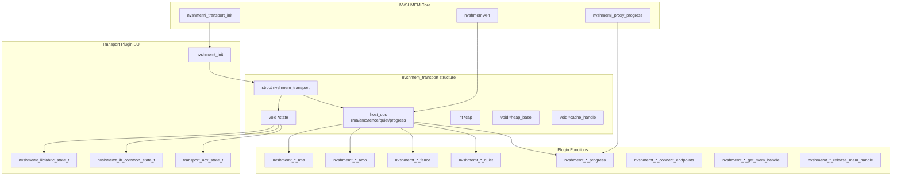

**Sources:** [src/include/internal/host_transport/transport.h:1-250](), [src/host/transport/transport.cpp:50-318]()

## Transport Structure Definition

The `struct nvshmem_transport` is defined in [src/include/internal/host_transport/transport.h](). A transport plugin populates this structure during initialization:

**Transport Structure Fields**

```mermaid
graph TB
    subgraph "struct nvshmem_transport"
        BASIC["Core Fields"]
        OPS["Operations"]
        RESOURCES["Resources"]
    end
    
    subgraph "Core Fields"
        MY_PE["int my_pe"]
        N_PES["int n_pes"]
        N_DEVICES["int n_devices"]
        ATTR["int attr"]
        TYPE["nvshmem_transport_type type"]
        API_VERSION["int api_version"]
    end
    
    subgraph "Operations - host_ops_t"
        RMA["int (*rma)()"]
        AMO["int (*amo)()"]
        FENCE["int (*fence)()"]
        QUIET["int (*quiet)()"]
        PROGRESS["int (*progress)()"]
        SHOW_INFO["int (*show_info)()"]
    end
    
    subgraph "Operations - init_t"
        GET_MEM_HANDLE["int (*get_mem_handle)()"]
        RELEASE_MEM_HANDLE["int (*release_mem_handle)()"]
        CONNECT_ENDPOINTS["int (*connect_endpoints)()"]
        CAN_REACH_PEER["int (*can_reach_peer)()"]
        FINALIZE["int (*finalize)()"]
    end
    
    subgraph "Resources"
        STATE["void *state"]
        HEAP_BASE["void *heap_base"]
        BOOT_HANDLE["bootstrap_handle_t *boot_handle"]
        CAP["int *cap"]
        CACHE_HANDLE["void *cache_handle"]
        PCI_PATHS["char **device_pci_paths"]
        ALIAS_VA_MAP["std::unordered_map *alias_va_map"]
    end
    
    BASIC --> MY_PE
    BASIC --> N_PES
    BASIC --> N_DEVICES
    BASIC --> ATTR
    BASIC --> TYPE
    BASIC --> API_VERSION
    
    OPS --> RMA
    OPS --> AMO
    OPS --> FENCE
    OPS --> QUIET
    OPS --> PROGRESS
    OPS --> SHOW_INFO
    OPS --> GET_MEM_HANDLE
    OPS --> RELEASE_MEM_HANDLE
    OPS --> CONNECT_ENDPOINTS
    OPS --> CAN_REACH_PEER
    OPS --> FINALIZE
    
    RESOURCES --> STATE
    RESOURCES --> HEAP_BASE
    RESOURCES --> BOOT_HANDLE
    RESOURCES --> CAP
    RESOURCES --> CACHE_HANDLE
    RESOURCES --> PCI_PATHS
    RESOURCES --> ALIAS_VA_MAP
```

**Sources:** [src/include/internal/host_transport/transport.h:1-250]()

## Implementation Checklist

### Required Plugin Entry Point

The transport plugin shared object must export `nvshmemt_init`:

```c
typedef int (*nvshmemi_transport_init_fn)(nvshmem_transport_t *transport,
                                          struct nvshmemi_cuda_fn_table *table,
                                          int api_version);
```

This function is called by `nvshmemi_transport_init()` in [src/host/transport/transport.cpp:50-318]() to initialize the transport plugin.

### Required Function Implementations

All custom transports must implement these functions and populate the `nvshmem_transport` structure:

| Function Pointer | Purpose | Called From | Example |
|----------|---------|-------------|---------|
| `host_ops.rma` | Execute put/get operations | Proxy, host API | [libfabric.cpp:688-823]() |
| `host_ops.amo` | Execute atomic operations | Proxy, host API | [libfabric.cpp:831-951]() |
| `host_ops.fence` | Ordering barrier | Host API | [libfabric.cpp:676-681]() |
| `host_ops.quiet` | Completion barrier | Host API | [libfabric.cpp:629-674]() |
| `host_ops.progress` | Advance operations | Proxy thread | [libfabric.cpp:235-255]() |
| `host_ops.show_info` | Display transport info | Init | [libfabric.cpp:683-686]() |
| `get_mem_handle` | Register memory region | Memory init | [libfabric.cpp:1010-1288]() |
| `release_mem_handle` | Deregister memory | Memory cleanup | [libfabric.cpp:960-1008]() |
| `connect_endpoints` | Establish connections | Init | [libfabric.cpp:1385-1580]() |
| `can_reach_peer` | Check reachability | Init | [libfabric.cpp:1290-1298]() |
| `finalize` | Cleanup resources | Finalize | [libfabric.cpp:2037-2104]() |

**Sources:** [src/include/internal/host_transport/transport.h:1-250](), [src/modules/transport/libfabric/libfabric.cpp:1-2200]()

## Transport State Management

Each transport maintains private state through the `void *state` pointer in `struct nvshmem_transport`. State structures contain device management, endpoint arrays, memory handle cache, and configuration.

**Libfabric State Structure Example**

```mermaid
graph TB
    subgraph "nvshmemt_libfabric_state_t"
        CORE["Core Fields"]
        DEVICES_FIELD["Devices"]
        EPS_FIELD["Endpoints"]
        CACHE_FIELD["Cache"]
        CONFIG["Configuration"]
    end
    
    subgraph "Core Fields"
        N_DEV["int n_dev_ids"]
        N_SEL["int n_devs_selected"]
        DEV_IDS["int *dev_ids"]
        SEL_DEV_IDS["int *selected_dev_ids"]
        SELECTED_DEV_ID["int selected_dev_id"]
    end
    
    subgraph "Device Array"
        DEVICES["void *devices"]
        DEVICE_STRUCT["nvshmemt_libfabric_device_t[]"]
    end
    
    subgraph "Endpoint Array"
        EPS["nvshmemt_libfabric_endpoint_t eps[]"]
        HOST_EP_IDX["NVSHMEMT_LIBFABRIC_HOST_EP_IDX"]
        PROXY_EP_IDX["NVSHMEMT_LIBFABRIC_PROXY_EP_IDX"]
    end
    
    subgraph "Memory Handle Cache"
        CACHE["transport_mem_handle_info_cache *cache"]
        CACHE_IMPL["nvshmemt_mem_handle_cache_t"]
    end
    
    subgraph "Configuration Fields"
        OPTIONS["nvshmemi_options_s *options"]
        LOG_LEVEL["int log_level"]
        PROVIDER["nvshmemt_libfabric_provider_type_t provider"]
        PROV_INFO["struct fi_info *prov_info"]
    end
    
    CORE --> N_DEV
    CORE --> N_SEL
    CORE --> DEV_IDS
    CORE --> SEL_DEV_IDS
    CORE --> SELECTED_DEV_ID
    
    DEVICES_FIELD --> DEVICES
    DEVICES --> DEVICE_STRUCT
    
    EPS_FIELD --> EPS
    EPS --> HOST_EP_IDX
    EPS --> PROXY_EP_IDX
    
    CACHE_FIELD --> CACHE
    CACHE --> CACHE_IMPL
    
    CONFIG --> OPTIONS
    CONFIG --> LOG_LEVEL
    CONFIG --> PROVIDER
    CONFIG --> PROV_INFO
```

**State Structure Examples:**
- Libfabric: `nvshmemt_libfabric_state_t` in [src/modules/transport/libfabric/libfabric.h:274-300]()
- IBRC: `nvshmemt_ib_common_state_t` in [src/modules/transport/ib_common/transport_ib_common.h:1-200]()
- UCX: `transport_ucx_state_t` in [src/modules/transport/ucx/ucx.h:1-150]()

**Sources:** [src/modules/transport/libfabric/libfabric.h:274-300](), [src/modules/transport/ib_common/transport_ib_common.h:1-200](), [src/modules/transport/ucx/ucx.h:1-150]()

## Initialization Flow

The initialization sequence follows this pattern:

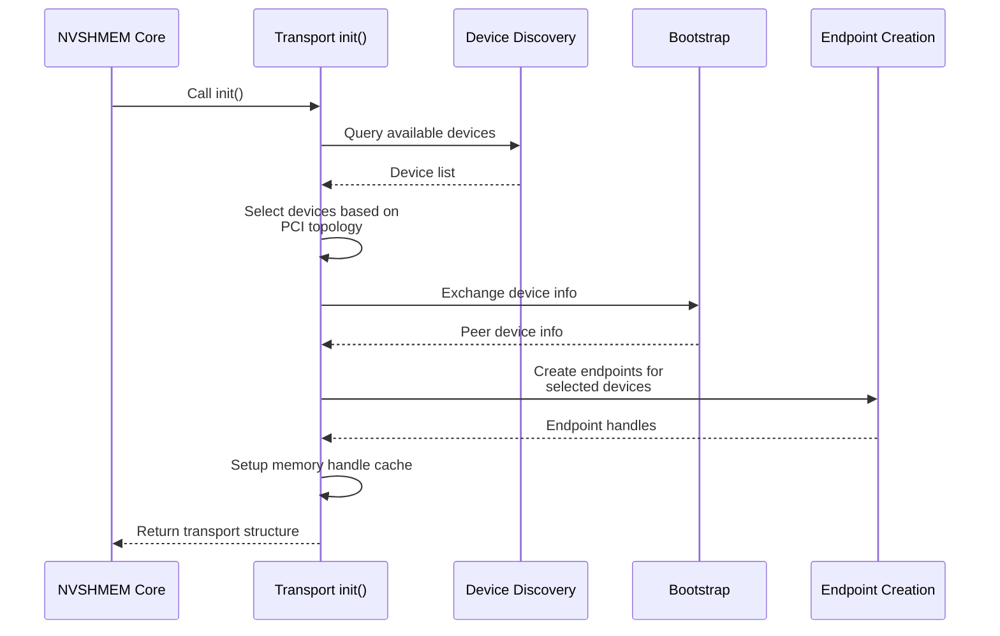

Key steps:

1. **Device Discovery**: Query available network devices
2. **Device Selection**: Choose devices based on GPU affinity and PCI topology
3. **Bootstrap Exchange**: Share device information with peers using bootstrap handle
4. **Endpoint Creation**: Create communication endpoints for each selected device
5. **Resource Allocation**: Allocate completion queues, buffers, etc.

Example from IBRC transport initialization:
- [src/modules/transport/ibrc/ibrc.cpp:258-356]() - `ep_create()` function
- [src/modules/transport/libfabric/libfabric.cpp:1500-1800]() - Libfabric initialization

**Sources:** [src/modules/transport/ibrc/ibrc.cpp:258-356](), [src/modules/transport/libfabric/libfabric.cpp:1500-1800]()

## Endpoint and Connection Management

### Endpoint Structure

Endpoints represent communication channels to remote PEs. Common pattern:

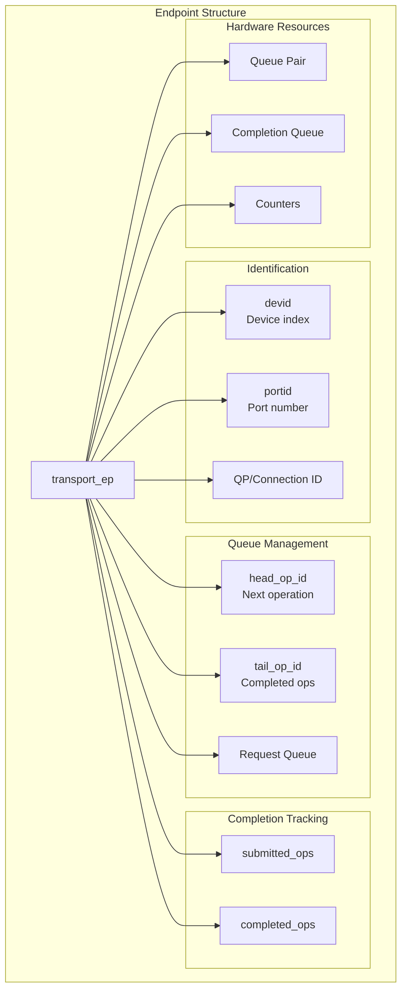

### Connection Establishment

The `connect_endpoints()` function establishes PE-to-PE connections:

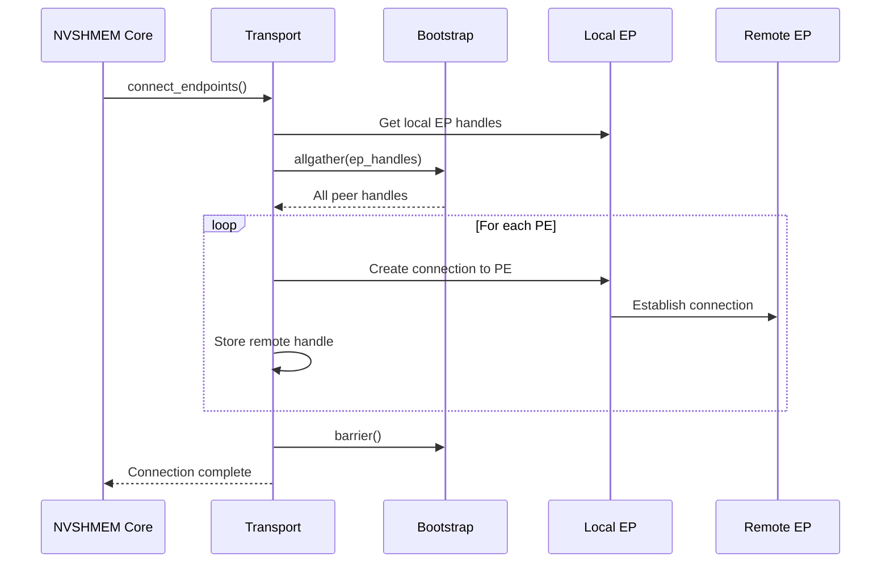

Example implementations:
- [src/modules/transport/ibrc/ibrc.cpp:358-433]() - IBRC `ep_connect()`
- [src/modules/transport/ucx/ucx.cpp:424-504]() - UCX endpoint connection
- [src/modules/transport/libfabric/libfabric.cpp:1200-1400]() - Libfabric endpoint setup

**Sources:** [src/modules/transport/ibrc/ibrc.cpp:358-433](), [src/modules/transport/ucx/ucx.cpp:424-504](), [src/modules/transport/libfabric/libfabric.cpp:1200-1400]()

## Memory Registration

### Memory Handle Cache

Transports register memory regions and cache handles for efficient RDMA access. The cache implementation is in [src/modules/transport/common/transport_common.cpp:85-227]().

**Memory Handle Cache Structure**

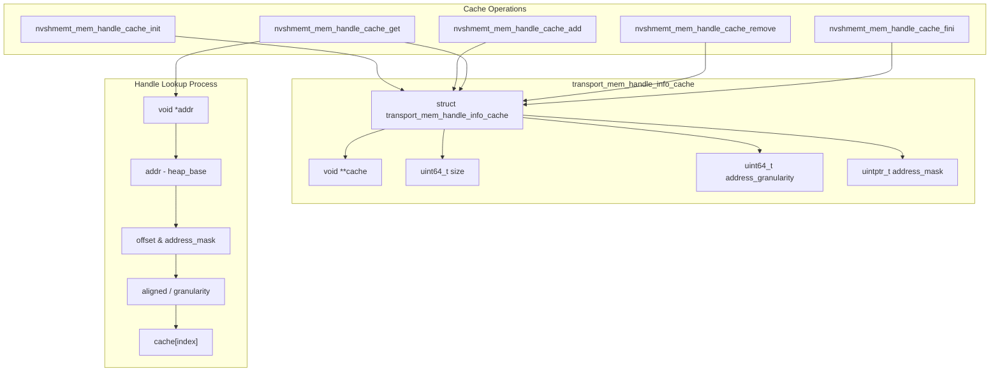

### Memory Handle Registration Flow

The `get_mem_handle()` function registers memory and adds entries to the cache:

**Registration Process:**
1. Check if buffer is already registered via `alias_va_map`
2. Register memory with fabric-specific API (e.g., `ibv_reg_mr`, `fi_mr_reg`, `ucp_mem_map`)
3. Create transport-specific handle info structure
4. Add handle to cache via `nvshmemt_mem_handle_cache_add()`
5. Handle local-only registrations differently (no remote keys)

**Example from Libfabric:**
```c
// Check for aliased VA
void *alias_va_ptr = NULL;
if (transport->alias_va_map != NULL && transport->alias_va_map->count(buf)) {
    alias_va_ptr = transport->alias_va_map->operator[](buf);
}

// Register with libfabric
status = nvshmemt_ib_common_reg_mem_handle(
    &ftable, &mlx5dv_ftable, pd, mem_handle, buf, length,
    local_only, dmabuf_support, cuda_syms, log_level,
    relaxed_ordering, data_direct, alias_va_ptr);

// Add to cache
if (!local_only) {
    curr_ptr = buf;
    do {
        status = nvshmemt_mem_handle_cache_add(t, cache, curr_ptr, handle_info);
        curr_ptr = (char *)curr_ptr + (1ULL << t->log2_cumem_granularity);
    } while (curr_ptr < (char *)buf + length);
}
```

**Implementation Examples:**
- Libfabric: [src/modules/transport/libfabric/libfabric.cpp:1010-1288]()
- IBRC: [src/modules/transport/ibrc/ibrc.cpp:453-587]()
- UCX: [src/modules/transport/ucx/ucx.cpp:292-422]()

**Sources:** [src/modules/transport/common/transport_common.cpp:85-227](), [src/modules/transport/libfabric/libfabric.cpp:1010-1288](), [src/modules/transport/ibrc/ibrc.cpp:453-587]()

## RMA Operations

### RMA Operation Types

The `rma()` function implements three operation types:

| Verb | Description | Inline Data |
|------|-------------|-------------|
| `NVSHMEMI_OP_P` | Put small data (≤8 bytes) | Yes |
| `NVSHMEMI_OP_PUT` | Put arbitrary size | No |
| `NVSHMEMI_OP_GET` | Get arbitrary size | No |
| `NVSHMEMI_OP_G` | Get small data | Optional |

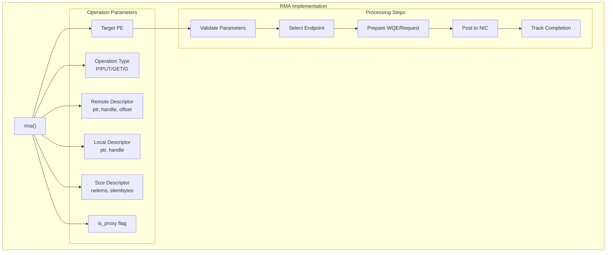

### Implementation Example

From Libfabric transport:
- [src/modules/transport/libfabric/libfabric.cpp:605-730]() - `nvshmemt_libfabric_rma_impl()`

Key steps:

1. **Select Endpoint**: Choose proxy or host endpoint based on `is_proxy` flag
2. **Unpack Memory Handles**: Extract remote and local memory keys
3. **Prepare Operation**: Build operation descriptor (e.g., fi_msg_rma for libfabric)
4. **Handle Inline Data**: For P operations, copy data inline
5. **Post Operation**: Submit to NIC (fi_write/fi_read for libfabric)
6. **Track Submission**: Increment `submitted_ops` counter

```c
// Select endpoint
int ep_idx = is_proxy ? PROXY_EP_IDX : HOST_EP_IDX;
ep = &state->eps[ep_idx];

// Post operation with retry logic
do {
    status = fi_write(ep->endpoint, local->ptr, op_size, 
                     local_handle->local_desc, target_ep,
                     remote_addr, remote_handle->key, context);
} while (try_again(transport, &status, &num_retries));

ep->submitted_ops++;
```

**Sources:** [src/modules/transport/libfabric/libfabric.cpp:605-730]()

## AMO Operations

### AMO Operation Types

Atomic operations are categorized as:

1. **Non-fetch AMOs**: No return value (e.g., `NVSHMEMI_AMO_ADD`, `NVSHMEMI_AMO_SET`)
2. **Fetch AMOs**: Return old value (e.g., `NVSHMEMI_AMO_FETCH_ADD`, `NVSHMEMI_AMO_FETCH`)
3. **Compare-and-swap**: `NVSHMEMI_AMO_COMPARE_SWAP`

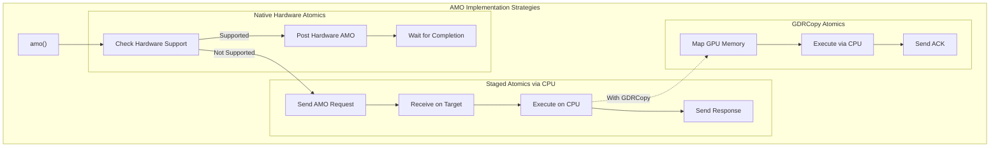

### Staged Atomics Pattern

When hardware atomics are unavailable, transports implement "staged atomics" where:

1. **Sender**: Sends AMO request via send operation
2. **Receiver**: Processes request in progress function
3. **Execution**: Performs atomic operation on CPU (with GDRCopy if available)
4. **Response**: Sends result back to sender (for fetch operations)

Example from UCX transport:
- [src/modules/transport/ucx/ucx.cpp:634-727]() - `nvshmemt_ucx_handle_amo()`
- [src/modules/transport/ucx/ucx.cpp:729-862]() - `nvshmemt_ucx_process_amos()`

Example atomic execution with templates:
```c
template <typename T>
int perform_amo(void *ptr, amo_verb_t verb, T swap_add, T compare, T *old_value) {
    T old_val = *((volatile T *)ptr);
    T new_val;
    
    switch (verb.desc) {
        case NVSHMEMI_AMO_ADD:
            new_val = old_val + swap_add;
            break;
        case NVSHMEMI_AMO_COMPARE_SWAP:
            new_val = (old_val == compare) ? swap_add : old_val;
            break;
        // ... other operations
    }
    
    *((volatile T *)ptr) = new_val;
    if (old_value) *old_value = old_val;
    return 0;
}
```

**Sources:** [src/modules/transport/ucx/ucx.cpp:634-727](), [src/modules/transport/ucx/ucx.cpp:729-862]()

## Synchronization Operations

### Fence and Quiet

Both operations ensure ordering and completion:

- **fence()**: Ensures all previous operations are ordered before subsequent operations
- **quiet()**: Ensures all previous operations have completed

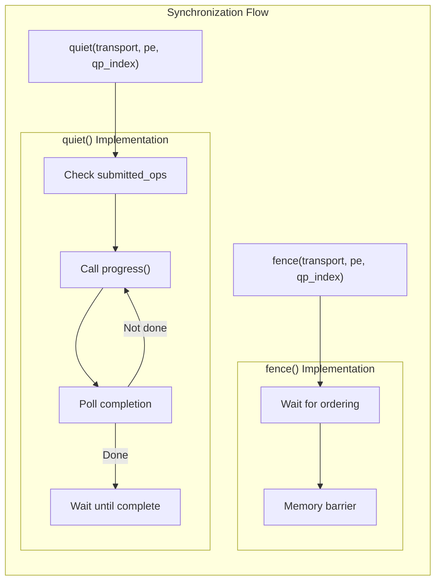

### Implementation Pattern

Typical quiet implementation:
- [src/modules/transport/libfabric/libfabric.cpp:546-591]() - Libfabric quiet

```c
static int quiet(struct nvshmem_transport *tcurr, int pe, int qp_index) {
    ep = &state->eps[qp_index];
    
    // For manual progress fabrics
    if (prov_info->domain_attr->control_progress == FI_PROGRESS_MANUAL ||
        prov_info->domain_attr->data_progress == FI_PROGRESS_MANUAL) {
        
        for (;;) {
            completed = fi_cntr_read(ep->counter);
            submitted = ep->submitted_ops;
            
            if (completed == submitted)
                break;
            
            // Progress pending operations
            if (progress(tcurr))
                return error;
        }
    } else {
        // For auto-progress fabrics
        status = fi_cntr_wait(ep->counter, ep->submitted_ops, timeout);
    }
    
    return status;
}
```

**Sources:** [src/modules/transport/libfabric/libfabric.cpp:546-591]()

## Progress Function

The `progress()` function is called by the proxy thread and during quiet operations to advance pending operations and process completions. Each transport implements progress differently based on fabric requirements.

**Libfabric Progress Flow**

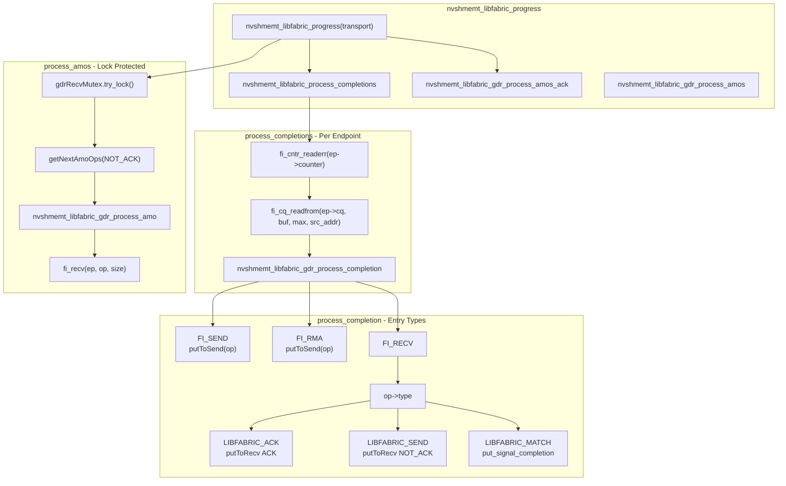

**Progress Implementation Examples:**

Libfabric uses completion queues and processes both completions and staged atomics:
- Main progress: [src/modules/transport/libfabric/libfabric.cpp:235-255]()
- Process completions: [src/modules/transport/libfabric/libfabric.cpp:166-233]()
- Process AMOs: [src/modules/transport/libfabric/libfabric.cpp:510-547]()

IBGDA progress rings doorbells for DCI and RC QPs:
- DCI progress: [src/modules/transport/ibgda/ibgda.cpp:491-551]()
- RC progress: [src/modules/transport/ibgda/ibgda.cpp:553-613]()

UCX progress uses `ucp_worker_progress()`:
- [src/modules/transport/ucx/ucx.cpp:864-901]()

**Sources:** [src/modules/transport/libfabric/libfabric.cpp:235-255](), [src/modules/transport/ibgda/ibgda.cpp:491-613](), [src/modules/transport/ucx/ucx.cpp:864-901]()

## Integration with Host Proxy

The host proxy thread (`nvshmemi_proxy_progress`) processes device-initiated requests and calls transport operations. The proxy system is documented in [Proxy Architecture](#2.5).

**Proxy Request Processing Flow**

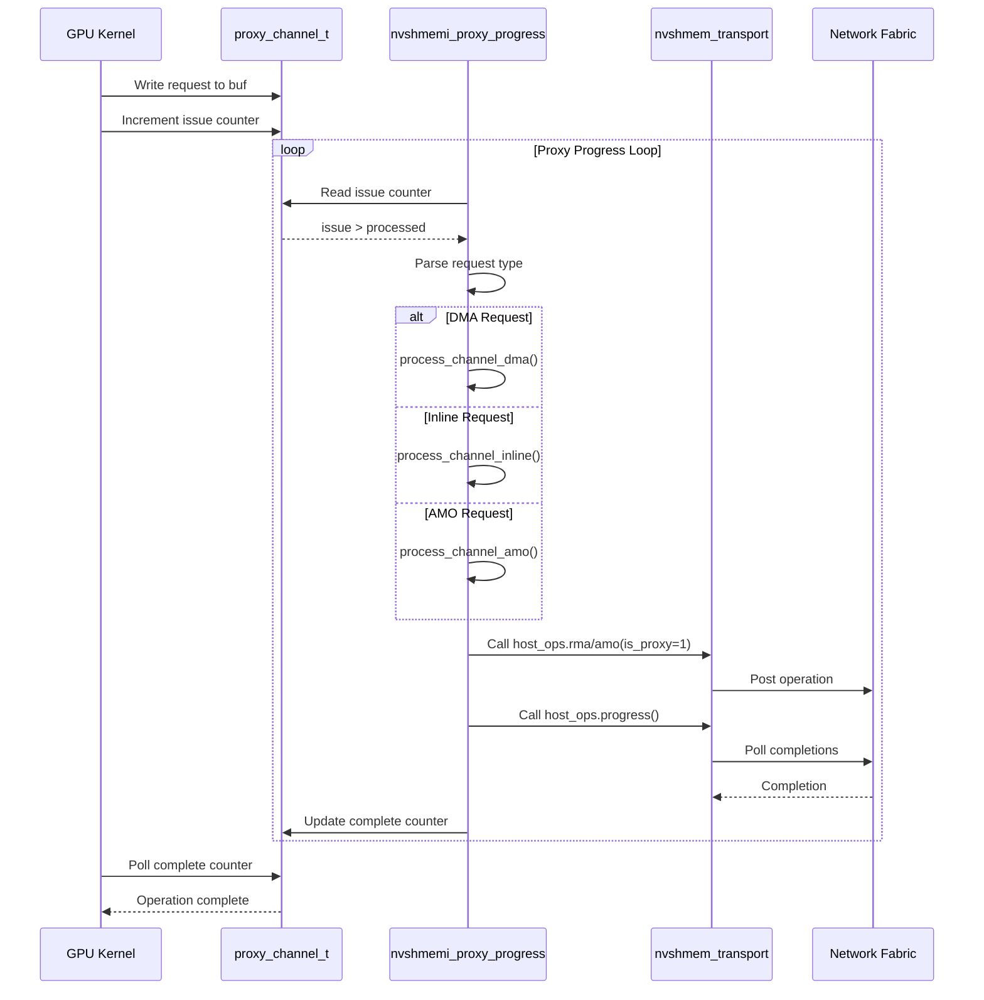

### Proxy Channel Processing Functions

The proxy parses requests from channels and dispatches to transport:

**DMA Request Processing:**
- [src/host/proxy/proxy.cpp:382-459]() - `process_channel_dma()`
- Parses `put_dma_request_*_t` structures from channel buffer
- Calls `nvshmemi_process_multisend_rma()` with `is_proxy` flag

**Inline Request Processing:**
- [src/host/proxy/proxy.cpp:461-560]() - `process_channel_inline()`
- Handles small puts (P operations) with inline data
- Uses transport's `rma()` function with `NVSHMEMI_OP_P` verb

**AMO Request Processing:**
- [src/host/proxy/proxy.cpp:562-658]() - `process_channel_amo()`
- Processes atomic operation requests from device
- Calls transport's `amo()` function with `is_proxy=1`

### Endpoint Selection for Proxy

Transports maintain separate endpoints for host and proxy operations:

```c
// Libfabric endpoint selection
int ep_idx = is_proxy ? NVSHMEMT_LIBFABRIC_PROXY_EP_IDX 
                      : NVSHMEMT_LIBFABRIC_HOST_EP_IDX;
ep = &libfabric_state->eps[ep_idx];

// UCX endpoint selection
int ep_index = is_proxy ? (ep_count * pe + proxy_ep_idx)
                        : (ep_count * pe);
ep = ucx_state->endpoints[ep_index];
```

**Sources:** [src/host/proxy/proxy.cpp:382-459](), [src/host/proxy/proxy.cpp:461-560](), [src/host/proxy/proxy.cpp:562-658](), [src/modules/transport/libfabric/libfabric.cpp:710-717]()

## Testing and Validation

### Testing Checklist

1. **Functional Tests**:
   - Basic put/get operations
   - Atomic operations (all types)
   - Fence and quiet operations
   - Memory registration/deregistration

2. **Stress Tests**:
   - High message rate
   - Multiple concurrent operations
   - Large transfer sizes
   - Many registered memory regions

3. **Proxy Tests**:
   - Device-initiated operations
   - Proxy channel overflow
   - Concurrent host and device operations

4. **Error Handling**:
   - Network errors
   - Memory registration failures
   - Connection failures
   - Resource exhaustion

### Debug Support

Enable debugging with environment variables:

```bash
export NVSHMEM_DEBUG=TRACE        # Enable debug output
export NVSHMEM_DEBUG_SUBSYS=INIT,TRANSPORT  # Filter subsystems
```

Add logging in your transport:
```c
INFO(state->log_level, "Transport: operation type=%d pe=%d size=%zu",
     verb.desc, pe, size);

NVSHMEMI_NZ_ERROR_JMP(status, NVSHMEMX_ERROR_INTERNAL, out,
                      "Failed to post operation: %s", error_string);
```

**Sources:** [src/modules/transport/libfabric/libfabric.cpp:1-100]()

## Common Implementation Patterns

### Error Handling Macros

NVSHMEM provides error handling macros defined in [src/include/non_abi/nvshmemx_error.h]() and [src/include/internal/host/util.h]():

```c
// Jump to label on non-zero status
NVSHMEMI_NZ_ERROR_JMP(status, NVSHMEMX_ERROR_INTERNAL, out,
                      "Operation failed with error %d", status);

// Jump to label on NULL pointer
NVSHMEMI_NULL_ERROR_JMP(ptr, status, NVSHMEMX_ERROR_OUT_OF_MEMORY, out,
                        "Failed to allocate memory");

// Jump to label on inequality
NVSHMEMI_NE_ERROR_JMP(actual, expected, NVSHMEMX_ERROR_INVALID_VALUE, out,
                      "Unexpected value: %d != %d", actual, expected);

out:
    if (status) {
        // Cleanup resources
    }
    return status;
```

### Retry Logic for Fabric Operations

Libfabric's `try_again()` helper handles `FI_EAGAIN` returns:

```c
static inline int try_again(nvshmem_transport_t transport, int *status, 
                           uint64_t *num_retries,
                           nvshmemt_libfabric_try_again_call_site_t call_site,
                           bool completions_only = false) {
    if (likely(*status == 0))
        return 0;
    
    if (*status == -FI_EAGAIN) {
        if (*num_retries >= NVSHMEMT_LIBFABRIC_MAX_RETRIES) {
            fprintf(stderr, "Max retries reached at call site %d\n", call_site);
            *status = NVSHMEMX_ERROR_INTERNAL;
            return 0;
        }
        (*num_retries)++;
        
        if (completions_only) {
            *status = nvshmemt_libfabric_process_completions(transport);
        } else {
            *status = nvshmemt_libfabric_progress(transport);
        }
    }
    
    return (*status == 0) ? 1 : 0;  // 1 = retry, 0 = error or done
}

// Usage pattern
uint64_t num_retries = 0;
do {
    status = fi_write(ep, buf, size, desc, dest_ep, remote_addr, rkey, ctx);
} while (try_again(transport, &status, &num_retries, CALL_SITE_RMA_PUT));
```

Implementation: [src/modules/transport/libfabric/libfabric.cpp:257-287]()

### Function Table Pattern for Dynamic Loading

Transports use function tables to dynamically load vendor libraries (libibverbs, libfabric, libucx):

```c
struct nvshmemt_ibv_function_table {
    struct ibv_device **(*get_device_list)(int *num_devices);
    void (*free_device_list)(struct ibv_device **list);
    struct ibv_context *(*open_device)(struct ibv_device *device);
    int (*close_device)(struct ibv_context *context);
    int (*query_device)(struct ibv_context *context, 
                       struct ibv_device_attr *device_attr);
    struct ibv_pd *(*alloc_pd)(struct ibv_context *context);
    struct ibv_mr *(*reg_mr)(struct ibv_pd *pd, void *addr, size_t length, 
                            int access);
    int (*dereg_mr)(struct ibv_mr *mr);
    // ... additional functions
};

static struct nvshmemt_ibv_function_table ftable;
static void *ibv_handle;

// Load functions
ibv_handle = dlopen("libibverbs.so.1", RTLD_NOW);
ftable.get_device_list = dlsym(ibv_handle, "ibv_get_device_list");
ftable.open_device = dlsym(ibv_handle, "ibv_open_device");
// ...
```

Implementation: [src/modules/transport/ib_common/transport_ib_common.h:1-150]()

**Sources:** [src/include/non_abi/nvshmemx_error.h:1-100](), [src/modules/transport/libfabric/libfabric.cpp:257-287](), [src/modules/transport/ib_common/transport_ib_common.h:1-150]()

## Summary

Implementing a custom transport requires:

1. **Define transport state structure** with device management, endpoints, and configuration
2. **Implement initialization** with device discovery and selection
3. **Implement endpoint management** with connection establishment
4. **Implement memory registration** with proper handle caching
5. **Implement RMA operations** with inline and DMA variants
6. **Implement AMO operations** with hardware or staged approach
7. **Implement synchronization** with fence/quiet semantics
8. **Implement progress function** for completion processing
9. **Test thoroughly** with functional and stress tests
10. **Document configuration options** and performance characteristics

The existing transports (Libfabric, IBRC, IBDEVX, IBGDA, UCX) serve as complete reference implementations demonstrating different approaches and optimizations.

**Sources:** All transport implementations in [src/modules/transport/]()

---

