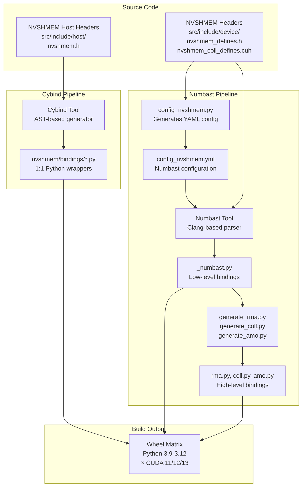
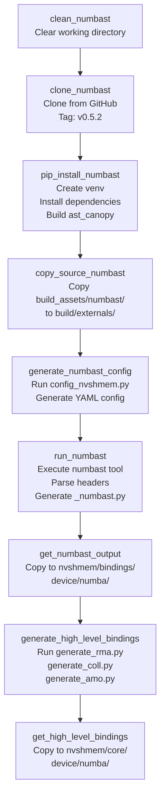
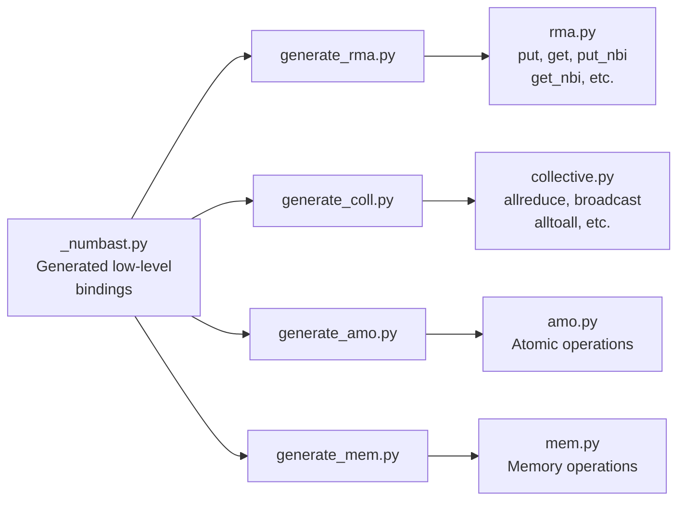
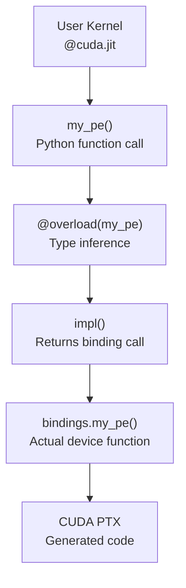
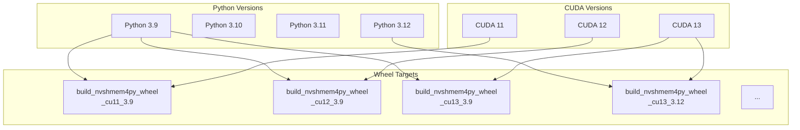

<!-- source: DeepWiki mcp.deepwiki.com · repo NVIDIA/nvshmem · page 8.4 Python Binding Development · fetched 2026-10-26 -->

# Python Binding Development

<details>
<summary>Relevant source files</summary>

The following files were used as context for generating this wiki page:

- [nvshmem4py/build_assets/numbast/config_nvshmem.py](nvshmem4py/build_assets/numbast/config_nvshmem.py)
- [nvshmem4py/build_assets/numbast/numbast_entry_point.h](nvshmem4py/build_assets/numbast/numbast_entry_point.h)
- [nvshmem4py/build_assets/numbast/templates/config_nvshmem.yml.j2](nvshmem4py/build_assets/numbast/templates/config_nvshmem.yml.j2)
- [nvshmem4py/cmake/addNumbast.cmake](nvshmem4py/cmake/addNumbast.cmake)
- [nvshmem4py/examples/device_custom_kernel.py](nvshmem4py/examples/device_custom_kernel.py)
- [nvshmem4py/examples/torch_triton_interop.py](nvshmem4py/examples/torch_triton_interop.py)
- [nvshmem4py/nvshmem/core/collective.py](nvshmem4py/nvshmem/core/collective.py)
- [nvshmem4py/nvshmem/core/device/numba/__init__.py](nvshmem4py/nvshmem/core/device/numba/__init__.py)
- [nvshmem4py/nvshmem/core/device/numba/direct.py](nvshmem4py/nvshmem/core/device/numba/direct.py)
- [nvshmem4py/nvshmem/core/nvshmem_types.py](nvshmem4py/nvshmem/core/nvshmem_types.py)
- [nvshmem4py/nvshmem/core/rma.py](nvshmem4py/nvshmem/core/rma.py)

</details>


This page provides a guide for developers extending nvshmem4py, covering the binding generation workflow, configuration management, and wheel building process. For information about using the Python bindings, see [Python API Reference](#4). For general contribution guidelines, see [Contributing Guidelines](#8.5).

## Overview

nvshmem4py uses two separate binding generation tools to expose NVSHMEM functionality to Python:

- **Cybind**: Generates 1:1 host-side bindings from the NVSHMEM C API using Cython
- **Numbast**: Generates device-side bindings for use with Numba CUDA kernels using Clang-based AST parsing

Both tools operate during the CMake build process and generate Python source files that are included in the distributed wheels. The binding generation is a one-time process during build; the generated files are checked into the repository (with `_numbast.py` tracked via Git LFS due to its size).

### Key Components

The Python bindings consist of three layers:

1. **Low-level bindings**: Direct 1:1 mappings generated by Cybind (host) and Numbast (device)
2. **High-level wrappers**: Pythonic APIs in `nvshmem.core` that handle framework interoperability, buffer management, and type conversions
3. **Type system**: Python classes implementing cuda.core protocols (`MemoryResource`, `Buffer`) and NVSHMEM concepts (`Teams`, `NvshmemKernelObject`)

### Binding Generation Architecture



**Sources**: [nvshmem4py/CMakeLists.txt:23-41](), [nvshmem4py/cmake/addNumbast.cmake:1-184]()

## Numbast Device Binding Generation

Numbast generates device-side bindings that enable NVSHMEM functions to be called from Numba-compiled CUDA kernels. The generation process involves multiple steps orchestrated by CMake targets.

### Generation Workflow

The Numbast binding generation follows a multi-stage pipeline defined in `AddNumbast` function:



**Sources**: [nvshmem4py/cmake/addNumbast.cmake:60-183]()

### Key Directories and Files

| Path | Purpose |
|------|---------|
| `build/externals/numbast/numbast/` | Cloned Numbast tool repository |
| `build/externals/numbast/build_assets/` | Configuration files and templates |
| `build/externals/numbast/out/` | Generated binding output |
| `nvshmem4py/build_assets/numbast/` | Source templates and generation scripts |
| `nvshmem4py/nvshmem/bindings/device/numba/_numbast.py` | Final low-level bindings |
| `nvshmem4py/nvshmem/core/device/numba/` | Final high-level bindings |

**Sources**: [nvshmem4py/cmake/addNumbast.cmake:28-57]()

### Configuration Generation

The `config_nvshmem.py` script generates the Numbast YAML configuration from a Jinja2 template:

#### Configuration Template Variables

The template [nvshmem4py/build_assets/numbast/templates/config_nvshmem.yml.j2:1-44]() uses these variables:

- `CONFIG_VERSION`: Version string (currently "0.1.0")
- `NVSHMEM_HOME`: Repository root path
- `ENTRY_POINT_PATH`: Path to `numbast_entry_point.h`
- `OUTPUT_NAME`: Output filename (`nvshmem_device_binding_generated.py`)
- `COOPERATIVE_LAUNCH_REQUIRED_FUNCTIONS`: Generated list of functions requiring cooperative launch

#### Cooperative Launch Function Detection

The [config_nvshmem.py:6-116]() script programmatically generates a list of NVSHMEM functions that require cooperative kernel launch. This includes:

- **Barrier operations**: `nvshmem_barrier`, `nvshmem_barrier_all`, `nvshmemx_barrier_block`, `nvshmemx_barrier_warp`
- **Sync operations**: `nvshmem_sync`, `nvshmem_sync_all`, `nvshmem_team_sync` and their block/warp variants
- **Collective operations**: `alltoall`, `broadcast`, `fcollect`, reduction operations (`sum`, `max`, `min`, `prod`, `and`, `or`, `xor`) across all data types
- **Wait/test operations**: `wait_until`, `test`, and their vector variants

The function generation iterates over data types and operation patterns:

```python
types = ['float', 'half', 'double', 'bfloat16', 'uint8', 'uint16', 'uint32', 
         'uint64', 'int8', 'short', 'int16', 'int32', 'int', 'int64', 'long', 
         'longlong', 'size', 'char', 'schar', 'uchar', 'ushort', 'uint', 
         'ulong', 'ulonglong', 'ptrdiff']

reduction_operators = ["and", "or", "xor", "max", "min", "sum", "prod"]
block_variants = ["block", "warp"]
```

**Sources**: [nvshmem4py/build_assets/numbast/config_nvshmem.py:1-163]()

### Numbast Execution

The Numbast tool is executed with specific environment configuration [nvshmem4py/cmake/addNumbast.cmake:40-42]():

```bash
env LD_LIBRARY_PATH=${ASTCANOPY_INSTALL_PREFIX}/lib \
    python3 -m numbast \
    --cfg-path build_assets/numbast/config_nvshmem.yml \
    --output-dir build/externals/numbast/out/
```

Key aspects:
- Uses a dedicated virtual environment at `build/externals/venv`
- Requires `libastcanopy.so` for AST parsing functionality
- Parses headers listed in the YAML config using Clang with `-sm_70` architecture
- Generates bindings with API prefix removal (`nvshmem_`, `nvshmemx_` → user-facing names)
- Includes module callbacks for `cumodule_init` and `cumodule_finalize`

**Sources**: [nvshmem4py/cmake/addNumbast.cmake:136-150](), [nvshmem4py/build_assets/numbast/templates/config_nvshmem.yml.j2:28-44]()

### High-Level Binding Generation

After Numbast generates the low-level `_numbast.py`, three additional scripts create higher-level Python wrappers:



These generators create user-friendly wrappers that:
- Provide type hints and docstrings
- Handle buffer type conversions
- Add default parameter values
- Organize functions by operation category

The generation process runs via CMake targets [nvshmem4py/cmake/addNumbast.cmake:166-177]():
- `generate_high_level_bindings`: Executes generator scripts
- `get_high_level_bindings`: Copies output to `nvshmem/core/device/numba/`

**Sources**: [nvshmem4py/cmake/addNumbast.cmake:162-179]()

### Numba Overload Mechanism

The high-level device bindings use Numba's `@overload` decorator to create type-safe, JIT-friendly wrappers. This allows Python-like syntax in device code while compiling to efficient CUDA:



The pattern in [nvshmem4py/nvshmem/core/device/numba/direct.py:27-32]() shows the structure:

```python
def my_pe(): pass

@overload(my_pe)
def my_pe_ol():
    def impl():
        return bindings.my_pe()
    return impl
```

When Numba encounters `my_pe()` in a CUDA kernel, it:
1. Calls `my_pe_ol()` during type inference
2. Receives the `impl()` function 
3. Compiles `impl()` into PTX using the `bindings.my_pe()` declaration from `_numbast.py`
4. Links against NVSHMEM device library at runtime

This pattern is repeated for all device functions with variations for:
- Functions with arguments (e.g., `team_my_pe(team)`)
- Functions requiring buffer pointer conversions (e.g., `signal_op`)
- Type-specific overloads (generated by the high-level binding scripts)

**Sources**: [nvshmem4py/nvshmem/core/device/numba/direct.py:27-83](), [nvshmem4py/cmake/addNumbast.cmake:162-179]()

### Entry Point Header

The [nvshmem4py/build_assets/numbast/numbast_entry_point.h:1-4]() serves dual purposes:

1. **Parse-time**: Numbast uses it as the entry point for parsing NVSHMEM declarations
2. **Runtime**: Numba includes it during JIT compilation of user kernels

```c
#define __NVSHMEM_NUMBA_SUPPORT__
#include <nvshmem.h>
#include <nvshmemx.h>
```

This header is copied to [nvshmem4py/nvshmem/bindings/device/numba/entry_point.h]() and made available to Numba via `CUDA_NVRTC_EXTRA_SEARCH_PATHS`.

**Sources**: [nvshmem4py/build_assets/numbast/numbast_entry_point.h:1-4](), [nvshmem4py/cmake/addNumbast.cmake:156-158](), [nvshmem4py/nvshmem/bindings/device/numba/__init__.py:30-35]()

## Cybind Host Binding Generation

Cybind generates 1:1 Python bindings for the host-side NVSHMEM C API. The process is similar to Numbast but targets host functions:

- Clones Cybind from GitHub (tag: "main")
- Generates bindings in `nvshmem/bindings/`
- Creates Cython `.pyx` files for efficient C API wrapping
- Produces Python modules for initialization, memory management, and collective operations

The Cybind target is conditionally included [nvshmem4py/CMakeLists.txt:23-30]() and only runs when the CMake file exists (removed after first generation to avoid regeneration).

**Sources**: [nvshmem4py/CMakeLists.txt:23-30]()

## Wheel Build Matrix

nvshmem4py produces a matrix of wheel packages for different Python and CUDA versions:

### Build Matrix Structure



**Sources**: [nvshmem4py/CMakeLists.txt:44-93]()

### Python Version Discovery

The build system discovers available Python versions using a shell script [nvshmem4py/CMakeLists.txt:46-54]():

```cmake
execute_process(
    COMMAND bash -c "${CMAKE_CURRENT_SOURCE_DIR}/scripts/find_python_versions.sh"
    OUTPUT_VARIABLE PYTHON_VERSION_LINES
    OUTPUT_STRIP_TRAILING_WHITESPACE
)
```

The script outputs lines in format `3.10|/usr/bin/python3.10`, which are parsed to create wheel targets for each Python/CUDA combination.

### Wheel Dependencies

Each wheel target depends on:
- `build_bindings_cybind` (if present)
- `build_bindings_numbast` (if `NVSHMEM_BUILD_PYTHON_DEVICE_LIB` is enabled)
- Previous wheel target (serialized builds to manage resources)

**Sources**: [nvshmem4py/CMakeLists.txt:72-86]()

### pyproject.toml Generation

The [nvshmem4py/scripts/generate_pyproject_toml.py:1-106]() script generates CUDA-version-specific `pyproject.toml` files:

- Reads dependencies from `requirements_cuda{11|12|13}.txt`
- Injects them into the template
- Configures setuptools_scm versioning (fallback: "0.1.2")
- Includes package data for bindings, headers, and generated files

Key package data includes:
```python
"nvshmem.bindings.device.numba" = ["*.py", "entry_point.h"]
```

This ensures the entry point header is included in wheels for runtime Numba compilation.

**Sources**: [nvshmem4py/scripts/generate_pyproject_toml.py:42-48](), [nvshmem4py/scripts/generate_pyproject_toml.py:77-97]()

## Adding New APIs

To add a new NVSHMEM API to the Python bindings:

### For Device APIs (via Numbast)

1. **Add the API to NVSHMEM headers**: Ensure the new function is declared in one of the headers listed in [config_nvshmem.yml.j2:5-9]():
   - `src/include/device/nvshmem_coll_defines.cuh`
   - `src/include/device/nvshmem_defines.h`
   - `src/include/device/nvshmemx_coll_defines.cuh`
   - `src/include/device/nvshmemx_defines.h`

2. **Update cooperative launch list** (if applicable): If the function requires cooperative kernel launch, modify [config_nvshmem.py:6-116]() to include it in the generated list.

3. **Regenerate bindings**: Run the `build_bindings_numbast` CMake target:
   ```bash
   cmake --build build --target build_bindings_numbast
   ```

4. **Create high-level wrappers** (optional): Modify `generate_rma.py`, `generate_coll.py`, or `generate_amo.py` to create user-friendly wrappers.

5. **Update imports**: Add new functions to `__all__` in [nvshmem4py/nvshmem/core/device/numba/__init__.py:16-21]().

### For Host APIs (via Cybind)

1. **Add the API to NVSHMEM host headers**: Ensure the function is in `src/include/host/nvshmem.h`

2. **Regenerate Cybind bindings**: Delete the Cybind CMake file to force regeneration:
   ```bash
   rm nvshmem4py/cmake/addCybind.cmake
   cmake --build build
   ```

3. **Expose in Python modules**: Import the generated binding in appropriate Python module (e.g., `nvshmem/core/__init__.py`)

**Sources**: [nvshmem4py/build_assets/numbast/templates/config_nvshmem.yml.j2:4-9](), [nvshmem4py/cmake/addNumbast.cmake:162-179]()

## Development Workflow

### Building Bindings Only

To regenerate bindings without building wheels:

```bash
# Regenerate Numbast bindings
cmake --build build --target build_bindings_numbast

# Regenerate both (requires addCybind.cmake to exist)
cmake --build build --target build_bindings_cybind
cmake --build build --target build_bindings_numbast
```

### Building Specific Wheel

```bash
# Build wheel for Python 3.10 with CUDA 12
cmake --build build --target build_nvshmem4py_wheel_cu12_3.10
```

### Full Build

```bash
# Build all wheels (requires bindings to be generated first)
cmake --build build --target build_nvshmem4py_wheels
```

### Build Dependencies

The build requires these Python packages [nvshmem4py/requirements_build.txt:1-21]():

| Package | Purpose |
|---------|---------|
| `networkx`, `pycparser` | AST parsing for Cybind |
| `Cython>=0.29.24` | Building Cython extensions |
| `setuptools==68`, `setuptools_scm` | Wheel building and versioning |
| `wheel`, `auditwheel`, `patchelf` | Wheel creation and repair |
| `pybind11`, `scikit-build-core` | Building ast_canopy C++ library |
| `pyyaml`, `click` | Numbast configuration |
| `numba-cuda[cu12]==0.20.0` | Runtime testing and validation |

**Sources**: [nvshmem4py/requirements_build.txt:1-21]()

### Git LFS Tracking

The generated `_numbast.py` file is large and tracked with Git LFS [.gitattributes:1-2]():

```
nvshmem4py/nvshmem/bindings/device/numba/_numbast.py filter=lfs diff=lfs merge=lfs -text
```

This prevents the large generated file from bloating the repository history.

**Sources**: [.gitattributes:1-2]()

## Testing Device Bindings

The [nvshmem4py/examples/device_custom_kernel.py:1-98]() demonstrates using generated device bindings in a custom Numba kernel:

```python
from numba import cuda
from nvshmem.bindings.device.numba import my_pe, n_pes, put_signal_nbi, signal_wait_until
from nvshmem.core import SignalOp, ComparisonType

@cuda.jit(lto=True)
def ring_reduce(dst, src, nreduce, signal, chunk_size):
    mype = my_pe()
    npes = n_pes()
    peer = (mype + 1) % npes
    
    # Use NVSHMEM device functions
    signal_wait_until(signal_block, CMP_GE, chunk + 1)
    put_signal_nbi(dst_block, src_data, chunk_elems, 
                   signal_block, 1, SIGNAL_ADD, peer)
```

This validates that:
- Device functions are correctly exposed via `_numbast.py`
- The entry point header is accessible to Numba's NVRTC compiler
- Module callbacks (`cumodule_init`/`cumodule_finalize`) execute properly

**Sources**: [nvshmem4py/examples/device_custom_kernel.py:1-98]()

---

